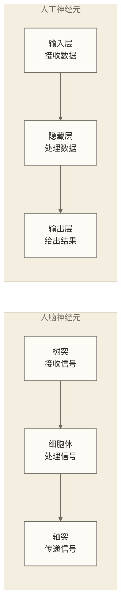
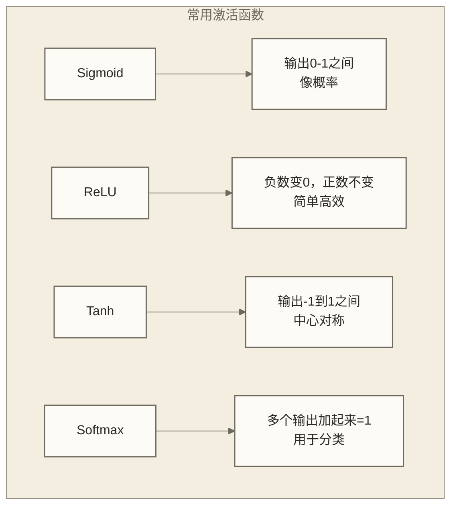
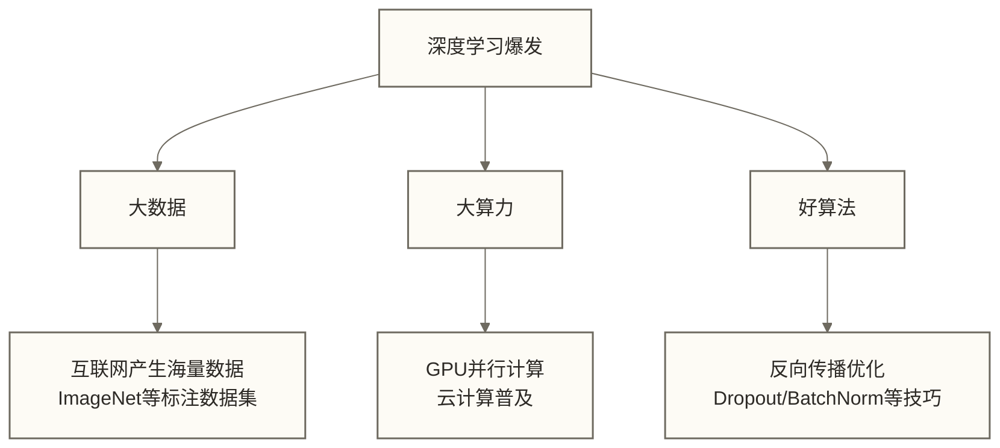
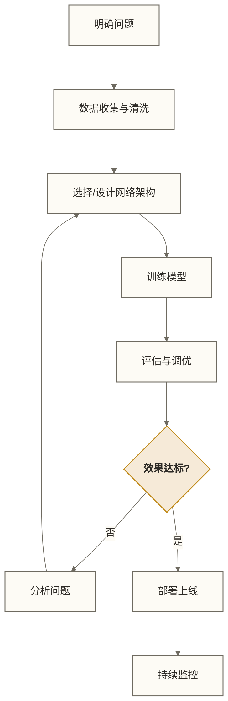
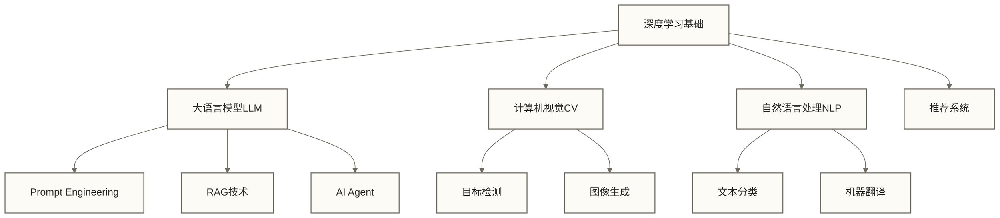

# 深度学习基础与神经网络

> [!quote] 核心理念
> 深度学习就像教一个小孩认识世界——不是告诉他"苹果是红色的圆形水果"，而是给他看成千上万张苹果的照片，让他自己总结出"苹果长什么样"。

## 为什么要学深度学习？

在 [[【AI 与大数据】/01-基础原理/02-机器学习基础概念|机器学习基础]] 中，我们学习了让机器从数据中学习的基本方法。但传统机器学习有一个"天花板"——**特征工程**太依赖人的经验。

> [!example] 生活化比喻：识别猫的两种方式
>
> **传统机器学习（像先整理观察指标）**：
> - 人类专家总结：猫有尖耳朵、胡须、毛茸茸...
> - 把这些特征转换为模型的输入
> - 机器从训练数据中学习分类规律，而不是只按人工规则匹配
> - 问题：人工特征若不充分，识别折耳猫、无毛猫等情况可能受影响
>
> **深度学习（像带孩子认世界）**：
> - 给机器看100万张猫的照片
> - 机器自己琢磨"猫的本质特征是什么"
> - 最终能识别各种奇奇怪怪的猫
> - 甚至能认出卡通猫！

---

## 一、神经网络：模拟大脑的计算系统

### 1.1 什么是神经网络？

神经网络的灵感来源于人类大脑。我们的大脑有约860亿个神经元，通过突触相互连接，共同完成思考、记忆、决策等任务。



> [!tip] 一句话理解
> 神经网络 = 很多个简单的"小计算器"连接在一起，每个小计算器做一点点工作，合起来就能完成复杂任务。

### 1.2 神经元的工作原理

每个人工神经元做三件事：

| 步骤 | 动作 | 生活类比 |
|-----|------|---------|
| 1. 接收 | 收集所有输入信号 | 听取所有人的意见 |
| 2. 加权求和 | 给不同输入不同的重要性 | 有的人意见更重要 |
| 3. 激活判断 | 决定是否"激活"输出 | 综合判断后做决定 |

> [!example] 买房决策神经元
>
> **输入信号**：
> - 价格（权重：0.3）→ 150万，评分7分
> - 位置（权重：0.4）→ 地铁旁，评分9分
> - 面积（权重：0.2）→ 90平，评分6分
> - 朝向（权重：0.1）→ 朝北，评分4分
>
> **加权计算**：7×0.3 + 9×0.4 + 6×0.2 + 4×0.1 = 7.3分
>
> **激活判断**：7.3 > 7（阈值）→ 输出"买！"

### 1.3 激活函数：让神经网络"活"起来

如果神经元只做线性计算（加权求和），那叠加再多层也只是一条直线。**激活函数**让网络能够学习复杂的非线性关系。



> [!info] 为什么ReLU最流行？
> 就像一个"门卫"——负能量（负数）一律不让进，正能量直接放行。计算简单、效果好、训练快。

---

## 二、深度学习的"深度"从何而来？

### 2.1 从浅层到深层

"深度"指的是神经网络的**层数**。

| 网络类型 | 层数 | 能力 | 类比 |
|---------|-----|------|-----|
| 单层感知机 | 1层 | 只能解决线性问题 | 小学生 |
| 浅层网络 | 2-3层 | 简单的非线性问题 | 中学生 |
| 深度网络 | 几十层 | 复杂模式识别 | 大学生 |
| 超深网络 | 上百层 | 图像/语音/语言 | 博士 |

> [!example] 识别"猫"的层层抽象
>
> ```text
> 第1层：识别边缘、线条
>    ↓
> 第2层：识别简单形状（圆、三角）
>    ↓
> 第3层：识别局部特征（眼睛、耳朵）
>    ↓
> 第4层：识别组合特征（猫脸）
>    ↓
> 第5层：识别整体概念（这是一只猫！）
> ```

### 2.2 深度学习的三大支柱

深度学习能在2012年后爆发，靠的是三大支柱的同时成熟：



---

## 三、主流神经网络架构速览

### 3.1 全连接网络（MLP）：基础中的基础

每一层的每个神经元都与下一层的所有神经元相连。

**适用场景**：结构化数据（表格数据）的分类和回归

**优点**：简单直观
**缺点**：参数太多，处理图像/文本效率低

> [!note] 与传统ML的关系
> 全连接网络可以看作是 [[【AI 与大数据】/01-基础原理/02-机器学习基础概念|逻辑回归]] 的"加强版"——叠加多层，增加非线性。

### 3.2 卷积神经网络（CNN）：图像处理之王

> [!tip] 核心思想
> 像人眼一样，先看局部，再看整体。不需要每个像素都和所有神经元连接。

**核心概念**：

| 概念 | 作用 | 生活类比 |
|-----|------|---------|
| 卷积核 | 提取局部特征 | 放大镜扫描图片 |
| 池化层 | 降低分辨率，保留关键信息 | 缩略图 |
| 特征图 | 不同卷积核提取的特征 | 从不同角度看同一张照片 |

```mermaid
%%{init: {"theme":"base","themeVariables":{"fontFamily":"PingFang SC, -apple-system, Source Han Serif SC, serif","fontSize":"16px","background":"#FDFBF5","primaryColor":"#FDFBF5","primaryTextColor":"#2D2A26","primaryBorderColor":"#6E6A60","secondaryColor":"#E8EFE8","secondaryBorderColor":"#8FA890","secondaryTextColor":"#2D2A26","tertiaryColor":"#FDFBF5","tertiaryBorderColor":"#9A9488","tertiaryTextColor":"#6E6A60","lineColor":"#6E6A60","textColor":"#2D2A26","mainBkg":"#FDFBF5","nodeBorder":"#2D5A3D","clusterBkg":"#F3EEDF","clusterBorder":"#9A9488","edgeLabelBackground":"#FDFBF5"},"flowchart":{"htmlLabels":true,"curve":"basis","padding":20,"nodeSpacing":60,"rankSpacing":70,"useMaxWidth":false},"themeCSS":".node rect, .node polygon, .node circle { stroke-width: 1.5px; } .edgePath .path { stroke-width: 1.5px; } .cluster-label .nodeLabel, .cluster-label foreignObject { color: #2D2A26 !important; } .edgeLabel, .edgeLabel foreignObject { color: #2D2A26 !important; background-color: #FDFBF5; } .edgeLabel rect { fill: #FDFBF5; }"}}%%
graph LR
    classDef default fill:#FDFBF5,stroke:#6E6A60,color:#2D2A26,stroke-width:1.5px
    classDef startend fill:#2D2A26,stroke:#2D2A26,color:#FDFBF5,font-weight:bold
    classDef decision fill:#F6EAD8,stroke:#C08A1A,color:#2D2A26,font-weight:bold
    classDef hub fill:#3B5A80,stroke:#3B5A80,color:#FDFBF5,font-weight:bold
    classDef io fill:#E5EAF0,stroke:#3B5A80,color:#2D2A26
    classDef accent fill:#A6432C,stroke:#A6432C,color:#FDFBF5,font-weight:bold
    classDef storage fill:#F3EEDF,stroke:#9A9488,color:#2D2A26
    A[原始图片] --> B[卷积层<br/>提取边缘]
    B --> C[池化层<br/>压缩信息]
    C --> D[卷积层<br/>提取形状]
    D --> E[池化层<br/>再压缩]
    E --> F[全连接层<br/>综合判断]
    F --> G[输出：猫/狗]
    class A,B,C,D,E,F,G default
```



**经典模型演进**：
- **LeNet（1998）**：开山鼻祖，识别手写数字
- **AlexNet（2012）**：深度学习元年，ImageNet冠军
- **VGG（2014）**：更深更简洁
- **ResNet（2015）**：残差连接，可以训练上千层
- **EfficientNet（2019）**：效率与精度的平衡

**应用领域**：
- 图像分类（这是什么？）
- 目标检测（在哪里？）→ 详见 [[【AI 与大数据】/01-基础原理/05-计算机视觉基础|计算机视觉]]
- 图像分割（精确边界在哪？）
- 人脸识别、医学影像分析

### 3.3 循环神经网络（RNN）：处理序列数据

> [!tip] 核心思想
> 有"记忆"的网络——处理当前输入时，会参考之前的信息。

**为什么需要RNN？**

普通神经网络把每个输入当作独立的个体，但很多数据是有顺序的：
- 文本："我 喜欢 吃 苹果" → 顺序很重要
- 语音：声波是连续的时间序列
- 股票：今天的价格和昨天有关

> [!example] 理解"它"指代什么
>
> - "小明养了一只**猫**，**它**很可爱" → 它 = 猫
> - "小明买了一个**手机**，**它**很贵" → 它 = 手机
>
> RNN会"记住"前面的内容，才能理解"它"指的是什么。

**RNN的问题与解决**：

| 问题 | 原因 | 解决方案 |
|-----|------|---------|
| 短期记忆 | 信息传递会逐渐衰减 | LSTM（长短期记忆） |
| 梯度消失 | 反向传播时梯度越来越小 | GRU（门控循环单元） |
| 无法并行 | 必须顺序处理 | Transformer（注意力机制） |

### 3.4 Transformer：当今AI的基石

> [!important] 重要性
> Transformer是 [[【AI 与大数据】/02-大模型核心/01-大语言模型全景解析|GPT、Claude、文心一言]] 等大模型的核心架构，理解它是理解现代AI的关键。

**核心创新：自注意力机制（Self-Attention）**

> [!example] 注意力机制的生活比喻
>
> 想象你在嘈杂的聚会上和朋友聊天：
> - **传统方式（RNN）**：必须按顺序听完所有人说话，才能理解对话
> - **注意力机制**：你的大脑自动"聚焦"在朋友的声音上，忽略其他噪音
>
> Transformer让AI学会"注意力分配"——在处理一个词时，自动判断应该关注哪些其他词。

**Transformer为什么这么强？**

| 优势 | 说明 |
|-----|------|
| 并行计算 | 训练时可并行处理序列位置；自回归生成通常仍需逐步进行 |
| 长距离依赖 | 注意力可在上下文范围内直接建立远距离位置之间的联系 |
| 可扩展性 | 在数据质量、算力和训练配置适当时，扩大模型与数据规模通常有助于提升效果 |

```mermaid
%%{init: {"theme":"base","themeVariables":{"fontFamily":"PingFang SC, -apple-system, Source Han Serif SC, serif","fontSize":"16px","background":"#FDFBF5","primaryColor":"#FDFBF5","primaryTextColor":"#2D2A26","primaryBorderColor":"#6E6A60","secondaryColor":"#E8EFE8","secondaryBorderColor":"#8FA890","secondaryTextColor":"#2D2A26","tertiaryColor":"#FDFBF5","tertiaryBorderColor":"#9A9488","tertiaryTextColor":"#6E6A60","lineColor":"#6E6A60","textColor":"#2D2A26","mainBkg":"#FDFBF5","nodeBorder":"#2D5A3D","clusterBkg":"#F3EEDF","clusterBorder":"#9A9488","edgeLabelBackground":"#FDFBF5"},"flowchart":{"htmlLabels":true,"curve":"basis","padding":20,"nodeSpacing":60,"rankSpacing":70,"useMaxWidth":false},"themeCSS":".node rect, .node polygon, .node circle { stroke-width: 1.5px; } .edgePath .path { stroke-width: 1.5px; } .cluster-label .nodeLabel, .cluster-label foreignObject { color: #2D2A26 !important; } .edgeLabel, .edgeLabel foreignObject { color: #2D2A26 !important; background-color: #FDFBF5; } .edgeLabel rect { fill: #FDFBF5; }"}}%%
graph TB
    classDef default fill:#FDFBF5,stroke:#6E6A60,color:#2D2A26,stroke-width:1.5px
    classDef startend fill:#2D2A26,stroke:#2D2A26,color:#FDFBF5,font-weight:bold
    classDef decision fill:#F6EAD8,stroke:#C08A1A,color:#2D2A26,font-weight:bold
    classDef hub fill:#3B5A80,stroke:#3B5A80,color:#FDFBF5,font-weight:bold
    classDef io fill:#E5EAF0,stroke:#3B5A80,color:#2D2A26
    classDef accent fill:#A6432C,stroke:#A6432C,color:#FDFBF5,font-weight:bold
    classDef storage fill:#F3EEDF,stroke:#9A9488,color:#2D2A26
    subgraph "Transformer架构"
        A[输入序列] --> B[词嵌入+位置编码]
        B --> C[多头自注意力]
        C --> D[前馈神经网络]
        D --> E[重复N层]
        E --> F[输出]
    end
    class A,B,C,D,E,F default
```



**基于Transformer的模型家族**：

| 模型类型 | 代表 | 特点 | 应用 |
|---------|-----|------|-----|
| Encoder-only | BERT | 双向理解 | 文本分类、问答 |
| Decoder-only | GPT系列 | 自回归生成 | 文本生成、对话 |
| Encoder-Decoder | T5, BART | 序列到序列 | 翻译、摘要 |

---

## 四、深度学习的训练过程

### 4.1 训练的本质：调整参数

> [!tip] 一句话理解
> 训练神经网络 = 不断调整几百万甚至几十亿个参数，让网络的预测越来越准。

```mermaid
%%{init: {"theme":"base","themeVariables":{"fontFamily":"PingFang SC, -apple-system, Source Han Serif SC, serif","fontSize":"16px","background":"#FDFBF5","primaryColor":"#FDFBF5","primaryTextColor":"#2D2A26","primaryBorderColor":"#6E6A60","secondaryColor":"#E8EFE8","secondaryBorderColor":"#8FA890","secondaryTextColor":"#2D2A26","tertiaryColor":"#FDFBF5","tertiaryBorderColor":"#9A9488","tertiaryTextColor":"#6E6A60","lineColor":"#6E6A60","textColor":"#2D2A26","mainBkg":"#FDFBF5","nodeBorder":"#2D5A3D","clusterBkg":"#F3EEDF","clusterBorder":"#9A9488","edgeLabelBackground":"#FDFBF5"},"flowchart":{"htmlLabels":true,"curve":"basis","padding":20,"nodeSpacing":60,"rankSpacing":70,"useMaxWidth":false},"themeCSS":".node rect, .node polygon, .node circle { stroke-width: 1.5px; } .edgePath .path { stroke-width: 1.5px; } .cluster-label .nodeLabel, .cluster-label foreignObject { color: #2D2A26 !important; } .edgeLabel, .edgeLabel foreignObject { color: #2D2A26 !important; background-color: #FDFBF5; } .edgeLabel rect { fill: #FDFBF5; }"}}%%
graph LR
    classDef default fill:#FDFBF5,stroke:#6E6A60,color:#2D2A26,stroke-width:1.5px
    classDef startend fill:#2D2A26,stroke:#2D2A26,color:#FDFBF5,font-weight:bold
    classDef decision fill:#F6EAD8,stroke:#C08A1A,color:#2D2A26,font-weight:bold
    classDef hub fill:#3B5A80,stroke:#3B5A80,color:#FDFBF5,font-weight:bold
    classDef io fill:#E5EAF0,stroke:#3B5A80,color:#2D2A26
    classDef accent fill:#A6432C,stroke:#A6432C,color:#FDFBF5,font-weight:bold
    classDef storage fill:#F3EEDF,stroke:#9A9488,color:#2D2A26
    A[输入数据] --> B[神经网络<br/>当前参数]
    B --> C[预测结果]
    C --> D{与正确答案<br/>对比}
    D --> E[计算损失]
    E --> F[反向传播<br/>计算梯度]
    F --> G[更新参数]
    G --> B
    class D decision
    class A,B,C,E,F,G default
```



### 4.2 关键概念速查

| 概念 | 含义 | 类比 |
|-----|------|-----|
| **损失函数** | 衡量预测与真实的差距 | 考试分数（越低越好） |
| **梯度** | 参数调整的方向和幅度 | 下山时的坡度 |
| **学习率** | 每次参数调整的步长 | 下山时的步子大小 |
| **反向传播** | 从输出层往回计算梯度 | 从结果倒推原因 |
| **优化器** | 具体的参数更新策略 | 下山的具体走法 |

> [!example] 下山比喻
>
> 想象你蒙着眼在山上，想走到最低点（最小损失）：
> - **负梯度**告诉你：当前位置局部下降最快的方向
> - **学习率**决定：每步走多远
> - **优化器**（如Adam）：聪明地调整步伐，避免走弯路

### 4.3 常见训练问题与对策

| 问题 | 症状 | 解决方案 |
|-----|------|---------|
| **过拟合** | 训练集很好，测试集很差 | Dropout、数据增强、正则化 |
| **欠拟合** | 训练集和测试集都不好 | 增加模型复杂度、更多特征 |
| **梯度消失** | 深层网络学不动 | ResNet残差连接、BatchNorm |
| **训练不稳定** | 损失剧烈波动 | 降低学习率、梯度裁剪 |

---

## 五、深度学习 vs 传统机器学习

| 维度 | 传统机器学习 | 深度学习 |
|-----|-------------|---------|
| **特征工程** | 人工设计特征 | 自动学习特征 |
| **数据需求** | 小数据也能work | 需要大量数据 |
| **计算资源** | CPU就够 | 需要GPU/TPU |
| **可解释性** | 较强 | 较弱（黑盒） |
| **适用场景** | 结构化数据 | 图像/语音/文本 |
| **模型复杂度** | 相对简单 | 可能有数十亿参数 |

> [!warning] 选择建议
> - 数据量小（<1万条）、需要解释性 → 优先传统ML
> - 图像/语音/文本任务、数据量大 → 优先深度学习
> - 实际项目中，两者常常结合使用

---

## 六、深度学习实践要点

### 6.1 开发流程概览



### 6.2 常用框架选择

| 框架 | 特点 | 适合人群 |
|-----|------|---------|
| **PyTorch** | 灵活、动态图、学术界主流 | 研究人员、想深入理解原理 |
| **TensorFlow** | 支持即时执行与图执行、生态完善 | 工程部署、企业应用 |
| **Keras** | 简单易用、高层API | 快速原型、初学者 |
| **HuggingFace** | 预训练模型库、NLP首选 | 使用现成模型 |

### 6.3 学习建议

> [!tip] 给初学者的建议
>
> 1. **先跑通，再理解**：用现成代码跑通一个例子，再逐行理解
> 2. **从小模型开始**：先在MNIST手写数字上练手
> 3. **站在巨人肩膀上**：善用预训练模型，不必从头训练
> 4. **重视数据质量**：数据决定上限，模型只是逼近上限
> 5. **实践出真知**：多做项目，Kaggle是很好的练习场

---

## 七、与其他主题的联系



**推荐学习路径**：
1. 本文（深度学习基础）
2. → [[【AI 与大数据】/01-基础原理/04-自然语言处理基础|NLP基础]] 或 [[【AI 与大数据】/01-基础原理/05-计算机视觉基础|CV基础]]
3. → [[【AI 与大数据】/02-大模型核心/01-大语言模型全景解析|大语言模型]]
4. → [[【AI 与大数据】/02-大模型核心/03-Prompt-Engineering提示工程|Prompt Engineering]]
5. → [[【AI 与大数据】/03-AI-Agent/01-AI-Agent智能体概述|AI Agent]]

---

## 八、本章小结

> [!abstract] 核心要点回顾
>
> 1. **神经网络**模拟人脑，由大量简单神经元组成
> 2. **深度**来自多层网络，层层抽象，提取高级特征
> 3. **CNN**擅长图像，**RNN**擅长序列，**Transformer**是当前主流
> 4. **训练**就是通过反向传播不断调整参数
> 5. 深度学习需要**大数据 + 大算力 + 好算法**

> [!quote] 金句
> "深度学习不是魔法，它只是在海量数据中找到隐藏的模式。数据是燃料，算力是引擎，算法是方向盘。"

---

## 延伸阅读

- [[【AI 与大数据】/01-基础原理/02-机器学习基础概念|机器学习基础]] - 理解ML与DL的关系
- [[【AI 与大数据】/02-大模型核心/01-大语言模型全景解析|大语言模型]] - 深度学习最热门的应用方向
- [[【AI 与大数据】/07-传统ML与大数据/01-Spark MLlib实战指南|Spark MLlib]] - 分布式机器学习
- [[【AI 与大数据】/04-AI工程化/00-MLOps最佳实践|MLOps]] - 模型的工程化部署
