# 电商平台系统 - 数字商业的前端门户

> [!abstract] 📋 系统概览：电商平台系统的核心价值
> 
> 🔍 **电商平台系统定义**
> 电商平台系统是企业面向消费者的数字化销售前端，通过网站、移动APP、小程序等多种形态，为用户提供商品浏览、购买决策、交易支付、售后服务等全流程的在线购物体验。
> 
> 🛍️ **在零售电商业的核心价值**：
> - 🎨 **用户体验优化**：直观易用的界面设计和流畅的购物流程
> - 🛒 **商品展示管理**：丰富的商品展示形式和个性化推荐
> - 💳 **交易处理能力**：安全便捷的支付流程和订单管理
> - 📱 **多端统一体验**：PC、移动、小程序等多端一致性体验
> - 🎯 **营销工具集成**：促销活动、会员权益、社交分享等营销功能
> - 📊 **数据收集分析**：用户行为数据收集和商业洞察分析
> 
> ⏱️ **学习安排**：32分钟全面了解电商平台系统的功能架构和应用特点

## 🏬 电商平台系统的核心功能模块

### 🛍️ 商品展示与管理

```mermaid
%%{init: {"theme":"base","themeVariables":{"fontFamily":"PingFang SC, -apple-system, Source Han Serif SC, serif","fontSize":"16px","background":"#FDFBF5","primaryColor":"#FDFBF5","primaryTextColor":"#2D2A26","primaryBorderColor":"#6E6A60","secondaryColor":"#E8EFE8","secondaryBorderColor":"#8FA890","secondaryTextColor":"#2D2A26","tertiaryColor":"#FDFBF5","tertiaryBorderColor":"#9A9488","tertiaryTextColor":"#6E6A60","lineColor":"#6E6A60","textColor":"#2D2A26","mainBkg":"#FDFBF5","nodeBorder":"#2D5A3D","clusterBkg":"#F3EEDF","clusterBorder":"#9A9488","edgeLabelBackground":"#FDFBF5"},"flowchart":{"htmlLabels":true,"curve":"basis","padding":20,"nodeSpacing":60,"rankSpacing":70,"useMaxWidth":false},"themeCSS":".node rect, .node polygon, .node circle { stroke-width: 1.5px; } .edgePath .path { stroke-width: 1.5px; } .cluster-label .nodeLabel, .cluster-label foreignObject { color: #2D2A26 !important; } .edgeLabel, .edgeLabel foreignObject { color: #2D2A26 !important; background-color: #FDFBF5; } .edgeLabel rect { fill: #FDFBF5; }"}}%%
flowchart TB
    classDef default fill:#FDFBF5,stroke:#6E6A60,color:#2D2A26,stroke-width:1.5px
    classDef startend fill:#2D2A26,stroke:#2D2A26,color:#FDFBF5,font-weight:bold
    classDef decision fill:#F6EAD8,stroke:#C08A1A,color:#2D2A26,font-weight:bold
    classDef hub fill:#3B5A80,stroke:#3B5A80,color:#FDFBF5,font-weight:bold
    classDef io fill:#E5EAF0,stroke:#3B5A80,color:#2D2A26
    classDef accent fill:#A6432C,stroke:#A6432C,color:#FDFBF5,font-weight:bold
    classDef storage fill:#F3EEDF,stroke:#9A9488,color:#2D2A26
    subgraph "商品分类"
        A1[类目导航] --> A2[品牌筛选]
        A2 --> A3[属性筛选]
        A3 --> A4[价格区间]
    end
    subgraph "商品详情"
        B1[商品图片] --> B2[详细描述]
        B2 --> B3[规格选择]
        B3 --> B4[用户评价]
    end
    subgraph "推荐系统"
        C1[个性化推荐] --> C2[关联商品]
        C2 --> C3[热销推荐]
        C3 --> C4[浏览历史]
    end
    class A1,A2,A3,A4,B1,B2,B3,B4,C1,C2,C3,C4 default
```

**商品展示功能**：
- **商品分类导航**：多级分类体系、面包屑导航、快速筛选条件、搜索结果排序
- **商品详情页面**：高清图片展示、360度展示、视频介绍、详细规格参数
- **商品规格管理**：多规格选择、库存状态显示、价格联动、规格图片切换
- **用户评价系统**：评价展示、评分统计、图片评价、评价筛选和排序

**智能推荐引擎**：
- **个性化推荐**：基于用户行为的商品推荐、千人千面的首页展示
- **关联推荐**：相关商品推荐、搭配推荐、经常一起购买的商品
- **实时推荐**：基于当前浏览的实时推荐、热门搜索推荐
- **场景化推荐**：节假日推荐、季节性推荐、地域性推荐

### 🛒 购物车与交易流程

```mermaid
%%{init: {"theme":"base","themeVariables":{"fontFamily":"PingFang SC, -apple-system, Source Han Serif SC, serif","fontSize":"16px","background":"#FDFBF5","primaryColor":"#FDFBF5","primaryTextColor":"#2D2A26","primaryBorderColor":"#6E6A60","secondaryColor":"#E8EFE8","secondaryBorderColor":"#8FA890","secondaryTextColor":"#2D2A26","tertiaryColor":"#FDFBF5","tertiaryBorderColor":"#9A9488","tertiaryTextColor":"#6E6A60","lineColor":"#6E6A60","textColor":"#2D2A26","mainBkg":"#FDFBF5","nodeBorder":"#2D5A3D","clusterBkg":"#F3EEDF","clusterBorder":"#9A9488","edgeLabelBackground":"#FDFBF5"},"flowchart":{"htmlLabels":true,"curve":"basis","padding":20,"nodeSpacing":60,"rankSpacing":70,"useMaxWidth":false},"themeCSS":".node rect, .node polygon, .node circle { stroke-width: 1.5px; } .edgePath .path { stroke-width: 1.5px; } .cluster-label .nodeLabel, .cluster-label foreignObject { color: #2D2A26 !important; } .edgeLabel, .edgeLabel foreignObject { color: #2D2A26 !important; background-color: #FDFBF5; } .edgeLabel rect { fill: #FDFBF5; }"}}%%
flowchart TB
    classDef default fill:#FDFBF5,stroke:#6E6A60,color:#2D2A26,stroke-width:1.5px
    classDef startend fill:#2D2A26,stroke:#2D2A26,color:#FDFBF5,font-weight:bold
    classDef decision fill:#F6EAD8,stroke:#C08A1A,color:#2D2A26,font-weight:bold
    classDef hub fill:#3B5A80,stroke:#3B5A80,color:#FDFBF5,font-weight:bold
    classDef io fill:#E5EAF0,stroke:#3B5A80,color:#2D2A26
    classDef accent fill:#A6432C,stroke:#A6432C,color:#FDFBF5,font-weight:bold
    classDef storage fill:#F3EEDF,stroke:#9A9488,color:#2D2A26
    subgraph "购物车管理"
        D1[加入购物车] --> D2[商品编辑]
        D2 --> D3[批量操作]
        D3 --> D4[收藏管理]
    end
    subgraph "订单结算"
        E1[地址选择] --> E2[配送方式]
        E2 --> E3[优惠计算]
        E3 --> E4[订单确认]
    end
    subgraph "支付流程"
        F1[支付方式] --> F2[支付安全]
        F2 --> F3[支付确认]
        F3 --> F4[支付成功]
    end
    class D1,D2,D3,D4,E1,E2,E3,E4,F1,F2,F3,F4 default
```

**购物车功能**：
- **购物车管理**：商品添加删除、数量修改、规格更换、批量选择操作
- **购物车同步**：多设备购物车同步、登录状态购物车合并、临时购物车保存
- **智能提醒**：购物车商品降价提醒、库存不足提醒、优惠活动提醒
- **快速结算**：一键购买、立即结算、批量结算、预约购买

**交易流程优化**：
- **地址管理**：收货地址管理、默认地址设置、地址智能填充、GPS定位
- **配送选择**：配送方式选择、配送时间预约、配送费用计算、特殊配送需求
- **优惠计算**：优惠券使用、满减活动、积分抵扣、会员折扣计算
- **订单确认**：订单信息确认、发票信息、备注说明、协议确认

### 👤 用户中心与会员体系

**用户账户管理**：
- **注册登录**：多种注册方式、第三方登录、手机验证、密码安全管理
- **个人信息**：基本信息管理、头像设置、偏好设置、隐私设置
- **账户安全**：密码修改、手机绑定、邮箱验证、登录记录查看
- **消息中心**：系统通知、订单消息、促销信息、客服消息

**会员权益体系**：
- **会员等级**：等级晋升规则、等级权益展示、等级有效期管理
- **积分系统**：积分获取规则、积分使用场景、积分有效期、积分明细
- **专属权益**：会员专享价格、会员专享商品、生日特权、专属客服
- **成长任务**：签到任务、购物任务、分享任务、评价任务

### 🎯 营销活动与促销

```mermaid
%%{init: {"theme":"base","themeVariables":{"fontFamily":"PingFang SC, -apple-system, Source Han Serif SC, serif","fontSize":"16px","background":"#FDFBF5","primaryColor":"#FDFBF5","primaryTextColor":"#2D2A26","primaryBorderColor":"#6E6A60","secondaryColor":"#E8EFE8","secondaryBorderColor":"#8FA890","secondaryTextColor":"#2D2A26","tertiaryColor":"#FDFBF5","tertiaryBorderColor":"#9A9488","tertiaryTextColor":"#6E6A60","lineColor":"#6E6A60","textColor":"#2D2A26","mainBkg":"#FDFBF5","nodeBorder":"#2D5A3D","clusterBkg":"#F3EEDF","clusterBorder":"#9A9488","edgeLabelBackground":"#FDFBF5"},"flowchart":{"htmlLabels":true,"curve":"basis","padding":20,"nodeSpacing":60,"rankSpacing":70,"useMaxWidth":false},"themeCSS":".node rect, .node polygon, .node circle { stroke-width: 1.5px; } .edgePath .path { stroke-width: 1.5px; } .cluster-label .nodeLabel, .cluster-label foreignObject { color: #2D2A26 !important; } .edgeLabel, .edgeLabel foreignObject { color: #2D2A26 !important; background-color: #FDFBF5; } .edgeLabel rect { fill: #FDFBF5; }"}}%%
flowchart TB
    classDef default fill:#FDFBF5,stroke:#6E6A60,color:#2D2A26,stroke-width:1.5px
    classDef startend fill:#2D2A26,stroke:#2D2A26,color:#FDFBF5,font-weight:bold
    classDef decision fill:#F6EAD8,stroke:#C08A1A,color:#2D2A26,font-weight:bold
    classDef hub fill:#3B5A80,stroke:#3B5A80,color:#FDFBF5,font-weight:bold
    classDef io fill:#E5EAF0,stroke:#3B5A80,color:#2D2A26
    classDef accent fill:#A6432C,stroke:#A6432C,color:#FDFBF5,font-weight:bold
    classDef storage fill:#F3EEDF,stroke:#9A9488,color:#2D2A26
    subgraph "促销活动"
        G1[限时抢购] --> G2[满减活动]
        G2 --> G3[优惠券] --> G4[拼团购买]
    end
    subgraph "会员营销"
        H1[会员专享] --> H2[积分商城]
        H2 --> H3[签到奖励]
        H3 --> H4[邀请有礼]
    end
    subgraph "社交营销"
        I1[分享赚钱] --> I2[拼团功能]
        I2 --> I3[砍价活动]
        I3 --> I4[直播带货]
    end
    class G1,G2,G3,G4,H1,H2,H3,H4,I1,I2,I3,I4 default
```

**促销活动管理**：
- **限时促销**：闪购、秒杀、限时折扣、倒计时显示、库存限制
- **满减活动**：满额减免、满件减免、阶梯满减、跨店满减
- **优惠券系统**：优惠券发放、使用规则、叠加使用、券码兑换
- **组合促销**：套装优惠、买赠活动、加价购、组合装

**社交电商功能**：
- **分享功能**：商品分享、订单分享、优惠分享、邀请分享
- **拼团购买**：发起拼团、参与拼团、拼团状态、拼团失败处理
- **社交互动**：商品评论、晒单分享、用户互动、社区功能
- **直播带货**：直播展示、实时互动、直播购买、回放功能

## 🎯 不同业务模式的应用场景

### 🏪 B2C自营电商模式

**业务场景描述**：
企业自主经营商品，直接面向消费者销售，如京东自营、网易严选等模式。

**平台系统特点**：
- 商品信息由企业统一管理，保证信息准确性和一致性
- 价格策略统一制定，支持全站促销和营销活动
- 客户服务标准化，提供一致的购物体验
- 库存和物流统一管理，保证发货时效和服务质量

**关键功能重点**：
- 强化商品展示和品牌形象
- 优化购物流程和用户体验
- 完善客户服务和售后保障
- 精准营销和客户关系管理

### 🏬 B2B2C平台电商模式

**业务场景描述**：
平台提供技术和服务支持，商家入驻平台销售商品，如天猫、京东开放平台等模式。

**平台系统特点**：
- 多商家管理，支持商家独立运营店铺
- 商品信息由商家维护，平台提供管理工具
- 统一的交易流程，但支持商家个性化设置
- 平台提供基础服务，商家可选择增值服务

**关键功能重点**：
- 商家入驻和店铺管理功能
- 多商家商品统一展示和搜索
- 商家端管理工具和数据分析
- 平台规则管理和违规处理

### 🛍️ C2C个人交易模式

**业务场景描述**：
个人用户之间的商品交易，平台提供交易撮合和保障服务，如淘宝、闲鱼等模式。

**平台系统特点**：
- 降低开店门槛，支持个人快速开店
- 交易保障机制，保护买卖双方权益
- 社区化运营，鼓励用户互动和分享
- 灵活的交易方式，支持拍卖、议价等模式

### 🎥 直播电商模式

**业务场景描述**：
通过直播形式展示商品，主播与观众实时互动，引导观众购买，如抖音直播、淘宝直播等。

**平台系统特点**：
- 直播技术支持，保证直播流畅性和清晰度
- 实时互动功能，支持弹幕、点赞、礼物等
- 直播购物车，观众可直接在直播间下单
- 数据分析功能，分析直播效果和转化率

## 🔗 与其他系统的集成关系

### 📋 系统集成架构

```mermaid
%%{init: {"theme":"base","themeVariables":{"fontFamily":"PingFang SC, -apple-system, Source Han Serif SC, serif","fontSize":"16px","background":"#FDFBF5","primaryColor":"#FDFBF5","primaryTextColor":"#2D2A26","primaryBorderColor":"#6E6A60","secondaryColor":"#E8EFE8","secondaryBorderColor":"#8FA890","secondaryTextColor":"#2D2A26","tertiaryColor":"#FDFBF5","tertiaryBorderColor":"#9A9488","tertiaryTextColor":"#6E6A60","lineColor":"#6E6A60","textColor":"#2D2A26","mainBkg":"#FDFBF5","nodeBorder":"#2D5A3D","clusterBkg":"#F3EEDF","clusterBorder":"#9A9488","edgeLabelBackground":"#FDFBF5"},"flowchart":{"htmlLabels":true,"curve":"basis","padding":20,"nodeSpacing":60,"rankSpacing":70,"useMaxWidth":false},"themeCSS":".node rect, .node polygon, .node circle { stroke-width: 1.5px; } .edgePath .path { stroke-width: 1.5px; } .cluster-label .nodeLabel, .cluster-label foreignObject { color: #2D2A26 !important; } .edgeLabel, .edgeLabel foreignObject { color: #2D2A26 !important; background-color: #FDFBF5; } .edgeLabel rect { fill: #FDFBF5; }"}}%%
flowchart TB
    classDef default fill:#FDFBF5,stroke:#6E6A60,color:#2D2A26,stroke-width:1.5px
    classDef startend fill:#2D2A26,stroke:#2D2A26,color:#FDFBF5,font-weight:bold
    classDef decision fill:#F6EAD8,stroke:#C08A1A,color:#2D2A26,font-weight:bold
    classDef hub fill:#3B5A80,stroke:#3B5A80,color:#FDFBF5,font-weight:bold
    classDef io fill:#E5EAF0,stroke:#3B5A80,color:#2D2A26
    classDef accent fill:#A6432C,stroke:#A6432C,color:#FDFBF5,font-weight:bold
    classDef storage fill:#F3EEDF,stroke:#9A9488,color:#2D2A26
    subgraph "电商平台前端"
        Platform[电商平台系统]
    end
    subgraph "后端业务系统"
        Platform --> A1[商品中心]
        Platform --> A2[用户中心]
        Platform --> A3[订单中心]
        Platform --> A4[支付中心]
    end
    subgraph "数据支撑系统"
        Platform --> B1[推荐引擎]
        Platform --> B2[搜索引擎]
        Platform --> B3[内容管理]
        Platform --> B4[数据分析]
    end
    subgraph "外部服务"
        Platform --> C1[CDN服务]
        Platform --> C2[短信服务]
        Platform --> C3[第三方登录]
        Platform --> C4[地图服务]
    end
    class Platform,A1,A2,A3,A4,B1,B2,B3,B4,C1,C2,C3,C4 default
```

### 🔄 关键数据交换

**与商品中心的数据交换**：
- 商品基础信息、价格信息、库存状态、商品分类
- 商品上下架状态、促销信息、商品评价、商品图片
- 商品搜索索引、推荐数据、热门商品、新品信息

**与用户中心的数据交换**：
- 用户基础信息、登录状态、会员等级、积分余额
- 用户偏好数据、浏览历史、购买历史、收货地址
- 用户行为数据、用户标签、营销触达权限

**与订单中心的数据交换**：
- 订单创建请求、订单状态更新、支付状态同步
- 库存占用和释放、优惠计算结果、配送信息
- 售后申请、退换货处理、订单评价反馈

## 📊 数据管理重点

> [!important] 🎯 数据从业者关注要点
> 
> 电商平台系统是用户行为数据的主要收集入口，承载着浏览、搜索、购买、互动的全流程数据。对于数据从业者而言，深入分析平台数据是优化用户体验、提升转化率和支撑商业决策的核心基础。

### 🛍️ 电商平台数据体系

**用户行为数据**：
- **浏览行为数据**：页面访问、商品浏览、停留时间、跳出率、浏览路径、设备信息
- **搜索行为数据**：搜索关键词、搜索结果、点击行为、搜索转化、搜索细化、无结果搜索
- **交互行为数据**：点击行为、收藏加购、分享行为、评价互动、客服咨询、社交互动
- **购买行为数据**：下单转化、支付转化、购买偏好、客单价、购买频次、复购行为

**商品展示数据**：
- **商品曝光数据**：商品展示次数、展示位置、展示时长、曝光CTR、展示效果
- **商品内容数据**：商品描述、图片视频、规格参数、价格信息、库存状态、促销标签
- **商品评价数据**：评分分布、评价内容、图片评价、评价标签、有用性投票、商家回复
- **推荐效果数据**：推荐算法、推荐位置、推荐点击、推荐转化、推荐多样性、推荐覆盖率

### 📈 电商平台关键指标

> [!note] 💡 电商平台核心KPI
> 
> 电商平台系统的数据支撑关键业务指标计算，这些指标是评估平台运营效果和用户体验的重要依据。

**流量质量指标**：
- **访问流量指标**：日活用户DAU、月活用户MAU、新用户占比、用户留存率、会话时长
- **页面性能指标**：页面加载时间、首屏渲染时间、页面跳出率、页面停留时间、错误率
- **搜索体验指标**：搜索成功率、搜索点击率、搜索转化率、搜索结果相关性、搜索响应时间
- **移动体验指标**：移动访问占比、移动转化率、APP下载率、小程序使用率、移动页面性能

**转化效果指标**：
- **购买转化指标**：浏览转化率、加购转化率、下单转化率、支付转化率、整体转化漏斗
- **商品运营指标**：商品点击率、商品转化率、热销商品、滞销商品、商品评分、商品收藏率
- **营销活动指标**：活动参与率、活动转化率、优惠券使用率、促销效果、社交分享效果
- **客户价值指标**：客单价、复购率、用户生命周期价值LTV、会员转化率、推荐成功率

### 🔍 电商平台数据分析应用

**用户体验优化**：
- **页面体验分析**：页面热力图、用户行为路径、异常退出分析、表单转化分析
- **功能使用分析**：功能点击率、功能使用深度、功能满意度、功能改进建议
- **个性化效果分析**：个性化推荐效果、千人千面效果、个性化内容点击、用户偏好挖掘
- **移动端体验分析**：移动端性能、触屏操作、移动购物流程、跨端行为一致性

**商业运营分析**：
- **商品运营分析**：商品销售趋势、商品生命周期、商品组合优化、定价策略分析
- **流量来源分析**：流量渠道效果、获客成本、渠道转化、流量质量评估、SEO效果
- **营销活动分析**：活动ROI分析、用户参与分析、活动传播效果、促销策略优化
- **竞争对手分析**：市场份额、竞品功能、价格对比、用户流失分析、差异化定位

### 📊 平台数据质量管理

**数据采集质量**：
- **埋点数据完整性**：关键行为埋点覆盖、数据上报成功率、埋点规范执行、数据采集时效
- **用户标识准确性**：用户身份识别、跨设备关联、用户去重、匿名用户处理
- **行为数据真实性**：异常行为过滤、机器人流量识别、数据清洗规则、作弊行为检测
- **商品数据一致性**：商品信息同步、价格库存准确、分类标签统一、图片内容匹配

**数据处理质量**：
- **实时数据准确性**：实时指标计算、数据延迟监控、异常数据处理、数据修复机制
- **历史数据连续性**：数据归档完整、历史查询准确、数据版本管理、变更追踪记录
- **跨系统数据一致**：前后端数据一致、多端数据同步、第三方数据整合、数据标准统一
- **隐私数据合规性**：敏感信息脱敏、用户授权管理、数据访问控制、合规审计要求

### 🎯 电商平台数据建模

**用户行为数据模型**：
- **用户维度表**：用户基本信息、注册来源、设备信息、地理位置、偏好标签、价值分级
- **行为事件事实表**：行为类型、行为时间、页面信息、商品信息、交互结果、会话信息
- **用户会话宽表**：会话汇总、页面序列、停留时长、转化结果、流量来源、设备特征
- **用户画像标签表**：人口属性、行为特征、兴趣偏好、消费能力、生命周期、活跃度

**商品运营数据模型**：
- **商品维度表**：商品基本信息、分类层级、品牌属性、价格区间、上架时间、运营状态
- **商品曝光事实表**：展示位置、曝光时间、用户特征、展示效果、点击行为、转化结果
- **商品销售事实表**：销售时间、销售数量、销售金额、购买用户、促销活动、评价反馈
- **商品分析集市**：商品热度、销售趋势、用户反馈、竞争分析、库存周转、利润贡献

### 💡 智能电商应用

> [!tip] 📈 数据驱动电商创新
> 
> 基于电商平台数据的深度分析和AI技术应用，能够实现平台运营的智能化升级和用户体验个性化。

**智能推荐系统**：
- **个性化推荐**：基于用户行为和偏好的商品推荐、内容推荐、品牌推荐、品类推荐
- **实时推荐引擎**：实时用户行为分析、动态推荐调整、A/B测试优化、多场景推荐
- **多样性推荐**：推荐多样性控制、新品推荐、长尾商品推荐、跨品类推荐
- **推荐效果优化**：点击率预测、转化率预测、推荐解释性、推荐公平性

**智能运营决策**：
- **用户行为预测**：购买意向预测、流失风险预测、价值提升预测、行为模式识别
- **商品运营智能化**：商品定价建议、库存预警、促销策略、新品推广、商品搭配
- **营销活动优化**：活动效果预测、用户群体划分、个性化营销、营销时机预测
- **用户体验优化**：页面优化建议、流程改进、异常识别、性能优化、个性化界面

### 📊 电商数据架构

**实时数据处理**：
- **用户行为流处理**：Kafka消息队列、Flink流计算、实时行为分析、即时反馈响应
- **实时推荐服务**：特征实时计算、模型实时预测、推荐结果缓存、A/B测试分流
- **实时监控预警**：业务指标监控、异常行为检测、系统性能监控、用户体验监控
- **实时个性化**：实时用户画像、动态内容展示、个性化价格、实时营销触达

**批量分析架构**：
- **用户数据仓库**：分层数据架构、用户主题建模、行为数据集市、标签数据管理
- **商品分析平台**：商品销售分析、库存分析、价格分析、竞争分析、趋势预测
- **运营分析平台**：流量分析、转化分析、营销分析、用户分析、商业智能BI
- **机器学习平台**：特征工程、模型训练、模型评估、A/B测试、模型部署管理

## 💡 产品选型指南

### 🏆 主要技术方案对比

**SaaS平台方案**：
- **Shopify**：国际化电商平台，功能完善，适合跨境电商
- **有赞**：国内知名电商SaaS，微信生态集成好，适合中小企业
- **微盟**：全渠道电商解决方案，社交电商能力强
- **shopex**：老牌电商平台，定制化程度高，适合大型企业

**开源解决方案**：
- **Magento**：功能强大的开源电商平台，定制性强，技术要求高
- **WooCommerce**：基于WordPress的电商插件，易用性好
- **OpenCart**：轻量级开源电商系统，部署简单，功能基础
- **PrestaShop**：欧洲流行的开源电商平台，国际化支持好

**自主开发方案**：
- 基于现有技术栈自主开发
- 使用微服务架构，支持高并发和高可用
- 前后端分离，支持多端应用
- 云原生架构，支持弹性扩容

### 📝 选型考虑因素

**业务需求匹配**：
- 业务模式支持程度（B2C、B2B2C、C2C等）
- 多渠道支持能力（PC、移动、小程序、APP）
- 营销功能丰富程度和个性化能力
- 国际化需求和多语言支持

**技术架构要求**：
- 系统性能和并发处理能力
- 系统稳定性和可用性保障
- 扩展性和二次开发能力
- 安全性和数据保护能力

**成本和实施**：
- 总体拥有成本（TCO）分析
- 实施周期和复杂度评估
- 技术团队能力要求
- 长期维护和升级成本

### ⚙️ 实施关键要点

**前期规划**：
- 业务需求详细分析和功能规划
- 用户体验设计和界面原型
- 技术架构设计和性能规划
- 项目实施计划和里程碑设定

**开发实施**：
- 敏捷开发模式，快速迭代
- 前端体验优化和性能调优
- 后端接口设计和数据安全
- 多端适配和兼容性测试

**上线运营**：
- 系统性能监控和故障预警
- 用户反馈收集和体验优化
- 数据分析和运营指标监控
- 功能持续迭代和升级优化

## 📈 发展趋势

### 🚀 技术发展方向

**前端技术演进**：
- **PWA技术**：渐进式Web应用，提供类原生应用体验
- **微前端架构**：模块化前端开发，提高开发效率和维护性
- **无头商务**：前后端彻底分离，支持多渠道快速部署
- **AI驱动的个性化**：智能推荐、智能客服、智能搜索

**用户体验创新**：
- **AR/VR购物**：虚拟试穿、3D展示、沉浸式购物体验
- **语音购物**：语音搜索、语音下单、智能语音助手
- **视觉搜索**：图片搜索、拍照购物、视觉识别技术
- **实时互动**：直播购物、视频客服、社交购物

### 🌟 商业模式创新

**社交电商兴起**：
- 私域流量运营，深度客户关系管理
- 社交分享和推荐，口碑营销传播
- 社区化运营，用户参与和共创
- 达人经济和网红带货

**全渠道融合**：
- 线上线下一体化运营
- 多渠道会员体系统一
- 全渠道库存和订单管理
- 无缝切换的购物体验

**智能化运营**：
- 个性化推荐引擎不断优化
- 智能客服和自动化营销
- 数据驱动的精准运营
- 预测性分析和主动服务

### 🔮 未来展望

**购物体验变革**：
- 从功能性购物向体验性购物转变
- 从标准化服务向个性化服务发展
- 从单向购买向互动参与演进
- 从单一渠道向全场景覆盖扩展

**技术驱动创新**：
- 5G技术带来的体验提升
- 物联网设备的广泛应用
- 人工智能的深度融合
- 区块链技术的信任机制

---

> [!quote] 💭 电商平台系统成功的关键要素
> 
> 🎯 **用户为中心**：始终以用户体验为核心，持续优化购物流程
> ⚡ **性能优先**：快速响应和稳定运行是用户体验的基础
> 🔄 **持续迭代**：根据用户反馈和业务变化快速迭代优化
> 📊 **数据驱动**：基于用户行为数据进行功能优化和商业决策
> 🌐 **生态思维**：构建开放的生态体系，整合各方资源和能力

## 🔗 相关学习资源

### 深入学习建议
- **用户体验设计**：用户体验设计方法论
- **前端技术**：现代前端架构
- **电商运营**：[[【数据分析与数据运营】/03-数据运营专业能力/00-目录导览|数据运营专业能力-目录导览]]

### 技术提升方向
- **前端开发**：掌握现代前端框架和性能优化技术
- **用户体验**：学习用户研究方法和交互设计原则
- **数据分析**：了解电商数据分析和用户行为分析方法

> [!tip] 🌟 实践建议
> 
> 建议从用户购物旅程的角度理解电商平台系统的价值，重点关注用户体验优化、系统性能保障和商业价值创造三个方面。通过分析优秀电商平台的设计和功能，学习最佳实践和创新应用。