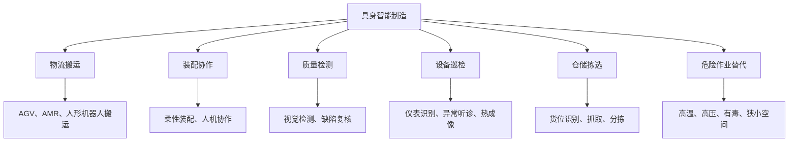

# 具身智能制造数据专题导览

> [!abstract] 专题定位
> 具身智能不是“把大模型装进机器人”这么简单。它真正改变的是制造业数据的边界：过去数据主要来自设备和业务系统，现在还会来自机器人的视觉、触觉、动作、任务、环境和反馈。
>
> 数据从业者要看见的不是一个会走路的机器人，而是一套新的工业数据闭环。

## 1. 为什么制造业要关注具身智能

制造业过去的智能化，主要围绕设备联网、MES、质量控制、预测性维护、数字孪生展开。具身智能把 AI 从屏幕带进物理世界，让机器人在真实工厂中感知、移动、抓取、装配、巡检、搬运、协作。

这会带来新的数据问题：如何采集多模态数据，如何标注动作轨迹，如何把工艺知识转化为机器人策略，如何评估安全边界，如何让机器人行为可追溯。

建议先读：

- [[【各行业的基础知识】/03-制造业/00-制造业行业全景解析|制造业行业全景解析]]
- [[【数据治理与数据管理】/02-深度研究/05-AI数据治理/10-AI-ready Data/00-AI-ready Data专题导览|AI-ready Data专题导览]]
- [[【AI 与大数据】/03-AI-Agent/07-企业级Agent控制平面|企业级Agent控制平面]]

---

## 2. 业务地图：具身智能在制造现场的入口

具身智能最先落地的地方，不一定是最酷的地方，而是“人辛苦、风险高、动作相对标准、ROI 能算清”的地方。制造业的很多岗位并不缺概念，缺的是能把场景拆成数据、动作、指标和系统的人。

---

## 3. 数据模型：机器人进入工厂后新增哪些数据

### 3.1 环境感知数据

包括视觉、深度、激光雷达、声学、热成像、位姿、地图。它们用于定位、避障、识别物料、判断设备状态。

### 3.2 动作轨迹数据

包括机械臂轨迹、抓取点、力度、速度、失败动作、人工接管记录。动作数据是机器人学习和复盘的核心。

### 3.3 工艺与任务数据

包括工单、BOM、SOP、工艺参数、设备状态、质量标准。没有工艺语义，机器人只能动，不能真正“懂制造”。

### 3.4 质量与反馈数据

包括缺陷检测结果、返工记录、良率、节拍、人工复核、异常标签。它决定机器人策略是否真的改善了生产。

### 3.5 安全与审计数据

包括人机距离、急停、碰撞、越界、权限、人工接管、任务回放。具身智能一旦进入现场，安全日志就是底线。

---

## 4. AI场景：从数据到动作

### 4.1 机器人视觉检测

通过图像和视频识别产品缺陷、装配状态、仪表读数。数据团队要关注缺陷样本稀缺、标注一致性、相机位置、光照变化和误检漏检成本。

### 4.2 机器人作业学习

通过示教、仿真、强化学习、行为克隆，让机器人学习抓取、搬运、装配。数据核心是动作轨迹、环境状态和结果反馈。

### 4.3 工业Agent调度

把机器人、设备、仓储、MES、WMS、APS 连接起来，让 Agent 根据工单、产线状态和约束条件生成调度建议。这里的关键是权限、任务边界和可回滚。

### 4.4 数字孪生与仿真数据

真实工厂试错成本高，仿真数据可以用来训练和评估机器人策略。但仿真到现实存在差距，必须记录仿真参数、场景覆盖和现实验证结果。

### 4.5 预测性维护与巡检机器人

巡检机器人可以采集声音、温度、图像、振动等数据，用于设备异常识别。它不是单纯替代人工巡检，而是把巡检数据结构化、连续化、可追溯化。

---

## 5. 治理合规：具身智能的工业安全边界

制造业具身智能治理至少包括：

1. 现场安全边界和急停机制；
2. 人机协作区域权限；
3. 机器人任务审计和行为回放；
4. 工艺数据、设备数据和商业秘密保护；
5. 训练数据与仿真数据版本管理；
6. 异常事件复盘和责任归属。

相关链接：

- [[【数据治理与数据管理】/02-深度研究/05-AI数据治理/14-AI系统审计日志与证据链|AI系统审计日志与证据链]]
- [[【AI 与大数据】/03-AI-Agent/08-Agent安全与沙箱执行|Agent安全与沙箱执行]]
- [[【数据开发与数据架构】/07-数据服务架构/10-Agent-to-Data访问架构|Agent-to-Data访问架构]]

---

## 6. 岗位机会

| 方向 | 典型岗位 | 核心能力 |
|---|---|---|
| 工业数据分析 | 制造数据分析师、质量分析师 | SPC、良率、工艺分析 |
| 工业数据工程 | 工业数据工程师、IoT数据工程师 | 设备数据、实时流、边缘采集 |
| 机器人数据 | 机器人数据工程师、数据标注负责人 | 多模态、轨迹、仿真数据 |
| 工业AI产品 | 工业AI产品经理、机器人产品经理 | 场景抽象、ROI、现场流程 |
| 工业AI治理 | 工业安全审计、模型评估、数据治理 | 权限、日志、安全、合规 |

---

## 7. 学习路线建议

第一步，理解制造业基础业务：计划、采购、生产、质量、设备、仓储。第二步，理解工业数据：设备状态、工艺参数、质量结果、工单、物料。第三步，进入具身智能：视觉、动作、轨迹、仿真、机器人任务。第四步，补齐治理：现场安全、审计日志、权限边界、异常复盘。

## 8. 资料依据

- [工业和信息化部](https://www.miit.gov.cn/)
- [工业和信息化部 - 人形机器人创新发展指导意见](https://www.miit.gov.cn/zwgk/zcwj/wjfb/tz/art/2023/art_11370a8420884f34b1ebccf6a9d8f98b.html)
- [World Economic Forum - Future of Jobs Report 2025](https://www.weforum.org/publications/the-future-of-jobs-report-2025/digest/)
- [国家数据局 - 全国数据资源调查报告（2025年）](https://www.nda.gov.cn/sjj/ywpd/sjzy/0429/20260429164803571173880_pc.html)

## 9. 延伸阅读

- [[【各行业的基础知识】/03-制造业/00-制造业行业全景解析|制造业行业全景解析]]
- [[【各行业的基础知识】/03-制造业/07-核心业务系统/00-制造业信息系统架构|制造业信息系统架构]]
- [[【求职就业专题】/08-AI时代求职与作品集/06-AI时代数据人作品集项目清单|AI时代数据人作品集项目清单]]
