# 云计算 (Cloud Computing)

## 定义

云计算是一种通过互联网按需提供计算资源(服务器、存储、数据库、网络、软件等)的服务模式。用户可以根据需要灵活获取和释放这些资源，而无需直接购买和管理底层的物理基础设施。

## 核心概念

### 基本特征
- **按需自助服务**: 用户可以单方面获取计算资源
- **广泛网络接入**: 通过标准网络机制访问服务
- **资源池化**: 计算资源被池化以服务多个用户
- **快速弹性伸缩**: 资源可以快速弹性供应和释放
- **可测量服务**: 云系统通过计量机制监控、控制和报告资源使用，为资源优化及使用透明度提供依据

### 服务模式
- **IaaS**(Infrastructure as a Service): 基础设施即服务
- **PaaS**(Platform as a Service): 平台即服务
- **SaaS**(Software as a Service): 软件即服务
- **FaaS**(Function as a Service): 函数即服务

## 云计算服务模式

### IaaS - 基础设施即服务

```mermaid
%%{init: {"theme":"base","themeVariables":{"fontFamily":"PingFang SC, -apple-system, Source Han Serif SC, serif","fontSize":"16px","background":"#FDFBF5","primaryColor":"#FDFBF5","primaryTextColor":"#2D2A26","primaryBorderColor":"#6E6A60","secondaryColor":"#E8EFE8","secondaryBorderColor":"#8FA890","secondaryTextColor":"#2D2A26","tertiaryColor":"#FDFBF5","tertiaryBorderColor":"#9A9488","tertiaryTextColor":"#6E6A60","lineColor":"#6E6A60","textColor":"#2D2A26","mainBkg":"#FDFBF5","nodeBorder":"#2D5A3D","clusterBkg":"#F3EEDF","clusterBorder":"#9A9488","edgeLabelBackground":"#FDFBF5"},"flowchart":{"htmlLabels":true,"curve":"basis","padding":20,"nodeSpacing":60,"rankSpacing":70,"useMaxWidth":false},"themeCSS":".node rect, .node polygon, .node circle { stroke-width: 1.5px; } .edgePath .path { stroke-width: 1.5px; } .cluster-label .nodeLabel, .cluster-label foreignObject { color: #2D2A26 !important; } .edgeLabel, .edgeLabel foreignObject { color: #2D2A26 !important; background-color: #FDFBF5; } .edgeLabel rect { fill: #FDFBF5; }"}}%%
flowchart TB
    classDef default fill:#FDFBF5,stroke:#6E6A60,color:#2D2A26,stroke-width:1.5px
    classDef startend fill:#2D2A26,stroke:#2D2A26,color:#FDFBF5,font-weight:bold
    classDef decision fill:#F6EAD8,stroke:#C08A1A,color:#2D2A26,font-weight:bold
    classDef hub fill:#3B5A80,stroke:#3B5A80,color:#FDFBF5,font-weight:bold
    classDef io fill:#E5EAF0,stroke:#3B5A80,color:#2D2A26
    classDef accent fill:#A6432C,stroke:#A6432C,color:#FDFBF5,font-weight:bold
    classDef storage fill:#F3EEDF,stroke:#9A9488,color:#2D2A26
    A[IaaS基础设施即服务] --> B[计算资源]
    A --> C[存储资源]
    A --> D[网络资源]
    A --> E[安全服务]
    B --> B1[虚拟机]
    B --> B2[容器服务]
    B --> B3[裸金属服务器]
    C --> C1[对象存储]
    C --> C2[块存储]
    C --> C3[文件存储]
    D --> D1[负载均衡]
    D --> D2[CDN]
    D --> D3[VPC网络]
    E --> E1[防火墙]
    E --> E2[DDoS防护]
    E --> E3[安全组]
    class A,B,C,D,E,B1,B2,B3,C1,C2,C3,D1,D2,D3,E1,E2,E3 default
```

**典型应用场景**:
- 企业IT基础设施迁移
- 弹性计算需求
- 灾备和数据保护
- 开发测试环境

### PaaS - 平台即服务
**核心组件**:
- **应用运行环境**: Java、Python、Node.js等
- **数据库服务**: MySQL、PostgreSQL、NoSQL等
- **中间件服务**: 消息队列、缓存、搜索等
- **开发工具**: CI/CD、监控、日志等

**价值优势**:
- 简化应用部署和管理
- 可提供高可用和弹性扩展能力，具体取决于服务及配置
- 降低运维复杂度
- 加速应用开发周期

### SaaS - 软件即服务
**服务特点**:
- 按需订阅使用
- 多租户架构
- 自动更新升级
- 跨设备访问

**常见应用**:
- 办公软件(Office 365)
- 客户关系管理(Salesforce)
- 企业资源规划(SAP)
- 协作工具(Slack)

## 云计算架构与技术

### 虚拟化技术
**云资源虚拟化管理的概念性能力**：
资源管理平台可考虑统一管理与优化等功能方向；本段是能力概览，不提供已实现的平台、配置步骤或效果验证。**虚拟机生命周期管理**包括资源池管理，统一调度CPU、内存和存储资源；虚拟机创建与配置，检查资源可用性和自动分配资源；状态管理和监控，跟踪资源使用情况。**智能扩缩容**通过实时监控应用指标，如CPU使用率、内存使用率和请求数量；根据预设阈值自动执行扩容或缩容操作；生成详细的扩缩决策记录便于审计和优化。**资源优化建议**基于历史数据分析工作负载模式；识别资源过度配置和性能瓶颈；提供资源规格优化（rightsizing）建议和成本优化方案。

### 容器与微服务
**容器技术优势**:
- 轻量级虚拟化
- 快速启动和部署
- 环境一致性
- 资源利用率高

**微服务架构**:
- 服务拆分和解耦
- 独立部署和扩展
- 技术栈多样化
- 故障隔离能力

### 云原生技术栈

```mermaid
%%{init: {"theme":"base","themeVariables":{"fontFamily":"PingFang SC, -apple-system, Source Han Serif SC, serif","fontSize":"16px","background":"#FDFBF5","primaryColor":"#FDFBF5","primaryTextColor":"#2D2A26","primaryBorderColor":"#6E6A60","secondaryColor":"#E8EFE8","secondaryBorderColor":"#8FA890","secondaryTextColor":"#2D2A26","tertiaryColor":"#FDFBF5","tertiaryBorderColor":"#9A9488","tertiaryTextColor":"#6E6A60","lineColor":"#6E6A60","textColor":"#2D2A26","mainBkg":"#FDFBF5","nodeBorder":"#2D5A3D","clusterBkg":"#F3EEDF","clusterBorder":"#9A9488","edgeLabelBackground":"#FDFBF5"},"flowchart":{"htmlLabels":true,"curve":"basis","padding":20,"nodeSpacing":60,"rankSpacing":70,"useMaxWidth":false},"themeCSS":".node rect, .node polygon, .node circle { stroke-width: 1.5px; } .edgePath .path { stroke-width: 1.5px; } .cluster-label .nodeLabel, .cluster-label foreignObject { color: #2D2A26 !important; } .edgeLabel, .edgeLabel foreignObject { color: #2D2A26 !important; background-color: #FDFBF5; } .edgeLabel rect { fill: #FDFBF5; }"}}%%
flowchart TB
    classDef default fill:#FDFBF5,stroke:#6E6A60,color:#2D2A26,stroke-width:1.5px
    classDef startend fill:#2D2A26,stroke:#2D2A26,color:#FDFBF5,font-weight:bold
    classDef decision fill:#F6EAD8,stroke:#C08A1A,color:#2D2A26,font-weight:bold
    classDef hub fill:#3B5A80,stroke:#3B5A80,color:#FDFBF5,font-weight:bold
    classDef io fill:#E5EAF0,stroke:#3B5A80,color:#2D2A26
    classDef accent fill:#A6432C,stroke:#A6432C,color:#FDFBF5,font-weight:bold
    classDef storage fill:#F3EEDF,stroke:#9A9488,color:#2D2A26
    A[云原生技术栈] --> B[容器技术]
    A --> C[容器编排]
    A --> D[服务网格]
    A --> E[DevOps工具链]
    B --> B1[Docker]
    B --> B2[Containerd]
    B --> B3[Podman]
    C --> C1[Kubernetes]
    C --> C2[Docker Swarm]
    C --> C3[Nomad]
    D --> D1[Istio]
    D --> D2[Envoy数据平面代理]
    D --> D3[Linkerd]
    E --> E1[CI/CD流水线]
    E --> E2[监控告警]
    E --> E3[日志分析]
    class A,B,C,D,E,B1,B2,B3,C1,C2,C3,D1,D2,D3,E1,E2,E3 default
```

## 云服务商生态

### 主要云服务商
**国际厂商**:
- AWS (Amazon Web Services)
- Microsoft Azure
- Google Cloud Platform
- IBM Cloud

**国内厂商**:
- 阿里云 (Alibaba Cloud)
- 腾讯云 (Tencent Cloud)
- 华为云 (Huawei Cloud)
- 百度云 (Baidu Cloud)

### 服务对比分析

**云服务商对比平台的概念性能力设想**：
下述内容是可能的功能设计方向，并非本文提供的可用产品或经验证推荐；实际比较需另行确定输入数据、评分规则与适用场景。**计算服务对比**包括性能指标、价格模型、可靠性、安全性、合规性和技术支持等维度；根据业务需求智能匹配最适合的实例类型；计算总体成本和性能评分；生成适合性排名推荐。**定价模式分析**涵盖按需付费、预留实例、竞价实例和承诺使用折扣等模式；对不同使用场景进行成本效益和风险评估；提供个性化定价策略建议。**云迁移可行性评估**包括技术兼容性分析，评估现有系统与云平台的兼容性；重构需求识别，确定需要修改的系统组件；成本影响分析，比较现有成本与预期云成本；迁移复杂度评估和成本节省时间表预测。

## 云安全与合规

### 安全责任模型
**云服务商责任**:
- 基础设施安全
- 物理安全控制
- 网络和虚拟化安全
- 服务可用性保障

**用户责任**:
- 数据加密和保护
- 身份和访问管理
- 应用程序安全
- 网络流量保护

### 合规框架
**国际法规、标准与审计框架**:
- ISO 27001 信息安全管理
- SOC 2 服务组织控制审计
- PCI DSS 支付卡行业标准
- GDPR 通用数据保护条例

**国内法规与合规要求**:
- 等保2.0 网络安全等级保护
- 商用密码应用安全性评估
- 个人信息保护法合规
- 数据安全法要求

## 云计算数据分析

### 云资源监控指标
**计算资源指标**:
- CPU使用率
- 内存使用率
- 磁盘I/O性能
- 网络吞吐量

**服务质量指标**:
- 可用性SLA
- 响应时间
- 错误率
- 并发用户数

**成本优化指标**:
- 资源利用率
- 成本单位效率
- 闲置资源比例
- 预留实例使用率

### 云成本优化分析
**云成本优化平台的概念性能力设想**：
下述内容列举可能的分析与建议功能，不承诺已经实现或能够最大化成本效益；实际优化仍需明确计费口径、工作负载、风险约束及验证方法。**成本趋势分析**进行月度费用趋势统计，计算增长率和成本驱动因素；服务成本分解分析各个云服务的费用占比；异常成本检测识别非正常的费用波动。**智能优化建议**包括闲置资源清理，识别低利用率资源并计算潜在节省；资源规格优化（rightsizing），对过度配置的资源提供合适的规格建议；预留实例优化，根据使用模式推荐最优的预留购买策略。所有建议按照潜在节省金额、风险级别和实施难度进行综合排序。

## 云计算发展趋势

### 技术演进方向
**边缘计算融合**:
- 边缘云服务
- 5G+边缘计算
- IoT数据处理
- 实时计算需求

**AI与云计算结合**:
- 机器学习平台服务
- AI模型训练和推理
- 自动化运维(AIOps)
- 智能资源调度

**量子云计算**:
- 量子计算服务
- 量子算法开发
- 量子安全通信
- 量子优势应用

### 业务模式创新
**多云和混合云**:
- 多云管理平台
- 混合云编排
- 云间数据迁移
- 统一安全策略

**Serverless计算**:
- 函数即服务(FaaS)
- 事件驱动架构
- 按执行付费
- 减少底层基础设施运维，仍需管理应用、权限、监控和成本

## 应用场景与案例

### 企业数字化转型
- IT基础设施云化
- 应用现代化改造
- 数据中台建设
- 业务连续性保障

### 互联网应用
- 弹性扩缩容
- 全球内容分发
- 大数据处理
- 人工智能服务

### 创新应用领域
- 远程办公协作
- 在线教育平台
- 智慧城市建设
- 工业互联网

## 学习要点

### 技术掌握
1. **基础概念**: 理解云计算的基本原理和服务模式
2. **架构设计**: 掌握云原生架构设计方法
3. **成本优化**: 学会云资源成本分析和优化
4. **安全合规**: 了解云安全最佳实践

### 业务应用
1. **迁移策略**: 制定云迁移规划和实施方案
2. **资源管理**: 云资源的监控、调度和优化
3. **成本控制**: 云成本的预算、监控和优化
4. **风险管理**: 云服务的风险评估和控制

## 相关术语

- [[【技术与工具】/Python/31-FastAPI开发|FastAPI开发]] - 可用于云服务接口开发的Python Web框架
- [[【各行业的基础知识】/10-互联网科技/99-专业术语词典/05-微服务|微服务]] - 云原生应用架构
- [[【各行业的基础知识】/10-互联网科技/99-专业术语词典/07-容器化|容器化]] - 云计算的部署技术
- [[【各行业的基础知识】/10-互联网科技/99-专业术语词典/06-DevOps|DevOps]] - 云时代的开发运维

## 行业标准

### 国际标准
- NIST云计算定义和标准
- ISO/IEC 17789云计算参考架构
- ITU-T云计算标准
- DMTF云管理标准

### 国内标准
- 全国信标委云计算标准
- 中国通信标准化协会
- 工信部云计算发展指导意见
- 国家标准《信息技术 云计算概览与词汇》

---

*云计算是数字化转型的重要基础设施，深入理解云计算的技术原理、服务模式和应用场景，对于互联网科技领域的数据分析和业务优化具有重要价值。*