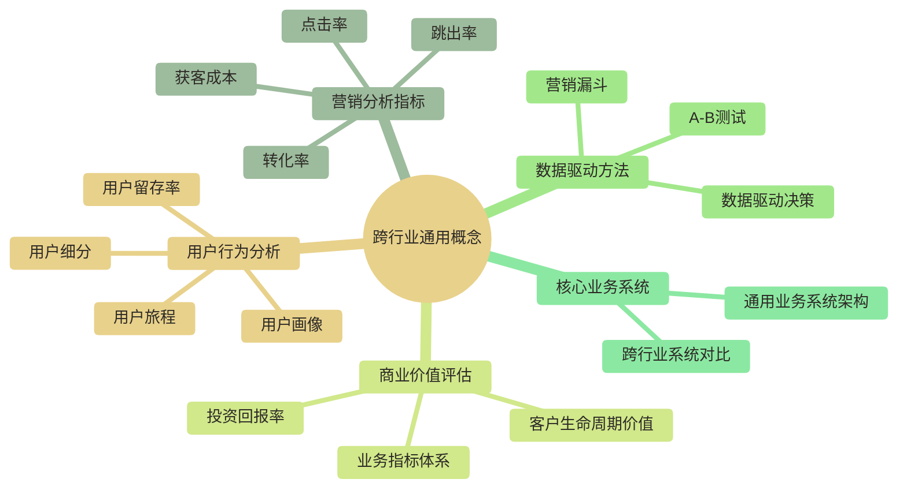

> [!warning] 关联材料边界
> 以下原引用目标缺失或无法唯一确认，已取消跳转并保留提及：【各行业的基础知识】/98-跨行业通用/07-核心业务系统/通用业务系统概览；【各行业的基础知识】/98-跨行业通用/99-专业术语词典/跨行业通用术语。相关素材/延伸说明暂不可用，不能据此声称已经提供配套材料。

# 跨行业通用概念全景解析

> [!abstract] 🌍 跨行业通用概念体系
> 
> 🎯 **核心定位**
> 整理和解析在各个行业中都广泛应用的通用商业概念、数据指标和分析方法，为数据从业者提供跨行业的通用知识基础。
> 
> 📚 **主要内容**：
> - 🎯 **营销分析指标**：转化率、获客成本、用户留存等核心指标
> - 👥 **用户行为分析**：用户画像、用户旅程、用户细分等概念
> - 📊 **数据驱动方法**：A/B测试、业务指标体系、数据驱动决策
> - 💼 **商业价值评估**：客户生命周期价值、投资回报率等

## 🗺️ 跨行业通用知识地图

## 📈 营销分析核心指标

### 🎯 关键转化指标
- **[[【各行业的基础知识】/98-跨行业通用/转化率|转化率]]**：各环节转化效果的核心衡量标准
- **[[【各行业的基础知识】/98-跨行业通用/点击率|点击率优化]]**：数字化营销效果的直接反映
- **[[【各行业的基础知识】/98-跨行业通用/跳出率|跳出率]]**：用户体验质量的重要指标

### 💰 成本效益指标
- **[[【各行业的基础知识】/98-跨行业通用/获客成本|获客成本控制]]**：营销投入产出的关键衡量标准
- **[[【各行业的基础知识】/98-跨行业通用/客户生命周期价值|客户价值评估]]**：长期商业价值的核心指标

### 📊 营销分析工具
- **[[【各行业的基础知识】/98-跨行业通用/营销漏斗|营销漏斗建设]]**：用户转化路径的可视化分析工具

## 👥 用户行为深度分析

### 🎭 用户洞察体系
- **[[【各行业的基础知识】/98-跨行业通用/用户画像|用户画像构建]]**：精准用户定位的基础工具
- **[[【各行业的基础知识】/98-跨行业通用/用户细分|用户分群]]**：个性化营销的前提条件
- **[[【各行业的基础知识】/98-跨行业通用/用户旅程|用户体验优化]]**：全触点用户体验的系统性分析

### 📈 用户粘性指标
- **[[【各行业的基础知识】/98-跨行业通用/用户留存率|用户留存]]**：观察用户持续使用行为、辅助评估产品价值的参考指标，不能直接等同于用户满意度，需结合产品类型和使用周期解读

## 🧪 数据驱动决策方法论

### 🔬 科学验证方法
- **[[【各行业的基础知识】/98-跨行业通用/A-B测试|A/B测试实践]]**：科学决策的核心验证工具
- **[[【各行业的基础知识】/98-跨行业通用/数据驱动决策|数据化运营]]**：基于数据的业务决策流程

### 📊 指标体系建设
- **[[【各行业的基础知识】/98-跨行业通用/业务指标体系|业务指标]]**：企业运营的量化管理体系

## 💼 通用业务系统知识

### 🏢 企业管理系统
- **核心业务系统（原引用“【各行业的基础知识】/98-跨行业通用/07-核心业务系统/通用业务系统概览”未能确定有效目标，暂不可跳转）**：跨行业通用的企业业务系统架构

### 📚 专业术语
- **专业术语词典（原引用“【各行业的基础知识】/98-跨行业通用/99-专业术语词典/跨行业通用术语”未能确定有效目标，暂不可跳转）**：跨行业通用的专业术语和概念解释

## 🎯 应用场景与实践

### 📊 电商零售场景
- **转化率优化**：从流量获取到订单完成的全链路优化
- **用户留存提升**：通过精准营销和用户体验改善提升复购
- **获客成本控制**：多渠道获客效果评估和预算分配优化

### 🏦 金融服务场景  
- **客户价值评估**：基于客户生命周期价值的精准营销
- **风险用户识别**：通过用户行为分析进行风险预警
- **产品转化分析**：金融产品的销售漏斗优化

### 📱 互联网产品场景
- **产品功能验证**：A/B测试驱动的产品迭代决策
- **用户行为分析**：基于用户旅程的产品体验优化
- **增长策略制定**：数据驱动的用户增长策略设计

### 🎓 教育培训场景
- **学习效果评估**：学员学习行为和效果的量化分析
- **课程优化决策**：基于学习数据的课程内容调整
- **用户转化提升**：从试听到付费的转化路径优化

## 🚀 跨行业应用趋势

### 📈 数字化转型共性
1. **数据驱动文化**：建立基于数据的决策机制是跨行业数字化转型的通用方向，实际建设程度因行业和企业而异
2. **用户体验中心**：以用户为中心的业务流程重构
3. **精准化运营**：基于数据分析的精细化业务管理

### 🔮 未来发展方向
1. **智能化分析**：AI驱动的自动化数据分析和决策支持
2. **实时化运营**：基于实时数据的动态业务调整
3. **个性化服务**：基于大数据的个性化产品和服务提供

---

> [!tip] 💡 学习建议
> 
> **初学者**：建议从转化率、用户画像等基础概念开始学习
> **进阶者**：重点关注A/B测试、数据驱动决策等方法论
> **专业人士**：深入研究业务指标体系建设和跨行业最佳实践
> 
> **实践要点**：这些通用概念需要结合具体行业场景进行应用，才能发挥最大价值