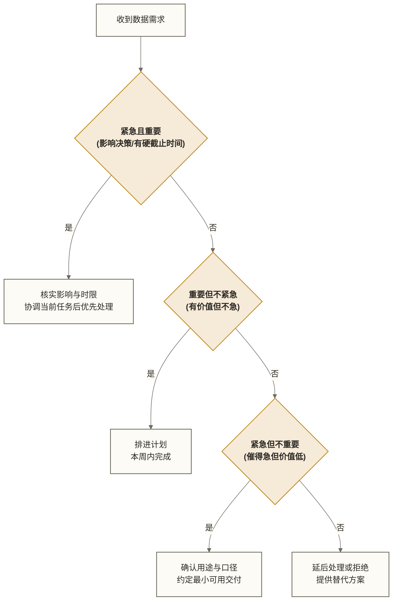

# 职场数据人的时间管理实战

数据岗位有一个独特的时间问题：你的时间不属于你自己。

产品经理说「帮我查一下最近7天的新用户数」，5分钟。运营说「这个活动的漏斗能看一眼吗」，15分钟。领导说「明天开会要用，今晚把留存分析做出来」，3小时。

这还没算上你自己手头正在做的分析项目、每周例行报表、数据质量巡检……

数据分析师经常描述自己的工作状态是：「很忙，但不知道忙了什么」。一天结束了，感觉做了很多事，但那个真正重要的分析项目又往后推了。

这不是你效率低，是数据岗位的时间消耗结构天然是碎片化的。时间管理对数据人不是「努力工作」的技巧，是**对抗碎片化、保护深度工作时间**的系统工程。

## 数据岗位的时间消耗特征

先做一个诊断。下表仅为记录时间去向的教学示例，占比和价值密度并非行业统计或固定评价；请用自己的工作记录和业务目标重新填写：

| 工作类型 | 时间占比（示例范围）| 价值密度 |
|---------|-----------------|---------|
| 临时取数需求 | 25-35% | 低 |
| 例行报表维护 | 15-25% | 低到中 |
| 专项数据分析 | 20-30% | 高 |
| 数据质量处理 | 10-15% | 中 |
| 跨部门沟通协调 | 10-20% | 中 |
| 学习和技能提升 | 0-10% | 高 |

如果你的记录显示，重要的「专项分析」和「学习提升」时间较少，而大量时间用于低价值的「临时取数」，就值得检查需求分配方式。

这是需要主动干预的。

## 深度工作保护策略

**时间块（Time Blocking）**是保护深度工作时间的一种可尝试的方法。

具体做法：在日历上提前预约「数据分析专用时间块」，尝试保护一个约2小时的专注时间段，并为必须及时处理的事项约定例外。这个时间段不接临时需求，不回消息，专门用于需要深度思考的工作。

**关键配置建议**：
- 时间段选择：优先选自己较易专注、且不与团队关键协作冲突的时段（例如上午9:30-11:30）
- 在团队内沟通这个机制，让同事知道这个时间段发的消息你会稍后回复
- 时间块内只做一件事，不要切换
- 一开始可以从每天1小时开始，逐步建立习惯

**沟通规范**：很多数据人不好意思设沟通边界，觉得「随时响应」是职业态度的表现。但随时响应的代价是：你永远无法进入深度工作状态。

一个可以直接使用的话术：「临时需求通常我会在X小时内响应，如果非常紧急可以电话我，其他情况请直接在需求系统里提。」设置预期，而不是无限响应。

## 数据需求的分级处理框架

不是所有需求都值得同等对待。一个实用的分级框架：



**关于「拒绝」**：数据人很少拒绝需求，但接受所有需求的代价是把时间全部投入低价值工作。学会说「这个需求我评估了一下，投入产出比不高，是否考虑XXX替代方案？」是职业成熟度的表现，不是不配合。

一个判断「值不值得做」的简单标准：**这个分析结论会影响什么决策？如果拿到这个数字之后什么都不会改变，那这个需求大概率不值得做**。

## 如何预估数据任务的时间

数据工作最难预估时间的原因：不确定因素太多——数据质量问题可能让一个1小时的任务变成3小时，临时增加的分析角度可能让下班前完成的报告拖到第二天。

**系数估算法**：

以下系数仅是教学用的初始估时缓冲，不是统计规律；评估任务需要X小时时，可结合不确定度及历史耗时调整：

| 不确定程度 | 系数 | 适用场景 |
|-----------|------|---------|
| 熟悉任务，数据质量好 | 1.2x | 同类型的第三次以后 |
| 较熟悉，可能有数据问题 | 1.5x | 类似任务第二次 |
| 新领域，数据情况不清楚 | 2.0x | 第一次接触的分析方向 |
| 全新方向，需求不清晰 | 2.5x | 需求模糊+技术不熟悉 |

比如你评估一个分析报告「大概需要4小时」，但这是一个新领域，用2.0系数，可以暂按8小时规划，再与实际耗时对照调整。预留缓冲有助于应对不确定性，但不能保证估时更准确。

**另一个实用技巧**：分解任务到最小步骤后再估时。「做一个用户留存分析」很难估，但「1.写取数SQL(30min)，2.数据验证(30min)，3.计算各维度留存率(60min)，4.可视化(45min)，5.写分析结论(45min)」估起来就准确多了。

## 个人数据工作的效率工具组合

不是推荐你买什么软件，而是建立一套能节省重复工作的系统：

**SQL模板库**：把常用的SQL查询模式整理成模板。比如：
- 漏斗分析模板
- 同期群分析模板
- 用户行为路径模板
- 环比/同比计算模板

每次有类似需求时，从模板库里找，改改参数就能用。以教学假设为例，模板库建设可能花2-3个月，单次重复需求可能节省30-60分钟；实际投入与节时取决于需求重复度、口径维护和使用情况，不能作为通用收益承诺。

**常用脚本集合**：把工作中反复用到的Python脚本保存成可复用的函数：
- 数据读取和清洗的标准流程
- 常用可视化的快速绘图函数
- 报告生成的自动化脚本

**数据字典**：维护一个团队公用的数据字典，记录每张重要数据表的字段含义、口径定义、刷新频率。前期投入时间建设，后期每次取数时不用重新确认口径，节省大量沟通时间。

**需求记录表**：用最简单的方式记录每一个来自业务方的临时需求：谁提的、什么问题、什么时候要、最终结论是什么。这个记录有两个价值：避免同样的问题被问第二次时重新做分析；年底总结工作时有完整的需求日志。

## 一个数据分析师的理想工作日设计

这是一个参考框架，不是标准答案。根据你的岗位和团队文化调整：

```text
09:00 - 09:30  处理昨天未完成的紧急消息，过一遍今天的任务清单
09:30 - 11:30  深度工作时间块（专项分析/复杂报告/学习提升）
              这段时间不接临时需求
11:30 - 12:00  处理上午积累的消息和临时需求（简单的快速响应）

午休

13:30 - 15:30  第二个深度工作时间块（续昨天的项目/复杂需求）
15:30 - 17:00  例行报表维护 + 中等复杂度需求处理
17:00 - 17:30  整理今天的进度，更新需求记录，规划明天的任务清单
```

**这个设计的核心逻辑**：把认知能力最强的上午保护起来做最需要思考的工作，下午处理例行和相对机械的工作，避免整天都在应急响应中消耗。

> [!tip] 关于任务清单
> 每天结束前花10分钟写明天的任务清单，比每天早上再想「今天做什么」有效率得多。提前明确下一步后，早上开始工作时你知道第一步做什么，不会在「先做哪个」上浪费时间。

> [!note] 关于加班
> 数据人加班可能与紧急业务需求、需求排期、资源约束及碎片化工作等多种因素有关。时间保护只能处理其中一部分，不能替代团队层面的优先级与资源协调。如果你经常因为「今天又被打扰」而加班，可以检查时间保护、需求分级和团队排期，而不必简单归因于个人不够努力。

> [!warning] 一个关于工具的警告
> 花太多时间研究和配置效率工具，本身就是一种效率浪费。一个用熟了的简单工具，比一个功能强大但没真正用起来的复杂工具有价值得多。选一套够用的工具组合，专注使用，不要不断切换。

## 相关资源

- [[【学习方法分享】/如何在工作中快速提升数据能力|如何在工作中快速提升数据能力]] - 在有限时间里最大化工作学习价值
- [[【学习方法分享】/输出倒逼输入-数据人的最强学习策略|输出倒逼输入]] - 如何把碎片时间的学习沉淀成知识
- [[【学习方法分享】/数据人的知识管理系统搭建指南|数据人的知识管理系统搭建指南]] - SQL模板库和知识库的系统搭建
- [[【学习方法分享】/实践驱动学习法|实践驱动学习法]] - 在工作任务中嵌入刻意练习

**核心标签**：#时间管理 #效率工具 #数据人 #职业成长 #深度工作 #学习方法
