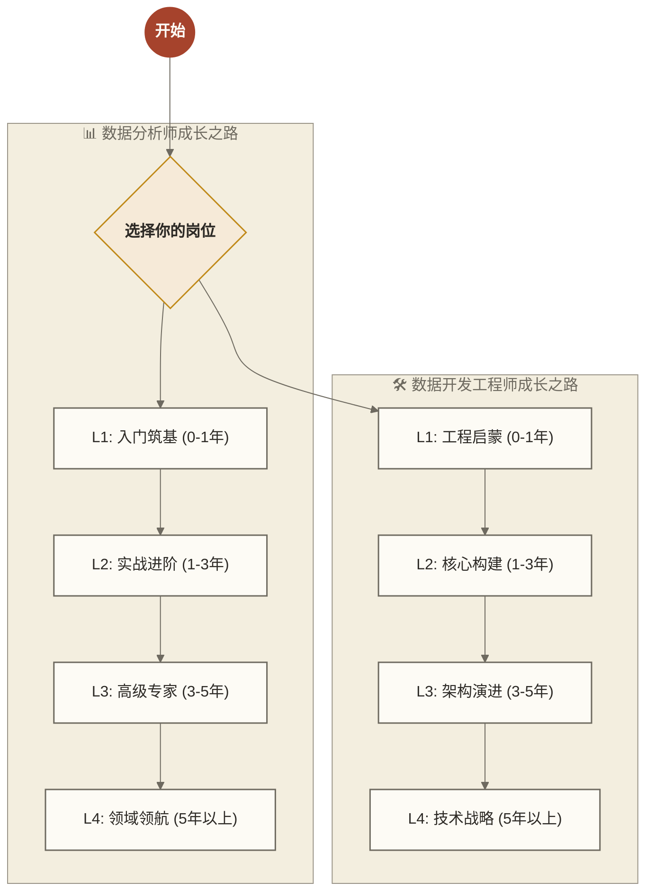

> [!warning] 关联材料边界
> 以下原引用目标缺失或无法唯一确认，已取消跳转并保留提及：95-面试实战演练。相关素材/延伸说明暂不可用，不能据此声称已经提供配套材料。

# 🗺️ 学习路线图使用指南

> [!note] 欢迎来到数据领域全栈知识库
> 本文件夹包含了面向数据分析师、数据开发工程师、数据运营、数据治理工程师、数据架构师等核心岗位的全生命周期学习路线，并新增了面向 AI 时代的数据人横向升级入口。无论你是初入职场的萌新，还是寻求突破的资深专家，都能在这里找到适合你的成长路径。

> [!tip] 不知道从哪里开始？
> 如果你对自己的定位还不清晰，或者想获得更有针对性的建议，强烈推荐先阅读 [[【学习路线】/09-给不同阶段学习者的真诚建议|给不同阶段学习者的真诚建议]]。这份指南会根据你的具体情况，帮你找到最适合的学习路径。

> [!tip] 关注 AI 时代岗位变化？
> 如果你关心 AI 会如何改变数据岗位、需要补哪些能力、如何做作品集，建议直接进入 [[【学习路线】/AI时代数据人/00-AI时代数据人成长路线|AI时代数据人成长路线]]。它是一个横向入口，会把你带回到数据分析、数据开发、数据治理、AI 与求职等原有模块。

## 🔍 如何使用本指南

本路线将职业成长组织为四个参考阶段，每个阶段对应一个独立的文档；图中年限仅为组织参考，不是按工龄确定能力等级或晋级的统一标准。请根据你目前的能力、目标与实践经验选择合适的起点：

## 📖 文档结构说明

每个阶段的文档都包含以下核心模块：

1.  **🎯 阶段目标**：简述该阶段的核心任务和能力画像。
2.  **🧠 核心能力树**：使用 Mermaid 思维导图展示技能分支。
3.  **📚 重点学习内容**：
    *   **知识点**：具体的概念或技术。
    *   **掌握程度**：了解 / 熟悉 / 掌握 / 精通。
    *   **推荐资源**：直接链接到知识库中的双链 *WikiLink*。
4.  **💡 避坑指南**：前辈们的经验之谈 (Callout 形式)。

## 🚀 快速索引

### 📊 数据分析师 (Data Analyst)
*   **L1 入门**：[[【学习路线】/数据分析师/L1-入门筑基|L1: 入门筑基]] —— *构建思维，掌握 SQL 与 Python 基础*
*   **L2 进阶**：[[【学习路线】/数据分析师/L2-实战进阶|L2: 实战进阶]] —— *业务模型，复杂查询，统计分析*
*   **L3 专家**：[[【学习路线】/数据分析师/L3-高级专家|L3: 高级专家]] —— *机器学习，因果推断，自动化*
*   **L4 领航**：[[【学习路线】/数据分析师/L4-领域领航|L4: 领域领航]] —— *商业战略，算法深潜，团队管理*

### 🛠️ 数据开发工程师 (Data Engineer)
*   **L1 启蒙**：[[【学习路线】/数据开发/L1-工程启蒙|L1: 工程启蒙]] —— *Linux, SQL, 数据库原理*
*   **L2 构建**：[[【学习路线】/数据开发/L2-核心构建|L2: 核心构建]] —— *数仓建模, ETL, Spark/Flink 基础*
*   **L3 架构**：[[【学习路线】/数据开发/L3-架构演进|L3: 架构演进]] —— *平台架构, 性能调优, 数据治理*
*   **L4 战略**：[[【学习路线】/数据开发/L4-技术战略|L4: 技术战略]] —— *云原生, DataOps, 技术选型*

### 🤖 AI时代数据人 (AI-era Data Professional)
*   **成长路线**：[[【学习路线】/AI时代数据人/00-AI时代数据人成长路线|AI时代数据人成长路线]] —— *从岗位变化到能力升级的横向入口*
*   **岗位变化**：[[【学习路线】/AI时代数据人/01-AI时代数据岗位变化总览|AI时代数据岗位变化总览]] —— *分析、开发、治理、科学家等岗位的新职责*
*   **能力模型**：[[【学习路线】/AI时代数据人/02-数据人能力模型升级|数据人能力模型升级]] —— *问题定义、语义治理、AI协作、产品化交付*
*   **90天计划**：[[【学习路线】/AI时代数据人/03-90天AI时代数据人升级计划|90天AI时代数据人升级计划]] —— *把焦虑变成项目和作品集*
*   **细分岗位**：[[【学习路线】/AI时代数据人/05-AI时代数据分析师升级路线|数据分析师]] / [[【学习路线】/AI时代数据人/06-AI时代数据开发工程师升级路线|数据开发]] / [[【学习路线】/AI时代数据人/07-AI时代数据治理工程师升级路线|数据治理]] / [[【学习路线】/AI时代数据人/08-AI-Data-Analyst岗位全解析|AI Data Analyst]] / [[【学习路线】/AI时代数据人/09-Analytics-Engineer岗位全解析|Analytics Engineer]]

---

## 📚 知识库内容全览

除了学习路线，本知识库还提供丰富的专题内容，帮助你全方位提升：

### 核心学习模块

| 模块 | 内容简介 | 适合人群 |
|-----|---------|---------|
| [[【数据分析与数据运营】/00-数据分析与数据运营导览|数据分析与数据运营]] | 分析方法、运营实战、案例研究 | 数据分析师、运营人员 |
| [[【数据开发与数据架构】/00-数据开发与架构总体导览|数据开发与数据架构]] | 数仓建设、架构设计、工程实践 | 数据工程师、架构师 |
| [[【数据治理与数据管理】/00-数据治理知识库导览|数据治理与数据管理]] | 数据质量、元数据、主数据管理 | 数据治理专家、管理者 |
| [[【技术与工具】/00-技术与工具导航|技术与工具]] | SQL、Python、Spark、Flink等 | 所有技术从业者 |
| [[【学习路线】/AI时代数据人/00-AI时代数据人成长路线|AI时代数据人]] | 岗位变化、能力升级、90天计划、作品集 | 所有需要适配AI时代的数据从业者 |

### 行业与业务知识

| 行业 | 核心内容 |
|-----|---------|
| [[【各行业的基础知识】/01-金融行业/00-金融行业全景解析|金融行业]] | 银行、保险、证券、风控 |
| [[【各行业的基础知识】/02-零售电商/00-零售电商行业全景解析|零售电商]] | 用户增长、供应链、营销 |
| [[【各行业的基础知识】/03-制造业/00-制造业行业全景解析|制造业]] | 智能制造、质量管理、IoT |
| [[【各行业的基础知识】/04-医疗健康/00-医疗健康行业全景解析|医疗健康]] | 临床数据、医疗AI、公共卫生 |
| [[【各行业的基础知识】/11-互联网商业分析/00-互联网商业分析导览|互联网商业]] | 平台经济、商业模式分析 |

### 求职与职业发展

| 资源 | 说明 |
|-----|------|
| [[【求职就业专题】/00-岗位导向求职指南|岗位导向求职指南]] | 五大数据岗位的完整求职攻略 |
| [[【求职就业专题】/00-岗位导向求职指南|面试题库]] | 分岗位、分难度的面试真题 |
| *简历模板* | 原稿列出的资源项：针对不同岗位的简历模板；本页未附模板材料，暂不能确认可用性 |
| 面试演练（原引用“95-面试实战演练”未能确定有效目标，暂不可跳转） | 模拟面试与反馈指南 |

### 特色专题

- [[【学习路线】/09-给不同阶段学习者的真诚建议|给不同阶段学习者的真诚建议]] — 针对你具体处境的个性化指导
- [[【学习路线】/10-知识库使用完全手册|知识库使用完全手册]] — 知识库的结构说明与高效使用技巧
- *知识库完整索引* — 原稿称为“全部1900+篇文档的分类目录”；该数量与覆盖范围尚未核实，本页未附索引材料
- [[【AI 与大数据】/00-AI与大数据导航|AI与大数据]] — 机器学习、大模型、AI应用
- *个性化咨询服务* — 原稿列出的一对一职业规划与技能提升服务；本页未说明服务获取条件与交付范围，暂不能确认可用性

---

> [!tip] 建议
> 学习不是线性的。即使你处于 L3 阶段，回顾 L1 的基础知识（如 [[【数据分析与数据运营】/01-共同能力基础/01-数据思维/01-数据思维基础|数据思维基础]]）往往也能带来新的启发。保持空杯心态，持续迭代。
