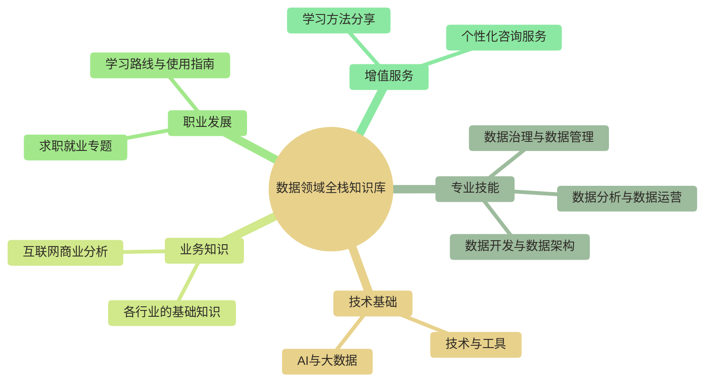

# 知识库使用完全手册

> [!abstract] 本手册的目的
> 这份手册将帮助你快速了解整个知识库的内容结构，掌握高效使用知识库的方法，避免在海量内容中迷失方向。第一次使用时可先花 10 分钟浏览模块总览和角色入口；完整阅读并按自己的目标选择路线，预计需要 30～45 分钟。

> [!note] 适用边界
> 本次核验对象是本地知识库的目录、文件与双链，不代表线上站点已经完成同版本发布。发布到 `pro.ss-data.cc` 前仍需执行站点导航、权限和链接的独立验收。

---

## 知识库的整体结构

本知识库围绕**数据从业者的完整职业生命周期**设计，涵盖从入门学习到职业进阶的全部内容。

### 十个对外模块一览

当前公开产品内容以根目录名称被 `【】` 包裹为准，共有十个模块：

| 模块 | 推荐入口 | 主要用途 |
|------|---------|---------|
| 数据分析与数据运营 | [[【数据分析与数据运营】/00-数据分析与数据运营导览|模块导览]] | 分析方法、指标、运营和业务场景 |
| 数据开发与数据架构 | [[【数据开发与数据架构】/00-数据开发与架构总体导览|模块导览]] | 数仓、数据管道、架构和工程实践 |
| 数据治理与数据管理 | [[【数据治理与数据管理】/00-数据治理知识库导览|模块导览]] | 质量、标准、元数据、安全与资产管理 |
| 技术与工具 | [[【技术与工具】/00-技术与工具导航|模块导航]] | 编程语言、数据库和数据技术栈 |
| AI 与大数据 | [[【AI 与大数据】/00-AI与大数据导航|模块导航]] | 大模型、RAG、Agent 与 AI 工程化 |
| 各行业的基础知识 | [[【各行业的基础知识】/98-跨行业通用/00-跨行业通用全景解析|跨行业入口]] | 行业业务、系统、指标和数据场景 |
| 学习路线 | [[【学习路线】/00-路线图使用指南|路线图使用指南]] | 按岗位和阶段组织学习顺序 |
| 项目实战库 | [[【项目实战库】/00-项目实战库总览|项目实战库总览]] | 跟做项目、交付物、复盘和作品集证据 |
| 求职就业专题 | [[【求职就业专题】/00-岗位导向求职指南|岗位导向求职指南]] | 岗位认知、简历、面试和求职准备 |
| 学习方法分享 | [[【学习方法分享】/实践驱动学习法|实践驱动学习法]] | 学习策略、知识管理和实践方法 |

下面的关系图按“专业技能—业务知识—职业发展”聚合内容，展示的是使用视角，不等同于物理目录。其中“互联网商业分析”属于“各行业的基础知识”子专题；“个性化咨询服务”是服务触点，不计入十个公开内容目录。

---

## 横向专题：AI时代数据人

在十个对外模块之上，知识库还提供一个跨模块入口：[[【学习路线】/AI时代数据人/00-AI时代数据人成长路线|AI时代数据人成长路线]]。

它不替代 [[【AI 与大数据】/00-AI与大数据导航|AI与大数据]]。二者的区别是：AI 与大数据回答“AI 技术是什么、怎么做”；AI 时代数据人回答“数据岗位如何变化、我应该如何升级、如何做出能证明能力的项目”。

适合优先阅读的人群：

- 担心 AI 改变数据岗位，希望重新判断职业方向的人。
- 已经会 SQL、报表、数仓或治理，但不知道如何补 AI 能力的人。
- 正在求职，希望把 AI 能力表达成作品集和项目经历的人。
- 想从工具执行者升级为问题负责人、数据产品负责人或 AI 数据治理负责人 的人。

推荐入口：

- [[【学习路线】/AI时代数据人/01-AI时代数据岗位变化总览|AI时代数据岗位变化总览]]
- [[【学习路线】/AI时代数据人/02-数据人能力模型升级|数据人能力模型升级]]
- [[【学习路线】/AI时代数据人/03-90天AI时代数据人升级计划|90天AI时代数据人升级计划]]
- [[【学习路线】/AI时代数据人/04-AI时代数据人作品集路线|AI时代数据人作品集路线]]

---

## 模块详解：每个模块能帮你解决什么问题

### 模块一：数据分析与数据运营

**解决的核心问题**：如何用数据发现问题、驱动决策、支持业务增长？

**包含内容**：
- 数据思维与分析方法论
- 指标体系设计与搭建
- 用户分析、增长分析、运营分析
- A/B测试与实验设计
- 数据可视化与报告撰写
- 实战案例与项目模板

**推荐入口**：[[【数据分析与数据运营】/00-数据分析与数据运营导览|数据分析与数据运营导览]]

**适合人群**：数据分析师、数据运营、产品经理、业务分析师

---

### 模块二：数据开发与数据架构

**解决的核心问题**：如何搭建稳定、高效、可扩展的数据基础设施？

**包含内容**：
- 数据仓库建模理论与实践
- ETL/ELT开发最佳实践
- 实时数据处理架构
- 数据湖与湖仓一体
- 数据中台建设方法论
- 性能优化与故障排查

**推荐入口**：[[【数据开发与数据架构】/00-数据开发与架构总体导览|数据开发与数据架构导览]]

**适合人群**：数据工程师、数据架构师、ETL开发、数仓工程师

---

### 模块三：数据治理与数据管理

**解决的核心问题**：如何保证数据的质量、安全、合规，让数据真正可用？

**包含内容**：
- 数据治理框架与体系
- 数据质量管理方法
- 元数据管理实践
- 主数据与参考数据管理
- 数据安全与隐私保护
- 数据资产管理

**推荐入口**：[[【数据治理与数据管理】/00-数据治理知识库导览|数据治理与数据管理导览]]

**适合人群**：数据治理专家、数据管理者、合规专员、数据架构师

---

### 模块四：技术与工具

**解决的核心问题**：数据工作需要掌握哪些技术工具？如何快速上手？

**包含内容**：

| 技术类别 | 主要工具 |
|---------|---------|
| 编程语言 | [[【技术与工具】/Python/00-Python学习路线图|Python]]、[[【技术与工具】/Java/00-Java学习路线图|Java]]、[[【技术与工具】/Scala/00-Scala学习路线图|Scala]]、R |
| 数据库 | [[【技术与工具】/MySQL/00-MySQL学习路线图|MySQL]]、[[【技术与工具】/PostgreSQL/00-PostgreSQL学习路线图|PostgreSQL]]、Oracle |
| 大数据框架 | [[【技术与工具】/Spark/00-Spark学习路线图|Spark]]、[[【技术与工具】/Flink/00-Flink学习路线图|Flink]]、[[【技术与工具】/Hadoop/00-Hadoop学习路线图|Hadoop]]、[[【技术与工具】/Hive/00-Hive学习路线图|Hive]] |
| 消息队列 | [[【技术与工具】/Kafka/00-Kafka学习路线图|Kafka]] |
| OLAP引擎 | [[【技术与工具】/ClickHouse/00-ClickHouse学习路线图|ClickHouse]]、[[【技术与工具】/Doris/00-Doris学习路线图|Doris]]、Greenplum |
| BI工具 | Tableau、Power BI、Excel |
| 数据湖 | Hudi、Paimon、Iceberg |

**推荐入口**：[[【技术与工具】/00-技术与工具导航|技术与工具导览]]

**适合人群**：所有数据从业者

---

### 模块五：AI与大数据

**解决的核心问题**：如何理解和应用机器学习、大模型等AI技术？

**包含内容**：
- 机器学习基础与进阶
- 深度学习与神经网络
- 大语言模型应用
- Prompt Engineering
- RAG检索增强生成
- AI Agent开发
- MLOps最佳实践

**推荐入口**：[[【AI 与大数据】/00-AI与大数据导航|AI与大数据导航]]

> [!tip] 如果你的问题不是“怎么学 AI 技术”，而是“AI 时代我这个数据岗位怎么升级”，请先阅读 [[【学习路线】/AI时代数据人/00-AI时代数据人成长路线|AI时代数据人成长路线]]。

**适合人群**：数据科学家、算法工程师、AI应用开发者

---

### 模块六：各行业的基础知识

**解决的核心问题**：如何快速理解一个行业的业务逻辑和数据特点？

**包含内容**：

| 行业 | 核心主题 |
|-----|---------|
| [[【各行业的基础知识】/01-金融行业/00-金融行业全景解析|金融行业]] | 银行业务、保险、证券、风险管理、金融科技 |
| [[【各行业的基础知识】/02-零售电商/00-零售电商行业全景解析|零售电商]] | 用户分析、供应链、营销归因、数字化转型 |
| [[【各行业的基础知识】/03-制造业/00-制造业行业全景解析|制造业]] | 智能制造、工业物联网、质量控制、预测性维护 |
| [[【各行业的基础知识】/04-医疗健康/00-医疗健康行业全景解析|医疗健康]] | 临床数据、医疗AI、公共卫生、合规要求 |
| [[【各行业的基础知识】/06-交通物流/00-交通物流行业全景解析|交通物流]] | 运力调度、路径优化、仓储管理 |
| [[【各行业的基础知识】/05-教育培训/00-教育培训行业全景解析|教育培训]] | 学习分析、个性化推荐、效果评估 |
| [[【各行业的基础知识】/08-能源电力/00-能源电力行业全景解析|能源电力]] | 智能电网、负荷预测、能效管理 |
| [[【各行业的基础知识】/11-互联网商业分析/00-互联网商业分析导览|互联网商业分析]] | 平台商业模式、竞争策略与案例分析 |

**适合人群**：想进入特定行业的求职者、需要理解业务的数据从业者

---

### 模块七：学习路线

**解决的核心问题**：面对大量知识，应该根据岗位、阶段和目标按什么顺序学习？

**包含内容**：

- 数据分析、数据开发、数据架构、数据治理和数据运营分级路线
- AI 时代数据人成长路线
- 入门行动计划与阶段建议
- 知识库使用方法

**推荐入口**：[[【学习路线】/00-路线图使用指南|路线图使用指南]]

**适合人群**：需要制定学习计划、转岗计划或能力升级路线的读者

---

### 模块八：项目实战库

**解决的核心问题**：如何把知识转化为可以运行、验收、复盘和展示的项目成果？

**包含内容**：

- 数据分析项目：转化、流失、活动、会员、看板、投放、留存和指标体系
- 数据开发项目：Kafka、Spark、数仓、质量、实时指标、调度、OneID 和语义层
- 最小数据、实现步骤、问题记录、验收清单和简历改写模板

**推荐入口**：[[【项目实战库】/00-项目实战库总览|项目实战库总览]]

**适合人群**：需要跟做练习、补充项目经历或沉淀工作方法的读者

---

### 模块九：求职就业专题

**解决的核心问题**：如何准备面试、写好简历、顺利拿到心仪的offer？

**包含内容**：

| 子模块 | 说明 |
|-------|------|
| [[【求职就业专题】/00-岗位导向求职指南|岗位导向指南]] | 按目标岗位组织求职策略 |
| [[【求职就业专题】/01-数据分析师求职全攻略/00-数据分析师求职导览|数据分析师攻略]] | DA 岗位的技能要求、面试准备和简历优化 |
| [[【求职就业专题】/02-数据科学家求职全攻略/00-数据科学家求职导览|数据科学家攻略]] | DS 岗位的算法准备、项目展示和求职策略 |
| [[【求职就业专题】/03-数据工程师求职全攻略/00-数据工程师求职导览|数据工程师攻略]] | DE 岗位的技术栈、系统设计和面试技巧 |
| [[【求职就业专题】/98-实用面试题库/01-数据分析师高频面试真题|数据分析师面试题]]、[[【求职就业专题】/98-实用面试题库/03-数据工程师高频面试真题|数据工程师面试题]] | 分岗位、分难度的题目与解析 |
| [[【求职就业专题】/96-简历模板库/00-AI简历模板库导览|AI 简历模板库]] | 针对不同岗位和背景的简历模板 |
| [[【求职就业专题】/95-面试实战演练/01-面试场景化实战演练|面试场景化实战演练]] | 模拟面试流程与常见问题应对 |

**适合人群**：所有正在或即将求职的数据从业者

---

### 模块十：学习方法分享

**解决的核心问题**：如何更高效地学习，避免低效努力？

**包含内容**：
- 实践驱动学习法
- 如何学习一门新技术
- 如何了解一个新行业
- 知识地图构建方法
- 写作促进学习

**推荐入口**：[[【学习方法分享】/实践驱动学习法|实践驱动学习法]]、[[【学习方法分享】/数据人的知识管理系统搭建指南|数据人的知识管理系统搭建指南]]

**适合人群**：希望提升学习效率的所有人

---

## 三种典型使用场景

### 场景一：我是新手，想系统入门

**推荐路径**：

1. **首先**，阅读 [[【学习路线】/09-给不同阶段学习者的真诚建议|给不同阶段学习者的真诚建议]]，找到与你情况最匹配的建议
2. **然后**，根据你选择的方向：
   - 数据分析方向 → [[【数据分析与数据运营】/01-新手入门指南|新手入门指南]] → [[【学习路线】/数据分析师/L1-入门筑基|数据分析师L1]]
   - 数据开发方向 → [[【学习路线】/数据开发/L1-工程启蒙|数据开发L1]]
3. **同步**，学习必备技术工具：[[【数据分析与数据运营】/01-共同能力基础/03-工具掌握/01-SQL基本概念|SQL基础]]
4. **最后**，选一个行业深入了解

> [!tip] 给新手的建议
> 不要贪多，先把一条线走通。宁可在一个方向上学得扎实，也不要什么都学一点但什么都不精。

---

### 场景二：我正在求职，需要快速准备

**推荐路径**：

1. **确定目标岗位**：[[【求职就业专题】/00-岗位导向求职指南|岗位导向求职指南]]
2. **针对性准备**：
   - 数据分析师 → [[【求职就业专题】/01-数据分析师求职全攻略/00-数据分析师求职导览|数据分析师求职攻略]]
   - 数据工程师 → [[【求职就业专题】/03-数据工程师求职全攻略/00-数据工程师求职导览|数据工程师求职攻略]]
   - 数据科学家 → [[【求职就业专题】/02-数据科学家求职全攻略/00-数据科学家求职导览|数据科学家求职攻略]]
3. **刷题准备**：从 [[【求职就业专题】/98-实用面试题库/01-数据分析师高频面试真题|数据分析师面试题]] 或 [[【求职就业专题】/98-实用面试题库/03-数据工程师高频面试真题|数据工程师面试题]] 进入
4. **简历优化**：[[【求职就业专题】/96-简历模板库/00-AI简历模板库导览|AI 简历模板库]]

> [!tip] 给求职者的建议
> 求职是一场信息战。了解招聘方的视角、准备针对性的回答，比海投100份简历更有效。

---

### 场景三：我已经工作，想提升进阶

**推荐路径**：

1. **评估当前位置**：你处于L几？参考学习路线图中的阶段描述
2. **选择进阶方向**：
   - 技术深度 → [[【学习路线】/数据开发/L3-架构演进|架构演进]] / [[【数据治理与数据管理】/00-数据治理知识库导览|数据治理]]
   - 业务深度 → [[【学习路线】/数据分析师/L3-高级专家|高级专家]] + 行业知识
   - 管理方向 → [[【学习路线】/数据分析师/L4-领域领航|领域领航]]
3. **补充行业知识**：深入研究你所在行业的知识文档
4. **建立影响力**：用项目成果证明自己的价值

> [!tip] 给在职者的建议
> 进阶的关键不是学更多新技术，而是在一个方向上做出有分量的成果。有一个拿得出手的项目，胜过学会十个新工具。

---

## 高效使用知识库的五个技巧

### 技巧一：用双链快速跳转

知识库中的 `*双链*` 可以快速跳转到相关文档。当你看到一个不熟悉的概念时，点击链接就能深入了解。

### 技巧二：善用搜索功能

如果你有明确的问题，直接搜索关键词往往比浏览目录更高效。比如搜索"RFM模型"、"Flink状态管理"等。

### 技巧三：先看导览再深入

每个大模块都有一个"导览"或"导航"文档（通常以00-开头），先看导览了解全貌，再根据需要深入具体章节。

### 技巧四：结合实践学习

不要只是阅读，要边学边练。遇到技术内容时，打开对应的工具实际操作；遇到分析方法时，找数据集练习应用。

### 技巧五：定期回顾和更新

知识需要反复巩固。建议每周花一点时间回顾本周学过的内容，并在实际工作中尝试应用。

---

## 常见问题解答

### Q：内容这么多，我该从哪里开始？

**A**：这取决于你的情况。如果你不确定，请先阅读 [[【学习路线】/09-给不同阶段学习者的真诚建议|给不同阶段学习者的真诚建议]]，找到与你最匹配的路径。

### Q：我需要把所有内容都学完吗？

**A**：不需要，也不建议这样做。知识库是"参考书"而不是"教科书"，根据你的目标选择性学习，需要时查阅即可。

### Q：发现内容有错误或想提建议怎么办？

**A**：欢迎通过 *咨询服务* 联系我们，你的反馈将帮助我们持续改进。

### Q：如何获得一对一的指导？

**A**：我们提供 *个性化咨询服务*，包括职业规划、技能提升、求职辅导等。

---

## 写在最后

这个知识库是我们多年经验的沉淀，希望它能成为你数据职业道路上的有力助手。

但请记住，**知识库只是工具，真正的成长来自于你的思考和实践**。读完一篇文档不重要，能在工作中用出来才重要；收藏一百个技巧不重要，真正内化成自己的能力才重要。

祝你在数据的道路上越走越远。

---

**快速导航**
- [[【学习路线】/00-路线图使用指南|返回路线图总览]]
- [[【学习路线】/09-给不同阶段学习者的真诚建议|不同阶段学习者的建议]]
- [[【学习路线】/10-知识库使用完全手册#十个对外模块一览|十个对外模块一览]]
- [[【项目实战库】/00-项目实战库总览|项目实战库总览]]
- [[【求职就业专题】/00-岗位导向求职指南|岗位导向求职指南]]
