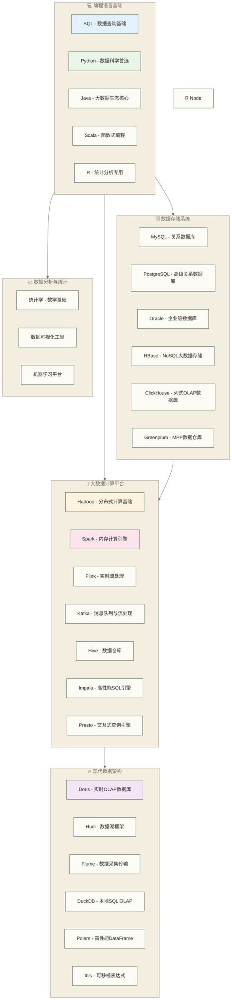
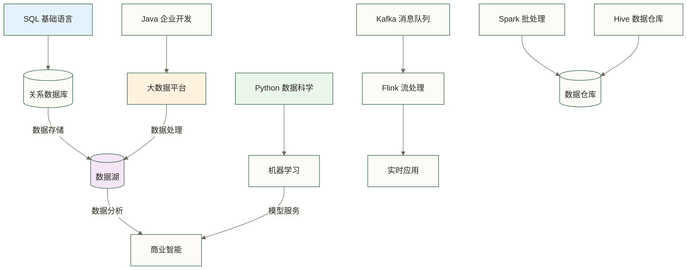

# 技术与工具导航 - 数据从业者技术栈全景图

> [!abstract] 技术栈概览
> - **覆盖范围**：40 个一级技术专题，涵盖数据全生命周期
> - **技术分类**：编程语言、数据库、大数据平台、数据集成、工作流调度、分析工具、AI 与向量技术
> - **学习规划**：提供完整的技术学习路径和职业发展建议
> - **适用人群**：数据工程师、数据分析师、数据科学家、架构师
> - **新增（2026-03）**：DataX 离线同步（9篇）+ Flink CDC 实时同步（5篇）数据集成专题
> - **新增（2026-05）**：Spark 4 / Flink 2.2 / dbt Fusion，以及 DuckDB、Polars、Ibis 轻量分析栈

## 🎯 技术栈架构图

### 📊 数据技术生态系统全景

---

## 💻 编程语言基础

### 🔤 核心编程语言

**[[【技术与工具】/PostgreSQL/00-PostgreSQL学习路线图|PostgreSQL]]** 📊

SQL是结构化查询语言，是数据分析领域最重要的基础技能，无论从事什么数据相关工作都无法避免。作为一门专门为关系数据库设计的声明式语言，SQL具有学习曲线平缓、表达能力强、标准化程度高的特点。在现代数据生态中，SQL不仅用于传统的关系数据库查询，还扩展到了大数据平台、数据仓库、甚至NoSQL系统中。掌握SQL意味着掌握了数据世界的通用语言，可以在MySQL、PostgreSQL、Oracle等关系数据库中畅通无阻，也可以在Hive、Spark SQL、Presto等大数据查询引擎中得心应手。学习SQL的过程就是培养数据思维的过程，通过SQL可以理解数据的组织方式、关联关系、聚合计算等核心概念。

**[[【技术与工具】/Python/00-Python学习路线图|Python]]** 🐍

Python凭借其简洁的语法和丰富的生态系统，成为数据科学领域的绝对王者。作为一门通用编程语言，Python在数据科学中的优势主要体现在其完整的数据科学工具链上。NumPy提供了高性能的数值计算基础，Pandas构建了直观易用的数据处理框架，Matplotlib和Seaborn满足了数据可视化需求，Scikit-learn涵盖了机器学习的主要算法，TensorFlow和PyTorch则是深度学习的利器。Python的另一个优势是其跨平台特性和活跃的社区支持，无论是Windows、macOS还是Linux系统，都能获得一致的开发体验。对于数据从业者而言，Python不仅是数据分析的工具，更是实现数据科学想法的最佳载体。

**[[【技术与工具】/Java/00-Java学习路线图|Java]]** ☕

Java是企业级开发的首选语言，在大数据领域更是占据了绝对的主导地位。Hadoop、Kafka、HBase等核心大数据框架主要使用Java开发，Spark核心主要使用Scala开发；这些框架广泛依托JVM生态，因此Java是理解和扩展相关系统的重要技能。Java的优势在于其强大的企业级特性，包括强类型系统、完善的内存管理、丰富的并发编程支持、成熟的JVM生态等。在大数据场景下，Java的这些特性转化为了处理大规模数据的能力，能够构建高性能、高可靠性的分布式系统。学习Java不仅仅是掌握一门编程语言，更是理解企业级软件开发的思维方式，包括面向对象设计、设计模式、并发编程等高级概念。对于希望在大数据工程师道路上走得更远的从业者，Java是不可或缺的技能。

**[[【技术与工具】/Scala/00-Scala学习路线图|Scala]]** 🎭

Scala是一门融合了面向对象和函数式编程特性的现代编程语言，在大数据领域因为Spark而广受关注。作为Spark核心使用的开发语言，Scala适合编写简洁的数据处理代码；实际性能还取决于所用API、执行计划、数据布局和运行配置，并非由语言选择单独决定。Scala的函数式编程特性使其在处理数据转换时具有天然优势，不可变数据结构、高阶函数、模式匹配等特性让数据处理逻辑更加清晰和可维护。同时，Scala运行在JVM上，能够无缝集成Java生态系统，享受JVM的成熟性和稳定性。学习Scala的过程也是学习现代编程思维的过程，函数式编程的理念对于理解数据流处理、并行计算等概念具有重要价值。

**[[【技术与工具】/PostgreSQL/00-PostgreSQL学习路线图|PostgreSQL]]** 📊

R是专门为统计计算和数据可视化而设计的编程语言，在学术研究和统计分析领域具有无可替代的地位。作为统计学家开发的语言，R内置了丰富的统计函数和数据分析功能，提供了从基础统计到高级建模的完整工具集。R的优势在于其深度的统计功能和精美的可视化能力，ggplot2等包能够创建出版级别的统计图表，而各种专业的统计包则覆盖了几乎所有的统计方法。R的另一个特色是其强大的包生态系统CRAN，包含了数万个专业包，涵盖了统计学、生物信息学、计量经济学等各个领域的专业方法。对于需要进行严谨统计分析的从业者，R提供了最专业和全面的工具支持。

---

## 🗄️ 数据存储系统

### 💾 关系型数据库

**[[【技术与工具】/MySQL/00-MySQL学习路线图|MySQL]]** 🐬

MySQL是世界上最受欢迎的开源关系数据库管理系统，以其简单易用、性能可靠而著称。作为LAMP技术栈的重要组成部分，MySQL几乎支撑了整个互联网的发展历程。其最大的优势在于学习成本低、部署简单、社区支持强大，这使得MySQL成为初学者入门数据库的最佳选择。在企业应用中，MySQL广泛用于Web应用后端、内容管理系统、电子商务平台等场景，特别适合读多写少的OLTP（联机事务处理）系统。MySQL的InnoDB存储引擎提供了ACID事务支持、行级锁定、外键约束等企业级特性，而其丰富的复制和高可用方案使其能够满足大多数业务的可靠性要求。

**[[【技术与工具】/PostgreSQL/00-PostgreSQL学习路线图|PostgreSQL]]** 🐘

PostgreSQL被誉为"世界上最先进的开源关系数据库"，以其严格的SQL标准兼容性和强大的扩展能力而闻名。相比MySQL，PostgreSQL提供了更丰富的数据类型支持，包括数组、JSON、XML、地理空间数据等，使其能够处理更复杂的数据结构。其强大的查询优化器和丰富的索引类型（B-tree、Hash、GiST、GIN等）提供了卓越的查询性能。PostgreSQL的另一个突出特点是其高度的可扩展性，支持自定义函数、操作符、数据类型，甚至可以用多种编程语言编写存储过程。这些特性使PostgreSQL成为复杂分析应用、地理信息系统、科学计算等领域的首选数据库。

**[[【技术与工具】/Oracle/00-Oracle学习路线图|Oracle]]** 🏛️

Oracle Database是全球领先的商业关系数据库，以其无与伦比的企业级特性和卓越性能而著称。作为数据库技术的先驱和引领者，Oracle在事务处理、数据仓库、高可用性、安全性等方面都设立了行业标杆。Oracle的核心优势在于其全面的企业级功能，包括Real Application Clusters（RAC）提供的集群能力、Data Guard提供的灾难恢复方案、Advanced Security提供的数据加密和访问控制等。在性能方面，Oracle的查询优化器被认为是业界最智能的，能够处理最复杂的SQL查询。Oracle还提供了完整的数据治理解决方案，包括数据质量管理、元数据管理、数据血缘追踪等功能，这些都是大型企业数据治理的关键需求。

### 🚀 NoSQL与分析型数据库

**[[【技术与工具】/Hadoop/14-HBase NoSQL数据库|HBase NoSQL数据库]]** 📱
> Hadoop生态的分布式NoSQL数据库，支持实时读写
> - **适用场景**：大规模数据存储、实时数据访问
> - **核心优势**：线性扩展、强一致性
> - **学习优先级**：⭐⭐⭐ 大数据场景

**[[【技术与工具】/ClickHouse/00-ClickHouse学习路线图|ClickHouse]]** ⚡
> 高性能列式OLAP数据库，查询速度极快
> - **适用场景**：实时数据分析、数据仓库、BI系统
> - **核心优势**：查询性能极佳、压缩比高
> - **学习优先级**：⭐⭐⭐⭐ 现代OLAP首选

**[[【技术与工具】/Greenplum/00-Greenplum学习路线图|Greenplum]]** 💚
> 大规模并行处理(MPP)数据仓库平台
> - **适用场景**：企业数据仓库、大规模数据分析
> - **核心优势**：线性扩展、SQL兼容
> - **学习优先级**：⭐⭐⭐ 企业数据仓库

---

## 🚀 大数据计算平台

### 🏗️ 分布式计算基础

**[[【技术与工具】/Hadoop/00-Hadoop学习路线图|Hadoop]]** 🐘

Hadoop是大数据技术发展的基石，开创了分布式存储和计算的新时代。作为Apache基金会的顶级项目，Hadoop解决了大规模数据存储和处理的根本问题，其核心思想是将数据分布存储在普通服务器集群上，通过并行计算实现高性能处理。Hadoop的三大核心组件构成了完整的大数据处理平台：HDFS（Hadoop分布式文件系统）提供了可靠的大规模数据存储能力，能够将PB级别的数据分布存储在数千台服务器上；MapReduce提供了简单而强大的并行编程模型，将复杂的数据处理任务分解为可并行执行的Map和Reduce操作；YARN（资源协调器）则统一管理集群资源，支持多种计算引擎在同一集群上运行。学习Hadoop的意义不仅在于掌握一个具体的技术，更是理解分布式计算的基本原理和大数据处理的核心思想。

**[[【技术与工具】/Spark/00-Spark学习路线图|Spark]]** ✨

Apache Spark是下一代大数据处理引擎，以其卓越的性能和统一的编程模型而广受推崇。相比于Hadoop MapReduce，Spark的最大创新在于基于内存的计算架构，通过弹性分布式数据集（RDD）实现了数据在内存中的持久化和重用，有助于提升迭代算法的性能；原稿所述“10-100倍”为未核实的性能示例，未提供测试环境或负载，不能视为普遍提升幅度。Spark提供了统一的API来处理不同类型的数据处理需求：Spark Core提供基础的分布式计算能力，Spark SQL支持结构化数据查询，Spark Streaming处理实时数据流，MLlib提供机器学习算法库，GraphX支持图计算。这种统一的架构设计使得开发者可以在一个平台上完成从数据摄取到机器学习的完整数据科学流水线，大大简化了技术栈的复杂度。Spark支持多种编程语言（Scala、Java、Python、R），使得不同背景的开发者都能轻松上手。

> [!note] 2026补充
> Spark 4.x 的学习不只是版本追新，重点是 SQL 表达力、Spark Connect、湖仓表格式、Python 可观测性如何支撑 Agent 时代的数据底座。延伸阅读：[[【技术与工具】/Spark/25-Spark-4与AI时代数据处理|Spark 4与AI时代数据处理]]。

### 🌊 实时流处理

**[[【技术与工具】/Flink/00-Flink学习路线图|Flink]]** 🌊

Apache Flink是专为流处理而生的分布式计算引擎，在实时数据处理领域具有无可比拟的优势。Flink的核心理念是"流优先"，将批处理看作是流处理的特殊情况，这种设计哲学使其能够提供真正的低延迟实时处理能力。Flink的技术优势主要体现在几个方面：首先是其事件时间处理能力，能够处理乱序到达的数据并提供精确的时间窗口计算；其次是强大的状态管理机制，支持大规模有状态计算并提供精确一次（exactly-once）的处理语义；再次是其灵活的窗口机制，支持时间窗口、计数窗口、会话窗口等多种窗口类型。Flink还提供了丰富的连接器生态，能够与Kafka、Elasticsearch、HDFS等多种外部系统无缝集成。在实际应用中，Flink广泛用于实时风控、实时推荐、实时监控、复杂事件处理等对延迟敏感的场景。

> [!note] 2026补充
> Flink 的前沿方向已经从实时 ETL 扩展到实时 Data-AI：连续特征、在线推理、向量检索和 Agent 事件编排会成为新的学习重点。延伸阅读：[[【技术与工具】/Flink/22-Flink-2_2实时Data-AI架构|Flink 2.2实时Data-AI架构]]。

**[[【技术与工具】/Kafka/00-Kafka学习路线图|Kafka]]** 📨

Apache Kafka是现代数据架构的核心基础设施，以其卓越的性能和可靠性重新定义了消息队列的概念。Kafka不仅仅是一个消息队列，更是一个完整的流处理平台，能够处理每秒数百万条消息的高吞吐量场景。Kafka的设计理念是将数据流看作是一系列有序的、不可变的记录序列，这些记录被持久化到分布式的、分区的、可复制的日志中。其核心优势包括：高吞吐量的消息传递能力，得益于其高效的磁盘存储和零拷贝技术；水平可扩展性，通过分区机制实现负载分散和并行处理；数据持久化能力，消息可以持久保存并支持历史数据重放；强大的容错机制，通过副本机制保证数据可靠性。Kafka Connect提供了丰富的连接器生态，Kafka Streams则提供了轻量级的流处理能力，使Kafka成为企业级数据流处理的首选平台。

### 🏛️ 数据仓库与查询引擎

**[[【技术与工具】/Hadoop/13-Hive数据仓库|Hive数据仓库]]** 🐝
> 基于Hadoop的数据仓库软件，支持SQL查询
> - **核心优势**：SQL接口、元数据管理、成熟稳定
> - **适用场景**：数据仓库建设、离线数据分析
> - **学习优先级**：⭐⭐⭐⭐ 数据仓库必备

**[[【技术与工具】/Impala/05-Impala SQL语法基础|Impala SQL语法]]** 🚀
> Hadoop生态的高性能SQL查询引擎
> - **核心优势**：查询速度快、资源利用率高
> - **适用场景**：交互式查询、即席分析
> - **学习优先级**：⭐⭐⭐ 高性能查询

**[[【技术与工具】/Presto/05-Presto SQL语法基础|Presto SQL语法]]** 🎭
> 支持多数据源的交互式查询引擎
> - **核心优势**：跨数据源查询、查询速度快
> - **适用场景**：数据联邦、交互式分析
> - **学习优先级**：⭐⭐⭐⭐ 现代查询引擎

---

## 🔥 现代数据架构

### 💎 新一代数据技术

**[[【技术与工具】/Doris/00-Doris学习路线图|Doris]]** 💎

Apache Doris是新一代的实时OLAP数据库，专为现代数据分析场景而设计。作为一款MPP（大规模并行处理）数据库，Doris在架构设计上充分考虑了现代业务对实时性和高并发的要求。其核心优势体现在多个层面：首先是其流批一体的架构设计，支持实时数据写入的同时保证查询性能，解决了传统OLAP系统在实时性方面的痛点；其次是其优异的查询性能，通过列式存储、向量化执行、智能物化视图等技术实现亚秒级查询响应；再次是其高并发处理能力，单集群可以支持数千个并发查询，满足企业级应用的需求。Doris还提供了丰富的数据模型支持，包括明细模型、聚合模型、更新模型等，能够适应不同的业务场景。在实际应用中，Doris广泛用于实时报表、用户画像、实时数据大屏、多维分析等场景，是构建现代数据平台的重要选择。

**[[【技术与工具】/Hudi/00-Hudi学习路线图|Hudi]]** 🌊

Apache Hudi是下一代数据湖存储管理框架，解决了传统数据湖在数据更新、数据质量、数据治理方面的核心痛点。Hudi的名称来自"Hadoop Upserts Deletes and Incrementals"，这恰好概括了其核心功能。传统的数据湖通常只支持追加写入，而Hudi通过创新的存储格式和索引机制，实现了对数据湖中数据的高效更新和删除操作。其核心特性包括：增量数据处理能力，通过时间轴概念跟踪数据变更历史，支持增量查询和增量处理；数据版本管理，提供时间旅行功能，可在版本支持及历史保留范围内查询数据快照；通过时间轴记录提交和变更历史，完整的跨系统数据血缘仍需配合其他治理工具；灵活的数据布局优化，通过聚簇、压缩等技术提升查询性能。Hudi与Apache Spark、Apache Flink等计算引擎无缝集成，支持流批一体的数据处理模式，是构建现代数据湖架构的核心组件。

### 🔄 数据集成与传输

**[[【技术与工具】/DataX/00-DataX学习路线图|DataX]]**

DataX 是阿里巴巴开源的离线数据同步框架，国内数据团队事实上的离线同步标准工具。其核心设计是 Framework + Plugin 的插件化架构，通过统一的 Reader-Channel-Writer 模型，支持 MySQL、Oracle、PostgreSQL、HDFS、OSS、HBase 等 20+ 种数据源之间的任意组合同步。在国内的数据仓库建设中，DataX 几乎是 MySQL → Hive ODS 层 T+1 同步的首选——配置简单（JSON 格式），稳定可靠（阿里内部大规模验证），社区活跃（中文文档丰富）。DataX 内置流控机制（bps/tps 限速）保护源数据库，脏数据处理机制保证同步过程的可观测性。与 DolphinScheduler、Airflow 深度集成，是构建企业级离线数仓的核心组件。

本系列专为数据开发工程师设计，涵盖从安装到生产运维的完整知识体系：

- [[【技术与工具】/DataX/00-DataX学习路线图|学习路线图]] - 知识全景与学习路径规划
- [[【技术与工具】/DataX/01-数据集成概述|数据集成概述]] - 离线 vs 实时同步、DataX/Sqoop/Flink CDC/Canal 选型指南
- [[【技术与工具】/DataX/02-DataX核心架构|核心架构]] - Framework + Plugin 模型、Reader-Channel-Writer 三段式、任务切分与流控
- [[【技术与工具】/DataX/03-DataX安装与配置|安装与配置]] - JDK/Python 依赖、目录结构、第一个同步任务
- [[【技术与工具】/DataX/04-常用Reader插件|常用 Reader 插件]] - mysqlreader/oraclereader/hdfsreader/ossreader 完整配置
- [[【技术与工具】/DataX/05-常用Writer插件|常用 Writer 插件]] - hdfswriter/hivewriter/mysqlwriter/osswriter 完整配置
- [[【技术与工具】/DataX/06-DataX实战场景|实战场景]] - MySQL→Hive 全量/增量同步、多表批量、分库分表、大表调优
- [[【技术与工具】/DataX/07-DataX调优与运维|调优与运维]] - Channel 调优、JVM 内存、脏数据处理、监控告警
- [[【技术与工具】/DataX/08-DataX与调度集成|调度集成]] - Airflow/DolphinScheduler 集成、生产部署方案

**[[【技术与工具】/Flink-CDC/00-Flink-CDC学习路线图|Flink CDC]]**

Flink CDC（Change Data Capture）是实时数据同步领域的主流方案，基于 Apache Flink 构建，通过读取 MySQL binlog、PostgreSQL WAL、Oracle Redo Log 等数据库变更日志，实现毫秒级的实时数据捕获。其核心技术优势体现在三个层面：支持增量快照的连接器可降低全量读取阶段的锁表影响，是否需要锁及所需权限取决于数据库和连接器实现；Flink Checkpoint 为故障恢复及 Exactly-Once 处理提供基础，端到端不丢不重还取决于源端日志保留、目标端事务或幂等能力及正确配置；Pipeline API 可在受支持的版本和连接器组合中配置整库、多表实时同步。在现代实时数仓架构中，Flink CDC 通常与 [[【技术与工具】/Paimon/00-Paimon学习路线图|Paimon]] 或 [[【技术与工具】/Hudi/00-Hudi学习路线图|Hudi]] 配合，构建实时入湖的标准链路。

本系列专为需要构建实时数仓和实时数据集成的工程师设计：

- [[【技术与工具】/Flink-CDC/00-Flink-CDC学习路线图|学习路线图]] - 知识全景与学习路径规划
- [[【技术与工具】/Flink-CDC/01-CDC技术原理|CDC 技术原理]] - binlog/WAL 原理、基于日志 vs 基于查询、增量快照算法
- [[【技术与工具】/Flink-CDC/02-Flink-CDC核心特性|核心特性]] - 架构设计、Exactly-Once、Schema Evolution、多数据库支持
- [[【技术与工具】/Flink-CDC/03-Flink-CDC实战|实战场景]] - MySQL→Kafka/Hudi/Paimon/Iceberg、整库同步完整 SQL 配置
- [[【技术与工具】/Flink-CDC/04-Flink-CDC生产实践|生产实践]] - 监控指标、故障排查手册、性能调优、离线实时配合策略

**[[【技术与工具】/Flume/00-Flume学习路线图|Flume]]**
> 高可靠的数据采集、聚合和传输系统
> - **核心优势**：高可靠性、容错性、可配置性
> - **适用场景**：日志收集、数据传输、ETL预处理
> - **学习优先级**：⭐⭐⭐ 数据集成工具

### ⏰ 工作流调度

工作流调度是数据工程的基础设施，负责在正确的时间、按照正确的顺序、自动执行数据管道中的每一步。掌握调度系统，是从"写脚本"到"做数据工程"的关键一跃。

**[[【技术与工具】/Airflow/00-Airflow学习路线图|Apache Airflow 完整知识体系]]**

Apache Airflow 是全球使用最广泛的工作流调度工具，用 Python 代码定义 DAG（有向无环图），通过 Operator 封装各种操作（Shell、SQL、Spark、Hive...），让数据管道可以被版本控制、可视化监控、自动重试和按时调度。从 crontab 管理十几个脚本到 Airflow 管理数百个 DAG，是每个数据工程师职业成长的必经之路。

本系列共 12 篇，覆盖从入门到生产的完整知识体系：

- [[【技术与工具】/Airflow/01-工作流调度概述|工作流调度概述]] - crontab vs 专业调度系统，Airflow/DS/Azkaban 横评
- [[【技术与工具】/Airflow/02-Airflow核心概念|Airflow核心概念]] - DAG、Task、Operator、Executor、XCom 完整解析
- [[【技术与工具】/Airflow/03-Airflow安装部署|安装部署]] - Docker Compose 一键部署，PostgreSQL 生产配置
- [[【技术与工具】/Airflow/04-第一个DAG|第一个DAG]] - 从零编写完整 DAG，理解 schedule_interval 和 catchup
- [[【技术与工具】/Airflow/05-常用Operator详解|常用Operator详解]] - Bash/Python/SQL/Hive/Spark/Email/Sensor 全覆盖
- [[【技术与工具】/Airflow/06-任务依赖与编排|任务依赖与编排]] - 条件分支、跨 DAG 触发、TaskGroup、动态 DAG
- [[【技术与工具】/Airflow/07-调度策略与时间管理|调度策略与时间管理]] - cron 表达式、数据区间概念、时区陷阱、SLA
- [[【技术与工具】/Airflow/08-变量连接与配置管理|变量连接与配置管理]] - Variable、Connection、Secrets Backend 最佳实践
- [[【技术与工具】/Airflow/09-监控告警与故障处理|监控告警与故障处理]] - Web UI 使用、钉钉/飞书告警、僵尸任务处理
- [[【技术与工具】/Airflow/10-数据管道实战|数据管道实战]] - MySQL→ODS→DWS→报表→邮件的完整端到端案例
- [[【技术与工具】/Airflow/11-Airflow进阶实践|Airflow进阶实践]] - CeleryExecutor、KubernetesExecutor、自定义 Operator、dbt 集成
- [[【技术与工具】/Airflow/12-Airflow最佳实践与踩坑|最佳实践与踩坑]] - 幂等性设计、性能调优、常见坑、生产 checklist

> [!tip] 适用版本
> 本系列以 Airflow 2.7+ 为原稿标注的学习基线；此处未提供逐篇代码的运行验证记录。使用 Docker Compose 前须确认具体 Airflow 版本、Provider 依赖、镜像和外部服务配置，不能据此推定所有后续版本均可直接运行。

**[[【技术与工具】/DolphinScheduler/00-DolphinScheduler概述与对比|DolphinScheduler（海豚调度）]]**
> 国内企业使用最广泛的调度工具，可视化拖拽配置，开箱即用多租户
> - **核心优势**：可视化 DAG 设计、原生多租户、国内生态集成（飞书/钉钉）
> - **适用场景**：SQL 工程师团队、需要多项目隔离的大型企业
> - **学习优先级**：⭐⭐⭐⭐ 国内数仓项目必备了解

### 🔧 数据转换与分析工程

**[[【技术与工具】/dbt/00-dbt学习路线图|dbt（data build tool）]]**

dbt 是现代数据栈（Modern Data Stack）转换层的核心工具，代表了"分析工程化（Analytics Engineering）"的趋势。它让数据分析师能用软件工程的方式管理 SQL 转换逻辑——版本控制、依赖管理、自动化测试、数据文档，一套工具全部搞定。核心理念是：你只写 SELECT 语句描述"数据应该是什么样"，dbt 负责在数据仓库中创建表或视图。与 Airflow 等调度工具配合，dbt 成为 ELT 管道中 T（Transform）环节的最佳实践。原稿称2023-2025年 Analytics Engineer 是数据领域增速最快的岗位之一，但未提供统计来源、地区或岗位口径，该增速判断尚未核实；dbt 是这一角色常用的工具之一。

本系列专为初中级数据分析师和数据工程师设计，覆盖 dbt Core 的完整知识体系：

- [[【技术与工具】/dbt/01-dbt概述与理念|dbt 概述与理念]] - ELT vs ETL、Analytics Engineering 角色、dbt Core vs dbt Cloud
- [[【技术与工具】/dbt/02-dbt安装与项目初始化|安装与项目初始化]] - pip 安装、适配器选择、profiles.yml、项目目录结构
- [[【技术与工具】/dbt/03-Model基础|Model 基础]] - SELECT 就是 Model、ref() 函数、四种物化方式（view/table/incremental/ephemeral）
- [[【技术与工具】/dbt/04-数据建模分层|数据建模分层]] - staging/intermediate/marts 三层架构、source() 函数、与传统 ODS/DWD/DWS 的对应
- [[【技术与工具】/dbt/05-增量模型|增量模型]] - incremental 策略、is_incremental() 宏、merge/append/delete+insert 策略
- [[【技术与工具】/dbt/06-测试与数据质量|测试与数据质量]] - 四种内置测试、dbt-expectations、数据质量即代码
- [[【技术与工具】/dbt/07-文档与数据血缘|文档与数据血缘]] - schema.yml 文档、dbt docs 生成、可视化血缘图
- [[【技术与工具】/dbt/08-Jinja与宏|Jinja 与宏]] - Jinja 模板、自定义宏、dbt-utils 包、DRY 原则
- [[【技术与工具】/dbt/09-Seeds与Snapshots|Seeds 与 Snapshots]] - CSV seed 管理维度表、snapshot 实现 SCD Type 2
- [[【技术与工具】/dbt/10-dbt与调度集成|dbt 与调度集成]] - 命令行全览、Airflow 集成、GitHub Actions CI/CD
- [[【技术与工具】/dbt/11-dbt项目实战|dbt 项目实战]] - 完整电商数仓项目（source → staging → intermediate → marts → 测试 → 文档）
- [[【技术与工具】/dbt/12-dbt最佳实践|dbt 最佳实践]] - 项目规范、SQL 风格、性能优化、团队协作、dbt Mesh 简介
- [[【技术与工具】/dbt/14-dbt-Fusion与AI时代SQL语义工程|dbt Fusion与AI时代SQL语义工程]] - Fusion 引擎、SQL 语义理解、状态感知编排、AI-ready metadata

> [!tip] 选型建议
> - **学习环境**：dbt Core + DuckDB（零配置，免费，本地运行）
> - **生产环境**：dbt Core + Airflow 或 dbt Cloud（按团队规模选择）
> - **适配器**：根据已有数仓选择（Snowflake/BigQuery/PostgreSQL/ClickHouse 等有对应适配器，但维护主体与支持范围不同，须核对具体适配器的版本兼容性，不能统称为 dbt 官方维护）

#### 🧪 轻量分析栈：DuckDB / Polars / Ibis

DuckDB、Polars、Ibis 不是用来取代 Spark / Flink 的“大集群”，而是补上数据人日常最高频的“小而快”场景：本地文件分析、Notebook 探索、Parquet 抽样、轻量数据产品、AI Agent 自动生成分析脚本。它们代表的是一种更务实的工程审美：先把问题在桌面上想清楚，再决定是否上分布式系统。

- [[【技术与工具】/DuckDB/00-DuckDB学习路线图|DuckDB学习路线图]]：适合 SQL 型分析、本地 OLAP、Parquet / CSV 文件直接查询。
- [[【技术与工具】/Polars/00-Polars学习路线图|Polars学习路线图]]：适合 Python DataFrame 性能瓶颈、LazyFrame 优化、表达式式数据处理。
- [[【技术与工具】/Ibis/00-Ibis学习路线图|Ibis学习路线图]]：适合希望用一套 Python 表达式跨 DuckDB、Polars、PostgreSQL、BigQuery 等后端的团队。

> [!tip] 选型判断
> 单机文件、探索分析、教学项目优先 DuckDB / Polars；团队级 SQL 工程优先 dbt；海量数据、统一资源调度、湖仓治理再上 Spark / Flink。

---

## 🤖 AI 与向量技术

### 🧠 向量数据库专题

向量数据库是 AI 时代的核心基础设施，是构建 RAG 系统、语义搜索、推荐系统的关键组件。掌握向量数据库，就掌握了 AI 应用落地的底层能力。

**[[【技术与工具】/向量数据库/00-向量数据库选型指南|向量数据库选型指南]]** 🗺️
> 不知道选哪个？从这里开始，5个问题帮你做决定
> - **核心价值**：决策框架 + 产品横评 + 场景化推荐
> - **适合人群**：技术选型、架构师、RAG 系统开发者

#### 📐 通用知识（跨技术栈）

**[[【技术与工具】/向量数据库/通用知识/01-向量搜索原理与ANN算法|向量搜索原理与 ANN 算法]]** 🔬
> 搞懂向量搜索的底层逻辑：维度灾难、暴力搜索瓶颈，以及 HNSW/IVF/PQ/LSH 四大 ANN 算法原理
> - **核心内容**：HNSW 多层图结构 · IVF 聚类索引 · PQ 乘积量化 · Faiss 代码示例
> - **必读指数**：⭐⭐⭐⭐⭐ 理解向量数据库的理论基础

**[[【技术与工具】/向量数据库/通用知识/02-Embedding模型选型指南|Embedding 模型选型指南]]** 🧬
> MTEB 任务体系 + BGE/OpenAI/Jina/Cohere/GTE 选型维度，帮助判断 Embedding 模型
> - **核心内容**：MTEB 8大任务 · MRL 维度压缩 · Late Chunking · 工程化部署
> - **必读指数**：⭐⭐⭐⭐⭐ RAG 系统的质量天花板在这里

**[[【技术与工具】/向量数据库/通用知识/03-混合搜索工程实践|混合搜索工程实践]]** 🔀
> BM25 + 向量检索融合，RAG 效果提升的核心手段
> - **核心内容**：Dense + Sparse 融合原理 · RRF 算法 · Reranker 精排 · 生产部署
> - **必读指数**：⭐⭐⭐⭐⭐ 让 RAG 召回率再上一个台阶

**[[【技术与工具】/向量数据库/通用知识/04-RAG系统架构设计模式|RAG 系统架构设计模式]]** 🏗️
> 从 Naive RAG 到 Advanced RAG 到 Modular RAG 的完整演进路径，不绑定特定向量数据库
> - **核心内容**：10+ 改进模式 · RAGAS 评估 · 多租户隔离 · 生产级设计
> - **必读指数**：⭐⭐⭐⭐⭐ 构建企业级 RAG 系统的架构蓝图

#### 🗄️ 技术栈专题

**[[【技术与工具】/向量数据库/Milvus/00-Milvus学习路线图|Milvus 完整知识体系]]** 🏆
> 开源向量数据库的王者，十亿级场景的不二之选 · **11篇深度文档**
> - **核心优势**：云原生、存算分离、超大规模、HNSW/IVF 全索引覆盖
> - **适用场景**：企业级 AI 平台、超大规模推荐系统、生产级 RAG
> - **学习优先级**：⭐⭐⭐⭐⭐ 生产首选
>
> 📚 **文档导航**：[[【技术与工具】/向量数据库/Milvus/01-Milvus概述与核心定位|概述]] · [[【技术与工具】/向量数据库/Milvus/02-Milvus架构深度解析|架构]] · [[【技术与工具】/向量数据库/Milvus/03-核心概念详解|核心概念]] · [[【技术与工具】/向量数据库/Milvus/04-安装与部署|安装部署]] · [[【技术与工具】/向量数据库/Milvus/05-第一个Milvus应用|入门实战]] · [[【技术与工具】/向量数据库/Milvus/06-索引类型与选型指南|索引指南]] · [[【技术与工具】/向量数据库/Milvus/07-Schema设计与数据建模|Schema设计]] · [[【技术与工具】/向量数据库/Milvus/08-查询与搜索详解|查询搜索]] · [[【技术与工具】/向量数据库/Milvus/09-生产运维与性能调优|生产运维]] · [[【技术与工具】/向量数据库/Milvus/10-RAG集成实战|RAG集成]]

**[[【技术与工具】/向量数据库/Qdrant/00-Qdrant学习路线图|Qdrant 完整知识体系]]** ⚡
> Rust 编写，性能极致，Payload 过滤与混合搜索的天花板 · **11篇深度文档**
> - **核心优势**：零 GC 延迟、Filterable HNSW、三级量化压缩（SQ/PQ/BQ）、原生混合搜索
> - **适用场景**：中大规模生产、过滤性能敏感的 RAG、Binary Quantization 超大规模场景
> - **学习优先级**：⭐⭐⭐⭐⭐ 强烈推荐
>
> 📚 **文档导航**：[[【技术与工具】/向量数据库/Qdrant/01-Qdrant概述与核心定位|概述]] · [[【技术与工具】/向量数据库/Qdrant/02-Qdrant架构深度解析|架构]] · [[【技术与工具】/向量数据库/Qdrant/03-核心概念详解|核心概念]] · [[【技术与工具】/向量数据库/Qdrant/04-安装与部署|安装部署]] · [[【技术与工具】/向量数据库/Qdrant/05-第一个Qdrant应用|入门实战]] · [[【技术与工具】/向量数据库/Qdrant/06-索引与量化配置|索引量化]] · [[【技术与工具】/向量数据库/Qdrant/07-Payload与过滤设计|Payload过滤]] · [[【技术与工具】/向量数据库/Qdrant/08-搜索与查询详解|查询搜索]] · [[【技术与工具】/向量数据库/Qdrant/09-生产运维与性能调优|生产运维]] · [[【技术与工具】/向量数据库/Qdrant/10-RAG集成实战|RAG集成]]

**[[【技术与工具】/向量数据库/Weaviate/00-Weaviate学习路线图|Weaviate 完整知识体系]]** 🌐
> AI-Native 设计，覆盖架构、模块、Schema、多租户、查询、生产运维和 RAG 集成
> - **核心优势**：自动向量化、模块化能力、GraphQL 接口、多租户隔离
> - **适用场景**：企业知识库、语义搜索、多租户 AI 应用
> - **学习优先级**：⭐⭐⭐⭐ AI 应用工程
>
> 📚 **文档导航**：[[【技术与工具】/向量数据库/Weaviate/01-Weaviate概述与核心定位|概述]] · [[【技术与工具】/向量数据库/Weaviate/02-Weaviate架构深度解析|架构]] · [[【技术与工具】/向量数据库/Weaviate/03-核心概念详解|核心概念]] · [[【技术与工具】/向量数据库/Weaviate/04-安装与部署|安装部署]] · [[【技术与工具】/向量数据库/Weaviate/05-第一个Weaviate应用|入门实战]] · [[【技术与工具】/向量数据库/Weaviate/06-Modules模块系统详解|模块系统]] · [[【技术与工具】/向量数据库/Weaviate/07-Schema设计与数据建模|Schema设计]] · [[【技术与工具】/向量数据库/Weaviate/07B-多租户与数据隔离|多租户]] · [[【技术与工具】/向量数据库/Weaviate/08-查询与搜索详解|查询搜索]] · [[【技术与工具】/向量数据库/Weaviate/09-生产运维与性能调优|生产运维]] · [[【技术与工具】/向量数据库/Weaviate/10-RAG集成实战|RAG集成]]

**[[【技术与工具】/向量数据库/pgvector/00-pgvector学习路线图|pgvector 完整知识体系]]** 🐘
> 给老房子装电梯——PostgreSQL 向量扩展，零新增基础设施 · **11篇深度文档**
> - **核心优势**：SQL 原生、事务一致性、JOIN 业务表、可结合 PostgreSQL 的 Row Level Security；可复用现有数据库运维体系，但仍需维护索引、资源和备份
> - **适用场景**：已有 PG 栈、向量+关系数据联查、Supabase 用户；原稿“数据量 1000 万以内”为未核实的规模示例，须结合向量维度、索引、过滤条件、硬件和延迟目标压测
> - **学习优先级**：⭐⭐⭐⭐ 已有 PG 栈时值得优先评估；原稿“80% 场景的最优解”未提供统计或比较依据，不作为选型结论
>
> 📚 **文档导航**：[[【技术与工具】/向量数据库/pgvector/01-pgvector概述与核心定位|概述]] · [[【技术与工具】/向量数据库/pgvector/02-pgvector架构深度解析|架构]] · [[【技术与工具】/向量数据库/pgvector/03-核心概念详解|核心概念]] · [[【技术与工具】/向量数据库/pgvector/04-安装与部署|安装部署]] · [[【技术与工具】/向量数据库/pgvector/05-第一个pgvector应用|入门实战]] · [[【技术与工具】/向量数据库/pgvector/06-索引类型与选型|索引选型]] · [[【技术与工具】/向量数据库/pgvector/07-SQL向量查询实战|SQL查询]] · [[【技术与工具】/向量数据库/pgvector/08-与PostgreSQL生态集成|生态集成]] · [[【技术与工具】/向量数据库/pgvector/09-生产运维与性能调优|生产运维]] · [[【技术与工具】/向量数据库/pgvector/10-RAG集成实战|RAG集成]]

**Chroma** 🎨
> 适合原型验证和小规模本地实验。本知识库不单独维护 Chroma 系列，选型判断统一参考 [[【技术与工具】/向量数据库/00-向量数据库选型指南|向量数据库选型指南]]。

---

## 🔧 开发工具与工程效率

### 版本控制

**[[【技术与工具】/Git/00-Git学习路线图|Git 版本控制]]**

Git 是现代软件工程的基础设施，也是数据工程师日常工作不可或缺的工具。无论是 SQL 脚本管理、ETL 代码维护还是数据平台的团队协作，Git 都是核心的协作纽带。对数据从业者来说，掌握 Git 意味着拥有了代码的时光机和安全网——能够追溯任意历史版本、并行开发不同功能、与团队安全协作，以及在生产故障时快速回滚。

本系列专为数据从业者设计，聚焦实际工作场景，涵盖从安装配置到数据项目实战的完整知识体系：

- [[【技术与工具】/Git/01-版本控制概念|版本控制概念]] - 为什么要用 Git、Git vs SVN、数据项目的版本管理痛点
- [[【技术与工具】/Git/02-Git安装与配置|安装与配置]] - Mac/Windows/Linux 安装、SSH 密钥配置、连接 GitHub/GitLab
- [[【技术与工具】/Git/03-Git基础操作|基础操作]] - init/clone/add/commit/log/diff，日常工作流
- [[【技术与工具】/Git/04-分支管理|分支管理]] - 分支策略、Git Flow、数据项目分支实践
- [[【技术与工具】/Git/05-远程仓库协作|远程协作]] - push/pull/fetch、Pull Request 工作流、代码审查
- [[【技术与工具】/Git/06-冲突解决|冲突解决]] - 合并冲突处理与预防最佳实践
- [[【技术与工具】/Git/07-Git进阶技巧|进阶技巧]] - stash、cherry-pick、rebase、tag、.gitignore
- [[【技术与工具】/Git/08-数据项目Git实践|数据项目实践]] - SQL脚本管理、ETL代码、Git LFS 大文件处理
- [[【技术与工具】/Git/09-Git常用命令速查|命令速查表]] - 按场景分类的命令速查
- [[【技术与工具】/Git/10-GitHub与GitLab使用|GitHub 与 GitLab]] - Issue 管理、CI/CD 基础、GitHub Actions

### Linux 与 Shell

**[[【技术与工具】/Linux/00-Linux学习路线图|Linux / Shell 实战指南]]**

Linux 是大数据基础设施的运行底座。Hadoop、Spark、Kafka 等大数据组件在生产中常部署于 Linux 环境；具体运行方式也可能涉及容器或托管服务，SSH 登录是自管服务器场景中的常见操作。本系列专为数据从业者设计，聚焦实际工作中真正会用到的 Linux 和 Shell 技能，不追求运维级深度，只讲数据工作中够用的知识。

- [[【技术与工具】/Linux/01-Linux基础概念|Linux基础概念]] - Linux 是什么、发行版选择、命令行思维入门
- [[【技术与工具】/Linux/02-远程连接与环境配置|远程连接与环境配置]] - SSH 连接、iTerm2/MobaXterm、.bashrc 配置
- [[【技术与工具】/Linux/03-文件系统与目录操作|文件系统与目录操作]] - 目录结构、cd/ls/mkdir/rm/cp/mv
- [[【技术与工具】/Linux/04-文件查看与编辑|文件查看与编辑]] - cat/head/tail/less、vim 够用就行
- [[【技术与工具】/Linux/05-文件权限与用户管理|文件权限与用户管理]] - chmod/chown/sudo，解决权限报错
- [[【技术与工具】/Linux/06-文本处理三剑客|文本处理三剑客]] - grep/sed/awk，数据处理的核武器
- [[【技术与工具】/Linux/07-管道与重定向|管道与重定向]] - 组合命令的威力，`|`/`>`/`>>`/`2>&1`
- [[【技术与工具】/Linux/08-Shell脚本基础|Shell脚本基础]] - 变量、条件、循环、函数，写数据处理脚本
- [[【技术与工具】/Linux/09-进程与任务管理|进程与任务管理]] - ps/top/nohup/tmux，SSH 断线任务继续跑
- [[【技术与工具】/Linux/10-网络与数据传输|网络与数据传输]] - curl/wget/scp/rsync，数据文件传输
- [[【技术与工具】/Linux/11-定时任务crontab|定时任务crontab]] - 定时执行数据脚本，ETL 自动化
- [[【技术与工具】/Linux/12-包管理与软件安装|包管理与软件安装]] - yum/apt/conda，服务器安装软件
- [[【技术与工具】/Linux/13-数据工作常用命令速查|命令速查手册]] - 按场景分类，忘了就翻这里
- [[【技术与工具】/Linux/14-实战场景|综合实战场景]] - 日志分析、批量处理、自动化 ETL 完整案例

### 容器化技术

**[[【技术与工具】/Docker/00-Docker学习路线图|Docker 容器化]]**

Docker 是现代数据工程不可缺少的基础工具，解决了"在我机器上能跑"这个困扰每个数据团队的老大难问题。对于数据工程师而言，Docker 的价值不在于底层原理，而在于三件实际的事：一是快速拉起 MySQL、Kafka、Spark、Flink 等大数据组件的本地测试环境，省去繁琐的手动安装配置；二是把 Python ETL 脚本、数据服务打包成可移植的镜像，在兼容的操作系统、硬件架构及依赖配置下提高运行一致性；三是用 Docker Compose 一个文件定义整个数据开发栈，让团队协作环境标准化。掌握 Docker，有助于在具备兼容镜像、足够资源、网络与权限条件时快速搭建数据开发环境。

本系列专为数据工程师设计，聚焦数据工作中的实际使用场景，不涉及 Kubernetes 等高阶编排：

- [[【技术与工具】/Docker/01-容器化概念入门|容器化概念入门]] - 容器 vs 虚拟机、为什么数据工程师要学 Docker
- [[【技术与工具】/Docker/02-Docker安装与配置|安装与配置]] - Mac/Windows/Linux 安装、国内镜像加速配置
- [[【技术与工具】/Docker/03-镜像管理|镜像管理]] - 找镜像、拉镜像、镜像仓库操作
- [[【技术与工具】/Docker/04-容器基本操作|容器基本操作]] - run/exec/logs、端口映射、目录挂载
- [[【技术与工具】/Docker/05-Dockerfile编写|Dockerfile编写]] - 打包自己的数据处理脚本为镜像
- [[【技术与工具】/Docker/06-Docker Compose入门|Docker Compose入门]] - 多容器编排、数据服务组合
- [[【技术与工具】/Docker/07-数据开发环境搭建|数据开发环境搭建]] - MySQL/Kafka/Spark/Flink/Jupyter 一键启动
- [[【技术与工具】/Docker/08-Docker网络与存储|网络与存储]] - 容器间通信、数据持久化
- [[【技术与工具】/Docker/09-Docker实战场景|实战场景]] - ETL 容器化、数据服务部署、团队环境标准化
- [[【技术与工具】/Docker/10-Docker常用命令速查|命令速查]] - 按场景分类的命令手册
- [[【技术与工具】/Docker/11-Docker问题排查|问题排查手册]] - 常见报错解决方案

---

## 📈 数据分析与统计

### 📊 统计学与数学基础

**[[【技术与工具】/统计学/偏度与峰度|偏度与峰度]]** 📐
> 数据科学和机器学习的理论基础
> - **核心内容**：此处单篇入口聚焦偏度与峰度；描述统计、推断统计、假设检验、回归分析属于更广的统计学学习范围，不应据此入口认定已完整覆盖
> - **适用场景**：数据建模、A/B测试、业务分析
> - **学习优先级**：⭐⭐⭐⭐⭐ 数据科学根基

---

## 🗺️ 学习路径推荐

### 🎯 按职业方向的学习路径

以下6-8个月、8-12个月、10-15个月、12-18个月，以及后文技能评估的月数，均保留为原稿规划参考，未说明每周投入、学习起点或验收条件；不代表到期即可胜任岗位。应以独立项目交付、业务判断和实际工程经验评估能力，架构师等角色尤其不能仅凭学习时长认定。

#### 🔰 数据分析师路径 (6-8个月)

数据分析师是数据领域的入门岗位，专注于从数据中提取业务洞察和支持决策制定。这个职业路径相对较短，但需要扎实的基础技能。第一阶段重点建立数据处理的基础能力，掌握SQL作为数据查询的核心工具，同时学习Python进行数据清洗和基础分析。第二阶段深入统计学理论，建立数据科学的数学基础，掌握各种数据可视化工具来呈现分析结果。第三阶段学习主流数据库系统，包括传统的关系数据库和现代的OLAP数据库，具备处理不同规模数据的能力。最后阶段通过实际项目锻炼业务理解能力，学会将技术技能转化为业务价值。

#### 🏗️ 数据工程师路径 (8-12个月)

数据工程师是数据基础设施的建设者，负责构建和维护企业的数据处理流水线。这个角色要求更深入的技术功底和系统思维能力。第一阶段建立编程基础，选择Java或Python作为主要开发语言，同时深入学习SQL和统计学基础。第二阶段进入大数据技术栈的核心，掌握Hadoop生态系统的基础架构，学习Spark进行大规模数据处理，使用Hive建设数据仓库。第三阶段专注于实时数据处理能力，掌握Kafka作为数据流的中央管道，学习Flink进行低延迟的流计算，使用HBase存储大规模实时数据。最后阶段接触现代数据架构理念，学习云原生技术，通过综合项目整合所学技术。

#### 🤖 数据科学家路径 (10-15个月)

数据科学家是数据领域的高端角色，需要结合统计学、机器学习和业务理解来解决复杂问题。这个路径要求最长的学习时间和最深入的技术掌握。第一阶段深入Python生态，熟练掌握NumPy、Pandas、Scikit-learn等核心库，同时建立扎实的统计学理论基础。第二阶段专注机器学习实践，学习各种算法的原理和应用场景，掌握Spark MLlib进行大规模机器学习。第三阶段进入深度学习领域，掌握TensorFlow或PyTorch框架，学习处理图像、文本等非结构化数据。第四阶段关注模型的生产化部署，学习MLOps实践，掌握模型监控和持续集成。最后阶段选择特定领域深入，如自然语言处理、计算机视觉或推荐系统，通过业务项目积累实战经验。

#### 🏛️ 数据架构师路径 (12-18个月)

数据架构师是数据技术的战略规划者，需要统筹企业数据技术选型和架构设计。这个角色要求最广泛的技术视野和最强的系统设计能力。第一阶段要求对所有主流数据技术都有基础了解，建立全栈的技术认知，能够理解不同技术的适用场景和局限性。第二阶段专注企业级架构设计能力，学习如何设计可扩展、高可用、高性能的数据平台，掌握容量规划、性能调优、灾难恢复等企业级特性。第三阶段紧跟技术发展趋势，深入学习容器化、微服务、云原生等现代技术理念，评估新技术的应用价值。最后阶段发展软技能，学习团队管理和项目领导能力，具备技术决策和团队指导的综合素质。

---

## 🎓 学习建议与最佳实践

### 💡 高效学习策略

> [!tip] 🚀 学习加速技巧
> 1. **循序渐进**：严格按照学习路径，打好基础再进阶
> 2. **项目驱动**：每个技术都要有实际项目练习
> 3. **社区参与**：加入技术社区，分享学习心得
> 4. **持续实践**：理论学习与实际应用相结合
> 5. **定期总结**：建立个人技术知识库，定期回顾

### 🎯 技能评估标准

**初级水平 (3-6个月学习)**

初级数据从业者应当具备扎实的基础技能，这是所有后续学习的根基。首先要熟练掌握SQL查询和数据处理能力，能够编写复杂的SELECT语句，熟练使用聚合函数、窗口函数和多表连接，具备数据清洗和基础分析的能力。其次要能够使用Python进行基础数据分析，掌握NumPy和Pandas库的核心功能，能够处理CSV、Excel等常见数据格式，完成数据预处理和简单的统计分析任务。同时要理解关系数据库的基本概念和操作，包括表结构设计、主键外键关系、索引优化等基础知识，能够独立完成数据库的基本管理任务。最后要具备基础的统计学知识，理解描述性统计指标的含义，掌握假设检验的基本思路，为后续的高级分析奠定理论基础。

**中级水平 (6-12个月学习)**

中级数据从业者需要具备处理企业级数据的能力，能够独立承担项目中的技术实现工作。首先要掌握至少一个大数据平台，如Spark或Hadoop，理解分布式计算的基本原理，能够处理TB级别的数据，熟练使用相关的开发工具和调优技巧。其次要能够设计和实现完整的数据处理流程，从数据源接入到最终的数据产品，包括ETL流程设计、数据质量监控、错误处理机制等关键环节。同时要熟悉NoSQL数据库的使用，理解不同NoSQL产品的特点和适用场景，能够根据业务需求选择合适的存储方案。最后要具备数据仓库建模能力，掌握维度建模理论，能够设计星型模式和雪花模式，理解数据分层架构的设计原则。

**高级水平 (12-24个月学习)**

高级数据从业者是技术专家和团队骨干，需要具备战略思维和领导能力。首先要能够设计企业级数据架构，统筹考虑性能、可用性、扩展性、安全性等多个维度，制定技术选型策略，规划数据平台的演进路线。其次要掌握多种技术栈的集成和优化，不仅要深入理解单个技术的原理，更要理解不同技术之间的协同关系，能够构建高效稳定的技术生态。同时要具备团队技术指导能力，能够指导初级和中级工程师的技术成长，建立技术标准和最佳实践，推动团队整体技术水平的提升。最后要持续跟踪和应用最新技术趋势，评估新技术的应用价值，推动技术创新在业务中的落地实践，保持企业技术竞争力的领先地位。

---

## 🔗 技术生态关系图

### 🌐 技术间的协同关系

---

## 🏆 职业发展与认证

### 📜 推荐技术认证

以下保留原稿认证清单，尚未核实各考试当前是否开放、名称是否更新及颁发机构。请在制定报考计划前逐项查阅认证机构的当前说明；此清单不表示所列认证仍有效或适合当前岗位要求。

**云平台认证**：
- AWS Certified Data Analytics
- Google Cloud Professional Data Engineer
- Azure Data Engineer Associate

**大数据认证**：
- Cloudera Certified Professional (CCP)
- Hortonworks Certified Professional (HCP)
- MongoDB Certified Developer

**数据库认证**：
- Oracle Certified Professional (OCP)
- MySQL Certified Database Administrator
- PostgreSQL Certified Professional

### 💼 职业发展路径

**技术专家路线：深度技术发展路径**

技术专家路线是纯粹的技术发展道路，适合热爱技术钻研、希望在某个领域达到专家水平的从业者。从初级工程师开始，主要负责具体的编码和基础技术实现工作，需要在导师指导下完成项目任务。晋升为中级工程师后，能够独立承担模块开发，开始参与技术方案设计，具备一定的技术判断能力。高级工程师阶段要求具备系统性思维，能够设计复杂的技术架构，在团队中发挥技术骨干作用。技术专家阶段需要在特定领域具有深厚的技术积累，能够解决行业级的技术难题，对外代表公司的技术实力。首席工程师是技术路线的顶峰，不仅要有深度的技术功底，还要有前瞻性的技术视野，引领公司技术发展方向。

**管理路线：技术管理发展路径**

管理路线适合具备一定技术基础、同时有管理天赋和意愿的从业者。从技术骨干开始，在具备扎实技术能力的基础上，开始承担一些项目协调和团队协作的工作。技术组长阶段需要管理3-8人的小团队，既要保持技术能力不落后，又要学会人员管理、项目管理的基本技能。技术经理管理更大规模的团队（通常10-30人），需要制定技术战略、进行资源协调、处理跨部门合作等复杂管理任务。技术总监是部门级的管理角色，负责整个技术部门的规划和运营，需要将技术能力与商业理解相结合。CTO是公司技术的最高负责人，需要将技术战略与公司整体战略相结合，具备技术、管理、商业的综合能力。

**产品路线：数据产品发展路径**

产品路线是将技术能力与业务理解相结合的发展道路，适合既懂技术又有商业敏感度的从业者。数据分析师是起点，主要负责从数据中提取业务洞察，支持业务决策，需要具备扎实的数据技能和基础的业务理解。高级分析师不仅要有更深入的技术能力，还要能够独立设计分析框架，主动发现业务问题，提出有价值的解决方案。数据产品经理是关键的转换点，需要将技术背景转化为产品思维，负责数据产品的规划设计，协调技术团队和业务团队，确保产品能够真正解决业务问题。数据产品总监管理多个产品线，需要制定产品战略，具备市场洞察力和战略规划能力，是技术与商业的桥梁角色。

---

*最后更新：2026-08-26*

#技术栈 #学习路线 #数据技术 #职业发展 #技术导航