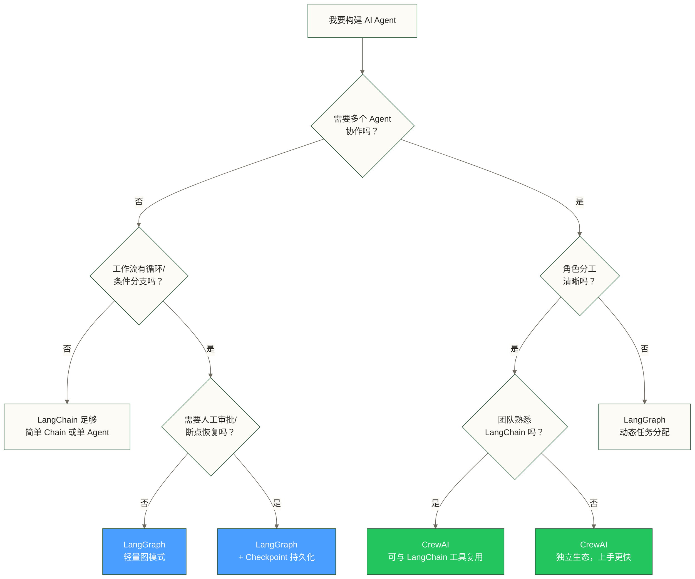

# AI Agent 框架选型指南

> 框架是乐高积木，Agent 是你要搭的城堡。选错积木，城堡怎么也搭不稳。

工具层永远是从"知道有这个东西"到"能用它干活"之间最难跨越的一步。AI Agent 这个方向尤甚——概念层的内容已经够多了，但真正坐下来写代码时，摆在你面前的是五六个框架，每个都说自己最好，你不知道从哪里下手。

这篇文档的目的很简单：帮你在 15 分钟内搞清楚选哪个框架，以及为什么。

---

## 2025 年主流框架全景

| 框架 | 定位 | 最适合 | 不适合 | 成熟度 |
|------|------|--------|--------|--------|
| **LangChain** | 通用 LLM 应用框架 | 快速原型、工具链组装 | 复杂状态管理 | ⭐⭐⭐⭐⭐ |
| **LangGraph** | 有状态 Agent 工作流（LangChain 子项目） | 复杂多步骤、需要人工审批的 Agent | 简单线性流程 | ⭐⭐⭐⭐ |
| **CrewAI** | 多角色协作 Agent | 角色分工明确的团队协作场景 | 单 Agent 简单任务 | ⭐⭐⭐⭐ |
| **AutoGen**（微软） | 对话式多 Agent | 研究型、对话驱动的 Agent | 生产级稳定性要求高的场景 | ⭐⭐⭐ |
| **Agno**（前 Phidata） | 轻量级 Agent 框架 | 快速构建单 Agent | 复杂协作 | ⭐⭐⭐ |

> [!note] 关于 AutoGen
> 使用 AutoGen 教程时，应核对其对应的版本和 API（包括 AgentChat API），不能仅凭旧教程的写法判断当前版本是否适用。本文入门路线优先介绍 LangGraph 和 CrewAI；这属于学习路径建议，不代表两者的社区活跃度或文档完整性已经过比较核验。

---

## 选型决策树

先问自己三个问题，答案决定你的框架选择。

---

## 数据工程师的推荐路线

如果你是数据工程师（而不是全栈 AI 工程师），推荐路线是：

**LangGraph 优先，CrewAI 作为补充。**

原因很直接：数据工作流天然有状态。

一个典型的数据分析 Agent 要做的事是这样的：

1. 理解用户需求
2. 生成 SQL
3. 执行 SQL，获取结果
4. 判断结果是否足够（不够就回到第 2 步补查）
5. 生成分析报告
6. 等待用户审核（人工审批节点）
7. 输出最终结果

这个流程有**循环**（第 4 步可能多次触发）、有**条件分支**（够了和不够走不同路径）、有**人工介入点**（第 6 步）。这三个特征加在一起，就是 LangGraph 的主场。

CrewAI 适合的场景是"角色分工清晰的团队任务"——比如：数据采集 Agent + 数据分析 Agent + 报告撰写 Agent 三者各司其职，输出是一篇竞品分析报告。这种场景用 CrewAI 写起来非常自然。

> [!tip] 学习路径建议
> 1. 先把 [[【技术与工具】/AI-Agent框架/01-LangGraph实战|LangGraph实战]] 通读一遍，跑通核心案例
> 2. 再看 [[【技术与工具】/AI-Agent框架/02-CrewAI实战|CrewAI实战]]，理解多角色协作的思路
> 3. 工具开发参考 [[【技术与工具】/AI-Agent框架/03-Agent工具开发规范|Agent工具开发规范]]
> 4. 理论基础回溯 [[【AI 与大数据】/03-AI-Agent/01-AI-Agent智能体概述|AI Agent智能体概述]]

---

## 2026补充：框架之外还要理解协议

框架解决“Agent 内部怎么编排”，协议解决“Agent 怎么连接外部世界”。如果要进入企业级生产环境，建议补两条线：

- [[【技术与工具】/AI-Agent框架/06-A2A协议与MCP分工|A2A协议与MCP分工]]：理解 Agent 与工具、Agent 与 Agent 的接口边界。
- [[【AI 与大数据】/03-AI-Agent/07-企业级Agent控制平面|企业级Agent控制平面]]：理解注册、策略、运行、观测、评估、审计这些生产化能力。
- [[【AI 与大数据】/03-AI-Agent/08-Agent安全与沙箱执行|Agent安全与沙箱执行]]：理解为什么 Agent 运行时必须有沙箱和权限边界。

> [!tip] 新判断
> 2026 年学 Agent，不能只学 LangGraph、CrewAI 这类框架。框架是“写法”，协议和控制平面才是“生产系统”。

## 框架选型的常见误区

**误区一：用最新的就是最好的**

AutoGen、Agno 等框架的关注度不能替代生产环境所需的稳定性和可调试性验证。本文优先推荐 LangGraph 和 CrewAI 作为候选，但未提供统一版本范围和比较测试，不能据此认定它们在这两点上必然更成熟。

**误区二：框架越复杂，Agent 越强**

框架只是胶水。Agent 的实际能力取决于：底层 LLM 的能力 + 工具设计的质量 + 提示词的质量。选了 LangGraph 但工具写得一塌糊涂，Agent 照样干不了活。工具开发见 [[【技术与工具】/AI-Agent框架/03-Agent工具开发规范|Agent工具开发规范]]。

**误区三：一套框架解决所有问题**

现实项目里，LangGraph 和 CrewAI 可以共存——用 LangGraph 控制整体流程，在某些节点内部用 CrewAI 协调子团队。框架不是信仰，是工具。

---

## 快速参考

| 我的需求 | 推荐框架 |
|----------|----------|
| 快速验证一个想法 | LangChain |
| 需要循环、条件分支的工作流 | LangGraph |
| 需要人工审批节点 | LangGraph + Checkpoint |
| 多个角色协作完成一个项目 | CrewAI |
| 复杂工作流 + 角色协作 | LangGraph（主流程）+ CrewAI（子团队） |
| 极简单的单次问答增强 | LangChain 或直接调用 API |

---

## 相关文档

- [[【技术与工具】/AI-Agent框架/01-LangGraph实战|LangGraph实战]] — 有状态 Agent 工作流完整实战
- [[【技术与工具】/AI-Agent框架/02-CrewAI实战|CrewAI实战]] — 多角色协作 Agent 完整实战
- [[【技术与工具】/AI-Agent框架/03-Agent工具开发规范|Agent工具开发规范]] — 工具设计与开发标准
- [[【AI 与大数据】/03-AI-Agent/01-AI-Agent智能体概述|AI Agent智能体概述]] — Agent 概念基础
- [[【AI 与大数据】/03-AI-Agent/02-AI-Agent开发框架实战|AI Agent开发框架实战]] — 更多框架对比
- [[【AI 与大数据】/03-AI-Agent/03-AI多Agent协作系统|AI多Agent协作系统]] — 多 Agent 理论
- [[【技术与工具】/AI-Agent框架/06-A2A协议与MCP分工|A2A协议与MCP分工]] — Agent 协议与互操作边界

#AI-Agent #框架选型 #LangGraph #CrewAI #LangChain
