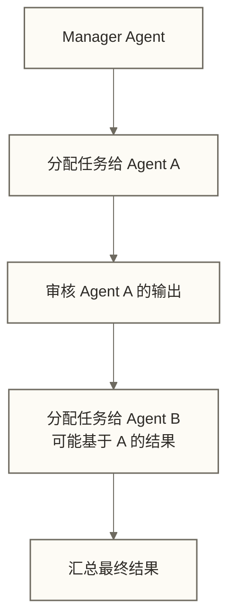

# CrewAI 实战

LangGraph 是精确的流水线——你画图、你控制每一步的走向。CrewAI 是招募一支团队——你告诉每个人是谁、目标是什么，然后让他们自己配合完成任务。

两种思路没有高下，适用于不同场景。当你的任务可以清晰地分解成"研究员收集信息、分析师挖掘洞察、作者撰写报告"这样的角色分工时，CrewAI 写起来比 LangGraph 自然得多。

> [!tip] 前置知识
> - Python 基础
> - 了解 LLM 基本概念
> - 参考 [[【技术与工具】/AI-Agent框架/00-AI-Agent框架选型指南|AI Agent框架选型指南]] 确认 CrewAI 适合你的场景
> - 如果需要复杂条件分支，先看 [[【技术与工具】/AI-Agent框架/01-LangGraph实战|LangGraph实战]]

---

## CrewAI 的核心思想

CrewAI 把 Agent 协作建模为**团队项目**：

- **Agent（成员）**：有角色（role）、目标（goal）、背景（backstory）的 AI 团队成员
- **Task（任务）**：团队要完成的具体工作，可以指定由哪个 Agent 负责
- **Crew（团队）**：把 Agent 和 Task 组织在一起，定义执行方式

与 LangGraph 的根本区别：

```text
LangGraph：你精确控制每个节点的执行逻辑和转换条件
CrewAI：你定义角色、任务和执行模式，LLM 在这些约束内完成任务；顺序模式仍由显式任务顺序控制
```

CrewAI 中由 LLM 决定的执行细节具有不确定性，但任务顺序、上下文依赖和工具边界仍可显式配置；在角色分工清晰的场景下，这种灵活性可能是优势。

---

## 安装

```bash
pip install crewai crewai-tools
# 如果需要使用 OpenAI
pip install langchain-openai
```

配置 LLM（CrewAI 默认使用 OpenAI，也支持其他模型）：

```bash
export OPENAI_API_KEY="your-api-key"
# 或者在代码中配置
```

---

## 快速上手：单 Crew 示例

用最简洁的代码感受 CrewAI 的工作方式。此例未提供检索工具或市场数据来源，生成的销量、品牌份额和增长率不得作为已核实事实引用；角色背景中的“不会凭空捏造数据”只是提示，不是准确性保证。

```python
from crewai import Agent, Task, Crew, Process

# 定义 Agent：数据研究员
researcher = Agent(
    role="数据研究员",
    goal="深入研究指定主题，提供准确的数据和洞察",
    backstory="""你是一个有 10 年经验的数据研究员，擅长从复杂数据中
    提取关键信息。你严谨、客观，不会凭空捏造数据。""",
    verbose=True  # 开启详细日志，便于调试
)

# 定义 Agent：报告撰写员
writer = Agent(
    role="分析报告撰写员",
    goal="将数据分析结果转化为清晰、有说服力的分析报告",
    backstory="""你是专业的商业分析报告作者，擅长用简洁的语言
    解释复杂的数据，报告结构清晰，结论明确。"""
)

# 定义 Task：研究任务
research_task = Task(
    description="研究中国新能源汽车市场 2024 年的关键数据，包括销量、主要品牌份额、增长趋势",
    expected_output="包含关键数据点的结构化研究摘要，涵盖市场规模、TOP5品牌份额、同比增长率",
    agent=researcher  # 指定由 researcher 负责
)

# 定义 Task：报告任务
report_task = Task(
    description="基于研究员的数据，撰写一份 500 字左右的市场分析简报，重点是洞察和建议",
    expected_output="格式规范的市场分析报告，包含市场现状、关键趋势、战略建议三个部分",
    agent=writer
)

# 组建 Crew，使用顺序执行模式
crew = Crew(
    agents=[researcher, writer],
    tasks=[research_task, report_task],
    process=Process.sequential,  # 顺序执行：research_task 完成后 report_task 才开始
    verbose=True
)

# 启动
result = crew.kickoff()
print(result.raw)
```

> [!note] backstory 的重要性
> backstory 不是装饰品。LLM 会根据 backstory 来决定回应的风格、关注点和边界。写一个有具体经验背景的 backstory，比写"你是专家"效果好得多。

---

## 数据团队实战：竞品数据分析 Crew

这是核心案例。场景是：产品团队需要每周生成一份竞品数据分析报告。

**团队成员：**

| Agent | 角色 | 职责 |
|-------|------|------|
| 数据采集 Agent | 数据猎手 | 从数据库获取竞品原始数据 |
| 数据分析 Agent | 数据侦探 | 分析趋势、识别异常、挖掘洞察 |
| 报告撰写 Agent | 故事讲述者 | 把数据分析结果写成可读报告 |
| 质量审核 Agent | 挑剔的编辑 | 检查报告准确性和逻辑一致性 |

### 第一步：定义 Tools

Tools 是 Agent 能调用的外部能力。没有 Tool 的 Agent 只能靠 LLM 内部知识工作，加了 Tool 才能真正对接业务系统。

```python
from crewai.tools import BaseTool
from typing import Type
from pydantic import BaseModel, Field

# --- Tool 1：数据库查询工具 ---
class DatabaseQueryInput(BaseModel):
    sql: str = Field(description="要执行的 SQL 查询语句，只支持 SELECT")
    limit: int = Field(default=100, description="返回结果的最大行数")

class DatabaseQueryTool(BaseTool):
    name: str = "数据库查询工具"
    description: str = """查询业务数据库获取竞品数据。
    支持查询的表：
    - competitor_metrics（竞品指标表）：字段包括 date, competitor_name, dau, revenue, app_downloads
    - market_share（市场份额表）：字段包括 date, brand, share_pct, rank
    只支持 SELECT 语句，禁止数据修改操作。"""
    args_schema: Type[BaseModel] = DatabaseQueryInput

    def _run(self, sql: str, limit: int = 100) -> str:
        # 仅作 SELECT 前缀演示检查，不构成真实数据库的只读或授权保障
        if not sql.strip().upper().startswith("SELECT"):
            return "错误：只允许 SELECT 查询"

        # 实际场景：连接真实数据库
        # 这里用 mock 数据模拟
        mock_data = {
            "competitor_metrics": [
                {"date": "2024-12-01", "competitor_name": "竞品A", "dau": 1250000, "revenue": 8500000},
                {"date": "2024-12-01", "competitor_name": "竞品B", "dau": 980000, "revenue": 6200000},
                {"date": "2024-11-01", "competitor_name": "竞品A", "dau": 1180000, "revenue": 7900000},
            ]
        }

        return f"查询成功，返回 {len(mock_data['competitor_metrics'])} 条记录：\n{mock_data['competitor_metrics'][:limit]}"

# --- Tool 2：趋势计算工具 ---
class TrendCalculatorInput(BaseModel):
    current_value: float = Field(description="当前值")
    previous_value: float = Field(description="对比值（上期）")
    metric_name: str = Field(description="指标名称")

class TrendCalculatorTool(BaseTool):
    name: str = "趋势计算工具"
    description: str = """计算指标的变化趋势。
    输入当前值和上期值，返回变化率、变化量和趋势判断。
    本例将变化率大于1%标为上升、小于-1%标为下降，其余标为持平；这是演示阈值，不表示数值完全不变。
    适合计算 DAU 变化、收入变化等环比或同比指标。"""
    args_schema: Type[BaseModel] = TrendCalculatorInput

    def _run(self, current_value: float, previous_value: float, metric_name: str) -> str:
        if previous_value == 0:
            return f"{metric_name}：无法计算变化率（上期值为0）"

        change_pct = (current_value - previous_value) / previous_value * 100
        change_abs = current_value - previous_value
        trend = "上升" if change_pct > 1 else ("下降" if change_pct < -1 else "持平")

        return (f"{metric_name} 趋势分析：\n"
                f"  当前值：{current_value:,.0f}\n"
                f"  上期值：{previous_value:,.0f}\n"
                f"  变化量：{change_abs:+,.0f}\n"
                f"  变化率：{change_pct:+.1f}%\n"
                f"  趋势：{trend}")

# 实例化工具
db_tool = DatabaseQueryTool()
trend_tool = TrendCalculatorTool()
```

### 第二步：定义 Agent

```python
from crewai import Agent
from langchain_openai import ChatOpenAI

llm = ChatOpenAI(model="gpt-4o", temperature=0.1)

# Agent 1：数据采集
data_collector = Agent(
    role="数据猎手",
    goal="从业务数据库中获取最完整、最准确的竞品数据，不遗漏任何关键指标",
    backstory="""你是一个在数据行业工作了 8 年的数据工程师，对数据库查询了如指掌。
    你非常谨慎，每次查询都会验证数据的完整性，发现异常数据会主动标注。
    你不会凭空捏造数据，如果数据不存在会如实说明。""",
    tools=[db_tool],
    llm=llm,
    verbose=True,
    max_iter=5  # 最多迭代 5 次，防止无限循环
)

# Agent 2：数据分析
data_analyst = Agent(
    role="数据侦探",
    goal="从竞品数据中发现有价值的趋势、异常和商业洞察",
    backstory="""你是一个商业分析师，专长是从数据中找到别人看不见的规律。
    你喜欢问"为什么"——数据变化背后的原因比数字本身更重要。
    你的分析总是基于数据，不会做无根据的推断。""",
    tools=[trend_tool],
    llm=llm,
    verbose=True
)

# Agent 3：报告撰写
report_writer = Agent(
    role="故事讲述者",
    goal="把数据分析结果转化为产品团队能直接使用的决策参考报告",
    backstory="""你是一个在咨询公司工作过的报告撰写专家，深知产品经理和业务负责人
    最怕读冗长报告。你的报告总是：结论前置、逻辑清晰、建议可操作。
    你会用简单的语言解释复杂的数据，让非技术人员也能看懂。""",
    llm=llm,
    verbose=True
)

# Agent 4：质量审核
quality_reviewer = Agent(
    role="挑剔的编辑",
    goal="确保报告中的每一个数据点和结论都是准确、有依据的",
    backstory="""你是一个有完美主义倾向的数据编辑，职业生涯里纠正过无数数据错误。
    你的职责是找毛病：数据前后矛盾、结论缺乏依据、建议不可操作……
    你不会放过任何疑点，但批评总是建设性的。""",
    llm=llm,
    verbose=True
)
```

### 第三步：定义 Task

```python
from crewai import Task

# Task 1：数据采集
collection_task = Task(
    description="""从数据库中获取以下竞品数据：
    1. 最近两个月的 DAU（日活跃用户数）数据，按竞品分列
    2. 最近两个月的收入数据，按竞品分列
    3. 市场份额变化数据

    要求：
    - 数据时间范围：2024年11月和12月
    - 涵盖所有主要竞品（至少 3 个）
    - 标注任何数据异常或缺失""",
    expected_output="""结构化的竞品数据报告，包含：
    - 各竞品 DAU 数据表（含环比变化）
    - 各竞品收入数据表（含环比变化）
    - 数据质量说明（是否有缺失或异常）""",
    agent=data_collector
)

# Task 2：数据分析（依赖 collection_task 的输出）
analysis_task = Task(
    description="""基于数据采集员提供的竞品数据，进行深度分析：
    1. 计算各竞品的 DAU 和收入环比变化率
    2. 识别增长最快和下滑最明显的竞品
    3. 分析市场份额变化趋势
    4. 找出数据中的异常点，推测可能原因
    5. 对比我方产品与竞品的差距""",
    expected_output="""分析报告，包含：
    - 竞品排名变化（按 DAU 和收入分别排名）
    - 关键趋势（2-3个最重要的发现）
    - 异常数据解读
    - 竞争态势判断（市场是集中还是分散？）""",
    agent=data_analyst,
    context=[collection_task]  # 声明依赖：分析任务需要采集任务的输出
)

# Task 3：撰写报告（依赖 analysis_task 的输出）
report_task = Task(
    description="""将数据分析结果整理成一份专业的竞品分析周报：
    - 格式：Markdown
    - 篇幅：600-800字
    - 结构：执行摘要 → 竞品动态 → 关键洞察 → 行动建议
    - 受众：产品总监和业务负责人（非技术人员）
    - 要求：结论前置，关键数字加粗，建议具体可操作""",
    expected_output="""格式规范的 Markdown 格式竞品分析周报，
    包含执行摘要、竞品动态、关键洞察、行动建议四个部分，
    用数据支撑每一个结论""",
    agent=report_writer,
    context=[analysis_task]
)

# Task 4：质量审核（依赖 report_task 的输出）
review_task = Task(
    description="""审核竞品分析周报的质量：
    1. 检查报告中每个数据点是否与原始数据一致
    2. 验证结论是否有数据支撑（发现无根据的结论要指出）
    3. 检查建议是否可操作（过于模糊的建议要标注）
    4. 检查逻辑连贯性（数据 → 分析 → 结论 → 建议是否通顺）

    如果发现问题，提出具体修改意见。如果报告质量良好，给出通过结论。""",
    expected_output="""质量审核报告，包含：
    - 审核结论（通过/需修改）
    - 发现的问题列表（如有）
    - 修改建议（如有）
    - 最终优化后的报告（如需要修改，直接给出修改版）""",
    agent=quality_reviewer,
    context=[report_task, collection_task]  # 需要对照原始数据审核
)
```

### 第四步：组建 Crew 并执行

```python
from crewai import Crew, Process

# Sequential 模式：任务按顺序执行
crew = Crew(
    agents=[data_collector, data_analyst, report_writer, quality_reviewer],
    tasks=[collection_task, analysis_task, report_task, review_task],
    process=Process.sequential,
    verbose=True,
    memory=True,        # 开启记忆，Agent 之间可以共享上下文
    max_rpm=10          # 限制每分钟 API 调用次数，防止超限
)

# 执行：以下输入键未在任务描述中引用，不会自动替换固定日期或竞品要求；
# 若需动态参数，应在对应任务描述中使用 {report_date}、{focus_competitors} 等占位符
result = crew.kickoff(inputs={
    "report_date": "2024-12-08",
    "focus_competitors": "竞品A, 竞品B, 竞品C"
})

print(result.raw)  # 最终输出
print(f"\n总 Token 消耗：{result.token_usage}")
```

---

## Sequential vs Hierarchical 执行模式

CrewAI 支持两种任务协调模式。

### Sequential（顺序模式）

任务按照定义顺序依次执行；未显式设置 context 时通常会使用此前任务输出作为上下文，显式设置 context 时则应按指定任务依赖理解，具体聚合行为需结合所用版本验证。

```text
任务1 → 任务2 → 任务3 → 任务4
```

**适用场景：** 任务有明确的前后依赖关系，流程相对固定。

```python
crew = Crew(
    agents=[...],
    tasks=[task1, task2, task3],
    process=Process.sequential
)
```

### Hierarchical（层级模式）

有一个 Manager Agent 负责分配任务、协调成员、审核输出。本例通过 manager_llm 配置管理器模型；也可按所用版本支持的方式配置自定义 Manager Agent。管理器模型并不自动保证比成员模型更强。



**适用场景：** 任务复杂、依赖关系不确定、需要动态调度。

```python
crew = Crew(
    agents=[data_collector, data_analyst, report_writer],
    tasks=[complex_task],  # Hierarchical 模式下可以只定义高层任务
    process=Process.hierarchical,
    manager_llm=ChatOpenAI(model="gpt-4o"),  # 示例管理器模型；能力、成本及接入兼容性需评估
    verbose=True
)
```

> [!warning] Hierarchical 模式的成本
> Hierarchical 模式会多调用一个 Manager LLM，API 成本更高，执行时间也更长。如果任务的顺序和分工已经明确，Sequential 更经济实用。

---

## CrewAI Tools 生态

### 内置工具（crewai-tools 包）

```python
from crewai_tools import (
    SerperDevTool,         # Google 搜索
    ScrapeWebsiteTool,     # 网页爬取
    FileReadTool,          # 读取文件
    CSVSearchTool,         # CSV 文件搜索
    CodeInterpreterTool,   # 代码执行
)

# 使用内置工具
search_tool = SerperDevTool()
agent = Agent(
    role="研究员",
    goal="...",
    backstory="...",
    tools=[search_tool]
)
```

### 自定义 Tool（数据工程师最常用）

用 `@tool` 装饰器快速定义简单工具：

```python
from crewai.tools import tool

@tool("数据仓库查询工具")
def query_data_warehouse(sql: str) -> str:
    """
    查询公司数据仓库。

    参数：
    - sql：SELECT 查询语句

    返回：查询结果的 JSON 字符串

    使用场景：需要获取业务数据时使用，例如用户数据、销售数据等。
    """
    # 仅作前缀检查演示；真实连接须另设只读权限、表级授权和查询资源限制
    if not sql.strip().upper().startswith("SELECT"):
        return "错误：只允许 SELECT 查询"

    # 实际执行（替换为真实连接）
    import json
    mock_result = [{"date": "2024-12", "value": 12500}]
    return json.dumps(mock_result, ensure_ascii=False)
```

完整的 `BaseTool` 继承方式（推荐用于复杂工具，见 [[【技术与工具】/AI-Agent框架/03-Agent工具开发规范|Agent工具开发规范]]）。

---

## LangGraph vs CrewAI：如何选择

| 维度 | LangGraph | CrewAI |
|------|-----------|--------|
| 控制粒度 | 精确，你控制每一步 | 粗粒度，LLM 自主决策 |
| 学习曲线 | 较陡（需要理解图模型） | 较平（更符合直觉） |
| 适合场景 | 有条件分支、循环、人工介入 | 角色分工清晰的协作任务 |
| 可调试性 | 强（每个节点可单独测试） | 较弱（Agent 行为难以完全预测） |
| 工具集成 | 任何 LangChain 工具 | crewai-tools + 自定义 |
| 生产稳定性 | 显式图控制有助于约束流程，但不保证模型输出稳定 | 角色和任务执行仍需验证；不能仅凭框架判断生产稳定性 |

**选 LangGraph 当：**

- 工作流有明确的条件分支（"如果数据不足就追查"）
- 需要断点恢复（人工审批、长时间任务）
- 对输出格式有严格要求

**选 CrewAI 当：**

- 任务可以清晰分解为角色（研究员、分析师、作者）
- 希望快速搭建原型
- 任务流程比较直线（收集 → 分析 → 输出）

两者也可以结合：用 LangGraph 控制宏观工作流，在某些节点内部调用 CrewAI 的 Crew 来完成具体的协作任务。

---

## 相关文档

- [[【技术与工具】/AI-Agent框架/00-AI-Agent框架选型指南|AI Agent框架选型指南]] — 判断是否需要 CrewAI
- [[【技术与工具】/AI-Agent框架/01-LangGraph实战|LangGraph实战]] — 需要精确控制时的替代方案
- [[【技术与工具】/AI-Agent框架/03-Agent工具开发规范|Agent工具开发规范]] — 工具开发的完整规范
- [[【AI 与大数据】/03-AI-Agent/01-AI-Agent智能体概述|AI Agent智能体概述]] — Agent 概念基础
- [[【AI 与大数据】/03-AI-Agent/03-AI多Agent协作系统|AI多Agent协作系统]] — 多 Agent 理论

#CrewAI #多Agent #角色协作 #AI工程
