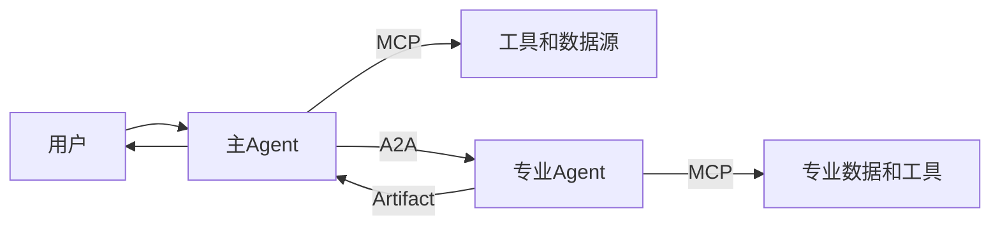
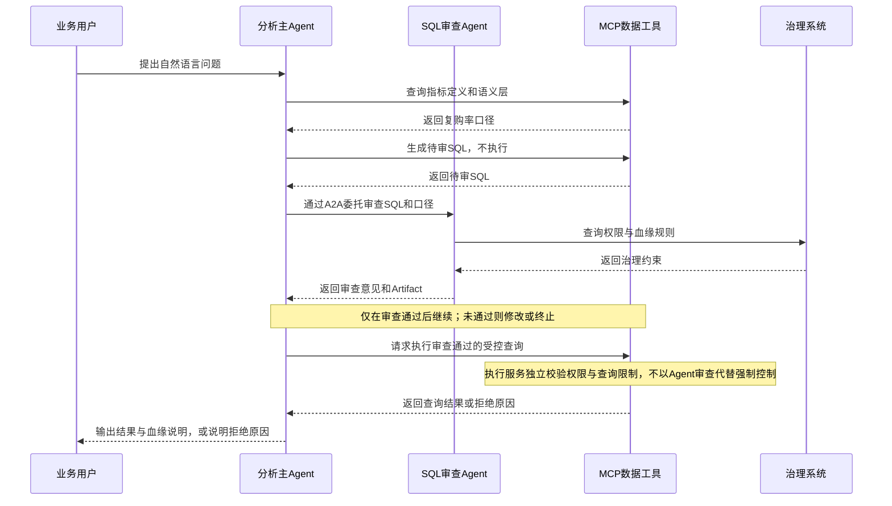

# A2A协议与MCP分工：Agent时代的两条接口线

> [!abstract] 一句话结论
> **MCP 解决 Agent 如何调用工具和数据，A2A 解决 Agent 如何发现、委托、协作另一个 Agent。** 前者像“工具与数据接口”，后者像“Agent 之间的业务协作协议”。两者不是替代关系，而是职责互补、可组合使用的协议；在远程 Agent 内部通过 MCP 调用工具的架构中，可以形成上下游调用链，但这不是固定关系。

2026 年的数据团队如果要做企业级 Agent，迟早会遇到一个问题：

> 我的 Agent 到底应该接 MCP，还是接 A2A？

这个问题问得很好，因为它说明你已经不满足于“写一个 Prompt + 调一个工具”的玩具阶段了。真正的生产系统里，Agent 会调用数据库、调度任务、写文件、请求另一个专业 Agent、等待远程任务完成、收集产物、再回到用户。这里面至少有两条接口线：

- Agent 调工具、调数据：MCP。
- Agent 调另一个 Agent：A2A。

相关阅读：[[【技术与工具】/MCP/00-MCP学习路线图|MCP学习路线图]]、[[【AI 与大数据】/03-AI-Agent/03-AI多Agent协作系统|AI多Agent协作系统]]。

---

## 1. 先用一句话区分

| 协议 | 主要对象 | 解决的问题 | 类比 |
|---|---|---|---|
| MCP | Agent 与工具/数据源 | 如何安全、标准化地暴露工具、资源、Prompt | Agent 世界的 USB-C / REST for tools |
| A2A | Agent 与 Agent | 如何发现远程 Agent、委托任务、跟踪状态、接收产物 | Agent 世界的业务协作协议 |

MCP 的核心是 **Tool / Resource / Prompt**。A2A 的核心是 **AgentCard / Task / Message / Artifact**。

---

## 2. MCP：把工具和数据变成 Agent 可用能力

根据 MCP 官方规范，MCP 是一个开放协议，用于让 LLM 应用与外部数据源和工具进行标准化集成。它使用 JSON-RPC 2.0 消息，并区分 Host、Client、Server 等角色。

对数据团队来说，MCP 最关键的是三类 Server 能力：

1. **Resources**：提供上下文和数据，例如指标定义、表元数据、数据字典。
2. **Tools**：提供可执行动作，例如执行 SQL、查询指标、触发调度、创建工单。
3. **Prompts**：提供可复用工作流模板，例如“生成经营分析报告”。

MCP 适合解决的问题：

- 让 Agent 查询指标平台。
- 让 Agent 调用数据质量检测工具。
- 让 Agent 读取元数据目录。
- 让 Agent 执行受控 SQL。
- 让 Agent 调用 RAG、向量检索、报表生成工具。

相关：[[【技术与工具】/MCP/01-MCP协议核心概念|MCP协议核心概念]]、[[【技术与工具】/MCP/04-MCP-Gateway与生产部署|MCP Gateway与生产部署]]。

---

## 3. A2A：把远程 Agent 变成可委托对象

A2A 的核心思路是：一个 Agent 不必知道另一个 Agent 内部用 LangGraph、CrewAI 还是自研框架，只要它暴露标准能力描述和任务接口，就可以被发现与调用。

A2A 的典型构件包括：

- **AgentCard**：描述 Agent 的名称、能力、端点、认证方式、输入输出能力。
- **Message**：交互输入。
- **Task**：可持续跟踪的工作单元。
- **Artifact**：任务产物，例如报告、文件、结构化结果。
- **Streaming / Polling**：长任务的状态跟踪与流式返回。

A2A 适合解决的问题：

- 主 Agent 委托“风控分析 Agent”做专项分析。
- 数据分析 Agent 委托“SQL 审查 Agent”检查口径。
- 企业助理 Agent 委托“采购 Agent”“法务 Agent”“财务 Agent”分别处理子任务。
- 不同供应商、不同框架构建的 Agent 之间互操作。

---

## 4. 两者如何组合：一个数据分析 Agent 例子

场景：业务问“华北区过去 30 天复购率异常的类目有哪些？”

在这个例子里：

- MCP 负责主 Agent 与语义层、SQL 工具的连接；SQL 审查 Agent 也可通过 MCP 访问治理系统，图中省略了该连接的协议标注。
- A2A 负责主 Agent 与“SQL 审查 Agent”的协作。
- 两者共同构成企业级 Agent 的接口层。

---

## 5. 数据团队的落地建议

### 5.1 先做 MCP，不要一上来做 Agent 网络

大多数企业第一步不是让 Agent 互相聊天，而是让 Agent 安全访问数据能力。优先级应该是：

1. 指标查询 MCP Server
2. 元数据与数据目录 MCP Server
3. 受控 SQL 执行 MCP Server
4. 数据质量检测 MCP Server
5. 报表和工单 MCP Server

等工具和数据能力标准化后，再考虑 A2A。

### 5.2 A2A 适合“专业 Agent 分工”

如果一个 Agent 太大，什么都做，系统会很难调试。更好的方式是分成：

- Planner Agent：拆解问题
- SQL Agent：生成查询
- Critic Agent：审查结果
- Governance Agent：检查权限和合规
- Report Agent：生成报告

A2A 让这些 Agent 可以跨系统协作。

### 5.3 协议不是治理本身

不管 MCP 还是 A2A，都不能自动解决权限、审计、合规、成本问题。协议只是车道，交通规则还要自己定。

这部分继续看 [[【AI 与大数据】/03-AI-Agent/07-企业级Agent控制平面|企业级Agent控制平面]]、[[【数据治理与数据管理】/02-深度研究/05-AI数据治理/11-Agent权限审计与责任边界|Agent权限审计与责任边界]]。

---

## 6. 常见误区

### 误区一：A2A 会取代 MCP

不会。A2A 解决 Agent 之间协作，MCP 解决工具与数据访问。一个远程 Agent 内部仍然可能使用 MCP 调工具。

### 误区二：有 MCP 就可以让 Agent 直连数据库

不建议。企业场景应该通过语义层、数据产品、受控查询服务，而不是把底层表直接暴露给 Agent。

### 误区三：协议统一后 Agent 就可靠了

协议统一只解决“能不能互通”，不解决“答案对不对”。可靠性还需要 Eval、Observability、Guardrail、权限与人工审批。

---

## 7. 外部参考

- [Model Context Protocol Specification](https://modelcontextprotocol.io/specification/2025-06-18)
- [Agent2Agent Core Protocol Specification](https://agent2agent.info/specification/core/)
- [Microsoft Learn - A2A Agent](https://learn.microsoft.com/en-us/agent-framework/agents/providers/agent-to-agent)
- [OpenAI - The next evolution of the Agents SDK](https://openai.com/index/the-next-evolution-of-the-agents-sdk/)

---

## 8. 相关学习入口

- [[【技术与工具】/AI-Agent框架/00-AI-Agent框架选型指南|AI Agent框架选型指南]]
- [[【技术与工具】/AI-Agent框架/03-Agent工具开发规范|Agent工具开发规范]]
- [[【AI 与大数据】/03-AI-Agent/01-AI-Agent智能体概述|AI Agent智能体概述]]
- [[【AI 与大数据】/03-AI-Agent/07-企业级Agent控制平面|企业级Agent控制平面]]
- [[【数据开发与数据架构】/07-数据服务架构/10-Agent-to-Data访问架构|Agent-to-Data访问架构]]
