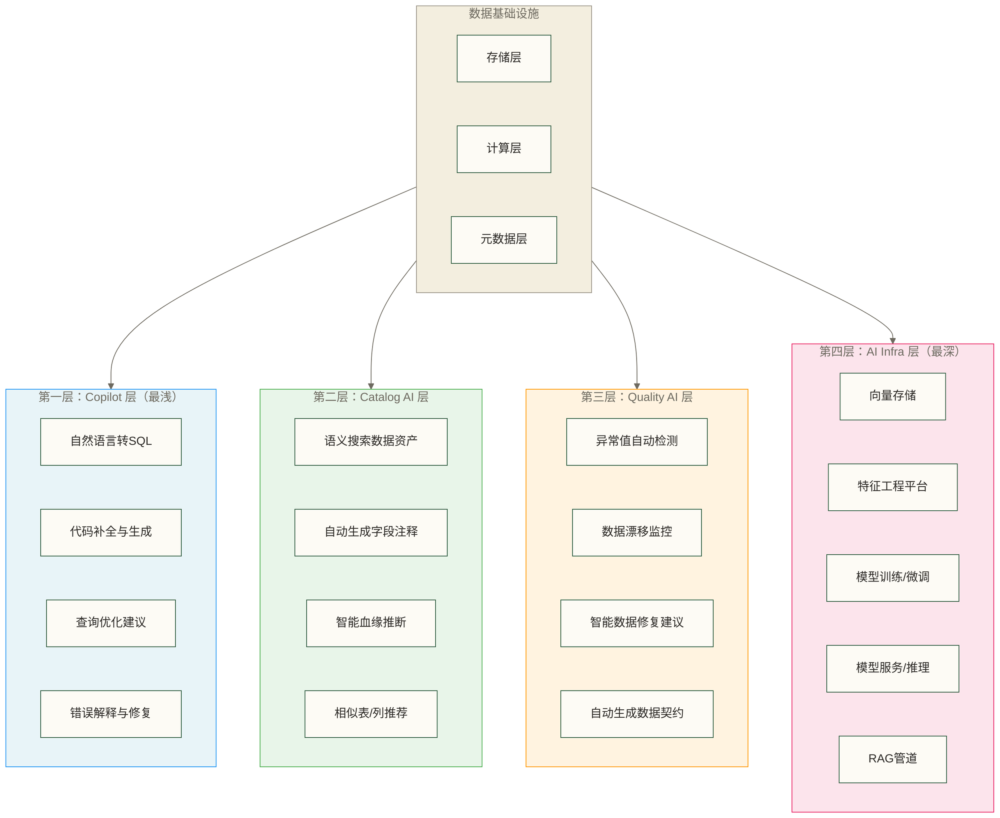

# AI-Native数据平台全景

## 写在前面

最近两年，每家数据平台厂商都在说自己是"AI-Native"，Databricks有Mosaic AI，Snowflake有Cortex，Google有Gemini in BigQuery。营销话术满天飞，但干活的人需要搞清楚：这些东西到底改变了什么，我的工作会不会被影响，技术选型该怎么做。

这篇文章不是厂商宣传册的汉化版。我会把每个平台真正在做什么讲清楚，包括它们的局限和短板，最后给出可以落地的选型建议。

---

## 目录

- [[【技术与工具】/AI-Native数据平台/00-AI-Native数据平台全景#为什么要专门讲"AI-Native数据平台"|#为什么要专门讲"AI-Native数据平台"]]
- [[【技术与工具】/AI-Native数据平台/00-AI-Native数据平台全景#AI嵌入数据栈的四个层次|#AI嵌入数据栈的四个层次]]
- [[【技术与工具】/AI-Native数据平台/00-AI-Native数据平台全景#三大平台深度解析|#三大平台深度解析]]
  - [[【技术与工具】/AI-Native数据平台/00-AI-Native数据平台全景#Databricks：从Spark公司到AI平台|#Databricks：从Spark公司到AI平台]]
  - [[【技术与工具】/AI-Native数据平台/00-AI-Native数据平台全景#Snowflake Cortex：数据不离库的AI路线|#Snowflake Cortex：数据不离库的AI路线]]
  - [[【技术与工具】/AI-Native数据平台/00-AI-Native数据平台全景#Google BigQuery + Gemini：SQL原生AI|#Google BigQuery + Gemini：SQL原生AI]]
- [[【技术与工具】/AI-Native数据平台/00-AI-Native数据平台全景#三平台横向对比|#三平台横向对比]]
- [[【技术与工具】/AI-Native数据平台/00-AI-Native数据平台全景#国内同类产品扫描|#国内同类产品扫描]]
- [[【技术与工具】/AI-Native数据平台/00-AI-Native数据平台全景#对数据工程师的实际影响|#对数据工程师的实际影响]]
- [[【技术与工具】/AI-Native数据平台/00-AI-Native数据平台全景#选型建议|#选型建议]]

---

## 为什么要专门讲"AI-Native数据平台"

### 传统数据平台的边界在哪里

传统数据平台（Hadoop时代的那批，包括Hive、Spark、HBase）的设计目标很明确：**存储和计算数据**。平台本身不理解数据的语义，不知道一张表里的`user_id`和`order_amount`的业务含义，也不会主动帮你发现数据质量问题。

这种架构下，人的工作是：
- 写ETL流水线，把数据从A搬到B
- 写SQL或代码，从数据里提取信息
- 维护数据血缘，靠人工文档或元数据平台
- 数据质量监控，靠预设规则触发告警

平台是工具，人是主体，人告诉平台做什么，平台照做。

### AI-Native平台的本质差异

AI-Native平台试图做的事情是：**让平台理解数据的语义，而不只是数据的结构**。

这不是一句虚话。举个具体的例子：

传统平台里，你有一张表`dwd_order_detail`，平台只知道它有哪些列、数据类型、有多少行。

AI-Native平台里，这张表会被向量化，平台知道这张表和"订单"、"交易"、"用户购买行为"这些语义相关，当另一个数据工程师想找"用户消费记录"相关的表时，即使他用的词不完全匹配，平台也能推荐正确的表。

这是质的变化，不是量的积累。

---

## AI嵌入数据栈的四个层次

理解这四个层次，是理解所有AI数据平台产品的基础框架。



### 第一层：Copilot 层

这是最表层的 AI 能力，也是目前最成熟的。核心是让 AI 帮你写代码。

实际效果如何？说实话，**写简单查询很好用，写复杂业务逻辑还差得远**。一个涉及多层子查询、多个维度关联的报表 SQL，AI 生成的版本通常需要大幅修改。但对于"查某张表过去7天每天的 GMV"这类标准查询，自然语言转 SQL 已经够用了。

所有主流平台都有这层能力，这不是竞争壁垒。

### 第二层：Catalog AI 层

数据目录的智能化。这层的价值被严重低估。

一个中等规模的数据仓库里，可能有几千张表，几万个字段。没有智能 Catalog，新来的工程师找数据要花大量时间，老工程师也会重复建同样的表。Catalog AI 解决的是**数据资产的可发现性**问题。

Databricks 的 Unity Catalog 和 Snowflake 的 Cortex Search 都在这个方向发力，是实际工作中能看到生产力提升的地方。

### 第三层：Quality AI 层

传统的数据质量监控是规则驱动的：你设定阈值，超过就告警。这种方式的问题是：**你得知道会出什么问题，才能写规则**。

Quality AI 层使用无监督学习检测异常，能发现你预料不到的数据问题。比如某个字段的分布突然变化，或者某个维度的数据量突然下降，系统会自动识别并告警。

这层能力还不够成熟，误报率还比较高，但方向是对的。

### 第四层：AI Infra 层

这是最本质的变化。数据平台不只是 BI 和报表的基础设施了，它同时也是 **AI 应用的基础设施**。

向量数据库、特征存储、模型训练、RAG 管道——这些曾经需要独立搭建的系统，现在都在向数据平台汇合。这是三大平台竞争最激烈的地方，也是它们和传统数据仓库最根本的区别。

相关内容参见 [[【AI 与大数据】/04-AI工程化/07-向量数据库与语义搜索|向量数据库与语义搜索]] 和 [[【AI 与大数据】/02-大模型核心/04-RAG检索增强生成实战|RAG检索增强生成实战]]。

---

## 三大平台深度解析

### Databricks：从Spark公司到AI平台

#### 历史背景不能不说

Databricks 是 Spark 的亲爹（Apache Spark 的创始团队创立的公司）。这决定了它的基因：**计算引擎优先，数据处理能力强，但数据仓库的查询性能和易用性历史上是短板**。

最近几年，Databricks 在补仓库侧的课（Photon 引擎、Delta Live Tables），同时在 AI 侧激进扩张（收购 MosaicML 进入 LLM 赛道）。

#### Unity Catalog：不只是数据目录

Unity Catalog 是 Databricks 的统一治理产品，解决的是一个长期存在的痛点：Databricks workspace 之间的数据治理孤岛；其正式 GA 并非始于 2023 年。

在 Unity Catalog 之前，不同 workspace 的数据是割裂的，血缘追踪也做不到跨 workspace。Unity Catalog 提供了统一的数据治理层：

- **三层命名空间**：`catalog.schema.table`，和 Snowflake、BigQuery 对齐
- **列级权限控制**：可以精确到哪个用户能看哪一列
- **自动血缘追踪**：Spark 作业、SQL 查询、ML 实验的血缘都会被记录

AI 部分体现在：Unity Catalog 的元数据可为 AI 助手提供上下文；提供上下文不等于用于训练模型，训练数据的使用须另行核对具体功能及数据使用条款。比如你用自然语言问"给我看上个月退款率最高的商品"，AI 需要知道哪张表是订单表、哪张表是退款记录，这些知识就来自 Unity Catalog。

这和 [[【技术与工具】/00-技术与工具导航|技术与工具导航]] 中提到的数据治理能力是一脉相承的。

#### Mosaic AI：完整的 LLM 工程平台

Databricks 在 2023 年以 13 亿美元收购了 MosaicML，这笔收购让它一跃成为企业级 LLM 开发的重要玩家。

Mosaic AI 提供的能力链路：

```text
数据准备 → 模型训练/微调 → 模型评估 → 模型部署 → 推理服务 → 监控
   ↑              ↑             ↑            ↑
Delta Lake    MLflow         MLflow      Model Serving
```

**Fine-tuning 能力**：支持对 Llama、Mistral 等开源模型进行指令微调，计算基础是 Databricks 自身的分布式训练框架。企业数据可存储在自己的 Delta Lake 中，但微调时的读取、处理位置及是否涉及第三方，仍须核对具体训练服务、部署配置和数据处理条款，不能仅凭存储位置判断。

**RAG 支持**：Databricks 提供了完整的 RAG 工具链——文档解析、分块、向量化（集成了多种 Embedding 模型）、向量检索（基于 Delta Sync Index 或集成外部向量库）、检索增强生成。相关架构参见 [[【AI 与大数据】/02-大模型核心/04-RAG检索增强生成实战|RAG检索增强生成实战]]。

**MLflow 集成**：这是 Databricks 的护城河之一。MLflow 作为开源的 ML 实验跟踪和模型管理工具，在行业里已经有很高的采用率。Databricks 的托管 MLflow 无缝集成进整个 AI 工程流程，相比竞争对手这是实实在在的优势。相关实践参见 [[【AI 与大数据】/04-AI工程化/00-MLOps最佳实践|MLOps最佳实践]]。

#### DBRX：Databricks 的自研模型

2024 年初 Databricks 发布了 DBRX，是当时开源模型里性能最强的之一（现在已经被更新的模型超越了）。

**DBRX 的真实定位**：它不是要跟 GPT-4 竞争，而是一个基础模型，供企业在 Databricks 平台上进行微调。Databricks 的逻辑是：给企业一个"足够好"的起点，企业用自己的数据微调后，得到一个专有的、数据不外泄的领域模型。

对大多数企业来说，DBRX 本身不会直接用，但它的存在使 Databricks 在 AI 供应链上具备了更大的议价能力。

#### Spark 还会死吗

不会。但 Databricks 在往上走。

Spark 的定位在 Databricks 的产品体系里正在变成基础计算引擎，越来越多的场景被更高层的抽象接管（Delta Live Tables 替代手写 Spark ETL，Databricks SQL 替代 Spark SQL 做交互查询）。

作为 Spark 工程师，你的技能仍然有价值，但如果只会 RDD 编程，确实需要升级了。

---

### Snowflake Cortex：数据不离库的AI路线

#### Snowflake 的核心优势

Snowflake 的设计哲学和 Databricks 截然不同：**存储计算分离，SQL 优先，数据仓库能力极强**。

Snowflake 在 SQL 层面的工程质量非常高——并发处理、自动伸缩、多集群共享数据，这些是它长期的护城河。

进入 AI 时代，Snowflake 面临的挑战是：AI 工作负载（训练、推理）不像 SQL 查询，Snowflake 的计算架构并不原生适合矩阵运算。它的应对策略是：**把 AI 能力封装成 SQL 函数，让用户在 Snowflake 里直接调用 AI，而不是把数据导出去**。

#### Cortex AI：SQL 调 LLM

Cortex AI 是 Snowflake 的 AI 能力品牌，核心是一组内置函数：

```sql
-- 直接在 SQL 里调用 LLM 做情感分析
SELECT
    review_text,
    SNOWFLAKE.CORTEX.SENTIMENT(review_text) AS sentiment_score,
    SNOWFLAKE.CORTEX.CLASSIFY_TEXT(
        review_text,
        ['正面', '负面', '中性']
    ) AS category
FROM customer_reviews
WHERE review_date >= '2025-01-01';
```

```sql
-- 批量摘要，不需要写任何 Python 代码
SELECT
    product_id,
    SNOWFLAKE.CORTEX.SUMMARIZE(product_description) AS short_desc
FROM product_catalog;
```

这个设计的妙处在于：**用户可在 Snowflake 内通过 SQL 发起 AI 处理，减少自行导出数据的流程**。很多行业（金融、医疗、政府）有严格的数据合规要求，可能限制调用外部模型 API。Cortex 是否符合具体要求，仍须核对模型、区域、跨区域推理配置、数据处理条款及组织的合规规定，不能据此保证数据永远不离开指定边界。

背后的实现是：Snowflake 在自己的基础设施上托管了多个 LLM（包括 Llama 系列、Mistral、Arctic），通过函数调用的方式暴露给用户。调用 `CORTEX.COMPLETE()` 时，实际处理位置和数据边界取决于所选模型、服务区域及相关配置，须以对应服务说明为准。

#### Cortex Analyst：自然语言查数仓

Cortex Analyst 是 Snowflake 的自然语言转 SQL 产品，但它比普通的 Text-to-SQL 产品多了一层：**语义层（Semantic Model）**。

工作流程是：
1. 数据工程师提前定义语义模型，把业务术语和 SQL 对象的映射关系写清楚（比如"GMV"对应`SUM(amount)`，"活跃用户"对应`COUNT(DISTINCT user_id) WHERE login_count > 0`）
2. 业务用户用自然语言提问
3. Cortex Analyst 结合语义模型生成 SQL

这个设计比"直接让 LLM 看表结构生成 SQL"要靠谱得多，因为 LLM 无法凭空知道"活跃用户"在你公司的业务定义是什么。

缺点是：**语义模型的维护成本不低**。这需要数据工程师和业务方持续合作，定义和更新语义层。引入了新的工作量。

#### Arctic：Snowflake 的开源 LLM

2024 年 Snowflake 发布了 Arctic 模型，定位是"高效的企业智能模型"。Arctic 采用了混合专家架构（MoE），参数量大（480B）但激活参数少，在推理成本上有优势。

Arctic 对 Snowflake 用户的直接价值：作为 Cortex 函数底层的模型选项之一，且完全开源（Apache 2.0），企业可以自行部署微调。

---

### Google BigQuery + Gemini：SQL原生AI

#### BigQuery 的特殊地位

BigQuery 是 Google 在 2010 年推出的，比 Snowflake 早，比 Databricks 早。它在设计上有两个先天优势：

1. **Dremel 论文的工程实现**：列式存储 + 树形执行架构，PB 级数据的查询性能一直很强
2. **背靠 Google 基础设施**：和 GCS、Pub/Sub、Dataflow 的集成是原生的，不是后期拼接的

在 AI 时代，BigQuery 最大的优势是：**和 Google 整个 AI 研究体系的纵深整合**。Vertex AI、Gemini、TensorFlow——这些都属于 Google 的 AI 生态，但 BigQuery 与它们的集成仍须确认接口、版本、区域和权限要求，不能因同属一个生态就认为不存在接口对齐问题。

#### BigQuery ML：SQL 直接训练和预测模型

BigQuery ML（BQML）是 BigQuery 最有争议的功能，也是最容易被误解的功能。

它能做什么：
```sql
-- 在 BigQuery 里直接训练一个线性回归模型
CREATE OR REPLACE MODEL `my_project.my_dataset.sales_forecast_model`
OPTIONS(
    model_type='linear_reg',
    input_label_cols=['sales_amount'],
    data_split_method='AUTO_SPLIT'
) AS
SELECT
    day_of_week,
    holiday_flag,
    promo_flag,
    avg_temperature,
    sales_amount
FROM `my_project.my_dataset.daily_sales`
WHERE date < '2025-01-01';

-- 用模型做预测
SELECT *
FROM ML.PREDICT(
    MODEL `my_project.my_dataset.sales_forecast_model`,
    (SELECT day_of_week, holiday_flag, promo_flag, avg_temperature
     FROM `my_project.my_dataset.upcoming_dates`)
);
```

这适合谁：**数据分析师**，不会 Python 但需要做预测分析的人。这降低了 ML 的门槛。

这不适合谁：**需要精细控制模型的数据科学家**。BQML 的模型配置能力有限，超参数调整空间小，对复杂任务还是要用 Vertex AI。

BQML 和传统 ML 流程的核心差异：传统流程需要把数据导出到 Python 环境，BQML 的模型训练和预测在数据所在的地方发生。对于不需要复杂特征工程的场景，省掉了大量数据搬运的工程工作。

#### Gemini in BigQuery：AI 助手嵌入查询界面

Gemini in BigQuery 提供了两类能力：

**面向工程师的能力**：
- SQL 代码补全（类似 GitHub Copilot 但针对 BigQuery SQL）
- 自然语言生成 SQL（在 BigQuery Studio 里直接用）
- 查询解释：给一段复杂 SQL，Gemini 解释每一步在做什么
- 错误诊断：SQL 执行报错时，Gemini 给出修复建议

**面向业务分析师的能力**：
- Data Canvas：可视化的数据探索界面，用自然语言提问，Gemini 自动生成查询并展示图表
- Looker Studio 集成：在可视化工具里直接问问题

#### 与 Vertex AI 的关系

这是 BigQuery 相对于竞争对手最大的差异化优势：**BigQuery 是 Google AI 生态的数据底座**。

Vertex AI 是 Google 的 AI 平台，提供模型训练、超参数调整、模型部署、特征存储（Vertex AI Feature Store）等能力。BigQuery 和 Vertex AI 的集成：

- 从 BigQuery 导出特征到 Vertex AI Feature Store，不需要写中间文件
- 在 BigQuery ML 里调用部署在 Vertex AI 上的自定义模型
- BigQuery 的数据直接作为 Vertex AI Pipeline 的输入

如果你的团队已经在 Google Cloud 上，并且在用 Vertex AI 做 ML 工程，那么 BigQuery 几乎是必然选择，集成成本极低。

---

## 三平台横向对比

| 对比维度 | Databricks | Snowflake | BigQuery |
|---------|-----------|-----------|----------|
| **AI 能力成熟度** | 高（全栈：从数据到模型训练部署） | 中高（推理和分析强，训练弱） | 高（依托 Google AI 生态） |
| **自然语言查询** | Databricks Assistant | Cortex Analyst | Gemini in BigQuery |
| **模型训练** | 原生支持（Mosaic AI） | 可通过 Snowpark ML 等能力开展训练，支持范围需按工作负载确认 | BQML 支持多类模型，复杂训练可结合 Vertex AI |
| **LLM 微调** | 支持（Mosaic AI 技术栈） | 部分模型可通过 Cortex 微调能力实现，须确认模型与区域支持 | 通过 Vertex AI，须确认模型支持 |
| **RAG 支持** | 完整工具链 | Cortex Search + 函数 | 需结合 Vertex AI |
| **开放性** | 高（开源 Delta Lake，MLflow） | 需区分专有托管表与 Iceberg 等开放格式能力 | 需区分托管表与 BigLake 对 Iceberg 等开放格式的支持；BigLake 本身不是开源格式 |
| **数据安全模型** | 依部署模式区分客户云存储与托管存储 | 依表类型区分 Snowflake 托管存储与外部存储 | 区分 BigQuery 托管存储与 GCS 等外部数据源；均须核对权限、区域及处理边界 |
| **与开源生态兼容** | 高（Spark、Delta、MLflow） | 低 | 中（支持 Apache Iceberg） |
| **计算成本模型** | DBU 等用量计费，另须区分云资源及托管模式费用 | 虚拟仓库消耗 credits，通常按秒计费并有最低计费时长；AI 等服务另计 | 可选按查询处理数据量或容量计费，存储及 AI 等费用另计 |
| **SQL 能力** | 近几年进步大，但仍不如 Snowflake | 最强，历史积累深 | 强，特别是窗口函数 |
| **适合团队类型** | 数据工程重，ML 需求强 | 数仓分析为主，BI 团队 | GCP 生态用户，或 ML 工程师 |
| **适合企业规模** | 中大型，有工程能力的团队 | 各规模，运维压力小 | 各规模，GCP 用户优先 |
| **上手难度** | 高（概念多，配置复杂） | 低（SQL 开箱即用） | 中（GCP 生态熟悉后顺畅） |

> [!warning] 关于上表的说明
> 这三个平台都在快速迭代，表格中的信息反映的是 2026 年初的状态。Snowflake 在增强训练能力，Databricks 在优化 SQL 性能，BigQuery 在扩展 AI 功能。选型时务必参考最新官方文档和产品更新。

---

## 国内同类产品扫描

> [!note] 阅读说明
> 国内产品这里只做概要扫描，不做深度对比。一是因为信息更新快，二是国内产品的 AI 集成深度普遍比上面三家浅，更多是在现有数据平台上叠加 AI 功能，而不是架构层面的重构。

### 阿里云：MaxCompute + PAI

- **MaxCompute** 是阿里云的大数据计算服务，对标 BigQuery，在国内有很大的存量市场
- **PAI（Platform for AI）** 是独立的 AI 平台，提供模型训练、调优、部署
- 两者的集成：通过阿里云的数据集成产品串联，不像 BigQuery+Vertex AI 那么紧密
- **AI 助手**：2024 年起 MaxCompute 集成了通义千问，提供 SQL 生成和解释功能
- 适合场景：已在阿里云上的企业，特别是互联网/电商背景的团队

### 腾讯云：数仓 + 混元

- **TDSQL-C** 是腾讯云的云原生关系型数据库产品，不能直接等同于分析型数仓；**云数据仓库 CDW** 属于数据仓库产品线，具体能力需按产品版本区分
- **混元大模型** 集成到数据产品的深度还在建设中
- 目前更多是在 SQL 编辑器里提供代码补全，语义搜索、自动血缘等能力还不成熟
- 适合场景：已在腾讯云上的团队，微信/小程序相关业务的数据分析

### 字节跳动：豆包 + 火山引擎数据平台

- **火山引擎 DataLeap** 是字节内部大数据平台对外商业化的版本，功能完整度高（内部磨砺多年）
- **豆包大模型** 在 DataLeap 中的集成方向：数据资产搜索、SQL 生成
- 字节的特点是**工程能力强**，DataLeap 在数据开发、数据质量、数据地图方面做得扎实
- 适合场景：有大数据研发能力的团队，需要完整数据中台功能的企业

> [!tip] 国内产品的选型逻辑
> 如果业务在国内，数据安全和合规是首要考虑（数据出境限制），国内三家云的产品在合规上有天然优势。如果技术团队有能力、预算允许，阿里云整体成熟度最高；如果是字节系背景的团队，DataLeap 的习惯成本最低。

---

## 对数据工程师的实际影响

### 技能迁移：Spark 工程师怎么上手 Databricks

这是很多人最关心的问题。简短答案：**比你想象的要平滑，但不是零成本**。

**可以直接复用的**：
- Spark API（PySpark、Spark SQL）的大量知识与代码可以复用；“99% 的代码不需要改”是原稿未核实的示例说法，不是兼容率保证，实际迁移须检查 Runtime 版本、依赖、权限、存储访问及 API 限制
- Delta Lake 建立在 Parquet 上，理解分区、文件格式的知识照样用
- 性能调优的思路（分区调整、缓存策略、join 优化）基本通用

**需要新学的**：
- Delta Lake 的特性：ACID 事务、Time Travel、Merge 操作、Vacuum 命令
- Unity Catalog 的权限模型和三层命名空间
- Databricks Workflows 替代传统的调度系统（Airflow 还是可以用，但 Databricks 有内置调度）
- MLflow 的使用（如果之前没接触过）

**学习路径建议**：
1. 先把 Delta Lake 基础搞清楚（1-2 周）
2. 跑通一个端到端的 ETL + ML 流程（1 周）
3. 理解 Unity Catalog 的设计和权限管理（2-3 天）
4. 了解 Databricks SQL 和 Databricks Assistant 的能力（持续使用中学）

### 新的工作模式：AI 工具协作的日常

现实情况是：**AI 工具会改变你的工作节奏，但不会替代数据工程师的核心价值**。

**AI 工具真正能帮到的**：
- 写样板代码（重复性的 ETL 框架、配置文件）
- 写测试用例（数据质量测试的 SQL 或 Python 代码）
- 解释别人写的复杂 SQL（接手旧项目时特别有用）
- 生成字段注释和文档（数据工程师最懒得做的事）
- 调试报错（把错误信息丢给 AI，通常能快速定位）

**AI 工具帮不了太多的**：
- 理解业务需求（AI 不知道你公司的"有效订单"定义）
- 架构设计决策（分层设计、分区策略、数据模型选择）
- 性能问题排查（需要结合具体的数据分布和执行计划）
- 数据治理和业务对齐（这是协作问题，不是技术问题）

更详细的 AI 工程化实践参见 [[【AI 与大数据】/04-AI工程化/01-AI工程化实践指南|AI工程化实践指南]]。

### 不需要慌的部分

有些焦虑是没有必要的，列几条：

1. **分布式计算原理没有变**：Shuffle、分区、内存管理这些底层机制，无论平台怎么变，理解它们都是优势

2. **数据建模方法论没有变**：维度建模、宽表 vs 规范化、缓慢变化维——这些在 AI-Native 平台里照样适用

3. **数据质量意识没有变**：如果数据是脏的，AI 生成的 SQL 再聪明也输出垃圾。Garbage in, garbage out 的铁律不会因为 AI 而失效

4. **SQL 没有死**：自然语言查询是补充，不是替代。复杂的报表、数据建模、性能调优，仍然需要真正懂 SQL 的人

---

## 选型建议

> [!important] 选型的前提
> 没有普适的"最佳平台"。以下建议基于典型场景，实际选型必须结合你的现有技术债、团队规模、预算和业务增长预期来判断。

### 初创公司 / 小团队（工程师 10 人以内）

**推荐**：Snowflake 或 BigQuery

**理由**：
- 运维成本低，没有 Databricks 那么多需要配置的旋钮
- Snowflake 的 SQL 体验开箱即用，小团队不需要专职的平台工程师
- BigQuery 的按查询处理数据量计费可能适合早期数据量小的团队；不查询不代表没有费用，仍可能产生存储、容量预留及其他服务费用
- AI 能力够用：Cortex SQL 生成、Gemini 代码助手，满足日常分析需求

**不建议用 Databricks 的原因**：概念太多（Unity Catalog、Clusters、Workflows），小团队学习成本高，ROI 不划算。

### 中大型企业数仓迁移（从传统 Hive/Oracle 迁移）

**推荐**：根据现有技术栈决定

- **如果现在有 Spark 使用经验**：Databricks 迁移成本最低，Delta Lake 替代 Hive 是自然路径
- **如果现在主要是 SQL 分析**：Snowflake 的迁移体验最好，标准 SQL 兼容性强
- **如果已经在 GCP 上**：BigQuery 可优先纳入候选，但仍需比较迁移成本、工作负载、预算、开放格式与跨云需求

数仓迁移的决策参见相关架构设计文档。

### AI 应用为主的团队（LLM 应用、推荐系统）

**推荐**：Databricks

**理由**：
- RAG 全链路支持（从文档到向量到检索，一个平台搞定）
- 模型微调能力最强，企业私有化部署 LLM 的最成熟方案
- MLflow 生态成熟，ML 工程化基础扎实
- 和向量数据库的集成（Pinecone、Weaviate、Chroma）比其他平台更完善

相关技术参见 [[【AI 与大数据】/04-AI工程化/07-向量数据库与语义搜索|向量数据库与语义搜索]] 和 [[【AI 与大数据】/04-AI工程化/00-MLOps最佳实践|MLOps最佳实践]]。

### 强监管行业（金融、医疗、政府）

**候选方案**：满足区域与合同要求的 Snowflake 云服务，或符合要求的本地部署方案；Snowflake 的隔离部署选项不等于可在企业自有机房安装的私有部署版本

**核心考虑**：
- 数据不能出境，不能传给第三方 AI API
- Snowflake Cortex 是否满足数据合规要求，须结合所选模型、服务区域、跨区域推理配置、数据处理条款及监管要求逐项评估
- 国内监管行业可将阿里云 MaxCompute + PAI 纳入评估，但须确认部署区域、适用等保要求、模型调用路径及客户侧控制措施，不能仅凭产品名称认定满足合规要求
- 如果有自建机房能力，可以考虑开源方案：Delta Lake + Spark + 自部署 LLM

> [!warning] 强监管行业的 AI 能力要有预期
> 数据合规要求越严格，可用的 AI 模型选择越少，能力越受限。不要为了用上最新的 AI 功能而在合规上妥协，那是后患无穷的选择。

---

## 总结

AI-Native 数据平台这个话题，最容易陷入两个极端：要么被厂商的 PPT 带跑，觉得一切都要重来；要么完全无视，觉得只是炒概念。

实际情况是：**架构确实在变，但变化是渐进的**。Spark 不会消失，SQL 不会消失，数据工程师的核心技能不会被 AI 替代，但工具层和工作方式确实在升级。

作为数据工程师，我建议的态度是：
1. 把 AI 的四个层次搞清楚，知道哪层能给你的工作带来实际价值
2. 选一个平台深入学习（根据你公司的方向决定），不要浅尝辄止
3. 底层原理继续巩固，这是 AI 时代的护城河，不是包袱

---

## 本系列文档索引

| 编号 | 文档 | 核心内容 |
|------|------|---------|
| 01 | [[【技术与工具】/AI-Native数据平台/01-Databricks平台实战|Databricks 平台实战]] | Delta Lake、Unity Catalog、Mosaic AI 实战 |
| 02 | [[【技术与工具】/AI-Native数据平台/02-Snowflake-Cortex实战|Snowflake Cortex 实战]] | Cortex AI 函数、Cortex Analyst、Arctic 模型 |
| 03 | [[【技术与工具】/AI-Native数据平台/03-BigQuery-ML实战|BigQuery ML 实战]] | BQML、Gemini in BigQuery、Vertex AI 集成 |
| 04 | [[【技术与工具】/AI-Native数据平台/04-AI-Native平台选型对比|AI-Native 平台选型对比]] | 三大平台深度横评与选型决策框架 |
| 05 | [[【技术与工具】/AI-Native数据平台/05-Unity-Catalog对比Open-Catalog|Unity Catalog vs Open Catalog]] | 2026 元数据治理路线之争，Polaris vs Unity 选型 |

## 延伸阅读

- [[【AI 与大数据】/04-AI工程化/00-MLOps最佳实践|MLOps最佳实践]] - AI 工程化的完整方法论
- [[【AI 与大数据】/02-大模型核心/04-RAG检索增强生成实战|RAG检索增强生成实战]] - RAG 系统的架构与实现
- [[【AI 与大数据】/04-AI工程化/07-向量数据库与语义搜索|向量数据库与语义搜索]] - 向量存储技术深度解析
- [[【AI 与大数据】/04-AI工程化/01-AI工程化实践指南|AI工程化实践指南]] - 企业 AI 应用落地指南
- [[【技术与工具】/00-技术与工具导航|技术与工具导航]] - 数据技术栈全景索引

#数据平台 #Databricks #Snowflake #BigQuery #AI-Native #云原生 #数据工程 #选型指南 #技术栈
