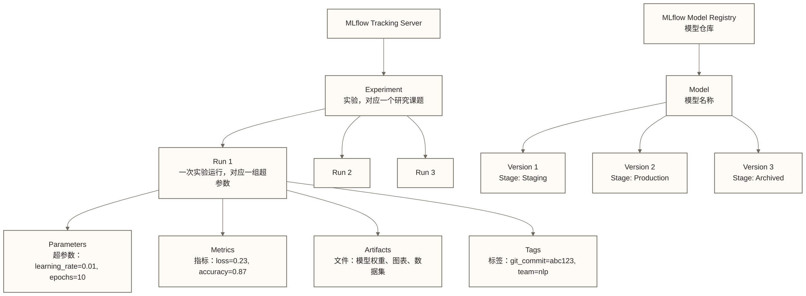
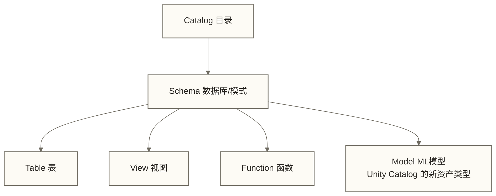
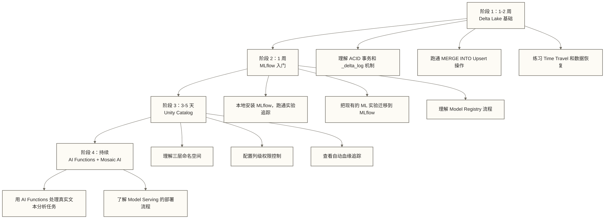

# Databricks 平台实战

## 写在前面

很多人对 Databricks 的认知停在"云上 Spark 服务"这个层次，这个认知在 2019 年是对的，在 2026 年是错的。

Databricks 提供统一的数据+AI 平台能力，Delta Lake 增强数据湖的可靠性，MLflow 支持机器学习实验管理，Unity Catalog 提供统一治理能力，Mosaic AI 支持模型训练与托管推理等场景；这些能力不等同于企业自有基础设施上的私有化部署。

这篇文档的目标是让你能看着代码把这些东西跑通，而不是在概念层面打转。

---

## 目录

- [[【技术与工具】/AI-Native数据平台/01-Databricks平台实战#Databricks 是什么|#Databricks 是什么]]
- [[【技术与工具】/AI-Native数据平台/01-Databricks平台实战#Delta Lake 核心特性|#Delta Lake 核心特性]]
- [[【技术与工具】/AI-Native数据平台/01-Databricks平台实战#MLflow 实验管理|#MLflow 实验管理]]
- [[【技术与工具】/AI-Native数据平台/01-Databricks平台实战#Unity Catalog：数据治理统一|#Unity Catalog：数据治理统一]]
- [[【技术与工具】/AI-Native数据平台/01-Databricks平台实战#Databricks AI Functions（SQL 内嵌 AI）|#Databricks AI Functions（SQL 内嵌 AI）]]
- [[【技术与工具】/AI-Native数据平台/01-Databricks平台实战#Mosaic AI Model Serving|#Mosaic AI Model Serving]]
- [[【技术与工具】/AI-Native数据平台/01-Databricks平台实战#学习路径与资源|#学习路径与资源]]

---

## Databricks 是什么

### 定位：不是 Spark 托管服务

Databricks 由 Spark 原班人马创立，但它早已不只是"云上跑 Spark"。准确的定位是：**统一数据与 AI 平台（Unified Data and AI Platform）**。

三个核心引擎构成了它的差异化：

| 引擎 | 解决什么问题 | 竞争对手怎么看 |
|------|------------|--------------|
| Delta Lake | 数据湖的 ACID 事务和可靠性 | Snowflake 用的是私有存储，BigQuery 用 Colossus |
| MLflow | ML 实验的可追踪性和模型管理 | 开源，独立于 Databricks 可用，但托管版集成更深 |
| Unity Catalog | 跨 workspace 的数据治理统一 | Snowflake 有类似架构，BigQuery 靠 IAM |

三件事合在一起，解决了一个传统架构的老毛病：**数据平台和 AI 平台是两套系统，数据要在中间不断搬运**。Databricks 的设计是数据在哪里，计算就在哪里，AI 也在哪里。

### 2025-2026 年的 AI 能力

这几年 Databricks 在 AI 侧的动作密集，值得单独列出来：

- **Mosaic AI**：收购 MosaicML 后整合的 AI 产品线，覆盖模型训练、微调、部署
- **DBRX**：Databricks 发布的开放权重基础大模型（MoE 架构）；模型权重采用 DBRX 专用许可，部分配套代码采用 Apache 2.0，使用与分发前须核对具体材料的许可证。
- **AI Functions**：在标准 SQL 里直接调用 LLM 做文本处理，不需要写 Python
- **Delta Live Tables（DLT）**：声明式流批一体 ETL 框架，AI 辅助生成管道定义

---

## Delta Lake 核心特性

### 为什么 Parquet 不够用

Parquet 是优秀的列式存储格式，但它只是一个文件格式，不是一个事务系统。用纯 Parquet 构建数据湖面临几个实际痛点：

1. **并发写入是噩梦**：两个 Spark 作业同时向同一分区写数据，结果不可预期
2. **小文件问题失控**：流式写入积累大量小 Parquet 文件，读性能急速下降
3. **没有 schema 约束**：字段类型改了，读出来的数据可能直接 null 掉
4. **删除操作代价高**：需要删除用户数据时，纯 Parquet 没有表级行删除语义，通常需重写包含目标记录的数据文件，并管理替换与并发一致性，不一定要重写整个分区。

Delta Lake 在 Parquet 之上加了一层事务日志（`_delta_log/` 目录），提供事务、schema 校验和表级更新删除能力；小文件问题仍需配合压缩、布局优化与写入策略处理，用户数据删除还需评估历史文件保留。

### ACID 事务：MERGE INTO（Upsert）操作

Delta Lake 最实用的能力之一是真正意义上的 Upsert：

```python
from delta.tables import DeltaTable
from pyspark.sql import SparkSession

spark = SparkSession.builder.getOrCreate()

# 读取目标表（Delta 格式）
target_table = DeltaTable.forName(spark, "dwd.order_detail")

# 增量数据（来自 Kafka 或 CDC）
updates_df = spark.table("ods.order_updates_staging")

# MERGE INTO：有则更新，无则插入
target_table.alias("target").merge(
    updates_df.alias("source"),
    "target.order_id = source.order_id"
).whenMatchedUpdate(set={
    "order_status": "source.order_status",
    "updated_at": "source.updated_at",
    "amount": "source.amount"
}).whenNotMatchedInsert(values={
    "order_id": "source.order_id",
    "user_id": "source.user_id",
    "order_status": "source.order_status",
    "amount": "source.amount",
    "created_at": "source.created_at",
    "updated_at": "source.updated_at"
}).execute()
```

等价的 SQL 写法：

```sql
MERGE INTO dwd.order_detail AS target
USING ods.order_updates_staging AS source
ON target.order_id = source.order_id
WHEN MATCHED THEN UPDATE SET
    target.order_status = source.order_status,
    target.updated_at = source.updated_at,
    target.amount = source.amount
WHEN NOT MATCHED THEN INSERT (
    order_id, user_id, order_status, amount, created_at, updated_at
) VALUES (
    source.order_id, source.user_id, source.order_status,
    source.amount, source.created_at, source.updated_at
);
```

### Time Travel：历史版本查询和回滚

Delta Lake 的写入事务提交后会在事务日志里记录新版本。只要对应的事务日志和数据文件仍被保留，就可以查询相应历史版本或时间点的数据：

```sql
-- 查询指定版本的数据
SELECT * FROM dwd.order_detail VERSION AS OF 42;

-- 查询指定时间点的数据
SELECT * FROM dwd.order_detail
TIMESTAMP AS OF '2026-01-15 09:00:00';

-- 回滚到指定版本（常用于误操作恢复）
RESTORE TABLE dwd.order_detail TO VERSION AS OF 5;

-- 查看表的版本历史
DESCRIBE HISTORY dwd.order_detail;
```

```python
# Python API 方式
df = spark.read.format("delta") \
    .option("versionAsOf", 42) \
    .table("dwd.order_detail")

# 或按时间戳
df = spark.read.format("delta") \
    .option("timestampAsOf", "2026-01-15 09:00:00") \
    .table("dwd.order_detail")
```

**Time Travel 的实际用途：**

- **误删数据恢复**：在目标版本所需日志与数据文件仍保留时，可用 RESTORE 恢复表状态；原稿的“30 秒”仅作未核实的恢复耗时示例，不是性能承诺，历史文件已清理时仍可能需要备份。
- **数据审计**：查看某张表在特定时间点的状态，满足合规审计需求
- **增量处理**：比较两个版本之间的差异，作为下游增量任务的输入
- **A/B 测试回溯**：回查历史数据验证新指标定义

> [!tip] Time Travel 的存储成本
> 历史版本依赖事务日志和旧数据文件，两者的保留策略不同：常见默认设置为事务日志保留 30 天、已删除数据文件保留 7 天，具体须检查表属性与运行环境。`VACUUM` 清理超过保留阈值且不再被当前版本引用的数据文件，不会保证保留全部 30 天历史。生产环境需要权衡恢复窗口、长时间任务与存储成本：`VACUUM dwd.order_detail RETAIN 168 HOURS;`（数据文件清理阈值为 7 天）；执行前应确认不会破坏所需历史查询和恢复。

### Change Data Feed（CDF）：追踪每一行的变化

CDF 是 Delta Lake 里被低估的特性。它不只是版本快照，而是精确记录了每行数据的变化类型：`insert`、`update_preimage`、`update_postimage`、`delete`。

```sql
-- 开启 CDF（建表时或 ALTER TABLE）
ALTER TABLE dwd.order_detail
SET TBLPROPERTIES (delta.enableChangeDataFeed = true);

-- 读取某个版本区间内的变更记录
SELECT * FROM table_changes('dwd.order_detail', 10, 20);

-- 结合 _change_type 过滤
SELECT *
FROM table_changes('dwd.order_detail', 10, 20)
WHERE _change_type = 'update_postimage';
```

```python
# PySpark 读取 CDF
changes_df = spark.read.format("delta") \
    .option("readChangeFeed", "true") \
    .option("startingVersion", 10) \
    .option("endingVersion", 20) \
    .table("dwd.order_detail")

changes_df.filter("_change_type = 'delete'").show()
```

**CDF 为什么是数据飞轮的基础：**

传统的增量同步靠时间戳字段（`updated_at`）识别变更，但这种方式无法捕获删除操作，也无法区分"哪些字段改了"。CDF 提供了完整的变更事件流，让下游可以精确同步：

```text
Delta Lake（CDF）→ 实时数仓（精确同步）→ 推荐系统（实时特征）→ 模型更新
```

### Liquid Clustering：告别 Partition 的心智负担

传统分区策略（`PARTITION BY date, region`）有个根本性问题：**分区键一旦定下来很难改**，而且对高基数列（如 `user_id`）完全无效。

Liquid Clustering 是 Delta Lake 提供的可调整聚类键的数据组织方式，不是 Z-Order 的另一种写法，也不与传统分区或 ZORDER 在同一张表上组合使用；以下语法须确认目标运行环境支持：

```sql
-- 创建使用 Liquid Clustering 的表
CREATE TABLE dwd.user_behavior (
    user_id BIGINT,
    event_type STRING,
    event_time TIMESTAMP,
    page_id STRING,
    session_id STRING
)
CLUSTER BY (user_id, event_time);

-- 对现有表开启 Liquid Clustering
ALTER TABLE dwd.user_behavior CLUSTER BY (user_id, event_time);

-- 触发 Clustering 优化（通常在写入后调度运行）
OPTIMIZE dwd.user_behavior;
```

**Liquid Clustering vs 传统 Partition 对比：**

| 场景 | 传统 Partition | Liquid Clustering |
|------|--------------|------------------|
| 按日期过滤 | 好，直接跳过分区 | 好，自动布局 |
| 按用户 ID 过滤 | 差（高基数，小文件爆炸） | 好，聚类布局 |
| 按多个列过滤 | 可对多个分区列进行裁剪，效果取决于过滤条件与数据分布 | 可按聚类列优化，效果取决于查询与实际布局 |
| 调整布局键 | 更改传统分区方案通常需要重写数据 | 可用 `ALTER TABLE CLUSTER BY` 调整聚类键，历史数据布局仍需后续优化 |
| 运维复杂度 | 高（要预估数据分布） | 低（交给平台优化） |

> [!note] 生产建议
> 新建表优先考虑 Liquid Clustering，特别是分析查询的过滤条件多变的情况。存量分区表迁移要先评估，因为 `OPTIMIZE` 操作需要消耗计算资源。

---

## MLflow 实验管理

### 核心概念体系

MLflow 的设计清晰，但概念层级经常让人绕晕，先把结构理清楚：



### 追踪传统 ML 实验

```python
import mlflow
import mlflow.sklearn
from sklearn.ensemble import RandomForestClassifier
from sklearn.metrics import accuracy_score, f1_score
import pandas as pd

# 设置实验（不存在则自动创建）
mlflow.set_experiment("/Users/your_email/churn_prediction")

with mlflow.start_run(run_name="rf_baseline_v1"):
    # 记录参数
    params = {
        "n_estimators": 200,
        "max_depth": 8,
        "min_samples_split": 5,
        "random_state": 42
    }
    mlflow.log_params(params)

    # 训练模型
    X_train, X_test, y_train, y_test = load_data()
    model = RandomForestClassifier(**params)
    model.fit(X_train, y_train)
    y_pred = model.predict(X_test)

    # 记录指标
    mlflow.log_metric("accuracy", accuracy_score(y_test, y_pred))
    mlflow.log_metric("f1_score", f1_score(y_test, y_pred))

    # 记录模型（自动推断 signature）
    signature = mlflow.models.infer_signature(X_train, model.predict(X_train))
    mlflow.sklearn.log_model(
        model,
        artifact_path="churn_model",
        signature=signature,
        registered_model_name="churn_prediction_rf"
    )

    # 记录特征重要性图（Artifact）
    import matplotlib.pyplot as plt
    fig, ax = plt.subplots(figsize=(10, 6))
    # ... 绘图代码
    mlflow.log_figure(fig, "feature_importance.png")
```

### 追踪 LLM 实验（MLflow 2.x 的 LLM 追踪）

MLflow 2.x 专门增强了对 LLM 实验的追踪能力，这是 2024 年以后最常用的场景之一：

```python
import mlflow
import openai
from ragas import evaluate
from ragas.metrics import faithfulness, answer_relevancy, context_recall

# 追踪 RAG 实验的完整示例
mlflow.set_experiment("/Users/your_email/rag_experiment")

# 本段用 start_run 记录配置、评估结果和自行计算的成本；LLM 调用链追踪需另行插桩，start_run 本身不会自动记录 Token 成本
with mlflow.start_run(run_name="rag_v3_prompt_tuning"):

    # 记录实验配置
    mlflow.log_params({
        "llm_model": "gpt-4o",
        "embedding_model": "text-embedding-3-large",
        "chunk_size": 512,
        "chunk_overlap": 50,
        "top_k": 5,
        "prompt_version": "v3_concise"
    })

    # 记录 Prompt 模板（作为 Artifact）
    prompt_template = """你是一个数据工程专家助手。请基于以下参考资料回答用户问题。
参考资料：{context}
用户问题：{question}
请提供简洁、准确的答案："""

    mlflow.log_text(prompt_template, "prompt_template.txt")

    # 运行评估（模拟 RAGAS 评估流程）
    test_dataset = load_test_dataset()
    results = evaluate(
        dataset=test_dataset,
        metrics=[faithfulness, answer_relevancy, context_recall]
    )

    # 记录 RAGAS 评估指标
    mlflow.log_metrics({
        "faithfulness": results["faithfulness"],
        "answer_relevancy": results["answer_relevancy"],
        "context_recall": results["context_recall"],
        "avg_input_tokens": calculate_avg_tokens(test_dataset),
        "total_cost_usd": calculate_cost(test_dataset)  # Token 成本追踪
    })

    # 记录完整评估结果（便于后续分析）
    results_df = results.to_pandas()
    mlflow.log_table(results_df, artifact_file="evaluation_results.json")
```

```python
# MLflow 2.x 原生 LLM 追踪（使用 @mlflow.trace 装饰器）
import mlflow

@mlflow.trace(name="rag_pipeline", span_type="CHAIN")
def rag_pipeline(question: str) -> str:

    @mlflow.trace(name="retrieve", span_type="RETRIEVER")
    def retrieve(q):
        # 向量检索逻辑
        return vector_store.similarity_search(q, k=5)

    @mlflow.trace(name="generate", span_type="LLM")
    def generate(q, docs):
        context = "\n".join([d.page_content for d in docs])
        return llm.invoke(prompt_template.format(context=context, question=q))

    docs = retrieve(question)
    return generate(question, docs)

# 装饰器记录已插桩的调用链、延迟及输入输出；Token 用量能否自动记录取决于模型集成与返回信息，成本仍需单独计算
with mlflow.start_run():
    answer = rag_pipeline("什么是 Delta Lake 的 ACID 事务？")
```

### Model Registry：从实验到生产的审批流程

```python
from mlflow import MlflowClient

client = MlflowClient()

# 将模型从 Run 注册到 Registry
model_uri = f"runs:/{run_id}/churn_model"
model_version = mlflow.register_model(
    model_uri=model_uri,
    name="churn_prediction_rf"
)

# 转移到 Staging（供 QA 验证）
client.transition_model_version_stage(
    name="churn_prediction_rf",
    version=model_version.version,
    stage="Staging",
    archive_existing_versions=False
)

# 添加审核注释
client.update_model_version(
    name="churn_prediction_rf",
    version=model_version.version,
    description="教学假设：v3 版本新增用户行为序列特征；原稿示例中的 F1 提升 3.2% 未经实测核实，不代表真实项目成果。待 A/B 测试验证。"
)

# 验证通过后推送生产
client.transition_model_version_stage(
    name="churn_prediction_rf",
    version=model_version.version,
    stage="Production",
    archive_existing_versions=True  # 自动归档旧的生产版本
)
```

```python
# 生产服务调用 Model Registry 中的 Production 版本
import mlflow.pyfunc

# 始终指向 Production Stage，无需硬编码版本号
model = mlflow.pyfunc.load_model(
    model_uri="models:/churn_prediction_rf/Production"
)
predictions = model.predict(new_users_df)
```

> [!important] 旧式 Workspace Model Registry 的团队流程示例
> 下述 Stage 流程不是平台强制规则；MLflow 的模型 Stage 已弃用，Unity Catalog 模型不支持该 Stage 流程，新实现应按目标 Registry 使用别名、标签与审批机制。
> - 本示例约定模型先经验证环境审核，再切换生产引用
> - 每次版本更新填写 `description`，说明变更原因和评估结果
> - 生产切换前记录适用的离线评估或 A/B 测试结果作为 Artifact
> - 下线模型保留版本与审计记录；仅在支持旧式 Stage 的 Registry 中使用 `Archived`

---

## Unity Catalog：数据治理统一

### 三层命名空间

Unity Catalog 引入了标准的三层命名空间，对齐 Snowflake 和 BigQuery：



```sql
-- 在 Unity Catalog 中创建数据资产
CREATE CATALOG IF NOT EXISTS prod_data;
CREATE SCHEMA IF NOT EXISTS prod_data.dwd;

-- 创建受管表（存储在 Unity Catalog 的托管位置）
CREATE TABLE prod_data.dwd.order_detail (
    order_id BIGINT NOT NULL COMMENT '订单唯一标识',
    user_id BIGINT NOT NULL COMMENT '用户 ID',
    amount DECIMAL(18, 2) COMMENT '订单金额（元）',
    created_at TIMESTAMP COMMENT '下单时间'
)
COMMENT '订单明细表，ODS 层清洗后的标准订单数据';

-- 三层命名空间查询
SELECT * FROM prod_data.dwd.order_detail LIMIT 100;
```

### Fine-grained Access Control：行级和列级权限

```sql
-- 列级别权限：隐藏敏感字段
-- 创建动态视图，非 finance_team 看不到金额字段
CREATE VIEW prod_data.dwd.order_detail_safe AS
SELECT
    order_id,
    user_id,
    -- 非财务团队返回 NULL，不展示金额或金额区间
    CASE
        WHEN IS_MEMBER('finance_team') THEN amount
        ELSE NULL
    END AS amount,
    created_at
FROM prod_data.dwd.order_detail;

-- 行级别权限：只能看自己负责的地区数据
CREATE VIEW prod_data.dwd.regional_orders AS
SELECT * FROM prod_data.dwd.order_detail
WHERE region = CURRENT_USER_ATTRIBUTE('region');
```

```sql
-- 标准权限授予
-- 授予表级别读权限
GRANT SELECT ON TABLE prod_data.dwd.order_detail TO `data_analyst@company.com`;

-- 授予 Schema 级别写权限（给 ETL 服务账号）
GRANT ALL PRIVILEGES ON SCHEMA prod_data.ods TO `etl_service_principal`;

-- 撤销权限
REVOKE SELECT ON TABLE prod_data.dwd.order_detail FROM `contractor@external.com`;
```

### Data Lineage：自动血缘追踪

在启用 Unity Catalog 且满足计算环境与对象支持条件时，平台可自动捕获受支持的 Spark 和 SQL 操作的数据血缘；并非所有 ML 实验或外部操作都会被自动捕获，须核对相应集成与捕获边界：

```python
# 这段普通的 Spark 代码执行后，Unity Catalog 自动记录血缘
# ods.raw_orders → dwd.order_detail 的转换关系

from pyspark.sql.functions import col

orders_df = spark.table("prod_data.ods.raw_orders")
cleaned_df = orders_df.filter("order_status != 'CANCELLED'") \
    .withColumn("amount", col("amount").cast("decimal(18,2)")) \
    .select("order_id", "user_id", "amount", "created_at")

cleaned_df.write.mode("overwrite").saveAsTable("prod_data.dwd.order_detail")
# 血缘：prod_data.ods.raw_orders → prod_data.dwd.order_detail
```

**Unity Catalog 的资产类型覆盖（AI 相关）：**

```python
# ML 模型也是 Catalog 中的一等公民
# 注册模型到 Unity Catalog（而不是 workspace-level Model Registry）
import mlflow

mlflow.set_registry_uri("databricks-uc")

mlflow.register_model(
    model_uri=f"runs:/{run_id}/model",
    name="prod_data.ml_models.churn_predictor"  # 三层命名空间
)
```

```sql
-- 查看指定 Schema 中的模型，不是列出所有类型的资产
SHOW MODELS IN prod_data.ml_models;
```

---

## Databricks AI Functions（SQL 内嵌 AI）

### 为什么要把 AI 嵌进 SQL

传统做法：
1. 从数仓导出数据到 Python 环境
2. 写 LLM 调用代码，循环处理每条记录
3. 把结果写回数仓

AI Functions 做法：
```sql
-- 直接在 SQL 里完成，不需要离开数仓
SELECT ai_summarize(review_text) as summary
FROM product_reviews
WHERE date >= '2025-01-01';
```

对于批量文本处理任务，AI Functions 省掉了数据搬运的工程工作，并且能利用 Databricks 的并行计算能力高效处理。

### 内置 AI Functions 一览

```sql
-- 1. ai_summarize：文本摘要
SELECT
    product_id,
    -- 原示例期望摘要不超过 400 字；ai_summarize 不接受输出字数参数，长度要求需另行实现并检查
    ai_summarize(reviews_concatenated) AS review_summary
FROM (
    SELECT
        product_id,
        CONCAT_WS('\n', COLLECT_LIST(review_text)) AS reviews_concatenated
    FROM product_reviews
    GROUP BY product_id
);

-- 2. ai_classify：文本分类（指定类别）
SELECT
    support_ticket_id,
    ticket_content,
    ai_classify(
        ticket_content,
        ARRAY('billing', 'technical', 'account', 'shipping', 'return')
    ) AS ticket_category
FROM support_tickets
WHERE status = 'open';

-- 3. ai_extract：结构化信息提取
SELECT
    doc_id,
    ai_extract(
        contract_text,
        ARRAY('party_name', 'contract_date', 'contract_value', 'expiry_date')
    ) AS extracted_fields
FROM legal_contracts;

-- 4. ai_translate：文本翻译
SELECT
    review_id,
    original_text,
    ai_translate(original_text, 'zh') AS translated_to_chinese
FROM international_reviews
WHERE detected_language != 'zh';

-- 5. ai_gen：通用文本生成（最灵活）
SELECT
    product_id,
    product_name,
    product_specs,
    ai_gen(
        CONCAT(
            '请根据以下产品规格，为电商平台生成一段200字以内的吸引人的产品描述：\n',
            product_specs
        )
    ) AS ai_generated_description
FROM products
WHERE description IS NULL OR LENGTH(description) < 50;
```

### 成本注意事项

> [!warning] 使用 AI Functions 前必须了解的成本问题
> AI Functions 的计费方式与实际费用须按目标函数、模型、计算资源及当前平台规则核对，本文未提供已核实的定价依据；在大表上直接运行可能产生高额费用：
> - 先在小样本（`LIMIT 100`）上验证效果和成本
> - 用 `WHERE` 条件过滤真正需要处理的行
> - 按任务选择函数并实测输入输出规模与费用；不能仅凭函数名称认定 `ai_classify` 一定比 `ai_gen` 便宜很多
> - 结果持久化，避免重复计算：`CREATE TABLE ... AS SELECT ai_summarize(...)`

```sql
-- 好的实践：过滤 + 持久化
CREATE TABLE product_reviews_ai_enriched AS
SELECT
    review_id,
    product_id,
    review_text,
    ai_classify(review_text, ARRAY('positive', 'negative', 'neutral')) AS sentiment,
    -- 原示例期望摘要不超过 100 字；此调用不保证字数，长度要求需另行实现并检查
    ai_summarize(review_text) AS short_summary
FROM product_reviews
WHERE
    review_date >= '2025-01-01'  -- 只处理需要的数据
    AND LENGTH(review_text) > 50  -- 过滤掉没有实质内容的评论
    AND sentiment IS NULL;  -- 避免重复处理已有结果的记录
```

---

## Mosaic AI Model Serving

### 在 Databricks 内部署 LLM

Mosaic AI Model Serving 提供了 Serverless 的模型推理服务，支持多种场景：

```python
import mlflow.deployments

# 创建推理端点（在 Databricks UI 或通过 API）
client = mlflow.deployments.get_deploy_client("databricks")

# 部署开源模型（无需自行管理 GPU 基础设施）
endpoint = client.create_endpoint(
    name="llama3-70b-instruct",
    config={
        "served_entities": [{
            "entity_name": "system.ai.llama_v3_70b_instruct",
            "entity_version": "1",
            "workload_size": "Medium",  # Small/Medium/Large
            "scale_to_zero_enabled": True
        }],
        "traffic_config": {
            "routes": [{"served_model_name": "llama3-70b-instruct", "traffic_percentage": 100}]
        }
    }
)

# 调用端点
response = client.predict(
    endpoint="llama3-70b-instruct",
    inputs={
        "messages": [
            {"role": "user", "content": "解释 Delta Lake 的 Time Travel 特性"}
        ],
        "max_tokens": 512,
        "temperature": 0.1
    }
)
print(response["choices"][0]["message"]["content"])
```

### 部署自定义微调模型

```python
# 1. 用 MLflow 记录微调后的模型
with mlflow.start_run():
    # 假设已完成微调，模型在本地
    mlflow.transformers.log_model(
        transformers_model={"model": fine_tuned_model, "tokenizer": tokenizer},
        artifact_path="fine_tuned_llm",
        registered_model_name="prod_data.ml_models.domain_expert_llm"
    )

# 2. 从 Unity Catalog 部署到 Model Serving
endpoint = client.create_endpoint(
    name="domain-expert-llm-v1",
    config={
        "served_entities": [{
            "entity_name": "prod_data.ml_models.domain_expert_llm",
            "entity_version": "3",
            "workload_type": "GPU_MEDIUM",
            "scale_to_zero_enabled": False  # 生产环境保持常驻
        }]
    }
)
```

### 与外部 LLM API 对比

| 考量维度 | Mosaic AI Model Serving | 外部 LLM API（OpenAI 等） |
|---------|------------------------|------------------------|
| 数据安全 | 须核对端点类型、模型提供方、区域与实际数据处理边界，不能仅凭产品名认定数据不外传 | 须核对提供方的数据处理、保留和网络隔离条款 |
| 成本控制 | 计费随自定义模型、托管基础模型和端点配置等部署类型变化，需核对当前规则并压测 | 计费随提供方、模型、输入输出及购买方式变化，需核对当前规则并压测 |
| 模型选择 | 开源模型 + 自定义微调 | 固定的商业模型 |
| 延迟 | 取决于区域、端点网络、模型规模、负载和冷启动，不能假定与 Delta Lake 在同一网络 | 取决于端点区域、网络路径、模型和负载 |
| 合规性 | 须结合司法辖区、数据类别、部署区域、合同和控制措施评估，不能保证满足金融/医疗要求 | 同样须逐项评估，不能仅因使用外部 API 判定不合规 |
| 上手难度 | 较高（需要理解 Serving 配置） | 低（直接调用 REST API） |
| 能力上限 | 取决于具体托管或自定义模型及任务评测，本文未验证“接近 GPT-4”的结论 | 取决于提供方可用模型、版本与具体任务评测 |

---

## 学习路径与资源

### 推荐的学习顺序



---

## 相关文档

- [[【技术与工具】/AI-Native数据平台/00-AI-Native数据平台全景|AI-Native数据平台全景]] - AI-Native 平台的整体架构和选型框架
- [[【技术与工具】/AI-Native数据平台/02-Snowflake-Cortex实战|Snowflake Cortex实战]] - Snowflake Cortex AI 的对标参考
- [[【技术与工具】/AI-Native数据平台/03-BigQuery-ML实战|BigQuery ML实战]] - Google 路线的 AI 数据平台
- [[【技术与工具】/AI-Native数据平台/04-AI-Native平台选型对比|AI-Native平台选型对比]] - 三大平台的系统化选型决策
- [[【AI 与大数据】/04-AI工程化/00-MLOps最佳实践|MLOps最佳实践]] - ML 工程化的完整方法论
- [[【AI 与大数据】/02-大模型核心/04-RAG检索增强生成实战|RAG检索增强生成实战]] - Databricks 上构建 RAG 系统的实践
- [[【AI 与大数据】/04-AI工程化/07-向量数据库与语义搜索|向量数据库与语义搜索]] - 向量检索技术深度解析

#Databricks #Delta-Lake #MLflow #Unity-Catalog #AI-Native #数据湖 #数据工程 #湖仓一体 #Mosaic-AI
