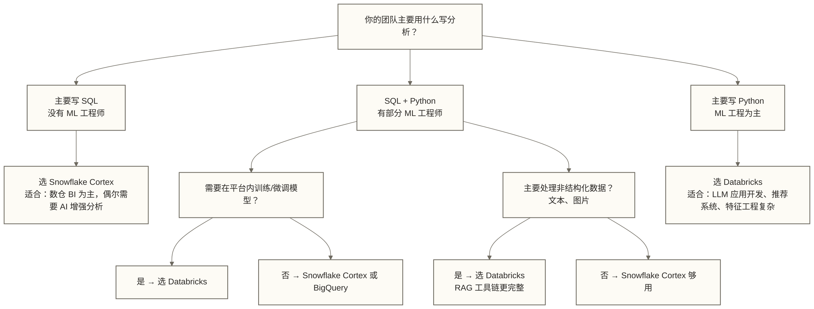

# Snowflake Cortex AI 实战

## 写在前面

Snowflake 干了一件聪明的事：它没有试图把自己变成第二个 Databricks，而是把 AI 能力彻底包进 SQL 里。

这个选择有清晰的逻辑。Snowflake 的用户基础是 SQL 分析师和数仓工程师，这些人不想学 Python，不想管 GPU 集群，不想知道 LLM 的推理延迟。他们只想写 SQL，想让数据分析帮到业务。Cortex 就是为这批人设计的。

代价是：训练和微调能力非常弱。如果你需要从头训练一个模型，或者做复杂的特征工程，Snowflake 不是你的地方。但如果你的核心诉求是"在 SQL 里直接调用 AI 处理文本"，Cortex 的体验是这三家平台里最流畅的。

---

## 目录

- [[【技术与工具】/AI-Native数据平台/02-Snowflake-Cortex实战#Snowflake Cortex 是什么|#Snowflake Cortex 是什么]]
- [[【技术与工具】/AI-Native数据平台/02-Snowflake-Cortex实战#Cortex LLM Functions：SQL 直接调用 LLM|#Cortex LLM Functions：SQL 直接调用 LLM]]
- [[【技术与工具】/AI-Native数据平台/02-Snowflake-Cortex实战#Cortex Search：语义搜索服务|#Cortex Search：语义搜索服务]]
- [[【技术与工具】/AI-Native数据平台/02-Snowflake-Cortex实战#Cortex Analyst：自然语言查询|#Cortex Analyst：自然语言查询]]
- [[【技术与工具】/AI-Native数据平台/02-Snowflake-Cortex实战#Snowflake Arctic：自研基础模型|#Snowflake Arctic：自研基础模型]]
- [[【技术与工具】/AI-Native数据平台/02-Snowflake-Cortex实战#何时选 Snowflake Cortex vs Databricks Mosaic AI|#何时选 Snowflake Cortex vs Databricks Mosaic AI]]

---

## Snowflake Cortex 是什么

### 产品线演进（2023-2026）

Snowflake 进入 AI 赛道的时间不算晚，但路线很坚定：**数据不离 Snowflake，AI 能力以 SQL 函数形式交付**。

2023-2026 年的主要产品发布：

| 时间 | 产品 | 核心能力 |
|------|------|---------|
| 2023 Q3 | Cortex LLM Functions | SQL 内嵌文本处理（摘要、翻译、情感分析） |
| 2023 Q4 | Cortex Search | 向量语义搜索，不需要独立向量数据库 |
| 2024 Q1 | Snowflake Arctic | 自研基础 LLM，开源（Apache 2.0） |
| 2024 Q2 | Cortex Analyst | 自然语言转 SQL，带语义层 |
| 2024 Q4 | Cortex Fine-tuning | 有限的模型微调（基于 Arctic） |
| 2025 | Document AI | 非结构化文档理解（PDF、图片） |

### 核心设计哲学

Snowflake 的 AI 路线和 Databricks 是两种截然不同的思路：

```text
Databricks 路线：
数据 → Python/Spark 计算 → 模型训练/微调 → 部署推理服务 → 应用调用

Snowflake 路线：
数据 → SQL 查询（内嵌 AI 函数）→ 直接返回结果
```

Snowflake 把"数据不离库"作为核心卖点，在金融、医疗等强监管行业里这不是噱头，是真实的合规需求。具体推理位置、网络路径和数据处理边界须按所用功能、账户区域及配置核对；不能仅凭使用 Snowflake 就断言数据流量不走公共互联网或满足大多数数据合规要求。

---

## Cortex LLM Functions：SQL 直接调用 LLM

### 部分函数示例与用法

**SENTIMENT：情感分析**

```sql
-- 基础用法：返回 -1（负面）到 1（正面）之间的分数
SELECT
    review_id,
    product_id,
    review_text,
    SNOWFLAKE.CORTEX.SENTIMENT(review_text) AS sentiment_score,
    CASE
        WHEN SNOWFLAKE.CORTEX.SENTIMENT(review_text) > 0.3 THEN '正面'
        WHEN SNOWFLAKE.CORTEX.SENTIMENT(review_text) < -0.3 THEN '负面'
        ELSE '中性'
    END AS sentiment_label
FROM product_reviews
WHERE review_date >= '2025-01-01';

-- 按情感聚合分析
SELECT
    product_id,
    COUNT(*) AS total_reviews,
    ROUND(AVG(SNOWFLAKE.CORTEX.SENTIMENT(review_text)), 3) AS avg_sentiment,
    SUM(CASE WHEN SNOWFLAKE.CORTEX.SENTIMENT(review_text) < -0.3 THEN 1 ELSE 0 END) AS negative_count
FROM product_reviews
GROUP BY product_id
ORDER BY avg_sentiment ASC
LIMIT 20;  -- 找出口碑最差的 20 个商品
```

**SUMMARIZE：文本摘要**

```sql
-- 摘要单条文本
SELECT
    article_id,
    title,
    SNOWFLAKE.CORTEX.SUMMARIZE(full_content) AS summary
FROM news_articles
WHERE publish_date = CURRENT_DATE();

-- 合并多条评论后再摘要（GROUP 场景）
SELECT
    product_id,
    SNOWFLAKE.CORTEX.SUMMARIZE(
        LISTAGG(review_text, '\n---\n') WITHIN GROUP (ORDER BY review_date DESC)
    ) AS consolidated_review_summary
FROM product_reviews
WHERE review_date >= DATEADD('month', -3, CURRENT_DATE())
GROUP BY product_id
HAVING COUNT(*) >= 5;  -- 只摘要有足够评论量的商品
```

**TRANSLATE：多语言翻译**

```sql
-- 将不同语言的用户反馈统一翻译成中文
SELECT
    feedback_id,
    source_language,
    original_text,
    SNOWFLAKE.CORTEX.TRANSLATE(
        original_text,
        source_language,   -- 源语言代码（'en', 'ja', 'ko', 'de' 等）
        'zh'               -- 目标语言
    ) AS translated_text
FROM global_user_feedback
WHERE source_language != 'zh'
    AND feedback_date >= CURRENT_DATE() - 7;
```

**COMPLETE：通用 Prompt 调用（最灵活）**

```sql
-- 单轮对话（适合结构化分析任务）
SELECT
    sale_id,
    sale_date,
    region,
    amount,
    SNOWFLAKE.CORTEX.COMPLETE(
        'llama3-70b',  -- 指定模型
        CONCAT(
            '你是一位销售数据分析师。请分析以下单笔销售记录，',
            '从地区、时段、金额维度给出不超过3条业务洞察：\n',
            '日期：', sale_date::STRING, '\n',
            '地区：', region, '\n',
            '金额：', amount::STRING, ' 元\n',
            '请用中文回答，每条洞察不超过50字。'
        )
    ) AS ai_insights
FROM daily_sales
WHERE sale_date = CURRENT_DATE() - 1
    AND amount > 100000;  -- 只分析高价值订单

-- 多轮对话（使用 OBJECT 格式传入 messages）
SELECT SNOWFLAKE.CORTEX.COMPLETE(
    'mistral-large2',
    [
        {'role': 'system', 'content': '你是一个数据工程专家，用简洁的语言回答问题。'},
        {'role': 'user', 'content': '解释 Snowflake 的虚拟仓库是什么，用一个比喻帮助理解。'}
    ],
    {}
) AS response;
```

### 支持的模型对比

| 模型 | 适用场景 | 速度 | 质量 | 成本 |
|------|---------|------|------|------|
| `snowflake-arctic-instruct` | 通用文本、SQL 相关任务 | 快 | 中 | 低 |
| `mistral-7b` | 简单分类、摘要 | 最快 | 较低 | 最低 |
| `mistral-large2` | 复杂推理、多步骤任务 | 中 | 高 | 中 |
| `llama3-8b` | 通用任务，平衡选项 | 快 | 中 | 低 |
| `llama3-70b` | 高质量分析、长文处理 | 慢 | 很高 | 高 |
| `llama3.1-405b` | 最复杂任务（慎用，成本高） | 很慢 | 最高 | 最高 |

> [!tip] 模型选择原则
> 不要默认选最大的模型。先用 `mistral-7b` 或 `llama3-8b` 跑测试集，只有在质量明显不够时才升级模型。对于简单的情感分析和摘要，可以先评测较小模型；原稿所称“成本是 70B 级别的 1/10”为未核实的示例比例，不是现行定价结论，须按具体模型、输入输出 token 和账户计费规则测算。

### 批量处理的成本控制

```sql
-- 先测试小样本，估算成本
SELECT
    COUNT(*) AS sample_size,
    AVG(LENGTH(review_text)) AS avg_text_length,
    SUM(LENGTH(review_text)) / 4 AS estimated_total_tokens  -- 未核实的粗估示例；中文及不同 tokenizer 偏差可能很大，不用于计费预算
FROM product_reviews
WHERE review_date = CURRENT_DATE() - 1;

-- 覆盖写表示例：会替换已有目标表结果；并非完整增量任务，运行前须确认成本并备份或使用测试表
CREATE OR REPLACE TABLE product_reviews_enriched AS
SELECT
    r.*,
    SNOWFLAKE.CORTEX.SENTIMENT(r.review_text) AS sentiment_score,
    SNOWFLAKE.CORTEX.SUMMARIZE(r.review_text) AS review_summary,
    SNOWFLAKE.CORTEX.CLASSIFY_TEXT(
        r.review_text,
        ['质量问题', '物流问题', '服务问题', '好评', '其他']
    ) AS issue_category
FROM product_reviews r
WHERE r.review_date = CURRENT_DATE() - 1
    AND r.enriched_at IS NULL;  -- 仅筛选源表空标记；此语句不更新标记，不能保证增量处理或避免重复调用
```

---

## Cortex Search：语义搜索服务

### 为什么不需要单独的向量数据库

传统的向量搜索方案需要一套独立的向量数据库（Pinecone、Weaviate、Qdrant），维护成本高，数据需要在两个系统之间同步。

Cortex Search 把向量索引直接建在 Snowflake 里，数据留在原地：

```sql
-- 1. 创建 Cortex Search 服务
CREATE OR REPLACE CORTEX SEARCH SERVICE product_knowledge_search
  ON body  -- 需要语义搜索的文本字段
  ATTRIBUTES product_id, category, updated_at  -- 可用于过滤的元数据字段
  WAREHOUSE = compute_wh
  TARGET_LAG = '1 hour'  -- 数据刷新滞后的目标值，不保证新数据在一小时内可被搜索到
  AS (
    -- 数据源查询
    SELECT
        product_id,
        category,
        CONCAT(product_name, '\n', description, '\n', features) AS body,
        updated_at
    FROM product_catalog
    WHERE is_active = TRUE
  );
```

```python
# 2. Python 调用语义搜索（Snowflake Python SDK）
from snowflake.core import Root
from snowflake.snowpark import Session

session = Session.builder.configs(connection_params).create()
root = Root(session)

# 获取搜索服务
search_service = root.databases["PROD_DB"] \
    .schemas["PUBLIC"] \
    .cortex_search_services["product_knowledge_search"]

# 语义搜索（向量相似度 + 关键词混合搜索）
results = search_service.search(
    query="防水透气的户外登山鞋",
    columns=["product_id", "body", "category"],
    filter={"@eq": {"category": "鞋类"}},  # 元数据过滤
    limit=10
)

for result in results.results:
    print(f"Product: {result['product_id']}, Score: {result.get('_score', 'N/A')}")
    print(f"Content: {result['body'][:200]}...")
    print()
```

```sql
-- 3. SQL 接口调用（直接在查询里使用）
SELECT PARSE_JSON(
    SNOWFLAKE.CORTEX.SEARCH_PREVIEW(
        'product_knowledge_search',
        '{
            "query": "适合小朋友的益智玩具",
            "columns": ["product_id", "body"],
            "filter": {"@eq": {"category": "玩具"}},
            "limit": 5
        }'
    )
) AS search_results;
```

### 结合 LLM Functions 构建完整的 RAG 流程

```sql
-- 在 Snowflake 内组合实现 RAG：此示例直接扫描预存 embedding，不调用前文的 Cortex Search 服务；须先生成同模型、同维度的商品向量
WITH user_query AS (
    SELECT '我想找一款适合初学者的电吉他，预算3000元以内' AS query
),
-- Step 1: 语义检索相关商品
retrieved_products AS (
    SELECT
        p.product_id,
        p.product_name,
        p.price,
        p.description
    FROM product_catalog p
    WHERE p.category = '乐器'
        AND p.price <= 3000
    ORDER BY VECTOR_COSINE_SIMILARITY(
        p.embedding,
        SNOWFLAKE.CORTEX.EMBED_TEXT_768('e5-base-v2', (SELECT query FROM user_query))
    ) DESC
    LIMIT 5
),
-- Step 2: 组织检索结果作为 Context
context_builder AS (
    SELECT LISTAGG(
        CONCAT('商品：', product_name, '，价格：', price::STRING, '元\n描述：', description),
        '\n\n'
    ) AS context
    FROM retrieved_products
)
-- Step 3: 调用 LLM 生成最终回答
SELECT SNOWFLAKE.CORTEX.COMPLETE(
    'llama3-70b',
    CONCAT(
        '你是一位专业的乐器顾问。请根据以下商品列表，为用户推荐最合适的选择，并说明推荐理由。\n\n',
        '可选商品：\n', (SELECT context FROM context_builder), '\n\n',
        '用户需求：', (SELECT query FROM user_query), '\n\n',
        '请给出1-2个推荐，每个推荐包含：商品名称、推荐理由（2-3句话）。'
    )
) AS recommendation;
```

---

## Cortex Analyst：自然语言查询

### 它不是普通的 Text-to-SQL

普通 Text-to-SQL 直接让 LLM 看表结构生成 SQL，核心问题是：**LLM 不懂你公司的业务定义**。"活跃用户"在每家公司的定义都不一样，LLM 猜不出来。

Cortex Analyst 的设计多了一层：**Semantic Model（语义模型）**，强制要求数据工程师事先把业务定义写清楚。

### 定义语义模型

```yaml
# semantic_model.yaml - 语义模型定义文件
name: "电商数据分析模型"
description: "覆盖订单、用户、商品三个核心业务域的分析语义层"

tables:
  - name: "dwd_order_detail"
    description: "订单明细表，记录每笔成功交易的详细信息"
    base_table:
      database: PROD_DB
      schema: DWD
      table: ORDER_DETAIL
    filters:
      - name: "有效订单"
        synonyms: ["成功订单", "已完成订单", "非取消订单"]
        expr: "order_status NOT IN ('CANCELLED', 'FAILED')"

    dimensions:
      - name: "订单日期"
        synonyms: ["下单时间", "购买日期", "交易日期"]
        expr: "DATE(created_at)"
        data_type: DATE

      - name: "地区"
        synonyms: ["省份", "区域", "城市大区"]
        expr: "region"
        data_type: TEXT

      - name: "用户等级"
        synonyms: ["会员等级", "用户分层"]
        expr: "user_tier"
        data_type: TEXT
        sample_values: ["普通", "银牌", "金牌", "钻石"]

    measures:
      - name: "GMV"
        synonyms: ["交易金额", "销售额", "成交额"]
        description: "所有有效订单的支付金额总和，不含运费"
        expr: "SUM(payment_amount)"
        data_type: NUMBER
        default_aggregation: SUM

      - name: "订单量"
        synonyms: ["下单数", "笔数", "成交量"]
        expr: "COUNT(DISTINCT order_id)"
        data_type: NUMBER

      - name: "客单价"
        synonyms: ["平均订单金额", "每单金额"]
        description: "GMV 除以订单量"
        expr: "SUM(payment_amount) / COUNT(DISTINCT order_id)"
        data_type: NUMBER

  - name: "dwd_user_base"
    description: "用户基础信息表"
    base_table:
      database: PROD_DB
      schema: DWD
      table: USER_BASE

    measures:
      - name: "活跃用户数"
        synonyms: ["DAU", "MAU", "活跃用户"]
        description: "统计周期内有过下单行为的用户数（以用户 ID 去重计算）"
        expr: "COUNT(DISTINCT user_id)"
        data_type: NUMBER
```

### 通过 API 使用 Cortex Analyst

```python
import snowflake.connector
import json

conn = snowflake.connector.connect(**connection_params)
cursor = conn.cursor()

def ask_cortex_analyst(question: str, semantic_model_path: str) -> dict:
    """向 Cortex Analyst 提问，自动生成并执行 SQL"""

    # 读取语义模型
    with open(semantic_model_path, 'r') as f:
        semantic_model = f.read()

    # 原稿调用方式有缺陷：Cortex Analyst 使用服务 API，下列 SQL 函数调用不能作为可运行实现，须替换为实际 API 请求
    response = cursor.execute("""
        SELECT SNOWFLAKE.CORTEX.ANALYST(
            ?,   -- 用户问题
            ?    -- 语义模型 YAML 内容
        )
    """, (question, semantic_model)).fetchone()[0]

    result = json.loads(response)

    print("理解的问题：", result.get("interpreted_query", ""))
    print("生成的 SQL：")
    print(result.get("sql", ""))

    return result

# 使用示例
result = ask_cortex_analyst(
    question="上个月各地区的 GMV 是多少，按金额降序排列",
    semantic_model_path="./semantic_model.yaml"
)

# 以下为未经审查直接执行的原稿示例；实际使用须先审核 SQL，并限制为只读角色、允许访问的对象及查询资源
if result.get("sql"):
    df = cursor.execute(result["sql"]).fetch_pandas_all()
    print(df)
```

### 语义模型的维护成本

> [!warning] Cortex Analyst 的现实代价
> 语义模型不是一次性的工作，它需要持续维护：
> - 每次业务定义变化，语义模型必须同步更新
> - 新增业务指标，需要更新 measures 配置
> - 需要数据工程师和业务方定期对齐，确认定义无歧义
>
> 如果你的组织没有成熟的数据指标管理文化，Cortex Analyst 的效果会大打折扣。这不是技术问题，是组织问题。

---

## Snowflake Arctic：自研基础模型

### 设计目标与架构特点

Arctic 是 Snowflake 在 2024 年发布的基础大模型，定位是"高效的企业智能模型"：

- **架构**：混合专家（MoE）架构，总参数 480B，但推理时只激活约 17B
- **训练重点**：SQL 代码、企业数据分析、结构化推理，比通用 LLM 在 SQL 任务上表现更好
- **开源协议**：Apache 2.0，企业可以自由部署和修改
- **Snowflake 内使用**：作为 Cortex 函数的底层模型选项之一（`snowflake-arctic-instruct`）

### 什么时候选 Arctic

```sql
-- Arctic 在 SQL 生成类任务上表现好
SELECT SNOWFLAKE.CORTEX.COMPLETE(
    'snowflake-arctic-instruct',
    '根据以下 Snowflake 表结构，写一个按月统计各地区活跃用户数的 SQL：
     表名：user_events
     字段：user_id, event_type, event_time, region
     要求：只统计过去 3 个月，结果按月份降序和用户数降序排列'
) AS generated_sql;

-- 对比：通用文本创作，Arctic 不如 llama3-70b
SELECT SNOWFLAKE.CORTEX.COMPLETE(
    'llama3-70b',  -- 创意写作用更大的通用模型
    '为我们的数据分析平台写一段面向非技术高管的产品介绍，200字以内，重点突出业务价值。'
) AS product_intro;
```

**选用 Arctic 的场景：**
- SQL 生成和优化建议
- 结构化数据的摘要和报告
- 低延迟、高并发的简单 AI 任务
- 需要控制成本的批量处理

**不选 Arctic 的场景：**
- 复杂的多步骤推理
- 创意写作或开放性生成
- 非英语和非 SQL 的专业域任务

---

## 何时选 Snowflake Cortex vs Databricks Mosaic AI

### 选型对比矩阵

| 维度 | Snowflake Cortex | Databricks Mosaic AI |
|------|-----------------|---------------------|
| **主要用户** | SQL 分析师、BI 工程师 | 数据工程师、ML 工程师 |
| **AI 接口** | SQL 函数（COMPLETE、SENTIMENT 等） | Python API + SQL AI Functions |
| **模型训练** | 基本不支持（有限的 Arctic 微调） | 完整支持（Mosaic AI Training） |
| **模型微调** | 有限（Fine-tuning API，基于 Arctic） | 完整（支持 Llama、Mistral 等主流模型） |
| **向量搜索** | Cortex Search（内置，无需额外配置） | Delta Sync Index + 外部向量库集成 |
| **自然语言查询** | Cortex Analyst（带语义模型） | Databricks Assistant（自然语言转 SQL） |
| **RAG 支持** | 基础（函数组合实现） | 完整工具链（Document Parsing + 向量化 + 检索） |
| **数据安全** | Snowflake 边界内，极佳 | Databricks 边界内，同样良好 |
| **上手难度** | 低（会 SQL 就能用） | 高（需要理解 MLflow、Clusters 等概念） |
| **开源生态** | 低（封闭生态为主） | 高（Delta Lake、MLflow 均开源） |
| **月均成本估算** | 中（按 Credit 消耗） | 高（DBU 计费 + 存储） |
| **适合企业规模** | 各规模，特别是 BI 团队为主的企业 | 中大型，有数据工程和 ML 工程能力 |

### 决策树



### 教学对照示例：同一个需求，两种平台的实现差异

**需求：对过去 30 天的用户评论做情感分析，生成每个商品的综合舆情报告**

Snowflake Cortex 实现：
```sql
-- 15 行 SQL 搞定，不需要任何 Python
CREATE OR REPLACE TABLE product_sentiment_report AS
SELECT
    product_id,
    COUNT(*) AS review_count,
    ROUND(AVG(SNOWFLAKE.CORTEX.SENTIMENT(review_text)), 3) AS avg_sentiment,
    SNOWFLAKE.CORTEX.SUMMARIZE(
        LISTAGG(review_text, '\n') WITHIN GROUP (ORDER BY review_date DESC)
    ) AS ai_summary,
    SNOWFLAKE.CORTEX.COMPLETE(
        'llama3-70b',
        CONCAT(
            '以下是商品的用户评论汇总，请给出3条具体的改进建议：\n',
            LISTAGG(review_text, '\n') WITHIN GROUP (ORDER BY review_date DESC)
        )
    ) AS improvement_suggestions
FROM product_reviews
WHERE review_date >= CURRENT_DATE() - 30
GROUP BY product_id;
```

Databricks Mosaic AI 实现：
```python
# 未完成的 PySpark + Python 对照骨架：缺少 client、count、avg 等定义，返回类型和时间窗口待修正，尚未实现完整舆情报告
from pyspark.sql.functions import col, udf, lit
from pyspark.sql.types import StringType
import openai  # 或 Databricks AI Functions

# 读取数据
reviews = spark.table("prod.dwd.product_reviews") \
    .filter(col("review_date") >= "2026-02-09")

# 定义 UDF 或使用 AI Functions
@udf(returnType=StringType())
def get_sentiment(text):
    # 调用 Mosaic AI 端点
    response = client.predict(endpoint="llama3-70b", inputs={"text": text})
    return response["sentiment"]

# 处理
result = reviews.groupBy("product_id") \
    .agg(
        count("*").alias("review_count"),
        avg(get_sentiment(col("review_text"))).alias("avg_sentiment"),
        # 更多复杂聚合逻辑...
    )

result.write.mode("overwrite").saveAsTable("prod.dm.product_sentiment_report")
```

对这个需求，Snowflake 的方案更简洁。但如果需求变成"训练一个专属的情感分类模型"，Snowflake 就力不从心了，Databricks 的工具链才能支撑。

---

## 相关文档

- [[【技术与工具】/AI-Native数据平台/00-AI-Native数据平台全景|AI-Native数据平台全景]] - AI-Native 平台整体框架和选型逻辑
- [[【技术与工具】/AI-Native数据平台/01-Databricks平台实战|Databricks平台实战]] - Databricks Delta Lake、MLflow、Mosaic AI 的对标参考
- [[【技术与工具】/AI-Native数据平台/03-BigQuery-ML实战|BigQuery ML实战]] - Google 路线的 AI 数据平台实战
- [[【技术与工具】/AI-Native数据平台/04-AI-Native平台选型对比|AI-Native平台选型对比]] - 三大平台系统化选型决策矩阵
- [[【AI 与大数据】/06-行业应用/03-Text-to-SQL自然语言查询实战|Text-to-SQL自然语言查询实战]] - Text-to-SQL 技术原理与实践
- [[【AI 与大数据】/04-AI工程化/07-向量数据库与语义搜索|向量数据库与语义搜索]] - 向量检索技术深度解析

#Snowflake #Cortex #AI #SQL #云数仓 #LLM #向量搜索 #自然语言查询 #Arctic #AI-Native
