# BigQuery ML 与 Vertex AI 实战

## 写在前面

BigQuery 的独特之处在于它的位置：不是某个 AI 功能的载体，而是整个 Google AI 生态的数据底座。

这意味着什么？如果你在 Google Cloud 上，BigQuery 和 Vertex AI（Google 的 AI 平台）、Gemini（Google 的 LLM）、Looker（Google 的 BI 工具）的集成不是拼接出来的，是原生设计的。原生集成可以减少部分数据转换与系统对接工作，但跨服务调用仍存在延迟，并需配置 IAM、连接服务账号和区域兼容性。

代价是：如果你不在 Google Cloud 生态里，BigQuery 的 AI 能力对你的吸引力大打折扣，因为跨云集成的复杂度会消耗掉它的生态红利。

这篇文档不会假设你已经在 Google Cloud 里，我会把 BigQuery AI 能力的适用边界说清楚。

---

## 目录

- [[【技术与工具】/AI-Native数据平台/03-BigQuery-ML实战#Google 的数据+AI 战略|#Google 的数据+AI 战略]]
- [[【技术与工具】/AI-Native数据平台/03-BigQuery-ML实战#BigQuery ML 能做什么|#BigQuery ML 能做什么]]
- [[【技术与工具】/AI-Native数据平台/03-BigQuery-ML实战#BigQuery 向量搜索（Vector Search）|#BigQuery 向量搜索（Vector Search）]]
- [[【技术与工具】/AI-Native数据平台/03-BigQuery-ML实战#Vertex AI + BigQuery 集成|#Vertex AI + BigQuery 集成]]
- [[【技术与工具】/AI-Native数据平台/03-BigQuery-ML实战#Gemini in BigQuery：AI 助手深度嵌入|#Gemini in BigQuery：AI 助手深度嵌入]]
- [[【技术与工具】/AI-Native数据平台/03-BigQuery-ML实战#Looker BI + AI|#Looker BI + AI]]
- [[【技术与工具】/AI-Native数据平台/03-BigQuery-ML实战#何时选 BigQuery|#何时选 BigQuery]]

---

## Google 的数据+AI 战略

### 产品矩阵结构

Google Cloud 的数据和 AI 产品线比另外两家更复杂，先把地图画清楚：

```mermaid
%%{init: {"theme":"base","themeVariables":{"fontFamily":"PingFang SC, -apple-system, Source Han Serif SC, serif","fontSize":"16px","background":"#FDFBF5","primaryColor":"#FDFBF5","primaryTextColor":"#2D2A26","primaryBorderColor":"#6E6A60","secondaryColor":"#E8EFE8","secondaryBorderColor":"#8FA890","secondaryTextColor":"#2D2A26","tertiaryColor":"#FDFBF5","tertiaryBorderColor":"#9A9488","tertiaryTextColor":"#6E6A60","lineColor":"#6E6A60","textColor":"#2D2A26","mainBkg":"#FDFBF5","nodeBorder":"#2D5A3D","clusterBkg":"#F3EEDF","clusterBorder":"#9A9488","edgeLabelBackground":"#FDFBF5"},"flowchart":{"htmlLabels":true,"curve":"basis","padding":20,"nodeSpacing":60,"rankSpacing":70,"useMaxWidth":false},"themeCSS":".node rect, .node polygon, .node circle { stroke-width: 1.5px; } .edgePath .path { stroke-width: 1.5px; } .cluster-label .nodeLabel, .cluster-label foreignObject { color: #2D2A26 !important; } .edgeLabel, .edgeLabel foreignObject { color: #2D2A26 !important; background-color: #FDFBF5; } .edgeLabel rect { fill: #FDFBF5; }"}}%%
flowchart TD
    classDef default fill:#FDFBF5,stroke:#6E6A60,color:#2D2A26,stroke-width:1.5px
    classDef startend fill:#2D2A26,stroke:#2D2A26,color:#FDFBF5,font-weight:bold
    classDef decision fill:#F6EAD8,stroke:#C08A1A,color:#2D2A26,font-weight:bold
    classDef hub fill:#3B5A80,stroke:#3B5A80,color:#FDFBF5,font-weight:bold
    classDef io fill:#E5EAF0,stroke:#3B5A80,color:#2D2A26
    classDef accent fill:#A6432C,stroke:#A6432C,color:#FDFBF5,font-weight:bold
    classDef storage fill:#F3EEDF,stroke:#9A9488,color:#2D2A26
    subgraph BQ["数据层（BigQuery 生态）"]
        BQ1[BigQuery<br>Serverless 列式数仓 核心]
        BQ2[BigQuery ML BQML<br>SQL 内直接训练和调用 ML 模型]
        BQ3[BigQuery Vector Search<br>向量相似度搜索]
        BQ4[BigLake<br>跨云数据湖统一访问，支持 Iceberg]
        BQ5[Pub/Sub + Dataflow<br>实时流数据摄入和处理]
    end

    subgraph VA["AI 层（Vertex AI 生态）"]
        VA1[Vertex AI<br>统一 ML 平台，训练/调优/部署/监控]
        VA2[Vertex AI Feature Store<br>特征存储]
        VA3[Vertex AI Pipelines<br>ML 工作流编排]
        VA4[Model Garden<br>预训练模型库，Gemini/Llama/Mistral 等]
    end

    subgraph GE["LLM 层（Gemini 生态）"]
        GE1[Gemini 1.5 Pro/Flash<br>原稿采用的模型版本，端点可用性未核实]
        GE2[Gemini for Google Cloud<br>嵌入所有 Google Cloud 服务的 AI 助手]
        GE3[Gemma<br>开放权重小型 LLM，原始系列 2B/7B，适用 Gemma 使用条款]
    end

    BQ --> VA
    VA --> GE
    class BQ,BQ1,BQ2,BQ3,BQ4,BQ5,VA,VA1,VA2,VA3,VA4,GE,GE1,GE2,GE3 default
```



**三层之间的关系：BigQuery 存数据，Vertex AI 训练和管理模型，Gemini 提供 LLM 能力。这三者可通过 Google Cloud 的 IAM 和服务接口集成，但仍需配置权限、连接及区域，并评估调用延迟与费用。**

### BigQuery 的先天优势

BigQuery 从 2010 年就存在，基于 Google 内部的 Dremel 论文实现。几个关键的工程特点：

**Serverless 计算模型**：不需要自行管理计算集群。查询执行时由平台调度资源；按需查询计费模式下，没有查询通常不产生查询扫描费用，但存储、容量承诺及其他服务仍可能收费。这对数据量增长不可预测的早期团队具有一定便利性。

**按查询扫描量计费**：原稿给出的未核实价格示例为 5 美元每 TB 数据扫描、每月 1 TB 免费额度，不应视为当前报价；实际费用取决于区域、计费模式及免费额度适用条件。善用分区表和列裁剪可以减少扫描量，但仍需估算其他费用。

**Colossus 存储**：Google 的分布式文件系统，PB 级查询性能有历史积累，这是 BigQuery 2010 年就能做 PB 级分析的原因。

---

## BigQuery ML 能做什么

### 核心定位

BigQuery ML 的定位很明确：**让不会 Python 的 SQL 用户也能做 ML 预测分析，数据不需要离开 BigQuery**。

它不是替代 Vertex AI 的，而是填补了 SQL 分析师和 ML 工程师之间的技能鸿沟。

### 传统 ML 模型（SQL 直接训练）

```sql
-- 在 BigQuery 里直接训练线性回归模型
CREATE OR REPLACE MODEL `project.dataset.order_amount_predictor`
OPTIONS(
    model_type = 'linear_reg',
    input_label_cols = ['order_amount'],      -- 目标变量
    data_split_method = 'AUTO_SPLIT',          -- 自动划分数据；具体比例和评估集大小取决于数据量与模型规则
    enable_global_explain = TRUE               -- 开启全局特征重要性解释
) AS
SELECT
    user_age,
    user_tier,                               -- 字符串特征会自动编码
    day_of_week,
    is_holiday,
    promo_code_used,
    region,
    order_amount
FROM `project.dataset.order_history`
WHERE order_date BETWEEN '2024-01-01' AND '2025-12-31'
    AND order_status = 'COMPLETED';

-- 查看模型训练结果
SELECT * FROM ML.EVALUATE(MODEL `project.dataset.order_amount_predictor`);

-- 查看特征重要性
SELECT * FROM ML.GLOBAL_EXPLAIN(MODEL `project.dataset.order_amount_predictor`);

-- 用模型做预测；此线性回归示例返回点预测，不返回置信区间
SELECT
    user_id,
    predicted_order_amount
FROM ML.PREDICT(
    MODEL `project.dataset.order_amount_predictor`,
    (
        SELECT
            user_id,
            user_age,
            user_tier,
            day_of_week,
            is_holiday,
            promo_code_used,
            region
        FROM `project.dataset.upcoming_users`
    )
);
```

支持的模型类型：

| 类型 | 用途 | SQL 关键字 |
|------|------|-----------|
| 线性回归 | 数值预测（如销量、金额） | `linear_reg` |
| 逻辑回归 | 二分类（如是否流失） | `logistic_reg` |
| 多分类 | 多类别单标签分类 | `logistic_reg`（多类别） |
| K-Means | 用户分群、异常检测 | `kmeans` |
| 矩阵分解 | 协同过滤推荐 | `matrix_factorization` |
| 时间序列 | 销量预测、趋势分析 | `arima_plus` |
| XGBoost | 复杂的表格数据分类/回归 | `boosted_tree_classifier` / `boosted_tree_regressor` |
| DNN | 深度神经网络 | `dnn_classifier` / `dnn_regressor` |

### 在 SQL 里直接调用 Gemini

这是 BigQuery 最有冲击力的新能力：

```sql
-- 步骤 1：使用已创建并授权的连接注册 Gemini 远程模型（此语句不创建连接）
CREATE OR REPLACE MODEL `project.dataset.gemini_connection`
REMOTE WITH CONNECTION `us.bigquery_connection`
OPTIONS (endpoint = 'gemini-1.5-flash');  -- 原稿端点示例，尚未核实可用性；执行前确认所用区域支持的模型

-- 步骤 2：直接在 SQL 里调用 Gemini
SELECT *
FROM ML.GENERATE_TEXT(
    MODEL `project.dataset.gemini_connection`,
    (
        SELECT
            review_id,
            CONCAT(
                '请分析以下电商评论，提取：\n',
                '1. 情感倾向（正面/负面/中性）\n',
                '2. 主要提到的产品属性（最多3个）\n',
                '3. 一句话总结\n\n',
                '评论内容：', review_text
            ) AS prompt
        FROM `project.dataset.product_reviews`
        WHERE review_date = CURRENT_DATE() - 1
    ),
    STRUCT(
        0.1 AS temperature,          -- 低温度，输出更确定
        512 AS max_output_tokens,    -- 限制输出长度控制成本
        TRUE AS flatten_json_output  -- 展平 API 响应字段，不会自动解析模型生成文本中的业务 JSON
    )
);
```

```sql
-- 结合 JSON 解析，把结构化输出存成独立字段
CREATE OR REPLACE TABLE `project.dataset.reviews_ai_enriched` AS
WITH ai_response AS (
    SELECT
        r.review_id,
        r.product_id,
        r.review_text,
        SAFE.PARSE_JSON(ml_generate_text_llm_result) AS ai_result  -- 非法 JSON 返回 NULL，仍需检查生成状态与字段结构
    FROM ML.GENERATE_TEXT(
        MODEL `project.dataset.gemini_connection`,
        (
            SELECT
                review_id,
                product_id,
                review_text,
                CONCAT(
                    '分析以下评论，用 JSON 格式返回：\n',
                    '{"sentiment": "正面/负面/中性",',
                    '"key_aspects": ["属性1", "属性2"],',
                    '"summary": "一句话总结"}\n\n',
                    '评论：', review_text
                ) AS prompt
            FROM `project.dataset.product_reviews`
            WHERE review_date >= CURRENT_DATE() - 30
        ),
        STRUCT(0.0 AS temperature, 256 AS max_output_tokens, TRUE AS flatten_json_output)
    ) r
)
SELECT
    review_id,
    product_id,
    review_text,
    JSON_VALUE(ai_result, '$.sentiment') AS sentiment,
    JSON_QUERY(ai_result, '$.key_aspects') AS key_aspects,
    JSON_VALUE(ai_result, '$.summary') AS ai_summary
FROM ai_response;
```

### BQML 的适用边界

> [!note] BQML 是补充，不是替代
> **适合用 BQML 的场景：**
> - 数据分析师需要快速验证 ML 假设，不想等数据科学团队排期
> - 数据量不超过数亿行的中等规模预测任务
> - 特征工程逻辑简单，可以在 SQL 里完成
> - 不需要频繁重训练（每天或每周批量更新）
>
> **不适合用 BQML 的场景：**
> - 需要复杂特征工程（序列特征、图特征、实时特征）
> - 需要精细控制模型超参数
> - 在线低延迟推理（BQML 预测延迟在秒级，不适合实时场景）
> - 需要直接用 SQL 训练图像、音频等非结构化数据模型；通过远程模型处理此类数据属于另一条路径，需另行确认模型支持、输入方式与权限

---

## BigQuery 向量搜索（Vector Search）

### 架构设计：向量和业务数据放在一起

BigQuery 的向量搜索把向量索引和原始数据放在同一个系统里，避免了向量数据库和数仓之间的数据同步问题：

```sql
-- 步骤 1：生成文本 Embedding（调用 Vertex AI Embedding 模型）
CREATE OR REPLACE MODEL `project.dataset.text_embedding_model`
REMOTE WITH CONNECTION `us.vertex_connection`
OPTIONS (endpoint = 'text-embedding-004');  -- 原稿采用的文本 Embedding 模型，执行前确认端点可用性

-- 步骤 2：为商品描述生成 Embedding 并存储
CREATE OR REPLACE TABLE `project.dataset.product_embeddings` AS
SELECT
    product_id,
    product_name,
    description,
    ml_generate_embedding_result AS embedding  -- text-embedding-004 默认输出 768 维；以实际输出和维度配置为准
FROM ML.GENERATE_EMBEDDING(
    MODEL `project.dataset.text_embedding_model`,
    (
        SELECT
            product_id,
            product_name,
            description,
            CONCAT(product_name, ': ', description, '. 分类：', category) AS content
        FROM `project.dataset.product_catalog`
        WHERE is_active = TRUE
    )
);

-- 步骤 3：创建向量索引（IVF 索引，适合大规模近似搜索）
CREATE OR REPLACE VECTOR INDEX product_vector_idx
ON `project.dataset.product_embeddings`(embedding)
OPTIONS (
    index_type = 'IVF',
    distance_type = 'COSINE',
    ivf_options = '{"num_lists": 100}'  -- 数据量越大，num_lists 越大
);
```

```sql
-- 步骤 4：执行向量相似度搜索
SELECT
    base.product_id,
    base.product_name,
    base.description,
    distance
FROM VECTOR_SEARCH(
    TABLE `project.dataset.product_embeddings`,
    'embedding',
    (
        -- 将查询文本转为 Embedding
        SELECT ml_generate_embedding_result AS embedding
        FROM ML.GENERATE_EMBEDDING(
            MODEL `project.dataset.text_embedding_model`,
            (SELECT '适合夏天穿的透气运动鞋' AS content)
        )
    ),
    top_k => 10,          -- 返回最相似的 10 个结果
    distance_type => 'COSINE',
    options => '{"use_brute_force": false}'  -- 使用索引加速（非暴力搜索）
)
ORDER BY distance ASC;
```

### 完整的 RAG 流程（纯 BigQuery 实现）

```sql
-- 在 BigQuery 内部实现完整的 RAG：检索 + 生成
WITH user_query AS (
    SELECT '公司的退货政策是什么？退货期限多长？' AS question
),
-- Step 1: 生成查询向量
query_embedding AS (
    SELECT ml_generate_embedding_result AS embedding
    FROM ML.GENERATE_EMBEDDING(
        MODEL `project.dataset.text_embedding_model`,
        (SELECT question AS content FROM user_query)
    )
),
-- Step 2: 向量检索相关知识库文档
retrieved_docs AS (
    SELECT
        base.doc_id,
        base.chunk_text,
        distance
    FROM VECTOR_SEARCH(
        TABLE `project.dataset.knowledge_base_embeddings`,
        'embedding',
        TABLE query_embedding,
        top_k => 5,
        distance_type => 'COSINE'
    )
    WHERE distance < 0.3  -- 过滤相关性不够的结果
    ORDER BY distance ASC
),
-- Step 3: 组织 Context
context_builder AS (
    SELECT STRING_AGG(chunk_text, '\n\n') AS context
    FROM retrieved_docs
)
-- Step 4: 调用 Gemini 生成回答
SELECT ml_generate_text_result AS answer
FROM ML.GENERATE_TEXT(
    MODEL `project.dataset.gemini_connection`,
    (
        SELECT CONCAT(
            '你是公司的智能客服助手，请基于以下公司文档回答用户问题。\n\n',
            '参考文档：\n', c.context, '\n\n',
            '用户问题：', q.question, '\n\n',
            '请用简洁、友好的语气回答，如果文档中没有相关信息请如实说明。'
        ) AS prompt
        FROM user_query q
        CROSS JOIN context_builder c
    ),
    STRUCT(0.1 AS temperature, 1024 AS max_output_tokens)
);
```

### 与 Snowflake Cortex Search 对比

| 维度 | BigQuery Vector Search | Snowflake Cortex Search |
|------|----------------------|------------------------|
| 向量生成 | 需单独调用 Vertex AI Embedding | 内置，自动处理 |
| 检索方式 | 可使用向量索引（如 IVF）进行近似搜索，也可进行无索引的 Brute Force 搜索 | 混合搜索（向量+关键词） |
| 配置复杂度 | 较高（多步骤配置） | 低（声明式配置） |
| 数据同步 | 向量表需手动更新 | 自动同步（TARGET_LAG 配置） |
| SQL 集成 | `VECTOR_SEARCH()` 函数 | `SEARCH_PREVIEW()` 函数 |
| 成本模型 | 按存储+查询量计费 | 按 Cortex Credit 计费 |
| 混合搜索 | 需手动实现 | 内置支持 |

---

## Vertex AI + BigQuery 集成

### 特征工程：BigQuery 作为特征来源

```python
# 使用 Vertex AI Python SDK 从 BigQuery 读取训练数据
from google.cloud import bigquery, aiplatform
from google.cloud.aiplatform import TabularDataset

aiplatform.init(project="my-project", location="us-central1")

# 直接用 BigQuery 表或查询创建 Vertex AI 数据集（不需要导出文件）
dataset = TabularDataset.create(
    display_name="churn_prediction_dataset",
    bq_source="bq://my-project.my_dataset.user_features_for_training"
)

# 用 AutoML 训练（不需要写模型代码）
from google.cloud.aiplatform import AutoMLTabularTrainingJob

job = AutoMLTabularTrainingJob(
    display_name="churn_automl_v1",
    optimization_prediction_type="classification",
    optimization_objective="maximize-au-roc"
)

model = job.run(
    dataset=dataset,
    target_column="is_churned",
    training_fraction_split=0.8,
    validation_fraction_split=0.1,
    test_fraction_split=0.1,
    budget_milli_node_hours=1000,  # 1 个节点小时的训练预算
    model_display_name="churn_predictor_automl"
)
```

### 在 BigQuery 里调用 Vertex AI 上的自定义模型

```sql
-- 注册部署在 Vertex AI 上的自定义模型到 BigQuery
CREATE OR REPLACE MODEL `project.dataset.custom_churn_model`
REMOTE WITH CONNECTION `us.vertex_connection`
OPTIONS (
    endpoint = 'projects/my-project/locations/us-central1/endpoints/12345678'
);

-- 像调用 BQML 模型一样使用 Vertex AI 上的模型
SELECT
    user_id,
    predicted_label,
    predicted_label_probs
FROM ML.PREDICT(
    MODEL `project.dataset.custom_churn_model`,
    (
        SELECT
            user_id,
            days_since_last_order,
            total_orders_30d,
            avg_order_value,
            support_tickets_30d,
            user_tier
        FROM `project.dataset.user_features_current`
    )
);
```

### Vertex AI Feature Store：在线特征管理

```python
# BigQuery 作为离线特征存储，Vertex AI Feature Store 作为在线存储
from vertexai.resources.preview.feature_store import (
    FeatureStore,
    FeatureView,
    BigQuerySource
)

# 创建 Feature Store（连接到 BigQuery）
fs = FeatureStore.create(
    feature_store_id="user_feature_store",
    online_store_type="bigtable",  # 在线服务层
    bigtable_min_node_count=1
)

# 创建 Feature View（定义从 BigQuery 同步的特征）
fv = fs.create_feature_view(
    name="user_behavior_features",
    source=BigQuerySource(
        uri="bq://my-project.my_dataset.user_realtime_features",
        entity_id_columns=["user_id"]
    ),
    sync_config={"cron": "0 * * * *"}  # 每小时同步一次
)

# 在线推理时调用（低延迟，毫秒级返回）
features = fv.read(key="user_12345678")
```

---

## Gemini in BigQuery：AI 助手深度嵌入

### 面向工程师的能力

Gemini 在 BigQuery Studio（BigQuery 的 Web IDE）里提供的 AI 能力：

**SQL 生成**：
```text
用户输入（自然语言）：
"给我看过去6个月每个月、每个地区的GMV，只看GMV超过100万的地区，
 结果按月份升序和GMV降序排列"

Gemini 生成的 SQL：
SELECT
    DATE_TRUNC(order_date, MONTH) AS order_month,
    region,
    SUM(payment_amount) AS gmv
FROM `project.dataset.dwd_order_detail`
WHERE
    order_date >= DATE_SUB(CURRENT_DATE(), INTERVAL 6 MONTH)
    AND order_status = 'COMPLETED'
GROUP BY 1, 2
HAVING SUM(payment_amount) > 1000000
ORDER BY order_month ASC, gmv DESC;
```

**SQL 解释（把别人写的复杂 SQL 变成人话）：**
这在接手旧系统时很实用，Gemini 会逐步解释每个子查询和 JOIN 的逻辑。

**错误诊断**：执行失败时，Gemini 直接在报错旁边给出修复建议，不需要去 Google 报错信息。

### Data Canvas：业务分析师的界面

Data Canvas 是 BigQuery 里面向业务分析师的可视化探索工具，不需要写 SQL：

1. 选择数据源（一张或多张 BigQuery 表）
2. 用自然语言描述分析需求（"按地区和用户等级分析过去 3 个月的留存率"）
3. Gemini 自动生成查询并展示图表
4. 支持追加问题（"把金牌用户的数据单独拆出来看"）

这和 Cortex Analyst 的定位非常接近。区别在于：Cortex Analyst 需要预定义语义模型，Data Canvas 更依赖 LLM 直接理解表结构，灵活但准确性更难保证。

---

## Looker BI + AI

### Looker Explore AI

Looker 是 Google 的企业级 BI 工具（收购于 2019 年宣布、2020 年完成；原稿所列交易金额 26 亿美元未在本轮核实）。集成 Gemini 之后的主要 AI 能力：

**Explore AI**：在 Looker 的探索界面里用自然语言生成 Look（可视化报表）：
```text
用户问："展示本季度各品类商品的销售趋势，以折线图呈现"
→ Looker 辅助生成 Dimension/Measure 组合和图表配置，需核对指标口径、筛选条件与结果正确性
```

**自动生成分析结论**：对 Looker Dashboard 上的数据，Gemini 可以自动生成文字版的分析结论，识别异常趋势，适合给不看数字的高管汇报。

> [!note] Looker 的定位说明
> Looker 有比较陡的学习曲线（需要理解 LookML 的 Dimension/Measure 体系），且定价偏高，主要面向中大型企业。如果你的团队还在用 Tableau、Power BI，迁移成本需要认真评估。
>
> 如果本来就在用 Looker，Gemini 集成确实能提升业务用户的自助分析能力。

---

## 何时选 BigQuery

### BigQuery 明显有优势的场景

**1. 已经在 Google Cloud 生态**

如果你的应用跑在 GKE，数据流过 Pub/Sub，后端用 Cloud SQL，那么 BigQuery 是最省力的选择。统一的 IAM、统一的账单、统一的监控（Cloud Monitoring），不需要管理跨云的集成复杂度。

**2. Serverless 偏好，不想管集群**

BigQuery 的按需查询计费模式可以避免自行管理常驻查询集群，但并非"不查不花钱"，存储、容量承诺和其他服务仍可能收费。对于数据量小但查询场景复杂的早期团队，是否具有成本优势需结合扫描量、查询频率和计费模式评估。Databricks 在使用常驻集群且未合理配置自动终止时，也可能产生空转费用。

**3. 数据规模在 PB 级，查询偏复杂聚合**

BigQuery 在超大数据量的聚合查询上有历史积累，基于 Dremel 的并行执行架构对全表扫描类查询特别有效率。

**4. 团队以 SQL 分析师为主**

BigQuery ML + Gemini 的组合让 SQL 分析师可以做一定程度的 ML 和 AI 任务，不需要把所有需求都排给 ML 工程师。

### BigQuery 不适合的场景

**实时流处理为主**：BigQuery 本身是批处理为主的，流式写入（Streaming Insert）功能有限且成本高。实时场景需要引入 Pub/Sub + Dataflow，架构复杂度上升明显。Databricks 的 Spark Streaming 在这方面更成熟。

**复杂的 ML 特征工程**：BQML 的特征工程能力有限，只能在 SQL 里完成的特征变换才能用。序列特征、图特征、实时特征这些需要 Python 的场景，还是要走 Vertex AI，而 BigQuery 只是数据源角色。

**不在 Google Cloud 的团队**：跨云使用 BigQuery 可以（通过 BigLake 连接其他云的 S3/Azure Blob），但生态红利大幅减少。

**对开源生态有强需求**：BigQuery 是相对封闭的系统，数据格式和 SQL 方言有 Google 特有的部分。虽然支持 Apache Iceberg（通过 BigLake），但开放程度不如 Databricks 的 Delta Lake 生态。

---

## 相关文档

- [[【技术与工具】/AI-Native数据平台/00-AI-Native数据平台全景|AI-Native数据平台全景]] - AI-Native 平台整体框架和选型逻辑
- [[【技术与工具】/AI-Native数据平台/01-Databricks平台实战|Databricks平台实战]] - Databricks Delta Lake、MLflow、Mosaic AI 实战
- [[【技术与工具】/AI-Native数据平台/02-Snowflake-Cortex实战|Snowflake Cortex实战]] - Snowflake Cortex AI 对标参考
- [[【技术与工具】/AI-Native数据平台/04-AI-Native平台选型对比|AI-Native平台选型对比]] - 三大平台系统化选型决策
- [[【AI 与大数据】/04-AI工程化/07-向量数据库与语义搜索|向量数据库与语义搜索]] - 向量检索技术深度解析
- [[【AI 与大数据】/02-大模型核心/04-RAG检索增强生成实战|RAG检索增强生成实战]] - RAG 系统架构与实现
- [[【AI 与大数据】/04-AI工程化/00-MLOps最佳实践|MLOps最佳实践]] - ML 工程化完整方法论

#BigQuery #BigQuery-ML #Vertex-AI #Google-Cloud #LLM #SQL #Gemini #向量搜索 #云数仓 #AI-Native #Serverless
