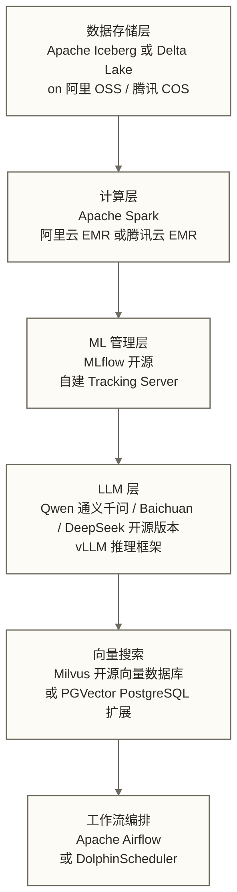

# AI-Native 数据平台选型对比

## 写在前面

技术选型是一个被过度美化的工作。实际情况是：大多数选型决策在做出的时候并没有充分的信息，执行过程中会遇到意料之外的问题，做完之后也很难客观评价当初的决定对不对。

这篇文档不打算给你一个"答案"，而是把三个平台的真实差异讲清楚，并提供一套可以在具体场景里实际使用的决策框架。

有一件事需要先说清楚：**Databricks、Snowflake、BigQuery 都是很好的产品，选哪个通常不会是灾难性的决定**。真正重要的是：你的团队能不能用好它，你选的平台能不能支撑你接下来 3 年的业务增长，你的迁移成本能不能承受。

---

## 目录

- [[【技术与工具】/AI-Native数据平台/04-AI-Native平台选型对比#三个核心判断问题|#三个核心判断问题]]
- [[【技术与工具】/AI-Native数据平台/04-AI-Native平台选型对比#全面对比矩阵|#全面对比矩阵]]
- [[【技术与工具】/AI-Native数据平台/04-AI-Native平台选型对比#场景化选型建议|#场景化选型建议]]
- [[【技术与工具】/AI-Native数据平台/04-AI-Native平台选型对比#中国企业的现实选择|#中国企业的现实选择]]
- [[【技术与工具】/AI-Native数据平台/04-AI-Native平台选型对比#迁移成本评估|#迁移成本评估]]
- [[【技术与工具】/AI-Native数据平台/04-AI-Native平台选型对比#不应该成为选型依据的因素|#不应该成为选型依据的因素]]

---

## 三个核心判断问题

在看任何对比表格之前，先回答这三个问题。原稿以“过滤掉 80% 的选型纠纷”说明其筛选作用，但该比例未经核实，不应视为实际效果统计：

### 问题一：你的数据量级是多少，增长预期如何？

| 数据量级 | 倾向 |
|---------|------|
| 百 GB 以内，增长缓慢 | 三家都够用，选最便宜的 |
| TB 级，稳定增长 | BigQuery（Serverless 最省心）或 Snowflake |
| PB 级以上 | 三家都能撑，但 Databricks 在大规模数据处理上历史最深 |
| 数据量波动极大（有明显峰谷） | BigQuery 或 Snowflake（自动伸缩优于 Databricks 的集群管理） |

### 问题二：你的 ML 工作流有多复杂？

| ML 需求 | 倾向 |
|---------|------|
| 没有 ML，只做 SQL 分析 | Snowflake 或 BigQuery |
| 用 BQML 或 Cortex 函数就够的简单 ML | BigQuery 或 Snowflake |
| 需要自定义模型训练、特征工程 | Databricks 或 BigQuery + Vertex AI |
| 需要训练/微调 LLM | Databricks（Mosaic AI 最完整）|
| 需要在平台内部署 RAG 全流程 | Databricks（工具链最成熟）|

### 问题三：你的团队偏 SQL 还是 Python？

这个问题的答案比你想象的更重要。**技术工具最大的沉没成本不是许可证费用，而是团队的学习投入**。

| 团队技能结构 | 倾向 |
|------------|------|
| 90%+ 时间写 SQL，有 BI 背景 | Snowflake（SQL 体验最好）|
| Python + SQL 各半，有数据工程背景 | Databricks（PySpark 直接迁移）|
| 已深度使用 Google Cloud / GCP | BigQuery（生态集成成本最低）|
| Spark 重度用户 | Databricks（Spark 的亲爹）|

---

## 全面对比矩阵

> [!warning] 数据时效性说明
> 下表基于 2026 年初的产品状态。三个平台都在快速迭代，选型前务必查阅最新官方文档。特别是 AI 功能，每季度都有重要更新。

### 核心能力对比

| 维度 | Databricks | Snowflake | BigQuery |
|------|-----------|-----------|---------|
| **基础架构类型** | 湖仓一体（Lake + Warehouse） | 纯云数仓 | Serverless 云数仓 |
| **存储组织与底层存储（非同层概念）** | Delta Lake 表格式（Parquet 数据文件与事务日志） | Snowflake 微分区存储组织 | Colossus（Google 分布式存储系统，不是文件或表格式） |
| **计算引擎** | Apache Spark（+ Photon 加速） | Snowflake Virtual Warehouse | Dremel（Google 自研）|
| **SQL 能力** | 强（近几年大幅提升）| 最强（历史积累深）| 强（窗口函数特别完善）|
| **流处理** | Spark Streaming + Delta Live Tables | 有限（Snowpipe 准实时）| 需 Pub/Sub + Dataflow |
| **ACID 事务** | Delta Lake 原生支持 | 原生支持 | 原生支持 |
| **Time Travel** | 可用历史取决于事务日志及数据文件保留、VACUUM 等设置，不能仅以30天概括 | 保留期受版本、表类型和配置限制，90天不是所有表的默认值 | 默认7天，实际窗口须核对数据集配置 |

### AI 能力对比

| AI 维度 | Databricks | Snowflake | BigQuery |
|---------|-----------|-----------|---------|
| **LLM 集成方式** | Mosaic AI + SQL AI Functions | Cortex LLM Functions（SQL）| BQML + Gemini（SQL）|
| **可用 LLM** | Llama3、Mixtral、DBRX、自定义 | Llama3、Mistral、Arctic、自定义（有限）| Gemini 1.5 系列、Llama、自定义 |
| **自然语言查询** | Databricks Assistant | Cortex Analyst（带语义层）| Gemini in BigQuery + Data Canvas |
| **模型训练** | 完整支持（Mosaic AI Training）| 基本不支持 | 有限（BQML AutoML）|
| **模型微调（Fine-tuning）** | 完整支持（任意开源模型）| 有限（仅 Arctic Fine-tuning API）| 通过 Vertex AI |
| **向量存储** | Delta Sync Index / 外部集成 | Cortex Search（内置）| Vector Search（内置）|
| **RAG 工具链** | 完整（文档解析 + 向量化 + 检索）| 基础（函数组合）| 需结合 Vertex AI |
| **AI Functions in SQL** | 支持（`ai_summarize`, `ai_classify` 等）| 支持（`CORTEX.SENTIMENT` 等）| 支持（`ML.GENERATE_TEXT`）|

### 工程与运维对比

| 维度 | Databricks | Snowflake | BigQuery |
|------|-----------|-----------|---------|
| **计费模式** | DBU及可能另计的云资源、存储等费用，依部署方式核算 | Credit计量计算及相关服务，另核算存储等费用 | 查询可按扫描数据量或计算容量计费，另核算存储等费用 |
| **成本可预测性** | 低（DBU 单价变量多）| 中（虚拟仓库暂停后停止该仓库的计算计费，存储及其他服务仍可能产生费用）| 高（善用分区可压低成本）|
| **月均成本原稿未核实示例（不可作为报价或预算）** | $5,000-$20,000+ | $2,000-$10,000 | $500-$5,000；三组区间均缺少负载、区域及费用口径，不能据此比较高低 |
| **运维复杂度** | 高（集群配置、Workspace 管理）| 低（托管，自动扩缩容）| 很低（Serverless，零配置）|
| **数据安全模型** | 数据在客户自有存储（S3/ADLS）| Snowflake 托管存储（隔离）| Google 托管存储（GCS）|
| **VPC/私有网络与服务边界（非同类能力）** | 支持（Databricks on VPC，须核对部署方式）| 支持（Private Link，须核对云与区域）| VPC Service Controls用于服务边界控制，不等同于私有网络连接；私有访问方案须另行核对 |
| **开源友好度** | 高（Delta Lake、MLflow 均 Apache 2.0）| 低（封闭生态）| 中（支持 Iceberg，部分开放）|

### 生态与集成对比

| 维度 | Databricks | Snowflake | BigQuery |
|------|-----------|-----------|---------|
| **调度工具** | Databricks Workflows（内置）/ Airflow | 第三方为主（dbt、Airflow）| Cloud Composer（托管 Airflow）|
| **数据转换** | dbt、Delta Live Tables、Spark | dbt（最佳实践）、Snowpark | dbt、Dataform（Google 收购）|
| **BI 工具** | 各主流 BI（JDBC 连接）| 各主流 BI（原生连接器多）| Looker（原生）+ 其他 |
| **数据目录** | Unity Catalog（自带）| Snowflake Catalog / 集成 | Dataplex（Google 数据治理平台）|
| **监控告警** | 内置 + Datadog/Grafana | 内置 + 第三方 | Cloud Monitoring（Google 原生）|
| **中国大陆可用性** | 阿里云/腾讯云有同类产品（EMR）| **无大陆节点**（香港可用）| **无大陆节点** |

---

## 场景化选型建议

### 初创公司 / 小团队（工程师 10 人以内）

**首选：BigQuery**

原因很简单：**减少基础设施运维**。通常不需要自行管理底层集群，但仍需管理权限、配额、数据生命周期和成本；不查询也可能产生存储、容量预留等费用。早期团队的精力应该放在业务问题上，尽量减少平台基础设施运维投入。

Gemini in BigQuery 的 SQL 辅助功能够用，数据量上去之前 BQML 也能满足基础的预测需求。

**次选：Snowflake**

如果团队有强 SQL 背景，Snowflake 的开箱体验很好，学习成本低。虚拟仓库可以在不使用时暂停，成本可控。

**为什么不选 Databricks**：概念太多（Unity Catalog、Clusters、Jobs、MLflow）。10 人团队没有精力消化这套学习曲线，而且 Databricks 的价值在中大型规模才能充分体现。

### 数据密集型 ML 团队

**首选：Databricks**

如果你的核心工作是：
- 训练和微调大模型
- 构建 RAG 系统
- 实时特征工程
- 大规模 Spark 数据处理

Databricks 的 MLflow + Mosaic AI 可作为这个场景的重点候选，但不是唯一选择；工具链成熟度及是否需要连接外部系统，应按模型、区域、部署边界和实际工作流通过POC验证。

**配套建议**：Databricks + dbt（数据转换）+ Airflow 或 Databricks Workflows（调度），这套组合在大型数据工程团队里已经是事实标准。

### BI 分析为主，AI 为辅

**首选：Snowflake**

这是 Snowflake 最舒服的场景。SQL 团队友好，Cortex LLM Functions 让分析师可以在 SQL 里直接做文本 AI 处理，不需要求助数据科学团队。Cortex Analyst 的语义层配置一次，业务用户反复用。

**配套建议**：Snowflake + dbt + Looker 或 Tableau，经典的现代数据栈，成熟度高，招聘也容易。

### 强监管行业（金融、医疗、政府）

这个场景的核心考量不是技术能力，而是**数据主权和合规要求**。

**国内监管行业**：原稿关于Databricks、Snowflake、BigQuery均无中国大陆节点的断言未经核实，不能直接据此判定合规或排除产品。应核对具体服务和区域，并审查数据分类、跨境传输、部署及合同条件；阿里云 MaxCompute + PAI 或字节跳动 DataLeap可纳入国内候选，但也必须进行相同的合规与功能评估。

**海外监管行业**：
- 数据不能出特定地理区域 → BigQuery（每个 GCP Region 数据独立）或 Snowflake（支持多 Region 部署）
- 需要 LLM 但数据不能传第三方 → Snowflake Cortex（数据在 Snowflake 边界内）或 Databricks Mosaic AI（数据在客户自有存储）
- 有自建机房能力 → 开源方案：Delta Lake + Spark + 自部署 LLM（Llama3 + vLLM）

### 已经在 GCP 生态的团队

**优先评估：BigQuery**。当数据流经 Pub/Sub、应用跑在 GKE、监控在 Cloud Monitoring 里，BigQuery可能减少跨云集成工作，但并非唯一选择，也不意味着没有权限配置、数据转换、网络传输及运营成本；应通过POC量化其生态集成价值。

---

## 中国企业的现实选择

### 国内三大云的对标产品

原稿关于三大国际平台在中国大陆均无节点的断言未经核实，不能据此排除产品；具体服务及区域须逐项确认。以下列出可纳入评估的国内候选，其类比不代表功能等价或合规保证：

| 国内产品 | 类比 | 成熟度 | 适合场景 |
|---------|------|-------|---------|
| 阿里云 MaxCompute | BigQuery（Serverless 数仓）| 高（十年积累）| 互联网/电商，数据量大 |
| 阿里云 EMR + OSS + PAI | Databricks | 中高 | 大规模 Spark + ML |
| 阿里云 DataWorks | Databricks Workflows | 高 | 全流程数据开发 |
| 腾讯云 TDSQL-C | Snowflake（有限）| 中 | 腾讯生态的企业 |
| 字节跳动 DataLeap | Databricks（工程能力强）| 高（字节内部磨砺多年）| 有研发能力的中大型企业 |
| 华为云 MRS + DLI | Databricks | 中 | 政企、运营商背景 |

### 如何在国内环境复现 AI-Native 能力

如果国内团队想获得接近三大国际平台的 AI-Native 体验，可以用开源方案拼装：

这套方案需要更多工程投入，可提高数据部署与访问控制的自主性，但数据主权仍取决于云服务、区域、合同和运维边界。图中包含托管云服务，模型不同版本也有不同许可条件，不能统称全部开源；采用开放组件可降低部分锁定风险，但不能消除存储、接口、工作流和迁移成本带来的依赖。

---

## 迁移成本评估

选型时一个经常被低估的因素：**从现有系统迁移的成本**。

### 迁移到 Databricks

**最适合从**：Hive/Spark 的本地数仓、Hadoop 集群

迁移评估清单：
- [ ] SQL 兼容性：Databricks SQL 和 Spark SQL 与 HiveQL 大部分兼容，但有细节差异
- [ ] 数据格式：Parquet 到 Delta Lake 的转换相对简单（Delta 建立在 Parquet 上）
- [ ] 调度逻辑：把 Oozie/Azkaban 的任务迁移到 Databricks Workflows，通常需要重写
- [ ] 权限体系：Unity Catalog 的 RBAC 和 Hive 的权限模型差异较大，需要完整重映射
- [ ] 监控告警：监控体系需要重新建立

**迁移时间原稿未核实示例**（中等规模，100+ 个 ETL 任务）：3-6 个月；缺少人员配置、任务复杂度和验收范围，不作为工期承诺。

### 迁移到 Snowflake

**最适合从**：Oracle、SQL Server、Teradata 等传统关系型数仓

- SQL 兼容性：Snowflake SQL 对标准 ANSI SQL 兼容性好，Oracle 特有函数需要改写
- 数据格式：CSV、Parquet、JSON等受支持格式可以加载；并非任何格式都可直接加载，解析选项、嵌套结构和类型转换仍需测试
- 调度：现有 ETL 工具（Informatica、DataStage）通常有 Snowflake 连接器
- 性能调优：传统数仓的分区逻辑在 Snowflake 里基本不适用（Micro-partition 自动管理）

**迁移时间原稿未核实示例**（传统数仓，100+ 张核心表）：4-8 个月（主要是 SQL 改写和验证）；缺少人员配置、SQL复杂度和验收范围，不作为工期承诺。

### 迁移到 BigQuery

**最适合从**：已在 GCP 上的系统；从其他 Google 产品（Firebase、Google Analytics）

- SQL 兼容性：BigQuery SQL 方言有 Google 特有的部分（`ARRAY_AGG`、`STRUCT` 等用法独特）
- 数据格式：从 GCS 加载数据是原生的，从非 GCP 存储需要数据搬运
- 调度：Cloud Composer（托管 Airflow）是推荐选项，有学习成本
- 成本变化：传统"按月付费"到"按用量付费"，前期估算容易出错

**迁移时间原稿未核实示例**（从 Redshift 或 Azure Synapse 迁移）：3-5 个月；缺少数据规模、工作负载、人员配置和验收范围，不作为工期承诺。

---

## 不应该成为选型依据的因素

最后说几个经常出现、但实际上不应该成为主要决策依据的因素：

**"某厂商的产品路线图很好看"**

产品路线图是承诺，不是现实。三家厂商的路线图都很好看。选型应该基于你现在能用的能力，而不是 12 个月后可能有的能力。

**"某平台 Gartner 评级更高"**

Gartner 的评级有方法论局限，且通常滞后于实际产品演进。更有价值的参考是同行业规模相近公司的真实技术博客，而不是分析师报告。

**"某平台的 Demo 更酷"**

Demo 都是最理想场景下的表现。找一个接近你实际业务场景的 POC（概念验证），用真实数据测试，这才是有效的评估。

**工程师个人偏好**

这个确实重要，但不是决定性的。工程师喜欢什么，不代表它适合当前团队和业务阶段。架构决策是集体的决定，需要平衡个人偏好和实际约束。

> [!tip] 选型的正确姿势
> 把选型做成一个 POC 项目，而不是一个调研报告：
> 1. 完成数据授权、分类分级、脱敏及区域和跨境合规审查，并配置最小权限后，将获准使用的代表性生产数据样本加载到候选平台；未获批准时使用合成数据
> 2. 跑你们最频繁的前 10 个查询，记录性能和成本
> 3. 让实际会使用的工程师操作 1-2 周，收集反馈
> 4. 估算迁移成本和第一年的运营成本
>
> 这比阅读再多的对比文章都有价值。

---

## 总结

三个平台的核心差异，用一句话概括：

- **Databricks**：数据工程和 ML 工程的全栈平台，适合需要完整 AI 工作流的团队，工程深度最强
- **Snowflake**：SQL 团队最友好，AI 能力通过函数形式嵌入 SQL，适合 BI 分析为主的场景
- **BigQuery**：Serverless 运维最省心，背靠 Google AI 生态，适合 GCP 用户和小团队快速起步

没有平台能保证选型不出错；能否满足业务、成本、合规和迁移约束，需要通过POC和实际验证判断。

---

## 相关文档

- [[【技术与工具】/AI-Native数据平台/00-AI-Native数据平台全景|AI-Native数据平台全景]] - AI-Native 平台架构与 AI 嵌入数据栈的四个层次
- [[【技术与工具】/AI-Native数据平台/01-Databricks平台实战|Databricks平台实战]] - Databricks Delta Lake、MLflow、Unity Catalog 完整实战
- [[【技术与工具】/AI-Native数据平台/02-Snowflake-Cortex实战|Snowflake Cortex实战]] - Snowflake Cortex AI 实战：SQL 内嵌 LLM 的完整路径
- [[【技术与工具】/AI-Native数据平台/03-BigQuery-ML实战|BigQuery ML实战]] - BigQuery ML 与 Vertex AI 集成实战
- [[【AI 与大数据】/04-AI工程化/00-MLOps最佳实践|MLOps最佳实践]] - ML 工程化的完整方法论
- [[【AI 与大数据】/04-AI工程化/07-向量数据库与语义搜索|向量数据库与语义搜索]] - 向量检索技术深度解析
- [[【AI 与大数据】/02-大模型核心/04-RAG检索增强生成实战|RAG检索增强生成实战]] - RAG 系统架构与实现

#Databricks #Snowflake #BigQuery #平台选型 #AI-Native #数据工程 #云原生 #技术决策 #选型指南
