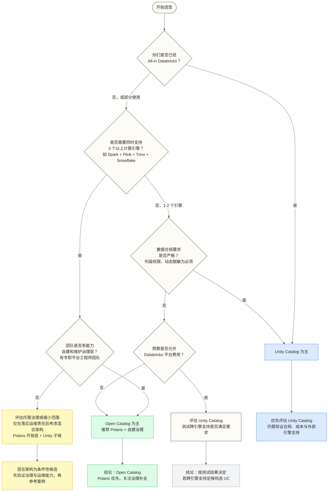
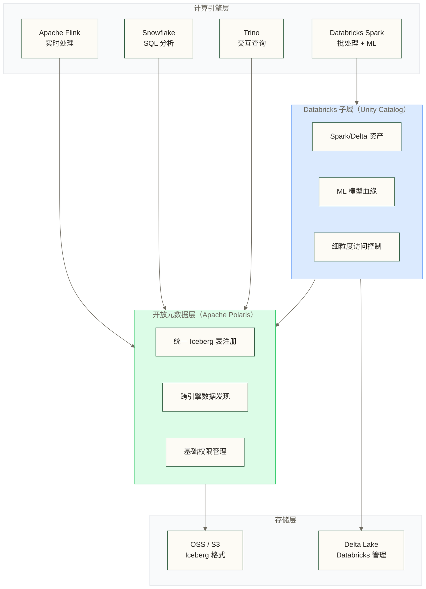

# Unity Catalog vs Open Catalog：2026 元数据治理的路线之争

> [!info] 前置知识
> 本文假设你了解以下概念，如有空缺请先补课：
> - [[【技术与工具】/AI-Native数据平台/01-Databricks平台实战|Databricks 平台实战]] —— Unity Catalog 的宿主环境
> - [[【技术与工具】/AI-Native数据平台/02-Snowflake-Cortex实战|Snowflake Cortex 实战]] —— Apache Polaris 的主要贡献方
> - [[【技术与工具】/Iceberg/01-Iceberg-V3深度解析|Apache Iceberg V3 深度解析]] —— Open Catalog 阵营的核心表格格式
> - [[【技术与工具】/AI-Native数据平台/00-AI-Native数据平台全景|AI-Native 数据平台全景]] —— 本系列的全局视角

---

## 这不是一道技术题

2026 年，数据领域讨论最多的架构问题不是"用 Flink 还是用 Spark"，而是：**你的元数据到底放在谁手里？**

这个问题的答案，决定了你未来十年的平台锁定程度，决定了你能不能在多云之间自由迁移，也决定了当 AI Agent 需要访问数据时，它能看到多少、看得多清楚。

Catalog 是数据平台的神经中枢。它不只是一个"表的列表"——它是数据的语义锚点、权限的执行点、血缘的记录者，以及 AI 时代里机器理解数据的入口。谁控制了 Catalog，谁就控制了数据资产的治理话语权。

这场战争有两个阵营：

**Databricks 的 Unity Catalog**：深度集成、治理成熟、功能强大，但本质上是一个以 Databricks 为中心的生态围墙。

**Open Catalog 阵营**（Apache Polaris、Gravitino、Project Nessie 等）：协议开放、多引擎中立、真正跨云，但生态碎片化、治理能力参差不齐。

选错了，两种死法：要么被厂商锁死，要么被开放生态的复杂度拖死。

---

## Unity Catalog：封闭的代价与收益

### 出身决定基因

Unity Catalog（UC）在 2022 年 GA，解决的是一个 Databricks 用户长期的痛点：不同 workspace 之间的数据是割裂的，权限管理混乱，血缘追踪做不到跨 workspace。

2024 年，Databricks 宣布将 Unity Catalog 的核心规范开源（GitHub 上的 `unitycatalog` 仓库）。这个动作很聪明：**开放规范，保留生态控制权**。就像 Google 开放 Android 源码，但 GMS 和 Play Store 仍然握在手里。

Unity Catalog 的核心设计：

- **三层命名空间**：`catalog.schema.table`，与 Snowflake、BigQuery 对齐，迁移时概念映射清晰
- **统一权限模型**：列级、行级、标签级权限，一套 RBAC 管理所有 Databricks 资产（表、模型、函数、文件）
- **全链路血缘**：Spark 作业、SQL 查询、Delta Live Tables、ML 实验的血缘自动采集，关联到 [[【数据治理与数据管理】/02-深度研究/05-AI数据治理/AI-Lineage血缘2.0|AI 血缘 2.0]] 中描述的 Agent 调用链路
- **AI 语义集成**：UC 的元数据会被 Databricks Assistant 消费，支持自然语言发现数据资产

### Unity Catalog 真正强在哪里

不说营销话术，说实际工程价值。

**ML 资产的统一治理**是 Unity Catalog 目前无人能及的地方。一个训练好的 PyTorch 模型，它的输入特征是哪张表、经过了哪些 Feature Engineering、在哪个实验里产生的——这条完整的血缘链，只有 Unity Catalog 做到了生产级别。对于把 [[【数据治理与数据管理】/02-深度研究/05-AI数据治理/AI-First治理模型|AI-First 治理]] 作为方向的团队，这是护城河。

**Fine-grained Access Control（细粒度访问控制）**也是 UC 的强项。列级权限、动态数据脱敏（比如自动对非授权用户隐藏身份证字段的后几位），在金融和医疗场景里是硬需求，开放阵营目前普遍做不到这个成熟度。

### Unity Catalog 的真实局限

说完优点说短板，这才是选型时需要想清楚的。

**跨引擎支持有限**。Unity Catalog 对 Databricks 生态（Spark、Delta Lake、Databricks SQL）的支持无缝，但如果你还在用 Presto、Trino 或者 Flink，支持就降级了。你需要靠第三方连接器，且功能不完整（权限下推、血缘采集都有缺失）。

**不是真正的多云 Catalog**。Unity Catalog 本身部署在 Databricks 的控制平面，哪怕你的数据在 AWS S3，元数据的管理权仍然在 Databricks 手里。你换云厂商，UC 不能直接跟着走。

**开源版本和商业版本存在功能差距**。开源的 `unitycatalog` 项目提供基础的目录和权限管理，但细粒度权限、自动血缘、AI 集成这些能力在商业版里，开源版不给。这和 Databricks 的商业模式是一致的。

---

## Open Catalog 阵营：自由的代价与收益

### 阵营里都有谁

Open Catalog 不是一个产品，是一个松散的生态联盟。主要玩家：

**Apache Polaris**：Snowflake 在 2024 年贡献给 Apache 基金会的项目，实现了 Iceberg REST Catalog 规范。Polaris 的目标是成为多引擎共享的开放 Catalog，Snowflake、Spark、Flink、Trino 都能连。

**Project Nessie**：Projectnessie.org，由 Dremio 主导。核心创新是给数据湖引入了 Git 式的分支和提交模型，你可以在不影响生产的前提下在数据分支上做实验。

**Apache Gravitino**：Apache 基金会下的统一元数据管理层，目标是联邦多个异构数据源的元数据（Hive Metastore、Iceberg Catalog、数据库等），统一一套 API 访问。LinkedIn 是主要贡献方。

**Iceberg REST Catalog 协议**：这不是一个具体产品，是一个 HTTP API 规范。只要实现了这个规范，任何兼容 Iceberg 的引擎都能连接。这正在成为 2026 年的事实标准。

### Open Catalog 的核心价值主张

**真正的引擎中立**。Polaris 实现了 Iceberg REST 规范，意味着 Spark、Flink、Trino、DuckDB、Snowflake 都能用同一个 Catalog，读同一份数据，不需要数据复制，不需要元数据同步。这在多引擎架构里是降低复杂度的关键。

**多云部署自主性**。支持自托管的 Open Catalog 实现可部署在 Kubernetes 等环境中，并按数据位置规划部署。厂商切换时仍需处理元数据迁移、存储地址、网络、身份和凭证变更，不能据此保证业务无感知。

**与 [[【数据开发与数据架构】/07-数据服务架构/09-语义层工程实践|语义层]] 的天然亲和**。Iceberg REST Catalog 的开放接口让语义层工具（如 dbt Semantic Layer、Cube）能直接集成，不需要穿越厂商的 API 围墙。

### Open Catalog 的真实问题

不装，把问题说清楚。

**治理能力弱**是整个开放阵营的共同短板。Polaris 目前支持基础的 RBAC，但没有列级权限、没有动态脱敏、没有 ML 资产治理。如果你的数据有合规要求，你要么在 Polaris 之上自建一层治理，要么接受功能缺失。

**生态碎片化**。Polaris、Nessie、Gravitino 三个项目方向类似但不完全互通，社区分裂。2026 年，这个局面还没有收敛。你选了 Nessie，六个月后发现 Polaris 生态更好，迁移成本不小。

**无统一权限模型**是最大的工程挑战。在多引擎场景里，Spark 用自己的权限，Trino 用自己的权限，Polaris 层的权限和引擎层的权限如何保持一致，目前没有标准答案，靠各团队自己摸索。

---

## 核心能力横向对比

| 对比维度 | Unity Catalog（Databricks） | Apache Polaris | Project Nessie | Apache Gravitino |
|---------|---------------------------|----------------|----------------|-----------------|
| **表格格式支持** | Delta Lake 原生，Iceberg 支持有限 | Iceberg 原生，Delta 不支持 | Iceberg 原生，支持 Delta | 多格式联邦（Hive、Iceberg、自定义） |
| **引擎兼容性** | Databricks 生态强，Presto/Flink 弱 | Spark、Flink、Trino、Snowflake、DuckDB | Spark、Flink、Trino、Dremio | 异构引擎联邦为主 |
| **权限模型** | 列级+行级+标签级，成熟 | 基础 RBAC，无列级权限 | 基础权限，分支级隔离 | 基础 RBAC，依赖下层引擎 |
| **血缘能力** | 全链路（SQL+Spark+ML），生产级 | 元数据血缘，无 ML 链路 | 提交级血缘（Git 式） | 元数据级，不含计算血缘 |
| **AI Agent 集成** | Databricks Assistant 深度集成 | 通过开放 API 自行集成 | 通过开放 API 自行集成 | 通过开放 API 自行集成 |
| **部署模式** | Databricks 托管（SaaS） | 自托管 / Snowflake 托管 | 自托管 / Dremio 托管 | 自托管（Kubernetes） |
| **治理成熟度** | 高（企业级生产） | 中（基础功能完整） | 中偏低（分支特性强，治理弱） | 低偏中（元数据联邦强，治理弱） |
| **开源程度** | 规范开源，核心功能商业化 | 完全开源（Apache 2.0） | 完全开源（Apache 2.0） | 完全开源（Apache 2.0） |
| **成本模型** | DBU 计费 + 平台绑定 | 自托管运维成本 / Snowflake 按量 | 自托管运维成本 | 自托管运维成本 |
| **多云支持** | 弱（Databricks 控制平面绑定） | 强（自托管可跨云） | 强（自托管可跨云） | 强（自托管可跨云） |
| **社区活跃度** | 商业驱动，迭代快 | 活跃（Snowflake 背书） | 活跃（Dremio 持续贡献） | 成长中（LinkedIn 主导） |
| **生产采用率** | 高（Databricks 用户标配） | 中（2025 年起快速增长） | 中低（利基场景） | 低（早期采用阶段） |

---

## 哲学差异：平台思路 vs 协议思路

这个对比的本质不是功能清单的胜负，是两种建设数据平台的哲学。

**Unity Catalog 是平台思路**。Databricks 的赌注是：如果你在他们的平台上深度使用，你的工程效率会高于任何自建方案。数据、计算、治理、AI 全在一个体系里，内聚性极强。这个思路的极端形态就是：你的所有数据生命周期都在 Databricks 里完成，包括数据接入、处理、治理、分析、模型训练、AI 部署。

类比：**这是 iOS 的路线**。生态封闭，但体验丝滑，出了围墙就不好使。

**Open Catalog 是协议思路**。开放阵营的赌注是：数据平台的未来是联邦式的，没有哪个厂商能包打天下，最终会有多引擎共存。他们押注于建设一个中立的元数据协议层，让各个引擎都能按规范接入，用户在上层自由组合。

类比：**这是 Android 的路线**。生态开放，选择自由，但碎片化是内生问题，你要自己负责让各部件协同工作。

iOS vs Android，没有绝对的对错。取决于你愿意把多少控制权交给别人，换来多少工程便利。

---

## 选型决策框架

---

## 教学假设案例：某车企的混合架构决策

原稿将此描述为 2025 年实际发生、经过脱敏的选型过程，但未提供可核实材料；本节按教学假设阅读，企业背景、人员规模、方案过程及结果数字均保留原稿未核实示例，不作为真实企业成果证据。

### 背景

某头部新能源车企，数据团队约 60 人，技术栈复杂：

- 实时数据用 Flink，跑在自建的 Kubernetes 集群上
- 批处理数据用 Spark，部分工作负载已迁移到 Databricks
- 数据分析团队用 Snowflake，BI 报表全在这里
- 未来 12 个月计划接入 Databricks Mosaic AI，用于车端数据的模型训练

### 痛点

三套计算，三套元数据：Flink 连的是 Hive Metastore，Spark 在 Databricks 里用 Unity Catalog，Snowflake 自己管自己的。同一张"用户行程数据"表，在三个地方有三个定义，血缘断裂，权限各管各的，数据质量问题溯源要靠人工跨系统查。

### 方案演化

最开始，Databricks 的方案是："全迁 Unity Catalog，Flink 和 Snowflake 的数据也同步进来。"

问题在于：

1. Snowflake 团队不愿意放弃 Snowflake，因为 SQL 分析体验和 Cortex 能力在那里
2. Flink 的连接器支持 Unity Catalog 的功能残缺，权限下推做不到
3. 数据主权问题：车企希望核心元数据不完全托管在单一厂商的控制平面

最终采用的是**分层混合架构**：

**关键设计决策**：

- Polaris 作为开放元数据层，负责注册所有 Iceberg 格式的表，让 Flink、Trino、Snowflake 都能发现数据
- Unity Catalog 作为 Databricks 子域的强治理层，负责 ML 资产血缘、细粒度权限、Delta Lake 原生能力
- Databricks 内部的 Delta 表可评估使用 Delta Lake 3.0 起提供的 Universal Format（UniForm）生成兼容的 Iceberg 元数据；这不是把 Delta 表直接转换成 Iceberg 视图，也不会自动完成 Polaris 注册。能否由 Polaris 管理并供目标引擎访问，需另行验证版本、注册方式、元数据更新与凭证支持
- 跨域的数据血缘靠 OpenLineage 协议采集，汇总到独立的血缘平台，对应 [[【数据治理与数据管理】/02-深度研究/05-AI数据治理/AI-Lineage血缘2.0|AI 血缘 2.0]] 里描述的联邦血缘模式

### 结果

在本教学假设中，原稿未核实的结果示例为：实施 6 个月后，工程师找数据的时间从平均 2 小时降到 20 分钟以内；这些数字没有可核验的测量依据，不代表实际收益或效果承诺。原稿还假设需要一个专职的平台工程师负责 Polaris 集群和 UC 的元数据同步；实际人力需求取决于规模、同步机制与治理要求，维护两套 Catalog 的成本不可忽视。

这个案例的结论是：**混合架构可行，但有实实在在的维护成本，不适合没有平台工程能力的团队**。

---

## 2026 趋势：战场怎么演化

不预测，只分析已经在发生的事。

### Iceberg REST Catalog 成为事实协议

2025 年下半年开始，越来越多的引擎和平台宣布支持 Iceberg REST Catalog 规范。这个协议正在做的事情，类似 JDBC/ODBC 在关系数据库时代做的事：提供一个标准化的连接层，让上下游解耦。

**对团队的影响**：选 Catalog 时，首先问"它支持 Iceberg REST 吗"。支持的，未来切换成本低；不支持的，要特别警惕。

### Polaris 会吃 Unity Catalog 的外部工作负载

Databricks 外部的工作负载（Flink、Trino、外部 Spark 集群）连接 Unity Catalog 体验不佳这个事实，给了 Polaris 空间。预计 2026-2027 年，在多引擎场景下 Polaris 的采用率会持续上升，把 UC 挤压回 Databricks 内部的治理工具角色。

### Unity Catalog 会继续统治 Databricks 内部

这没有悬念。Databricks 用户的体量足够大，UC 在内部生态里的整合深度是竞争对手短期内追不上的。ML 血缘这个方向，UC 至少领先 2-3 年。

### Snowflake Horizon 是第三条腿

Snowflake 的 Horizon 是一套治理产品（包含 Polaris 作为 Catalog 层），是 Snowflake 对"我不只是仓库，我也做治理"的回应。在 Snowflake 用户群体里，Horizon 会是重要选项。

### 语义层和 Catalog 的融合加速

[[【数据开发与数据架构】/07-数据服务架构/09-语义层工程实践|语义层]]（dbt Semantic Layer、Cube、Metriql）和 Catalog 的边界在模糊。2026 年，主要 Catalog 都在往"语义感知"方向走——不只存表结构，还存业务语义（这个字段在业务上叫什么、如何计算、属于哪个域）。这和 [[【数据治理与数据管理】/02-深度研究/05-AI数据治理/AI-First治理模型|AI-First 治理模型]] 里描述的"语义元数据"概念高度吻合。

---

## 给数据团队的三条建议

### 小团队（数据工程师 5 人以内）

选你主用平台的 Catalog，省心第一。

- 主用 Databricks：Unity Catalog，不用纠结
- 主用 Snowflake：Horizon + Polaris，Snowflake 管好就够了
- 主用开源栈：Polaris，接受治理能力有限的现实

不要追求"最优架构"，追求"最小维护成本"。

### 中大型团队（数据工程师 20 人以上，有平台工程组）

**这个规模上没有银弹**。两条主流路线都有成功案例，取舍看业务重心：

**路线 A：All-in Databricks（Unity Catalog 为主）**

适合已经把 Spark ETL、Delta Lake、Mosaic AI 深度绑定 Databricks 的团队。核心优势是治理功能一致、ML 血缘完整、运维边界清晰。代价是跨引擎（Snowflake、Flink、Presto）接入难度高，未来迁移成本大。很多中大型企业走这条路运行良好，不需要强行"去封闭化"。

**路线 B：Open Catalog 为主 + Unity 做局部**

适合多引擎、多云、已经或即将引入 Snowflake/Flink/Iceberg 原生生态的团队。具体做法：

- 用 Polaris 或 Gravitino 统一元数据入口，接入所有引擎
- 在 Databricks 子域内保留 Unity Catalog，发挥其 ML 血缘和细粒度权限的优势
- 用 OpenLineage 做跨域血缘采集，不依赖单一 Catalog 的血缘能力

代价：治理能力需要自建、组件多、运维复杂度高，对平台工程组是实打实的挑战。

**怎么选**：看你们的**业务重心**在哪儿。

- AI 工作负载为中心（训练、模型部署、ML Feature Store）→ 路线 A 更顺手
- 数据平台为中心（多引擎分析、跨云流转、开放生态）→ 路线 B 更灵活

不要被"开放 vs 封闭"的哲学讨论绑架。对你们团队，**能稳定跑、能解决问题的架构就是好架构**。

### 三个坑不要踩

**坑一：过早锁定**。在技术栈没有稳定之前，别把 Catalog 锁定在某个厂商的托管方案里。先用能开源自托管的方案，等需求清晰了再决定是否交给厂商。

**坑二：过度联邦**。联邦元数据听起来很美，实际上增加 Catalog 节点会增加元数据一致性与权限同步的复杂度；增长程度取决于连接拓扑和同步机制，不能一概称为指数级上升。不要接入超过你有能力维护的 Catalog 数量。

**坑三：元数据双写**。有些团队为了"两边都有"，同时往 UC 和 Polaris 写元数据。这是运维灾难的开始——两边数据不一致，权限决策不一致，出了问题不知道以哪边为准。选一个作为 Source of Truth，另一个做只读同步。

---

## 掌握检查

在继续之前，确认你对这篇文章的核心判断都清楚了：

- [ ] 能解释 Unity Catalog 开源了什么、没开源什么，以及这个区别的商业含义
- [ ] 知道 Apache Polaris 和 Iceberg REST Catalog 规范的关系，以及为什么后者在 2026 年重要
- [ ] 能说出 Open Catalog 阵营治理能力弱的具体表现（列级权限、动态脱敏、ML 血缘）
- [ ] 理解为什么混合架构（Polaris 开放层 + Unity Catalog 子域）在多引擎场景下是合理的
- [ ] 知道"元数据双写"为什么是坑，以及 Source of Truth 原则怎么应用

---

## 实践练习

**基础题**：画出你所在团队当前数据平台的元数据依赖图——有几个 Catalog、各自管理哪些资产、引擎之间如何共享元数据（或者无法共享）。找到最薄弱的断点。

**进阶题**：假设你的团队同时使用 Databricks（Spark ETL + ML）和 Snowflake（SQL 分析），设计一个元数据架构方案，要求：(1) 两边的数据都能被发现，(2) 权限有统一的管理入口，(3) 血缘能追踪到 Databricks 的 ML 模型训练过程。写出关键设计决策和取舍点。

---

## 下一步

学完本篇，推荐继续深入：

- [[【技术与工具】/AI-Native数据平台/04-AI-Native平台选型对比|AI-Native 平台选型对比]] —— 在 Catalog 选型之外，整体平台如何决策
- [[【数据治理与数据管理】/02-深度研究/05-AI数据治理/AI-First治理模型|AI-First 治理模型]] —— 当 AI Agent 开始访问数据，治理框架如何演化
- [[【数据治理与数据管理】/02-深度研究/05-AI数据治理/AI-Lineage血缘2.0|AI 血缘 2.0]] —— Agent 时代血缘追踪的新挑战与新范式
- [[【数据开发与数据架构】/07-数据服务架构/09-语义层工程实践|语义层工程实践]] —— Catalog 之上的语义层，如何让 AI 真正"理解"数据

#UnityCatalog #Polaris #元数据治理 #数据目录 #2026 #选型
