# Apache Airflow 学习路线图

> [!abstract] 这份路线图能给你什么
> - **核心目标**：从调度概念入手，在具备下列前置技能的基础上，逐步学习用 Airflow 管理企业级数据管道所需的能力
> - **适用人群**：初中级数据工程师、数据分析工程师
> - **学习时长**：40-60 小时（原稿未核实估算，视基础、练习深度及环境排障情况而定）
> - **学习路径**：循序渐进，每篇文档聚焦一个核心主题
> - **实用导向**：以数据工程场景和代码练习为学习目标；各篇场景的真实性与代码可运行性尚未在本页核实，运行前需核对版本、依赖和环境配置

以下为教学假设，并非已核实的真人案例：小王是一名在职两年的数据工程师。他用 crontab 管理着十几个数据同步脚本，某天早上上班，发现昨晚的日报数据是空的——某个脚本在数据库导出完成之前就开始跑了，依赖关系全乱了。他花了三个小时排查，才找到是一个定时任务因为服务器重启而漏跑。那天之后，他开始认真研究 Airflow。

这份路线图，就是为了让你不走小王的弯路。

---

## 学习地图

### 知识结构总览

```mermaid
%%{init: {"theme":"base","themeVariables":{"fontFamily":"PingFang SC, -apple-system, Source Han Serif SC, serif","fontSize":"16px","background":"#FDFBF5","primaryColor":"#FDFBF5","primaryTextColor":"#2D2A26","primaryBorderColor":"#6E6A60","secondaryColor":"#E8EFE8","secondaryBorderColor":"#8FA890","secondaryTextColor":"#2D2A26","tertiaryColor":"#FDFBF5","tertiaryBorderColor":"#9A9488","tertiaryTextColor":"#6E6A60","lineColor":"#6E6A60","textColor":"#2D2A26","mainBkg":"#FDFBF5","nodeBorder":"#2D5A3D","clusterBkg":"#F3EEDF","clusterBorder":"#9A9488","edgeLabelBackground":"#FDFBF5"},"flowchart":{"htmlLabels":true,"curve":"basis","padding":20,"nodeSpacing":60,"rankSpacing":70,"useMaxWidth":false},"themeCSS":".node rect, .node polygon, .node circle { stroke-width: 1.5px; } .edgePath .path { stroke-width: 1.5px; } .cluster-label .nodeLabel, .cluster-label foreignObject { color: #2D2A26 !important; } .edgeLabel, .edgeLabel foreignObject { color: #2D2A26 !important; background-color: #FDFBF5; } .edgeLabel rect { fill: #FDFBF5; }"}}%%
flowchart TB
    classDef default fill:#FDFBF5,stroke:#6E6A60,color:#2D2A26,stroke-width:1.5px
    classDef startend fill:#2D2A26,stroke:#2D2A26,color:#FDFBF5,font-weight:bold
    classDef decision fill:#F6EAD8,stroke:#C08A1A,color:#2D2A26,font-weight:bold
    classDef hub fill:#3B5A80,stroke:#3B5A80,color:#FDFBF5,font-weight:bold
    classDef io fill:#E5EAF0,stroke:#3B5A80,color:#2D2A26
    classDef accent fill:#A6432C,stroke:#A6432C,color:#FDFBF5,font-weight:bold
    classDef storage fill:#F3EEDF,stroke:#9A9488,color:#2D2A26
    subgraph "第一阶段：理解调度"
        A1[01-工作流调度概述]
        A2[02-Airflow核心概念]
    end

    subgraph "第二阶段：动手跑起来"
        B1[03-安装部署]
        B2[04-第一个DAG]
    end

    subgraph "第三阶段：核心技能"
        C1[05-常用Operator详解]
        C2[06-任务依赖与编排]
        C3[07-调度策略与时间管理]
        C4[08-变量连接与配置管理]
    end

    subgraph "第四阶段：生产就绪"
        D1[09-监控告警与故障处理]
        D2[10-数据管道实战]
    end

    subgraph "第五阶段：进阶提升"
        E1[11-Airflow进阶实践]
        E2[12-最佳实践与踩坑]
    end

    A1 --> A2 --> B1 --> B2 --> C1
    C1 --> C2 --> C3 --> C4 --> D1
    D1 --> D2 --> E1 --> E2
    class A1,A2,B1,B2,C1,C2,C3,C4,D1,D2,E1,E2 default
```



---

## 全部文档导航

### 第一阶段：理解调度（为什么需要 Airflow）

**[[【技术与工具】/Airflow/01-工作流调度概述|01-工作流调度概述]]**
- 什么是工作流调度
- 手动脚本 vs crontab vs 专业调度工具
- Airflow vs DolphinScheduler vs Azkaban 横评
- 阅读时间：30 分钟

**[[【技术与工具】/Airflow/02-Airflow核心概念|02-Airflow核心概念]]**
- DAG、Task、Operator、Executor 等核心概念
- 用数据管道场景解释每一个概念
- Airflow 的运行原理
- 阅读时间：45 分钟

### 第二阶段：动手跑起来

**[[【技术与工具】/Airflow/03-Airflow安装部署|03-Airflow安装部署]]**
- pip 安装与 Docker Compose 部署（推荐）
- airflow.cfg 核心配置解读
- SQLite → PostgreSQL/MySQL 数据库配置
- 阅读时间：60 分钟（含实操）

**[[【技术与工具】/Airflow/04-第一个DAG|04-第一个DAG]]**
- 从零写一个完整 DAG
- BashOperator 和 PythonOperator 实战
- 理解 schedule_interval、start_date、catchup
- 阅读时间：60 分钟（含实操）

### 第三阶段：核心技能

**[[【技术与工具】/Airflow/05-常用Operator详解|05-常用Operator详解]]**
- BashOperator、PythonOperator、SQLExecuteQueryOperator
- HiveOperator、SparkSubmitOperator、EmailOperator
- HttpSensor、FileSensor
- 阅读时间：60 分钟

**[[【技术与工具】/Airflow/06-任务依赖与编排|06-任务依赖与编排]]**
- `>>` 语法与 cross_downstream
- BranchPythonOperator 条件分支
- TriggerDagRunOperator 跨 DAG 触发
- TaskGroup 与动态 DAG 生成
- 阅读时间：50 分钟

**[[【技术与工具】/Airflow/07-调度策略与时间管理|07-调度策略与时间管理]]**
- cron 表达式详解
- 数据区间概念（data_interval_start/end）
- 时区处理与 SLA
- execution_date 的真实含义
- 阅读时间：45 分钟

**[[【技术与工具】/Airflow/08-变量连接与配置管理|08-变量连接与配置管理]]**
- Variable 管理配置
- Connection 管理数据源连接
- Secrets Backend 与环境变量
- 配置最佳实践
- 阅读时间：40 分钟

### 第四阶段：生产就绪

**[[【技术与工具】/Airflow/09-监控告警与故障处理|09-监控告警与故障处理]]**
- Web UI 使用指南
- 任务重试策略配置
- 邮件/钉钉/飞书告警集成
- 常见故障排查手册
- 阅读时间：50 分钟

**[[【技术与工具】/Airflow/10-数据管道实战|10-数据管道实战]]**
- 完整案例：MySQL → 数据清洗 → 数仓 → 报表 → 发送邮件
- 增量处理模式
- 数据质量检查集成
- 阅读时间：90 分钟（含实操）

### 第五阶段：进阶提升

**[[【技术与工具】/Airflow/11-Airflow进阶实践|11-Airflow进阶实践]]**
- CeleryExecutor 分布式部署
- KubernetesExecutor
- 自定义 Operator 和 Hook
- Plugin 开发、REST API、与 dbt 集成
- 阅读时间：90 分钟

**[[【技术与工具】/Airflow/12-Airflow最佳实践与踩坑|12-Airflow最佳实践与踩坑]]**
- DAG 设计原则与幂等性
- 性能调优方法
- 常见坑与生产 checklist
- 阅读时间：45 分钟

---

## 按职业方向推荐路径

### 数据分析工程师（入门优先）

专注数据管道的日常调度维护，快速上手为主：

```text
01 → 02 → 03（Docker部分）→ 04 → 05 → 08 → 09
```

预计 20-25 小时（原稿未核实估算），以学习管理和维护现有 Airflow 数据管道为目标；能否独立承担维护工作需通过实际环境中的操作、排障和安全配置验证。

### 数据开发工程师（系统学习）

需要从零设计和开发数据管道，建议完整路径：

```text
01 → 02 → 03 → 04 → 05 → 06 → 07 → 08 → 09 → 10
```

预计 35-45 小时（原稿未核实估算），以学习设计和实现企业级数据管道为目标；独立交付能力还需通过业务需求、数据质量、幂等性和生产运行验证。

### 数据平台工程师（深度掌握）

负责平台建设和运维优化，需要掌握全部内容：

```text
全部 12 篇文档，重点深入 03、09、11、12
```

预计 55-65 小时（原稿未核实估算），以学习企业 Airflow 平台建设和优化为目标；能否主导平台工作还取决于分布式部署、容量规划、安全治理和运维实践经验。

---

## 学习前置要求

> [!note] 需要提前掌握的技能
> - **Python 基础**：函数、类、装饰器的基本用法 → 参考 [[【技术与工具】/Python/00-Python学习路线图|Python/00-Python学习路线图]]
> - **Linux 基础**：文件操作、进程管理、crontab → 参考 [[【技术与工具】/Linux/00-Linux学习路线图|Linux/00-Linux学习路线图]]
> - **SQL 基础**：能写基本的 SELECT、INSERT、UPDATE → 参考 [[【技术与工具】/SQL/00-SQL学习路线图|SQL/00-SQL学习路线图]]
> - **Docker（推荐）**：能看懂 docker-compose.yml → 参考 [[【技术与工具】/Docker/06-Docker Compose入门|Docker/06-Docker Compose入门]]
> - **SQL 数据库**：MySQL 或 PostgreSQL 基本操作 → 参考 [[【技术与工具】/MySQL/00-MySQL学习路线图|MySQL/00-MySQL学习路线图]]

---

## 技能自检表

以下为本系列的能力自检目标，应以实际练习和验证结果判断是否达成，而非仅以完成阅读判断：

**基础能力**
- [ ] 用 Docker Compose 在本地部署 Airflow
- [ ] 读懂一个陌生的 DAG 文件的逻辑
- [ ] 用 BashOperator 和 PythonOperator 编写基本任务
- [ ] 配置 schedule_interval 和 start_date
- [ ] 在 Web UI 中查看任务运行状态和日志

**中级能力**
- [ ] 用 `>>` 语法设计多步骤数据管道的依赖关系
- [ ] 用 BranchPythonOperator 实现条件分支逻辑
- [ ] 通过 Connection 安全管理数据库连接
- [ ] 配置任务重试和失败告警
- [ ] 排查常见的任务失败问题

**高级能力**
- [ ] 实现增量数据处理的幂等 DAG
- [ ] 部署 CeleryExecutor 实现分布式任务执行
- [ ] 开发自定义 Operator 封装业务逻辑
- [ ] 对 Airflow 进行性能调优
- [ ] 制定和执行生产环境上线 checklist

---

## 相关工具对比

如果你还在纠结选 Airflow 还是其他调度工具，可以先看这份对比：

**[[【技术与工具】/DolphinScheduler/00-DolphinScheduler概述与对比|DolphinScheduler/00-DolphinScheduler概述与对比]]** — 可作为有可视化配置需求时的对比候选；原稿关于其在国内企业“更常用”的判断未经核实，不应据此判断采用率或直接作出选型决定

---

*创建时间：2026-03-18 | 适用版本：Airflow 2.7+*

#Airflow #工作流调度 #数据管道 #ETL #任务调度 #数据工程
