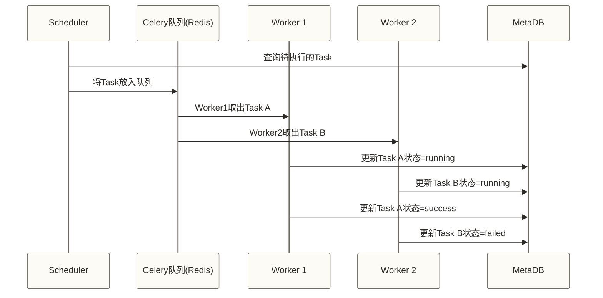
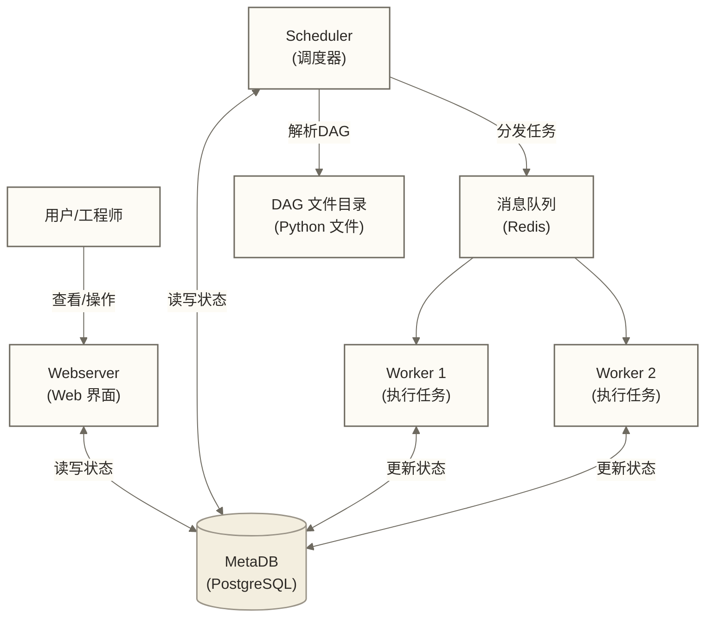

# Airflow 核心概念

> [!abstract] 本文核心内容
> - 用数据管道场景讲透 DAG、Task、Operator 等核心概念
> - 理解 Scheduler、Webserver、Executor、MetaDB 四大组件的职责
> - 掌握 XCom、Variable、Connection、Pool 等进阶概念
> - 建立对 Airflow 运行机制的整体认知

理解 Airflow 的概念，最好的方式是从一个具体的数据管道场景出发，看这些概念在实际工作中分别对应什么。

---

## 场景设定

假设我们需要每天凌晨处理一批电商订单数据：

1. 从 MySQL 中抽取前一天的订单数据
2. 用 Python 做数据清洗（过滤异常订单、标准化字段）
3. 将清洗后的数据写入 Hive 的 ODS 层
4. 触发 Hive SQL 做聚合计算，生成 DWS 层销售汇总
5. 将结果同步到 MySQL 供 BI 工具读取
6. 发送完成邮件通知

这就是一个典型的工作流，接下来用 Airflow 的语言描述它。

---

## DAG：有向无环图

**DAG（Directed Acyclic Graph，有向无环图）** 是 Airflow 的核心概念，代表一个完整的工作流。

### 为什么叫有向无环图

- **有向（Directed）**：任务之间有明确的执行顺序，箭头表示依赖方向
- **无环（Acyclic）**：任务之间不能形成循环依赖（A 依赖 B，B 又依赖 A）
- **图（Graph）**：多个任务通过依赖关系连接成一张图

上面那个电商数据管道，用图来表示就是：

```json
[抽取MySQL] → [数据清洗] → [写入Hive ODS] → [聚合计算] → [同步MySQL] → [发送邮件]
```

这就是一个 DAG：6 个节点，5 条有向边，没有环。

### DAG 在代码中的样子

```python
from airflow import DAG
from datetime import datetime

# 定义一个 DAG
with DAG(
    dag_id="ecommerce_daily_etl",       # DAG 的唯一标识，不能重复
    schedule_interval="0 1 * * *",       # 每天凌晨 1 点执行
    start_date=datetime(2024, 1, 1),     # 调度开始日期
    catchup=False,                        # 不补跑历史数据
    tags=["电商", "ETL", "日报"],         # 分类标签，便于 Web UI 筛选
    description="电商订单每日ETL流程",    # 描述
) as dag:
    # 在这里定义任务（Task）
    pass
```

> [!tip] dag_id 命名建议
> 建议使用下划线分隔的小写英文，包含业务域 + 频率 + 功能，例如：
> `ecommerce_daily_order_etl`、`finance_hourly_transaction_sync`

---

## Task：任务

**Task** 是 DAG 中的一个执行单元，对应工作流中的一个步骤。

Task 定义可以配置重试策略和超时；每次运行对应的 Task Instance 有独立的状态和日志：
- 运行状态（success、failed、running、skipped 等）
- 运行日志
- 重试策略
- 超时设置

在我们的场景中，6 个步骤就是 6 个 Task。

### Task 的运行状态

| 状态 | 颜色（Web UI）| 含义 |
|------|-------------|------|
| success | 绿色 | 运行成功 |
| failed | 红色 | 运行失败 |
| running | 黄色 | 正在运行 |
| queued | 灰色 | 等待执行器分配 |
| scheduled | 浅蓝色 | 已计划，等待调度 |
| upstream_failed | 橙色 | 上游失败导致触发规则未满足，本任务未执行；不同于 skipped |
| skipped | 粉色 | 被分支、跳过逻辑等标记为跳过 |
| up_for_retry | 黄色（深）| 失败后等待重试 |

---

## Operator：操作算子

**Operator** 定义了一个 Task 具体做什么事情。每种 Operator 封装了一类操作的逻辑。

可以把 Operator 理解为"任务模板"：

- `PythonOperator` → 执行一个 Python 函数
- `BashOperator` → 执行一个 Shell 命令
- `SQLExecuteQueryOperator` → 在数据库上执行 SQL
- `HiveOperator` → 在 Hive 上执行 HiveQL
- `SparkSubmitOperator` → 提交 Spark 作业
- `EmailOperator` → 发送邮件

用我们的场景举例：

```python
from airflow.operators.python import PythonOperator
from airflow.operators.bash import BashOperator

def clean_order_data():
    """数据清洗逻辑"""
    # 读取数据、过滤异常、标准化字段
    pass

# Task 1：用 BashOperator 执行 MySQL 导出脚本
extract_task = BashOperator(
    task_id="extract_mysql_data",
    bash_command="python /scripts/extract_mysql.py --date {{ ds }}",
)

# Task 2：用 PythonOperator 执行 Python 清洗函数
clean_task = PythonOperator(
    task_id="clean_order_data",
    python_callable=clean_order_data,
)
```

> [!note] Task 和 Operator 的关系
> Operator 是类（模板），Task 是这个类的实例。
> 当你写 `BashOperator(task_id="...", bash_command="...")` 时，你就创建了一个 Task（它的类型是 BashOperator）。
> 两个词在日常使用中经常混用，不用过于纠结区分。

---

## Scheduler：调度器

**Scheduler** 是 Airflow 的核心进程，负责：

1. 扫描 DAG 文件目录，解析 DAG 定义
2. 判断哪些 DAG 的哪些 Task 需要在当前时间运行
3. 将符合条件的 Task 放入执行队列
4. 检测 DAG 文件变化，实时更新调度计划

DAG 文件发现与解析由调度相关组件周期性完成，具体组件和间隔取决于 Airflow 版本及配置，不能统一视为默认每 5 秒扫描。通常修改 DAG 文件后无需重启 Airflow，但变化生效需要等待文件发现与解析。

> [!warning] Scheduler 的关键限制
> Scheduler 负责调度，Executor 决定并协调任务的执行方式；任务代码由本地执行进程、Worker 或 Pod 等运行。
> 仅部署一个 Scheduler 时存在单点风险，但每个部署并非只能运行一个 Scheduler。Airflow 2.x 支持 HA Scheduler（多个 Scheduler 同时运行），具体部署需满足对应版本的数据库及配置要求。

---

## Executor：执行器

**Executor** 决定了 Task 如何被执行。

Airflow 支持多种 Executor：

| Executor | 工作方式 | 适用场景 |
|----------|---------|---------|
| SequentialExecutor | 同一时刻只运行一个 Task，串行 | 本地开发调试 |
| LocalExecutor | 在 Scheduler 同一台机器上并行执行 | 小型生产环境 |
| CeleryExecutor | 通过消息队列（Redis/RabbitMQ）分发到多台 Worker | 中大型生产环境 |
| KubernetesExecutor | 每个 Task 启动一个 Pod | 云原生环境 |

在支持这些执行器的版本中，SequentialExecutor 可用于串行本地调试，LocalExecutor 可用于单机并行部署；是否采用 CeleryExecutor 或 KubernetesExecutor，应结合并发需求、基础设施和运维能力选择，而不是仅按开发或生产环境划分。

### Executor 的工作流程（以 CeleryExecutor 为例）



---

## Webserver：Web 界面

**Webserver** 提供 Airflow 的 Web 管理界面，基于 Flask 开发。

主要功能：
- 查看所有 DAG 列表和运行状态
- 查看 DAG 的图形结构（Graph View）
- 查看任务的运行日志
- 手动触发 DAG 运行
- 管理 Connection、Variable、Pool 等配置

Webserver 是无状态的，它从 MetaDB 读取所有状态信息显示。停掉 Webserver 不影响任务调度和执行。

---

## MetaDB：元数据数据库

**MetaDB（Metadata Database）** 是 Airflow 的"大脑记忆"，存储所有状态信息。

MetaDB 存储的内容：
- 所有 DAG 的元信息
- 每次 DAG Run 的状态
- 每个 Task Instance 的运行状态、开始时间、结束时间
- Connection（数据库连接信息）
- Variable（全局变量）
- XCom（任务间传递的数据）

Airflow 支持的数据库：
- **SQLite**：默认，仅用于开发测试，不支持并行执行
- **PostgreSQL**：官方推荐，生产环境首选
- **MySQL**：支持，但需要注意时区配置

> [!warning] 生产环境必须使用 PostgreSQL 或 MySQL
> SQLite 不支持多进程并发写入，SequentialExecutor 之外的 Executor 都无法正常工作。
> 只要不是本地调试，就换掉 SQLite。

---

## DAG Run：DAG 的一次运行实例

一个 DAG 可以被多次运行，每次运行叫做一个 **DAG Run**。

DAG Run 的常见触发方式包括以下两种，此外还可能有补跑、数据感知调度等方式，具体取决于 Airflow 版本：
1. **scheduled**：按照 schedule_interval 自动触发
2. **manual**：通过 Web UI 或 API 手动触发

每个 DAG Run 有一个在所属 DAG 内唯一的 `run_id`。旧版示例中的 `execution_date` 表示逻辑日期，不等同于实际启动时间；逻辑日期及数据区间的具体语义应结合所用 Airflow 版本和调度方式理解。

---

## Task Instance：任务实例

**Task Instance** 是 Task 在某次 DAG Run 中的运行记录。

一个 Task 在不同的 DAG Run 中会有多个 Task Instance，每个都有独立的状态和日志。

可以这样理解：
- `DAG` = 工厂的生产流程图（设计稿）
- `DAG Run` = 某一天的一次完整生产运行
- `Task` = 流程图中的一个工序
- `Task Instance` = 某次运行中那个工序的执行记录

---

## XCom：任务间数据传递

**XCom（Cross-Communication）** 是任务之间传递数据的机制。

场景：你在任务 A 里查询了今天要处理的数据量，想在任务 B 里根据这个数据量决定是否要跑某个分支。

```python
def extract_data(**context):
    row_count = 10000  # 假设查到了数据量
    # 推送数据到 XCom
    context['task_instance'].xcom_push(key='row_count', value=row_count)

def check_and_process(**context):
    # 从 XCom 拉取上游任务的数据
    row_count = context['task_instance'].xcom_pull(
        task_ids='extract_task',
        key='row_count'
    )
    print(f"今天要处理 {row_count} 行数据")
    if row_count == 0:
        print("没有数据，结束当前函数；这不会将任务状态设为 skipped")
        return

extract_task = PythonOperator(
    task_id="extract_task",
    python_callable=extract_data,
    provide_context=True,
)

process_task = PythonOperator(
    task_id="process_task",
    python_callable=check_and_process,
    provide_context=True,
)

extract_task >> process_task
```

> [!warning] XCom 不适合传大数据
> XCom 的数据存在 MetaDB 里，适合传递少量的元数据（如文件路径、行数、状态标志），
> **不适合传 DataFrame 或大文件**。传大数据应该用 S3/HDFS 等外部存储，通过 XCom 只传路径。

---

## Variable：全局变量

**Variable** 用于存储全局配置信息，可以在 Web UI 中管理，DAG 代码中读取。

常见用途：
- 存储数据库表名、文件路径等环境参数
- 存储 API Key、邮件地址等配置（敏感信息建议用 Secrets Backend）
- 存储业务参数（如报表时间范围）

```python
from airflow.models import Variable

# 读取变量
target_table = Variable.get("dw_target_table", default_var="ods_order_detail")
email_list = Variable.get("report_email_list", deserialize_json=True)
# email_list 的值是 JSON：["alice@example.com", "bob@example.com"]
```

---

## Connection：数据源连接

**Connection** 是 Airflow 管理数据源连接信息的机制，包括主机、端口、用户名、密码等。

- 连接信息存在 MetaDB 中（可以加密存储）
- 通过 `conn_id` 在 Operator 中引用
- 避免把密码硬写在 DAG 代码里

```python
from airflow.hooks.base import BaseHook

# 读取 Connection
conn = BaseHook.get_connection("mysql_dw")
print(f"Host: {conn.host}, Port: {conn.port}")

# 在 Operator 中使用
from airflow.providers.mysql.operators.mysql import MySqlOperator

create_table = MySqlOperator(
    task_id="create_table",
    mysql_conn_id="mysql_dw",  # 引用 Connection 的 conn_id
    sql="CREATE TABLE IF NOT EXISTS ods_order ...",
)
```

---

## Pool：任务并发资源池

**Pool** 用于限制并发执行的 Task 数量，防止某类任务占用过多资源。

场景：你有 50 个 DAG 都会查询同一个 MySQL 数据库，如果同时跑，数据库可能撑不住。

```python
# 为 Task 指定 Pool，限制同时运行的 Task 数量
extract_task = BashOperator(
    task_id="extract_from_mysql",
    bash_command="python extract.py",
    pool="mysql_query_pool",   # 使用 mysql_query_pool 这个 Pool
    pool_slots=1,               # 占用 1 个 slot
)
```

在对应版本的 Web UI Pools 管理页面，将 `mysql_query_pool` 的 slot 数设为 5；若相关任务均使用该 Pool 且每个任务占用 1 个 slot，Pool 可限制这些任务的并发占用。它不是数据库连接池，也不会限制未使用该 Pool 的任务或单个任务内部的并行查询。

---

## Airflow 组件架构全景

把上述组件放在一起，以 CeleryExecutor 部署为例，架构可以示意如下；其他 Executor 的部署不一定包含消息队列和独立 Worker：



---

## 概念速查表

| 概念 | 简单类比 | 一句话描述 |
|------|---------|-----------|
| DAG | 工作流程图 | 定义任务及其依赖关系的有向无环图 |
| Task | 流程中的一个步骤 | DAG 中的一个执行单元 |
| Operator | 任务的类型/模板 | 定义 Task 做什么事情 |
| DAG Run | 一次完整的流程执行 | DAG 被触发运行的一个实例 |
| Task Instance | 某次执行中某步骤的记录 | Task 在某个 DAG Run 中的运行实例 |
| Scheduler | 流程调度员 | 决定什么时候运行哪些任务 |
| Executor | 任务执行车间 | 决定并协调任务的执行方式 |
| Worker | 执行工人 | Executor 中实际运行任务的进程/节点 |
| Webserver | 监控看板 | 提供 Web 管理界面 |
| MetaDB | 档案室 | 存储所有状态和配置信息 |
| XCom | 任务间便条 | 任务之间传递少量数据 |
| Variable | 全局配置表 | 存储全局配置参数 |
| Connection | 通讯录 | 存储数据源连接信息 |
| Pool | 资源令牌池 | 限制某类任务的并发数量 |

---

## 小结

Airflow 的核心是 **DAG + Operator** 的组合：
- DAG 定义了工作流的结构（谁先谁后）
- Operator 定义了每个任务做什么
- Scheduler 决定什么时候触发
- Executor 决定在哪里执行
- MetaDB 记录所有状态

掌握这些概念后，就可以开始动手安装部署了。

下一篇：[[【技术与工具】/Airflow/03-Airflow安装部署|03-Airflow安装部署]] — 使用 Docker Compose 部署 Airflow，实际耗时取决于环境准备、镜像下载和配置

---

*所属系列：[[【技术与工具】/Airflow/00-Airflow学习路线图|00-Airflow学习路线图]] | 上一篇：[[【技术与工具】/Airflow/01-工作流调度概述|01-工作流调度概述]] | 下一篇：[[【技术与工具】/Airflow/03-Airflow安装部署|03-Airflow安装部署]]*

#Airflow #DAG #Operator #Executor #Scheduler #XCom #核心概念

---

> [!info] 前置知识
> - 了解工作流调度的基本概念，建议先看 [[【技术与工具】/Airflow/01-工作流调度概述|工作流调度概述]]
> - 有 Python 基础（能看懂 Python 对象和类的概念）
> - 知道什么是数据库（DAG 元信息存在 MetaDB 里）

---

## 掌握检查

- [ ] 能不看资料，徒手画出 Airflow 的四大组件（Scheduler、Webserver、Executor、MetaDB）以及它们的交互关系
- [ ] 能区分 DAG、Task、Operator、DAG Run、Task Instance 这五个概念——尤其是 DAG 和 DAG Run、Task 和 Task Instance 的关系
- [ ] 能解释 XCom 的使用场景，以及为什么不适合用来传递大量数据
- [ ] 知道生产环境为什么应将 SQLite 换成所用 Airflow 版本支持的 PostgreSQL 或 MySQL
- [ ] 能解释 Pool 解决的是什么资源竞争问题

---

## 实践练习

**基础题**：从本文的"电商订单数据管道"场景出发，列出这个管道需要哪些 Operator 类型（BashOperator？PythonOperator？），画出 DAG 的依赖关系图（箭头表示依赖方向）。

**进阶题**：假设你有两个 DAG：DAG_A 每天凌晨 2 点运行，DAG_B 需要在 DAG_A 全部完成后才能运行。请描述应该用什么机制来实现这个跨 DAG 依赖（提示：ExternalTaskSensor 或 TriggerDagRunOperator），以及两种方式的区别。
