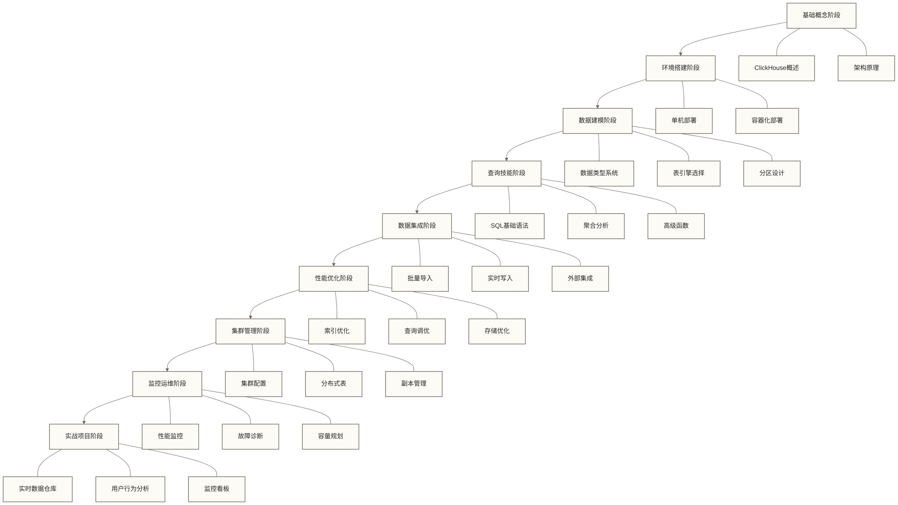

# 🚀 ClickHouse学习路线图

> [!tip] 💡 学习建议
> ClickHouse学习就像建造一座摩天大楼，需要扎实的基础、合理的规划和循序渐进的实施。**就像建筑师先要画好蓝图一样**，本路线图为你规划了一条从基础概念到高级工程实践的学习路径，帮助循序渐进地积累能力；实际学习效果取决于前置知识、实践投入和项目反馈。

## 📋 学习成果与技能获得

ClickHouse作为现代OLAP数据库的佼佼者，就像数据世界的超级跑车，为实时分析场景提供了完整的解决方案。通过系统化学习，你将获得以下核心技能：

> [!abstract] 🎯 核心技能树
> **🏗️ 架构理解能力** - 深入掌握列式存储原理和分布式计算架构，就像了解引擎构造的汽车工程师
> 
> **🔍 数据分析能力** - 熟练运用SQL进行复杂数据分析，快速洞察数据背后的商业价值
> 
> **⚙️ 系统工程能力** - 具备从零搭建高性能OLAP集群的能力，成为数据基础设施专家
> 
> **🎨 问题解决能力** - 将技术能力转化为业务价值，用数据驱动业务决策
> 
> **🌟 前瞻视野能力** - 理解实时数据处理技术发展趋势，把握技术前沿

## 🎯 为什么选择ClickHouse？

想象一下，传统数据库就像普通的图书馆，而ClickHouse则像一个配备了AI搜索系统的现代化数字图书馆。它不仅存储量大，查找速度更是快如闪电。

> [!info] 🌟 ClickHouse核心优势
> **⚡ 超音速查询性能**
> - 原稿以“单节点每秒处理数十亿行数据”描述性能潜力，但该数字尚未核实，不能作为通用性能指标；实际吞吐需结合硬件、数据布局和查询负载测试
> - 原稿以“PB级数据亚秒级响应”描述性能潜力，但该数字尚未核实，不能视为响应时间保证；实际延迟取决于扫描范围、查询复杂度、集群资源和并发
> 
> **📚 智能列式存储**
> - 专为分析场景精心设计，就像为不同类型书籍设计专门书架
> - 原稿给出“压缩比高达10:1”的未核实示例；实际压缩比取决于数据类型、分布、排序和压缩编码，应以自己的数据测试
> 
> **🔤 SQL语法兼容**
> - 支持常见SQL查询语法，但具体语法、函数和行为需按ClickHouse方言及目标版本确认
> - 已有SQL技能有助于迁移，但仍需学习ClickHouse的方言、表引擎和查询行为差异
> 
> **🌐 弹性扩展架构**
> - 支持分布式部署；扩展效果取决于分片策略、负载分布、网络和查询模式，不保证线性扩展
> - 就像乐高积木，可以随需求自由组合扩展
> 
> **💎 开源商业友好**
> - 开源代码基于Apache 2.0许可证，使用时须遵守许可条款；部署资源、运维、商业支持和托管服务可能产生费用
> - 生产使用应评估支持渠道、服务条款及运维能力，不能仅凭开源许可判断生产适用性

## 🗺️ ClickHouse学习路径图

学习ClickHouse就像攀登技术高峰，需要有明确的路线图指引。路径图列出9个技能节点，后文将其归并为5个学习阶段；可以像游戏关卡一样逐步练习，但完成路线不等于已经具备技术专家能力。

> [!note] 🎮 学习路径设计理念
> **渐进式技能解锁**：每个阶段都基于前一阶段的知识，确保学习的连贯性
> **实战驱动学习**：理论与实践相结合，每个概念都有对应的动手练习
> **职业导向设计**：针对不同职业路径提供差异化的重点建议

## 📚 ClickHouse学习阶段详解

### 🟢 第一阶段：基础概念入门（1-2周）

**学习目标**：理解ClickHouse基本概念，完成开发环境搭建，掌握基础操作

| 学习模块 | 主要内容 | 学习重点 | 时间 |
|---|---|---|---|
| **ClickHouse概述与特性** | OLAP定位、核心优势、应用场景 | 列式存储概念、性能特点 | 2小时 |
| **ClickHouse架构原理** | 系统架构、存储引擎、查询处理流程 | 架构设计思想、数据处理原理 | 3小时 |
| **环境搭建** | 安装部署、配置管理、客户端连接 | 快速搭建开发环境 | 2小时 |

> [!tip] 💡 第一阶段学习重点
> **建立正确的认知框架**：就像学习驾驶要先了解汽车构造一样，不要急于进行复杂查询操作，先建立正确的理论基础。
> 
> **重点关注**：
> - 🧠 **核心概念理解**：列式存储原理就像书籍按主题分类存放，便于快速查找
> - 🏗️ **架构思维培养**：理解OLAP与OLTP的本质区别
> - 💭 **建立数据思维**：从业务角度思考数据分析需求

### 🟡 第二阶段：数据处理核心技能（2-3周）

**学习目标**：掌握数据模型设计，熟练使用ClickHouse进行数据分析

| 学习模块 | 主要内容 | 学习重点 | 时间 |
|---|---|---|---|
| **数据类型与表引擎** | 数据类型系统、表引擎选择、分区设计 | 如何设计高效的数据表结构 | 4小时 |
| **SQL语法基础** | 基础查询、聚合函数、高级分析函数 | 数据分析能力训练 | 5小时 |
| **数据导入导出** | 批量导入、实时写入、外部系统集成 | 数据接入方案设计 | 4小时 |

> [!tip] 🛠️ 第二阶段学习重点
> **从理论走向实践**：就像学会了汽车原理后开始上路练习，这个阶段要大量动手操作。
> 
> **实践要点**：
> - ✋ **大量动手练习**：每个概念都要亲自验证，理论必须通过实践检验
> - 📊 **准备测试数据集**：建议使用电商、游戏或社交媒体的公开数据集练习
> - 🧮 **培养数据建模思维**：学会从业务角度设计表结构和分区策略
> - 🔍 **重复练习查询**：同一个问题尝试多种SQL写法，理解性能差异

### 🟠 第三阶段：性能优化技能（2-3周）

**学习目标**：掌握查询优化技巧，理解性能调优原理

| 学习模块 | 主要内容 | 学习重点 | 时间 |
|---|---|---|---|
| **查询优化** | 索引策略、查询调优、执行计划分析 | 性能诊断和优化方法 | 5小时 |
| **集群管理** | 集群配置、分布式表、数据分片策略 | 分布式架构设计 | 5小时 |

> [!tip] ⚡ 第三阶段学习重点
> **成为性能调优专家**：就像赛车手需要了解引擎性能一样，这个阶段要深入理解性能优化。
> 
> **优化要点**：
> - 📈 **建立性能基准**：学会使用EXPLAIN分析查询执行计划
> - 🎯 **理解优化场景**：不同的优化技巧适用于不同场景，避免过度优化
> - 📏 **建立方法论**：形成系统性的性能诊断和优化思路
> - ⚖️ **权衡取舍思维**：理解存储空间与查询性能之间的平衡

### 🔴 第四阶段：监控运维技能（2-3周）

**学习目标**：掌握集群部署管理，具备生产环境运维能力

| 学习模块 | 主要内容 | 学习重点 | 时间 |
|---|---|---|---|
| **监控运维** | 性能监控、故障诊断、数据备份恢复 | 生产环境运维技能 | 4小时 |

> [!tip] 🔧 第四阶段学习重点
> **掌握生产环境技能**：就像从练习场到真正的赛道，这个阶段要学会管理生产级系统。
> 
> **运维要点**：
> - 🏗️ **多方案实践**：尝试单机、集群、容器化等多种部署方案
> - 🚨 **故障演练**：在测试环境中主动制造各种故障，练习处理能力
> - 📊 **监控体系**：建立完整的性能监控和告警机制
> - 📋 **形成规范**：制定运维手册和应急处理流程

### 🟣 第五阶段：综合实战项目（3-4周）

**学习目标**：通过实际项目整合所学知识，解决真实业务问题

| 学习模块 | 主要内容 | 学习重点 | 时间 |
|---|---|---|---|
| **综合实践案例** | 实时数据仓库、用户行为分析、监控看板 | 端到端项目实现 | 8小时 |

> [!tip] 🚀 第五阶段学习重点
> **从技术走向业务**：就像工程师要解决实际问题一样，这个阶段要用技术创造业务价值。
> 
> **实战要点**：
> - 🎯 **选择真实场景**：基于实际业务需求设计项目，而不是纯技术演示
> - 🏛️ **架构设计能力**：学会从需求分析到系统设计的完整流程
> - 💡 **问题解决思维**：遇到问题时的系统性分析和解决方法
> - 📈 **价值导向**：始终考虑技术方案如何为业务带来实际价值

## 🎯 不同职业路径的学习策略

就像不同的职业需要不同的技能组合一样，每个职业方向对ClickHouse技能的需求也不同。我们为不同职业路径制定了个性化的学习方案：

> [!abstract] 🏆 职业发展路径
> **数据分析师**：重点关注数据洞察能力，像福尔摩斯一样从数据中发现线索
> **数据工程师**：关注系统设计能力，像建筑师一样构建数据基础设施
> **运维工程师**：专注系统稳定性，像医生一样守护系统健康

### 📊 数据分析师路径

> [!user] 🔍 数据探索家
> **职业定位**：像福尔摩斯一样的数据侦探，从海量数据中发现业务洞察和价值

**🎯 核心技能组合**：
- 📊 **数据查询分析**：熟练使用SQL进行复杂数据分析
- 📈 **可视化报表**：制作直观易懂的数据报表和看板
- ⚡ **性能优化**：了解查询优化原理，提高分析效率

**📋 学习路径**：[[【技术与工具】/ClickHouse/01-ClickHouse概述与特性|ClickHouse概述与特性]] → [[【技术与工具】/ClickHouse/05-ClickHouse SQL语法基础|ClickHouse SQL语法]] → [[【技术与工具】/ClickHouse/07-ClickHouse查询优化|ClickHouse查询优化]] → [[【技术与工具】/ClickHouse/10-ClickHouse实践案例|ClickHouse实践案例]]

**📅 时间规划**：4-6周（每天1-2小时）

**📝 学习建议**：
- 重点掌握OLAP分析思维和技巧
- 练习使用真实数据集进行分析
- 学会从业务角度理解数据指标

### 🛠️ 数据工程师路径

> [!gear] 🏗️ 数据架构师
> **职业定位**：像建筑师一样的数据基础设施设计者，构建稳定高效的数据处理系统

**🎯 核心技能组合**：
- 🏗️ **系统架构设计**：从业务需求到技术方案的完整设计能力
- 🔗 **数据集成能力**：构建复杂的数据管道和实时处理系统
- 🌐 **集群管理能力**：掌握分布式系统的部署、配置和维护
- ⚡ **性能调优能力**：系统性的性能分析和优化能力

**📋 学习路径**：完整学习路径，重点关注架构和集成模块

**📅 时间规划**：8-10周（每天2-3小时）

**📝 学习建议**：
- 深入理解分布式系统的复杂性和设计原理
- 掌握生产环境的部署和运维最佳实践
- 学会与各种大数据组件的集成和优化

### 🔧 运维工程师路径

> [!shield] 🛡️ 系统守护者
> **职业定位**：像医生一样的系统健康守护者，确保数据系统7x24小时稳定运行

**🎯 核心技能组合**：
- 🛠️ **系统部署能力**：掌握各种环境下的部署和配置技能
- 📊 **监控告警体系**：建立全方位的监控和智能告警机制
- 🚨 **故障处理能力**：快速定位和解决各类系统问题
- 📈 **容量规划能力**：预测和规划系统资源需求

**📋 学习路径**：[[【技术与工具】/ClickHouse/03-ClickHouse环境搭建|ClickHouse环境搭建]] → [[【技术与工具】/ClickHouse/08-ClickHouse集群管理|ClickHouse集群]] → [[【技术与工具】/ClickHouse/09-ClickHouse监控运维|ClickHouse监控运维]] → [[【技术与工具】/ClickHouse/07-ClickHouse查询优化|ClickHouse查询优化]]

**📅 时间规划**：6-8周（每天1.5-2.5小时）

**📝 学习建议**：
- 重点关注系统稳定性和高可用性设计
- 建立完整的运维流程和应急响应机制
- 掌握自动化运维工具和脚本开发

## 🛠️ 学习环境准备

### 💻 硬件要求

**小规模单机学习环境参考配置（非官方最低要求或生产容量保证）**：
- CPU: 4核心
- 内存: 8GB RAM
- 存储: 50GB可用空间
- 网络: 稳定的互联网连接

**较充裕的单机学习环境参考配置（集群及大数据量练习需另行评估）**：
- CPU: 8核心及以上
- 内存: 16GB RAM及以上  
- 存储: 100GB SSD
- 网络: 千兆网络

### 🔧 软件环境

**必备软件**：
- Linux系统（选择仍在维护支持期内且与目标ClickHouse版本兼容的发行版；原稿列出的Ubuntu 20.04/CentOS 7不再作为新建环境的默认推荐）
- 容器运行环境（用于快速部署ClickHouse测试实例）
- DBeaver或其他SQL客户端
- 仍在维护支持期内、且与所用依赖兼容的Python 3版本（用于数据生成和分析；不以Python 3.7作为新建环境基线）

**可选工具**：
- Grafana（监控可视化）
- Nginx（负载均衡）
- Kafka（实时数据流）

## 📖 学习资源补充

### 📚 官方资源
- **ClickHouse官方文档**：https://clickhouse.com/docs/
- **GitHub项目**：https://github.com/ClickHouse/ClickHouse
- **官方博客**：技术深度文章和最佳实践

### 🎥 在线学习
- **YouTube ClickHouse频道**：官方技术讲座
- **技术会议录像**：ClickHouse Meetup系列
- **在线课程**：Udemy、极客时间等平台课程

### 👥 社区交流
- **官方Slack频道**：实时技术讨论
- **中文技术社区**：知识星球、微信群
- **Stack Overflow**：技术问题求助

## ✅ 学习效果验证

### 🎯 阶段性检验

**第一阶段检验**：
- [ ] 能够解释ClickHouse的核心优势
- [ ] 成功搭建单机环境并连接
- [ ] 理解列式存储和OLAP概念

**第二阶段检验**：
- [ ] 能够设计合适的表结构和分区策略
- [ ] 熟练编写复杂的分析SQL
- [ ] 掌握常见数据导入方法

**第三阶段检验**：
- [ ] 能够分析和优化慢查询
- [ ] 理解不同索引类型的使用场景
- [ ] 掌握存储优化最佳实践

**第四阶段检验**：
- [ ] 能够设计和部署ClickHouse集群
- [ ] 掌握分布式表的使用方法
- [ ] 具备基础的运维能力

### 🏆 最终项目验收

完成一个**实时数据分析项目**，包含：
- 集群架构设计
- 数据模型设计
- ETL流程实现
- 查询性能优化
- 监控告警配置

## 🔗 相关技术栈

### 🔄 前置技能
- **[[【技术与工具】/SQL/00-SQL学习路线图|SQL]]** - 数据查询语言基础
- **[[【技术与工具】/Python/00-Python学习路线图|Python]]** - 数据处理和分析
- **[[【技术与工具】/统计学/描述性统计|描述性统计]]** - 数据分析理论基础

### 🤝 配套技术
- **[[【技术与工具】/Kafka/00-Kafka学习路线图|Kafka]]** - 实时数据流处理
- **[[【技术与工具】/Flink/00-Flink学习路线图|Flink]]** - 流计算引擎
- **[[【技术与工具】/Spark/00-Spark学习路线图|Spark]]** - 大数据处理引擎

### 📊 应用场景
- **实时数据仓库** - 替代传统OLAP系统
- **用户行为分析** - 网站、APP数据分析  
- **业务监控看板** - 实时业务指标展示
- **数据科学平台** - 支撑机器学习和AI应用

---

## 🎯 开始你的ClickHouse学习之旅

> [!success] 🚀 准备好开始你的ClickHouse之旅了吗？
> 
> ClickHouse就像数据世界的超级赛车，一旦掌握就能在数据分析领域如鱼得水。**通过系统学习，你将掌握一项在大数据时代至关重要的技能**。
> 
> **🏁 下一步行动计划**：
> 
> 1. 📋 **完成环境准备** - 检查并准备学习环境和必要软件
> 2. 📚 **从基础开始** - 从 [[【技术与工具】/ClickHouse/01-ClickHouse概述与特性|ClickHouse概述与特性]] 开始你的学习之旅
> 3. 💻 **动手实践为王** - 每个概念都要亲自动手验证，理论与实践相结合
> 4. 🤝 **加入学习社区** - 寻找志同道合的学习伙伴和技术支持
> 5. 🎯 **制定学习计划** - 根据个人情况制定具体的时间表和项目目标

---

> 💡 **记住**：**ClickHouse的学习就像学习驾驶一样，理论重要，但实践更关键**。每个概念都要亲自动手验证，每个项目都要认真完成。持续实践、复盘并接受项目检验，有助于逐步提升ClickHouse工程能力；成为技术专家还需要长期经验积累。🎆