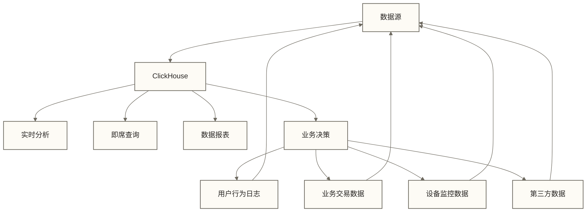
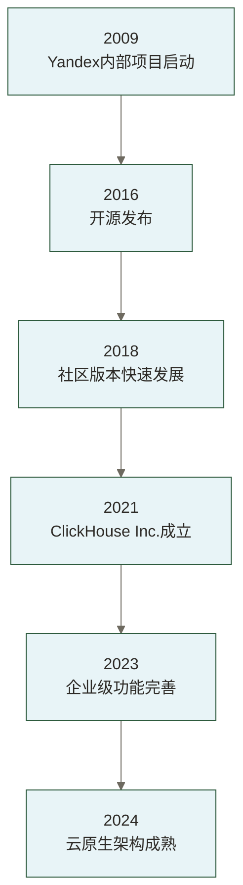
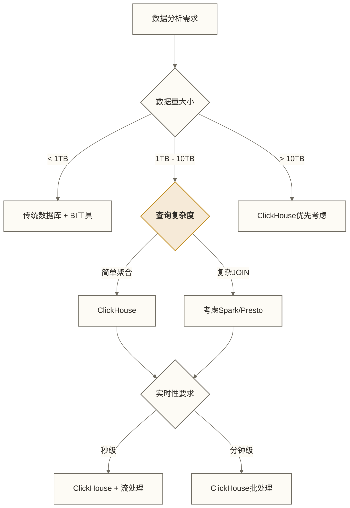

# 🚀 ClickHouse概述与特性

## 📚 学习目标

通过本章节的学习，你将能够：
- **理解ClickHouse的产品定位**和核心价值
- **掌握列式存储和OLAP**的基本概念
- **了解ClickHouse的核心特性**和技术优势
- **明确ClickHouse的适用场景**和技术选型标准
- **理解ClickHouse在现代数据技术栈**中的定位

> [!tip] 💡 学习建议
> ClickHouse是一个相对年轻但发展迅速的技术，**不要被它的技术细节吓到**。就像了解一辆汽车一样，**先理解它的用途和优势，再深入发动机原理**。这个阶段重点建立整体概念，为后续深入学习打下基础。

## 🎯 什么是ClickHouse

### 1. 产品定位

ClickHouse是一个**开源的列式OLAP数据库管理系统**，专为在线分析处理而设计。它由俄罗斯Yandex公司于2016年开源，现在由ClickHouse Inc.维护。

> [!info] 核心定位
> ClickHouse采用列式存储架构，将同类型数据集中存储，专门针对OLAP（在线分析处理）场景优化，能够在海量数据上提供亚秒级的查询响应。

**与传统数据库的区别**：
- **行式存储**：适合事务处理，每次读取整行数据
- **列式存储**：适合分析处理，只读取需要的列，大幅提升查询效率

### 2. 核心价值主张

ClickHouse在数据分析领域具有以下五类优势；本节及后文的性能、压缩和成本数字为原稿未核实示例，缺少测试环境与对照依据，不构成普遍结果或承诺：

> [!success] ClickHouse五大优势
> 
> **🚀 极致性能**
> - 单机可达数十亿行/秒的查询速度
> - 基于向量化执行和列式存储优化
> - 支持并行查询处理
> 
> **📈 线性扩展**  
> - 支持从单机到数千节点的水平扩展
> - 采用shared-nothing架构
> - 增加节点可能提升整体性能，实际收益取决于分片、查询并行度、数据倾斜及网络开销，并不保证线性扩展
> 
> **⚡ 实时分析**
> - 支持秒级延迟的实时数据分析
> - 适用于流式数据处理场景
> - 部分场景可减少预处理，但仍需按数据格式、质量和查询需求设计摄取与转换流程
> 
> **💰 成本效益**
> - 相比传统OLAP方案可降低10-100倍成本
> - 高压缩比（通常10:1）节省存储空间
> - 硬件利用率高
> 
> **🛠️ 易于使用**
> - 标准SQL语法，学习成本低
> - 兼容现有BI工具生态
> - 丰富的数据类型支持

### 3. 发展历程

> 以下医院人物、对话与系统均为教学假设，不代表经核实的真实医院案例；其中70%、1000多位、上亿次、100毫秒、30%等数字保留为原稿未核实示例，不构成医疗效果或系统性能证据。

## 🏗️ OLAP与列式存储基础

### 1. OLAP基本概念

李院长带着大家来到医院的两个不同区域："让我给大家解释一下医院的两种业务模式，这就像数据世界里OLTP和OLAP的区别。"

他首先指向繁忙的急诊科："你们看这里，急诊科每天处理大量的紧急病例，每个病人来了就要立即处理、开药、收费，这就像OLTP系统的事务处理，要求快速响应、准确记录每一笔交易。"

然后他带大家来到医院的大数据分析中心："而这里呢，我们的医疗专家在分析全院患者的诊疗数据，比如哪种疾病发病率最高、哪个科室效率最好、患者康复趋势如何。这种工作就像OLAP系统，需要处理大量历史数据，进行复杂的统计分析。"

王医生补充道："急诊科关注的是'现在这个病人怎么办'，而分析中心关注的是'所有病人的整体情况如何'，这就是两种不同的业务需求。"

**专业技术对应**：**OLAP（Online Analytical Processing）**在线分析处理，与OLTP（Online Transaction Processing）相对应：

| 特性 | OLTP | OLAP |
|---|---|---|
| **主要用途** | 事务处理 | 数据分析 |
| **查询特点** | 简单、频繁 | 复杂、聚合 |
| **数据量** | 较小 | 海量 |
| **响应要求** | 毫秒级 | 秒级可接受 |
| **典型场景** | 订单处理、用户注册 | 销售分析、用户画像 |

### 2. 列式存储原理

李院长指着医院的病历管理系统，开始解释："让我用我们医院的病历管理来说明传统数据库和ClickHouse的区别。"

"传统的病历管理就像行式存储，"他打开一份完整的纸质病历，"每次我们要分析患者情况，都要翻看整本病历，从第一页看到最后一页，即使我们只关心血压数据，也要把整份病历都拿出来。"

王医生接过话题："而我们现在的智能病历系统就像ClickHouse的列式存储，我们把所有患者的血压数据单独存放，血糖数据单独存放，体温数据也单独存放。这样当我们要分析全院患者的血压趋势时，只需要直接查看血压数据区域，不用翻看其他无关信息，效率提升了几十倍！"

"你们看，"李院长指向电脑屏幕上的示例，"传统方式和智能方式的差别多明显！"

**专业技术对应**：传统数据库采用**行式存储**，而ClickHouse采用**列式存储**：

行式存储和列式存储的数据组织方式存在根本差异。行式存储将一条完整记录的所有字段连续存放，就像传统档案柜中一个病人的完整病历放在一个文件夹里。而列式存储将相同字段的数据集中存放，类似于将所有病人的血压数据放在一个专门区域，血糖数据放在另一个区域。

这种组织方式的差异带来显著的性能优势：当我们只需要分析销售金额数据时，列式存储只需读取sales_amount列的数据块，而行式存储在扫描基础表数据页时通常会读取包含其他字段的数据；覆盖索引等访问路径可能避免读取完整行，实际I/O取决于执行计划与存储布局。在处理TB级数据时，原稿以10-100倍性能提升说明这种差异；该数字未核实，实际收益需按查询与存储配置测试。

### 3. 列式存储的优势

张护士长从医务管理的角度补充道："我们医院采用分科室专业化管理后，有三个显著优势，这也正是ClickHouse列式存储的优势所在。"

"第一个优势是**存储空间大幅节省**，"她指着压缩整齐的专业档案柜，"以前每个病人的完整病历都要单独存放，占用大量空间。现在我们把所有病人的血压记录放在一起，血糖记录放在一起，相同类型的数据可以用更紧凑的方式存储，节省了70%以上的档案空间！"

"第二个优势是**查询效率极高**，"她演示着电子查询系统，"以前要统计全院血压异常情况，需要翻遍所有病历本。现在我们直接去血压数据专区查找，只看相关数据，速度快了几十倍！而且我们的多个护士可以同时处理不同类型的数据查询，完全不会冲突。"

"第三个优势是**统计分析特别方便**，"她打开一个分析报告，"要计算平均血压、统计异常人数、分析变化趋势，我们的专业化系统可以并行处理，几秒钟就能出结果。以前手工统计需要几天时间！"

**专业技术对应**：
- **压缩效率高**：相同类型数据连续存储，压缩比可达10-30倍，减少存储成本和I/O开销
- **查询性能优秀**：只读取需要的列，避免无效数据传输，向量化执行充分利用CPU缓存
- **聚合查询友好**：SUM、COUNT、AVG等聚合操作高效执行，支持并行化处理

列式存储的性能优势在聚合查询中特别明显。当我们需要计算某个时间段的销售总额时，传统行式数据库在缺少合适索引或分区裁剪时，可能需要扫描整个表，并从包含其他字段的数据页中提取所需字段；合适的索引和执行计划可以减少读取量。而ClickHouse的列式存储只需要读取date和sales_amount两个列的数据块，大幅减少了磁盘I/O操作。配合向量化执行和数据压缩技术，这种优势在大数据场景下尤为突出。

## 🌟 ClickHouse核心特性

### 1. 极致查询性能

王医生自豪地向大家展示医院的实时诊断系统："让我展示一下我们医院智能系统的强大性能，这就像ClickHouse在数据查询方面的卓越表现。"

他打开心电图监控室的大屏幕："你们看，我们的心电监护系统正在同时监控全院1000多位患者的心跳数据，每秒钟要处理上亿次心跳信号，但是当任何一个患者出现心律异常时，系统都能在100毫秒内发出预警并显示在医生面前。这种实时处理能力就像ClickHouse能够在海量数据中瞬间找到需要的信息一样。"

ClickHouse的查询性能表现令人印象深刻。原稿给出了未核实的测试示例：对包含1亿行数据的销售表进行分类统计查询，ClickHouse在100毫秒内返回结果，而传统的行式数据库需要几秒甚至几分钟；由于缺少硬件、版本、查询语句、数据分布和对照配置，这些数字仅保留作示例，不能视为通常表现。这种性能优势主要来自于列式存储减少了不必要的数据读取，向量化执行引擎能够并行处理多个数据元素，以及高效的数据压缩降低了I/O开销。

**性能优势来源**：
- **向量化执行引擎** - 批量处理多个数据元素，部分操作可利用单指令多数据（SIMD）优化
- **多核并行处理** - 充分利用现代CPU多核架构
- **内存优化** - 高效的内存管理和缓存策略
- **磁盘I/O优化** - 最小化不必要的数据读取

### 2. 灵活的数据类型系统

ClickHouse提供了丰富的数据类型：

ClickHouse提供了丰富的数据类型系统来适应不同的业务场景。除了标准的数字、字符串和日期类型外，还支持复杂的复合数据类型。LowCardinality类型针对取值范围有限的字符串进行优化存储，JSON类型直接支持半结构化数据的存储和查询，Array和Map类型可以在单个字段中存储多个值，Tuple类型支持结构化数据组合。

这些数据类型的灵活运用可以显著提升查询效率并简化数据模型设计。例如，使用Array类型存储用户标签，可以避免创建额外的关联表；使用JSON类型存储事件属性，可以灵活适应不断变化的业务需求。JSON类型的可用性、设置要求及行为需按实际ClickHouse版本核对。

### 3. 多样化的表引擎

ClickHouse支持多种表引擎，适应不同场景：

ClickHouse的表引擎系统为不同的业务场景提供了专门的优化。MergeTree是最核心的表引擎，支持数据分区和主键索引，适用于大多数分析场景。ReplacingMergeTree在MergeTree基础上提供基于排序键的去重机制，在后台合并时对同键记录进行替换；指定版本字段时保留版本值最大的记录，但合并时机不确定，不保证查询立即无重复。需要查询时去重时可评估FINAL等方案及其开销，适合处理可能重复的数据流。

Distributed引擎提供了分布式查询能力，将查询请求分发到集群中的多个节点并汇总结果，实现了透明的水平扩展。除此之外，ClickHouse还提供了十多种专门的表引擎，如用于日志分析的Log引擎族、用于外部数据访问的各种集成引擎等，可以根据具体需求选择最适合的引擎。

### 4. 强大的SQL支持

ClickHouse支持标准SQL语法和高级分析功能：

ClickHouse的SQL功能支持非常全面，包括标准SQL的各种高级特性。窗口函数让我们可以进行复杂的分析计算，比如计算移动平均值、排名等，这对于时间序列分析和用户行为分析非常有用。

数组相关函数是ClickHouse的一大亮点，groupArray可以将多行数据聚合成数组，arrayFilter支持复杂的过滤条件，arrayReduce可以对数组元素进行聚合计算。这些功能使得复杂的数据转换操作变得简单高效。

JSON函数族则让半结构化数据的处理变得轻松，可以直接从JSON字段中提取需要的值，而无需预先定义固定的表结构。这种灵活性在处理日志数据、用户事件等场景中特别有价值。

## 🎯 应用场景与优势

### 1. 典型应用场景

李院长带着大家参观医院的各个智能化应用场景："现在让我们看看智能医院系统的实际应用，这些场景完美对应了ClickHouse在数据世界的各种用途。"

#### 📊 实时数据分析

王医生指着ICU的中央监控系统说道："这里是我们医院的'数据分析大脑'，就像企业使用ClickHouse进行实时用户行为分析一样。"

"你们看这个屏幕，"他指向实时滚动的数据，"我们正在分析过去24小时内全院患者的各种生命体征变化。系统每小时自动统计不同类型的异常事件发生次数，以及涉及的患者人数。这样我们就能快速识别是否有某种疾病的爆发趋势，或者某个科室是否需要额外关注。"

张护士长补充道："比如今天上午心律不齐的患者比平时多了30%，系统立即提醒我们加强心内科的值班力量。这种实时分析能力帮助我们防患于未然。"

**专业技术对应**：
实时用户行为分析是ClickHouse的典型应用场景之一。通过按小时统计不同事件类型的发生次数和涉及的用户数量，我们可以快速了解用户行为的时间分布特征，识别异常的行为模式或系统问题。这种分析在互联网产品的运营监控中特别重要，能够帮助产品经理和运营人员及时发现用户行为的变化趋势。

#### 📈 业务指标监控

李院长来到医院的运营监控中心，指着大屏幕上显示的各项实时指标："这里就是我们的医院'作战指挥部'，实时监控着整个医院的运营状况。"

"你们看，"他指着屏幕上跳动的数字，"过去一小时内，我们每分钟接诊了多少患者、产生了多少医疗收入、平均每位患者的诊疗费用是多少、有多少新患者前来就诊，所有这些关键指标都在实时更新。"

运营主管介绍道："当某个指标出现异常时，比如某分钟的接诊量突然下降，我们就能立即调查是设备故障、人员不足，还是其他原因，确保医院高效运转。这就像电商平台使用ClickHouse监控销售数据一样，每个关键业务指标都在掌控之中。"

**专业技术对应**：
业务指标监控是ClickHouse在企业中的重要应用。通过分钟级的销售数据聚合，我们可以实时监控订单量、收入、客单价和用户数等关键业务指标。当某个指标出现异常波动时，业务团队能够立即获得警报并采取对应措施。这种实时监控能力对于电商、金融、游戏等对业务指标敏感的行业尤为关键。

#### 🔍 用户画像分析
用户画像分析展示了ClickHouse在处理复杂分析任务时的能力。通过计算用户的行为频次、活跃度、最后活跃时间等特征，我们可以将用户划分为不同的群体，为精准营销和个性化服务提供数据支持。ClickHouse的高性能使得这种复杂的用户特征计算可以在海量数据上快速完成，支持实时的用户群体分析和策略调整。

### 2. 行业应用实例

李院长总结道："我们的智能医院模式已经在多个医疗专科领域得到成功应用，这就像ClickHouse在各个行业的广泛应用一样。"

#### 🛒 零售医疗（类比电商行业）
王医生介绍："我们的智慧药房系统就像电商的推荐引擎，根据患者的病史和症状，实时推荐最合适的药物组合。同时监控药品价格变化和库存情况，确保患者能以最优价格获得所需药物，并预测药品需求避免缺货。"

#### 📱 互联网医疗（类比互联网行业）
技术主管说道："我们的在线诊疗平台分析患者的就医行为轨迹，通过漏斗分析了解患者从预约到完成治疗的全流程，进行A/B测试优化挂号流程，根据患者反馈不断改进医疗服务体验。"

#### 🏦 医疗保险（类比金融行业）
医保科长解释："我们与保险公司合作，实时监控异常医疗消费行为，识别可能的骗保风险。同时生成各类合规报告，分析不同患者群体的医疗价值，为精准医疗服务提供数据支持。"

#### 🏭 医疗设备物联网（类比物联网行业）
设备工程师介绍："全院的医疗设备都连接了智能传感器，实时监控设备运行状态。我们可以预测设备故障时间，提前安排维护保养，同时分析设备能耗，优化医院的整体运营效率。"

### 3. 与传统方案对比

| 对比维度 | 传统OLAP | ClickHouse | 优势说明 |
|---|---|---|---|
| **查询性能** | 秒级-分钟级 | 毫秒级-秒级 | 10-100倍性能提升 |
| **存储成本** | 高 | 低 | 高压缩比，节省70-90%存储 |
| **实时性** | 分钟-小时级 | 秒级 | 支持实时数据分析 |
| **扩展性** | 因具体方案而异 | 支持水平扩展，不保证线性收益 | 扩展收益和成本需结合负载与部署评估 |
| **学习成本** | 高 | 中等 | 标准SQL，学习曲线平缓 |

## 🔧 技术选型考虑

### 1. ClickHouse适用场景

✅ **推荐使用ClickHouse的场景**：
- 大数据量的分析查询（TB级以上）
- 实时或准实时的数据分析需求
- 聚合查询为主的业务场景
- 读多写少的数据模式
- 对查询性能要求极高的应用

### 2. 不适用场景

❌ **不推荐使用ClickHouse的场景**：
- 频繁的小数据量事务处理
- 需要复杂事务和ACID保证的业务
- 频繁的UPDATE/DELETE操作
- 需要复杂JOIN的OLTP场景
- 数据量较小（GB级以下）且现有数据库已能满足需求的分析；小数据量本身并非ClickHouse的禁用条件

### 3. 技术选型决策矩阵

> 下图的1TB、10TB及查询类型分支仅为粗略讨论提示，不是经验证的选型阈值；复杂JOIN也不自动排除ClickHouse，实际应比较版本能力、数据模型、并发、延迟、成本与运维条件。

## 🌐 ClickHouse生态系统

### 1. 数据集成

ClickHouse与Kafka的集成为实时数据处理提供了强大支持。通过Kafka引擎表，ClickHouse可以直接从Kafka主题中消费数据流，无需额外的ETL工具。物化视图机制则实现了数据的自动转换和存储，将原始的JSON格式数据解析并存储到目标表中。

这种集成架构特别适合处理高频的用户行为数据、日志数据或IoT传感器数据。正确配置Kafka引擎表、物化视图及目标表后，ClickHouse可持续消费和处理Kafka数据；实际可见延迟与重复处理风险取决于批次、负载、故障恢复及消费配置，不保证数据发送后立即可查。

### 2. 可视化工具集成

**主流BI工具支持**：
- **Grafana** - 监控仪表板和实时图表
- **Tableau** - 企业级数据可视化
- **Superset** - 开源BI和探索工具
- **Metabase** - 简单易用的自助BI
- **DataLens** - Yandex的云端BI服务

### 3. 编程语言客户端

ClickHouse提供了丰富的编程语言客户端支持，使得开发者可以轻松地将ClickHouse集成到各种应用中。Python客户端是使用最广泛的客户端之一，提供了简洁的API和良好的性能。通过客户端，我们可以执行各种复杂的查询，并将结果直接用于后续的数据处理或可视化展示。

除了Python外，ClickHouse还支持Java、Go、Node.js、PHP等多种编程语言，不同客户端的维护主体、版本兼容性和性能特点各不相同，应按所选库的文档与实际负载验证，不能保证在所有技术栈中获得最佳性能。

## 🎯 学习重点总结

通过本章节的学习，我们了解了：

1. **产品定位** - ClickHouse是专为OLAP设计的高性能列式数据库
2. **核心概念** - 列式存储、向量化执行、实时分析
3. **技术特性** - 极致性能、丰富数据类型、多样表引擎
4. **应用场景** - 实时分析、用户画像、业务监控、数据仓库
5. **选型标准** - 数据量、查询模式、性能要求、实时性需求

> [!abstract] 📚 下一步学习
> 现在你已经对ClickHouse有了整体认知，接下来我们将深入学习[[【技术与工具】/ClickHouse/02-ClickHouse架构原理|ClickHouse架构]]，了解其高性能的技术实现原理。

## 🔗 相关资源

- [[【技术与工具】/ClickHouse/00-ClickHouse学习路线图|ClickHouse]] - 返回学习路线图
- [[【技术与工具】/PostgreSQL/00-PostgreSQL学习路线图|PostgreSQL]] - SQL基础知识
- [[【技术与工具】/Doris/00-Doris学习路线图|Doris]] - 另一个OLAP数据库选择

---

> 💡 **记住**：ClickHouse的最大价值在于**将复杂的数据分析变得简单高效**。理解它的设计理念和核心特性，将帮助你在实际项目中做出正确的技术选择。**不要急于上手复杂功能，先建立正确的概念基础**，这将让你的学习之路更加顺畅！