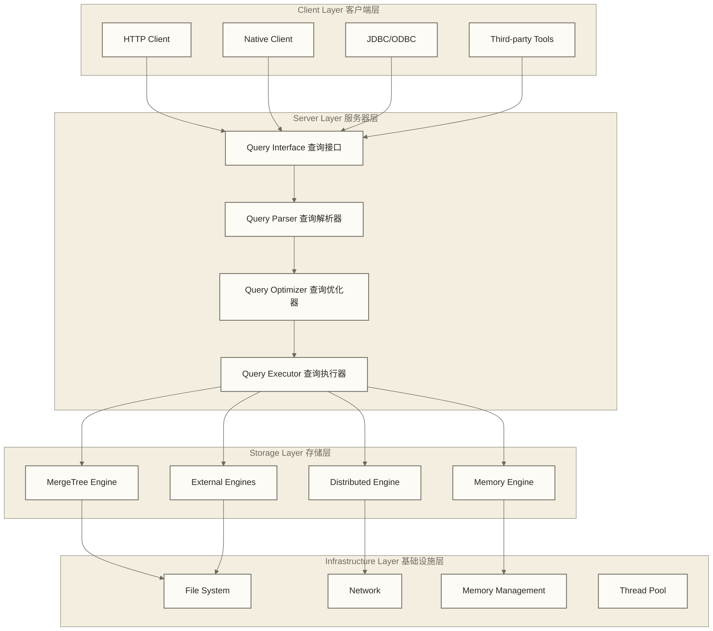
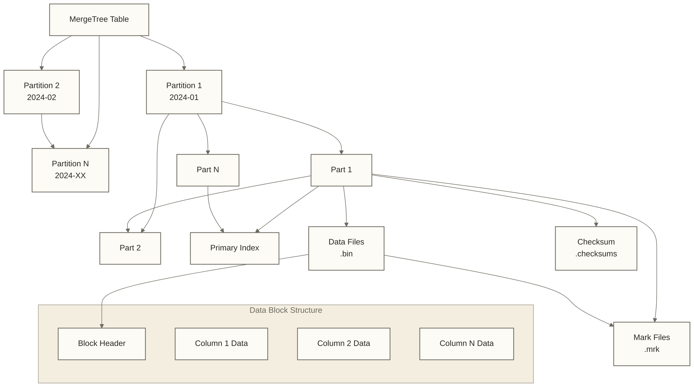
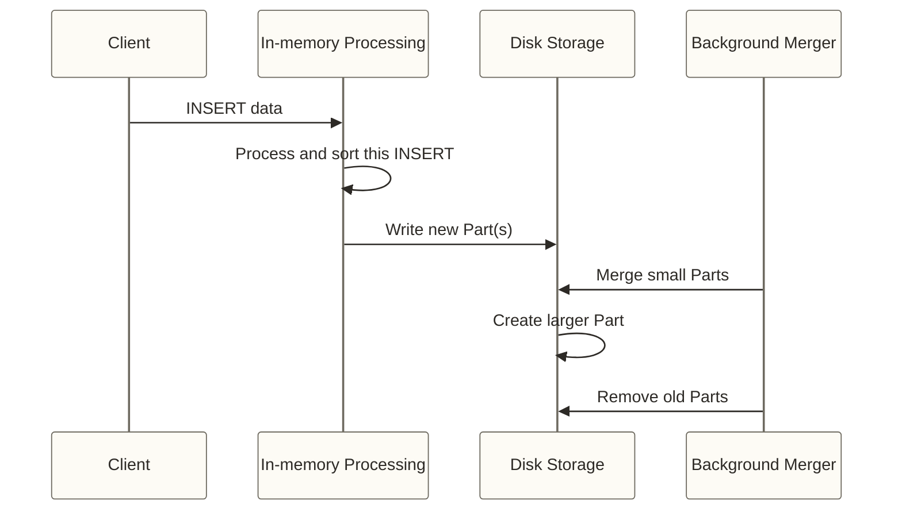
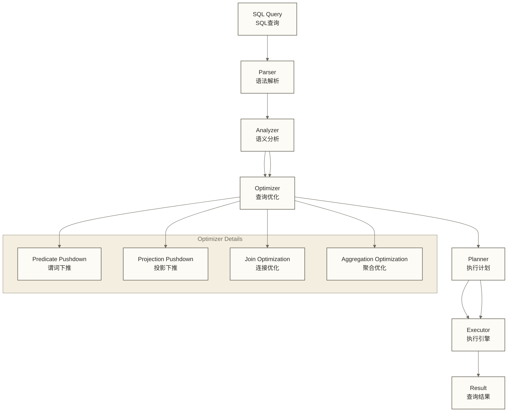
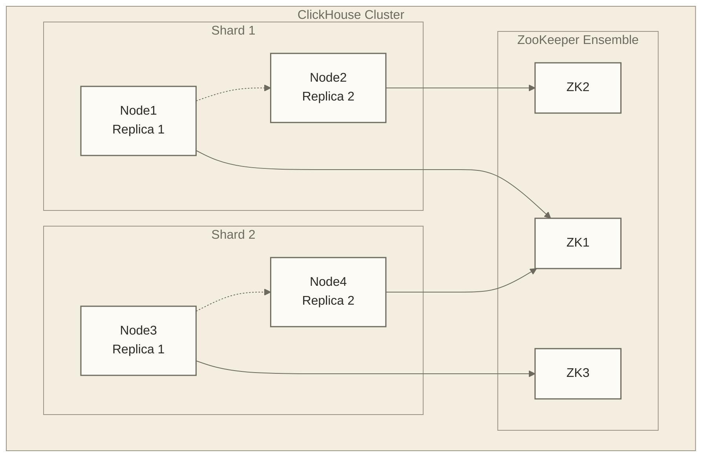
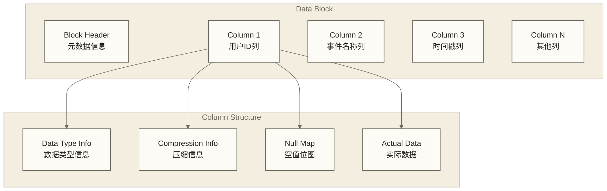

# 🏗️ ClickHouse架构原理

## 📚 学习目标

通过本章节的学习，你将能够：
- **理解ClickHouse的整体架构**设计思想
- **掌握列式存储引擎**的实现原理
- **了解查询处理和优化**机制
- **理解分布式架构**的设计和实现
- **掌握性能优化**的底层原理

> [!tip] 💡 学习建议
> 架构原理是理解ClickHouse高性能的关键。**不要被复杂的技术细节吓到**，就像了解汽车引擎一样，**先理解主要组件和工作流程，再深入具体机制**。这些原理将帮助你在实际使用中做出更好的设计决策。

## 🎯 整体架构概览

### 1. 系统架构图

ClickHouse的系统架构采用了分层设计的思想，从上到下分为客户端层、服务器层、存储层和物理层四个主要层次。每一层都有明确的职责分工，协同工作以实现高性能的数据处理能力。客户端层提供多样化的访问接口，服务器层负责查询解析和执行，存储层管理不同的存储引擎，物理层则处理实际的数据存储和I/O操作。这种架构设计使得ClickHouse既能保持高性能，又能支持灵活的扩展和优化。



### 2. 核心架构特点

王医生继续解释："我们智能医院的设计理念体现了现代医疗系统的四大核心原则，这也正是ClickHouse数据库的设计精髓。"

"**第一是专科化诊疗设计**，"他指向各个专科科室，"就像ClickHouse的列式存储一样，我们不是让一个医生看所有病，而是心内科专门看心脏、神经科专门看大脑、骨科专门看骨骼。每个科室都在自己的专业领域做到极致，这样诊断效率最高。"

"**第二是批量化高效处理**，"他走向体检中心，"我们的体检流程不是一个人一个人单独处理，而是把同类检查的人群集中起来批量处理，就像ClickHouse的向量化执行，一次性处理一批数据，充分利用设备和人力资源。"

"**第三是独立运作避免冲突**，"他指向各个楼层，"每个科室都有独立的诊疗设备和医护团队，相互之间不会争抢资源。需要扩展时，新增一个科室就能立即增强整体服务能力，这就是无共享架构的优势。"

"**第四是灵活的诊疗模式**，"他展示不同的医疗设备，"根据病情复杂程度，我们可以选择门诊、住院、手术等不同的诊疗方案，就像ClickHouse可以根据数据特点选择不同的表引擎，每种方案都有其最适合的应用场景。"

**专业技术对应**：
- **面向列的设计**：数据按列存储，优化分析查询性能，支持高效的数据压缩和编码
- **向量化执行**：批量处理数据，充分利用CPU缓存，SIMD指令加速计算过程
- **无共享架构**：每个节点独立处理，避免资源竞争，水平扩展能力强
- **可插拔的表引擎**：不同场景使用不同的存储引擎，支持自定义存储策略

## 🗄️ 存储引擎架构

### 1. MergeTree引擎族

王医生带大家来到医院的档案管理中心："现在让我介绍我们医院最核心的病历管理系统，它就像ClickHouse的MergeTree存储引擎一样，是整个系统的基石。"

"MergeTree就像我们医院的智能病历管理系统，"他指着排列整齐的数字化病历库，"专门为大规模医疗数据分析设计。传统医院的病历管理混乱低效，而我们的智能系统让每一份病历都能快速找到、高效分析。"

```sql
-- MergeTree表结构示例
CREATE TABLE events (
    date Date,
    user_id UInt64,
    event_name String,
    event_time DateTime,
    properties String
) ENGINE = MergeTree()
PARTITION BY toYYYYMM(date)
ORDER BY (user_id, event_time)
PRIMARY KEY user_id
SETTINGS index_granularity = 8192;
```

#### MergeTree数据组织结构



#### 数据写入和合并过程

张护士长详细解释病历管理流程："让我告诉大家我们医院是如何高效管理海量病历数据的，这个过程就像ClickHouse的数据写入和合并机制。"

"首先，当患者来医院就诊时，"她指着接诊台，"医生会把本批诊疗信息先整理在临时记录本上，这类比一次普通同步INSERT中的内存处理，并不表示MergeTree默认跨多次INSERT持续积攒内存缓存。"

"当本批记录整理完毕后，"她走向档案室，"我们的护士会把这些记录整理成正式的病历档案，按照科室和时间分类存储到专门的档案柜里，这类比普通同步INSERT将数据排序并写成一个或多个新的Part；Part是分区内的数据部件，不是集群分片。异步插入等缓冲模式需另行配置。"

"最精妙的是我们的智能合并系统，"她打开一个整理完毕的档案柜，"系统会自动把多个小的病历档案合并成大的综合档案，比如把一个月内同一患者在不同科室的就诊记录合并到一起，这样查找和分析效率更高。"

"当医生需要查看某个患者的完整病史时，系统会自动从所有相关档案中提取信息，就像ClickHouse查询MergeTree表时从相关Part读取数据一样；Part是分区内的数据部件，不是集群分片。"

**专业技术对应**：
```sql
-- 数据写入过程模拟
-- 1. 普通同步INSERT在内存中解析、组织和排序本次写入的数据
INSERT INTO events VALUES 
    ('2024-01-01', 1001, 'page_view', '2024-01-01 10:00:00', '{}'),
    ('2024-01-01', 1002, 'click', '2024-01-01 10:01:00', '{}');

-- 2. 本次写入形成一个或多个磁盘Part；不默认等待跨INSERT的内存累积阈值
-- 3. 后台自动合并小的Part为大的Part
-- 4. 查询时自动从所有相关Part读取数据
```



### 2. 列式存储实现

#### 数据压缩和编码

```sql
-- 不同的压缩算法选择
CREATE TABLE compressed_data (
    id UInt64,
    name String CODEC(ZSTD),        -- 字符串使用ZSTD压缩
    value Float64 CODEC(Gorilla, LZ4), -- 浮点数使用Gorilla编码再配合LZ4压缩，效果需实测
    timestamp DateTime CODEC(DoubleDelta) -- 时间戳使用DoubleDelta编码
) ENGINE = MergeTree()
ORDER BY id;

-- 查看压缩效果
SELECT 
    name,
    type,
    data_compressed_bytes,
    data_uncompressed_bytes,
    round(data_uncompressed_bytes / data_compressed_bytes, 2) as compression_ratio
FROM system.columns
WHERE table = 'compressed_data';
```

#### 索引结构

```sql
-- 主键索引（稀疏索引）
CREATE TABLE user_events (
    user_id UInt64,
    event_time DateTime,
    event_name String,
    properties String
) ENGINE = MergeTree()
ORDER BY (user_id, event_time)
PRIMARY KEY user_id
SETTINGS index_granularity = 8192;

-- 二级索引
ALTER TABLE user_events ADD INDEX idx_event_name event_name TYPE bloom_filter GRANULARITY 1;
ALTER TABLE user_events ADD INDEX idx_properties properties TYPE ngrambf_v1(3, 512, 3, 0) GRANULARITY 1;

-- 查看索引使用情况
EXPLAIN indexes = 1 
SELECT * FROM user_events 
WHERE user_id = 1001 AND event_name = 'click';
```

## ⚡ 查询执行引擎

### 1. 查询处理流程

王医生带大家来到医院的智能诊断中心："现在让我展示我们医院如何处理患者的诊疗请求，这个过程完美演示了ClickHouse的查询执行机制。"

"当患者带着症状来看病时，我们的诊疗流程是这样的，"他指着诊疗流程图解释道。



### 2. 向量化执行

王医生来到医院的大型体检中心："让我给大家演示我们医院的批量检查流程，这就是ClickHouse向量化执行的完美体现。"

"传统医院是一个一个患者单独检查，效率很低，"他指着传统诊室，"而我们的智能体检中心采用流水线式的批量处理模式。"

"你们看，"他带大家参观体检流水线，"我们把需要做血常规的患者集中起来，一次性用自动化设备处理100个血样；把需要做心电图的患者排成队，用高速心电设备连续检测；需要做B超的患者也是批量安排。这样每台设备都能发挥最大效能，就像ClickHouse一次性处理一批数据，充分利用CPU和内存资源。"

```sql
-- 向量化执行示例
SELECT 
    user_id,
    count() as event_count
FROM events 
WHERE date >= '2024-01-01'
GROUP BY user_id;

-- 执行过程：
-- 1. 批量读取数据块（65536是常见max_block_size设置值，不保证每块固定为该行数；实际大小受设置、读取路径和数据影响）
-- 2. 向量化处理WHERE条件
-- 3. 向量化执行聚合计算
-- 4. 批量输出结果
```

#### 执行计划分析

```sql
-- 查看详细执行计划
EXPLAIN PLAN 
SELECT 
    category,
    count() as cnt,
    sum(sales_amount) as total_sales
FROM sales 
WHERE date >= '2024-01-01'
GROUP BY category
ORDER BY total_sales DESC;

-- 查看执行流水线结构（不执行查询，也不提供实际运行统计）
EXPLAIN PIPELINE 
SELECT count() FROM events WHERE user_id = 1001;

-- 查看索引使用情况
EXPLAIN indexes = 1
SELECT * FROM events WHERE user_id = 1001 AND event_time >= '2024-01-01';
```

### 3. 内存管理

```sql
-- 查看已完成查询记录的内存用量（需启用查询日志；字段语义按目标版本确认）
SELECT 
    query,
    memory_usage,
    formatReadableSize(memory_usage) as memory_readable
FROM system.query_log 
WHERE type = 'QueryFinish'
ORDER BY memory_usage DESC
LIMIT 10;

-- 设置查询内存限制
SET max_memory_usage = 1000000000; -- 1GB限制

-- 查看系统内存指标
SELECT 
    metric,
    value,
    formatReadableSize(value) as readable_value
FROM system.asynchronous_metrics 
WHERE metric LIKE '%Memory%';
```

## 🌐 分布式架构

### 1. 集群架构设计

```xml
<!-- 集群配置示例 -->
<clickhouse>
    <remote_servers>
        <cluster_name>
            <shard>
                <replica>
                    <host>node1</host>
                    <port>9000</port>
                </replica>
                <replica>
                    <host>node2</host>
                    <port>9000</port>
                </replica>
            </shard>
            <shard>
                <replica>
                    <host>node3</host>
                    <port>9000</port>
                </replica>
                <replica>
                    <host>node4</host>
                    <port>9000</port>
                </replica>
            </shard>
        </cluster_name>
    </remote_servers>
</clickhouse>
```



### 2. 分布式表

```sql
-- 创建本地表
CREATE TABLE events_local (
    date Date,
    user_id UInt64,
    event_name String,
    event_time DateTime
) ENGINE = MergeTree()
PARTITION BY toYYYYMM(date)
ORDER BY (user_id, event_time);

-- 创建分布式表
CREATE TABLE events_distributed AS events_local
ENGINE = Distributed(cluster_name, database_name, events_local, rand());

-- 创建复制表
CREATE TABLE events_replicated (
    date Date,
    user_id UInt64,
    event_name String,
    event_time DateTime
) ENGINE = ReplicatedMergeTree('/clickhouse/tables/{shard}/events', '{replica}')
PARTITION BY toYYYYMM(date)
ORDER BY (user_id, event_time);
```

### 3. 数据分片和复制

```sql
-- 查看集群状态
SELECT * FROM system.clusters;

-- 查看分片分布
SELECT 
    shard_num,
    replica_num,
    host_name,
    port,
    is_local
FROM system.clusters 
WHERE cluster = 'cluster_name';

-- 查看表的分布情况
SELECT 
    partition,
    name,
    rows,
    bytes_on_disk,
    formatReadableSize(bytes_on_disk) as size_readable
FROM system.parts 
WHERE table = 'events_local'
ORDER BY partition, name;
```

## 🔧 性能优化机制

### 1. 查询优化技术

#### 谓词下推

```sql
-- 子查询形式：过滤仍在数据库中执行，不是在应用层过滤
SELECT * FROM (
    SELECT user_id, event_name, event_time 
    FROM events
) WHERE user_id = 1001;

-- 直接表达过滤条件；优化器可能将上面的子查询形式转换为等价计划
SELECT user_id, event_name, event_time 
FROM events 
WHERE user_id = 1001;

-- ClickHouse自动进行谓词下推优化
```

#### 投影下推

```sql
-- 只读取需要的列
SELECT user_id, count() 
FROM events 
GROUP BY user_id;

-- ClickHouse只会读取user_id列，大大减少I/O
```

### 2. 数据跳过索引

```sql
-- 创建跳过索引
CREATE TABLE events_with_skip_index (
    date Date,
    user_id UInt64,
    event_name String,
    properties String
) ENGINE = MergeTree()
ORDER BY date
SETTINGS index_granularity = 8192;

-- 添加不同类型的跳过索引
ALTER TABLE events_with_skip_index ADD INDEX idx_user_id user_id TYPE minmax GRANULARITY 1;
ALTER TABLE events_with_skip_index ADD INDEX idx_event_name event_name TYPE set(100) GRANULARITY 1;
ALTER TABLE events_with_skip_index ADD INDEX idx_properties properties TYPE bloom_filter GRANULARITY 1;

-- 查看索引效果
EXPLAIN indexes = 1
SELECT * FROM events_with_skip_index 
WHERE user_id BETWEEN 1000 AND 2000 
  AND event_name = 'click';
```

### 3. 并行处理机制

```sql
-- 查看查询并行度
SELECT 
    query,
    thread_ids,
    length(thread_ids) as thread_count
FROM system.query_log 
WHERE type = 'QueryFinish'
ORDER BY event_time DESC
LIMIT 5;

-- 控制查询并行度
SET max_threads = 8;

-- 查看系统线程池状态
SELECT 
    metric,
    value
FROM system.metrics 
WHERE metric LIKE '%Thread%';
```

## 📊 存储格式详解

### 1. 列文件格式

```sql
-- 查看各活动Part的列级存储信息；path是Part路径，不是逐个列文件路径
SELECT 
    column,
    column_type,
    path,
    formatReadableSize(column_bytes_on_disk) as size
FROM system.parts_columns 
WHERE table = 'events' AND active = 1
ORDER BY column, column_type;

-- 查看压缩信息
SELECT 
    name,
    type,
    data_compressed_bytes,
    data_uncompressed_bytes,
    round(data_uncompressed_bytes / data_compressed_bytes, 2) as compression_ratio
FROM system.columns 
WHERE table = 'events'
ORDER BY compression_ratio DESC;
```

### 2. 数据块结构



### 3. 索引文件格式

```sql
-- 查看主键和排序键信息
SELECT 
    primary_key,
    sorting_key
FROM system.tables 
WHERE database = currentDatabase() AND name = 'events';

-- 从建表语句查看显式设置；未显式指定的设置需另行核对默认值
SHOW CREATE TABLE events;

-- 查看索引颗粒度效果
SELECT 
    rows,
    marks,
    round(rows / marks) as rows_per_mark
FROM system.parts 
WHERE table = 'events' AND active = 1;
```

## 🎯 架构设计最佳实践

### 1. 表设计建议

```sql
-- 好的表设计示例
CREATE TABLE user_behavior_optimized (
    -- 时间列，用于分区
    date Date,
    -- 高基数列，用于排序
    user_id UInt64,
    session_id String,
    -- 低基数列，使用LowCardinality
    event_type LowCardinality(String),
    page_category LowCardinality(String),
    -- 数值列
    duration UInt32,
    -- JSON数据
    properties JSON
) ENGINE = MergeTree()
PARTITION BY toYYYYMM(date)  -- 按月分区
ORDER BY (user_id, session_id, date)  -- 优化常用查询
SETTINGS index_granularity = 8192;

-- 添加合适的索引
ALTER TABLE user_behavior_optimized ADD INDEX idx_event_type event_type TYPE set(100) GRANULARITY 1;
ALTER TABLE user_behavior_optimized ADD INDEX idx_duration duration TYPE minmax GRANULARITY 1;
```

### 2. 查询优化建议

```sql
-- 高效的聚合查询
SELECT 
    toStartOfDay(date) as day,
    event_type,
    count() as event_count,
    uniq(user_id) as unique_users,
    avg(duration) as avg_duration
FROM user_behavior_optimized
WHERE date >= today() - 7
  AND event_type IN ('page_view', 'click')
GROUP BY day, event_type
ORDER BY day DESC, event_count DESC;

-- 使用物化视图预计算：保存可合并状态，避免累加各插入批次的去重结果
-- 此增量物化视图处理创建后的新插入数据，既有数据需另行回填
CREATE MATERIALIZED VIEW daily_stats_mv
ENGINE = AggregatingMergeTree()
ORDER BY (date, event_type)
AS SELECT 
    date,
    event_type,
    countState() as event_count,
    uniqState(user_id) as unique_users
FROM user_behavior_optimized
GROUP BY date, event_type;

-- 读取时合并聚合状态；uniq仍为近似去重
SELECT
    date,
    event_type,
    countMerge(event_count) as event_count,
    uniqMerge(unique_users) as unique_users
FROM daily_stats_mv
GROUP BY date, event_type;
```

## 🎯 架构理解重点

通过本章节的学习，我们深入了解了：

1. **整体架构** - 分层设计、无共享架构、可插拔引擎
2. **存储引擎** - MergeTree设计、列式存储、数据合并机制
3. **查询处理** - 向量化执行、查询优化、内存管理
4. **分布式设计** - 集群架构、数据分片、副本机制
5. **性能优化** - 索引设计、并行处理、存储优化

> [!abstract] 📚 下一步学习
> 现在你已经理解了ClickHouse的架构原理，接下来我们将学习[[【技术与工具】/ClickHouse/03-ClickHouse环境搭建|ClickHouse环境搭建]]，动手实践这些理论知识。

## 🔗 相关资源

- [[【技术与工具】/ClickHouse/01-ClickHouse概述与特性|ClickHouse概述与特性]] - 基础概念回顾
- [[【技术与工具】/ClickHouse/00-ClickHouse学习路线图|ClickHouse]] - 返回学习路线图
- [[【技术与工具】/Doris/02-Doris架构深度解析|Doris架构]] - 对比学习其他OLAP架构

---

> 💡 **记住**：理解架构原理是掌握ClickHouse的关键。**这些知识将帮助你在实际使用中做出正确的设计决策**，比如如何选择表引擎、如何设计分区策略、如何优化查询性能等。**不要急于记住所有细节，重点是理解设计思想和工作原理**！