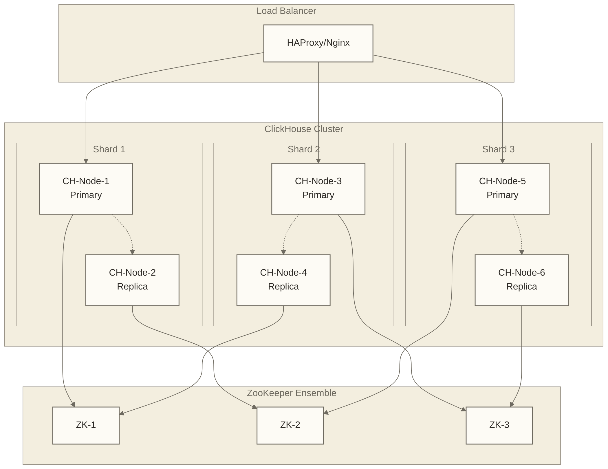
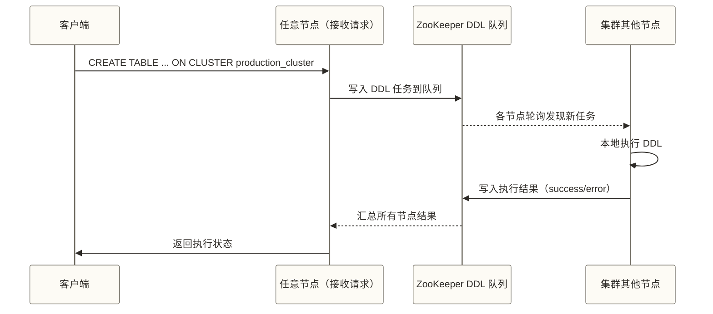

# 🌐 ClickHouse集群管理

## 📚 学习目标

通过本章节的学习，你将能够：
- **掌握ClickHouse集群架构**设计和部署方法
- **理解分片和副本机制**，实现数据的分布式存储
- **学会集群配置管理**，包括ZooKeeper集成
- **掌握分布式表操作**和查询优化技巧
- **练习企业级集群运维**和故障处理思路；实际能力需通过隔离环境演练及生产流程验证

> [!tip] 💡 学习建议
> 集群管理是ClickHouse的高级技能，**就像管理一个城市的交通系统一样复杂**。需要统筹考虑多个组件的协同工作。
> 
> **🎯 学习重点**：
> - 🧠 **先理论后实践**：先理解分布式系统的基本原理，再动手搭建集群
> - 🔗 **数据一致性**：理解CAP定理，掌握分布式事务和副本同步机制
> - 🛡️ **高可用性**：学会设计容错架构，处理各种故障场景
> - ⚡ **性能优化**：掌握负载均衡、查询路由和资源调度策略

## 🏗️ 集群架构设计

### 1. 集群架构概览

李院长站在医院集团总部的大会议室里，指着墙上巨大的医联体网络图："欢迎大家来到我们医疗集团的战略规划中心！今天我要向大家介绍我们如何通过医联体模式，实现多家医院的协同工作，这与ClickHouse的集群管理有着完美的对应关系。"

"你们看，"他指向网络图的不同区域，"我们建立了一个覆盖全市的医疗服务网络，每个分院都有自己的专业特长，同时又能相互协作，共享医疗资源。"

#### 基础集群架构（医联体协作网络）

"我来给大家详细介绍我们医联体的组织架构，"李院长拿起激光笔开始讲解。



#### 集群设计原则（医联体管理原则）

在这一教学类比中，李院长总结道："这里介绍医联体协作的三项原则，用来辅助理解ClickHouse集群设计，并非真实机构成果或严格技术等价关系。"

"第一是**专业分工**，"他指向不同的分院，"心内科专科医院专门处理心血管疾病患者，儿科医院专门服务儿童，这就像ClickHouse的数据分片，按照业务逻辑将不同类型的数据分配到不同的节点上，确保每个节点都能发挥最大效能。"

"第二是**高可用保障**，"他指向每个分院的备用设施，"每个专科医院都有至少一家后备医院，分布在不同的区域，一旦主要医院出现问题，患者可以立即转诊到备用医院，确保医疗服务不中断。"

"第三是**性能优化**，"他展示着各医院间的快速转诊通道，"我们建立了高效的患者转诊网络和资源共享机制，确保整个医联体的服务效率最大化。"

**专业技术对应**：
- **数据分片**：按业务逻辑或时间维度分片，保证分片间数据分布均匀，支持动态扩容
- **高可用性**：每个分片至少2个副本，跨机架/可用区部署，故障自动切换  
- **性能优化**：负载均衡、查询路由优化、资源合理分配
> - 网络延迟最小化
> - 存储I/O负载均衡
> - 计算资源合理分配

### 2. ZooKeeper集成

#### ZooKeeper部署

```bash
# ZooKeeper配置文件 /opt/zookeeper/conf/zoo.cfg
tickTime=2000
initLimit=10
syncLimit=5
dataDir=/data/zookeeper
clientPort=2181
maxClientCnxns=60

# 集群配置
server.1=zk1.example.com:2888:3888
server.2=zk2.example.com:2888:3888
server.3=zk3.example.com:2888:3888

# 在每个ZooKeeper节点上设置myid
echo "1" > /data/zookeeper/myid  # zk1节点
echo "2" > /data/zookeeper/myid  # zk2节点  
echo "3" > /data/zookeeper/myid  # zk3节点

# 启动ZooKeeper集群
systemctl start zookeeper
systemctl enable zookeeper

# 验证ZooKeeper状态
echo "stat" | nc localhost 2181
```

#### ClickHouse与ZooKeeper集成

```xml
<!-- /etc/clickhouse-server/config.xml -->
<clickhouse>
    <!-- ZooKeeper配置 -->
    <zookeeper>
        <node index="1">
            <host>zk1.example.com</host>
            <port>2181</port>
        </node>
        <node index="2">
            <host>zk2.example.com</host>
            <port>2181</port>
        </node>
        <node index="3">
            <host>zk3.example.com</host>
            <port>2181</port>
        </node>
        <session_timeout_ms>30000</session_timeout_ms>
        <operation_timeout_ms>10000</operation_timeout_ms>
        <root>/clickhouse</root>
    </zookeeper>

    <!-- 集群配置 -->
    <remote_servers>
        <production_cluster>
            <!-- 分片1 -->
            <shard>
                <weight>1</weight>
                <replica>
                    <host>ch-node-1.example.com</host>
                    <port>9000</port>
                    <user>default</user>
                    <password></password>
                </replica>
                <replica>
                    <host>ch-node-2.example.com</host>
                    <port>9000</port>
                    <user>default</user>
                    <password></password>
                </replica>
            </shard>
            
            <!-- 分片2 -->
            <shard>
                <weight>1</weight>
                <replica>
                    <host>ch-node-3.example.com</host>
                    <port>9000</port>
                    <user>default</user>
                    <password></password>
                </replica>
                <replica>
                    <host>ch-node-4.example.com</host>
                    <port>9000</port>
                    <user>default</user>
                    <password></password>
                </replica>
            </shard>
        </production_cluster>
    </remote_servers>

    <!-- 宏定义 -->
    <macros>
        <cluster>production_cluster</cluster>
        <shard>01</shard>  <!-- 同一分片的副本相同，不同分片不同 -->
        <replica>replica1</replica>  <!-- 每个节点不同 -->
    </macros>

    <!-- 分布式DDL -->
    <distributed_ddl>
        <path>/clickhouse/task_queue/ddl</path>
    </distributed_ddl>
</clickhouse>
```

## 🔧 集群部署实践

### 1. 节点部署配置

#### 节点配置文件

```xml

<!-- 节点1 (ch-node-1) 特定配置 -->
<clickhouse>
<macros>
<cluster>production_cluster</cluster>
<shard>01</shard>
<replica>replica1</replica>
</macros>

<listen_host>0.0.0.0</listen_host>
<http_port>8123</http_port>
<tcp_port>9000</tcp_port>
<interserver_http_port>9009</interserver_http_port>

<!-- 数据目录 -->
<path>/data/clickhouse/</path>
<tmp_path>/data/clickhouse/tmp/</tmp_path>

<!-- 日志配置 -->
<logger>
<level>information</level>
<log>/var/log/clickhouse-server/clickhouse-server.log</log>
<errorlog>/var/log/clickhouse-server/clickhouse-server.err.log</errorlog>
<size>1000M</size>
<count>10</count>
</logger>
</clickhouse>
```

### 📝 **配置项解释**

#### 集群初始化脚本

```bash
#!/bin/bash
# cluster_init.sh - 集群初始化脚本

set -e

# 配置变量
CLUSTER_NAME="production_cluster"
NODES=("ch-node-1" "ch-node-2" "ch-node-3" "ch-node-4")
ZK_HOSTS="zk1.example.com:2181,zk2.example.com:2181,zk3.example.com:2181"

echo "正在初始化ClickHouse集群: $CLUSTER_NAME"

# 1. 检查ZooKeeper连接
for zk in $(echo $ZK_HOSTS | tr ',' ' '); do
    echo "检查ZooKeeper: $zk"
    if ! echo "ruok" | nc ${zk%:*} ${zk#*:} >/dev/null 2>&1; then
        echo "错误: ZooKeeper $zk 不可达"
        exit 1
    fi
done

# 2. 验证节点连通性
for node in "${NODES[@]}"; do
    echo "检查节点: $node"
    if ! ping -c 1 $node >/dev/null 2>&1; then
        echo "错误: 节点 $node 不可达"
        exit 1
    fi
done

# 3. 原稿中的Memory表测试不会创建ZooKeeper路径，也不能验证ZooKeeper连接
clickhouse-client --query="
    CREATE TABLE IF NOT EXISTS system.zookeeper_test (
        path String
    ) ENGINE = Memory;
" 2>/dev/null || true

# 4. 验证集群配置
echo "验证集群配置..."
clickhouse-client --query="SELECT * FROM system.clusters WHERE cluster = '$CLUSTER_NAME';"

echo "集群初始化完成!"
```

### 2. 分布式表创建

#### 复制表创建

```sql
-- 在每个节点上创建本地复制表
CREATE TABLE events_local ON CLUSTER production_cluster (
    date Date,
    timestamp DateTime,
    user_id UInt64,
    event_type LowCardinality(String),
    page_url String,
    session_id String,
    properties JSON
) ENGINE = ReplicatedMergeTree('/clickhouse/tables/{shard}/events', '{replica}')
PARTITION BY toYYYYMM(date)
ORDER BY (user_id, timestamp)
SETTINGS index_granularity = 8192;

-- 创建分布式表
CREATE TABLE events_distributed ON CLUSTER production_cluster AS events_local
ENGINE = Distributed(production_cluster, default, events_local, cityHash64(user_id));

-- 验证表创建
SELECT 
    hostName() as host,
    database,
    name,
    engine,
    partition_key,
    sorting_key
FROM system.tables 
WHERE name LIKE 'events_%'
ORDER BY host, name;
```

#### 分片键选择原则与策略对比

分片键（`sharding_key`）是 Distributed 引擎最关键的参数，直接决定数据分布均匀性和查询性能。选择错误的分片键会导致严重的数据倾斜。

**核心原则**：
- **高基数**：分片键的取值种类要远多于分片数，否则分布不均匀。`user_id`（数百万）远好于 `gender`（2 种）。
- **分布均匀**：取值在各分片上的哈希结果要均衡分布，避免热点分片。
- **查询局部性**：如果大量查询都基于某个维度过滤（如 `tenant_id`），将其作为分片键可为分片裁剪提供条件；还需启用并验证 `optimize_skip_unused_shards` 等适用设置，且过滤条件必须可推导分片范围，不能认为所有查询都会自动只命中一个分片。

| 分片键方案 | 适用场景 | 优点 | 缺点 |
|------------|----------|------|------|
| `cityHash64(user_id)` | 用户维度查询为主 | 分布均匀，用户查询单分片 | 跨用户聚合需全分片扫描 |
| `toYYYYMM(date)` | 时序数据，按月查询 | 时间范围查询高效 | 近期数据热点（最新月份写入集中） |
| `cityHash64(tenant_id)` | 多租户 SaaS 场景 | 租户数据隔离，单租户查询局部化 | 租户规模差异大时可能倾斜 |
| `rand()` | 写入均衡，无明显查询维度 | 数据分布最均匀 | 所有查询必须全分片扫描 |
| `cityHash64(user_id, toYYYYMM(date))` | 综合场景 | 多维度均衡 | 单维度查询仍需多分片 |

> [!warning] rand() 兜底方案的代价
> `rand()` 虽然数据分布最均匀，但由于每次 INSERT 都是随机路由，**SELECT 查询永远需要扫描所有分片**，无法利用分片裁剪优化。只有在无法确定合适分片键时才使用，且需接受全分片扫描的查询代价。

```sql
-- 分片策略1：基于用户ID哈希（推荐：高基数、均匀分布）
CREATE TABLE user_events_distributed AS user_events_local
ENGINE = Distributed(production_cluster, default, user_events_local, cityHash64(user_id));

-- 分片策略2：基于时间分片（时序数据，按月查询为主）
CREATE TABLE time_series_distributed AS time_series_local
ENGINE = Distributed(production_cluster, default, time_series_local, toYYYYMM(date));

-- 分片策略3：多租户场景（租户数据局部化）
CREATE TABLE tenant_events_distributed AS tenant_events_local
ENGINE = Distributed(production_cluster, default, tenant_events_local, cityHash64(tenant_id));

-- 分片策略4：组合分片键（综合均衡）
CREATE TABLE complex_events_distributed AS complex_events_local
ENGINE = Distributed(production_cluster, default, complex_events_local,
    cityHash64(user_id, toYYYYMM(date)));

-- 验证数据分布是否均匀（原稿的差异 < 10%仅为未核实教学阈值，应结合分片权重、样本量和负载判断）
SELECT
    _shard_num,
    count() as record_count,
    uniq(user_id) as unique_users,
    min(date) as min_date,
    max(date) as max_date,
    round(count() * 100.0 / sum(count()) OVER (), 2) as shard_pct
FROM events_distributed
GROUP BY _shard_num
ORDER BY _shard_num;

-- 检测数据倾斜（原稿30%为未核实教学阈值，不适用于本例两分片：均衡占比约为50%；应与各分片预期权重比较）
SELECT
    _shard_num,
    count() as cnt,
    round(count() * 100.0 / sum(count()) OVER (), 2) as pct
FROM events_distributed
GROUP BY _shard_num
HAVING pct > 30;  -- 仅保留原稿阈值筛选示例，不能据此认定严重倾斜
```

### 3. ReplicatedMergeTree 路径规范

ZooKeeper 路径是副本间协调的核心标识，命名规范错误会导致副本无法正确同步或产生冲突。

**标准路径格式**：

```text
/clickhouse/tables/{shard}/{database}/{table}
```

| 路径片段 | 来源 | 说明 |
|----------|------|------|
| `/clickhouse` | 本例引擎路径中显式写入的前缀 | 与ZooKeeper `root` 连接命名空间不是同一项；本例同时设置两者，应核对实际组合路径，避免意外重复前缀 |
| `tables` | 固定字面量 | 区分 task_queue、ddl 等其他路径 |
| `{shard}` | `macros.shard` 宏变量 | 同一分片的所有副本使用相同路径 |
| `{database}` | 显式写明或用宏 | 区分不同数据库 |
| `{table}` | 显式写明 | 区分同库下不同表 |

```sql
-- 标准建表语句：使用宏变量，每个节点只需维护自身的 macros 配置
CREATE TABLE events_local ON CLUSTER production_cluster (
    date       Date,
    timestamp  DateTime,
    user_id    UInt64,
    event_type LowCardinality(String),
    page_url   String
) ENGINE = ReplicatedMergeTree(
    '/clickhouse/tables/{shard}/default/events',  -- ZK 路径：同一分片副本共享
    '{replica}'                                    -- 副本名：每个节点唯一
)
PARTITION BY toYYYYMM(date)
ORDER BY (user_id, timestamp)
SETTINGS index_granularity = 8192;
```

```xml
<!-- 节点1（shard=01, replica=replica1）的 macros 配置 -->
<clickhouse>
    <macros>
        <cluster>production_cluster</cluster>
        <shard>01</shard>
        <replica>replica1</replica>
    </macros>
</clickhouse>

<!-- 节点2（shard=01 的另一副本，replica=replica2）-->
<clickhouse>
    <macros>
        <cluster>production_cluster</cluster>
        <shard>01</shard>
        <replica>replica2</replica>  <!-- shard 相同，replica 不同 -->
    </macros>
</clickhouse>

<!-- 节点3（shard=02 的第一副本）-->
<clickhouse>
    <macros>
        <cluster>production_cluster</cluster>
        <shard>02</shard>       <!-- shard 不同 -->
        <replica>replica1</replica>
    </macros>
</clickhouse>
```

> [!warning] 常见路径配置错误
> - **同一 shard 内两个副本使用了相同的 `replica` 名称**：会发生副本身份冲突，常见表现是新副本创建失败，不能将其作为两个独立副本使用。
> - **不同 shard 使用了相同的 ZK 路径**：两个 shard 错误地共享同一副本组，数据被错误合并。
> - **跨环境复用路径**（如测试和生产共用同一 ZK）：生产数据被测试操作污染。

### 4. 集群操作管理

#### DDL 同步机制与 ON CLUSTER 语句

`ON CLUSTER` 通过 ZooKeeper DDL 队列（`/clickhouse/task_queue/ddl`）将 DDL 分发到集群每个节点。节点各自从队列拉取并本地执行，执行结果写回 ZK，发起方节点汇总后返回给客户端。



```sql
-- 创建数据库（推荐先建库，再建表）
CREATE DATABASE analytics ON CLUSTER production_cluster;

-- 标准三步法：建本地表 → 建分布式表（应用层读写分布式表）
CREATE TABLE analytics.user_profiles_local ON CLUSTER production_cluster (
    user_id    UInt64,
    name       String,
    email      String,
    created_at DateTime,
    updated_at DateTime DEFAULT now()
) ENGINE = ReplicatedMergeTree(
    '/clickhouse/tables/{shard}/analytics/user_profiles',
    '{replica}'
)
ORDER BY user_id;

CREATE TABLE analytics.user_profiles ON CLUSTER production_cluster
AS analytics.user_profiles_local
ENGINE = Distributed(production_cluster, analytics, user_profiles_local, cityHash64(user_id));

-- 加列：本地表和Distributed表需分别维护列定义，Distributed表不会自动继承后续结构变更
ALTER TABLE analytics.user_profiles_local ON CLUSTER production_cluster
ADD COLUMN last_login DateTime DEFAULT '1970-01-01 00:00:00';

-- 同步分布式表列定义
ALTER TABLE analytics.user_profiles ON CLUSTER production_cluster
ADD COLUMN last_login DateTime DEFAULT '1970-01-01 00:00:00';

-- 加跳数索引
ALTER TABLE analytics.user_profiles_local ON CLUSTER production_cluster
ADD INDEX idx_email email TYPE bloom_filter GRANULARITY 1;

-- 查看 DDL 队列执行状态
SELECT
    entry,
    host_name,
    status,
    exception_code,
    exception_text,
    query_finish_time
FROM system.distributed_ddl_queue
WHERE query LIKE '%user_profiles%'
ORDER BY query_create_time DESC
LIMIT 20;

-- 设置 DDL 等待超时（本例为300秒，按任务规模调整；等待超时不等于后台任务已取消）
SET distributed_ddl_task_timeout = 300;

-- DDL 卡住时：先核对任务与各节点状态；以下仅终止当前节点匹配的运行查询，不会取消分布式DDL队列任务，手动补执行前须确认任务不会重复执行
KILL QUERY WHERE query LIKE '%ALTER TABLE%' AND elapsed > 300;
```

#### 数据迁移和重平衡

```sql
-- 数据迁移脚本
-- 从旧集群迁移到新集群

-- 1. 创建迁移表
CREATE TABLE migration_temp AS events_local
ENGINE = Memory;

-- 2. 从源集群导出数据
INSERT INTO migration_temp
SELECT * FROM remote('old-cluster-node:9000', 'default.events_local', 'user', 'password')
WHERE date >= '2024-01-01';

-- 3. 写入新集群
INSERT INTO events_distributed
SELECT * FROM migration_temp;

-- 4. 验证数据完整性
SELECT 
    'source' as source,
    count() as record_count,
    uniq(user_id) as unique_users
FROM remote('old-cluster-node:9000', 'default.events_local', 'user', 'password')
WHERE date >= '2024-01-01'

UNION ALL

SELECT 
    'target' as source,
    count() as record_count,
    uniq(user_id) as unique_users  
FROM events_distributed
WHERE date >= '2024-01-01';

-- 5. 分片重平衡
-- 如果数据分布不均，可以重新分片
CREATE TABLE events_rebalanced AS events_local
ENGINE = Distributed(production_cluster, default, events_local, rand());

INSERT INTO events_rebalanced SELECT * FROM events_distributed;
```

## 📊 集群监控和维护

### 1. 集群健康监控

#### 集群状态检查

```sql
-- 集群节点状态
SELECT 
    cluster,
    shard_num,
    replica_num,
    host_name,
    port,
    is_local,
    errors_count,
    slowdowns_count,
    estimated_recovery_time
FROM system.clusters
WHERE cluster = 'production_cluster'
ORDER BY shard_num, replica_num;

-- 副本同步状态
SELECT 
    database,
    table,
    replica_name,
    is_leader,
    is_readonly,
    is_session_expired,
    future_parts,
    parts_to_check,
    queue_size,
    inserts_in_queue,
    merges_in_queue
FROM system.replicas
WHERE database = 'default'
ORDER BY table, replica_name;

-- 分布式表查询性能
SELECT 
    query,
    cluster,
    shard_num,
    query_duration_ms,
    read_rows,
    read_bytes,
    peak_memory_usage
FROM system.cluster_log
WHERE event_time >= now() - INTERVAL 1 HOUR
  AND cluster = 'production_cluster'
ORDER BY query_duration_ms DESC
LIMIT 10;
```

#### 自动化健康检查

```sql
-- 创建集群健康检查视图
CREATE VIEW cluster_health AS
WITH cluster_stats AS (
    SELECT 
        cluster,
        shard_num,
        count() as replica_count,
        sum(errors_count) as total_errors,
        avg(estimated_recovery_time) as avg_recovery_time
    FROM system.clusters
    WHERE cluster = 'production_cluster'
    GROUP BY cluster, shard_num
),
replica_stats AS (
    SELECT 
        count() as healthy_replicas,
        countIf(is_readonly = 0) as writable_replicas,
        countIf(queue_size > 100) as lagging_replicas
    FROM system.replicas
    WHERE database = 'default'
)
SELECT 
    c.cluster,
    c.shard_num,
    c.replica_count,
    c.total_errors,
    c.avg_recovery_time,
    r.healthy_replicas,
    r.writable_replicas,
    r.lagging_replicas,
    CASE 
        WHEN c.total_errors = 0 AND r.lagging_replicas = 0 THEN 'HEALTHY'
        WHEN c.total_errors > 0 OR r.lagging_replicas > 0 THEN 'WARNING'
        ELSE 'CRITICAL'
    END as health_status
FROM cluster_stats c
CROSS JOIN replica_stats r;

-- 查看集群健康状态
SELECT * FROM cluster_health;
```

### 2. 副本延迟监控与告警

副本同步滞后（`queue_size` 持续较大）是集群健康的重要信号，需要建立分级告警体系。

```sql
-- 副本延迟综合监控视图
SELECT
    database,
    table,
    replica_name,
    is_leader,
    is_readonly,
    queue_size,
    inserts_in_queue,
    merges_in_queue,
    -- 告警分级
    CASE
        WHEN is_readonly = 1 THEN 'CRITICAL: 副本只读，停止写入'
        WHEN queue_size > 10000 THEN 'CRITICAL: 同步严重滞后'
        WHEN queue_size > 1000  THEN 'WARNING: 同步存在积压'
        WHEN queue_size > 100   THEN 'INFO: 轻微积压，持续观察'
        ELSE 'OK'
    END AS alert_level,
    last_queue_update
FROM system.replicas
WHERE database NOT IN ('system', 'information_schema')
ORDER BY queue_size DESC;

-- 检查复制队列中的具体任务（滞后时排查原因）
SELECT
    type,
    create_time,
    required_quorum,
    source_replica,
    parts_to_merge,
    is_detach,
    is_currently_executing,
    num_tries,
    exception,
    last_attempt_time
FROM system.replication_queue
WHERE database = 'default' AND table = 'events_local'
ORDER BY create_time
LIMIT 20;

-- 检查 Mutations 执行状态（ALTER UPDATE/DELETE 的异步执行）
SELECT
    database,
    table,
    mutation_id,
    command,
    create_time,
    is_done,
    parts_to_do_names
FROM system.mutations
WHERE is_done = 0
ORDER BY create_time;
```

```bash
#!/bin/bash
# replica_lag_alert.sh - 副本延迟告警脚本（配合 cron 或 Prometheus 使用）

CH_CLIENT="clickhouse-client --host localhost"

# 检查是否有 CRITICAL 级别副本问题
CRITICAL=$(${CH_CLIENT} --query "
SELECT count()
FROM system.replicas
WHERE is_readonly = 1 OR queue_size > 10000
" 2>/dev/null)

if [ "${CRITICAL}" -gt "0" ]; then
    # 获取详情并发送告警
    DETAIL=$(${CH_CLIENT} --query "
    SELECT database, table, replica_name, is_readonly, queue_size
    FROM system.replicas
    WHERE is_readonly = 1 OR queue_size > 10000
    FORMAT TabSeparated" 2>/dev/null)
    echo "CRITICAL: ClickHouse 副本异常"
    echo "${DETAIL}"
    # 此处接入告警系统（钉钉/飞书/PagerDuty 等）
fi
```

### 3. 性能优化

#### 分布式查询优化

```sql
-- 分布式查询设置优化
SET distributed_aggregation_memory_efficient = 1;  -- 内存高效聚合
SET distributed_group_by_no_merge = 0;             -- 启用GROUP BY合并
SET skip_unavailable_shards = 1;                   -- 跳过不可用分片可能返回不完整结果，仅在业务明确接受缺失数据时使用
SET load_balancing = 'in_order';                   -- 负载均衡策略

-- 查询本地化优化
-- 尽量将相关数据查询限制在单个分片
SELECT 
    user_id,
    count() as events,
    max(timestamp) as last_seen
FROM events_distributed
WHERE user_id = 12345  -- 仅在启用分片裁剪且该条件可推导分片范围时，才可能只查询一个分片
GROUP BY user_id;

-- 避免跨分片JOIN
-- GLOBAL JOIN会将右侧查询结果广播到远端执行节点；是否合适取决于右表规模、内存和网络成本
SELECT 
    e.user_id,
    e.event_type,
    p.name
FROM events_distributed e
GLOBAL JOIN user_profiles_distributed p ON e.user_id = p.user_id;

-- 好的做法（使用字典或预聚合）
SELECT 
    user_id,
    event_type,
    dictGet('user_profiles_dict', 'name', user_id) as name
FROM events_distributed;
```

#### 集群负载均衡

```sql
-- 负载均衡配置
-- 在config.xml中配置不同的负载均衡策略

-- 1. 随机选择
SET load_balancing = 'random';

-- 2. 最近邻选择
SET load_balancing = 'nearest_hostname';

-- 3. 按顺序选择
SET load_balancing = 'in_order';

-- 4. 首个或随机选择
SET load_balancing = 'first_or_random';

-- 查看负载分布
SELECT 
    hostName() as host,
    count() as query_count,
    avg(query_duration_ms) as avg_duration,
    sum(read_rows) as total_read_rows
FROM system.query_log
WHERE type = 'QueryFinish'
  AND event_time >= now() - INTERVAL 1 HOUR
GROUP BY hostName()
ORDER BY query_count DESC;
```

## 🚨 故障处理和恢复

### 1. 常见故障场景

#### 节点故障处理

```sql
-- 1. 检查故障节点
SELECT 
    cluster,
    shard_num,
    replica_num,
    host_name,
    port,
    errors_count,
    estimated_recovery_time
FROM system.clusters
WHERE errors_count > 0;

-- 2. 副本状态检查
SELECT 
    database,
    table,
    replica_name,
    is_readonly,
    is_session_expired,
    queue_size,
    last_queue_update
FROM system.replicas
WHERE is_readonly = 1 OR queue_size > 1000;

-- 3. 强制同步副本
SYSTEM SYNC REPLICA events_local;

-- 4. 重启失效副本
SYSTEM RESTART REPLICA events_local;

-- 5. 清理已停用远端副本的协调元数据，不是删除本地损坏数据
-- 注意：这是危险操作，需确认目标副本已停用、备份和健康副本可用，且不能用此命令删除当前本地副本
-- SYSTEM DROP REPLICA 'replica_name' FROM TABLE events_local;
```

#### ZooKeeper 故障处理

ZooKeeper 是 ClickHouse 副本协调的核心组件。ZK 会话超时会导致 ClickHouse 节点进入只读状态（"脑裂"保护机制）。

```bash
# 检查 ZooKeeper 节点状态（ruok 返回 imok 表示存活）
echo "ruok" | nc zk1.example.com 2181
echo "stat" | nc zk1.example.com 2181  # 查看统计信息，包括 leader/follower 角色

# 检查集群中的 leader（只能有一个 leader）
for zk in zk1 zk2 zk3; do
    echo -n "$zk: "
    echo "stat" | nc ${zk}.example.com 2181 | grep "Mode:"
done

# 查看 ZooKeeper 与 ClickHouse 相关的路径
echo "ls /clickhouse/tables" | zkCli.sh -server zk1.example.com:2181

# 如果 ZK 会话超时导致 ClickHouse 只读，重启 ClickHouse 可触发重新连接
systemctl restart clickhouse-server

# 清理 ZooKeeper 中损坏的副本元数据（极端情况，需确认数据安全后操作）
# echo "rmr /clickhouse/tables/01/default/events/replicas/replica1" | \
#     zkCli.sh -server zk1.example.com:2181
```

```sql
-- ClickHouse 侧查看 ZooKeeper 连接状态
SELECT * FROM system.zookeeper WHERE path = '/clickhouse';

-- 查看 ZK 会话信息
SELECT * FROM system.zookeeper WHERE path = '/clickhouse/tables/01/default/events';
```

#### 常见集群问题处理

| 故障现象 | 根本原因 | 处理命令 |
|----------|----------|----------|
| 副本只读（`is_readonly=1`） | ZK 会话超时或 ZK 不可用 | 修复 ZK 后重启 ClickHouse |
| 副本同步滞后（`queue_size` 大） | 写入压力过大或网络问题 | `SYSTEM SYNC REPLICA table` |
| DDL 卡住（`distributed_ddl_queue` 有待完成任务） | 某节点 DDL 执行失败 | 手动在故障节点执行，或 `KILL QUERY` |
| 分片数据不均衡 | 分片键设计不合理或历史遗留 | clickhouse-copier 迁移再均衡 |
| 副本数据不一致 | 复制滞后、损坏或其他原因，需先诊断 | 检查复制队列和异常，确认健康副本及备份；`CHECK TABLE`与`OPTIMIZE TABLE FINAL`不能替代副本修复 |

```sql
-- 场景1：副本同步滞后 - 触发强制同步
SYSTEM SYNC REPLICA default.events_local;

-- 场景2：副本只读恢复 - 确认 ZK 正常后恢复写入
SYSTEM RESTART REPLICA default.events_local;

-- 场景3：检查本地数据部件并执行合并；以下命令不构成副本间一致性修复方案
CHECK TABLE default.events_local;
OPTIMIZE TABLE default.events_local FINAL;  -- 强制合并，可能产生较大I/O开销，不保证修复副本间数据差异

-- 场景4：从健康副本恢复故障副本（数据严重损坏时）
-- Step 1: 原稿命令仅用于清理已停用远端副本的协调元数据，不能在故障节点删除其自身副本；本恢复片段需重新验证，不可直接执行
SYSTEM DROP REPLICA 'damaged_replica' FROM TABLE default.events_local;
-- Step 2: 重新创建表（使用相同 ZK 路径，ClickHouse 自动从健康副本同步）
DROP TABLE IF EXISTS default.events_local;
CREATE TABLE default.events_local ... ENGINE = ReplicatedMergeTree(...);
```

#### 数据不一致处理

```sql
-- 检查副本间数据差异
SELECT 
    database,
    table,
    replica_name,
    total_replicas,
    active_replicas,
    parts_to_check,
    queue_size
FROM system.replicas
WHERE parts_to_check > 0 OR queue_size > 10;

-- 强制检查数据完整性
CHECK TABLE events_local;

-- 执行本地部件合并，不是修复副本间一致性；运行前评估资源开销
OPTIMIZE TABLE events_local FINAL;

-- 如果发现严重不一致，可以重建副本
-- 1. 停止写入
-- 2. 从健康副本恢复数据
-- 3. 重新同步
```

### 2. 灾难恢复

#### 备份策略

```sql
-- 1. 创建备份表
CREATE TABLE events_backup AS events_local
ENGINE = MergeTree()
ORDER BY (user_id, timestamp);

-- 2. 增量备份
INSERT INTO events_backup
SELECT * FROM events_local
WHERE date >= today() - 1
  AND (user_id, timestamp) NOT IN (
      SELECT user_id, timestamp FROM events_backup
  );

-- 3. 分区级备份
ALTER TABLE events_local FREEZE PARTITION '202401';

-- 4. 导出到外部存储
INSERT INTO FUNCTION s3(
    'https://backup-bucket.s3.amazonaws.com/clickhouse/events/backup_{date}.parquet',
    'access_key', 'secret_key', 'Parquet'
) 
SELECT * FROM events_local WHERE date = today() - 1;
```

#### 恢复流程

```sql
-- 集群恢复标准流程

-- 1. 评估故障范围
SELECT 
    'cluster_status' as check_type,
    cluster,
    count() as total_shards,
    sum(replica_count) as total_replicas,
    sum(healthy_replicas) as healthy_replicas
FROM cluster_health
GROUP BY cluster

UNION ALL

SELECT 
    'data_integrity' as check_type,
    '' as cluster,
    count(*) as total_tables,
    countIf(engine LIKE '%Replicated%') as replicated_tables,
    0 as healthy_replicas
FROM system.tables
WHERE database = 'default';

-- 2. 数据恢复
-- 从备份恢复
INSERT INTO events_local
SELECT * FROM events_backup
WHERE date >= '2024-01-01';

-- 从其他副本恢复
INSERT INTO events_local
SELECT * FROM remote('healthy-node:9000', 'default.events_local')
WHERE date >= '2024-01-01';

-- 3. 验证恢复结果
SELECT 
    hostName() as host,
    count() as record_count,
    min(date) as earliest_date,
    max(date) as latest_date
FROM events_local
GROUP BY hostName()
ORDER BY host;
```

## 🔧 集群扩容和升级

### 1. 水平扩容

#### 添加新分片

```xml
<!-- 在config.xml中添加新分片 -->
<remote_servers>
    <production_cluster>
        <!-- 现有分片 -->
        <shard>
            <replica>
                <host>ch-node-1.example.com</host>
                <port>9000</port>
            </replica>
        </shard>
        
        <!-- 新增分片 -->
        <shard>
            <replica>
                <host>ch-node-5.example.com</host>
                <port>9000</port>
            </replica>
            <replica>
                <host>ch-node-6.example.com</host>
                <port>9000</port>
            </replica>
        </shard>
    </production_cluster>
</remote_servers>
```

```sql
-- 数据重新分布
-- 1. 创建新的分布式表
CREATE TABLE events_distributed_new AS events_local
ENGINE = Distributed(production_cluster, default, events_local, cityHash64(user_id));

-- 2. 迁移历史数据
INSERT INTO events_distributed_new
SELECT * FROM events_distributed;

-- 3. 切换应用连接
-- 4. 删除旧表
-- DROP TABLE events_distributed;
-- RENAME TABLE events_distributed_new TO events_distributed;
```

#### clickhouse-copier：跨集群数据迁移与再均衡

新增 Shard 后，已有数据不会自动迁移，需要另行设计数据再均衡方案。本文保留使用 `clickhouse-copier` 进行跨集群、跨表迁移的练习，但未核实目标版本的工具可用性、参数兼容性及维护状态，不将其认定为当前官方推荐或唯一迁移方案。

```xml
<!-- copier_config.xml - clickhouse-copier 主配置 -->
<clickhouse>
    <zookeeper>
        <node index="1">
            <host>zk1.example.com</host>
            <port>2181</port>
        </node>
        <node index="2">
            <host>zk2.example.com</host>
            <port>2181</port>
        </node>
        <node index="3">
            <host>zk3.example.com</host>
            <port>2181</port>
        </node>
    </zookeeper>
</clickhouse>
```

```xml
<!-- task_config.xml - 迁移任务配置 -->
<clickhouse>
    <remote_servers>
        <!-- 源集群（2 个分片）-->
        <source_cluster>
            <shard>
                <replica><host>ch-node-1.example.com</host><port>9000</port></replica>
            </shard>
            <shard>
                <replica><host>ch-node-3.example.com</host><port>9000</port></replica>
            </shard>
        </source_cluster>
        <!-- 目标集群（3 个分片，新增了第 3 个分片）-->
        <dest_cluster>
            <shard>
                <replica><host>ch-node-1.example.com</host><port>9000</port></replica>
            </shard>
            <shard>
                <replica><host>ch-node-3.example.com</host><port>9000</port></replica>
            </shard>
            <shard>
                <replica><host>ch-node-5.example.com</host><port>9000</port></replica>
            </shard>
        </dest_cluster>
    </remote_servers>

    <max_workers>4</max_workers>  <!-- 并发迁移线程数 -->

    <settings_common>
        <connect_timeout>10</connect_timeout>
        <insert_quorum>1</insert_quorum>
    </settings_common>

    <tables>
        <table_hits>
            <cluster_pull>source_cluster</cluster_pull>
            <database_pull>default</database_pull>
            <table_pull>events_local</table_pull>

            <cluster_push>dest_cluster</cluster_push>
            <database_push>default</database_push>
            <table_push>events_local</table_push>

            <!-- 新分片键：三分片均衡 -->
            <engine>
                ReplicatedMergeTree(
                    '/clickhouse/tables/{shard}/default/events',
                    '{replica}'
                )
                PARTITION BY toYYYYMM(date)
                ORDER BY (user_id, timestamp)
            </engine>

            <sharding_key>cityHash64(user_id)</sharding_key>

            <!-- 按分区迁移，避免长事务 -->
            <enabled_partitions>
                <partition>'202401'</partition>
                <partition>'202402'</partition>
            </enabled_partitions>
        </table_hits>
    </tables>
</clickhouse>
```

```bash
# 将任务配置上传到 ZooKeeper
clickhouse-copier --config /etc/clickhouse-copier/copier_config.xml \
    --task-path /clickhouse/copier/migration_20240101 \
    --task-file /etc/clickhouse-copier/task_config.xml \
    --task-upload-force 1

# 启动 copier（可在多台机器并行启动，ZK 协调任务分配）
clickhouse-copier --config /etc/clickhouse-copier/copier_config.xml \
    --task-path /clickhouse/copier/migration_20240101 \
    --base-dir /tmp/copier_migration \
    2>&1 | tee /var/log/copier_migration.log &

# 监控迁移进度
watch -n 5 'clickhouse-client --query "
SELECT
    database,
    table,
    partition,
    is_done,
    rows,
    formatReadableSize(bytes_on_disk) as size
FROM system.parts
WHERE table = '"'"'events_local'"'"'
ORDER BY partition"'
```

#### 添加副本

```sql
-- 为现有分片添加副本
-- 1. 在新节点上创建复制表（使用相同的 ZK 路径，ClickHouse 自动从已有副本同步数据）
CREATE TABLE events_local (
    date       Date,
    timestamp  DateTime,
    user_id    UInt64,
    event_type LowCardinality(String),
    page_url   String
) ENGINE = ReplicatedMergeTree('/clickhouse/tables/01/default/events', 'replica3')
PARTITION BY toYYYYMM(date)
ORDER BY (user_id, timestamp);
-- 注意：ZK 路径与现有副本相同（同一 shard），replica 名称不同

-- 2. ClickHouse 会自动从其他副本拉取数据（进度可在 system.replicas 观察）

-- 3. 监控新副本同步进度
SELECT
    replica_name,
    is_leader,
    is_readonly,
    queue_size,        -- 待同步队列长度；降到0仅表示当前队列为空，还需检查日志追赶、异常和数据校验
    inserts_in_queue,
    merges_in_queue,
    log_pointer,
    total_replicas
FROM system.replicas
WHERE table = 'events_local';
```

### 2. 版本升级

#### 滚动升级流程

```bash
#!/bin/bash
# rolling_upgrade.sh - ClickHouse滚动升级脚本

CLUSTER_NODES=("ch-node-1" "ch-node-2" "ch-node-3" "ch-node-4")
NEW_VERSION="24.1.1"
BACKUP_DIR="/backup/clickhouse-upgrade"

echo "开始ClickHouse集群滚动升级到版本: $NEW_VERSION"

for node in "${CLUSTER_NODES[@]}"; do
    echo "正在升级节点: $node"
    
 # 1. 检查节点状态
    echo "检查节点 $node 状态..."
    ssh $node "clickhouse-client --query='SELECT version()'" || {
        echo "错误: 节点 $node 不可访问"
        exit 1
    }
    
 # 2. 备份配置
    echo "备份节点 $node 配置..."
    ssh $node "mkdir -p $BACKUP_DIR && cp -r /etc/clickhouse-server $BACKUP_DIR/"
    
 # 3. 停止写入到该节点（通过负载均衡器）
    echo "从负载均衡器移除节点 $node..."
 # curl -X POST "http://loadbalancer/api/remove-node/$node"
    
 # 4. 等待当前查询完成
    echo "等待节点 $node 查询完成..."
    while ssh $node "clickhouse-client --query=\"SELECT count() FROM system.processes WHERE query_id != currentQueryID()\"" | grep -q -v "^0$"; do
        sleep 5
    done
    
 # 5. 停止ClickHouse服务
    echo "停止节点 $node ClickHouse服务..."
    ssh $node "systemctl stop clickhouse-server"
    
 # 6. 升级ClickHouse
    echo "升级节点 $node ClickHouse到版本 $NEW_VERSION..."
    ssh $node "apt update && apt install clickhouse-server=$NEW_VERSION clickhouse-client=$NEW_VERSION"
    
 # 7. 启动服务
    echo "启动节点 $node ClickHouse服务..."
    ssh $node "systemctl start clickhouse-server"
    
 # 8. 验证升级
    echo "验证节点 $node 升级..."
    sleep 30  # 等待服务启动
    ssh $node "clickhouse-client --query='SELECT version()'" | grep -q "$NEW_VERSION" || {
        echo "错误: 节点 $node 升级失败"
        exit 1
    }
    
 # 9. 重新加入负载均衡器
    echo "重新加入节点 $node 到负载均衡器..."
 # curl -X POST "http://loadbalancer/api/add-node/$node"
    
    echo "节点 $node 升级完成"
    echo "等待30秒后继续下一个节点..."
    sleep 30
done

echo "集群升级完成!"

# 验证整个集群
echo "验证集群状态..."
clickhouse-client --query="SELECT hostName(), version() FROM cluster('production_cluster', system.one)"
```

## 🎯 最佳实践总结

### 1. 集群设计最佳实践

> [!info] 💡 集群设计建议
> 
> **硬件配置（以下数字为原稿未核实的选型示例，不是通用最低要求，需按数据规模、压缩率、查询并发和压测结果确定）**：
> - CPU: 每个节点至少16核心
> - 内存: 64GB以上，预留系统内存
> - 存储: SSD存储，RAID 10配置
> - 网络: 万兆网络，低延迟
> 
> **架构设计**：
> - 分片数量: 根据数据量和查询并发确定
> - 副本数量: 生产环境至少2个副本
> - 分片键: 选择高基数、分布均匀的列
> - 分区策略: 时间分区 + 业务分区

### 2. 运维管理规范

```sql
-- 集群运维检查清单
CREATE VIEW cluster_operations_checklist AS
SELECT 
    'daily_health_check' as task,
    'Check cluster health, replica sync status' as description,
    'daily' as frequency,
    'SELECT * FROM cluster_health' as command

UNION ALL

SELECT 
    'performance_monitoring' as task,
    'Monitor query performance and resource usage' as description,
    'hourly' as frequency,
    'SELECT * FROM system.query_log WHERE event_time >= now() - INTERVAL 1 HOUR' as command

UNION ALL

SELECT 
    'backup_verification' as task,
    'Verify backup integrity and restore procedures' as description,
    'weekly' as frequency,
    'CHECK TABLE events_backup' as command

UNION ALL

SELECT 
    'capacity_planning' as task,
    'Review disk usage and plan for expansion' as description,
    'monthly' as frequency,
    'SELECT formatReadableSize(sum(bytes_on_disk)) FROM system.parts' as command;

-- 自动化运维脚本调度
-- 可以配合cron或其他调度系统使用
```

### 3. 故障预防措施

```sql
-- 预防性维护任务
-- 1. 定期清理旧数据
SELECT 
    table,
    partition,
    rows,
    formatReadableSize(bytes_on_disk) as size
FROM system.parts 
WHERE table = 'events_local'
  AND min_date < today() - 90  -- 90天前的数据
ORDER BY min_date;

-- 2. 监控磁盘空间
SELECT 
    name,
    path,
    formatReadableSize(free_space) as free_space,
    formatReadableSize(total_space) as total_space,
    round(free_space / total_space * 100, 2) as free_percent
FROM system.disks;

-- 3. 检查副本延迟
SELECT 
    database,
    table,
    replica_name,
    queue_size,
    inserts_in_queue,
    last_queue_update
FROM system.replicas
WHERE queue_size > 100 OR inserts_in_queue > 50;
```

## 集群管理总结

通过本章节的学习，我们掌握了：

1. **集群架构设计** - Shard + Replica 架构，ZooKeeper 协调角色，`remote_servers` 配置
2. **分布式表体系** - 两层表结构（本地表 + 分布式表），INSERT 路由，分片键选择原则
3. **ReplicatedMergeTree 规范** - ZooKeeper 路径命名，macros 宏变量，副本配置
4. **DDL 同步机制** - ON CLUSTER 工作原理，DDL 队列，超时处理
5. **集群扩容** - 新增 Shard 配置，clickhouse-copier 数据再均衡，副本扩展
6. **监控告警** - system.clusters / system.replicas / system.replication_queue 三表联动
7. **故障处理** - 副本同步滞后、ZK 会话超时、DDL 卡住的标准处理流程

## 掌握检查

- [ ] 能画出 Shard + Replica 的拓扑图，并说明 ZooKeeper 在其中的作用
- [ ] 能说明分片键选择的三个核心原则，并举例说明 `rand()` 方案的代价
- [ ] 能写出标准的 ReplicatedMergeTree 建表语句，包括 ZK 路径和 macros 配置
- [ ] 能解释 ON CLUSTER DDL 的执行流程，并说明超时后如何处理
- [ ] 能使用 clickhouse-copier 完成一次跨分片的数据再均衡操作
- [ ] 能通过 `system.replicas` 和 `system.replication_queue` 诊断副本同步问题

## 练习题

1. 一个 2 分片 2 副本的集群要扩展为 3 分片 2 副本，画出新旧架构图，并说明 config.xml 需要修改哪些内容。
2. 某节点磁盘故障，其上的副本数据完全丢失，如何在不影响业务的情况下恢复该副本？
3. 执行 `ALTER TABLE t ON CLUSTER c ADD COLUMN ...` 后，发现有一个节点始终未完成，请写出完整的排查和修复步骤。
4. 现有一张表使用 `rand()` 作为分片键，想迁移到 `cityHash64(user_id)`，如何利用 clickhouse-copier 完成迁移？写出关键配置片段。

## 相关文档

- [[【技术与工具】/ClickHouse/07-ClickHouse查询优化|ClickHouse 查询优化]] - 分布式查询调优技巧
- [[【技术与工具】/ClickHouse/09-ClickHouse监控运维|ClickHouse 监控运维]] - 完善监控体系和自动化运维
- [[【技术与工具】/ClickHouse/00-ClickHouse学习路线图|ClickHouse 学习路线图]] - 完整知识体系
- [[【技术与工具】/Kafka/00-Kafka学习路线图|Kafka]] - 分布式系统设计参考

---

> [!tip] 集群管理核心原则
>
> ClickHouse 集群管理的三个关键决策点：
> - **分片键**：一旦确定很难更改，必须在设计阶段充分论证高基数 + 均匀分布 + 查询局部性
> - **ZK 路径**：命名混乱是副本错乱的根源，严格遵循 `/clickhouse/tables/{shard}/{db}/{table}` 规范
> - **副本数**：生产环境通常至少配置2个副本并跨故障域部署；副本数量本身不保证RPO接近0，还需结合异步复制、写入quorum、故障场景及备份恢复策略评估