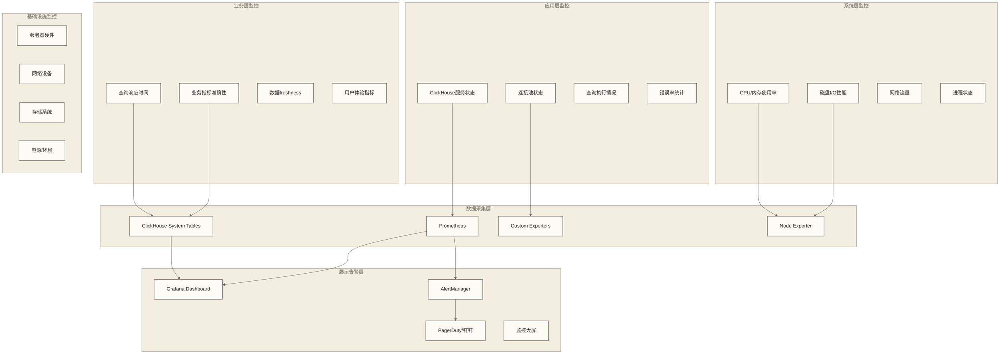

# 📊 ClickHouse监控运维

## 📚 学习目标

通过本章节的学习，你将能够：
- **建立完整的监控体系**，覆盖系统和业务各个层面
- **掌握告警机制设计**，实现主动式运维管理
- **学会性能调优方法**，持续优化系统性能
- **具备故障处理能力**，快速定位和解决问题
- **实现运维自动化**，提升运维效率和质量

> [!tip] 💡 学习建议
> 监控运维是ClickHouse生产应用的重要保障，**就像医生监护病人的生命体征一样重要**。**先建立监控体系，再实现自动化运维**。重点理解各种指标的含义和关联关系，这样才能准确诊断和处理问题。

## 📈 监控体系架构

建立完善的监控体系是保障ClickHouse稳定运行的基石。一个有效的监控架构需要考虑数据收集、存储、分析和展示的全流程，并且要能够在问题发生前提供预警。

### 1. 监控架构设计

现代监控架构遵循 "USE" 方法论（Utilization, Saturation, Errors），通过多层次的指标体系全面监控系统状态。在ClickHouse环境中，还需要特别关注查询性能、数据质量和集群健康度。

张护士长来到医院的中央监控室，自豪地向大家介绍："欢迎来到我们医院的'生命监护中心'！这里就像ClickHouse的监控运维系统一样，24小时不间断地监护着整个医院的'健康状态'。"

"你们看，"她指着墙上密密麻麻的监控屏幕，"我们建立了四个层级的全方位监护体系，就像给医院做了全面的'体检系统'。这套监控体系不仅能实时监测医院各个科室的运行状态，更重要的是能够预警潜在问题，就像患者的生命体征监护一样。"

**🏥 医院智能监护体系的四个层级**：
1. **患者体验层**：直接关系到患者感受的指标，如挂号等待时间、就诊效率等
2. **医疗服务层**：医生、护士、设备的工作状态和服务质量
3. **基础设施层**：医院的水、电、气、网络等基础保障系统
4. **管理决策层**：医院运营数据的分析和决策支持

"每一层都有专门的监控指标和告警机制，"张护士长继续解释，"一旦某个环节出现异常，系统会立即发出警报，相关负责人会第一时间收到通知并采取行动。"

#### 多层监控模型（医院生命监护体系）

"我们的监护体系分为四个层级，"张护士长详细介绍道，"从最直接的患者体验，到最底层的设备状态，每一个环节都不能出问题。"



#### 建立医院智能监控指标体系

**陈技师补充道：**"我们的智能监控系统就像医院的'健康档案'，需要记录各种'生命体征'数据。每一个指标都像患者的血压、心率、体温一样重要，需要持续监控并建立历史趋势。"

```sql
-- 创建医院监控指标汇总表（类比ClickHouse系统监控）
CREATE TABLE hospital_monitoring_metrics (
    timestamp DateTime,                       -- 监控时间戳
    metric_category LowCardinality(String),  -- 指标分类：患者服务、医疗设备、基础设施、人员
    metric_name LowCardinality(String),      -- 具体指标名称
    metric_value Float64,                    -- 指标数值
    department LowCardinality(String),       -- 所属科室
    equipment_id Nullable(String),          -- 设备编号（如果适用）
    severity_level LowCardinality(String),   -- 严重程度：正常、警告、紧急
    labels Map(String, String)              -- 扩展标签信息
) ENGINE = MergeTree()
PARTITION BY toYYYYMMDD(timestamp)          -- 按日期分区，便于数据管理
ORDER BY (metric_category, department, metric_name, timestamp)
TTL timestamp + INTERVAL 90 DAY;            -- 90天后自动清理历史数据

-- 收集医疗设备性能指标（类比系统资源监控）
INSERT INTO hospital_monitoring_metrics
SELECT 
    now() as timestamp,
    '医疗设备' as metric_category,
    CASE 
        WHEN metric LIKE '%Memory%' THEN '设备内存使用率'
        WHEN metric LIKE '%CPU%' THEN '设备CPU使用率'
        WHEN metric LIKE '%Disk%' THEN '设备存储使用率'
        ELSE metric
    END as metric_name,
    value as metric_value,
    '信息科' as department,
    concat('server_', toString(rand() % 10 + 1)) as equipment_id,
    CASE 
        WHEN value > 90 THEN '紧急'
        WHEN value > 70 THEN '警告'
        ELSE '正常'
    END as severity_level,
    map('unit', 'source_metric_unit_unverified', 'source', 'system_metrics') as labels
FROM system.asynchronous_metrics
WHERE metric LIKE '%Memory%' OR metric LIKE '%CPU%';

-- 收集诊疗服务性能指标（类比查询性能监控）
INSERT INTO hospital_monitoring_metrics
SELECT 
    toStartOfMinute(now()) as timestamp,
    '诊疗服务' as metric_category,
    '平均诊疗时长' as metric_name,
    avg(examination_time_seconds / 60.0) as metric_value,  -- 转换为分钟
    department,
    NULL as equipment_id,
    CASE 
        WHEN avg(examination_time_seconds / 60.0) > 60 THEN '警告'
        WHEN avg(examination_time_seconds / 60.0) > 30 THEN '注意'
        ELSE '正常'
    END as severity_level,
    map('unit', 'minutes', 'time_range', '1min') as labels
FROM diagnosis_efficiency
WHERE diagnosis_timestamp >= now() - INTERVAL 1 MINUTE
GROUP BY department;

-- 患者体验辅助指标收集：使用诊疗时长，不直接测量等待时间或满意度
INSERT INTO hospital_monitoring_metrics
SELECT 
    now() as timestamp,
    '患者体验' as metric_category,
    '平均诊疗时长' as metric_name,
    avg(examination_time_seconds / 60.0) as metric_value,
    department,
    NULL as equipment_id,
    CASE 
        WHEN avg(examination_time_seconds / 60.0) > 45 THEN '警告'
        WHEN avg(examination_time_seconds / 60.0) > 30 THEN '注意'
        ELSE '优秀'
    END as severity_level,
    map('unit', 'minutes', 'kpi', 'examination_duration') as labels
FROM diagnosis_efficiency
WHERE diagnosis_date = today()
GROUP BY department;
```

> [!info] 💡 监控指标设计原则
> **医院监控体系的核心理念**：
> - **全面覆盖**：从患者体验到设备运行，无死角监控
> - **分层分级**：不同级别的指标有不同的响应机制
> - **预警机制**：提前发现问题，而不是被动响应
> - **数据驱动**：基于历史数据建立智能预警阈值

### 2. 关键监控指标

ClickHouse的监控指标可以分为四大类别：系统资源指标、服务状态指标、查询性能指标和业务指标。每类指标都有其特定的采集方式和分析方法，需要根据业务特点设置合适的阈值和告警策略。

#### 系统资源指标

```sql
-- CPU使用率监控
CREATE VIEW cpu_usage_monitor AS
SELECT 
    toStartOfMinute(now()) as timestamp,
    hostName() as host,
    value as cpu_usage_percent
FROM system.asynchronous_metrics
WHERE metric = 'CPUUsageNormalized';

-- 进程内存指标监控：下列比例为MemoryDataAndStack/MemoryVirtual，不是主机物理内存使用率，不应直接用于主机内存告警
CREATE VIEW memory_usage_monitor AS
SELECT 
    toStartOfMinute(now()) as timestamp,
    hostName() as host,
    formatReadableSize(value) as memory_used,
    value as memory_bytes,
    round(value / (SELECT value FROM system.asynchronous_metrics WHERE metric = 'MemoryVirtual') * 100, 2) as memory_usage_percent
FROM system.asynchronous_metrics
WHERE metric = 'MemoryDataAndStack';

-- 磁盘使用监控
CREATE VIEW disk_usage_monitor AS
SELECT 
    name as disk_name,
    path,
    formatReadableSize(total_space) as total_space,
    formatReadableSize(free_space) as free_space,
    formatReadableSize(total_space - free_space) as used_space,
    round((total_space - free_space) / total_space * 100, 2) as usage_percent
FROM system.disks;

-- 磁盘相关异步指标历史：具体指标名称、单位及速率计算需按版本核对
SELECT 
    event_time,
    metric,
    value
FROM system.asynchronous_metrics_log
WHERE metric LIKE '%Disk%'
  AND event_time >= now() - INTERVAL 5 MINUTE
ORDER BY event_time DESC
LIMIT 10;
```

#### 服务状态指标

```sql
-- ClickHouse服务状态
CREATE VIEW service_status_monitor AS
SELECT 
    hostName() as host,
    version() as version,
    uptime() as uptime_seconds,
    formatReadableTimeDelta(uptime()) as uptime_readable,
    (SELECT count() FROM system.processes WHERE query != '') as active_queries,
    (SELECT count() FROM system.replicas WHERE is_readonly = 1) as readonly_replicas,
    (SELECT count() FROM system.replicas WHERE queue_size > 0) as replicas_with_queue
FROM system.one;

-- 连接状态监控
SELECT 
    hostName() as host,
    metric,
    value
FROM system.metrics
WHERE metric IN (
    'TCPConnection',
    'HTTPConnection', 
    'InterserverConnection',
    'MySQLConnection'
)
ORDER BY metric;

-- 副本同步状态
CREATE VIEW replica_sync_monitor AS
SELECT 
    database,
    table,
    replica_name,
    is_leader,
    is_readonly,
    is_session_expired,
    future_parts,
    parts_to_check,
    queue_size,
    inserts_in_queue,
    merges_in_queue,
    part_mutations_in_queue,
    last_queue_update,
    absolute_delay,
    total_replicas,
    active_replicas
FROM system.replicas
ORDER BY queue_size DESC, absolute_delay DESC;
```

#### 查询性能指标

```sql
-- 查询性能统计
CREATE VIEW query_performance_monitor AS
SELECT 
    toStartOfMinute(event_time) as minute,
    type,
    count() as query_count,
    avg(query_duration_ms) as avg_duration_ms,
    quantile(0.95)(query_duration_ms) as p95_duration_ms,
    quantile(0.99)(query_duration_ms) as p99_duration_ms,
    max(query_duration_ms) as max_duration_ms,
    sum(read_rows) as total_read_rows,
    sum(read_bytes) as total_read_bytes,
    sum(written_rows) as total_written_rows,
    sum(memory_usage) as total_memory_usage,
    avg(length(thread_ids)) as avg_threads
FROM system.query_log
WHERE event_time >= now() - INTERVAL 1 HOUR
GROUP BY minute, type
ORDER BY minute DESC, query_count DESC;

-- 慢查询监控
CREATE VIEW slow_queries_monitor AS
SELECT 
    query_id,
    user,
    query_duration_ms,
    formatReadableSize(memory_usage) as memory_used,
    read_rows,
    formatReadableSize(read_bytes) as data_read,
    length(thread_ids) as threads_used,
    event_time,
    substring(query, 1, 200) as query_preview
FROM system.query_log
WHERE type = 'QueryFinish'
  AND query_duration_ms > 10000  -- 超过10秒的查询
  AND event_time >= now() - INTERVAL 24 HOUR
ORDER BY query_duration_ms DESC
LIMIT 20;

-- 错误查询监控
CREATE VIEW error_queries_monitor AS
SELECT 
    toStartOfHour(event_time) as hour,
    exception_code,
    exception,
    count() as error_count,
    uniq(query_id) as unique_errors,
    any(query) as sample_query
FROM system.query_log
WHERE type = 'ExceptionWhileProcessing'
  AND event_time >= now() - INTERVAL 24 HOUR
GROUP BY hour, exception_code, exception
ORDER BY hour DESC, error_count DESC;
```

## 🚨 告警系统设计

### 1. 告警规则配置

#### Prometheus告警规则

```yaml
# clickhouse_alerts.yml
groups:
  - name: clickhouse_critical
    rules:
 # 服务可用性告警
      - alert: ClickHouseDown
        expr: up{job="clickhouse"} == 0
        for: 1m
        labels:
          severity: critical
        annotations:
          summary: "ClickHouse服务不可用"
          description: "节点 {{ $labels.instance }} 的ClickHouse服务已停止"

 # 磁盘空间告警
      - alert: DiskSpaceHigh
        expr: (clickhouse_disk_total_bytes - clickhouse_disk_free_bytes) / clickhouse_disk_total_bytes > 0.9
        for: 5m
        labels:
          severity: critical
        annotations:
          summary: "磁盘空间不足"
          description: "节点 {{ $labels.instance }} 磁盘使用率超过90%"

 # 内存使用告警
      - alert: MemoryUsageHigh
        expr: clickhouse_memory_usage_bytes / clickhouse_memory_total_bytes > 0.9
        for: 5m
        labels:
          severity: warning
        annotations:
          summary: "内存使用率过高"
          description: "节点 {{ $labels.instance }} 内存使用率超过90%"

  - name: clickhouse_performance
    rules:
 # 查询性能告警
      - alert: SlowQueriesHigh
        expr: rate(clickhouse_slow_queries_total[5m]) > 10
        for: 2m
        labels:
          severity: warning
        annotations:
          summary: "慢查询数量过多"
          description: "最近5分钟窗口内慢查询平均速率超过每秒10个，并持续2分钟；阈值需按业务调整"

 # 副本延迟告警
      - alert: ReplicaLagHigh
        expr: clickhouse_replica_queue_size > 100
        for: 3m
        labels:
          severity: warning
        annotations:
          summary: "副本同步延迟过高"
          description: "副本 {{ $labels.replica }} 队列长度超过100"

 # 错误率告警
      - alert: ErrorRateHigh
        expr: rate(clickhouse_query_errors_total[5m]) / rate(clickhouse_queries_total[5m]) > 0.05
        for: 3m
        labels:
          severity: warning
        annotations:
          summary: "查询错误率过高"
          description: "5分钟内查询错误率超过5%"
```

#### 基于ClickHouse表和视图的自定义告警检查

```sql
-- 创建告警配置表
CREATE TABLE alert_rules (
    rule_id String,
    rule_name String,
    metric_query String,
    threshold Float64,
    comparison_operator LowCardinality(String),
    severity LowCardinality(String),
    description String,
    is_active UInt8 DEFAULT 1,
    created_at DateTime DEFAULT now()
) ENGINE = MergeTree()
ORDER BY rule_id;

-- 插入告警规则
INSERT INTO alert_rules (rule_id, rule_name, metric_query, threshold, comparison_operator, severity, description, is_active) VALUES
    ('disk_space', '磁盘空间不足', 'SELECT usage_percent FROM disk_usage_monitor', 90, '>', 'critical', '磁盘使用率超过90%', 1),
    ('memory_usage', '进程内存指标比例过高', 'SELECT memory_usage_percent FROM memory_usage_monitor', 85, '>', 'warning', 'MemoryDataAndStack/MemoryVirtual比例超过85%（教学阈值，非主机物理内存使用率告警）', 1),
    ('slow_queries', '慢查询过多', 'SELECT count() FROM slow_queries_monitor WHERE event_time >= now() - INTERVAL 5 MINUTE', 5, '>', 'warning', '5分钟内慢查询超过5个', 1),
    ('replica_lag', '副本延迟过高', 'SELECT max(queue_size) FROM replica_sync_monitor', 50, '>', 'warning', '副本队列长度超过50', 1);

-- 告警检查函数
CREATE VIEW alert_checks AS
WITH rule_evaluations AS (
    SELECT 
        rule_id,
        rule_name,
        threshold,
        comparison_operator,
        severity,
        description,
        CASE rule_id
            WHEN 'disk_space' THEN (SELECT max(usage_percent) FROM disk_usage_monitor)
            WHEN 'memory_usage' THEN (SELECT memory_usage_percent FROM memory_usage_monitor LIMIT 1)
            WHEN 'slow_queries' THEN (SELECT count() FROM slow_queries_monitor WHERE event_time >= now() - INTERVAL 5 MINUTE)
            WHEN 'replica_lag' THEN (SELECT max(queue_size) FROM replica_sync_monitor)
            ELSE 0
        END as current_value
    FROM alert_rules
    WHERE is_active = 1
)
SELECT 
    rule_id,
    rule_name,
    current_value,
    threshold,
    comparison_operator,
    severity,
    description,
    CASE comparison_operator
        WHEN '>' THEN current_value > threshold
        WHEN '<' THEN current_value < threshold
        WHEN '>=' THEN current_value >= threshold
        WHEN '<=' THEN current_value <= threshold
        WHEN '=' THEN current_value = threshold
        ELSE false
    END as is_triggered,
    now() as check_time
FROM rule_evaluations;

-- 获取当前触发的告警
SELECT * FROM alert_checks WHERE is_triggered = 1;
```

### 2. 告警通知集成

#### 告警历史记录

```sql
-- 创建告警历史表
CREATE TABLE alert_history (
    alert_id String,
    rule_id String,
    rule_name String,
    severity LowCardinality(String),
    status LowCardinality(String),  -- 'fired', 'resolved'
    current_value Float64,
    threshold Float64,
    description String,
    host_name String,
    fired_at DateTime,
    resolved_at Nullable(DateTime),
    duration_seconds Nullable(UInt32)
) ENGINE = MergeTree()
PARTITION BY toYYYYMM(fired_at)
ORDER BY (severity, fired_at)
TTL fired_at + INTERVAL 6 MONTH;

-- 告警触发处理
INSERT INTO alert_history
SELECT 
    generateUUIDv4() as alert_id,
    rule_id,
    rule_name,
    severity,
    'fired' as status,
    current_value,
    threshold,
    description,
    hostName() as host_name,
    check_time as fired_at,
    NULL as resolved_at,
    NULL as duration_seconds
FROM alert_checks
WHERE is_triggered = 1;

-- 告警统计分析
SELECT 
    toStartOfDay(fired_at) as date,
    severity,
    count() as alert_count,
    uniq(rule_id) as unique_rules,
    avg(duration_seconds) as avg_duration_seconds
FROM alert_history
WHERE fired_at >= now() - INTERVAL 30 DAY
  AND status = 'resolved'
GROUP BY date, severity
ORDER BY date DESC, severity;
```

#### 通知渠道集成

```python
# alert_notifications.模型部署 - 告警通知脚本
import requests
import json
from datetime import datetime
from clickhouse_driver import Client

class AlertNotifier:
    def __init__(self, clickhouse_host='localhost'):
        self.ch_client = Client(clickhouse_host)
        
    def check_alerts(self):
        """检查当前触发的告警"""
        query = "SELECT * FROM alert_checks WHERE is_triggered = 1"
        return self.ch_client.execute(query)
    
    def send_dingtalk_alert(self, webhook_url, alert_data):
        """发送钉钉告警"""
        message = {
            "msgtype": "markdown",
            "markdown": {
                "title": f"ClickHouse告警 - {alert_data['severity']}",
                "text": f"""
### ClickHouse告警通知

**告警规则**: {alert_data['rule_name']}
**严重级别**: {alert_data['severity']}
**当前值**: {alert_data['current_value']}
**阈值**: {alert_data['threshold']}
**描述**: {alert_data['description']}
**时间**: {datetime.now().strftime('%Y-%m-%d %H:%M:%S')}
**主机**: {alert_data.get('host_name', 'unknown')}
                """
            }
        }
        
        response = requests.post(webhook_url, 
                               json=message, 
                               headers={'Content-Type': 'application/json'})
        return response.status_code == 200
    
    def send_email_alert(self, smtp_config, recipients, alert_data):
        """发送邮件告警"""
        import smtplib
        from email.mime.text import MIMEText
        from email.mime.multipart import MIMEMultipart
        
        msg = MIMEMultipart()
        msg['From'] = smtp_config['username']
        msg['To'] = ', '.join(recipients)
        msg['Subject'] = f"ClickHouse告警 - {alert_data['severity']} - {alert_data['rule_name']}"
        
        body = f"""
        ClickHouse告警详情:
        
        告警规则: {alert_data['rule_name']}
        严重级别: {alert_data['severity']}
        当前值: {alert_data['current_value']}
        阈值: {alert_data['threshold']}
        描述: {alert_data['description']}
        检查时间: {alert_data['check_time']}
        """
        
        msg.attach(MIMEText(body, 'plain'))
        
        server = smtplib.SMTP(smtp_config['server'], smtp_config['port'])
        server.starttls()
        server.login(smtp_config['username'], smtp_config['password'])
        server.send_message(msg)
        server.quit()
        
        return True
    
    def run_alert_check(self, config):
        """运行告警检查和通知"""
        alerts = self.check_alerts()
        
        for alert in alerts:
            alert_data = {
                'rule_id': alert[0],
                'rule_name': alert[1], 
                'current_value': alert[2],
                'threshold': alert[3],
                'severity': alert[5],
                'description': alert[6],
                'check_time': alert[8]
            }
            
 # 发送通知
            if config.get('dingtalk_webhook'):
                self.send_dingtalk_alert(config['dingtalk_webhook'], alert_data)
            
            if config.get('email') and config.get('smtp'):
                self.send_email_alert(config['smtp'], config['email']['recipients'], alert_data)

# 使用示例
if __name__ == "__main__":
    config = {
        'dingtalk_webhook': 'https://oapi.dingtalk.com/robot/send?access_token=xxx',
        'email': {
            'recipients': ['admin@example.com', 'dba@example.com']
        },
        'smtp': {
            'server': 'smtp.example.com',
            'port': 587,
            'username': 'alerts@example.com',
            'password': 'password'
        }
    }
    
    notifier = AlertNotifier()
    notifier.run_alert_check(config)
```

## 🔧 运维自动化

### 1. 自动化部署

#### Docker化部署

```dockerfile
# Dockerfile for ClickHouse with monitoring
FROM clickhouse/clickhouse-server:latest

# 安装监控工具
RUN apt-get update && apt-get install -y \
    prometheus-node-exporter \
    curl \
    netcat \
    htop \
    iotop

# 复制配置文件
COPY config.xml /etc/clickhouse-server/
COPY users.xml /etc/clickhouse-server/
COPY monitoring.xml /etc/clickhouse-server/config.d/

# 复制启动脚本
COPY start-with-monitoring.sh /start-with-monitoring.sh
RUN chmod +x /start-with-monitoring.sh

# 健康检查
HEALTHCHECK --interval=30s --timeout=10s --start-period=5s --retries=3 \
    CMD clickhouse-client --query="SELECT 1" || exit 1

EXPOSE 8123 9000 9009 9100

CMD ["/start-with-monitoring.sh"]
```

```bash
#!/bin/bash
# start-with-monitoring.sh
set -e

# 启动node exporter
prometheus-node-exporter --web.listen-address=":9100" &

# 启动ClickHouse服务器
/entrypoint.sh &

# 等待ClickHouse启动
until clickhouse-client --query="SELECT 1" >/dev/null 2>&1; do
    echo "等待ClickHouse启动..."
    sleep 2
done

echo "ClickHouse已启动，开始监控..."

# 保持容器运行
wait
```

#### Kubernetes部署

```yaml
# clickhouse-deployment.yaml
apiVersion: apps/v1
kind: StatefulSet
metadata:
  name: clickhouse
  labels:
    app: clickhouse
spec:
  serviceName: clickhouse-headless
  replicas: 3
  selector:
    matchLabels:
      app: clickhouse
  template:
    metadata:
      labels:
        app: clickhouse
      annotations:
        prometheus.io/scrape: "true"
        prometheus.io/port: "9363"
    spec:
      containers:
      - name: clickhouse
        image: clickhouse/clickhouse-server:latest
        ports:
        - containerPort: 8123
          name: http
        - containerPort: 9000
          name: native
        - containerPort: 9009
          name: interserver
        env:
        - name: CLICKHOUSE_DB
          value: "default"
        - name: CLICKHOUSE_USER
          value: "default"
        - name: CLICKHOUSE_PASSWORD
          valueFrom:
            secretKeyRef:
              name: clickhouse-secret
              key: password
        volumeMounts:
        - name: clickhouse-data
          mountPath: /var/lib/clickhouse
        - name: clickhouse-config
          mountPath: /etc/clickhouse-server/config.d
        resources:
          requests:
            memory: "4Gi"
            cpu: "2"
          limits:
            memory: "8Gi"
            cpu: "4"
        livenessProbe:
          exec:
            command:
            - clickhouse-client
            - --query=SELECT 1
          initialDelaySeconds: 30
          periodSeconds: 30
        readinessProbe:
          exec:
            command:
            - clickhouse-client
            - --query=SELECT 1
          initialDelaySeconds: 5
          periodSeconds: 10
      
      - name: clickhouse-exporter
        image: f1yegor/clickhouse-exporter:latest
        ports:
        - containerPort: 9363
          name: metrics
        env:
        - name: CLICKHOUSE_URL
          value: "http://localhost:8123"
        resources:
          requests:
            memory: "64Mi"
            cpu: "100m"
          limits:
            memory: "128Mi"
            cpu: "200m"
            
      volumes:
      - name: clickhouse-config
        configMap:
          name: clickhouse-config
          
  volumeClaimTemplates:
  - metadata:
      name: clickhouse-data
    spec:
      accessModes: ["ReadWriteOnce"]
      resources:
        requests:
          storage: 100Gi
      storageClassName: fast-ssd

---
apiVersion: v1
kind: Service
metadata:
  name: clickhouse-headless
spec:
  clusterIP: None
  selector:
    app: clickhouse
  ports:
  - port: 8123
    name: http
  - port: 9000
    name: native

---
apiVersion: v1
kind: Service  
metadata:
  name: clickhouse-service
spec:
  selector:
    app: clickhouse
  ports:
  - port: 8123
    targetPort: 8123
    name: http
  - port: 9000
    targetPort: 9000
    name: native
  type: LoadBalancer
```

### 2. 自动化运维脚本

#### 日常维护脚本

```bash
#!/bin/bash
# clickhouse-maintenance.sh - ClickHouse日常维护脚本

set -e

# 配置参数
CLICKHOUSE_HOST="localhost"
CLICKHOUSE_PORT="9000"
BACKUP_DIR="/backup/clickhouse"
LOG_FILE="/var/log/clickhouse-maintenance.log"
ALERT_EMAIL="admin@example.com"

# 日志函数
log() {
    echo "[$(date '+%Y-%m-%d %H:%M:%S')] $1" | tee -a $LOG_FILE
}

# 错误处理
error_exit() {
    log "ERROR: $1"
    echo "ClickHouse维护脚本出错: $1" | mail -s "ClickHouse维护告警" $ALERT_EMAIL
    exit 1
}

# 检查ClickHouse连接
check_clickhouse() {
    log "检查ClickHouse连接..."
    clickhouse-client --host $CLICKHOUSE_HOST --port $CLICKHOUSE_PORT --query="SELECT 1" >/dev/null 2>&1 || \
        error_exit "无法连接到ClickHouse服务器"
    log "ClickHouse连接正常"
}

# 清理查询日志
cleanup_query_logs() {
    log "清理查询日志..."
    clickhouse-client --host $CLICKHOUSE_HOST --port $CLICKHOUSE_PORT --multiquery --query="
        ALTER TABLE system.query_log DELETE WHERE event_time < now() - INTERVAL 30 DAY;
        ALTER TABLE system.part_log DELETE WHERE event_time < now() - INTERVAL 30 DAY;
        ALTER TABLE system.trace_log DELETE WHERE event_time < now() - INTERVAL 7 DAY;
    " || error_exit "清理查询日志失败"
    log "查询日志清理完成"
}

# 优化表
optimize_tables() {
    log "开始优化表..."
    
 # 获取需要优化的表列表
    tables=$(clickhouse-client --host $CLICKHOUSE_HOST --port $CLICKHOUSE_PORT --query="
        SELECT DISTINCT table 
        FROM system.parts 
        WHERE active = 1 
          AND database = 'default'
          AND table IN (SELECT name FROM system.tables WHERE database = 'default' AND engine LIKE '%MergeTree%')
        GROUP BY table 
        HAVING count() > 10
    " --format=TSV)
    
    for table in $tables; do
        log "优化表: $table"
        clickhouse-client --host $CLICKHOUSE_HOST --port $CLICKHOUSE_PORT --query="
            OPTIMIZE TABLE $table FINAL;
        " || log "WARNING: 优化表 $table 失败"
    done
    
    log "表优化完成"
}

# 检查磁盘空间
check_disk_space() {
    log "检查磁盘空间..."
    
 # 检查数据目录磁盘使用率
    usage=$(df /var/lib/clickhouse | awk 'NR==2 {print $5}' | sed 's/%//')
    
    if [ $usage -gt 85 ]; then
        error_exit "磁盘使用率过高: ${usage}%"
    elif [ $usage -gt 75 ]; then
        log "WARNING: 磁盘使用率较高: ${usage}%"
    else
        log "磁盘空间正常: ${usage}%"
    fi
}

# 检查副本状态
check_replicas() {
    log "检查副本状态..."
    
    readonly_replicas=$(clickhouse-client --host $CLICKHOUSE_HOST --port $CLICKHOUSE_PORT --query="
        SELECT count() FROM system.replicas WHERE is_readonly = 1
    " --format=TSV)
    
    if [ $readonly_replicas -gt 0 ]; then
        log "WARNING: 发现 $readonly_replicas 个只读副本"
        
 # 尝试同步副本
        clickhouse-client --host $CLICKHOUSE_HOST --port $CLICKHOUSE_PORT --query="
            SELECT 'SYSTEM SYNC REPLICA ' || database || '.' || table || ';'
            FROM system.replicas 
            WHERE is_readonly = 1
        " --format=TSV | while read sync_cmd; do
            log "执行同步命令: $sync_cmd"
            clickhouse-client --host $CLICKHOUSE_HOST --port $CLICKHOUSE_PORT --query="$sync_cmd" || \
                log "WARNING: 同步副本失败: $sync_cmd"
        done
    else
        log "所有副本状态正常"
    fi
}

# 备份系统配置
backup_configs() {
    log "备份系统配置..."
    
    backup_date=$(date +%Y%m%d_%H%M%S)
    config_backup_dir="$BACKUP_DIR/configs/$backup_date"
    
    mkdir -p $config_backup_dir
    
 # 备份配置文件
    cp -r /etc/clickhouse-server/* $config_backup_dir/ 2>/dev/null || \
        log "WARNING: 配置文件备份失败"
    
 # 压缩备份
    tar -czf $config_backup_dir.tar.gz -C $BACKUP_DIR/configs $backup_date
    rm -rf $config_backup_dir
    
    log "配置备份完成: $config_backup_dir.tar.gz"
}

# 性能报告
generate_performance_report() {
    log "生成性能报告..."
    
    report_file="$BACKUP_DIR/reports/performance_$(date +%Y%m%d).txt"
    mkdir -p $(dirname $report_file)
    
    {
        echo "ClickHouse性能报告 - $(date)"
        echo "=================================="
        echo "系统信息:"
        clickhouse-client --host $CLICKHOUSE_HOST --port $CLICKHOUSE_PORT --query="
            SELECT 
                'ClickHouse版本' as metric, 
                version() as value
            UNION ALL
            SELECT 
                '运行时间', 
                formatReadableTimeDelta(uptime())
            UNION ALL
            SELECT 
                '总查询数', 
                toString(sum(ProfileEvent_Query))
            FROM system.metric_log 
            WHERE event_time >= today()
        " --format=PrettyCompact
        
        echo "查询性能统计 (最近24小时):"
        clickhouse-client --host $CLICKHOUSE_HOST --port $CLICKHOUSE_PORT --query="
            SELECT 
                type,
                count() as queries,
                round(avg(query_duration_ms), 2) as avg_duration_ms,
                round(quantile(0.95)(query_duration_ms), 2) as p95_duration_ms,
                formatReadableSize(sum(read_bytes)) as total_read
            FROM system.query_log 
            WHERE event_time >= now() - INTERVAL 24 HOUR
            GROUP BY type 
            ORDER BY queries DESC
        " --format=PrettyCompact
        
        echo "资源使用情况:"
        clickhouse-client --host $CLICKHOUSE_HOST --port $CLICKHOUSE_PORT --query="
            SELECT 
                metric,
                formatReadableSize(value) as value
            FROM system.asynchronous_metrics 
            WHERE metric IN ('MemoryDataAndStack', 'MemoryVirtual')
            UNION ALL
            SELECT 
                name as metric,
                formatReadableSize(total_space - free_space) || ' / ' || formatReadableSize(total_space) as value
            FROM system.disks
        " --format=PrettyCompact
        
    } > $report_file
    
    log "性能报告已生成: $report_file"
}

# 主函数
main() {
    log "开始ClickHouse日常维护..."
    
    check_clickhouse
    check_disk_space
    check_replicas
    cleanup_query_logs
    optimize_tables
    backup_configs
    generate_performance_report
    
    log "ClickHouse日常维护完成"
}

# 执行主函数
main "$@"
```

#### 监控数据收集脚本

```python
# monitoring_collector.模型部署 - 监控数据收集器
import time
import json
import requests
from datetime import datetime
from clickhouse_driver import Client
import psutil
import threading
from queue import Queue

class MonitoringCollector:
    def __init__(self, clickhouse_host='localhost', prometheus_gateway=None):
        self.ch_client = Client(clickhouse_host)
        self.prometheus_gateway = prometheus_gateway
        self.metrics_queue = Queue()
        
    def collect_system_metrics(self):
        """收集系统指标"""
        metrics = {}
        
 # CPU使用率
        metrics['cpu_percent'] = psutil.cpu_percent(interval=1)
        metrics['cpu_count'] = psutil.cpu_count()
        
 # 内存使用
        memory = psutil.virtual_memory()
        metrics['memory_total'] = memory.total
        metrics['memory_used'] = memory.used
        metrics['memory_percent'] = memory.percent
        
 # 磁盘使用
        disk = psutil.disk_usage('/')
        metrics['disk_total'] = disk.total
        metrics['disk_used'] = disk.used
        metrics['disk_percent'] = (disk.used / disk.total) * 100
        
 # 网络I/O
        network = psutil.net_io_counters()
        metrics['network_bytes_sent'] = network.bytes_sent
        metrics['network_bytes_recv'] = network.bytes_recv
        
        return metrics
    
    def collect_clickhouse_metrics(self):
        """收集ClickHouse指标"""
        try:
 # 服务状态
            service_metrics = self.ch_client.execute("""
                SELECT 
                    'uptime' as metric,
                    toString(uptime()) as value
                UNION ALL
                SELECT 
                    'version',
                    version()
                UNION ALL
                SELECT 
                    'active_queries',
                    toString(count())
                FROM system.processes
                WHERE query != ''
            """)
            
 # 查询性能
            query_metrics = self.ch_client.execute("""
                SELECT 
                    'queries_per_minute' as metric,
                    toString(count()) as value
                FROM system.query_log
                WHERE event_time >= now() - INTERVAL 1 MINUTE
                  AND type = 'QueryFinish'
                UNION ALL
                SELECT 
                    'avg_query_duration_ms',
                    toString(round(avg(query_duration_ms), 2))
                FROM system.query_log
                WHERE event_time >= now() - INTERVAL 5 MINUTE
                  AND type = 'QueryFinish'
            """)
            
 # 副本状态
            replica_metrics = self.ch_client.execute("""
                SELECT 
                    'readonly_replicas' as metric,
                    toString(count()) as value
                FROM system.replicas
                WHERE is_readonly = 1
                UNION ALL
                SELECT 
                    'max_replica_queue_size',
                    toString(max(queue_size))
                FROM system.replicas
            """)
            
            return service_metrics + query_metrics + replica_metrics
            
        except Exception as e:
            print(f"收集ClickHouse指标失败: {e}")
            return []
    
    def store_metrics(self, metrics_data):
        """存储指标数据"""
        try:
 # 准备插入数据
            insert_data = []
            timestamp = datetime.now()
            
            for metric_name, metric_value in metrics_data.items():
                insert_data.append((
                    timestamp,
                    'system',
                    metric_name,
                    float(metric_value) if isinstance(metric_value, (int, float, str)) and str(metric_value).replace('.', '').isdigit() else 0,
                    'localhost',
                    {}
                ))
            
 # 插入到监控表
            self.ch_client.execute("""
                INSERT INTO monitoring_metrics 
                (timestamp, metric_category, metric_name, metric_value, host_name, labels)
                VALUES
            """, insert_data)
            
        except Exception as e:
            print(f"存储指标失败: {e}")
    
    def send_to_prometheus(self, metrics_data):
        """发送指标到Prometheus Gateway"""
        if not self.prometheus_gateway:
            return
            
        try:
            prometheus_metrics = []
            for metric_name, metric_value in metrics_data.items():
                if isinstance(metric_value, (int, float)):
                    prometheus_metrics.append(f"clickhouse_{metric_name} {metric_value}")
            
            metrics_text = '\n'.join(prometheus_metrics)
            
            response = requests.post(
                f"{self.prometheus_gateway}/metrics/job/clickhouse_monitoring",
                data=metrics_text,
                headers={'Content-Type': 'text/plain'}
            )
            
            if response.status_code != 200:
                print(f"发送到Prometheus失败: {response.status_code}")
                
        except Exception as e:
            print(f"发送到Prometheus失败: {e}")
    
    def collect_and_store(self):
        """收集并存储所有指标"""
 # 收集系统指标
        system_metrics = self.collect_system_metrics()
        
 # 收集ClickHouse指标
        ch_metrics = self.collect_clickhouse_metrics()
        ch_metrics_dict = {metric[0]: metric[1] for metric in ch_metrics}
        
 # 合并所有指标
        all_metrics = {**system_metrics, **ch_metrics_dict}
        
 # 存储指标
        self.store_metrics(all_metrics)
        
 # 发送到Prometheus
        self.send_to_prometheus(all_metrics)
        
        print(f"[{datetime.now()}] 收集了 {len(all_metrics)} 个指标")
    
    def run(self, interval=60):
        """运行监控收集器"""
        print(f"启动监控数据收集器，采集间隔: {interval}秒")
        
        while True:
            try:
                self.collect_and_store()
                time.sleep(interval)
            except KeyboardInterrupt:
                print("监控收集器已停止")
                break
            except Exception as e:
                print(f"收集过程出错: {e}")
                time.sleep(10)  # 出错后等待10秒再重试

if __name__ == "__main__":
 # 配置
    collector = MonitoringCollector(
        clickhouse_host='localhost',
        prometheus_gateway='http://prometheus-gateway:9091'
    )
    
 # 运行收集器
    collector.run(interval=30)  # 每30秒收集一次
```

## 📊 Grafana仪表板

### 1. 仪表板配置

#### ClickHouse概览仪表板

```json
{
  "dashboard": {
    "id": null,
    "title": "ClickHouse监控概览",
    "tags": ["clickhouse", "monitoring"],
    "timezone": "browser",
    "panels": [
      {
        "id": 1,
        "title": "服务状态",
        "type": "stat",
        "targets": [
          {
            "expr": "up{job=\"clickhouse\"}",
            "legendFormat": "{{instance}}"
          }
        ],
        "fieldConfig": {
          "defaults": {
            "color": {
              "mode": "thresholds"
            },
            "thresholds": {
              "steps": [
                {"color": "red", "value": 0},
                {"color": "green", "value": 1}
              ]
            }
          }
        }
      },
      {
        "id": 2,
        "title": "查询QPS",
        "type": "graph",
        "targets": [
          {
            "expr": "rate(clickhouse_queries_total[5m])",
            "legendFormat": "QPS"
          }
        ]
      },
      {
        "id": 3,
        "title": "查询延迟",
        "type": "graph",
        "targets": [
          {
            "expr": "histogram_quantile(0.95, rate(clickhouse_query_duration_seconds_bucket[5m]))",
            "legendFormat": "P95"
          },
          {
            "expr": "histogram_quantile(0.99, rate(clickhouse_query_duration_seconds_bucket[5m]))",
            "legendFormat": "P99"
          }
        ]
      },
      {
        "id": 4,
        "title": "内存使用",
        "type": "graph",
        "targets": [
          {
            "expr": "clickhouse_memory_usage_bytes / clickhouse_memory_total_bytes * 100",
            "legendFormat": "内存使用率 (%)"
          }
        ]
      },
      {
        "id": 5,
        "title": "磁盘使用",
        "type": "graph",
        "targets": [
          {
            "expr": "(clickhouse_disk_total_bytes - clickhouse_disk_free_bytes) / clickhouse_disk_total_bytes * 100",
            "legendFormat": "磁盘使用率 (%)"
          }
        ]
      },
      {
        "id": 6,
        "title": "副本状态",
        "type": "table",
        "targets": [
          {
            "expr": "clickhouse_replica_queue_size",
            "legendFormat": "{{database}}.{{table}} - {{replica}}"
          }
        ]
      }
    ],
    "time": {
      "from": "now-1h",
      "to": "now"
    },
    "refresh": "30s"
  }
}
```

#### 性能分析仪表板

```json
{
  "dashboard": {
    "title": "ClickHouse性能分析",
    "panels": [
      {
        "title": "慢查询Top 10",
        "type": "table",
        "targets": [
          {
            "rawSql": "SELECT query_id, user, query_duration_ms, memory_usage, read_rows FROM system.query_log WHERE type = 'QueryFinish' AND query_duration_ms > 1000 ORDER BY query_duration_ms DESC LIMIT 10"
          }
        ]
      },
      {
        "title": "查询类型分布",
        "type": "piechart",
        "targets": [
          {
            "rawSql": "SELECT type, count() as count FROM system.query_log WHERE event_time >= now() - INTERVAL 1 HOUR GROUP BY type"
          }
        ]
      },
      {
        "title": "内存使用趋势",
        "type": "graph",
        "targets": [
          {
            "rawSql": "SELECT toStartOfMinute(event_time) as time, avg(memory_usage) as avg_memory FROM system.query_log WHERE event_time >= now() - INTERVAL 2 HOUR GROUP BY time ORDER BY time"
          }
        ]
      }
    ]
  }
}
```

## 🎯 运维最佳实践

### 1. 监控运维规范

> [!info] 📋 监控运维最佳实践
> 
> **监控策略**：
> - 分层监控：基础设施 → 系统 → 应用 → 业务
> - 指标收集：延迟、错误率、流量、饱和度
> - 告警设置：基于SLA和业务影响程度
> 
> **运维流程**：
> - 预防性维护：定期检查、性能调优
> - 故障响应：快速诊断、及时恢复
> - 变更管理：版本升级、配置变更
> 
> **自动化程度**：
> - 监控自动化：指标收集、告警通知
> - 部署自动化：CI/CD、滚动更新
> - 运维自动化：日常维护、故障恢复

### 2. 故障处理流程

```sql
-- 故障处理标准流程
CREATE TABLE incident_management (
    incident_id String,
    severity LowCardinality(String),
    status LowCardinality(String),
    title String,
    description String,
    affected_services Array(String),
    start_time DateTime,
    detection_time DateTime,
    resolution_time Nullable(DateTime),
    root_cause String,
    resolution_summary String,
    assignee String,
    created_by String,
    created_at DateTime DEFAULT now(),
    updated_at DateTime DEFAULT now()
) ENGINE = MergeTree()
ORDER BY (severity, start_time);

-- 故障记录教学示例：日期、人员、原因和处置时长不代表已核实事件，也不构成通用SLA
INSERT INTO incident_management (incident_id, severity, status, title, description, affected_services, start_time, detection_time, resolution_time, root_cause, resolution_summary, assignee, created_by, created_at) VALUES
    ('INC-001', 'Critical', 'Resolved', 'ClickHouse集群节点宕机', '节点ch-node-1无响应', ['clickhouse'], '2024-01-01 10:00:00', '2024-01-01 10:02:00', '2024-01-01 10:15:00', '硬件故障', '重启节点并迁移流量', 'admin', 'monitoring', now()),
    ('INC-002', 'High', 'Resolved', '查询性能异常', '查询响应时间超过30秒', ['clickhouse'], '2024-01-01 14:00:00', '2024-01-01 14:05:00', '2024-01-01 14:30:00', '大查询阻塞', '优化查询SQL并增加索引', 'dba', 'user_report', now());

-- SLA统计分析
SELECT 
    severity,
    count() as incident_count,
    avg(dateDiff('minute', start_time, detection_time)) as avg_detection_minutes,
    avg(dateDiff('minute', detection_time, resolution_time)) as avg_resolution_minutes,
    countIf(dateDiff('minute', detection_time, resolution_time) <= 30) / count() * 100 as sla_compliance_percent
FROM incident_management
WHERE start_time >= now() - INTERVAL 30 DAY
  AND resolution_time IS NOT NULL
GROUP BY severity
ORDER BY 
    CASE severity 
        WHEN 'Critical' THEN 1 
        WHEN 'High' THEN 2 
        WHEN 'Medium' THEN 3 
        ELSE 4 
    END;
```

## 🎯 监控运维总结

本章节介绍了以下监控运维设计与示例，完整落地仍需补齐配置并经过测试：

1. **完整监控体系** - 多层监控、关键指标、实时告警
2. **自动化运维** - 部署自动化、维护脚本、故障恢复
3. **告警通知机制** - 智能告警、多渠道通知、告警收敛
4. **可视化监控** - Grafana仪表板、性能分析、趋势预测
5. **运维规范流程** - 最佳实践、故障管理、SLA监控

> [!abstract] 📚 下一步学习
> 完成本章节后，你可以结合测试环境进一步验证ClickHouse监控运维方案，接下来我们将学习[[【技术与工具】/ClickHouse/10-ClickHouse实践案例|ClickHouse实践案例]]，通过项目案例练习综合运用所学知识；是否具备生产运维能力仍需实际演练与评估。

## 🔗 相关资源

- [[【技术与工具】/ClickHouse/08-ClickHouse集群管理|ClickHouse集群]]
- [[【技术与工具】/ClickHouse/00-ClickHouse学习路线图|ClickHouse]]
- [[【技术与工具】/ClickHouse/07-ClickHouse查询优化|ClickHouse查询优化]]

---

> 💡 **记住**：**监控运维是系统稳定运行的基石**。建立完善的监控体系、实现运维自动化，**能够大大提升系统可靠性和运维效率**。在生产环境中，**预防胜于治疗**，持续的监控和主动的维护是确保系统健康的关键！