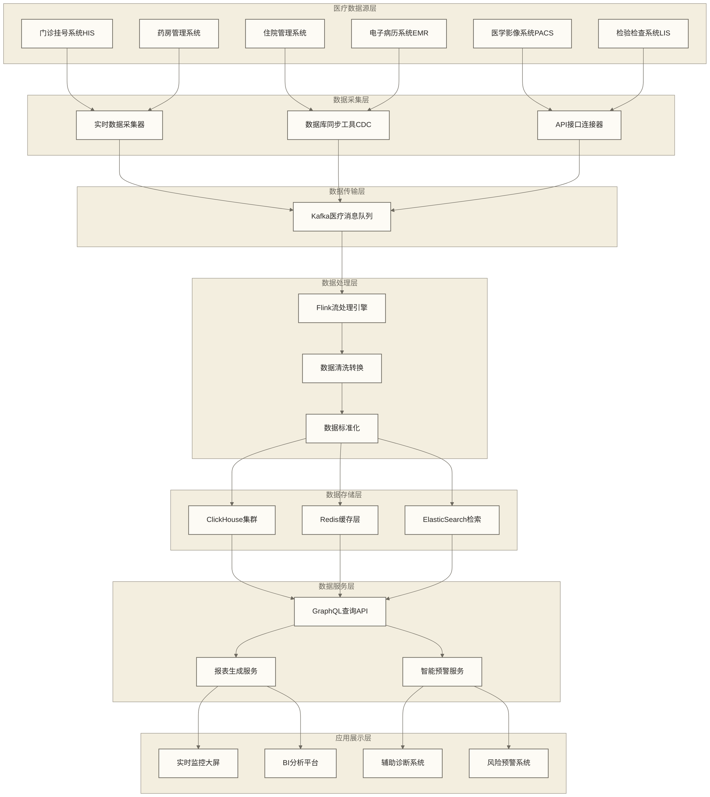

# 🚀 ClickHouse实践案例

## 📚 本章节学习收获

李院长召集全院技术专家，准备分享几个以智慧医院为背景的教学案例（人物、建设经历及数字均为原稿未核实的示例设定）："各位同事，经过前面的学习，大家已经掌握了我们医院信息系统的各个模块。现在让我们通过几个完整的项目实战，来看看如何将这些技术综合运用到实际的医院运营中。"

"这些案例用于讨论工程落地，"教学角色李院长强调，"原稿将其设定为医院投入使用的系统，服务数万名患者和上千名医护人员；这些数字和投产经历未经核实，不代表真实成果。案例围绕从概念设计到部署的过程展开，供读者分析实施方法。"

张护士长补充道："这些案例模拟实际工作中可能遇到的场景，包括患者流量监控、医疗数据分析、患者画像建立等。每个项目都有其独特的挑战和解决方案。通过这些实战项目，大家将掌握：

**🎯 项目实战核心收获**：
- **完整的项目实施经验** - 从需求分析到系统上线的全流程管理
- **复杂业务场景的解决方案** - 实时监控、数据分析、智能推荐等技术应用
- **系统架构设计能力** - 如何设计可扩展、高可用的医院信息系统
- **问题诊断和优化技能** - 性能调优、故障处理、持续改进的最佳实践
- **团队协作和项目管理** - 跨部门合作、进度管控、质量保证

**📊 三大经典案例**：
1. **智慧医院实时数据仓库** - 类比企业级数据平台建设
2. **医疗服务实时监控系统** - 类比业务指标监控平台  
3. **患者画像分析系统** - 类比用户画像和个性化推荐

"每个案例都会从项目背景、需求分析、架构设计、技术实现到上线运维的完整过程进行讲解，"陈技师补充道，"让大家不仅学会技术，更重要的是学会如何在实际项目中应用这些技术。"

## 专业技术对应
- **智慧医院系统建设** ↔ **企业级ClickHouse项目实施**
- **医疗数据实时分析** ↔ **实时数据仓库和OLAP分析**
- **患者流量监控** ↔ **业务指标实时监控系统**
- **患者画像分析** ↔ **用户画像和个性化推荐系统**

## 🏥 案例一：智慧医院实时医疗数据仓库

李院长指着大屏幕说道："让我们先看第一个案例 - 我们医院的实时医疗数据仓库建设项目。这是我们数字化转型的核心工程。"

### 1. 项目背景和需求分析

"当时我们面临的挑战是，" 王医生回忆道，"传统的医院信息系统数据分散在各个科室，就像不同的诊疗科室各自为政，缺乏统一的数据视图。我们需要建设一个能够实时汇聚全院医疗数据的'中央大脑'。"

#### 业务需求梳理

张护士长详细介绍了项目需求："经过深入的需求调研，我们确定了几个核心业务场景：

**实时诊疗监控**：像ICU监护一样，实时监控全院的接诊量、手术量、病床使用率等核心指标，确保医疗资源的最优配置。

**患者诊疗轨迹分析**：追踪每位患者从挂号到出院的完整诊疗路径，就像病历档案一样详细记录，帮助优化诊疗流程。

**智能辅助诊断**：基于患者的实时生理指标和历史病史，为医生提供辅助诊断建议，提升诊断准确率。

**医疗风险预警**：建立类似'重症监护'的风险预警体系，实时监测异常情况并及时报警。

**运营决策支持**：为院领导提供科学的运营数据支撑，就像体检报告一样全面反映医院运营健康状况。"

#### 技术要求分析

陈技师补充了技术层面的要求："以下100TB/日、10万QPS、毫秒级响应、99.9%可用性及60%以上降本等数字，均保留自原稿作为未核实的教学目标，不是实测结果或性能承诺；案例假设系统需要满足：

**数据处理能力**：每日处理约100TB的医疗数据，包括患者基础信息、诊疗记录、影像数据、检验报告等，峰值处理能力需达到10万QPS以上。

**实时响应要求**：就像心电监护设备一样，数据更新延迟不能超过秒级，查询响应时间要在毫秒级，确保医生能够实时获取最新的患者信息。

**系统可靠性**：作为医院的核心系统，可用性必须达到99.9%以上，支持7×24小时不间断运行，并具备在线扩容能力。

**成本控制**：在保证性能的前提下，相比传统的数据仓库方案，成本要降低60%以上，实现高性价比的解决方案。"

## 专业技术对应
- **智慧医院数据仓库** ↔ **电商实时数据仓库**
- **诊疗过程监控** ↔ **业务流程实时监控**
- **患者轨迹分析** ↔ **用户行为分析**
- **医疗数据处理** ↔ **大数据实时处理**

### 2. 系统架构设计

王医生在白板上画起了架构图："我们设计的智慧医院数据仓库架构，就像医院的神经网络系统，将各个科室的信息有机连接起来。"

#### 智慧医院数据流架构设计

**王医生指着大屏幕上的架构图：**"这是我们医院数据仓库的整体架构，就像人体的神经系统一样，将各个'器官'（系统）的信息汇聚到'大脑'（数据仓库）中进行统一处理和分析。"



**数据流处理目标（以下延迟与并发数字为原稿未核实示例，并非架构图能够保证的实测能力）**：
- **多源异构**：整合6个不同的医疗业务系统
- **实时处理**：从数据产生到可查询，延迟不超过5秒
- **高并发支持**：同时支持1000+医护人员并发查询
- **智能预警**：基于规则引擎的实时异常检测

#### 智慧医院数据仓库集群架构

陈技师详细解释了集群的配置方案："我们的医疗数据仓库集群就像医院的多个科室协同工作，通过合理的架构设计确保高效运转。每个节点就像一个专业科室，既能独立处理任务，又能与其他科室协同配合。"

**🏥 集群配置规划**：
- **6个数据节点**：类似医院的6个主要科室
- **3个分片**：将数据分散到3个分片，提高并发处理能力  
- **2个副本**：每个分片有2个副本，确保数据高可用
- **硬件配置**：每节点32核CPU，128GB内存，10TB SSD

```sql
-- 创建智慧医院数据仓库
CREATE DATABASE hospital_dw ON CLUSTER medical_cluster;

-- 患者诊疗活动记录表（核心事实表）
CREATE TABLE hospital_dw.patient_activities_local ON CLUSTER medical_cluster (
    -- 时间维度 - 诊疗活动的时间信息
    activity_date Date,                    -- 活动日期，用于分区
    activity_time DateTime64(3),          -- 精确的活动时间戳
    activity_hour UInt8,                  -- 活动小时，用于细分分区
    
    -- 患者维度 - 患者的核心标识
    patient_id UInt64,                    -- 患者唯一ID，类似身份证号
    visit_id String,                      -- 本次就诊ID，类似挂号单号
    medical_record_no String,             -- 病历号，医院内部编号
    patient_type LowCardinality(String), -- 患者类型：初诊、复诊、急诊、住院
    
    -- 诊疗活动维度 - 具体的医疗服务行为
    activity_type LowCardinality(String),    -- 活动类型：挂号、诊断、检查、治疗、取药
    department LowCardinality(String),       -- 就诊科室：内科、外科、急诊科等
    service_type LowCardinality(String),     -- 服务类型：门诊、住院、急诊、体检
    
    -- 医疗资源维度 - 提供服务的医疗资源
    doctor_id Nullable(UInt64),             -- 主治医生ID
    nurse_id Nullable(UInt64),              -- 责任护士ID  
    department_id UInt32,                   -- 科室ID
    room_id Nullable(String),               -- 诊室/病房号
    equipment_id Nullable(String),          -- 使用的医疗设备ID
    
    -- 诊疗指标 - 量化的医疗数据
    medical_cost Decimal(10,2),             -- 本次诊疗费用
    duration_minutes UInt32,                -- 诊疗耗时（分钟）
    medication_count UInt8,                 -- 开药品种数量
    examination_count UInt8,                -- 检查项目数量
    
    -- 质量指标 - 医疗质量相关指标
    satisfaction_score Nullable(UInt8),     -- 患者满意度评分(1-5)
    wait_time_minutes UInt16,               -- 等待时间（分钟）
    priority_level LowCardinality(String),  -- 优先级：普通、优先、急诊、危重
    
    -- 系统来源维度
    source_system LowCardinality(String),   -- 数据来源系统：HIS、PACS、LIS等
    access_channel LowCardinality(String),  -- 访问渠道：窗口、自助机、APP、网站
    
    -- 地理维度 - 患者地理分布
    patient_province LowCardinality(String),
    patient_city LowCardinality(String),
    patient_district LowCardinality(String),
    
    -- 扩展医疗信息 - 复杂结构化数据
    diagnosis_codes Array(String),          -- 诊断代码列表
    treatment_codes Array(String),          -- 治疗代码列表
    medical_details JSON,                   -- 详细医疗信息：症状、诊断、处方等
    
    -- 审计字段
    created_by String DEFAULT 'system',
    processed_time DateTime DEFAULT now()   -- 数据处理时间
    
) ENGINE = ReplicatedMergeTree('/clickhouse/tables/{shard}/patient_activities', '{replica}')
PARTITION BY (toYYYYMM(activity_date), activity_hour % 4)  -- 按月和小时除以4的余数分区，每月最多4组；并非连续4小时分区
ORDER BY (patient_id, department_id, activity_time)       -- 优化常见查询模式
SETTINGS index_granularity = 8192;

-- 添加业务相关的二级索引
ALTER TABLE hospital_dw.patient_activities_local ON CLUSTER medical_cluster
ADD INDEX idx_activity_type activity_type TYPE set(50) GRANULARITY 1;

ALTER TABLE hospital_dw.patient_activities_local ON CLUSTER medical_cluster  
ADD INDEX idx_doctor_id doctor_id TYPE bloom_filter GRANULARITY 2;

ALTER TABLE hospital_dw.patient_activities_local ON CLUSTER medical_cluster
ADD INDEX idx_cost_range medical_cost TYPE minmax GRANULARITY 4;

-- 创建分布式表（对外提供统一查询接口）
CREATE TABLE hospital_dw.patient_activities_distributed ON CLUSTER medical_cluster 
AS hospital_dw.patient_activities_local
ENGINE = Distributed(medical_cluster, hospital_dw, patient_activities_local, cityHash64(patient_id));
```

> [!tip] 💡 医疗数据模型设计原则
> **智慧医院数据仓库的设计理念**：
> - **患者中心化**：以患者ID为核心进行数据组织
> - **时间序列优化**：针对时间范围查询进行分区设计
> - **多维度分析**：支持按科室、医生、时间等多维度统计
> - **扩展性考虑**：预留JSON字段适应业务变化

### 3. 数据模型设计

#### 事实表设计

```sql
-- 订单事实表
CREATE TABLE ecommerce_dw.fact_orders_local ON CLUSTER production_cluster (
    order_date Date,
    order_time DateTime64(3),
    order_id UInt64,
    user_id UInt64,
    
    -- 订单状态
    order_status LowCardinality(String), -- created, paid, shipped, delivered, cancelled
    payment_method LowCardinality(String),
    
    -- 金额字段
    order_amount Decimal(12,2),
    discount_amount Decimal(10,2),
    shipping_fee Decimal(8,2),
    tax_amount Decimal(10,2),
    final_amount Decimal(12,2),
    
    -- 商品信息
    item_count UInt16,
    total_quantity UInt32,
    
    -- 地址信息
    shipping_province LowCardinality(String),
    shipping_city LowCardinality(String),
    
    -- 营销信息
    campaign_id Nullable(UInt32),
    coupon_id Nullable(UInt32),
    
    -- 时间戳
    created_at DateTime,
    updated_at DateTime,
    processed_time DateTime DEFAULT now()
    
) ENGINE = ReplicatedMergeTree('/clickhouse/tables/{shard}/fact_orders', '{replica}')
PARTITION BY toYYYYMM(order_date)
ORDER BY (order_date, user_id, order_id)
SETTINGS index_granularity = 8192;

-- 订单商品明细表
CREATE TABLE ecommerce_dw.fact_order_items_local ON CLUSTER production_cluster (
    order_date Date,
    order_id UInt64,
    user_id UInt64,
    
    -- 商品信息
    product_id UInt64,
    sku_id UInt64,
    category_id UInt32,
    brand_id UInt32,
    
    -- 价格数量
    unit_price Decimal(10,2),
    quantity UInt16,
    total_amount Decimal(10,2),
    discount_amount Decimal(8,2),
    
    -- 商品属性
    product_name String,
    category_name LowCardinality(String),
    brand_name LowCardinality(String),
    
    processed_time DateTime DEFAULT now()
    
) ENGINE = ReplicatedMergeTree('/clickhouse/tables/{shard}/fact_order_items', '{replica}')
PARTITION BY toYYYYMM(order_date)
ORDER BY (order_date, order_id, product_id)
SETTINGS index_granularity = 8192;

-- 创建对应的分布式表
CREATE TABLE ecommerce_dw.fact_orders_distributed ON CLUSTER production_cluster AS ecommerce_dw.fact_orders_local
ENGINE = Distributed(production_cluster, ecommerce_dw, fact_orders_local, cityHash64(user_id));

CREATE TABLE ecommerce_dw.fact_order_items_distributed ON CLUSTER production_cluster AS ecommerce_dw.fact_order_items_local  
ENGINE = Distributed(production_cluster, ecommerce_dw, fact_order_items_local, cityHash64(user_id));
```

#### 维度表设计

```sql
-- 用户维度表
CREATE TABLE ecommerce_dw.dim_users_local ON CLUSTER production_cluster (
    user_id UInt64,
    
    -- 基础信息
    username String,
    email String,
    phone String,
    gender LowCardinality(String),
    age_group LowCardinality(String),
    
    -- 地理信息
    country LowCardinality(String),
    province LowCardinality(String), 
    city LowCardinality(String),
    
    -- 业务属性
    user_level LowCardinality(String), -- bronze, silver, gold, platinum
    registration_date Date,
    first_purchase_date Nullable(Date),
    last_purchase_date Nullable(Date),
    
    -- 统计指标
    total_orders UInt32,
    total_amount Decimal(12,2),
    avg_order_amount Decimal(10,2),
    
    -- 标签
    user_tags Array(String),
    
    -- 时间戳
    created_at DateTime,
    updated_at DateTime
    
) ENGINE = ReplicatedMergeTree('/clickhouse/tables/{shard}/dim_users', '{replica}')
ORDER BY user_id
SETTINGS index_granularity = 8192;

-- 商品维度表  
CREATE TABLE ecommerce_dw.dim_products_local ON CLUSTER production_cluster (
    product_id UInt64,
    sku_id UInt64,
    
    -- 基础信息
    product_name String,
    description String,
    
    -- 分类信息
    category_id UInt32,
    category_name LowCardinality(String),
    category_path String,
    brand_id UInt32,
    brand_name LowCardinality(String),
    
    -- 价格信息
    current_price Decimal(10,2),
    original_price Decimal(10,2),
    cost_price Decimal(10,2),
    
    -- 商品属性
    product_status LowCardinality(String), -- active, inactive, discontinued
    is_new_product UInt8,
    is_hot_product UInt8,
    
    -- 库存信息
    stock_quantity UInt32,
    sales_quantity UInt32,
    
    -- 时间信息
    launch_date Date,
    created_at DateTime,
    updated_at DateTime
    
) ENGINE = ReplicatedMergeTree('/clickhouse/tables/{shard}/dim_products', '{replica}')
ORDER BY product_id
SETTINGS index_granularity = 8192;

-- 创建维度表分布式表
CREATE TABLE ecommerce_dw.dim_users_distributed ON CLUSTER production_cluster AS ecommerce_dw.dim_users_local
ENGINE = Distributed(production_cluster, ecommerce_dw, dim_users_local, cityHash64(user_id));

CREATE TABLE ecommerce_dw.dim_products_distributed ON CLUSTER production_cluster AS ecommerce_dw.dim_products_local
ENGINE = Distributed(production_cluster, ecommerce_dw, dim_products_local, cityHash64(product_id));
```

### 4. 实时数据处理

#### Kafka数据接入

```sql
-- 创建Kafka引擎表
CREATE TABLE ecommerce_dw.kafka_user_events ON CLUSTER production_cluster (
    event_time String,
    user_id String,
    session_id String,
    device_id String,
    event_type String,
    product_id String,
    revenue String,
    properties String,
    ip String,
    user_agent String
) ENGINE = Kafka
SETTINGS kafka_broker_list = 'kafka-1:9092,kafka-2:9092,kafka-3:9092',
         kafka_topic_list = 'user_events',
         kafka_group_name = 'clickhouse_user_events',
         kafka_format = 'JSONEachRow',
         kafka_num_consumers = 6,
         kafka_max_block_size = 1048576;

-- 创建物化视图处理实时数据
CREATE MATERIALIZED VIEW ecommerce_dw.mv_user_events_realtime TO ecommerce_dw.user_events_local AS
SELECT 
    toDate(parseDateTimeBestEffort(event_time)) as event_date,
    parseDateTimeBestEffort(event_time) as event_time,
    toHour(parseDateTimeBestEffort(event_time)) as event_hour,
    
    toUInt64(user_id) as user_id,
    session_id,
    device_id,
    'returning' as user_type,  -- 默认值，后续通过维度表关联
    
    event_type,
    JSONExtractString(properties, 'page_type') as page_type,
    
    nullIf(toUInt64OrNull(product_id), 0) as product_id,
    nullIf(toUInt32OrNull(JSONExtractString(properties, 'category_id')), 0) as category_id,
    nullIf(toUInt32OrNull(JSONExtractString(properties, 'brand_id')), 0) as brand_id,
    
    nullIf(toDecimal64OrNull(revenue, 2), 0) as revenue,
    toUInt32OrNull(JSONExtractString(properties, 'quantity')) as quantity,
    
    JSONExtractString(properties, 'platform') as platform,
    JSONExtractString(properties, 'channel') as channel,
    
    JSONExtractString(properties, 'country') as country,
    JSONExtractString(properties, 'province') as province,
    JSONExtractString(properties, 'city') as city,
    
    properties,
    
    ip,
    user_agent,
    '' as referrer,
    
    now() as processed_time
    
FROM ecommerce_dw.kafka_user_events
WHERE isNotNull(user_id) AND user_id != '0' AND user_id != '';
```

#### 实时聚合表

```sql
-- 创建实时指标聚合表
CREATE TABLE ecommerce_dw.metrics_realtime_local ON CLUSTER production_cluster (
    metric_time DateTime,
    metric_name LowCardinality(String),
    dimensions Map(String, String),
    metric_value Float64,
    
    processed_time DateTime DEFAULT now()
    
) ENGINE = ReplicatedMergeTree('/clickhouse/tables/{shard}/metrics_realtime', '{replica}')
PARTITION BY toYYYYMMDD(metric_time)
ORDER BY (metric_name, metric_time)
TTL metric_time + INTERVAL 7 DAY
SETTINGS index_granularity = 8192;

-- 实时指标计算物化视图
CREATE MATERIALIZED VIEW ecommerce_dw.mv_realtime_metrics TO ecommerce_dw.metrics_realtime_local AS
SELECT 
    toStartOfMinute(event_time) as metric_time,
    'page_views' as metric_name,
    map('platform', platform, 'channel', channel) as dimensions,
    count() as metric_value
FROM ecommerce_dw.user_events_local
WHERE event_type = 'page_view'
GROUP BY metric_time, platform, channel

UNION ALL

SELECT 
    toStartOfMinute(event_time) as metric_time,
    'revenue' as metric_name,
    map('platform', platform, 'country', country) as dimensions,
    sum(revenue) as metric_value
FROM ecommerce_dw.user_events_local
WHERE event_type = 'purchase' AND revenue > 0
GROUP BY metric_time, platform, country;

-- 创建分布式表
CREATE TABLE ecommerce_dw.metrics_realtime_distributed ON CLUSTER production_cluster AS ecommerce_dw.metrics_realtime_local
ENGINE = Distributed(production_cluster, ecommerce_dw, metrics_realtime_local, rand());
```

### 5. 业务查询案例

#### 实时业务监控

```sql
-- 实时交易大盘
SELECT 
    toStartOfMinute(event_time) as minute,
    count() as total_events,
    countIf(event_type = 'page_view') as page_views,
    countIf(event_type = 'add_cart') as add_carts,
    countIf(event_type = 'purchase') as purchases,
    sum(revenue) as total_revenue,
    uniq(user_id) as unique_users,
    uniq(session_id) as unique_sessions,
    
    -- 转化率计算
    round(countIf(event_type = 'purchase') / countIf(event_type = 'page_view') * 100, 2) as conversion_rate,
    
    -- 平均客单价
    round(sum(revenue) / countIf(event_type = 'purchase'), 2) as avg_order_value
    
FROM ecommerce_dw.user_events_distributed
WHERE event_time >= now() - INTERVAL 1 HOUR
GROUP BY minute
ORDER BY minute DESC
LIMIT 60;

-- 实时热门商品排行
SELECT 
    p.product_name,
    p.category_name,
    p.brand_name,
    p.current_price,
    
    countIf(e.event_type = 'page_view') as views,
    countIf(e.event_type = 'add_cart') as add_carts,
    countIf(e.event_type = 'purchase') as purchases,
    sum(e.revenue) as revenue,
    
    round(countIf(e.event_type = 'purchase') / countIf(e.event_type = 'page_view') * 100, 2) as conversion_rate
    
FROM ecommerce_dw.user_events_distributed e
JOIN ecommerce_dw.dim_products_distributed p ON e.product_id = p.product_id
WHERE e.event_time >= now() - INTERVAL 1 HOUR
  AND e.product_id IS NOT NULL
GROUP BY p.product_id, p.product_name, p.category_name, p.brand_name, p.current_price
ORDER BY revenue DESC, views DESC
LIMIT 20;
```

#### 用户行为分析

```sql
-- 用户行为漏斗分析
WITH funnel_events AS (
    SELECT 
        user_id,
        session_id,
        minOrNullIf(event_time, event_type = 'page_view') as first_page_view,
        minOrNullIf(event_time, event_type = 'product_view') as first_product_view,
        minOrNullIf(event_time, event_type = 'add_cart') as first_add_cart,
        minOrNullIf(event_time, event_type = 'checkout') as first_checkout,
        minOrNullIf(event_time, event_type = 'purchase') as first_purchase
    FROM ecommerce_dw.user_events_distributed
    WHERE event_time >= today()
      AND event_type IN ('page_view', 'product_view', 'add_cart', 'checkout', 'purchase')
    GROUP BY user_id, session_id
)
SELECT 
    'Step 1: Page View' as step,
    count() as users,
    round(count() / (SELECT count() FROM funnel_events WHERE first_page_view IS NOT NULL) * 100, 2) as conversion_rate
FROM funnel_events 
WHERE first_page_view IS NOT NULL

UNION ALL

SELECT 
    'Step 2: Product View' as step,
    count() as users,
    round(count() / (SELECT count() FROM funnel_events WHERE first_page_view IS NOT NULL) * 100, 2) as conversion_rate
FROM funnel_events 
WHERE first_product_view IS NOT NULL

UNION ALL

SELECT 
    'Step 3: Add to Cart' as step,
    count() as users,
    round(count() / (SELECT count() FROM funnel_events WHERE first_page_view IS NOT NULL) * 100, 2) as conversion_rate
FROM funnel_events 
WHERE first_add_cart IS NOT NULL

UNION ALL

SELECT 
    'Step 4: Checkout' as step,
    count() as users,
    round(count() / (SELECT count() FROM funnel_events WHERE first_page_view IS NOT NULL) * 100, 2) as conversion_rate
FROM funnel_events 
WHERE first_checkout IS NOT NULL

UNION ALL

SELECT 
    'Step 5: Purchase' as step,
    count() as users,
    round(count() / (SELECT count() FROM funnel_events WHERE first_page_view IS NOT NULL) * 100, 2) as conversion_rate
FROM funnel_events 
WHERE first_purchase IS NOT NULL;

-- 用户留存分析
WITH user_first_visit AS (
    SELECT 
        user_id,
        min(toDate(event_time)) as first_visit_date
    FROM ecommerce_dw.user_events_distributed
    WHERE event_time >= today() - 30
    GROUP BY user_id
),
user_retention AS (
    SELECT 
        f.first_visit_date,
        f.user_id,
        countIf(toDate(e.event_time) = f.first_visit_date + 1) > 0 as day_1_return,
        countIf(toDate(e.event_time) = f.first_visit_date + 7) > 0 as day_7_return,
        countIf(toDate(e.event_time) = f.first_visit_date + 30) > 0 as day_30_return
    FROM user_first_visit f
    LEFT JOIN ecommerce_dw.user_events_distributed e ON f.user_id = e.user_id
    WHERE e.event_time >= f.first_visit_date 
      AND e.event_time <= f.first_visit_date + 30
    GROUP BY f.first_visit_date, f.user_id
)
SELECT 
    first_visit_date,
    count() as new_users,
    countIf(day_1_return) as day_1_retained,
    countIf(day_7_return) as day_7_retained,
    countIf(day_30_return) as day_30_retained,
    round(countIf(day_1_return) / count() * 100, 2) as day_1_retention_rate,
    round(countIf(day_7_return) / count() * 100, 2) as day_7_retention_rate,
    round(countIf(day_30_return) / count() * 100, 2) as day_30_retention_rate
FROM user_retention
GROUP BY first_visit_date
ORDER BY first_visit_date DESC
LIMIT 30;
```

#### 商品推荐分析

```sql
-- 商品关联分析（购物篮分析）
WITH order_products AS (
    SELECT 
        order_id,
        groupArray(product_id) as products
    FROM ecommerce_dw.fact_order_items_distributed
    WHERE order_date >= today() - 7

    GROUP BY order_id
    HAVING length(groupArray(product_id)) >= 2  -- 至少2条商品明细，尚未按商品去重
),
product_pairs AS (
    SELECT 
        products[i] as product_a,
        products[j] as product_b
    FROM order_products
    ARRAY JOIN range(1, length(products) + 1) as i
    ARRAY JOIN range(i + 1, length(products) + 1) as j
    WHERE i != j
)
SELECT 
    product_a,
    product_b,
    pa.product_name as product_a_name,
    pb.product_name as product_b_name,
    count() as co_occurrence_count,
    round(count() / (SELECT count() FROM ecommerce_dw.fact_order_items_distributed WHERE product_id = product_a AND order_date >= today() - 7) * 100, 2) as confidence_a_to_b
FROM product_pairs pp
JOIN ecommerce_dw.dim_products_distributed pa ON pp.product_a = pa.product_id
JOIN ecommerce_dw.dim_products_distributed pb ON pp.product_b = pb.product_id
GROUP BY product_a, product_b, product_a_name, product_b_name
HAVING co_occurrence_count >= 10  -- 至少共现10次
ORDER BY co_occurrence_count DESC, confidence_a_to_b DESC
LIMIT 50;

-- 用户相似度分析
WITH user_product_matrix AS (
    SELECT 
        user_id,
        product_id,
        count() as interaction_count
    FROM ecommerce_dw.user_events_distributed
    WHERE event_time >= today() - 7
      AND event_type IN ('page_view', 'add_cart', 'purchase')
      AND product_id IS NOT NULL
    GROUP BY user_id, product_id
),
user_similarities AS (
    SELECT 
        a.user_id as user_a,
        b.user_id as user_b,
        sum(a.interaction_count * b.interaction_count) as dot_product,
        sqrt(sumArray(arrayMap(x -> x * x, groupArray(a.interaction_count)))) as norm_a,
        sqrt(sumArray(arrayMap(x -> x * x, groupArray(b.interaction_count)))) as norm_b
    FROM user_product_matrix a
    JOIN user_product_matrix b ON a.product_id = b.product_id AND a.user_id != b.user_id
    GROUP BY user_a, user_b
)
SELECT 
    user_a,
    user_b,
    round(dot_product / (norm_a * norm_b), 4) as cosine_similarity
FROM user_similarities
WHERE cosine_similarity > 0.5
ORDER BY cosine_similarity DESC
LIMIT 100;
```

## 📊 案例二：实时业务监控系统

### 1. 项目需求

某互联网公司需要建设实时业务监控系统，要求：

- **核心指标监控**：DAU、GMV、转化率等核心业务指标
- **异常检测**：自动识别指标异常波动
- **多维分析**：支持按地区、渠道、设备等维度分析
- **实时告警**：关键指标异常时实时通知
- **历史对比**：同比环比分析和趋势预测

### 2. 监控指标体系

#### 核心指标定义

```sql
-- 创建业务指标配置表
CREATE TABLE monitor.business_metrics (
    metric_id String,
    metric_name String,
    metric_type LowCardinality(String), -- counter, gauge, histogram
    calculation_sql String,
    dimensions Array(String),
    alert_rules JSON,
    is_active UInt8 DEFAULT 1,
    created_at DateTime DEFAULT now()
) ENGINE = MergeTree()
ORDER BY metric_id;

-- 插入核心指标定义
INSERT INTO monitor.business_metrics VALUES
    ('dau', '日活跃用户数', 'gauge', 'SELECT uniq(user_id) FROM user_events WHERE event_date = today()', ['platform', 'channel'], '{"min_threshold": 100000, "max_threshold": 2000000}', 1),
    ('gmv', '成交总额', 'counter', 'SELECT sum(revenue) FROM user_events WHERE event_type = "purchase" AND event_date = today()', ['platform', 'category'], '{"min_threshold": 1000000}', 1),
    ('conversion_rate', '转化率', 'gauge', 'SELECT countIf(event_type = "purchase") / countIf(event_type = "page_view") * 100 FROM user_events WHERE event_date = today()', ['platform'], '{"min_threshold": 2.0, "max_threshold": 10.0}', 1);

-- 实时指标计算表
CREATE TABLE monitor.realtime_metrics (
    metric_time DateTime,
    metric_id String,
    metric_name String,
    dimensions Map(String, String),
    metric_value Float64,
    previous_value Float64,
    change_percent Float64,
    status LowCardinality(String), -- normal, warning, critical
    calculated_at DateTime DEFAULT now()
) ENGINE = MergeTree()
PARTITION BY toYYYYMMDD(metric_time)
ORDER BY (metric_id, metric_time)
TTL metric_time + INTERVAL 30 DAY;
```

#### 实时指标计算

```sql
-- 创建实时指标计算视图
CREATE VIEW monitor.current_metrics AS
WITH 
-- 当前小时指标
current_hour AS (
    SELECT 
        toStartOfHour(now()) as metric_time,
        'dau_hourly' as metric_id,
        uniq(user_id) as current_value
    FROM ecommerce_dw.user_events_distributed
    WHERE event_time >= toStartOfHour(now())
      AND event_time < toStartOfHour(now()) + INTERVAL 1 HOUR
),
-- 前一小时指标
previous_hour AS (
    SELECT 
        uniq(user_id) as previous_value
    FROM ecommerce_dw.user_events_distributed
    WHERE event_time >= toStartOfHour(now()) - INTERVAL 1 HOUR
      AND event_time < toStartOfHour(now())
)
SELECT 
    c.metric_time,
    c.metric_id,
    'hourly_active_users' as metric_name,
    map() as dimensions,
    c.current_value as metric_value,
    p.previous_value,
    round((c.current_value - p.previous_value) / p.previous_value * 100, 2) as change_percent,
    CASE 
        WHEN abs((c.current_value - p.previous_value) / p.previous_value * 100) > 50 THEN 'critical'
        WHEN abs((c.current_value - p.previous_value) / p.previous_value * 100) > 20 THEN 'warning'
        ELSE 'normal'
    END as status
FROM current_hour c
CROSS JOIN previous_hour p

UNION ALL

-- GMV指标
SELECT 
    toStartOfHour(now()) as metric_time,
    'gmv_hourly' as metric_id,
    'hourly_gmv' as metric_name,
    map() as dimensions,
    sum(revenue) as metric_value,
    (SELECT sum(revenue) FROM ecommerce_dw.user_events_distributed 
     WHERE event_time >= toStartOfHour(now()) - INTERVAL 1 HOUR 
       AND event_time < toStartOfHour(now())
       AND event_type = 'purchase') as previous_value,
    0 as change_percent,
    'normal' as status
FROM ecommerce_dw.user_events_distributed
WHERE event_time >= toStartOfHour(now())
  AND event_type = 'purchase';

-- 定期更新实时指标
INSERT INTO monitor.realtime_metrics
SELECT * FROM monitor.current_metrics;
```

### 3. 异常检测算法

#### 基于统计的异常检测

```sql
-- 创建异常检测函数
CREATE TABLE monitor.anomaly_detection (
    detection_time DateTime,
    metric_id String,
    metric_value Float64,
    predicted_value Float64,
    anomaly_score Float64,
    is_anomaly UInt8,
    anomaly_type LowCardinality(String), -- spike, dip, trend_change
    confidence Float64,
    details JSON
) ENGINE = MergeTree()
PARTITION BY toYYYYMMDD(detection_time)
ORDER BY (metric_id, detection_time);

-- 异常检测算法实现
CREATE VIEW monitor.anomaly_alerts AS
WITH 
-- 计算历史统计信息
historical_stats AS (
    SELECT 
        metric_id,
        avg(metric_value) as mean_value,
        stddevPop(metric_value) as std_value,
        quantile(0.25)(metric_value) as q25,
        quantile(0.75)(metric_value) as q75,
        quantile(0.95)(metric_value) as q95,
        quantile(0.05)(metric_value) as q05
    FROM monitor.realtime_metrics
    WHERE metric_time >= now() - INTERVAL 7 DAY
      AND metric_time < now() - INTERVAL 1 HOUR
    GROUP BY metric_id
),
-- 当前值检测
current_detection AS (
    SELECT 
        r.metric_time as detection_time,
        r.metric_id,
        r.metric_value,
        h.mean_value as predicted_value,
        
        -- 计算异常分数
        abs(r.metric_value - h.mean_value) / h.std_value as z_score,
        
        -- 判断异常类型
        CASE 
            WHEN r.metric_value > h.q95 THEN 'spike'
            WHEN r.metric_value < h.q05 THEN 'dip'
            WHEN abs(r.metric_value - h.mean_value) / h.std_value > 2 THEN 'outlier'
            ELSE 'normal'
        END as anomaly_type,
        
        -- 计算置信度
        round(1 - exp(-abs(r.metric_value - h.mean_value) / h.std_value), 4) as confidence
        
    FROM monitor.realtime_metrics r
    JOIN historical_stats h ON r.metric_id = h.metric_id
    WHERE r.metric_time >= now() - INTERVAL 1 HOUR
)
SELECT 
    detection_time,
    metric_id,
    metric_value,
    predicted_value,
    z_score as anomaly_score,
    CASE WHEN z_score > 2 OR anomaly_type != 'normal' THEN 1 ELSE 0 END as is_anomaly,
    anomaly_type,
    confidence,
    map('z_score', toString(z_score), 'threshold', '2.0') as details
FROM current_detection
WHERE z_score > 2 OR anomaly_type != 'normal'
ORDER BY detection_time DESC, anomaly_score DESC;

-- 获取当前异常告警
SELECT * FROM monitor.anomaly_alerts;
```

### 4. 告警系统集成

#### 告警规则引擎

```sql
-- 告警规则配置
CREATE TABLE monitor.alert_rules (
    rule_id String,
    rule_name String,
    metric_id String,
    condition_type LowCardinality(String), -- threshold, change_rate, anomaly
    condition_config JSON,
    severity LowCardinality(String), -- low, medium, high, critical
    notification_channels Array(String),
    is_active UInt8 DEFAULT 1,
    created_at DateTime DEFAULT now()
) ENGINE = MergeTree()
ORDER BY rule_id;

-- 插入告警规则
INSERT INTO monitor.alert_rules VALUES
    ('rule_001', 'DAU大幅下降告警', 'dau', 'change_rate', '{"threshold": -30, "time_window": "1h"}', 'critical', ['email', 'sms', 'dingtalk'], 1),
    ('rule_002', 'GMV异常告警', 'gmv_hourly', 'anomaly', '{"anomaly_score": 2.0}', 'high', ['email', 'dingtalk'], 1),
    ('rule_003', '转化率过低告警', 'conversion_rate', 'threshold', '{"min_value": 1.5}', 'medium', ['email'], 1);

-- 告警事件表
CREATE TABLE monitor.alert_events (
    alert_id String,
    rule_id String,
    metric_id String,
    alert_time DateTime,
    severity LowCardinality(String),
    status LowCardinality(String), -- firing, resolved
    metric_value Float64,
    threshold_value Float64,
    message String,
    details JSON,
    resolved_time Nullable(DateTime),
    resolved_by Nullable(String)
) ENGINE = MergeTree()
PARTITION BY toYYYYMMDD(alert_time)
ORDER BY (severity, alert_time);

-- 告警触发检查
CREATE VIEW monitor.active_alerts AS
WITH 
rule_evaluations AS (
    SELECT 
        r.rule_id,
        r.rule_name,
        r.metric_id,
        r.condition_type,
        r.condition_config,
        r.severity,
        m.metric_value,
        m.change_percent,
        a.anomaly_score,
        
        -- 评估告警条件
        CASE r.condition_type
            WHEN 'threshold' THEN 
                CASE 
                    WHEN JSONExtract(r.condition_config, 'min_value', 'Float64') IS NOT NULL 
                         AND m.metric_value < JSONExtract(r.condition_config, 'min_value', 'Float64') THEN 1
                    WHEN JSONExtract(r.condition_config, 'max_value', 'Float64') IS NOT NULL 
                         AND m.metric_value > JSONExtract(r.condition_config, 'max_value', 'Float64') THEN 1
                    ELSE 0
                END
            WHEN 'change_rate' THEN 
                CASE 
                    WHEN (JSONExtract(r.condition_config, 'threshold', 'Float64') < 0
                          AND m.change_percent < JSONExtract(r.condition_config, 'threshold', 'Float64'))
                      OR (JSONExtract(r.condition_config, 'threshold', 'Float64') >= 0
                          AND m.change_percent > JSONExtract(r.condition_config, 'threshold', 'Float64')) THEN 1
                    ELSE 0
                END
            WHEN 'anomaly' THEN 
                CASE 
                    WHEN a.anomaly_score > JSONExtract(r.condition_config, 'anomaly_score', 'Float64') THEN 1
                    ELSE 0
                END
            ELSE 0
        END as is_triggered
        
    FROM monitor.alert_rules r
    LEFT JOIN monitor.realtime_metrics m ON r.metric_id = m.metric_id 
        AND m.metric_time >= now() - INTERVAL 10 MINUTE
    LEFT JOIN monitor.anomaly_detection a ON r.metric_id = a.metric_id 
        AND a.detection_time >= now() - INTERVAL 10 MINUTE
    WHERE r.is_active = 1
)
SELECT 
    rule_id,
    rule_name,
    metric_id,
    severity,
    metric_value,
    change_percent,
    anomaly_score,
    concat(rule_name, ': 当前值=', toString(metric_value), 
           CASE condition_type 
               WHEN 'change_rate' THEN concat(', 变化率=', toString(change_percent), '%')
               WHEN 'anomaly' THEN concat(', 异常分数=', toString(anomaly_score))
               ELSE ''
           END) as alert_message
FROM rule_evaluations
WHERE is_triggered = 1;

-- 查看当前告警
SELECT * FROM monitor.active_alerts;
```

## 🎯 案例三：用户画像分析系统

### 1. 用户标签体系

#### 标签分类设计

```sql
-- 用户标签字典表
CREATE TABLE profile.user_tag_dict (
    tag_id String,
    tag_name String,
    tag_category LowCardinality(String), -- demographic, behavioral, preference, value
    tag_type LowCardinality(String), -- enum, numeric, boolean, array
    tag_values Array(String), -- 枚举值列表
    calculation_logic String,
    update_frequency LowCardinality(String), -- realtime, daily, weekly
    is_active UInt8 DEFAULT 1,
    created_at DateTime DEFAULT now()
) ENGINE = MergeTree()
ORDER BY tag_id;

-- 插入标签定义
INSERT INTO profile.user_tag_dict VALUES
    ('age_group', '年龄段', 'demographic', 'enum', ['18-25', '26-35', '36-45', '46-55', '55+'], '', 'daily', 1),
    ('gender', '性别', 'demographic', 'enum', ['male', 'female', 'unknown'], '', 'daily', 1),
    ('city_tier', '城市等级', 'demographic', 'enum', ['tier1', 'tier2', 'tier3', 'tier4'], '', 'daily', 1),
    ('purchase_frequency', '购买频次', 'behavioral', 'enum', ['high', 'medium', 'low'], 'COUNT(orders) in last 30 days', 'daily', 1),
    ('avg_order_value', '平均客单价', 'value', 'numeric', [], 'AVG(order_amount) in last 90 days', 'daily', 1),
    ('preferred_categories', '偏好品类', 'preference', 'array', [], 'TOP categories by purchase amount', 'weekly', 1),
    ('device_preference', '设备偏好', 'behavioral', 'enum', ['mobile', 'desktop', 'both'], 'Most used platform', 'daily', 1),
    ('is_vip', 'VIP用户', 'value', 'boolean', ['true', 'false'], 'Total amount > 10000', 'daily', 1);

-- 用户标签表
CREATE TABLE profile.user_tags (
    user_id UInt64,
    tag_id String,
    tag_value String,
    confidence_score Float64, -- 0-1之间的置信度
    last_updated DateTime DEFAULT now(),
    expires_at Nullable(DateTime)
) ENGINE = ReplacingMergeTree(last_updated)
ORDER BY (user_id, tag_id)
SETTINGS index_granularity = 8192;
```

#### 标签计算引擎

```sql
-- 年龄段标签计算
INSERT INTO profile.user_tags
SELECT 
    user_id,
    'age_group' as tag_id,
    CASE 
        WHEN age_group = '18-25' THEN '18-25'
        WHEN age_group = '26-35' THEN '26-35'
        WHEN age_group = '36-45' THEN '36-45'
        WHEN age_group = '46-55' THEN '46-55'
        ELSE '55+'
    END as tag_value,
    1.0 as confidence_score,
    now() as last_updated,
    now() + INTERVAL 30 DAY as expires_at
FROM ecommerce_dw.dim_users_distributed
WHERE age_group != '';

-- 购买频次标签计算
INSERT INTO profile.user_tags
SELECT 
    user_id,
    'purchase_frequency' as tag_id,
    CASE 
        WHEN order_count >= 10 THEN 'high'
        WHEN order_count >= 3 THEN 'medium'
        WHEN order_count >= 1 THEN 'low'
        ELSE 'none'
    END as tag_value,
    round(least(order_count / 20.0, 1.0), 2) as confidence_score,  -- 限制在0-1范围内的启发式分数，非校准概率
    now() as last_updated,
    now() + INTERVAL 1 DAY as expires_at
FROM (
    SELECT 
        user_id,
        count() as order_count
    FROM ecommerce_dw.fact_orders_distributed
    WHERE order_date >= today() - 30
      AND order_status = 'completed'
    GROUP BY user_id
);

-- 偏好品类标签计算
INSERT INTO profile.user_tags
SELECT 
    user_id,
    'preferred_categories' as tag_id,
    arrayStringConcat(categories, ',') as tag_value,
    confidence_score,
    now() as last_updated,
    now() + INTERVAL 7 DAY as expires_at
FROM (
    SELECT 
        user_id,
        topK(3)(category_name) as categories,
        round(sum(total_amount) / (SELECT sum(total_amount) FROM ecommerce_dw.fact_order_items_distributed WHERE user_id = oi.user_id), 2) as confidence_score
    FROM ecommerce_dw.fact_order_items_distributed oi
    WHERE order_date >= today() - 90
    GROUP BY user_id
    HAVING sum(total_amount) > 100
);

-- 平均客单价标签计算
INSERT INTO profile.user_tags
SELECT 
    user_id,
    'avg_order_value' as tag_id,
    toString(round(avg_amount, 2)) as tag_value,
    CASE 
        WHEN order_count >= 5 THEN 1.0
        WHEN order_count >= 2 THEN 0.8
        ELSE 0.5
    END as confidence_score,
    now() as last_updated,
    now() + INTERVAL 1 DAY as expires_at
FROM (
    SELECT 
        user_id,
        avg(final_amount) as avg_amount,
        count() as order_count
    FROM ecommerce_dw.fact_orders_distributed
    WHERE order_date >= today() - 90
      AND order_status = 'completed'
    GROUP BY user_id
    HAVING order_count >= 1
);
```

### 2. 用户群体分析

#### RFM模型分析

```sql
-- RFM分析
CREATE VIEW profile.user_rfm_analysis AS
WITH user_rfm AS (
    SELECT 
        user_id,
        
        -- Recency: 最近一次购买距今天数
        dateDiff('day', max(order_date), today()) as recency_days,
        
        -- Frequency: 购买频次
        count() as frequency,
        
        -- Monetary: 消费金额
        sum(final_amount) as monetary_value,
        
        -- 计算最近购买日期
        max(order_date) as last_purchase_date
        
    FROM ecommerce_dw.fact_orders_distributed
    WHERE order_date >= today() - 365  -- 最近一年数据
      AND order_status = 'completed'
    GROUP BY user_id
),
rfm_scores AS (
    SELECT 
        user_id,
        recency_days,
        frequency,
        monetary_value,
        last_purchase_date,
        
        -- 计算RFM评分 (1-5分)
        CASE 
            WHEN recency_days <= 30 THEN 5
            WHEN recency_days <= 60 THEN 4
            WHEN recency_days <= 90 THEN 3
            WHEN recency_days <= 180 THEN 2
            ELSE 1
        END as r_score,
        
        CASE 
            WHEN frequency >= 20 THEN 5
            WHEN frequency >= 10 THEN 4
            WHEN frequency >= 5 THEN 3
            WHEN frequency >= 2 THEN 2
            ELSE 1
        END as f_score,
        
        CASE 
            WHEN monetary_value >= 10000 THEN 5
            WHEN monetary_value >= 5000 THEN 4
            WHEN monetary_value >= 2000 THEN 3
            WHEN monetary_value >= 500 THEN 2
            ELSE 1
        END as m_score
    FROM user_rfm
)
SELECT 
    user_id,
    recency_days,
    frequency,
    monetary_value,
    last_purchase_date,
    r_score,
    f_score,
    m_score,
    concat(toString(r_score), toString(f_score), toString(m_score)) as rfm_segment,
    
    -- 用户分群
    CASE 
        WHEN r_score >= 4 AND f_score >= 4 AND m_score >= 4 THEN 'Champions'
        WHEN r_score >= 3 AND f_score >= 3 AND m_score >= 3 THEN 'Loyal Customers'
        WHEN r_score >= 4 AND f_score <= 2 THEN 'New Customers'
        WHEN r_score >= 3 AND f_score <= 2 AND m_score >= 3 THEN 'Potential Loyalists'
        WHEN r_score <= 2 AND f_score >= 3 AND m_score >= 3 THEN 'At Risk'
        WHEN r_score <= 2 AND f_score >= 4 AND m_score <= 2 THEN 'Cannot Lose Them'
        WHEN r_score <= 1 AND f_score <= 2 THEN 'Lost Customers'
        ELSE 'Others'
    END as customer_segment,
    
    now() as calculated_at
FROM rfm_scores;

-- RFM分群统计
SELECT 
    customer_segment,
    count() as user_count,
    round(count() / (SELECT count() FROM profile.user_rfm_analysis) * 100, 2) as percentage,
    round(avg(monetary_value), 2) as avg_monetary_value,
    round(avg(frequency), 2) as avg_frequency,
    round(avg(recency_days), 1) as avg_recency_days
FROM profile.user_rfm_analysis
GROUP BY customer_segment
ORDER BY user_count DESC;
```

#### 用户生命周期分析

```sql
-- 用户生命周期分析
CREATE VIEW profile.user_lifecycle_analysis AS
WITH user_lifecycle AS (
    SELECT 
        user_id,
        min(order_date) as first_purchase_date,
        max(order_date) as last_purchase_date,
        count() as total_orders,
        sum(final_amount) as total_amount,
        avg(final_amount) as avg_order_value,
        dateDiff('day', min(order_date), max(order_date)) as customer_lifespan_days,
        dateDiff('day', max(order_date), today()) as days_since_last_purchase
    FROM ecommerce_dw.fact_orders_distributed
    WHERE order_status = 'completed'
    GROUP BY user_id
)
SELECT 
    user_id,
    first_purchase_date,
    last_purchase_date,
    total_orders,
    total_amount,
    avg_order_value,
    customer_lifespan_days,
    days_since_last_purchase,
    
    -- 用户生命周期阶段
    CASE 
        WHEN total_orders = 1 AND days_since_last_purchase <= 30 THEN 'New'
        WHEN total_orders >= 2 AND days_since_last_purchase <= 30 THEN 'Active'
        WHEN total_orders >= 2 AND days_since_last_purchase BETWEEN 31 AND 90 THEN 'Dormant'
        WHEN days_since_last_purchase > 90 THEN 'Churned'
        ELSE 'Undefined'
    END as lifecycle_stage,
    
    -- 客户价值分层
    CASE 
        WHEN total_amount >= 10000 THEN 'High Value'
        WHEN total_amount >= 2000 THEN 'Medium Value'
        WHEN total_amount >= 500 THEN 'Low Value'
        ELSE 'Entry Level'
    END as value_tier,
    
    -- 购买活跃度
    round(total_orders / greatest(customer_lifespan_days, 1) * 30, 2) as monthly_purchase_frequency,
    
    now() as calculated_at
FROM user_lifecycle;

-- 生命周期转化分析
SELECT 
    lifecycle_stage,
    value_tier,
    count() as user_count,
    round(avg(total_amount), 2) as avg_total_amount,
    round(avg(monthly_purchase_frequency), 2) as avg_monthly_frequency,
    round(count() / (SELECT count() FROM profile.user_lifecycle_analysis) * 100, 2) as percentage
FROM profile.user_lifecycle_analysis
GROUP BY lifecycle_stage, value_tier
ORDER BY 
    CASE lifecycle_stage 
        WHEN 'New' THEN 1 
        WHEN 'Active' THEN 2 
        WHEN 'Dormant' THEN 3 
        WHEN 'Churned' THEN 4 
        ELSE 5 
    END,
    CASE value_tier 
        WHEN 'High Value' THEN 1 
        WHEN 'Medium Value' THEN 2 
        WHEN 'Low Value' THEN 3 
        ELSE 4 
    END;
```

### 3. 个性化推荐系统

#### 协同过滤推荐

```sql
-- 基于用户的协同过滤推荐
CREATE VIEW recommend.user_based_recommendations AS
WITH 
-- 用户-商品评分矩阵
user_item_matrix AS (
    SELECT 
        user_id,
        product_id,
        -- 基于行为计算隐式评分
        sum(
            CASE event_type
                WHEN 'page_view' THEN 1
                WHEN 'add_cart' THEN 3
                WHEN 'purchase' THEN 5
                ELSE 0
            END
        ) as implicit_rating
    FROM ecommerce_dw.user_events_distributed
    WHERE event_time >= today() - 30
      AND event_type IN ('page_view', 'add_cart', 'purchase')
      AND product_id IS NOT NULL
    GROUP BY user_id, product_id
    HAVING implicit_rating >= 3  -- 过滤低评分
),
-- 计算用户相似度
user_similarity AS (
    SELECT 
        a.user_id as user_a,
        b.user_id as user_b,
        -- 余弦相似度
        sum(a.implicit_rating * b.implicit_rating) / 
        (sqrt(sum(a.implicit_rating * a.implicit_rating)) * sqrt(sum(b.implicit_rating * b.implicit_rating))) as similarity
    FROM user_item_matrix a
    JOIN user_item_matrix b ON a.product_id = b.product_id AND a.user_id != b.user_id
    GROUP BY user_a, user_b
    HAVING similarity > 0.3  -- 相似度阈值
),
-- 生成推荐
recommendations AS (
    SELECT 
        s.user_a as target_user,
        m.product_id as recommended_product,
        sum(s.similarity * m.implicit_rating) as recommendation_score
    FROM user_similarity s
    JOIN user_item_matrix m ON s.user_b = m.user_id
    WHERE m.product_id NOT IN (
        SELECT product_id 
        FROM user_item_matrix 
        WHERE user_id = s.user_a
    )  -- 排除用户已有行为的商品
    GROUP BY target_user, recommended_product
)
SELECT 
    r.target_user as user_id,
    r.recommended_product as product_id,
    p.product_name,
    p.category_name,
    p.current_price,
    round(r.recommendation_score, 4) as score,
    row_number() OVER (PARTITION BY r.target_user ORDER BY r.recommendation_score DESC) as rank
FROM recommendations r
JOIN ecommerce_dw.dim_products_distributed p ON r.recommended_product = p.product_id
WHERE p.product_status = 'active'
QUALIFY rank <= 20;  -- 每个用户推荐Top 20

-- 获取用户推荐结果
SELECT * FROM recommend.user_based_recommendations WHERE user_id = 12345 ORDER BY score DESC LIMIT 10;
```

## 🎯 项目实施总结

### 1. 架构设计要点

> [!info] 💡 架构设计核心原则
> 
> **数据架构**：
> - 分层设计：数据源 → 采集 → 存储 → 服务 → 应用
> - 实时性优化：流式处理 + 预聚合 + 缓存策略
> - 扩展性考虑：水平分片 + 垂直分区 + 弹性伸缩
> 
> **性能优化**：
> - 查询优化：索引设计 + 分区策略 + 物化视图
> - 存储优化：压缩算法 + TTL管理 + 冷热分离
> - 计算优化：并行处理 + 内存管理 + 资源调度

### 2. 实施经验总结

```sql
-- 项目实施检查清单
CREATE TABLE project.implementation_checklist (
    phase LowCardinality(String),
    task String,
    priority LowCardinality(String),
    estimated_days UInt8,
    dependencies Array(String),
    success_criteria String,
    risks String,
    mitigation_plan String
) ENGINE = MergeTree()
ORDER BY (phase, priority);

INSERT INTO project.implementation_checklist VALUES
    ('Phase 1: Architecture Design', '需求分析和架构设计', 'high', 5, [], '完成详细的技术方案和架构图', '需求理解偏差', '多轮需求确认和原型验证'),
    ('Phase 1: Architecture Design', '技术选型和容量规划', 'high', 3, ['需求分析'], '确定技术栈和硬件配置', '技术选型不当', '充分的技术调研和POC验证'),
    ('Phase 2: Infrastructure', '环境搭建和集群部署', 'high', 7, ['架构设计'], '集群正常运行并通过基础测试', '环境不稳定', '充分的测试和备用方案'),
    ('Phase 2: Infrastructure', '监控和告警系统', 'medium', 5, ['集群部署'], '建立完整的监控体系', '监控盲点', '全面的监控指标设计'),
    ('Phase 3: Data Pipeline', '数据接入和ETL开发', 'high', 10, ['环境搭建'], '数据正确接入并完成转换', '数据质量问题', '数据验证和质量监控'),
    ('Phase 3: Data Pipeline', '实时流处理开发', 'high', 8, ['数据接入'], '实时数据处理正常', '延迟和吞吐量问题', '性能测试和优化'),
    ('Phase 4: Application', '查询服务开发', 'high', 12, ['数据管道'], 'API服务稳定运行', '查询性能问题', '查询优化和缓存策略'),
    ('Phase 4: Application', '前端应用开发', 'medium', 15, ['查询服务'], '用户界面完整可用', '用户体验问题', '用户测试和迭代优化'),
    ('Phase 5: Testing', '性能测试和调优', 'high', 8, ['应用开发'], '满足性能要求', '性能不达标', '系统调优和硬件升级'),
    ('Phase 5: Testing', '压力测试和稳定性测试', 'high', 5, ['性能测试'], '系统稳定运行', '系统不稳定', '故障处理和高可用设计'),
    ('Phase 6: Deployment', '生产环境部署', 'critical', 3, ['测试完成'], '生产系统正常运行', '部署失败', '详细的部署计划和回滚方案'),
    ('Phase 6: Deployment', '用户培训和文档', 'medium', 5, ['部署完成'], '用户能够正常使用系统', '用户接受度低', '充分的培训和支持');

-- 查看实施计划
SELECT 
    phase,
    task,
    priority,
    estimated_days,
    success_criteria,
    risks,
    mitigation_plan
FROM project.implementation_checklist
ORDER BY 
    CASE phase 
        WHEN 'Phase 1: Architecture Design' THEN 1
        WHEN 'Phase 2: Infrastructure' THEN 2
        WHEN 'Phase 3: Data Pipeline' THEN 3
        WHEN 'Phase 4: Application' THEN 4
        WHEN 'Phase 5: Testing' THEN 5
        WHEN 'Phase 6: Deployment' THEN 6
    END,
    CASE priority 
        WHEN 'critical' THEN 1
        WHEN 'high' THEN 2
        WHEN 'medium' THEN 3
        WHEN 'low' THEN 4
    END;
```

### 3. 运维最佳实践

```sql
-- 运维监控指标
CREATE VIEW operations.health_dashboard AS
SELECT 
    'cluster_health' as category,
    concat('集群状态正常，', toString(healthy_nodes), '/', toString(total_nodes), ' 节点在线') as status,
    CASE WHEN healthy_nodes = total_nodes THEN 'green' ELSE 'red' END as health_color
FROM (
    SELECT 
        count() as total_nodes,
        countIf(errors_count = 0) as healthy_nodes
    FROM system.clusters
    WHERE cluster = 'production_cluster'
)

UNION ALL

SELECT 
    'query_performance' as category,
    concat('查询性能正常，P95延迟: ', toString(round(p95_latency, 2)), 'ms') as status,
    CASE WHEN p95_latency < 1000 THEN 'green' WHEN p95_latency < 5000 THEN 'yellow' ELSE 'red' END as health_color
FROM (
    SELECT quantile(0.95)(query_duration_ms) as p95_latency
    FROM system.query_log
    WHERE event_time >= now() - INTERVAL 1 HOUR
      AND type = 'QueryFinish'
)

UNION ALL

SELECT 
    'data_freshness' as category,
    concat('数据新鲜度正常，最新数据: ', toString(dateDiff('minute', max_event_time, now())), '分钟前') as status,
    CASE WHEN dateDiff('minute', max_event_time, now()) < 10 THEN 'green' 
         WHEN dateDiff('minute', max_event_time, now()) < 30 THEN 'yellow' 
         ELSE 'red' END as health_color
FROM (
    SELECT max(event_time) as max_event_time
    FROM ecommerce_dw.user_events_distributed
);

-- 查看系统健康状态
SELECT * FROM operations.health_dashboard;
```

## 🎯 实践案例总结

通过这些企业级实践案例，我们掌握了：

1. **完整项目实施流程** - 需求分析、架构设计、开发部署、运维优化
2. **复杂业务场景解决方案** - 实时数仓、监控系统、用户画像、推荐系统
3. **工程化实践经验** - 数据建模、性能优化、监控告警、运维自动化
4. **架构设计思维** - 分层设计、扩展性考虑、可靠性保证
5. **问题解决能力** - 性能调优、故障处理、持续改进

> [!abstract] 📚 学习成果
> 恭喜你完成了本ClickHouse学习路径的案例阅读！本章覆盖企业级项目设计与实施的主要环节，但完成阅读不等于已掌握全部技能或能够独立交付项目。请继续通过环境搭建、数据接入、正确性验证、压力测试和故障演练检验能力，逐步积累工程经验。

## 🔗 相关资源

- [[【技术与工具】/ClickHouse/09-ClickHouse监控运维|ClickHouse监控运维]]
- [[【技术与工具】/ClickHouse/08-ClickHouse集群管理|ClickHouse集群]]
- [[【技术与工具】/ClickHouse/00-ClickHouse学习路线图|ClickHouse]]

---

> 💡 **记住**：**实践是检验学习成果的最佳标准**。这些教学案例模拟了ClickHouse在业务场景中的应用，未经真实项目核验，**重点关注架构思维和工程实践能力的培养**。继续在实际项目中应用这些知识，你将不断提升技术水平，成为优秀的数据工程师！

