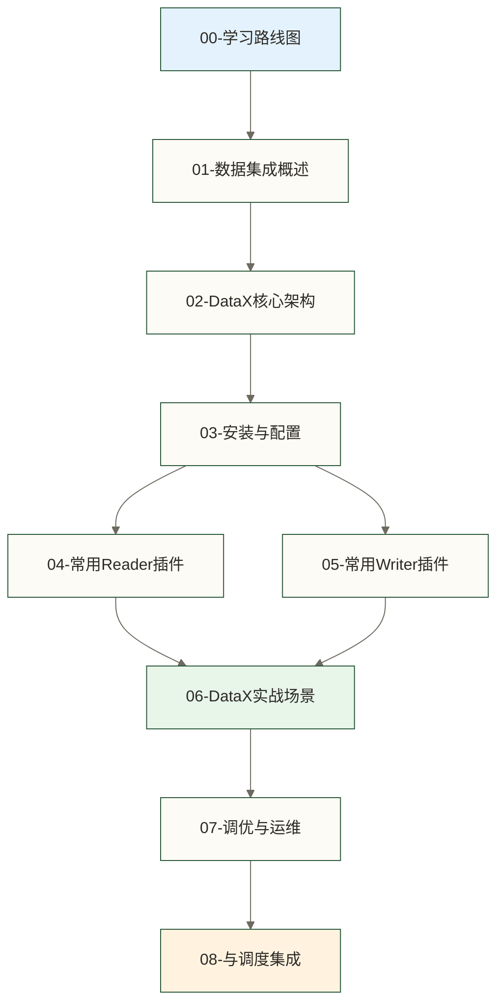
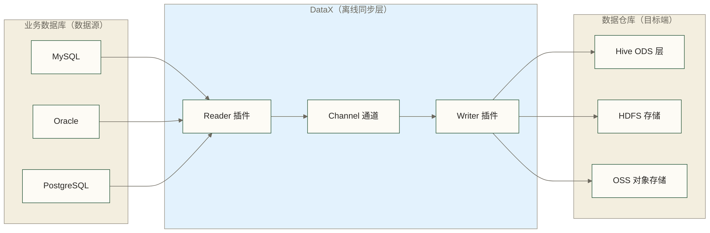

> [!warning] 关联材料边界
> 以下原引用目标缺失或无法唯一确认，已取消跳转并保留提及：MySQL学习路线图；Hive学习路线图；Linux学习路线图；Hadoop学习路线图；DolphinScheduler。相关素材/延伸说明暂不可用，不能据此声称已经提供配套材料。

# DataX 学习路线图 - 离线数据同步完整知识体系

> [!abstract] 这份路线图能给你什么
> - **学习目标**：系统学习 DataX 离线数据同步，为独立完成生产级数据集成任务建立能力基础；实际上线仍需环境适配、数据校验与恢复测试
> - **文档数量**：9 篇专精文档，覆盖从安装到生产运维的完整知识链路
> - **预计时长**：总计 20-30 小时，每篇文档 2-4 小时含实操练习
> - **适用人群**：数据开发工程师、ETL 工程师、数据仓库工程师
> - **核心价值**：面向生产场景的配置模板与问题处理经验导航；模板可用性及经验来源需在对应章节核验

以下为教学假设，并非已核实的真人案例：李明接手了公司的数据仓库建设任务。业务系统跑在 MySQL 上，数仓建在 Hive 里，每天需要把几十张业务表的数据同步过去。他搜了一圈，发现 DataX 是阿里巴巴开源的离线同步工具，可用于异构数据源之间的离线批量同步。但文档零散、配置繁琐，踩坑无数。这份路线图就是为了让你少走弯路，用最短的时间掌握生产中真正需要的 DataX 技能。

---

## 知识地图



---

## 文档导航

### 基础入门（第一步：建立认知）

**[[【技术与工具】/DataX/01-数据集成概述|01-数据集成概述]]**
在动手之前，先搞清楚几个问题：数据集成是什么，离线同步和实时同步各自适合什么场景，市面上那么多工具（DataX、Sqoop、Flink CDC、Canal、Debezium）该怎么选。这篇是选型决策的理论基础。

- 理解离线同步 vs 实时同步的本质区别
- 掌握主流数据集成工具的定位和选型逻辑
- 知道什么场景下选 DataX、什么场景下选 Flink CDC

**[[【技术与工具】/DataX/02-DataX核心架构|02-DataX核心架构]]**
DataX 的架构是 Framework + Plugin 的插件化设计，核心流程是 Reader -> Channel -> Writer 三段式。理解这个模型，才能看懂配置文件，才能在出问题时知道去哪里找原因。

- Reader-Channel-Writer 三段式数据流模型
- 任务切分与并发机制（如何把一张大表切成多个并发任务）
- 流控机制（限速、背压）和脏数据管理

### 安装配置（第二步：跑起来）

**[[【技术与工具】/DataX/03-DataX安装与配置|03-DataX安装与配置]]**
从零安装 DataX，包括 JDK 和 Python 依赖、目录结构解析、配置文件详解，跑通第一个同步任务。这里有国内下载加速方案和常见安装失败的解决方法。

- JDK 安装与配置（原稿列出 JDK 8/11，实际支持范围须按所用 DataX 发行版本验证）
- DataX 目录结构解析（plugin 目录的组织方式）
- 第一个 JSON 配置文件：stream -> stream 测试

### 插件详解（第三步：掌握核心武器）

**[[【技术与工具】/DataX/04-常用Reader插件|04-常用Reader插件]]**
数据从哪里读。覆盖最常用的 6 个 Reader 插件：mysqlreader、postgresqlreader、oraclereader、hdfsreader、ossreader、txtfilereader。每个插件提供完整的 JSON 配置示例和关键参数说明。

**[[【技术与工具】/DataX/05-常用Writer插件|05-常用Writer插件]]**
数据写到哪里去。原稿列出 6 个 Writer 插件：mysqlwriter、hdfswriter、hivewriter、oraclewriter、osswriter、streamwriter；实际可用性须核对所用发行包，hivewriter 不应默认视为标准发行包内置插件，Hive 写入还需区分 HDFS 文件写入与表、分区元数据管理。包括 Hive 分区写入、HDFS 文件格式选择等实用技巧。

### 实战应用（第四步：解决真实问题）

**[[【技术与工具】/DataX/06-DataX实战场景|06-DataX实战场景]]**
最贴近生产的一篇。覆盖五大高频场景：

| 场景 | 核心挑战 | 解决方案 |
|------|---------|---------|
| MySQL 全量同步到 Hive | 大表性能、分区对齐 | splitPk 切分 + 并发调优 |
| MySQL 增量同步到 Hive | 增量字段选择、去重 | WHERE 条件过滤 + 调度配合 |
| 多表批量同步 | 脚本维护成本 | Python 脚本动态生成 JSON |
| 分库分表同步 | 多个数据源合并 | DataX 多 connection 配置 |
| 大表性能调优 | 同步速度瓶颈 | Channel 并发 + 网络带宽优化 |

**[[【技术与工具】/DataX/07-DataX调优与运维|07-DataX调优与运维]]**
生产中真正会遇到的问题：Channel 数量怎么设合适、JVM 内存不够怎么调、脏数据怎么处理、任务失败了怎么重跑、怎么接入监控告警。

**[[【技术与工具】/DataX/08-DataX与调度集成|08-DataX与调度集成]]**
DataX 本身只是一个同步工具，生产环境要配合调度系统使用。这篇讲与 Airflow 和 DolphinScheduler 的集成，以及 Shell 脚本封装的最佳实践和生产部署方案。

---

## 学习路径建议

### 新手路径（1-2 天快速入门）

适合第一次接触 DataX，只需完成第一个同步任务：

```text
01-数据集成概述（了解定位）
→ 03-DataX安装与配置（装好跑通）
→ 04-常用Reader插件（选你要用的）
→ 05-常用Writer插件（选你要写的）
→ 06-DataX实战场景（跑第一个真实同步）
```

### 进阶路径（1 周系统掌握）

适合需要在生产环境使用 DataX 的工程师：

```text
全部 9 篇文档按序学习
重点：06（实战场景）+ 07（调优运维）+ 08（调度集成）
```

### 查阅路径（按需索引）

已经会用 DataX，遇到具体问题时按需查阅：

- 插件配置问题 → [[【技术与工具】/DataX/04-常用Reader插件|04-常用Reader插件]] / [[【技术与工具】/DataX/05-常用Writer插件|05-常用Writer插件]]
- 性能慢 → [[【技术与工具】/DataX/07-DataX调优与运维|07-DataX调优与运维]]
- 与调度集成 → [[【技术与工具】/DataX/08-DataX与调度集成|08-DataX与调度集成]]
- 架构原理疑问 → [[【技术与工具】/DataX/02-DataX核心架构|02-DataX核心架构]]

---

## DataX 在数据架构中的位置



DataX 在整个数据链路中承担的是**离线批量同步**的职责。通常的架构是：

- **业务数据 T+1 同步**：每天凌晨把 MySQL 业务表同步到 Hive ODS 层
- **历史数据迁移**：把旧系统的历史数据一次性迁移到新平台
- **跨系统数据集成**：把多个异构数据源的数据汇聚到统一的数仓

> [!tip] DataX vs Flink CDC 怎么选
> - **DataX**：适合 T+1 的批量同步、历史数据迁移、对实时性要求不高的场景
> - **Flink CDC**：适合分钟级/秒级的实时同步、需要捕获数据变更的场景
>
> 两者经常配合使用：DataX 做初始全量同步，Flink CDC 做后续的实时增量同步。详见 [[【技术与工具】/DataX/01-数据集成概述|01-数据集成概述]] 中的工具对比。

---

## 关联知识

学习 DataX 前建议具备的基础知识：

- MySQL（原引用“MySQL学习路线图”未能确定有效目标，暂不可跳转） - 理解 binlog、索引、分库分表
- Hive（原引用“Hive学习路线图”未能确定有效目标，暂不可跳转） - 理解分区、存储格式（ORC/Parquet）
- Linux（原引用“Linux学习路线图”未能确定有效目标，暂不可跳转） - Shell 脚本基础、crontab 定时任务
- Hadoop（原引用“Hadoop学习路线图”未能确定有效目标，暂不可跳转） - HDFS 基本操作

学完 DataX 后建议继续学习：

- [[【技术与工具】/Flink-CDC/00-Flink-CDC学习路线图|Flink CDC]] - 实时变更捕获与数据同步，可与 DataX 离线同步互补，但不是 DataX 的实时版本
- [[【技术与工具】/Airflow/02-Airflow核心概念|Airflow]] - 生产级调度，管理 DataX 任务
- DolphinScheduler（原引用“DolphinScheduler”未能确定有效目标，暂不可跳转） - 国内主流调度平台，与 DataX 集成紧密

---

#DataX #数据集成 #ETL #离线同步 #数据同步 #数据仓库
