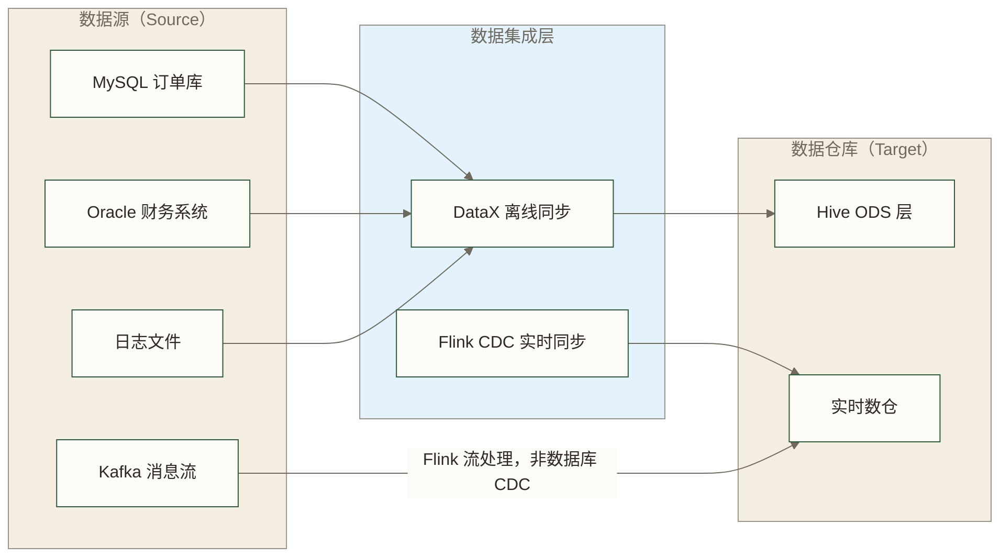
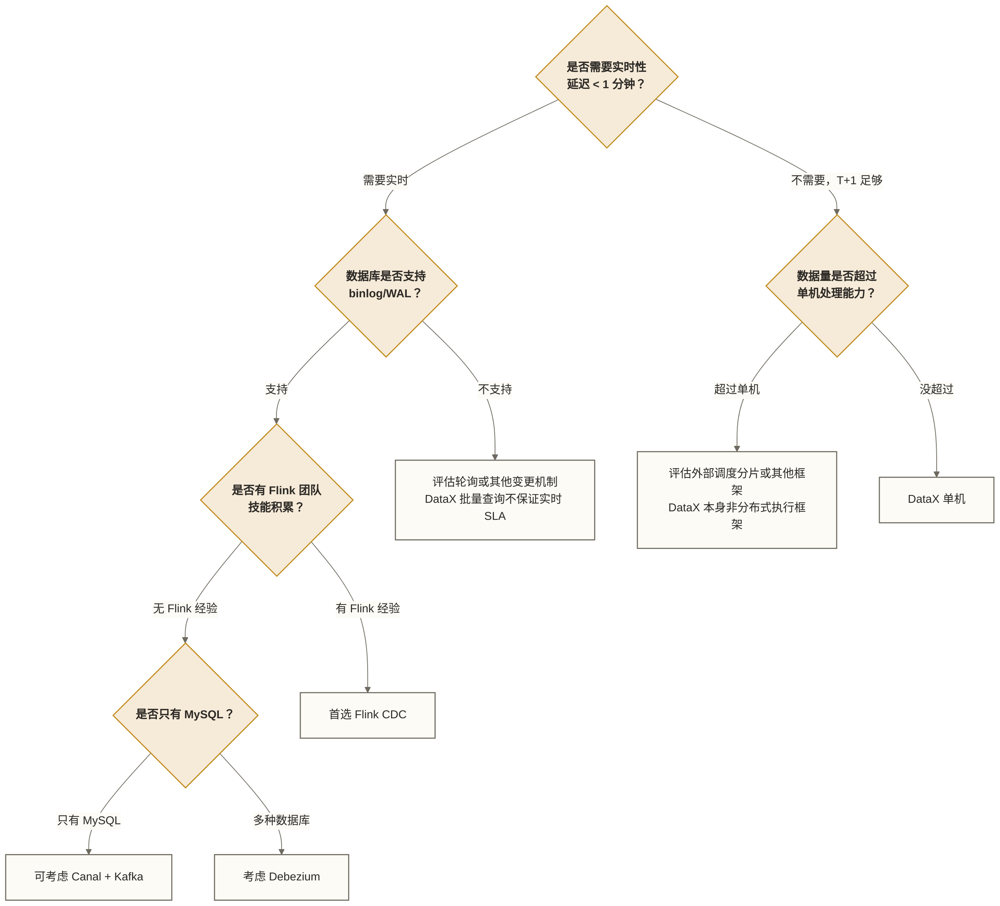

> [!warning] 关联材料边界
> 以下原引用目标缺失或无法唯一确认，已取消跳转并保留提及：Hive学习路线图；Kafka学习路线图；数据管道设计。相关素材/延伸说明暂不可用，不能据此声称已经提供配套材料。

# 数据集成概述 - 离线同步 vs 实时同步与工具选型

> [!abstract] 本文核心内容
> - 什么是数据集成，为什么是数仓建设的第一步
> - 离线同步和实时同步的本质区别与适用场景
> - DataX、Sqoop、Flink CDC、Canal、Debezium 五大工具深度横评
> - 不同业务场景下的选型决策框架

---

## 什么是数据集成

数据集成（Data Integration）是把分散在不同系统、不同格式、不同位置的数据，汇聚到一个统一平台的过程。

用一个具体的场景来理解：一家电商公司的业务数据分布在多个地方——订单数据在 MySQL、用户行为日志在 Kafka、商品信息在 Oracle、历史归档在 OSS。数据分析师要做销售报表，需要把这些数据都拉到数据仓库里才能做跨源分析。**把这些数据从各个业务系统搬运到数仓，就是数据集成要解决的问题。**

数据集成在整个数据链路中的位置：

---

## 离线同步 vs 实时同步

这是数据集成领域最核心的分类，选错了会带来巨大的技术债务。

### 离线同步（Batch Sync）

**核心特征**：周期性批量搬运数据，有固定的同步时间窗口。

最典型的场景：每天凌晨 2 点，把 MySQL 业务库里昨天新增/修改的订单数据同步到 Hive ODS 层，供早上 8 点的日报使用。这就是经典的 **T+1 离线同步**。

| 特征 | 说明 |
|------|------|
| 数据延迟 | 分钟级到小时级（通常是 T+1） |
| 资源消耗 | 集中在同步窗口期，其他时间空闲 |
| 实现复杂度 | 较低，配置化即可完成 |
| 适用数据量 | 从 GB 到 TB 级均适合 |
| 典型工具 | DataX、Sqoop |

**适合离线同步的场景**：
- 日报、周报等非实时报表的数据供给
- 历史数据迁移（把旧系统数据一次性迁入新平台）
- 业务系统数据归档（定期把热数据迁到冷存储）
- 对数据时效性要求在小时级以上的分析场景

### 实时同步（Real-time Sync / CDC）

**核心特征**：持续捕获数据变化，延迟在秒级甚至毫秒级。

典型场景：订单状态从"待支付"变为"已支付"，这个变化需要在 30 秒内反映到实时大屏和风控系统里。这就需要实时同步——监听 MySQL 的 binlog，把每一条数据变更事件实时推送到下游。

| 特征 | 说明 |
|------|------|
| 数据延迟 | 毫秒级到秒级 |
| 资源消耗 | 持续运行，需要稳定的计算资源 |
| 实现复杂度 | 较高，需要处理 Exactly-Once、断点续传等问题 |
| 适用数据量 | 适合高频变更的 OLTP 数据 |
| 典型工具 | Flink CDC、Canal、Debezium |

**适合实时同步的场景**：
- 实时风控（欺诈检测需要秒级响应）
- 实时大屏（销售额、订单量实时刷新）
- 搜索引擎索引实时更新（商品信息变更后立即可搜）
- 缓存双写（数据库变更后同步刷新 Redis）

> [!tip] 判断用离线还是实时的简单标准
> 问自己一个问题：**如果数据晚到 1 小时，会影响业务决策或用户体验吗？**
> - 不影响 → 用离线同步，更简单可靠，维护成本低
> - 影响 → 用实时同步，但要做好更复杂的工程准备

### 全量同步 vs 增量同步

这两个概念和离线/实时是正交的，都可以组合：

| 类型 | 含义 | 适用场景 |
|------|------|---------|
| 全量同步 | 每次同步全部数据 | 数据量小、无法识别增量的场景 |
| 增量同步 | 只同步变化的数据，可包括新增、修改和删除；覆盖范围取决于捕获方式 | 大表；字段查询适用于有可靠增量标识的场景，日志 CDC 可捕获更多变更类型 |
| 全量+增量 | 先全量初始化，再增量追踪 | 标准的数仓同步模式 |

> [!warning] 增量同步的常见踩坑
> 基于查询的增量同步通常依赖"增量标识字段"，如 `create_time`（新增）或 `update_time`（修改）；日志 CDC 通常以日志位点等记录进度，不要求表中存在这些字段。
>
> **坑 1**：表里只有 `create_time` 没有 `update_time`，增量同步会漏掉数据更新
> **坑 2**：`update_time` 字段没有索引，增量查询变成全表扫描，比全量还慢
> **坑 3**：业务代码直接用 SQL UPDATE 没有更新 `update_time`，变更被漏掉
>
> 可按业务约束考虑在数据库层面加触发器维护更新时间，或改用 CDC（捕获 binlog）减少对时间字段的依赖；仍需验证索引、删除捕获、日志保留、源库开销及故障恢复，不能保证彻底规避所有问题。

---

## 五大工具深度横评

### DataX

阿里巴巴开源的离线数据同步框架。原稿称“2011 年内部孵化，2022 年开源”，该时间信息未附来源，开源年份存在疑点，暂不作为已核实历史引用；“国内离线同步标配”的判断也缺少采用率依据。

**架构哲学**：插件化设计，Reader 和 Writer 完全解耦，理论上 N 个 Reader 可以搭配 M 个 Writer，支持 N×M 种同步组合。

**核心优势**：
- 插件丰富：官方支持 20+ 数据源，包括所有主流关系数据库、HDFS、OSS、HBase、Elasticsearch 等
- 配置简单：JSON 格式配置文件，学习成本低
- 生产稳定：阿里内部使用多年，稳定性经过大规模验证
- 流控机制：内置限速（bps/rps）和脏数据处理，对源数据库友好
- 国内社区活跃：中文文档和社区资源丰富

**核心劣势**：
- 只支持离线批量同步，无法做实时
- 不原生支持断点续传（任务失败需要重跑）
- 不支持 DDL 同步（表结构变更需要手动处理）
- 大表切分能力取决于 Reader 插件；常见关系型 Reader 可通过 `splitPk` 指定符合插件要求的整型切分列，该列不必是主键。缺少合适切分列时，需另行评估并行读取方案

**典型使用场景**：MySQL → Hive 的 T+1 离线同步。原稿“是 90% 离线数仓建设的选择”为未核实的采用率表述，不应作为行业统计或选型依据。

### Sqoop

Apache 基金会项目，专门为 Hadoop 生态设计的关系数据库 <-> HDFS 数据传输工具。

**现状**：Sqoop 1.x 已停止维护，Sqoop 2.x 也基本处于停滞状态。在国内，DataX 已经基本替代了 Sqoop 的位置。

**与 DataX 的主要区别**：
- Sqoop 本质上是把同步任务转化为 MapReduce 任务运行，依赖 Hadoop 集群
- DataX 是独立进程，不依赖 Hadoop，更轻量
- Sqoop 的并发控制依赖 YARN 资源管理，DataX 自管并发

> [!warning] 不建议新项目使用 Sqoop
> 新项目应先核对 Sqoop 的项目维护状态，再结合数据源、目标端和运维条件评估 DataX 等替代方案。如果你还在用 Sqoop，可以考虑迁移到 DataX，但需验证类型映射、并发、增量边界和写入语义，不能只做配置文件转换。

### Flink CDC

基于 Apache Flink 的 Change Data Capture 框架，支持实时捕获数据库变更。详细内容见 [[【技术与工具】/Flink-CDC/00-Flink-CDC学习路线图|Flink CDC 学习路线图]]。

**核心特点**：
- 通过读取数据库的变更日志（MySQL binlog、PostgreSQL WAL、Oracle Redo Log）捕获变化；实际延迟取决于连接器、配置、负载与下游写入，不能统一保证毫秒级
- 支持全量+增量一体化：先全量快照，再实时追踪变更；具体支持范围须按版本和连接器确认
- Exactly-Once 语义：端到端不重不漏需要源端、检查点、故障恢复及目标端事务或幂等写入共同满足条件，不能仅凭使用 Flink CDC 保证
- 无锁读取：部分连接器和快照模式可减少或避免锁表，但仍可能产生查询、I/O及日志保留压力，需评估对业务库的影响

**适用场景**：实时数仓、实时入湖（Hudi/Iceberg/Paimon）、数据库同步、实时数据同步到 Kafka

### Canal

阿里巴巴开源的 MySQL binlog 解析工具，核心功能是把 MySQL 的变更解析成结构化的事件消息。

**与 Flink CDC 的关系**：
- Canal 专注于 binlog 解析，可将变更交给客户端消费，也可配合 Kafka 等消息队列使用；消息队列并非所有接入方式的必需组件
- Flink CDC 是完整的数据同步框架，把解析和写入都做了，功能更完整
- 很多架构是：MySQL → Canal → Kafka → Flink → 数仓

**适用场景**：需要把 MySQL 变更解耦到消息队列的架构；对 Canal 已有投入的团队。

### Debezium

Red Hat 开源的 CDC 平台，支持 MySQL、PostgreSQL、Oracle、MongoDB、SQL Server 等多种数据库。

**与 Canal 的主要区别**：
- Canal 只支持 MySQL，Debezium 支持多种数据库
- Debezium 原生集成 Kafka Connect，更适合 Kafka 生态
- Canal 在国内社区更活跃，文档更丰富

**适用场景**：异构数据库环境（非纯 MySQL 环境）、需要接入 Kafka Connect 生态的架构。

---

## 选型决策框架

用 5 个问题确定你的选型：

### 场景化选型建议

| 场景 | 推荐工具 | 理由 |
|------|---------|------|
| MySQL → Hive T+1 同步 | DataX | 可作为批量同步候选，需验证插件、类型映射及同步窗口 |
| Oracle → Hive T+1 同步 | DataX | 可评估 oraclereader，需验证版本、权限、类型映射与吞吐 |
| MySQL → Hudi 实时入湖 | Flink CDC | 可结合 Flink 与 Hudi 连接器实现；需验证版本兼容、主键、Upsert 和端到端一致性条件 |
| MySQL → Kafka 变更事件 | Canal 或 Flink CDC | Canal 更轻量，Flink CDC 更完整 |
| 多数据库 → Kafka | Debezium | 多数据库支持，Kafka Connect 生态 |
| 历史数据一次性迁移 | DataX | 批量高吞吐，一次性任务不需要实时能力 |
| 初始全量 + 持续增量 | 优先评估 Flink CDC 一体化快照；也可评估 DataX（全量）+ Flink CDC（增量） | 跨工具衔接需确定一致性边界和日志起始位点，设计重叠去重与校验，不能直接拼接后假定不重不漏 |

> [!tip] 最实用的建议
> 可供评估的两类技术组合是（不代表已核实的国内团队采用情况）：
> - **离线数仓**：DataX + DolphinScheduler（或 Airflow），搞定 T+1 同步
> - **实时数仓**：Flink CDC + Kafka + Hudi/Paimon，搞定实时入湖
>
> 两套体系可以并行，DataX 负责离线，Flink CDC 负责实时，但可能共享源库、网络和目标端资源，需协调同步窗口、负载与一致性边界。

---

## 数据同步中的通用概念

无论用哪个工具，这些概念都会遇到：

### 全量快照（Full Snapshot）

指对源数据库的某个时刻做完整的数据复制。通常是第一次同步时做，把历史数据全量加载到目标端，作为增量同步的基线。

### 增量捕获（Incremental Capture）

只同步自上次同步以来发生变化的数据。有两种方式：
- **查询方式**：用 `WHERE update_time > 上次同步时间` 过滤，简单但有局限；需处理同时间戳边界、迟提交、回补与删除，避免直接推进水位线造成遗漏
- **日志方式**：读取数据库变更日志（binlog/WAL），是 CDC 的常见方式；可捕获的变更范围取决于日志配置、权限、保留时间及连接器支持

### 幂等写入（Idempotent Write）

同样的数据写多次，结果和写一次一样。这是处理任务重试时的关键特性。部分 DataX Writer 支持 `writeMode: replace`；例如 MySQL Writer 在主键或唯一键约束及确定性数据条件下可用于实现最终行数据的幂等效果，但不是所有 Writer 通用的能力，且 REPLACE 的删除再插入语义可能触发额外副作用。

### 脏数据（Dirty Data）

在同步过程中，因为源和目标数据类型不兼容、字段长度超限等原因导致写入失败的数据。同步工具通常可按配置记录或统计脏数据；是否继续运行取决于工具、插件、错误类型及容错阈值，超过阈值或遇到不可恢复错误仍可能使任务失败。

---

## 相关知识链接

- [[【技术与工具】/DataX/02-DataX核心架构|02-DataX核心架构]] - DataX 内部工作原理详解
- [[【技术与工具】/Flink-CDC/01-CDC技术原理|CDC 技术原理]] - binlog/WAL 的工作机制
- Hive（原引用“Hive学习路线图”未能确定有效目标，暂不可跳转） - 同步目标端的技术基础
- Kafka（原引用“Kafka学习路线图”未能确定有效目标，暂不可跳转） - CDC 事件流的传输通道
- 数据管道设计（原引用“数据管道设计”未能确定有效目标，暂不可跳转） - 数据集成在整体数据架构中的角色

---

#数据集成 #数据同步 #ETL #DataX #FlinkCDC #Canal #Debezium #离线同步 #实时同步 #选型

---

> [!info] 前置知识
> - 了解基本的数据库概念（表、行、列、主键）
> - 知道什么是 ETL（Extract-Transform-Load）或有数据搬运的直觉认知
> - 熟悉 Linux 命令行基础（后续运行 DataX 需要）

---

## 掌握检查

- [ ] 能说出离线同步（批处理）和实时同步（CDC）的核心区别：延迟量级（T+1 vs 秒级）、使用场景、对源库压力的差异
- [ ] 能描述 DataX、Sqoop、Flink CDC、Canal 四种工具各自最适合的场景，以及它们在离线/实时维度上的定位
- [ ] 能解释全量同步和增量同步的区别，说明查询式增量如何使用水位线和增量字段，以及日志 CDC 如何使用日志位点记录进度
- [ ] 能解释什么是幂等写入（Idempotent Write），说明为什么在数据同步中重要（任务重试时数据不重复）
- [ ] 能根据给定场景（如：每天凌晨同步昨日 MySQL 销售数据到 Hive）判断应该选离线同步还是实时同步，并说明理由

---

## 实践练习

**基础题**：给定以下 3 个场景，判断每个场景应选择离线同步还是实时同步，并说明理由：
1. 每天早上 6 点把昨天的订单数据同步到数仓供报表使用
2. 电商平台的库存数量需要在用户下单后秒级同步到搜索系统
3. 将 3 年前的历史订单数据从旧系统迁移到新数仓（一次性操作）

**进阶题**：假设你的团队需要把 MySQL 中的用户行为表（每天新增 500 万条记录，有 `created_at` 字段，无 `updated_at` 字段，数据一旦写入不会修改）同步到 Hive 数仓。请选择合适的工具（DataX/Sqoop/Flink CDC/Canal），说明你的选型理由，并描述增量同步的实现思路（用什么字段做水位线，如何避免遗漏数据）。
