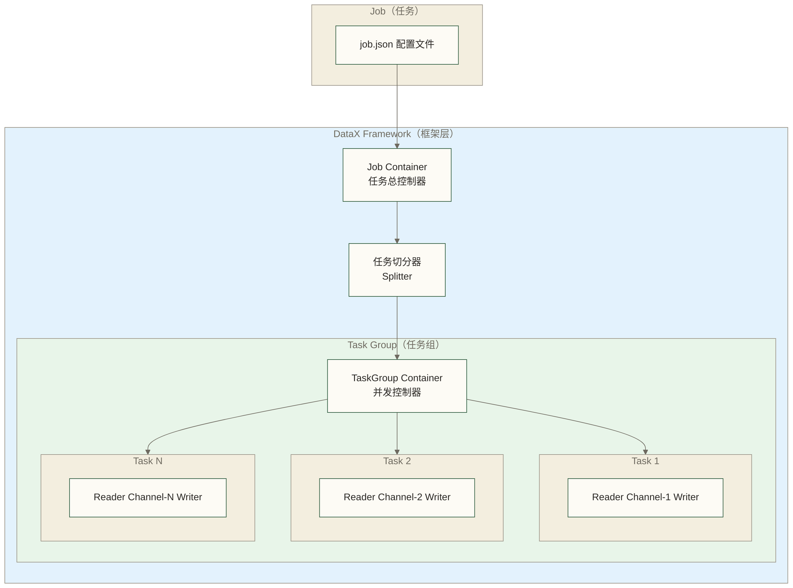
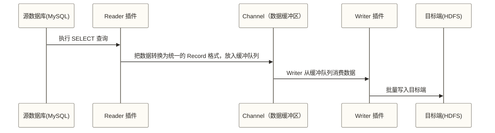
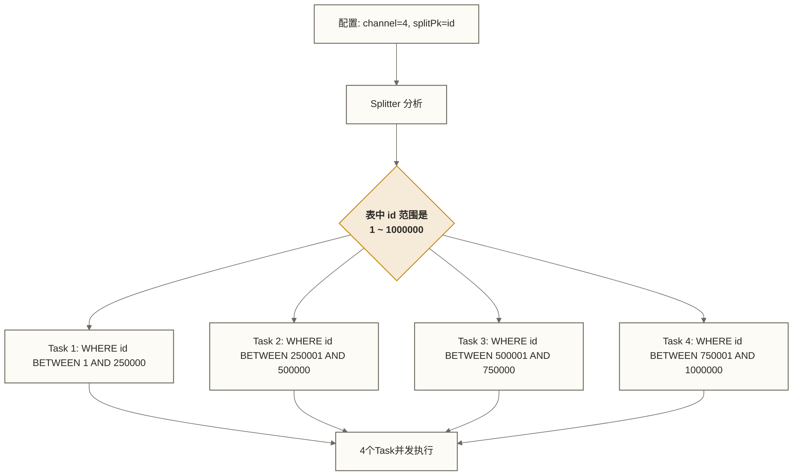
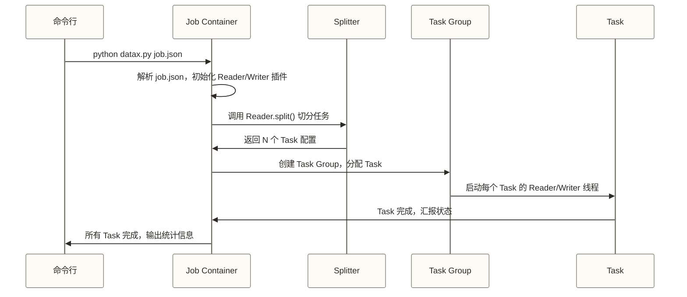

# DataX 核心架构 - Framework + Plugin 插件化设计深度解析

> [!abstract] 本文核心内容
> - DataX 的整体架构设计：Framework + Plugin 模型
> - 数据流动的三个阶段：Reader -> Channel -> Writer
> - 任务切分与并发：如何把一张大表切成多个并行任务
> - 流控机制：如何保护源数据库不被压垮
> - 脏数据处理：同步失败的数据去哪了

---

## 架构设计哲学

DataX 的设计者面临一个经典问题：数据源有几十种（MySQL、Oracle、HDFS、OSS……），目标端也有几十种，如果每种 Source-Target 组合都单独开发，工作量是 N×M 的规模。

解决方案是**插件化架构**：把数据同步拆分成两个独立的部分——"从哪里读"和"写到哪里去"，中间用一个统一的数据交换通道连接。

```text
Reader（N种）+ Writer（M种）≈ N+M 种插件开发工作量，理论上可组合 N×M 种同步路径；实际可用性仍受类型、格式及插件能力限制
```

这就是 DataX 的核心设计：**Framework（框架）+ Plugin（插件）**。

---

## 整体架构



### 核心概念层级

| 概念 | 含义 | 类比 |
|------|------|------|
| **Job** | 一次完整的同步任务，对应一个 JSON 配置文件 | 一个派送单 |
| **Task** | Job 切分后的最小执行单元，一个 Task 同步一部分数据 | 一个快递员负责的区域 |
| **Task Group** | 多个 Task 的并发组，共享资源 | 一个快递站点 |
| **Channel** | Task 内部的数据通道，连接 Reader 和 Writer | 传送带 |

---

## Reader-Channel-Writer 三段式数据流

这是理解 DataX 数据传输过程的核心概念，但还需结合任务调度、插件生命周期和异常处理理解其工作原理。



### Reader：数据读取层

Reader 负责从数据源读取数据，并把数据转换成 DataX 内部统一的 Record 对象格式。

每种数据源对应一个 Reader 插件。以 mysqlreader 为例，它的工作是：
1. 根据配置建立 JDBC 连接
2. 执行 `SELECT` 查询语句
3. 把每一行结果转换成 DataX 的 `Record` 对象（列表格式）
4. 把 Record 写入 Channel 的阻塞队列

Reader 对外暴露两个关键方法：
- `startRead(RecordSender sender)`：开始读取，把 Record 通过 sender 发送到 Channel
- `split(int adviceNumber)`：把当前读取任务切分成多个子任务

### Channel：数据交换通道

Channel 是 Reader 和 Writer 之间的**内存缓冲区**，解耦了读写速度的差异。

关键特性：
- **阻塞队列**：如果 Writer 跟不上 Reader 的速度，Channel 会积满，Reader 自动暂停（背压机制）
- **流量统计**：Channel 记录了流过的字节数和记录数，用于流速监控和限速
- **限速点**：DataX 的限速（bytesLimitPerSecond/recordsLimitPerSecond）就是在 Channel 层实现的

内存 Channel 使用有界缓冲队列；原稿所述“默认容量为 512 条记录”未注明版本和配置依据，应以实际发行版本的 Channel 配置为准。

### Writer：数据写入层

Writer 负责从 Channel 消费 Record，并写入目标数据源。

以 hdfswriter 为例，它的工作是：
1. 通过 RecordReceiver 从 Channel 获取 Record；内部传输批量与插件写入批量不能混为一谈，原稿“batchSize 默认 1024”未核实，不应作为 hdfswriter 默认参数使用
2. 把 Record 转换成插件支持的目标格式（如 ORC、Text；原稿列出的 Parquet 支持需核对实际插件版本）
3. 将数据写入 HDFS 文件

> [!note] Record 的统一格式
> DataX 内部用 `Record` 对象表示一行数据，本质是一个 `Column` 的列表。
> 每个 `Column` 包含：值（Object 类型）、数据类型（String/Long/Double/Date/Bytes/Bool）。
>
> Reader 把源数据转成 Record，Writer 把 Record 转成目标格式。这个统一的中间格式是插件解耦的关键。

---

## 任务切分与并发

DataX 先在任务层面切分数据，再由框架启动 Reader/Writer 等线程并发执行任务；任务切分与线程执行是相互配合的两个层面。

### 切分过程



### splitPk 的工作原理

mysqlreader 等关系数据库 Reader 支持 `splitPk` 参数，指定用哪个字段做切分。DataX 会：

1. 执行 `SELECT MIN(splitPk), MAX(splitPk) FROM table` 获取范围
2. 根据建议切分数和插件策略划分范围，生成多个 WHERE 子句；上图仅示意四段划分，实际 Task 数不保证等于 channel 数
3. 每个子任务执行带有不同 WHERE 条件的 SELECT

```json
"reader": {
    "name": "mysqlreader",
    "parameter": {
        "splitPk": "id",
        "column": ["*"],
        "connection": [...]
    }
}
```

> [!warning] splitPk 的局限性
> - 对常见开源 mysqlreader，应优先使用其支持的整数型字段作为 `splitPk`，最好选择分布较均匀的主键；其他插件或版本的类型支持需单独核对
> - 如果数据分布不均匀（如 id 有大量空洞），切分效果会不理想，部分任务数据量很少
> - 不应假定字符串、浮点数或日期字段可作为 mysqlreader 的 `splitPk`
> - 没有合适的 `splitPk` 时，单表范围切分受到限制；若配置包含多表、多个独立查询或其他可切分输入，仍可能产生多个 Task，并非必须设置 channel=1

### 实际并发控制

配置项 `job.setting.speed.channel` 控制总并发数。DataX 会把这些 Channel 分配到 Task Group 中管理。

```json
"setting": {
    "speed": {
        "channel": 4
    }
}
```

**在只显式设置 channel 的简化情形下，同时运行的 Task 数通常不超过 min(channel数, 切分出的Task数)**；这不是线程总数，每个 Task 通常包含 Reader/Writer 线程，框架还存在管理线程，速率配置也可能影响实际并发分配。

---

## 流控机制

流控（Rate Limiting）是 DataX 保护源数据库的核心机制。生产环境直接怼业务主库同步，如果不限速，可能把数据库 I/O 打满，影响线上业务。

### 全局限速（Job 级别）

```json
"setting": {
    "speed": {
        "channel": 4,
        "byte": 10485760,
        "record": 10000
    }
}
```

- `byte`：Job 级字节速率限制，单位 bytes/second。`10485760` = 10 MiB/s
- `record`：Job 级记录速率限制，单位 records/second

**注意**：`job.setting.speed.byte` 和 `job.setting.speed.record` 表达 Job 级目标限速，不应解释成每个 Channel 各自拥有该额度。框架结合 Channel 级配置计算并发并执行限速，实际规则需按所用版本核对。

### Channel 级别的限速

Channel 级限速属于框架配置，常见配置路径为 `core.transport.channel.speed.byte` 和 `core.transport.channel.speed.record`，需按发行版本核对配置位置。下面仍是 `job.setting` 内的 Job 级限速片段，不是 Channel 级配置：

```json
"setting": {
    "speed": {
        "channel": 4,
        "record": 500,
        "byte": 1048576
    }
}
```

> [!tip] 生产环境限速推荐
> 原稿建议的每个 Channel **1-5 MB/s** 和凌晨 **0:00-6:00** 未提供负载测试依据，仅可作为待验证的试验参考，不能作为通用安全阈值；应按实际业务低峰、查询开销和数据库容量逐步测试。
>
> 如果有从库，可优先评估从**从库读取**；除 JDBC 地址外，还需核对权限、复制延迟和一致性要求。从库读取可降低主库直接查询压力，但不能保证完全不影响主库。

---

## 脏数据管理

脏数据（Dirty Data）通常指插件在读取、转换或写入过程中识别并上报的异常记录。DataX 提供脏数据统计和错误阈值机制，但并非所有异常都能转为脏数据；超出阈值或发生不可恢复错误时，整个任务仍可能失败。

### 脏数据产生的原因

| 原因 | 示例 |
|------|------|
| 源目标数据类型不兼容 | 源端是 VARCHAR(50)，目标端是 INT |
| 字段长度超限 | 源端内容 500 个字符，目标端只有 255 |
| 必填字段为空 | 目标端 NOT NULL 约束，但源端有 NULL |
| 编码问题 | 源端有特殊字符，目标端不支持 |

### 脏数据配置

```json
"setting": {
    "errorLimit": {
        "record": 10,
        "percentage": 0.02
    }
}
```

- `record`：允许的最大脏数据条数。超过这个数，任务失败
- `percentage`：允许的脏数据占比。`0.02` 表示允许 2% 的脏数据率

### 脏数据的去向

插件上报的脏数据可能以日志形式输出，具体格式、输出数量和记录字段受版本及插件实现影响，不能假定日志保存了全部失败行。以下是教学示意格式，不是已核实的固定日志格式：

```text
Dirty data: [写入失败原因] Record: {字段1=值1, 字段2=值2, ...}
```

在生产中，可以配合 Shell 脚本把脏数据日志提取出来，存入专门的脏数据表，后续人工处理。

> [!warning] 脏数据量 0 不代表数据完整
> 脏数据可能在读取、转换或写入阶段被上报，源端数据本身的质量问题（空值、格式错误等）不一定会被计入脏数据。
>
> 真正的数据质量保障需要在 ETL 过程中做数据校验，而不是仅靠 DataX 的脏数据统计。

---

## Job 配置文件结构解析

DataX Job 配置文件的结构骨架如下；插件参数尚未填写，不能直接执行。其他示例中的省略号也只是占位符，不是合法 JSON：

```json
{
    "job": {
        "setting": {
            "speed": {
                "channel": 4,
                "byte": 10485760
            },
            "errorLimit": {
                "record": 0,
                "percentage": 0.02
            }
        },
        "content": [
            {
                "reader": {
                    "name": "mysqlreader",
                    "parameter": {

                    }
                },
                "writer": {
                    "name": "hdfswriter",
                    "parameter": {

                    }
                }
            }
        ]
    }
}
```

### 关键字段说明

| 字段路径 | 说明 |
|---------|------|
| `job.setting.speed.channel` | 并发数，核心调优参数 |
| `job.setting.speed.byte` | Job 级字节速率限制，具体生效规则需结合框架配置 |
| `job.setting.errorLimit.record` | 允许的脏数据条数上限 |
| `job.content[0].reader.name` | Reader 插件名称，如 `mysqlreader` |
| `job.content[0].writer.name` | Writer 插件名称，如 `hdfswriter` |

---

## DataX 的执行流程

理解执行流程有助于排查问题：



### 关键统计信息

任务成功后，DataX 会输出统计摘要；以下日期、耗时、流量和记录数为原稿未核实的教学示例，不对应已验证的运行成果，也不用于性能基准或精确指标推导：

```text
任务启动时刻                    : 2026-03-18 02:00:00
任务结束时刻                    : 2026-03-18 02:05:32
任务总计耗时                    : 332s
任务平均流量                    : 5.12MB/s
记录写入速度                    : 15234rec/s
读出记录总数                    : 5000000
读写失败总数                    : 0
```

> [!tip] 从统计信息判断性能瓶颈
> - **任务平均流量低**（< 1 MB/s）：可能是 Channel 数太少，或源数据库 I/O 瓶颈
> - **读写失败总数 > 0**：有脏数据，需要检查日志找原因
> - **任务耗时超预期**：检查 Channel 数配置，看是否可以增加并发

---

## 相关文档

- [[【技术与工具】/DataX/03-DataX安装与配置|03-DataX安装与配置]] - 安装完成后实际跑起来
- [[【技术与工具】/DataX/04-常用Reader插件|04-常用Reader插件]] - 各 Reader 插件的详细配置
- [[【技术与工具】/DataX/05-常用Writer插件|05-常用Writer插件]] - 各 Writer 插件的详细配置
- [[【技术与工具】/DataX/07-DataX调优与运维|07-DataX调优与运维]] - 基于架构理解进行性能调优

---

#DataX #架构 #插件化 #Reader #Writer #Channel #任务切分 #流控 #脏数据

---

> [!info] 前置知识
> - 了解数据集成的基本概念，参考 [[【技术与工具】/DataX/01-数据集成概述|01-数据集成概述]]
> - 理解并发/线程的基本概念（Channel 的并发性质）
> - 知道什么是 JSON 格式（DataX Job 配置文件使用 JSON）

---

## 掌握检查

- [ ] 能画出 DataX 的三层架构（Framework → Job → Task），并说明每一层的职责：Framework 负责调度和流控，Job 是一次完整同步任务，Task 是切分后的并行执行单元
- [ ] 能解释 Channel 是什么：Reader 和 Writer 之间的数据传输通道，每个运行中的 Task 通常包含一个 Channel 及 Reader/Writer 线程；`channel` 是并发控制参数，实际并发还受切分出的 Task 数、速率配置与框架调度影响
- [ ] 能解释 DataX 如何切分任务：通过 `splitPk`（主键范围切分）或按文件切分，切出多个 Task 后并行执行
- [ ] 能说明脏数据（Dirty Data）的处理机制：通过 `errorLimit` 配置失败行数和比例阈值，超出有效阈值则任务失败；日志可能只输出部分异常记录，不能替代完整的失败数据留存与补偿机制
- [ ] 能解释为什么 DataX 的插件化设计（Reader/Writer 独立插件）支持源端与目标端的组合复用：新增一个数据源通常只需开发对应的 Reader 或 Writer 插件，但具体同步路径仍受类型、格式及插件能力限制，并非任意组合都可直接使用

---

## 实践练习

**基础题**：阅读一个 DataX Job JSON 文件，识别其中的 `reader`、`writer`、`channel` 配置项，回答：这个任务从哪里读、写到哪里、并发度是多少、允许多少脏数据？

**进阶题**：假设一张 MySQL 大表有 1 亿行数据，主键为自增 `id`（1 到 100000000）。在教学模型中进一步假设 id 连续、数据均匀且切分为 8 段，描述 `splitPk: id` 和 `channel: 8` 的范围划分思路，并估算每段大约处理多少行数据；说明实际插件生成的 Task 数为何不一定等于 8。说明如果表没有主键或主键不是插件支持的切分类型，应如何选择其他切分字段或组织多个独立输入任务。

---

## 下一步

[[【技术与工具】/DataX/03-DataX安装与配置|03-DataX安装与配置]] - 理解架构后，动手安装 DataX 并运行第一个同步任务
