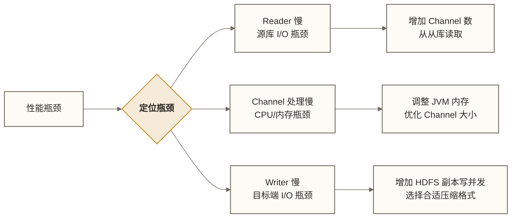

# DataX 实战场景 - MySQL→Hive 全量增量同步完整方案

> [!abstract] 本文核心内容
> - 场景 1：MySQL → Hive 全量同步（建立基线数据）
> - 场景 2：MySQL → Hive 增量同步（T+1 日常同步）
> - 场景 3：多表批量同步（Python 脚本动态生成 Job）
> - 场景 4：分库分表同步（多数据源合并）
> - 场景 5：大表性能调优（5 亿条记录的教学场景）

---

## 场景 1：MySQL → Hive 全量同步

**业务背景（教学假设）**：假设电商平台新建数仓，需要把 MySQL 里的历史订单数据（5000 万条）一次性全量同步到 Hive ODS 层，作为增量同步的基线；该规模不是已核实的企业案例数据。

### Hive 建表

```sql
CREATE TABLE IF NOT EXISTS ods.ods_orders (
    order_id     BIGINT,
    user_id      BIGINT,
    order_status STRING,
    amount       DECIMAL(12,2),
    create_time  TIMESTAMP,
    update_time  TIMESTAMP
)
PARTITIONED BY (dt STRING)
STORED AS ORC
TBLPROPERTIES ('orc.compress'='SNAPPY');
```

### DataX Job 配置

```json
{
    "job": {
        "setting": {
            "speed": {
                "channel": 8,
                "bps": 52428800
            },
            "errorLimit": {
                "record": 0,
                "percentage": 0.0
            }
        },
        "content": [
            {
                "reader": {
                    "name": "mysqlreader",
                    "parameter": {
                        "username": "datax_reader",
                        "password": "readonly_pass",
                        "column": [
                            "order_id",
                            "user_id",
                            "order_status",
                            "amount",
                            "create_time",
                            "update_time"
                        ],
                        "splitPk": "order_id",
                        "connection": [
                            {
                                "table": ["orders"],
                                "jdbcUrl": [
                                    "jdbc:mysql://10.0.0.2:3306/shop_db?useUnicode=true&characterEncoding=utf8&useSSL=false&serverTimezone=Asia/Shanghai"
                                ]
                            }
                        ]
                    }
                },
                "writer": {
                    "name": "hdfswriter",
                    "parameter": {
                        "defaultFS": "hdfs://mycluster",
                        "path": "/user/hive/warehouse/ods.db/ods_orders/dt=${dt}",
                        "fileType": "orc",
                        "fileName": "ods_orders",
                        "writeMode": "overwrite",
                        "compress": "SNAPPY",
                        "encoding": "UTF-8",
                        "column": [
                            {"name": "order_id",     "type": "BIGINT"},
                            {"name": "user_id",      "type": "BIGINT"},
                            {"name": "order_status", "type": "STRING"},
                            {"name": "amount",       "type": "DECIMAL"},
                            {"name": "create_time",  "type": "TIMESTAMP"},
                            {"name": "update_time",  "type": "TIMESTAMP"}
                        ],
                        "hadoopConfig": {
                            "dfs.nameservices": "mycluster",
                            "dfs.ha.namenodes.mycluster": "nn1,nn2",
                            "dfs.namenode.rpc-address.mycluster.nn1": "hadoop-nn1:9000",
                            "dfs.namenode.rpc-address.mycluster.nn2": "hadoop-nn2:9000",
                            "dfs.client.failover.proxy.provider.mycluster": "org.apache.hadoop.hdfs.server.namenode.ha.ConfiguredFailoverProxyProvider"
                        }
                    }
                }
            }
        ]
    }
}
```

### 同步后刷新 Hive 分区

DataX 写的是 HDFS 文件，Hive 元数据还不知道这个分区，需要手动添加：

```bash
# 方式 1：添加单个分区
hive -e "ALTER TABLE ods.ods_orders ADD IF NOT EXISTS PARTITION (dt='2026-03-18') LOCATION '/user/hive/warehouse/ods.db/ods_orders/dt=2026-03-18';"

# 方式 2：自动修复所有分区（大量分区时用这个）
hive -e "MSCK REPAIR TABLE ods.ods_orders;"
```

### 完整执行脚本

```bash
#!/bin/bash
# full_sync_orders.sh

DATE=${1:-$(date -d "yesterday" +%Y-%m-%d)}
JOB_FILE="/opt/datax/jobs/ods_orders_full.json"

echo "[$(date)] 开始全量同步 orders 表，目标分区: dt=${DATE}"

# 执行同步
python3 /opt/datax/datax/bin/datax.py "${JOB_FILE}" -p "-Ddt=${DATE}"

if [ $? -ne 0 ]; then
    echo "[$(date)] DataX 同步失败，退出"
    exit 1
fi

# 刷新 Hive 分区
echo "[$(date)] 刷新 Hive 分区"
hive -e "ALTER TABLE ods.ods_orders ADD IF NOT EXISTS PARTITION (dt='${DATE}');"

echo "[$(date)] 全量同步完成"
```

---

## 场景 2：MySQL → Hive 增量同步（T+1）

**业务背景**：全量基线数据已经同步完成，现在需要每天凌晨 2 点把昨天新增和修改的订单数据同步到 Hive ODS 层对应分区。

### 增量同步策略

增量同步依赖 `update_time` 字段：
- 抽取条件：`update_time >= 昨天 00:00:00 AND update_time < 今天 00:00:00`
- 目标分区：`dt=昨天日期`
- 写入模式：示例配置为 `overwrite`，意图覆盖昨天的分区数据；须核验插件是否支持，并满足下文的完整替换、无并发写入和失败处理条件，不能仅凭此配置保证幂等。

```json
{
    "job": {
        "setting": {
            "speed": {
                "channel": 4,
                "bps": 20971520
            },
            "errorLimit": {
                "record": 10,
                "percentage": 0.01
            }
        },
        "content": [
            {
                "reader": {
                    "name": "mysqlreader",
                    "parameter": {
                        "username": "datax_reader",
                        "password": "readonly_pass",
                        "column": [
                            "order_id", "user_id", "order_status",
                            "amount", "create_time", "update_time"
                        ],
                        "where": "update_time >= '${start_time}' AND update_time < '${end_time}'",
                        "splitPk": "order_id",
                        "connection": [
                            {
                                "table": ["orders"],
                                "jdbcUrl": [
                                    "jdbc:mysql://10.0.0.2:3306/shop_db?useUnicode=true&characterEncoding=utf8"
                                ]
                            }
                        ]
                    }
                },
                "writer": {
                    "name": "hdfswriter",
                    "parameter": {
                        "defaultFS": "hdfs://mycluster",
                        "path": "/user/hive/warehouse/ods.db/ods_orders/dt=${dt}",
                        "fileType": "orc",
                        "fileName": "ods_orders",
                        "writeMode": "overwrite",
                        "compress": "SNAPPY",
                        "column": [
                            {"name": "order_id",     "type": "BIGINT"},
                            {"name": "user_id",      "type": "BIGINT"},
                            {"name": "order_status", "type": "STRING"},
                            {"name": "amount",       "type": "DECIMAL"},
                            {"name": "create_time",  "type": "TIMESTAMP"},
                            {"name": "update_time",  "type": "TIMESTAMP"}
                        ]
                    }
                }
            }
        ]
    }
}
```

### 调度脚本

```bash
#!/bin/bash
# incremental_sync_orders.sh

# 默认同步昨天的数据
TARGET_DATE=${1:-$(date -d "yesterday" +%Y-%m-%d)}
START_TIME="${TARGET_DATE} 00:00:00"
END_TIME=$(date -d "${TARGET_DATE} + 1 day" +"%Y-%m-%d")
END_TIME="${END_TIME} 00:00:00"

echo "[$(date)] 增量同步订单，时间范围: ${START_TIME} ~ ${END_TIME}"

python3 /opt/datax/datax/bin/datax.py \
    /opt/datax/jobs/ods_orders_incremental.json \
    -p "-Dstart_time='${START_TIME}' -Dend_time='${END_TIME}' -Ddt=${TARGET_DATE}"

if [ $? -ne 0 ]; then
    echo "[$(date)] 同步失败"
    exit 1
fi

# 刷新分区
hive -e "ALTER TABLE ods.ods_orders ADD IF NOT EXISTS PARTITION (dt='${TARGET_DATE}');"

echo "[$(date)] 增量同步完成，分区 dt=${TARGET_DATE}"
```

> [!warning] 增量同步的幂等性边界
> 上述 `writeMode: overwrite` 尚须按实际 hdfswriter 版本核验，不能据此保证覆盖或幂等。只有目标日期的数据被完整替换、没有并发写入，并妥善处理部分失败时，重跑才不会累积重复数据。
> - 补录记录仅在其 `update_time` 落入本次抽取窗口时才会被读到；窗口外补录需要另行回补。
> - 日期分区保存的是该窗口内的变化记录，不会自动合并其他日期的订单版本或捕获物理删除。
>
> **前提**：必须明确全量基线与增量目录的关系，避免同日增量替换全量基线，并验证源数据一致性及目标发布流程。

---

## 场景 3：多表批量同步

**业务背景**：数仓 ODS 层需要同步 MySQL 的 50+ 张表，每天都要同步。如果每张表写一个 JSON 文件，维护成本极高。

### Python 动态生成 Job 配置

```python
#!/usr/bin/env python3
# generate_datax_jobs.py

import json
import subprocess
from datetime import datetime, timedelta

# 要同步的表配置
TABLES_CONFIG = [
    {
        "table": "orders",
        "time_column": "update_time",
        "split_pk": "order_id",
        "columns": ["order_id", "user_id", "order_status", "amount", "create_time", "update_time"],
        "hive_columns": [
            {"name": "order_id",     "type": "BIGINT"},
            {"name": "user_id",      "type": "BIGINT"},
            {"name": "order_status", "type": "STRING"},
            {"name": "amount",       "type": "DECIMAL"},
            {"name": "create_time",  "type": "TIMESTAMP"},
            {"name": "update_time",  "type": "TIMESTAMP"}
        ]
    },
    {
        "table": "users",
        "time_column": "register_time",  # 仅抽取该日注册的用户，不捕获后续资料修改
        "split_pk": "user_id",
        "columns": ["user_id", "username", "phone", "email", "register_time"],
        "hive_columns": [
            {"name": "user_id",       "type": "BIGINT"},
            {"name": "username",      "type": "STRING"},
            {"name": "phone",         "type": "STRING"},
            {"name": "email",         "type": "STRING"},
            {"name": "register_time", "type": "TIMESTAMP"}
        ]
    },
    # 更多表...
]

MYSQL_CONFIG = {
    "username": "datax_reader",
    "password": "readonly_pass",
    "host": "10.0.0.2",
    "port": 3306,
    "database": "shop_db"
}

HDFS_CONFIG = {
    "defaultFS": "hdfs://mycluster",
    "warehouse": "/user/hive/warehouse/ods.db"
}


def generate_job(table_config, dt, start_time, end_time):
    """动态生成 DataX Job 配置"""
    table = table_config["table"]
    jdbc_url = (f"jdbc:mysql://{MYSQL_CONFIG['host']}:{MYSQL_CONFIG['port']}"
                f"/{MYSQL_CONFIG['database']}"
                f"?useUnicode=true&characterEncoding=utf8&serverTimezone=Asia/Shanghai")

    job = {
        "job": {
            "setting": {
                "speed": {"channel": 4, "bps": 20971520},
                "errorLimit": {"record": 10, "percentage": 0.01}
            },
            "content": [{
                "reader": {
                    "name": "mysqlreader",
                    "parameter": {
                        "username": MYSQL_CONFIG["username"],
                        "password": MYSQL_CONFIG["password"],
                        "column": table_config["columns"],
                        "where": f"{table_config['time_column']} >= '{start_time}' AND {table_config['time_column']} < '{end_time}'",
                        "splitPk": table_config["split_pk"],
                        "connection": [{
                            "table": [table],
                            "jdbcUrl": [jdbc_url]
                        }]
                    }
                },
                "writer": {
                    "name": "hdfswriter",
                    "parameter": {
                        "defaultFS": HDFS_CONFIG["defaultFS"],
                        "path": f"{HDFS_CONFIG['warehouse']}/ods_{table}/dt={dt}",
                        "fileType": "orc",
                        "fileName": f"ods_{table}",
                        "writeMode": "overwrite",
                        "compress": "SNAPPY",
                        "column": table_config["hive_columns"]
                    }
                }
            }]
        }
    }
    return job


def run_sync(dt=None):
    """执行所有表的同步"""
    if dt is None:
        yesterday = datetime.now() - timedelta(days=1)
        dt = yesterday.strftime("%Y-%m-%d")

    start_time = f"{dt} 00:00:00"
    end_time = (datetime.strptime(dt, "%Y-%m-%d") + timedelta(days=1)).strftime("%Y-%m-%d") + " 00:00:00"

    print(f"开始批量同步，目标日期: {dt}，时间范围: {start_time} ~ {end_time}")

    failed_tables = []

    for table_config in TABLES_CONFIG:
        table = table_config["table"]
        print(f"  同步表: {table} ...", end=" ")

        # 生成临时 Job 文件
        job = generate_job(table_config, dt, start_time, end_time)
        job_file = f"/tmp/datax_job_{table}_{dt.replace('-', '')}.json"

        with open(job_file, "w", encoding="utf-8") as f:
            json.dump(job, f, ensure_ascii=False, indent=4)

        # 执行 DataX
        result = subprocess.run(
            ["python3", "/opt/datax/datax/bin/datax.py", job_file],
            capture_output=True, text=True
        )

        if result.returncode == 0:
            print("SUCCESS")
            # 刷新 Hive 分区
            subprocess.run([
                "hive", "-e",
                f"ALTER TABLE ods.ods_{table} ADD IF NOT EXISTS PARTITION (dt='{dt}');"
            ], check=True)
        else:
            print(f"FAILED")
            print(f"    错误信息: {result.stderr[-500:]}")
            failed_tables.append(table)

    if failed_tables:
        print(f"\n失败的表: {', '.join(failed_tables)}")
        return False
    else:
        print(f"\n所有表同步成功")
        return True


if __name__ == "__main__":
    import sys
    dt = sys.argv[1] if len(sys.argv) > 1 else None
    success = run_sync(dt)
    sys.exit(0 if success else 1)
```

运行方式：

```bash
# 同步昨天的数据
python3 generate_datax_jobs.py

# 同步指定日期
python3 generate_datax_jobs.py 2026-03-17
```

---

## 场景 4：分库分表同步

**业务背景**：订单表按用户 ID 分库（4 个库），按月分表（每个库有 12 张历史月表）。需要把所有分片数据汇聚到 Hive 中。

### 多 connection 配置

DataX 的 `connection` 支持配置多个数据源：

```json
{
    "reader": {
        "name": "mysqlreader",
        "parameter": {
            "username": "datax_reader",
            "password": "readonly_pass",
            "column": ["order_id", "user_id", "amount", "create_time"],
            "connection": [
                {
                    "table": ["orders_2026_01", "orders_2026_02", "orders_2026_03"],
                    "jdbcUrl": [
                        "jdbc:mysql://shard-db-1:3306/orders_db_0?useUnicode=true&characterEncoding=utf8"
                    ]
                },
                {
                    "table": ["orders_2026_01", "orders_2026_02", "orders_2026_03"],
                    "jdbcUrl": [
                        "jdbc:mysql://shard-db-2:3306/orders_db_1?useUnicode=true&characterEncoding=utf8"
                    ]
                },
                {
                    "table": ["orders_2026_01", "orders_2026_02", "orders_2026_03"],
                    "jdbcUrl": [
                        "jdbc:mysql://shard-db-3:3306/orders_db_2?useUnicode=true&characterEncoding=utf8"
                    ]
                },
                {
                    "table": ["orders_2026_01", "orders_2026_02", "orders_2026_03"],
                    "jdbcUrl": [
                        "jdbc:mysql://shard-db-4:3306/orders_db_3?useUnicode=true&characterEncoding=utf8"
                    ]
                }
            ]
        }
    }
}
```

> [!note] 分库分表同步的限制
> 当配置多个 `connection` 时，`splitPk` 仍然有效，但切分是**在每个 connection 内部**进行的。
>
> 如果各分片的 order_id 范围有重叠，须先确定业务主键是否需要包含分片标识。本文的 hdfswriter/Hive 文件目标不能用 `writeMode: replace` 处理主键冲突；应保留必要的来源标识，并在后续合并层按业务规则去重或处理冲突。

---

## 场景 5：大表性能调优

**业务背景（教学假设）**：假设单表有 5 亿条记录，要求每次全量同步在 4 小时凌晨窗口内完成；这是容量规划目标，不是本文已验证的达成结果。

### 调优方向



### 高性能配置

```json
{
    "job": {
        "setting": {
            "speed": {
                "channel": 16,
                "bps": 0
            },
            "errorLimit": {
                "record": 1000,
                "percentage": 0.001
            }
        },
        "content": [
            {
                "reader": {
                    "name": "mysqlreader",
                    "parameter": {
                        "username": "datax_reader",
                        "password": "readonly_pass",
                        "column": ["order_id", "user_id", "amount", "create_time"],
                        "splitPk": "order_id",
                        "fetchSize": 10000,
                        "connection": [
                            {
                                "table": ["big_orders"],
                                "jdbcUrl": [
                                    "jdbc:mysql://10.0.0.2:3306/shop_db?useUnicode=true&characterEncoding=utf8&useSSL=false&rewriteBatchedStatements=true"
                                ]
                            }
                        ]
                    }
                },
                "writer": {
                    "name": "hdfswriter",
                    "parameter": {
                        "defaultFS": "hdfs://mycluster",
                        "path": "/user/hive/warehouse/ods.db/ods_big_orders/dt=2026-03-18",
                        "fileType": "orc",
                        "fileName": "ods_big_orders",
                        "writeMode": "overwrite",
                        "compress": "SNAPPY",
                        "column": [
                            {"name": "order_id",    "type": "BIGINT"},
                            {"name": "user_id",     "type": "BIGINT"},
                            {"name": "amount",      "type": "DECIMAL"},
                            {"name": "create_time", "type": "TIMESTAMP"}
                        ]
                    }
                }
            }
        ]
    }
}
```

### 调整 JVM 内存

大数据量同步时，应先核对实际 JVM 堆参数并观察堆使用与 GC；数据总量大不意味着默认 1G 堆一定不足。确有内存瓶颈时，再验证本发行版支持的启动参数入口：

```bash
# 方式 1：直接修改 datax.py（不推荐，升级会丢失）
# 找到 JVM 启动参数，修改 -Xmx 值

# 方式 2：修改 conf/core.json（推荐）
# 把 "entry.jvm" 改成更大的内存
```

编辑 `/opt/datax/datax/conf/core.json`：

```json
{
    "entry": {
        "jvm": "-server -Xms4g -Xmx4g -Xmn2g -XX:+UseG1GC -XX:MaxGCPauseMillis=200"
    }
}
```

> [!tip] Channel 数量的最优值
> Channel 数量不是越多越好。过多的并发会：
> 1. 增加源数据库的连接数和查询压力
> 2. 消耗更多内存（每个 Channel 有自己的缓冲区）
>
> **经验值**：
> - 普通业务同步：4-8 个 Channel
> - 大表同步（从从库读）：8-16 个 Channel
> - 超大表/历史迁移：16-32 个 Channel，同时关注服务器内存
>
> CPU 利用率达到 70-80% 只能作为原稿给出的压测观察参考，不能据此确定最佳 Channel 数；还须同时满足源库负载、吞吐、内存、网络、目标写入及任务窗口约束。

### 性能基准参考

以下保留原稿未核实的教学性能数字，假设环境为 8 核 16G DataX 服务器、千兆内网；未提供实测记录，不代表典型生产表现或性能承诺，不可直接用于容量规划：

| 数据量 | Channel 数 | 大约耗时 | 平均吞吐 |
|-------|-----------|---------|---------|
| 1000 万条（简单字段） | 4 | 约 5 分钟 | 33K records/s |
| 1 亿条（简单字段） | 8 | 约 45 分钟 | 37K records/s |
| 5 亿条（简单字段） | 16 | 约 3.5 小时 | 40K records/s |

---

## 相关文档

- [[【技术与工具】/DataX/04-常用Reader插件|04-常用Reader插件]] - Reader 插件配置参考
- [[【技术与工具】/DataX/05-常用Writer插件|05-常用Writer插件]] - Writer 插件配置参考
- [[【技术与工具】/DataX/07-DataX调优与运维|07-DataX调优与运维]] - 更深入的性能调优
- [[【技术与工具】/DataX/08-DataX与调度集成|08-DataX与调度集成]] - 生产环境调度集成

---

#DataX #实战 #MySQL #Hive #全量同步 #增量同步 #分库分表 #性能调优

---

> [!info] 前置知识
> - 掌握 Reader 和 Writer 插件的配置方法，参考 [[【技术与工具】/DataX/04-常用Reader插件|04-常用Reader插件]] 和 [[【技术与工具】/DataX/05-常用Writer插件|05-常用Writer插件]]
> - 了解 Hive 分区表结构和 ODS/DWD 数据分层概念
> - 理解增量同步的"水位线"原理（用 `created_at` 或 `updated_at` 过滤当日数据）

---

## 掌握检查

- [ ] 能说明全量同步和增量同步的适用场景：全量同步适合数据量小或首次初始化，增量同步适合日常运行（通过 `where` 条件过滤当日新增记录）
- [ ] 能写出增量同步中 `mysqlreader` 的 `where` 参数配置，使用日期变量过滤当日数据（如 `"where": "date(created_at) = '${datax_dt}'"` ），并说明该变量如何通过脚本传入
- [ ] 能解释分库分表场景下，`jdbcUrl` 配置为列表（多个分库地址）、`table` 配置为列表（多个分表名）的意义，以及 DataX 如何将多个数据源合并写入同一目标表
- [ ] 能解释同一天重跑时为何必须确保目标日期分区被完整替换，并核验写入模式、并发写入与部分失败的处理；不能仅凭 `overwrite` 配置断言幂等
- [ ] 能说明用 Python 脚本动态生成 DataX Job JSON 的场景：当表结构（字段数量）动态变化，或需要批量为多张表生成同步任务时，手写 JSON 不可维护

---

## 实践练习

**基础题**：为 MySQL `orders` 表编写一个增量同步 Job，将每天新增的订单（`created_at` 字段为当日）同步到 Hive `ods.orders` 的对应日期分区。使用 Shell 脚本包装 DataX 命令，通过 `-p "-Ddatax_dt=2024-01-15"` 方式传入日期参数，确保任务可重跑（幂等性）。

**进阶题**：你有一个分库分表的电商场景：用户数据分布在 `user_db_0` 到 `user_db_3` 四个库，每库有 `users_0` 到 `users_7` 共 8 张表（共 32 张分表）。编写 DataX Job 将这 32 张分表的数据全量同步到 Hive `ods.users` 表中，配置 `channel: 8`。说明需要注意哪些数据一致性问题（如同步过程中源库仍有写入）。

---

## 下一步

[[【技术与工具】/DataX/07-DataX调优与运维|07-DataX调优与运维]] - 生产实战中如何调优 Channel 数、处理脏数据、监控任务健康度
