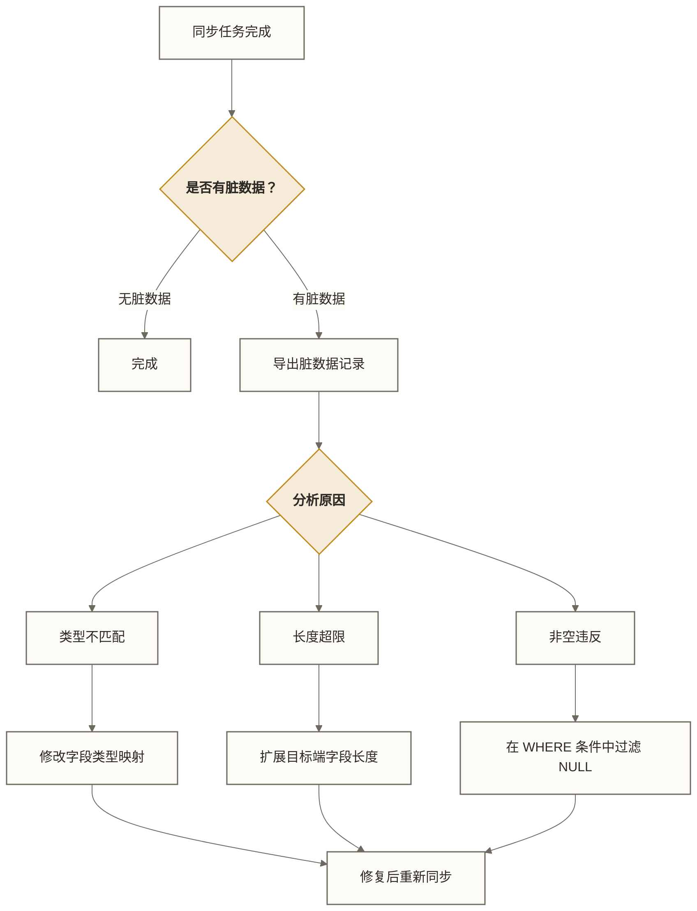

# DataX 调优与运维 - Channel 调优、脏数据处理、监控告警

> [!abstract] 本文核心内容
> - Channel 数量调优：找到最优并发数
> - JVM 内存配置：大数据量同步的内存管理
> - 限速配置：保护源数据库的最佳实践
> - 脏数据处理：识别、记录、修复
> - 断点续传：任务失败后的恢复策略
> - 监控与告警：生产级的任务监控体系

---

## Channel 并发调优

Channel 是 DataX 最核心的调优参数，直接决定同步速度。

### 理解 Channel 和并发的关系

Channel 用于连接 Reader 与 Writer 的数据传输。设置 `channel: N` 指定期望的通道并发规模，实际并发还受任务切分、限速配置和插件实现影响，并不意味着固定只有 N 个线程。下图是假设任务恰好均匀切为四份的示意，不是自动切分结果的保证。

```text
Channel 数 = 4
                    ↓
DataX 进程
├── Thread-1: Reader-1 → Channel-1 → Writer-1  （处理 order_id 1-250000）
├── Thread-2: Reader-2 → Channel-2 → Writer-2  （处理 order_id 250001-500000）
├── Thread-3: Reader-3 → Channel-3 → Writer-3  （处理 order_id 500001-750000）
└── Thread-4: Reader-4 → Channel-4 → Writer-4  （处理 order_id 750001-1000000）
```

### Channel 数量与性能的关系

```mermaid
%%{init: {"theme":"base","themeVariables":{"fontFamily":"PingFang SC, -apple-system, Source Han Serif SC, serif","fontSize":"16px","background":"#FDFBF5","primaryColor":"#FDFBF5","primaryTextColor":"#2D2A26","primaryBorderColor":"#6E6A60","secondaryColor":"#E8EFE8","secondaryBorderColor":"#8FA890","secondaryTextColor":"#2D2A26","tertiaryColor":"#FDFBF5","tertiaryBorderColor":"#9A9488","tertiaryTextColor":"#6E6A60","lineColor":"#6E6A60","textColor":"#2D2A26","mainBkg":"#FDFBF5","nodeBorder":"#2D5A3D","clusterBkg":"#F3EEDF","clusterBorder":"#9A9488","edgeLabelBackground":"#FDFBF5"},"flowchart":{"htmlLabels":true,"curve":"basis","padding":20,"nodeSpacing":60,"rankSpacing":70,"useMaxWidth":false},"themeCSS":".node rect, .node polygon, .node circle { stroke-width: 1.5px; } .edgePath .path { stroke-width: 1.5px; } .cluster-label .nodeLabel, .cluster-label foreignObject { color: #2D2A26 !important; } .edgeLabel, .edgeLabel foreignObject { color: #2D2A26 !important; background-color: #FDFBF5; } .edgeLabel rect { fill: #FDFBF5; }"}}%%
graph LR
    classDef default fill:#FDFBF5,stroke:#6E6A60,color:#2D2A26,stroke-width:1.5px
    classDef startend fill:#2D2A26,stroke:#2D2A26,color:#FDFBF5,font-weight:bold
    classDef decision fill:#F6EAD8,stroke:#C08A1A,color:#2D2A26,font-weight:bold
    classDef hub fill:#3B5A80,stroke:#3B5A80,color:#FDFBF5,font-weight:bold
    classDef io fill:#E5EAF0,stroke:#3B5A80,color:#2D2A26
    classDef accent fill:#A6432C,stroke:#A6432C,color:#FDFBF5,font-weight:bold
    classDef storage fill:#F3EEDF,stroke:#9A9488,color:#2D2A26
    A[Channel=1] --> B[Channel=4] --> C[Channel=8] --> D[Channel=16] --> E[Channel=32]

    A -. "吞吐低\n资源未充分利用" .-> B
    B -. "线性提升" .-> C
    C -. "提升减缓\n趋于平缓" .-> D
    D -. "可能下降\n源库压力大" .-> E
    class A,B,C,D,E default
```



**Channel 数量的影响因素**：

1. **源数据库的连接数限制**：Reader、Writer 及切分、元数据查询可能分别建立连接；应按插件行为估算源端和目标端连接预算，并为业务及其他任务保留余量，不能假定每个 Channel 恰好占用一个连接
2. **DataX 服务器 CPU 核数**：原稿的“CPU 核数的 2 倍”仅作为未核实的试验参考，并非通用上限；应根据读写阻塞、转换开销和压测结果确定并发数
3. **DataX 服务器内存**：Channel 缓冲容量应以部署版本的配置为准；若教学示例假设每个 Channel 为 64MB，则 16 个 Channel 的名义容量合计为 1GB，但这不是已核实的默认值，也不是进程实际内存占用
4. **网络带宽**：Channel 数越多，网络 I/O 越高，不能超过网卡带宽上限

### 调优步骤

**第一步：基准测试**

```bash
# 先用 4 个 Channel 跑一次，记录速度
python3 datax.py job.json  # channel=4

# 查看输出的平均流量
# 任务平均流量: 5.12MB/s
# 记录写入速度: 15234rec/s
```

**第二步：逐步增加 Channel**

```bash
# 改为 8 个 Channel，观察速度是否接近翻倍
# 改为 16 个 Channel，观察速度提升是否还明显
```

**第三步：找到性能拐点**

当增加 Channel 数后速度不再提升，甚至下降，就找到了瓶颈：
- 速度不再提升 → 可能受源/目标端 I/O、网络、限速、任务切分不均或数据转换开销影响，应结合监控定位
- DataX 服务器 CPU 很高 → DataX 服务器是瓶颈，考虑换更好的服务器
- 目标端写入成为瓶颈 → 检查 HDFS 的写入速度限制

### 关于 splitPk 切分不均匀

如果数据分布不均匀（如 order_id 有大量空洞），DataX 的切分可能导致部分 Task 数据量远多于其他 Task：

```sql
-- 检查 splitPk 的分布
SELECT
    FLOOR(order_id / 1000000) AS segment,
    COUNT(*) AS row_count
FROM orders
GROUP BY FLOOR(order_id / 1000000)
ORDER BY segment;
```

如果分布极度不均，考虑用 `querySql` 手动切分：

```json
"connection": [
    {"querySql": ["SELECT * FROM orders WHERE order_id BETWEEN 1 AND 5000000"],
     "jdbcUrl": ["jdbc:mysql://db:3306/shop"]},
    {"querySql": ["SELECT * FROM orders WHERE order_id BETWEEN 5000001 AND 10000000"],
     "jdbcUrl": ["jdbc:mysql://db:3306/shop"]},
    {"querySql": ["SELECT * FROM orders WHERE order_id > 10000000"],
     "jdbcUrl": ["jdbc:mysql://db:3306/shop"]}
]
```

---

## JVM 内存配置

### 默认配置的问题

原稿列出的 `-Xms1g -Xmx1g` 尚未按部署版本核验；请先检查启动脚本与实际 Java 进程参数。OOM 风险取决于缓冲容量、记录大小、插件行为及并发数，不仅取决于同步总数据量：

```text
java.lang.OutOfMemoryError: GC overhead limit exceeded
```

### 推荐配置

以下为 JVM 参数配置意图的示例，不是已验证可生效的 core.json 补丁；原稿路径 `/opt/datax/datax/conf/core.json` 及 `entry.jvm` 是否被启动器读取需按部署版本确认，应通过该版本支持的启动参数入口设置并检查实际进程参数：

```json
{
    "entry": {
        "jvm": "-server -Xms4g -Xmx4g -XX:+UseG1GC -XX:MaxGCPauseMillis=200 -XX:+HeapDumpOnOutOfMemoryError -XX:HeapDumpPath=/opt/datax/logs/heap_dump.hprof"
    }
}
```

参数说明：

| JVM 参数 | 说明 |
|---------|------|
| `-Xms4g -Xmx4g` | 堆内存 4GB，设成相同值避免动态扩展 |
| `-Xmn2g`（原稿参数，已从示例移除） | 固定新生代为 2GB 会限制 G1 的自适应调节，不作为通用推荐 |
| `-XX:+UseG1GC` | 使用 G1 垃圾收集器，适合大堆 |
| `-XX:MaxGCPauseMillis=200` | G1 停顿时间目标为 200ms，不是最大停顿时间保证 |
| `-XX:+HeapDumpOnOutOfMemoryError` | OOM 时自动 dump，便于分析 |

### 内存估算公式

```text
教学估算假设：每个 Channel 缓冲容量为 64MB，并暂按 2 倍预留
估算值 = channel × 64MB × 2

示例：16 个 Channel
估算值 = 16 × 64MB × 2 = 2048MB = 2GB
原稿建议的 4GB 仅作为未核实的试验起点；实际堆需求还应计入记录对象、插件批次、转换开销和 GC 余量，并检查主机与容器内存限制。
```

---

## 限速配置最佳实践

### 三层限速机制

以下分别控制任务并发及任务级字节、记录速率；不是三个由全局到局部的独立层级。具体并发计算还需结合部署版本的 Channel 限速配置核验：

```json
"setting": {
    "speed": {
        "channel": 8,
        "byte": 5242880,
        "record": 10000
    }
}
```

`setting.speed.byte` 和 `setting.speed.record` 分别表示任务级字节速率与记录速率目标；示例为 5242880 字节/秒和 10000 条/秒，不是每 Channel 的额度。两类限制共同约束吞吐，实际表现还受 Channel 配置及插件影响。

### 生产环境限速建议

| 场景 | 推荐配置 | 说明 |
|------|---------|------|
| 从主库同步（谨慎） | byte=2097152（任务级示例） | 原稿未核实的试验值，不保证保护线上主库 |
| 从从库同步 | byte=10485760（任务级示例） | 原稿未核实的试验值，需检查复制延迟和查询负载 |
| 历史数据迁移（专用库） | 是否省略任务级限速须按版本及 Channel 配置确认 | 不应使用 bps=0 表示不限速；先确认资源隔离 |
| 凌晨同步窗口 | byte=5242880（任务级示例） | 原稿未核实的试验值，低峰期也须监控业务负载 |

> [!tip] 如何计算合理的限速值
> 1. 先在隔离测试环境或经批准的低负载窗口，以保守并发和任务级限速建立基线
> 2. 持续检查业务延迟、连接数、复制延迟及 CPU/I/O，再逐步提高额度
> 3. 原稿 CPU > 70% 或 I/O wait > 30% 仅为未核实的示例阈值；负载异常时降低 setting.speed.byte/record 或并发，必要时停止任务
>
> 通常从库的处理能力比主库弱（主库在写，从库在追），从从库读时要更保守。

---

## 脏数据处理

### 什么情况会产生脏数据

```mermaid
%%{init: {"theme":"base","themeVariables":{"fontFamily":"PingFang SC, -apple-system, Source Han Serif SC, serif","fontSize":"16px","background":"#FDFBF5","primaryColor":"#FDFBF5","primaryTextColor":"#2D2A26","primaryBorderColor":"#6E6A60","secondaryColor":"#E8EFE8","secondaryBorderColor":"#8FA890","secondaryTextColor":"#2D2A26","tertiaryColor":"#FDFBF5","tertiaryBorderColor":"#9A9488","tertiaryTextColor":"#6E6A60","lineColor":"#6E6A60","textColor":"#2D2A26","mainBkg":"#FDFBF5","nodeBorder":"#2D5A3D","clusterBkg":"#F3EEDF","clusterBorder":"#9A9488","edgeLabelBackground":"#FDFBF5"},"flowchart":{"htmlLabels":true,"curve":"basis","padding":20,"nodeSpacing":60,"rankSpacing":70,"useMaxWidth":false},"themeCSS":".node rect, .node polygon, .node circle { stroke-width: 1.5px; } .edgePath .path { stroke-width: 1.5px; } .cluster-label .nodeLabel, .cluster-label foreignObject { color: #2D2A26 !important; } .edgeLabel, .edgeLabel foreignObject { color: #2D2A26 !important; background-color: #FDFBF5; } .edgeLabel rect { fill: #FDFBF5; }"}}%%
flowchart LR
    classDef default fill:#FDFBF5,stroke:#6E6A60,color:#2D2A26,stroke-width:1.5px
    classDef startend fill:#2D2A26,stroke:#2D2A26,color:#FDFBF5,font-weight:bold
    classDef decision fill:#F6EAD8,stroke:#C08A1A,color:#2D2A26,font-weight:bold
    classDef hub fill:#3B5A80,stroke:#3B5A80,color:#FDFBF5,font-weight:bold
    classDef io fill:#E5EAF0,stroke:#3B5A80,color:#2D2A26
    classDef accent fill:#A6432C,stroke:#A6432C,color:#FDFBF5,font-weight:bold
    classDef storage fill:#F3EEDF,stroke:#9A9488,color:#2D2A26
    R[Reader 读取 Record] --> V{数据校验}
    V -- "通过" --> C[Channel 传输]
    C --> W[Writer 写入]
    W --> S{写入结果}
    S -- "成功" --> OK[正常计数]
    S -- "失败" --> D[脏数据记录]
    V -- "格式转换失败" --> D
    class V,S decision
    class R,C,W,OK,D default
```



常见的脏数据触发原因：

```text
1. 字段类型不匹配：源端 VARCHAR "abc"，目标端期望 INT
2. 字段长度超限：源端内容 1000 字节，目标端列定义 VARCHAR(255)
3. 非空约束违反：目标端 NOT NULL，但源端有 NULL 值
4. 编码问题：源端包含特殊字符，目标端不支持
5. 精度丢失：源端 DECIMAL(20,10)，目标端只有 DECIMAL(10,2)
```

### 脏数据配置策略

**严格模式**（关键数据，不允许任何丢失）：

```json
"errorLimit": {
    "record": 0,
    "percentage": 0.0
}
```

**容忍模式**（非关键数据，允许少量脏数据）：

```json
"errorLimit": {
    "record": 1000,
    "percentage": 0.001
}
```

### 分析脏数据日志

脏数据日志的输出位置、格式和明细数量取决于版本、插件及日志配置；下面是示意格式，后续 grep 仅适用于确实包含 DirtyRecord 的日志，不能据此保证导出全部脏数据或准确计数：

```text
ERROR DirtyRecord: write record fail, exception: Data too long for column 'user_name' at row 1
Record = [column.field=user_id, value=12345], [column.field=user_name, value=这是一个超长的用户名...]
```

提取脏数据日志：

```bash
# 过滤脏数据行
grep "DirtyRecord" /opt/datax/logs/datax_20260318.log > dirty_records.txt

# 统计脏数据数量
grep -c "DirtyRecord" /opt/datax/logs/datax_20260318.log
```

### 脏数据处理流程



---

## 断点续传与任务重跑

DataX 本身不支持断点续传，但可以通过以下策略实现：

### 策略 1：分区断点续传

对于按分区同步的场景，可以记录已同步的分区，失败时只重跑未完成的分区：

```python
#!/usr/bin/env python3
# incremental_sync_with_checkpoint.py

import os
import json

CHECKPOINT_FILE = "/opt/datax/checkpoint/sync_progress.json"

def load_checkpoint():
    if os.path.exists(CHECKPOINT_FILE):
        with open(CHECKPOINT_FILE) as f:
            return json.load(f)
    return {}

def save_checkpoint(table, dt, status):
    checkpoint = load_checkpoint()
    checkpoint[f"{table}_{dt}"] = status
    with open(CHECKPOINT_FILE, "w") as f:
        json.dump(checkpoint, f, indent=2)

def sync_table(table, dt):
    key = f"{table}_{dt}"
    checkpoint = load_checkpoint()

    if checkpoint.get(key) == "SUCCESS":
        print(f"  {table} dt={dt} 已同步，跳过")
        return True

    # ... 执行同步逻辑 ...
    success = run_datax_job(table, dt)

    if success:
        save_checkpoint(table, dt, "SUCCESS")
    else:
        save_checkpoint(table, dt, "FAILED")

    return success
```

### 策略 2：幂等重跑

HDFS Writer 的写入模式需按插件版本核验，不能将 `writeMode: overwrite` 当作通用配置；常见实现的 `truncate` 也可能清理指定路径，必须先隔离目标目录并确认删除范围。MySQL 的 `writeMode: replace` 只有在主键或唯一键及输入数据满足预期条件时才能支持相应重跑策略，且可能产生删除再插入的副作用。两者都不自动保证任务级原子性、无重复或无数据丢失，重跑前须处理部分写入并核对结果。

---

## 监控与告警

### 基础监控方案（Shell + 邮件告警）

```bash
#!/bin/bash
# datax_monitor.sh - DataX 任务监控脚本

JOB_NAME=$1
JOB_FILE=$2
LOG_FILE="/opt/datax/logs/${JOB_NAME}_$(date +%Y%m%d_%H%M%S).log"

# 执行 DataX
python3 /opt/datax/datax/bin/datax.py ${JOB_FILE} > ${LOG_FILE} 2>&1
EXIT_CODE=$?

# 提取关键统计
RECORDS=$(grep "读出记录总数" ${LOG_FILE} | awk '{print $NF}')
ERRORS=$(grep "读写失败总数" ${LOG_FILE} | awk '{print $NF}')
COST=$(grep "任务总计耗时" ${LOG_FILE} | awk '{print $NF}')

if [ ${EXIT_CODE} -eq 0 ]; then
    echo "SUCCESS: ${JOB_NAME}"
    echo "同步记录数: ${RECORDS}, 失败记录数: ${ERRORS}, 耗时: ${COST}"
    # 写入成功日志到数据库
    mysql -u monitor_user -p'pass' monitor_db -e "
        INSERT INTO datax_job_log
        (job_name, exec_time, status, records, errors, cost)
        VALUES ('${JOB_NAME}', NOW(), 'SUCCESS', ${RECORDS}, ${ERRORS}, '${COST}');"
else
    echo "FAILED: ${JOB_NAME}"
    # 发送告警邮件
    echo "DataX 任务失败: ${JOB_NAME}
日志位置: ${LOG_FILE}
退出码: ${EXIT_CODE}

错误摘要:
$(tail -50 ${LOG_FILE})" | mail -s "[告警] DataX 同步失败: ${JOB_NAME}" data-ops@company.com

    exit 1
fi
```

### 使用 Prometheus + Grafana 监控（进阶）

DataX 执行完成后，用 Python 脚本解析日志，推送指标到 Prometheus Pushgateway：

```python
import re
import requests

def push_metrics_to_prometheus(job_name, log_file):
    """解析 DataX 日志，推送指标到 Prometheus"""
    with open(log_file) as f:
        content = f.read()

    # 提取关键指标
    records_match = re.search(r"读出记录总数\s*:\s*(\d+)", content)
    errors_match = re.search(r"读写失败总数\s*:\s*(\d+)", content)
    speed_match = re.search(r"任务平均流量\s*:\s*([\d.]+)([KMG]B/s)", content)

    records = int(records_match.group(1)) if records_match else 0
    errors = int(errors_match.group(1)) if errors_match else 0

    # 推送到 Pushgateway
    metrics = f"""
# HELP datax_records_total Total records synced
# TYPE datax_records_total gauge
datax_records_total{{job="{job_name}"}} {records}

# HELP datax_errors_total Total dirty records
# TYPE datax_errors_total gauge
datax_errors_total{{job="{job_name}"}} {errors}
"""
    requests.post(
        f"http://pushgateway:9091/metrics/job/{job_name}",
        data=metrics
    )
```

### 告警规则建议

| 告警类型 | 触发条件 | 告警级别 |
|---------|---------|---------|
| 任务失败 | EXIT_CODE != 0 | P1 - 立即处理 |
| 脏数据率超阈值 | 脏数据/总数 > 1% | P2 - 1小时内处理 |
| 同步超时 | 耗时 > 预期的 2 倍 | P2 - 今天内处理 |
| 同步记录数异常 | 当天记录数 < 历史均值的 50% | P3 - 次日内确认 |

---

## 常见故障排查手册

### 故障 1：任务卡住不动

**现象**：DataX 进程还在运行，但日志里没有新的进度输出，持续 30 分钟以上。

**排查步骤**：
```bash
# 查看进程是否在运行
ps aux | grep datax

# 查看 DataX 进程的线程状态
jstack $(ps aux | grep datax | grep -v grep | awk '{print $2}')

# 查看数据库连接状态
mysql -e "SHOW PROCESSLIST;" | grep datax_reader
```

**常见原因**：
- 数据库 I/O 负载过高，Reader 查询慢
- Channel 缓冲区满，Writer 写入目标端卡住
- 目标端 HDFS NameNode 没响应

### 故障 2：OOM 报错

```text
java.lang.OutOfMemoryError: Java heap space
```

**解决**：按前文调整 JVM 内存，增大 `-Xmx` 参数。

### 故障 3：连接数过多导致数据库拒绝连接

```yaml
com.mysql.jdbc.exceptions.jdbc4.CommunicationsException:
Too many connections
```

**解决**：降低 Channel 数，或联系 DBA 提升 MySQL 的 `max_connections` 限制。

---

## 相关文档

- [[【技术与工具】/DataX/02-DataX核心架构|02-DataX核心架构]] - 理解 Channel 和并发的底层机制
- [[【技术与工具】/DataX/06-DataX实战场景|06-DataX实战场景]] - 大表调优的实际案例
- [[【技术与工具】/DataX/08-DataX与调度集成|08-DataX与调度集成]] - 与监控系统的集成方案

---

#DataX #调优 #运维 #Channel #JVM #限速 #脏数据 #监控 #告警

---

> [!info] 前置知识
> - 了解 DataX 的 Channel 并发模型，参考 [[【技术与工具】/DataX/02-DataX核心架构|02-DataX核心架构]]
> - 有过实际运行 DataX 任务的经验，参考 [[【技术与工具】/DataX/06-DataX实战场景|06-DataX实战场景]]
> - 了解 JVM 内存模型的基本概念（Heap 大小配置 `-Xms`/`-Xmx`）

---

## 掌握检查

- [ ] 能说出 DataX 性能调优的主要方向：增加 `channel` 数（提高并发）、调整 `setting.speed.byte`/`setting.speed.record` 任务级流量限速、调大 JVM 堆内存（`-Xms4g -Xmx4g`）、优化源端 SQL（避免全表扫描）
- [ ] 能解释 `setting.speed.byte` 和 `setting.speed.record` 的作用：控制任务级同步速率，并结合并发、数据库负载和业务监控制定限速策略，不能仅靠配置限速保证业务不受影响
- [ ] 能说明脏数据的产生原因（类型不兼容、字段长度超限、非空约束）和处理方式（配置 `errorLimit` 并核验插件的脏数据记录方式；超过容忍阈值可使任务失败，日志也不保证保存全部脏数据），以及如何在运行后分析脏数据日志
- [ ] 能描述 DataX 任务失败时的排查步骤：查看日志末尾的 `ERROR` 信息 → 定位是 Reader 侧还是 Writer 侧报错 → 检查网络连通性、权限、数据类型兼容性
- [ ] 能解释为什么 Channel 数不是越多越好：单个 MySQL 实例连接数有上限（`Too many connections`），过高的 Channel 数会耗尽数据库连接池，反而导致任务失败

---

## 实践练习

**基础题**：给定一个 DataX 任务运行输出，其中显示"任务平均流量: 0.5 MB/s，Channel 数: 2，读写失败总数: 0，任务耗时: 1800 秒（30 分钟）"。分析性能瓶颈可能在哪里，提出至少 2 个优化方向，并估算优化后的预期耗时。

**进阶题**：一个生产环境 DataX 任务（MySQL 大表同步，Channel: 16）频繁报错 `Too many connections`。请分析根本原因，给出调优方案（涉及 Channel 数、MySQL `max_connections`、连接池配置的综合调整），以及如何在不停止业务的情况下验证优化效果。

---

## 下一步

[[【技术与工具】/DataX/08-DataX与调度集成|08-DataX与调度集成]] - 将调优后的 DataX 任务集成到 Airflow 或 DolphinScheduler 实现生产自动化
