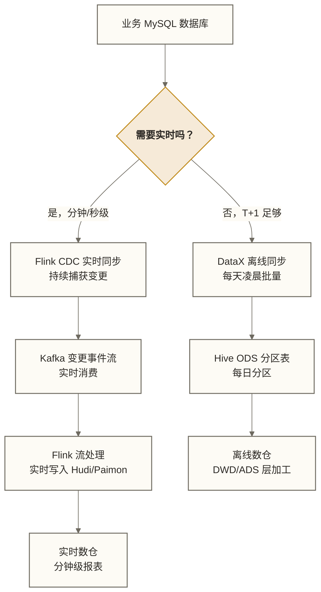

# DataX 与调度集成 - Airflow/DolphinScheduler 生产部署

> [!abstract] 本文核心内容
> - Shell 脚本封装 DataX 任务（生产级最佳实践）
> - 与 Apache Airflow 集成（DAG 定义和任务依赖）
> - 与 DolphinScheduler 集成（国内主流调度平台）
> - 生产环境部署方案（服务器规划、目录管理、运维规范）

---

## 为什么需要调度集成

DataX 只是一个同步工具，本身没有调度能力。生产环境里的数据同步任务通常需要：

1. **定时执行**：每天凌晨 2 点自动运行
2. **任务依赖**：先同步 ODS 层，再运行 DWD 层加工，最后刷新 ADS 层报表
3. **失败告警**：任务失败了及时通知 oncall
4. **重试机制**：网络抖动导致的失败自动重试
5. **执行历史**：能查看过去每次任务的执行记录

这些都需要调度平台来提供。

---

## Shell 脚本封装最佳实践

在接入调度平台之前，先把 DataX 任务封装成健壮的 Shell 脚本，是生产环境的标准做法。

### 通用封装脚本模板

```bash
#!/bin/bash
# ============================================================
# DataX 通用执行封装脚本
# 用法: run_datax.sh <任务名称> <dt> [额外参数]
# 示例: run_datax.sh ods_orders 2026-03-17 "-Dstart_time='2026-03-17 00:00:00'"
# ============================================================

set -euo pipefail  # 错误时立即退出，未定义变量报错

# ============ 参数定义 ============
JOB_NAME=${1:?"请提供任务名称"}
DT=${2:-$(date -d "yesterday" +%Y-%m-%d)}
EXTRA_PARAMS=${3:-""}

# ============ 路径定义 ============
DATAX_HOME="/opt/datax/datax"
JOB_DIR="/opt/datax/jobs"
LOG_DIR="/opt/datax/logs"
CHECKPOINT_DIR="/opt/datax/checkpoint"

JOB_FILE="${JOB_DIR}/${JOB_NAME}.json"
LOG_FILE="${LOG_DIR}/${JOB_NAME}_${DT}_$(date +%H%M%S).log"

# ============ 前置检查 ============
if [ ! -f "${JOB_FILE}" ]; then
    echo "ERROR: Job 配置文件不存在: ${JOB_FILE}"
    exit 1
fi

mkdir -p "${LOG_DIR}" "${CHECKPOINT_DIR}"

# ============ 执行 DataX ============
echo "=========================================="
echo "开始执行: ${JOB_NAME}"
echo "目标日期: ${DT}"
echo "Job 文件: ${JOB_FILE}"
echo "日志文件: ${LOG_FILE}"
echo "开始时间: $(date '+%Y-%m-%d %H:%M:%S')"
echo "=========================================="

START_TS=$(date +%s)

if python3 "${DATAX_HOME}/bin/datax.py" \
    "${JOB_FILE}" \
    -p "-Ddt=${DT} ${EXTRA_PARAMS}" \
    > "${LOG_FILE}" 2>&1; then
    EXIT_CODE=0
else
    EXIT_CODE=$?
fi
END_TS=$(date +%s)
DURATION=$((END_TS - START_TS))

# ============ 提取统计信息 ============
RECORDS=$(grep "读出记录总数" "${LOG_FILE}" 2>/dev/null | awk '{print $NF}' | tr -d '\r' || echo "N/A")
ERRORS=$(grep "读写失败总数" "${LOG_FILE}" 2>/dev/null | awk '{print $NF}' | tr -d '\r' || echo "N/A")
AVG_SPEED=$(grep "任务平均流量" "${LOG_FILE}" 2>/dev/null | awk '{print $NF}' || echo "N/A")

# ============ 结果处理 ============
if [ ${EXIT_CODE} -eq 0 ]; then
    echo "SUCCESS: ${JOB_NAME} dt=${DT}"
    echo "  读取记录数: ${RECORDS}"
    echo "  失败记录数: ${ERRORS}"
    echo "  平均流量:   ${AVG_SPEED}"
    echo "  耗时:       ${DURATION}s"

    # 写入成功状态到检查点文件
    echo "${DT}:SUCCESS:${RECORDS}:${DURATION}" >> "${CHECKPOINT_DIR}/${JOB_NAME}.checkpoint"

    # 可选：写入监控数据库
    # mysql -u monitor -ppass monitor_db -e "INSERT INTO task_log ..."

else
    echo "FAILED: ${JOB_NAME} dt=${DT}, 退出码: ${EXIT_CODE}"
    echo "日志位置: ${LOG_FILE}"

    # 打印最后 50 行日志帮助快速定位问题
    echo "--- 最后50行日志 ---"
    tail -50 "${LOG_FILE}"

    exit ${EXIT_CODE}
fi
```

### 刷新 Hive 分区的封装

```bash
#!/bin/bash
# refresh_hive_partition.sh - 刷新 Hive 分区

TABLE_NAME=$1
DT=$2
DATABASE=${3:-"ods"}

echo "刷新 Hive 分区: ${DATABASE}.${TABLE_NAME} dt=${DT}"

hive -e "
ALTER TABLE ${DATABASE}.${TABLE_NAME}
ADD IF NOT EXISTS PARTITION (dt='${DT}')
LOCATION '/user/hive/warehouse/${DATABASE}.db/${TABLE_NAME}/dt=${DT}';"

if [ $? -eq 0 ]; then
    echo "分区刷新成功"
else
    echo "分区刷新失败"
    exit 1
fi
```

### 标准化目录结构

```text
/opt/datax/
├── datax/                    # DataX 安装目录（不要改动）
├── jobs/                     # Job 配置目录
│   ├── ods/                  # ODS 层同步任务
│   │   ├── ods_orders.json
│   │   ├── ods_users.json
│   │   └── ods_products.json
│   └── dwd/                  # DWD 层相关任务
├── scripts/                  # 封装脚本目录
│   ├── run_datax.sh           # 通用执行脚本
│   ├── refresh_partition.sh   # Hive 分区刷新脚本
│   └── batch_sync.py          # 批量同步脚本
├── logs/                     # 日志目录（按日期清理）
│   ├── ods_orders_2026-03-17_020001.log
│   └── ...
└── checkpoint/               # 执行状态检查点
    ├── ods_orders.checkpoint
    └── ...
```

---

## 与 Apache Airflow 集成

Airflow 是 Python 生态的主流调度平台，适合已有 Python 技术栈的团队。

详细的 Airflow 使用方法参见 [[【技术与工具】/Airflow/02-Airflow核心概念|Airflow 核心概念]]，本节只关注 DataX 集成部分。

### 基础 DAG：单表同步

```python
# dags/ods_orders_sync.py
from datetime import datetime, timedelta
from airflow import DAG
from airflow.operators.bash import BashOperator
from airflow.operators.python import PythonOperator

default_args = {
    "owner": "data-engineering",
    "depends_on_past": False,
    "start_date": datetime(2026, 1, 1),
    "email": ["data-ops@company.com"],
    "email_on_failure": True,
    "email_on_retry": False,
    "retries": 2,
    "retry_delay": timedelta(minutes=5),
}

dag = DAG(
    "ods_orders_daily_sync",
    default_args=default_args,
    description="每日同步订单表到 Hive ODS",
    schedule_interval="0 2 * * *",      # 每天凌晨 2 点
    catchup=False,
    tags=["ods", "datax", "orders"],
)

# 任务 1：执行 DataX 同步
sync_orders = BashOperator(
    task_id="sync_orders_to_hive",
    bash_command=(
        "/opt/datax/scripts/run_datax.sh "
        "ods_orders "
        "{{ ds }} "                      # Airflow 逻辑日期的日期部分，格式 YYYY-MM-DD；不等同于实际执行当天
        "\"-Dstart_time='{{ ds }} 00:00:00' "
        "-Dend_time='{{ next_ds }} 00:00:00'\""
    ),
    dag=dag,
)

# 任务 2：刷新 Hive 分区
refresh_partition = BashOperator(
    task_id="refresh_hive_partition",
    bash_command=(
        "/opt/datax/scripts/refresh_partition.sh "
        "ods_orders "
        "{{ ds }} "
        "ods"
    ),
    dag=dag,
)

# 任务 3：数据质量检查（可选）
def check_row_count(**context):
    """检查同步行数是否正常"""
    import subprocess
    dt = context["ds"]

    result = subprocess.run(
        ["hive", "-e", f"SELECT COUNT(*) FROM ods.ods_orders WHERE dt='{dt}';"],
        capture_output=True, text=True, check=True
    )

    row_count = int(result.stdout.strip().split("\n")[-1])
    print(f"dt={dt} 同步行数: {row_count}")

    if row_count < 100:
        raise ValueError(f"数据量异常！dt={dt} 只有 {row_count} 条记录")

quality_check = PythonOperator(
    task_id="check_data_quality",
    python_callable=check_row_count,
    dag=dag,
)

# 定义依赖关系
sync_orders >> refresh_partition >> quality_check
```

### 多表批量同步 DAG

```python
# dags/ods_batch_sync.py
from airflow import DAG
from airflow.operators.bash import BashOperator
from datetime import datetime, timedelta

# 要同步的表列表
ODS_TABLES = [
    "ods_orders",
    "ods_users",
    "ods_products",
    "ods_order_items",
    "ods_payments",
]

default_args = {
    "owner": "data-engineering",
    "retries": 2,
    "retry_delay": timedelta(minutes=5),
    "email_on_failure": True,
    "email": ["data-ops@company.com"],
}

with DAG(
    "ods_batch_daily_sync",
    default_args=default_args,
    schedule_interval="0 1 * * *",
    start_date=datetime(2026, 1, 1),
    catchup=False,
    max_active_tasks=4,    # 最多同时运行 4 个同步任务
    tags=["ods", "datax", "batch"],
) as dag:

    # 动态生成每个表的同步任务
    sync_tasks = []
    for table in ODS_TABLES:
        task = BashOperator(
            task_id=f"sync_{table}",
            bash_command=(
                f"/opt/datax/scripts/run_datax.sh "
                f"{table} "
                "{{ ds }}"
            ),
        )
        sync_tasks.append(task)

    # 所有表同步完成后，统一刷新分区
    refresh_all = BashOperator(
        task_id="refresh_all_partitions",
        bash_command=(
            "for table in " + " ".join(ODS_TABLES) + "; do "
            "/opt/datax/scripts/refresh_partition.sh $table {{ ds }} ods || exit $?; "
            "done"
        ),
    )

    # 所有同步任务并行执行，完成后刷新分区
    sync_tasks >> refresh_all
```

---

## 与 DolphinScheduler 集成

DolphinScheduler 提供可视化的 Web 界面，可通过界面定义工作流；具体任务仍可能需要编写脚本或配置。

### 在 DolphinScheduler 中创建 DataX 任务

DolphinScheduler 3.x 原生支持 DataX 任务类型（不需要 Shell 封装）：

1. 在 **工作流定义** 页面创建新工作流
2. 拖拽 **DataX** 组件到画布
3. 填写参数：

```text
数据源（自定义数据源）: MySQL_Shop_DB
目标数据源（自定义数据源）: HDFS_Cluster
自定义JSON模板:
{
    "job": {
        "setting": {
            "speed": {"channel": 4},
            "errorLimit": {"record": 10}
        },
        "content": [{
            "reader": {
                "name": "mysqlreader",
                "parameter": {
                    "username": "datax_reader",
                    "password": "${mysql_password}",
                    "column": ["*"],
                    "where": "update_time >= '${yesterday} 00:00:00'",
                    "connection": [{
                        "table": ["orders"],
                        "jdbcUrl": ["${mysql_jdbc_url}"]
                    }]
                }
            },
            "writer": {
                "name": "hdfswriter",
                "parameter": {
                    "defaultFS": "${hdfs_default_fs}",
                    "path": "/user/hive/warehouse/ods.db/ods_orders/dt=${yesterday}",
                    "fileType": "orc",
                    "fileName": "ods_orders",
                    "writeMode": "truncate",
                    "compress": "SNAPPY",
                    "column": [
                        {"name": "order_id", "type": "BIGINT"},
                        ...
                    ]
                }
            }
        }]
    }
}
```

### 使用 Shell 任务节点

对于更复杂的场景，在 DolphinScheduler 中使用 **Shell** 任务节点调用封装脚本：

```bash
# DolphinScheduler Shell 任务内容
#!/bin/bash

# 使用 DolphinScheduler 的内置变量
DT="${system.biz.date}"     # 业务日期，格式 yyyyMMdd
# 转换格式
DT_FORMAT=$(date -d "${DT}" +%Y-%m-%d)

/opt/datax/scripts/run_datax.sh ods_orders ${DT_FORMAT}

if [ $? -ne 0 ]; then
    exit 1
fi

/opt/datax/scripts/refresh_partition.sh ods_orders ${DT_FORMAT} ods
```

### DolphinScheduler 的全局参数配置

JDBC URL 等配置可通过 DolphinScheduler 的参数机制传入；密码应使用部署环境支持的受控凭据机制，核实访问权限和日志脱敏后再注入任务，不能把全局参数本身视为加密存储。下例的“[加密存储]”仅为占位说明：

```ini
mysql_jdbc_url = jdbc:mysql://10.0.0.2:3306/shop_db?useUnicode=true&characterEncoding=utf8
mysql_password = [加密存储]
hdfs_default_fs = hdfs://mycluster
```

---

## 生产环境部署方案

### 服务器规划

| 角色 | 配置建议 | 说明 |
|------|---------|------|
| DataX 执行服务器 | 8C 16G，SSD 系统盘 | 轻量级同步任务可以共用调度服务器 |
| 大数据量专用服务器 | 16C 32G，千兆内网 | 历史迁移、大表同步需要专用机器 |
| 日志存储 | 500GB 独立磁盘 | 日志保留 30 天，注意定期清理 |

### 账号权限规范

```sql
-- MySQL 专用只读账号
CREATE USER 'datax_reader'@'datax_server_ip' IDENTIFIED BY 'strong_password';
GRANT SELECT ON shop_db.* TO 'datax_reader'@'datax_server_ip';
FLUSH PRIVILEGES;

-- Oracle 专用只读账号
CREATE USER DATAX_READER IDENTIFIED BY "strong_password";
GRANT CREATE SESSION TO DATAX_READER;
GRANT SELECT ON FINANCE.ACCOUNTS TO DATAX_READER;

-- HDFS 写入账号（需要 Hadoop 管理员创建）
sudo -u hdfs hdfs dfs -mkdir -p /user/datax
sudo -u hdfs hdfs dfs -chown datax:datax /user/datax
```

### 日志清理定时任务

```bash
# 在 DataX 服务器上添加 crontab
crontab -e

# 每天清理 30 天前的日志
0 3 * * * find /opt/datax/logs -name "*.log" -mtime +30 -exec rm {} \;

# 每周清理检查点文件（可选）
0 4 * * 0 find /opt/datax/checkpoint -name "*.checkpoint" -mtime +90 -exec rm {} \;
```

### 配置文件版本管理

把 Job 配置文件和脚本纳入 Git 管理：

```bash
# 初始化 Git 仓库
cd /opt/datax
git init
git remote add origin git@gitlab.company.com:data/datax-jobs.git

# .gitignore
cat > .gitignore << 'EOF'
logs/
checkpoint/
# DataX 安装包不纳入 Git
datax/
*.log
*.tmp
EOF

# 提交 Job 配置和脚本
git add jobs/ scripts/
git commit -m "feat: 添加 ODS 层订单同步任务"
git push origin main
```

---

## DataX 与 Flink CDC 的配合使用

在实际的实时数仓建设中，DataX 和 Flink CDC 经常配合使用：



**推荐的混合架构**：

1. **初始化**：在具备适配的 Writer 或后续导入流程时，用 DataX 把历史数据全量同步到 Hudi/Paimon（作为初始化阶段）；同时设计与 CDC 日志位点的衔接，不能假定标准安装已支持直接写入这些目标
2. **实时增量**：按已验证的快照与日志位点衔接方案，启动 Flink CDC 持续同步变更（长期运行）；不能仅在全量完成后从当时的最新位点启动，否则可能遗漏全量期间的变更
3. **离线备份**：DataX T+1 同步到 Hive，作为离线数仓的基础

这是一种组合实时同步与离线同步的可选数仓方案；是否适用取决于一致性衔接、目标写入能力和运维成本，T+1 同步也不能自动替代经过恢复验证的备份机制。

---

## 相关文档

- [[【技术与工具】/DataX/06-DataX实战场景|06-DataX实战场景]] - DataX 场景的完整配置示例
- [[【技术与工具】/DataX/07-DataX调优与运维|07-DataX调优与运维]] - 运维监控详细方案
- [[【技术与工具】/Airflow/02-Airflow核心概念|Airflow]] - 调度平台的详细使用
- [[【技术与工具】/Flink-CDC/00-Flink-CDC学习路线图|Flink CDC]] - 实时同步方案

---

#DataX #调度 #Airflow #DolphinScheduler #生产部署 #Shell脚本 #自动化

---

> [!info] 前置知识
> - 掌握 DataX 任务的运行方式和调优方法，参考 [[【技术与工具】/DataX/07-DataX调优与运维|07-DataX调优与运维]]
> - 了解 Airflow 的基本概念（DAG、BashOperator、调度周期），参考 [[【技术与工具】/Airflow/02-Airflow核心概念|Airflow 核心概念]]
> - 熟悉 Shell 脚本基础（变量、条件判断、`$?` 获取退出码）

---

## 掌握检查

- [ ] 能编写一个封装 DataX 的 Shell 脚本，正确通过 `-p` 参数传入日期变量（如 `-p "-Ddatax_dt=$(date -d '-1 day' +%Y-%m-%d)"`），在 DataX 命令执行处捕获退出码，并在脚本末尾依据保存的退出码处理结果、失败时输出日志路径
- [ ] 能在 Airflow 中用 `BashOperator` 调用 DataX 脚本，说明为什么在 `bash_command` 中应使用脚本绝对路径，以及如何通过 `env` 参数或脚本参数传入 `{{ ds }}` 日期变量
- [ ] 能解释 DataX 与调度系统的职责分工：调度系统（Airflow/DolphinScheduler）负责触发时机、依赖管理和失败重试，DataX 只负责单次数据同步执行
- [ ] 能说明 DataX 任务失败时在 Airflow 中配置 `retries: 2`、`retry_delay: 5min` 的合理性，以及什么情况下重试无效（如源库连接信息配置错误，重试也会失败）
- [ ] 能描述 DataX 初始化历史数据 + Flink CDC 持续实时同步的协作模式：DataX 做一次性全量初始化，之后由 Flink CDC 接管增量实时更新

---

## 实践练习

**基础题**：编写一个 Shell 脚本 `run_datax.sh`，接受 `$1` 作为 Job 文件路径、`$2` 作为同步日期参数，调用 DataX 执行同步，成功时打印统计摘要，失败时打印日志路径并以非零退出码退出。然后在 Airflow 中创建一个 `BashOperator` 调用该脚本，传入 `{{ ds }}` 作为日期参数。

**进阶题**：设计一个完整的电商 ODS 层数据同步 DAG（Airflow），包含：
1. 检查 MySQL 源库连接是否正常（Python 探测）
2. 并行运行 3 张表（orders、users、products）的 DataX 同步任务
3. 同步完成后执行 Hive `MSCK REPAIR TABLE` 刷新分区
4. 配置失败告警通知（DingTalk 或邮件）

说明各任务的依赖关系设计，以及如何保证整个 DAG 的幂等性（可重跑）。
