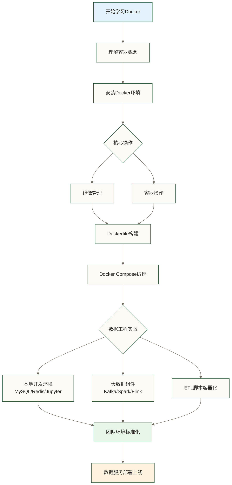

# Docker学习路线图 - 数据工程师的容器化实战指南

> [!abstract] 路线图概览
> - 目标：用 Docker 解决数据开发中的环境问题，快速部署数据服务
> - 适合人群：数据分析师、数据开发工程师，零容器基础
> - 学习周期：2-3 周，每天 1-2 小时
> - 学完能做什么：本地搭建 MySQL/Kafka/Spark 环境、容器化 ETL 脚本、标准化团队开发环境

---

## 为什么数据工程师要学 Docker

你是否遇到过这些场景：

- "我本地跑得好好的，到服务器上就报错了"
- 新同事入职，配置开发环境要折腾两天
- 想在本地测试 Kafka，但装起来又麻烦又容易把系统搞乱
- 多个项目依赖不同版本的 Python 包，冲突不断

Docker 就是为了解决这些问题而生的。对数据工程师而言，Docker 的价值不在于底层原理，而在于**三个字：能用上**。

---

## 学习路径总览

### 第一阶段：建立概念（第 1-2 天）

从"为什么"出发，理解容器化的本质，不纠结原理。

1. **[[【技术与工具】/Docker/01-容器化概念入门|容器化概念入门]]** - 容器是什么、和虚拟机有什么区别、数据工程场景下的价值
2. **[[【技术与工具】/Docker/02-Docker安装与配置|Docker安装与配置]]** - Mac/Windows/Linux 安装、国内镜像加速配置

### 第二阶段：掌握基本操作（第 3-5 天）

学会用别人做好的镜像，这是日常使用的核心。

3. **[[【技术与工具】/Docker/03-镜像管理|镜像管理]]** - 找镜像、下载镜像、管理本地镜像
4. **[[【技术与工具】/Docker/04-容器基本操作|容器基本操作]]** - 启动、停止、进入容器、查看日志

### 第三阶段：定制与编排（第 6-10 天）

学会自己构建镜像、用 Compose 管理多个容器。

5. **[[【技术与工具】/Docker/05-Dockerfile编写|Dockerfile编写]]** - 打包自己的数据处理脚本为镜像
6. **[[【技术与工具】/Docker/06-Docker Compose入门|Docker Compose入门]]** - 一键启动完整数据开发环境

### 第四阶段：数据工程实战（第 11-15 天）

把前面学的东西用到实际数据工作中。

7. **[[【技术与工具】/Docker/07-数据开发环境搭建|数据开发环境搭建]]** - 用 Docker 跑 MySQL、Kafka、Spark、Flink、Jupyter
8. **[[【技术与工具】/Docker/08-Docker网络与存储|Docker网络与存储]]** - 容器间通信、数据持久化
9. **[[【技术与工具】/Docker/09-Docker实战场景|Docker实战场景]]** - ETL 容器化、数据服务部署

### 随用随查

10. **[[【技术与工具】/Docker/10-Docker常用命令速查|常用命令速查]]** - 按场景分类的命令手册，用的时候翻这里
11. **[[【技术与工具】/Docker/11-Docker问题排查|问题排查手册]]** - 遇到报错先来这里找答案

---

## 完整文档目录

| 序号 | 文档 | 核心内容 | 预计时间 |
|------|------|----------|----------|
| 00 | [[【技术与工具】/Docker/00-Docker学习路线图|学习路线图]] | 全局规划 | 10 分钟 |
| 01 | [[【技术与工具】/Docker/01-容器化概念入门|容器化概念入门]] | 容器 vs 虚拟机、Docker 生态 | 30 分钟 |
| 02 | [[【技术与工具】/Docker/02-Docker安装与配置|安装与配置]] | 三平台安装、镜像加速 | 45 分钟 |
| 03 | [[【技术与工具】/Docker/03-镜像管理|镜像管理]] | pull/images/rmi、镜像仓库 | 30 分钟 |
| 04 | [[【技术与工具】/Docker/04-容器基本操作|容器基本操作]] | run/exec/logs、端口、挂载 | 45 分钟 |
| 05 | [[【技术与工具】/Docker/05-Dockerfile编写|Dockerfile编写]] | 自定义镜像构建 | 60 分钟 |
| 06 | [[【技术与工具】/Docker/06-Docker Compose入门|Docker Compose]] | 多容器编排 | 60 分钟 |
| 07 | [[【技术与工具】/Docker/07-数据开发环境搭建|数据开发环境搭建]] | MySQL/Kafka/Spark/Jupyter | 90 分钟 |
| 08 | [[【技术与工具】/Docker/08-Docker网络与存储|网络与存储]] | 网络模式、数据持久化 | 45 分钟 |
| 09 | [[【技术与工具】/Docker/09-Docker实战场景|实战场景]] | ETL 容器化、CI/CD | 60 分钟 |
| 10 | [[【技术与工具】/Docker/10-Docker常用命令速查|命令速查]] | 速查手册 | 随用随查 |
| 11 | [[【技术与工具】/Docker/11-Docker问题排查|问题排查]] | 常见错误解决 | 随用随查 |

---

## 数据工程师的 Docker 技能地图



---

## 关键概念速览

| 概念 | 一句话解释 |
|------|-----------|
| 镜像（Image） | 应用的"安装包"，只读的模板 |
| 容器（Container） | 镜像运行起来的实例，可以理解为"进程" |
| Dockerfile | 描述如何构建镜像的脚本文件 |
| Docker Compose | 用 YAML 文件管理多个容器的工具 |
| Volume | 独立于容器可写层的持久化存储；未随容器或被显式删除的卷可保留数据 |
| Registry | 存储和分发镜像的服务，Docker Hub 是常用的公共镜像服务 |
| 端口映射 | 将容器端口发布到指定宿主机地址和端口，能否从外部访问还取决于绑定地址及网络规则 |

---

## 数据工程中的 Docker 典型场景

### 场景一：本地搭建测试数据库

不用在本机装 MySQL，一条命令搞定：

```bash
docker run -d \
  --name mysql-dev \
  -e MYSQL_ROOT_PASSWORD=123456 \
  -p 127.0.0.1:3306:3306 \
  mysql:8.0
```

### 场景二：一键启动完整数据开发栈

下面是包含 MySQL、Kafka 和 Jupyter 的 Compose 结构片段，并非可直接运行的完整配置；其中尚未定义 zookeeper，也未补齐 Kafka 所需配置：

```yaml
# docker-compose.yml
services:
  mysql:
    image: mysql:8.0
    environment:
      MYSQL_ROOT_PASSWORD: "123456"
  kafka:
    image: confluentinc/cp-kafka:latest
    depends_on: [zookeeper]
  jupyter:
    image: jupyter/pyspark-notebook
    ports:
      - "8888:8888"
```

### 场景三：ETL 脚本打包部署

把 Python ETL 脚本打包成镜像，减少环境差异；运行机器仍需支持相应容器平台和 CPU 架构，并提供一致的外部配置及依赖服务。以下片段需自行准备 requirements.txt 和 etl_job.py：

```dockerfile
FROM python:3.11-slim
COPY requirements.txt .
RUN pip install -r requirements.txt
COPY etl_job.py .
CMD ["python", "etl_job.py"]
```

---

## 与知识库其他内容的关联

Docker 是数据工程的基础设施工具，学完 Docker 会让你使用以下技术更加顺畅：

- [[【技术与工具】/Kafka/00-Kafka学习路线图|Kafka]] - 本地 Kafka 集群最方便的搭建方式就是 Docker
- [[【技术与工具】/Spark/00-Spark学习路线图|Spark]] - Docker 快速搭建 Spark 测试环境
- [[【技术与工具】/Flink/00-Flink学习路线图|Flink]] - Flink on Docker 是入门实验的标准方式
- [[【技术与工具】/MySQL/00-MySQL学习路线图|MySQL]] - Docker 运行 MySQL 比本机安装干净得多
- [[【技术与工具】/Python/00-Python学习路线图|Python]] - Python 项目用 Docker 解决依赖隔离问题
- [[【技术与工具】/Linux/00-Linux学习路线图|Linux]] - 本路线使用的 Linux 容器依赖 Linux 内核，在 Mac/Windows 上通常通过 Linux 虚拟机运行；有 Linux 基础会更顺

---

> [!tip] 学习建议
> 边学边动手是学 Docker 最高效的方式。每看完一节文档，立刻在终端里敲一遍命令。Docker 的知识点不多，难点在于"熟练"，而熟练只能靠动手。
>
> 建议在自己电脑上保持一个"数据开发环境"的 Compose 文件，把常用服务都放进去，用的时候一条命令全拉起来。这个习惯会让你在数据工作中节省大量时间。

> [!note] 版本说明
> 本系列文档基于 Docker Engine 26.x 和 Docker Compose v2.x 编写。命令格式使用新版 `docker compose`（无连字符），旧版 `docker-compose` 命令基本兼容。
