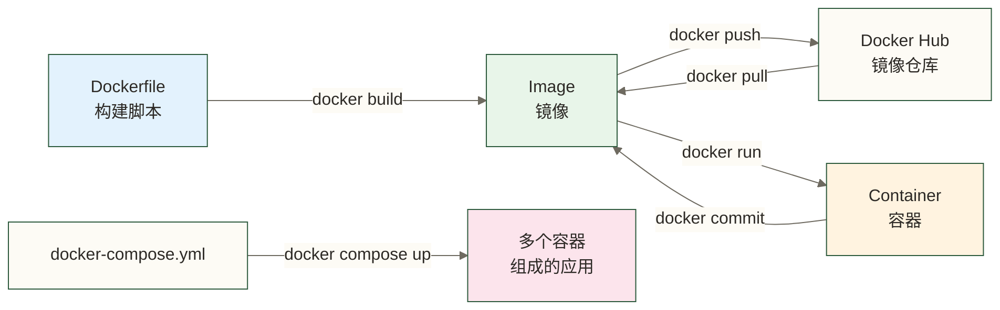

# 容器化概念入门 - 数据工程师为什么要学 Docker

> [!abstract] 本章要点
> - 理解"容器"是什么，用生活类比说清楚
> - 容器和虚拟机的区别，以及各自的适用场景
> - 数据工程师学 Docker 的三个核心理由
> - Docker 生态的主要组件速览

---

## 从一个真实问题开始

你有没有经历过这种场景：

> 你在自己的 Mac 上写了一个 Python 数据处理脚本，跑得好好的。发给同事，他说报错了。你去看，原来他装的 Python 版本不一样，或者少装了某个包。排查了半小时，终于跑起来了。
>
> 然后你把脚本部署到 Linux 服务器上，又报错了。这次是系统的 Python 版本太老...

这个问题本质上是**环境不一致**。Docker 可以通过封装应用及其依赖，减少这类环境差异，但不能消除所有兼容性和配置问题。

---

## 什么是容器

### 用集装箱类比

Docker 的 Logo 是一条鲸鱼驮着一堆集装箱，这个比喻非常准确。

在货运行业，集装箱发明之前，货物运输是这样的：
- 每种货物需要不同的包装方式
- 从船转运到卡车，要重新装卸
- 不同港口的装卸标准不一样

集装箱发明之后：
- 所有货物统一装入标准化的箱子
- 无论用船、火车还是卡车运，接口都一样
- 货物在箱子里，搬运过程中不受外界影响

**容器（Container）就是软件界的集装箱**。你把应用程序、它需要的运行环境、依赖库，全部打包进一个"箱子"里。这个箱子可以在具备兼容容器运行环境的机器上运行，减少环境差异；实际行为仍可能受 CPU 架构、内核、配置和外部服务影响。

### 容器的技术本质（了解即可）

Linux 容器可以理解为一组**隔离进程**，使用 Linux 的 namespace 和 cgroup 等机制实现资源隔离与管理；在 Mac/Windows 上运行 Linux 容器时，通常借助 Linux 虚拟机：

- **namespace**：为容器提供隔离的资源视图（如进程、网络和挂载点），具体隔离范围取决于配置，并非让容器完全看不到宿主机或其他容器资源
- **cgroup**：限制容器能使用的 CPU、内存等资源

> [!note] 不用深究原理
> 作为数据工程师，你不需要深入理解 namespace 和 cgroup 的实现细节。就像你会开车不需要懂发动机原理一样。知道"容器是隔离的进程"这个概念就够用了。

---

## 容器 vs 虚拟机

这是学 Docker 必然会遇到的问题，用一张图对比清楚：

```text
虚拟机架构：
┌─────────────────────────────────────┐
│           物理服务器硬件              │
├─────────────────────────────────────┤
│         宿主机操作系统               │
├─────────────────────────────────────┤
│           Hypervisor（虚拟化层）      │
├──────────────┬──────────────────────┤
│   虚拟机 A    │       虚拟机 B        │
│  完整OS系统   │      完整OS系统       │
│  App + Lib   │      App + Lib       │
└──────────────┴──────────────────────┘

容器架构：
┌─────────────────────────────────────┐
│           物理服务器硬件              │
├─────────────────────────────────────┤
│         宿主机操作系统（Linux内核）    │
├─────────────────────────────────────┤
│           Docker Engine              │
├──────────────┬──────────────────────┤
│   容器 A      │       容器 B          │
│  App + Lib   │      App + Lib       │
│ (共享OS内核)  │    (共享OS内核)        │
└──────────────┴──────────────────────┘
```

### 核心区别对比

| 对比维度 | 虚拟机 | 容器 |
|---------|--------|------|
| 启动速度 | 通常较慢，需要启动客户 OS，实际耗时因配置而异 | 通常较快；服务就绪时间还取决于应用初始化 |
| 占用空间 | 通常较大，包含客户操作系统 | 通常较小，但包含用户态环境及依赖的镜像也可能达到 GB 级 |
| 隔离程度 | 通常提供更强的隔离边界，但不等于绝对安全 | 进程级隔离，共享内核，安全性取决于配置与运行环境 |
| 资源开销 | 通常较高，每个 VM 运行客户 OS，也可共享宿主机资源 | 通常较低，共享宿主机内核与资源 |
| 适用场景 | 需要运行不同 OS、强安全隔离 | 应用部署、微服务、开发环境 |
| 典型工具 | VMware、VirtualBox、KVM | Docker、Podman、containerd |

### 对数据工程师的意义

**用虚拟机的典型场景**：需要在 Mac 上跑 Windows，或者需要完整的 Linux 测试环境。

**用容器的典型场景**：
- 在本机快速拉起 MySQL 测试数据
- 把 ETL 脚本打包成可移植的任务单元
- 搭建包含多个服务的数据开发环境（MySQL + Kafka + Python）
- 在 CI/CD 流水线中运行数据质量检查脚本

---

## 数据工程师为什么要学 Docker

### 理由一：解决"在我机器上能跑"的问题

这是最直接的理由。数据处理脚本的运行依赖通常很复杂：
- Python 版本（3.8 vs 3.11 差别很大）
- 各种包的版本（pandas 1.x vs 2.x 有 breaking change）
- 系统级依赖（某些包需要特定的 C 库）
- 环境变量和配置文件

把应用及可封装的依赖打包进容器，可以减少版本差异；环境变量、配置文件、密钥和外部服务仍需单独管理，密钥不应直接固化在镜像中。

### 理由二：轻松搭建大数据组件测试环境

想在本地测试 [[【技术与工具】/Kafka/00-Kafka学习路线图|Kafka]]？传统安装也需要配置运行环境和服务；部分旧版 Kafka 的流程是：装 Java → 下载 Kafka → 配置 ZooKeeper → 配置 Kafka → 启动服务。KRaft 模式不依赖 ZooKeeper，具体步骤取决于所用版本。

下面保留一个 Docker 配置示意片段：它使用 KRaft 角色配置，不含 ZooKeeper。该片段未验证，`latest` 未固定版本，且未展示完整监听器、控制器及主机访问配置，不能视为可直接运行的完整步骤；实践时需按选定镜像版本补齐配置并验证：

```bash
# Kafka KRaft 配置示意（不含 ZooKeeper；未核实，非完整可运行配置）
docker run -d --name kafka \
  -e KAFKA_CFG_NODE_ID=0 \
  -e KAFKA_CFG_PROCESS_ROLES=controller,broker \
  bitnami/kafka:latest
```

同样的道理适用于 [[【技术与工具】/Spark/00-Spark学习路线图|Spark]]、[[【技术与工具】/Flink/00-Flink学习路线图|Flink]]、[[【技术与工具】/MySQL/00-MySQL学习路线图|MySQL]]、[[【技术与工具】/Hadoop/00-Hadoop学习路线图|Hadoop]] 等。

### 理由三：团队协作的基础设施

当团队有多个数据工程师时，Docker 可以：
- 统一开发环境，减少新人配置环境所需的时间
- 用 `docker-compose.yml` 描述整个开发栈，纳入版本控制
- 提高开发环境和生产环境的一致性，减少部分上线风险；运行配置、数据及外部依赖仍需分别管理

---

## Docker 生态概览

### 核心组件

```text
Docker 生态
├── Docker Engine（核心）
│   ├── dockerd（守护进程，后台运行）
│   ├── Docker CLI（命令行工具，你敲的 docker 命令）
│   └── containerd（实际管理容器的运行时）
│
├── Docker Desktop（桌面端）
│   ├── 包含 Docker Engine + GUI 界面
│   ├── Mac/Windows 的推荐安装方式
│   └── 提供可视化的容器/镜像管理
│
├── Docker Hub（镜像仓库）
│   ├── 用于存放和分享容器镜像的仓库服务
│   ├── 官方镜像：mysql、postgres、python、nginx 等
│   └── 社区镜像：各种定制化镜像
│
└── Docker Compose（多容器编排）
    ├── 用 YAML 文件定义多容器应用
    ├── 一条命令启停完整环境
    └── Docker Desktop 内置，无需单独安装
```

### 核心概念的关系



### 关键术语速记

| 术语 | 类比 | 说明 |
|------|------|------|
| Image（镜像） | 安装光盘 | 只读的应用模板，包含应用和所有依赖 |
| Container（容器） | 运行中的程序 | 镜像的运行实例，可以启动/停止/删除 |
| Dockerfile | 安装脚本 | 描述如何构建镜像的文本文件 |
| Docker Hub | 应用商店 | 存放和分享镜像的公共仓库 |
| Volume（数据卷） | 外接硬盘 | 容器外部的持久化存储 |
| Network（网络） | 局域网 | 容器间通信的虚拟网络 |

---

## 一图看懂 Docker 工作流

```text
1. 找镜像          2. 运行容器         3. 使用服务

Docker Hub  ──pull──► Image ──run──► Container
                                         │
                                    端口映射
                                         │
                              你的应用/工具访问 ◄──── 你
```

---

## 数据工程师的 Docker 使用层次

作为数据工程师，你需要掌握的 Docker 技能可以分三层：

**第一层：会用（必须掌握）**
- 从 Docker Hub 拉取镜像
- 启动/停止容器，映射端口和目录
- 用 Docker Compose 管理多容器环境
- 查看容器日志排查问题

**第二层：会做（推荐掌握）**
- 写 Dockerfile 打包自己的数据处理脚本
- 自定义 Compose 文件构建数据开发环境
- 管理数据持久化（Volume）

**第三层：了解（可选）**
- 镜像优化（减小体积、多阶段构建）
- 容器安全配置
- 网络高级配置

本系列教程覆盖前两层，可作为数据工程师开展常见开发任务的基础；生产部署还需根据职责补充安全、网络、备份和运维能力。

---

## 下一步

理解了基本概念之后，下一步是在自己的机器上安装 Docker。

---

## 掌握检查

- [ ] 能用一个生活类比（非技术语言）向非技术同事解释"容器"和"虚拟机"的区别
- [ ] 能说出镜像（Image）和容器（Container）的关系：镜像是模板，容器是运行实例，一个镜像可以启动多个容器
- [ ] 知道 Docker 解决了什么核心问题："我的机器上能跑，你的机器跑不了" → 环境一致性
- [ ] 能说出数据工程师用 Docker 的三个典型场景（本地开发环境/ETL打包部署/快速拉起依赖服务）
- [ ] 理解 Dockerfile、Image、Container 的关系：Dockerfile 描述构建过程 → build 生成 Image → run 启动 Container

---

- 继续阅读：[[【技术与工具】/Docker/02-Docker安装与配置|Docker安装与配置]]

> [!tip] 课前检查
> 在学安装之前，先确认一下自己的机器配置。以下为原稿未核实的版本要求示例，未绑定具体 Docker Desktop 或 Docker Engine 版本，不能作为当前兼容性结论；请以拟安装版本的官方要求为准：
> - Mac：macOS 12 (Monterey) 及以上，芯片为 Apple Silicon 或 Intel 都支持
> - Windows：Windows 10/11，需要开启 WSL2
> - Linux：内核版本 4.x 及以上，主流发行版（Ubuntu/CentOS/Debian）均支持
