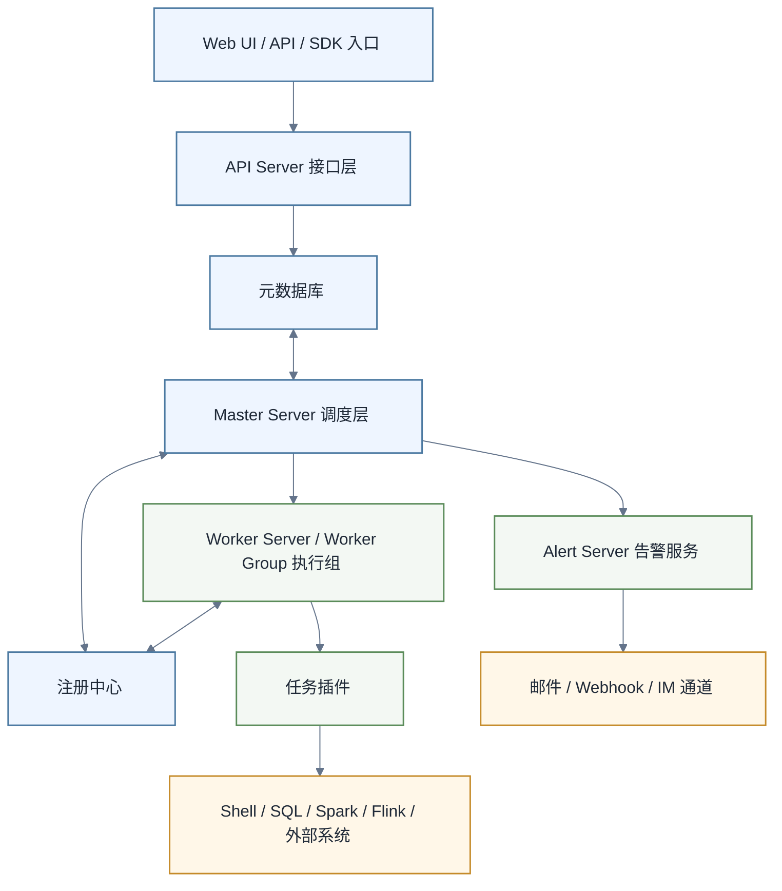

# DolphinScheduler 概述与对比

> [!abstract] 先说结论
> Apache DolphinScheduler 是面向分布式工作流编排的 Apache 顶级项目，核心体验是通过 Web UI 定义 DAG、管理项目与资源，并由 Master、Worker 等服务协同调度和执行任务。它和 Airflow 的关键差异不是“谁绝对更强”，而是工作流主要由可视化配置驱动，还是由代码驱动。

原稿称截至 2026-08-16，官方 GitHub Releases 的最新版本为 3.4.2；本轮未核实该日期的发布记录及版本排序，不应将此说法作为当前最新版本结论。版本状态会变化，部署前应再次核对 Release、升级说明和所需任务插件。

## 1. DolphinScheduler 是什么

DolphinScheduler 用 DAG 表示任务依赖，把工作流定义、定时调度、手动运行、补数、告警和运行实例管理集中到同一套平台中。

典型角色包括：

- 平台管理员：管理租户、用户、Worker Group、环境和告警实例
- 数据开发：在项目中创建工作流、配置任务、上线和运行
- 运维人员：观察实例状态、日志、资源与服务健康
- 外部系统：通过 API 或 SDK 提交、触发或查询工作流

它适合需要统一调度入口、可视化 DAG 和分布式执行的数据团队，但不意味着所有复杂逻辑都应该塞进调度器。调度器应负责编排、重试和状态管理，重计算逻辑仍应放在 Spark、Flink、SQL 引擎或独立程序中。

## 2. 核心组件

| 组件 | 主要职责 | 设计时关注点 |
|---|---|---|
| API Server | 为 Web UI 和外部调用提供接口 | 鉴权、限流、审计、反向代理 |
| Master Server | 解析工作流、生成任务实例并调度 | 高可用、命令积压、数据库连接 |
| Worker Server | 接收并执行任务 | Worker Group、资源隔离、依赖环境 |
| Alert Server | 处理告警事件和告警插件 | 通道凭据、失败重试、降噪 |
| 数据库 | 保存定义、实例、命令和配置元数据 | 备份、连接池、容量与恢复演练 |
| 注册中心 | 服务发现与协调 | 可用性、会话、网络与版本兼容 |

下面是用于建立心智模型的简化架构图。它强调控制面、执行面和外部系统的关系，不代替目标版本的部署拓扑。

> [!note] 版本差异
> 组件名称和部署方式可能随版本调整。生产设计应以目标版本的官方架构、安装与升级文档为准，不能照搬旧教程的进程列表。

## 3. 从定义到运行

一个常见工作流经历以下状态：

1. 在项目中创建任务定义
2. 连线形成工作流定义
3. 保存并上线工作流
4. 手动运行或创建调度
5. Master 生成工作流实例与任务实例
6. Worker 执行任务并回报状态
7. 根据重试、超时、失败策略和告警配置处理结果

需要特别区分：

- 工作流定义：可复用的 DAG 模板
- 工作流实例：某一次具体运行
- 任务定义：节点的配置模板
- 任务实例：节点在某次工作流运行中的执行记录

排障时混淆“定义”和“实例”，很容易改错对象或误判运行状态。

## 4. 重要的平台概念

### 4.1 项目与权限

项目是组织工作流的基本边界。权限设计应围绕团队职责和生产边界展开，而不是让所有用户共享一个超大项目。

### 4.2 租户

租户与任务运行身份、资源访问有关。它不是只在界面上分组的标签；生产部署要确认操作系统用户、目录权限、密钥和外部系统授权一致。

### 4.3 Worker Group 与环境

Worker Group 用于把任务路由到具备特定依赖或资源的 Worker。环境用于集中管理任务运行需要的环境变量。二者结合后，可以把通用任务、重计算任务和特殊依赖任务分开。

### 4.4 数据源、资源与告警

数据源连接、文件资源和告警插件都属于外部依赖入口。必须控制凭据可见性、变更权限和生产测试方式，不应在工作流文本中散落明文密码。

## 5. 与 Airflow 的对比

| 维度 | DolphinScheduler | Airflow | 判断方式 |
|---|---|---|---|
| 主要定义方式 | Web UI 配置 DAG；也有 API/SDK 路径 | Python 代码定义 DAG | 团队更依赖界面协作还是 Git/code review |
| 抽象方式 | 项目、工作流、任务、租户、Worker Group | DAG、Task、Operator、Executor、Pool | 现有平台治理模型是否容易映射 |
| 动态生成 | 以产品当前支持的参数、API 和任务能力为准 | Python 代码通常更自然 | 是否有大量由数据动态生成的任务 |
| 变更审查 | 需要建立导出、API 或平台审计流程 | 可直接进入代码评审流程 | 是否要求所有生产变更走 Git |
| 使用门槛 | SQL/平台用户可从可视化编排切入 | 需要理解 Python 与 Airflow API | 主要使用者的工程能力 |
| 扩展方式 | 任务、告警等插件及外部任务 | Operator、Provider、Plugin | 所需系统是否已有稳定集成 |
| 运行隔离 | 租户、Worker Group、队列等组合 | Executor、Queue、Pool、Kubernetes 等组合 | 需要验证实际执行身份和资源边界 |

这个表只描述两类产品的常见设计倾向，不代表任意版本都具备完全相同的功能。选型应针对目标版本做原型验证。

## 6. 哪些情况更适合 DolphinScheduler

- 工作流主要由 SQL、Shell、Spark、Flink 等标准任务组成
- 希望数据开发直接在 Web UI 中查看和维护 DAG
- 需要用项目、租户和 Worker Group 组织多团队任务
- 希望把调度、实例、日志和告警集中在平台中
- 团队能够为元数据库、注册中心、Worker 依赖和权限体系承担运维责任

## 7. 哪些情况需要重点评估 Airflow 或其他方案

- DAG 本身需要大量 Python 抽象、动态生成和单元测试
- 所有生产工作流必须天然进入 Git、代码评审和 CI/CD
- 已经深度依赖某一套 Airflow Provider 或托管 Airflow 服务
- 团队希望把调度平台运维交给现有云服务

两套系统也可以共存，但要明确职责边界。不要让同一条业务链路在两个调度器之间互相等待而没有统一的超时、幂等和故障责任人。

## 8. 选型 PoC 清单

不要只比较功能表。选一条真实但低风险的数据链路，至少验证：

- [ ] 创建、上线、定时运行和手动补数
- [ ] 上下游依赖、失败重试、超时和 Kill
- [ ] SQL、Shell 及一个真实计算引擎任务
- [ ] 参数传递、时区和业务日期
- [ ] Worker 故障与 Master 故障后的行为
- [ ] 多租户执行身份和目录权限
- [ ] 告警成功、告警失败与告警降噪
- [ ] 版本升级、元数据库备份与恢复
- [ ] API 或 SDK 自动化与审计记录
- [ ] 一次完整的故障演练和回退

## 9. 本目录学习路径

1. [[【技术与工具】/DolphinScheduler/01-DolphinScheduler部署与首次工作流|部署与首次工作流]]：用 Standalone 理解最小闭环
2. [[【技术与工具】/DolphinScheduler/02-DolphinScheduler核心概念与任务编排|核心概念与任务编排]]：理解定义、实例、依赖、参数与运行策略
3. [[【技术与工具】/DolphinScheduler/03-DolphinScheduler生产运维与故障排查|生产运维与故障排查]]：建立容量、监控、备份、升级和排障方法

## 10. 官方资料

- [Apache DolphinScheduler 官网](https://dolphinscheduler.apache.org/)
- [Apache DolphinScheduler 3.4.2 Release](https://github.com/apache/dolphinscheduler/releases/tag/3.4.2)
- [3.4.2 Standalone 安装文档](https://github.com/apache/dolphinscheduler/blob/3.4.2/docs/docs/en/guide/installation/standalone.md)
- [3.4.2 工作流定义文档](https://github.com/apache/dolphinscheduler/blob/3.4.2/docs/docs/en/guide/project/workflow-definition.md)
- [DolphinScheduler GitHub 仓库](https://github.com/apache/dolphinscheduler)
- [PyDolphinScheduler 文档](https://dolphinscheduler.apache.org/python/)

## 相关文档

- [[【技术与工具】/Airflow/00-Airflow学习路线图|Airflow学习路线图]]
- [[【技术与工具】/Airflow/01-工作流调度概述|工作流调度概述]]
- [[【技术与工具】/DataX/00-DataX学习路线图|DataX学习路线图]]
- [[【技术与工具】/Spark/00-Spark学习路线图|Spark学习路线图]]
- [[【技术与工具】/Flink/00-Flink学习路线图|Flink学习路线图]]
- [[【技术与工具】/Linux/00-Linux学习路线图|Linux学习路线图]]
