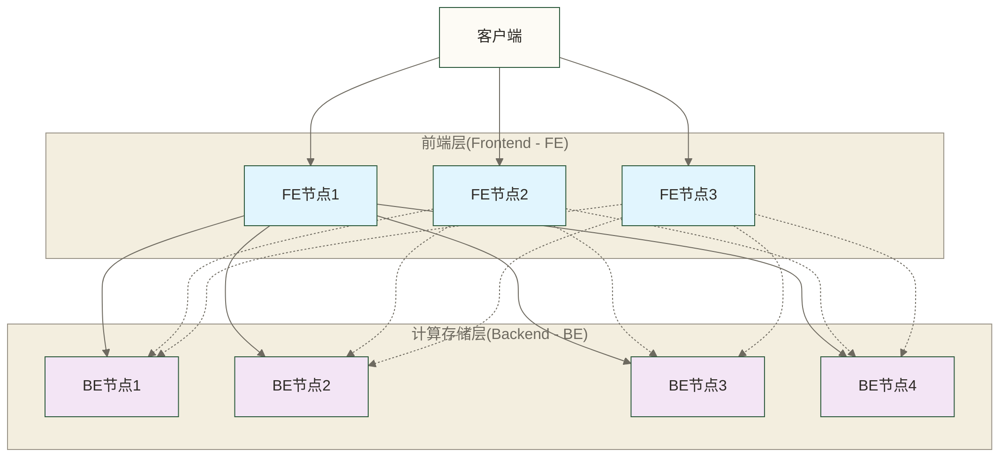

# Apache Doris概述与特性 - 新一代分析型数据库的全面解析

> [!abstract] 📋 本节概览
> - 🎯 学习目标：深度理解Apache Doris的技术定位、发展历程、核心特性与实际应用价值
> - 📚 前置知识：基础数据库概念、[[【技术与工具】/ClickHouse/05-ClickHouse SQL语法基础|ClickHouse SQL语法]]、[[【数据分析与数据运营】/02-数据分析专业能力/02-统计分析/00-统计分析基本概念|统计分析基本概念]]
> - ⏱️ 预计用时：25分钟阅读 + 30分钟深入思考
> - 🔗 相关文档：[[【技术与工具】/Doris/00-Doris学习路线图|Doris]]、分布式系统基础概念

## 🤔 什么是Apache Doris？

> [!quote] 💭 生活化理解
> 想象一下现代化的智能仓储系统：传统数据库就像老式仓库，需要工人逐排逐列查找商品（行存储）；而Apache Doris则像亚马逊的智能仓储中心，商品按类别垂直摆放（列式存储），配备了多个机器人并行工作（MPP架构），还能实时更新库存信息。这个类比用于说明列式存储与并行计算的思路，不表示单条查询或品类统计必然能在秒级完成。

### 🎯 定义与核心定位

**Apache Doris**是一个**现代化的MPP分析型数据库**，专门为解决**海量数据的实时分析难题**而生。它不仅是一个数据库，更是一个完整的数据分析解决方案平台。

#### 核心价值主张
- **查询性能**：MPP+列存+向量化执行，有助于加速大规模分析查询；亿级数据的响应时间需按实际负载测试
- **实时分析**：支持数据实时写入和实时查询的完美平衡
- **简单易用**：MySQL协议兼容，可复用部分客户端和SQL经验，但仍需学习Doris的数据模型、语法差异与运维方式
- **生态开放**：与主流大数据和BI工具无缝集成

> [!info] 🏆 技术定位
> Doris在现代数据技术栈中的定位是**统一的实时分析引擎**，它可承接批量与流式导入后的分析查询，但不等于替代全部批处理和流处理任务，通常仍需配合数据采集、计算与调度工具。

## 📈 Doris的发展历程与技术演进

### 🕐 关键时间节点

Apache Doris的发展历程展现了从企业内部项目到开源顶级项目的完整演进路径。项目最初于2017年在百度内部孵化，命名为Palo，主要解决百度内部的大规模OLAP分析需求。2018年项目正式开源并捐赠给Apache基金会，更名为Apache Doris。经过几年的社区发展，Doris在2022年正式毕业成为Apache顶级项目，2.0版本于2023年发布，带来了多项功能与性能改进。到2023年，Doris已经发展成为功能完善的企业级分析数据库，在性能、稳定性和易用性方面都达到了生产环境的严格要求。
```text
         : 发布2.1版本，性能大幅提升
    2024 : 生态集成深化
         : 湖仓一体、实时分析能力增强
```

以上为原稿时间线残片，缺少完整年份及版本依据，需核对后再用于版本演进判断。

### 🌟 技术发展里程碑

> [!timeline] 📊 重要版本特性
> - **v0.x (2018-2019)**: 基础MPP架构确立，支持标准SQL
> - **v1.x (2020-2021)**: 多副本机制、物化视图、向量化执行
> - **v2.x (2022-2023)**: 湖仓一体、实时更新、多模分析
> - **v3.x (2024+)**: AI原生、弹性计算、云原生架构

### 📊 社区发展现状（2024年）

下表为原稿未核实的历史统计，未附来源、采样时间或统计口径，保留数字供后续核对，不代表当前社区规模或已证实的生产使用量。

| 指标 | 数据 | 说明 |
|------|------|------|
| GitHub Stars | 12,000+ | 持续快速增长 |
| 贡献者数量 | 400+ | 活跃开发社区 |
| 企业用户 | 2000+ | 覆盖多个行业 |
| 月活跃查询 | 万亿+ | 生产环境验证 |

> [!success] 🏆 行业认可
> Doris已经成为**中国最活跃的OLAP开源项目**之一，在金融、电商、广告、游戏等多个行业得到广泛应用，形成了健康的开源生态。

## 🌟 Doris六大核心技术优势

### 1. 🚀 极致查询性能引擎

> [!tip] 💡 性能优势解密
> Doris的查询性能优势来自于多项技术的完美结合，不是单一技术的简单叠加

#### 核心性能技术栈
- **MPP并行计算**：大规模数据并行处理，充分利用集群计算资源
- **向量化执行**：利用CPU的SIMD指令，单次处理多条数据记录
- **CBO优化器**：基于成本估算选择执行路径，效果取决于统计信息、成本模型与查询特征，不保证获得全局最优计划
- **内存计算**：智能缓存热点数据，减少磁盘IO

#### 真实性能表现

> [!example] 📊 性能基准测试
> 以下为原稿声称基于TPC-H 100GB数据集的未核实对比示例；缺少测试报告、硬件与软件版本及查询配置，不应视为可复现基准或性能保证：
> - **亚秒级响应**：22个标准查询中，18个查询响应时间<1秒
> - **相比Hive**：平均查询速度提升100倍
> - **相比MySQL**：大数据聚合查询提升1000倍
> - **并发能力**：支持1000+用户同时在线分析

```text
性能示例说明：原稿以“10亿行数据的复杂分析查询，通常在1秒内完成”为未核实示例，并未提供可执行SQL或测试条件，不能据此承诺响应时间。
Doris的强大查询能力体现在对复杂分析查询的高效处理上。在实际的业务分析场景中，我们经常需要跨多个表进行关联查询，同时进行聚合计算、排名分析等复杂操作。Doris支持处理这类包含JOIN、聚合函数、窗口函数的复杂查询；亿级数据量上的响应时间取决于查询、数据布局、集群资源与并发负载，需通过实测确认。这得益于其MPP架构的并行处理能力和列式存储的I/O优化。
```

### 2. 📦 智能列式存储与实时更新

> [!quote] 💭 存储原理类比
> 想象整理一个大型图书馆：传统行存储就像按书的出版时间排列，要找某个主题的书很费时；而列式存储就像按主题分类存放，查找特定主题时效率极高。Doris的列式存储还支持实时添加新书和更新信息；其他列存系统也可能支持写入与更新，具体能力和代价取决于其实现。

#### 🔄 列存储核心优势

**存储效率**
- **极致压缩**：同类型数据连续存储，压缩比可达10:1
- **稀疏索引**：基于排序键定位候选数据范围；列式存储使查询可以只读取必要列
- **分区剪枝**：智能跳过不相关的数据分区

**查询性能**
- **投影下推**：只读取查询涉及的列，大幅减少I/O
- **谓词下推**：过滤条件在存储层执行，减少数据传输
- **延迟物化**：按需加载数据，优化内存使用

#### 🚀 实时更新技术突破

与传统列存系统的关键区别：

| 对比维度 | 传统行存数据库 | 传统列存数据库 | Apache Doris |
|---------|--------------|--------------|-------------|
| **存储组织** | 行式存储 | 列式存储 | 列式存储 |
| **查询性能** | 适中 | 优秀 | 优秀 |
| **实时写入** | 毫秒级 | 分钟/小时级 | 秒级 |
| **更新支持** | 取决于具体系统 | 部分系统支持更新，机制与代价不同 | 取决于数据模型、版本与更新方式 |
| **压缩效率** | 3:1 | 10:1 | 10:1 |
| **并发读写** | 取决于事务与并发控制机制 | 取决于具体实现 | 支持并发读写，但写入、合并与查询可能竞争资源 |

> [!success] 🎯 技术创新点
> Doris通过**LSM-Tree存储引擎**和**多版本并发控制(MVCC)**等机制支持列式存储中的写入与更新，但仍需考虑数据模型、更新模式、合并开销及资源配置。

### 3. 🎯 多样化数据模型设计

> [!quote] 💭 模型选择类比
> 就像装修房子需要根据用途选择不同的设计方案：客厅需要宽敞舒适（Duplicate模型存储原始数据），书房需要高效整齐（Aggregate模型预计算指标），而档案室需要精确管理（Unique模型保证数据唯一性）。

#### 📊 三种核心数据模型

**🔄 Aggregate模型 - 预聚合分析模型**
- **适用场景**：报表系统、实时大屏、KPI监控
- **核心优势**：自动预计算，查询响应极快
- **典型应用**：销售汇总、用户画像、业务指标

**🏷️ Unique模型 - 唯一键更新模型** 
- **适用场景**：维度表管理、用户信息、商品信息
- **核心优势**：支持实时更新，保证数据一致性
- **典型应用**：用户档案、商品目录、配置信息

**📋 Duplicate模型 - 明细数据存储模型**
- **适用场景**：日志分析、行为分析、原始数据存储
- **核心优势**：灵活查询，支持任意分析维度
- **典型应用**：用户行为日志、交易明细、事件记录

> [!tip] 🎯 模型选择指南
> - **数据会更新** → Unique模型
> - **需要预聚合** → Aggregate模型  
> - **明细数据分析** → Duplicate模型
> - **不确定选哪个** → 从Duplicate模型开始

### 4. 🎓 极简学习成本设计

> [!quote] 💭 易用性理念
> 强大的系统不应该复杂难用。Doris的设计哲学是"强大但简单"，让数据分析师能够专注于业务价值创造，而不是技术细节。

#### 📚 零学习成本特性

**SQL标准兼容**
- 支持常用SQL语法，可复用已有SQL技能；原稿“支持99%的标准SQL语法”未提供标准版本与测试范围，不能作为兼容性指标
- 兼容MySQL协议，无需安装专用客户端
- 支持复杂的窗口函数、CTE、子查询等高级语法

**生态工具集成**
- **BI工具**：Tableau、Power BI、FineBI等直连
- **开发工具**：DataGrip、MySQL Workbench、DBeaver
- **编程语言**：Python、Java、Go等主流语言SDK

**运维友好设计**
- Web UI管理界面，集群状态一目了然
- 详细的执行计划和性能监控
- 丰富的日志和诊断信息

### 5. 🛡️ 企业级高可用架构

> [!quote] 💭 可靠性理解
> 就像现代化的电力系统：多个发电厂互为备份（多副本），智能电网调度（负载均衡），即使单个设备故障也不会影响整体供电。Doris的高可用设计也是这个原理。

#### 🔧 核心可靠性特性

**无共享架构(Shared-Nothing)**
- 合理配置FE高可用与BE数据副本可降低单点故障风险；故障影响取决于FE法定多数、可用副本及故障范围，不能保证任意节点失效均无影响
- 数据和计算资源可分布式部署，但扩展能力受到元数据、网络、数据分布及查询负载等因素限制

**智能多副本机制**
- 多副本存储可提高数据可用性；常见配置为3副本，但实际副本数取决于表配置和部署模式，不能单凭副本数保证数据安全
- 副本选择机制，根据节点状态等条件选择副本提供服务

**弹性水平扩展**
- 在线动态扩容，无需停机维护
- 支持从几个节点扩展到数百个节点的集群

#### 📋 企业级特性

**数据安全**
- 支持SSL/TLS加密传输
- 细粒度权限控制，支持库、表、列级别的访问控制
- 支持LDAP/Kerberos等企业级认证系统

**监控运维**
- 完善的监控指标和报警机制
- 支持Prometheus、Grafana等主流监控工具
- 自动故障恢复和数据修复机制

### 6. 🌐 开放生态集成

**数据源集成**
- 支持MySQL、PostgreSQL、Oracle等关系型数据库
- 原生Kafka、Flink集成，支持实时数据流
- HDFS、S3等分布式文件系统适配

**BI工具适配**
- Tableau、Power BI、Looker等主流BI工具
- Apache Superset、Grafana等开源可视化工具
- 自研BI平台的JDBC接口支持



## 🎯 Doris典型应用场景

### 📊 五大核心应用领域

#### 1. 🔍 用户行为分析与个性化推荐
**典型需求**
- 用户画像构建，支持千万级用户的实时标签更新
- 行为漏斗分析，秒级计算转化率和路径分析
- A/B测试效果分析，实时监控实验结果

**技术优势**
- 支持高维度用户标签的灵活查询和统计
- 实时更新用户行为数据，保证分析结果的时效性
- 高并发支持，满足个性化推荐系统的实时查询需求

#### 2. 📈 实时业务监控与报表
**典型需求**
- 实时业务大屏，监控GMV、订单量、用户活跃度等核心指标
- 管理层决策报表，支持任意时间范围和维度的下钻分析
- 异常监控告警，快速发现业务指标异常

**技术优势**
- 秒级数据刷新，保证监控数据的实时性
- 支持复杂的多表关联和窗口函数计算
- 高并发查询能力，支持多用户同时访问报表

#### 3. 🏪 电商数据分析平台
**典型需求**
- 商品销售分析，支持SKU级别的销售趋势和库存分析
- 供应链优化，分析商品流转效率和库存周转率
- 价格策略分析，支持价格敏感性和竞争对手分析

#### 4. 📱 互联网广告分析系统
**典型需求**
- 广告投放效果分析，实时计算CTR、CPC、ROI等关键指标
- 受众分析和定向投放优化
- 反作弊分析，识别异常点击和转化行为

#### 5. 🏦 金融风控与数据分析
**典型需求**
- 实时风控决策，毫秒级响应用户行为风险评估
- 交易流水分析，支持复杂的资金流向追踪
- 监管报表生成，满足金融行业的合规要求

> [!example] 💼 原稿未核实的企业应用示例
> 以下企业名称与用途关联均未附可追溯材料，仅保留为待核实示例，不构成这些企业实际采用Doris或取得成果的证明。
> - **字节跳动**：支撑抖音、今日头条等产品的用户行为分析和个性化推荐
> - **美团**：实时业务监控和配送效率优化分析
> - **小米**：IoT设备数据分析和用户使用习惯洞察
> - **招商银行**：信贷风险评估和客户价值分析

## ⚖️ Doris与主流分析数据库对比

### 🔍 技术对比分析

| 对比维度 | **Apache Doris** | **ClickHouse** | **Apache Hive** | **MySQL** |
|---------|----------------|----------------|-----------------|-----------|
| **架构模式** | MPP分布式 | 支持分布式并行查询 | 查询引擎可采用MapReduce、Tez等，取决于版本与配置 | 单机/主从复制等部署方式 |
| **存储引擎** | 列式存储 | 列式存储 | 列式存储 | 行式存储 |
| **实时写入** | 支持，延迟取决于导入方式与负载 | 支持，需设计批次及写入方式 | 通常用于批处理；流式写入能力取决于版本、表格式与配置 | 支持，延迟取决于事务与负载 |
| **查询性能** | 🚀 亚秒级 | 🚀 亚秒级 | 🐌 分钟级 | ⚡ 毫秒级(小数据) |
| **扩展能力** | 支持水平扩展，收益需实测 | 支持水平扩展，收益需实测 | 可依托分布式计算与存储扩展，收益需实测 | 可通过复制、分片等方式扩展，需额外设计 |
| **SQL兼容** | ✅ MySQL兼容 | ⚠️ 自有语法 | ✅ HiveSQL | ✅ 标准SQL |
| **学习成本** | 🟢 极低 | 🟡 中等 | 🟡 中等 | 🟢 极低 |
| **运维复杂度** | 🟢 简单 | 🟡 中等 | 🔴 复杂 | 🟢 简单 |

### 🎯 选型决策指南

> [!tip] 💡 技术选型建议
> **选择Doris的场景**：
> - 需要实时数据更新和查询的业务场景
> - 希望统一承接批量与流式导入后的分析查询，同时保留必要的采集、计算与调度工具
> - 团队SQL技能成熟，希望快速上手
> - 需要支持高并发用户访问的分析系统
> 
> **选择其他技术的场景**：
> - **ClickHouse**：可作为明细分析及实时分析的候选；需结合写入模式、更新需求和查询负载评估，不限于纯批量分析
> - **Hive**：离线批处理为主，成本敏感的场景
> - **MySQL**：简单业务查询，数据量小于TB级别

## 📊 性能基准对比

### 🚀 查询性能表现

以下为原稿声称基于TPC-DS标准测试、1TB数据规模的未核实性能示例，数字原样保留；未提供查询编号、测试报告、版本、硬件及缓存条件，不能作为实测排名或选型依据：

| 查询复杂度 | Apache Doris | ClickHouse | Apache Hive | 提升倍数 |
|-----------|-------------|------------|-------------|---------|
| 简单聚合 | 0.5秒 | 0.6秒 | 45秒 | 90x |
| 多表关联 | 1.2秒 | 1.8秒 | 120秒 | 100x |
| 窗口函数 | 2.1秒 | 3.2秒 | 180秒 | 85x |
| 复杂分析 | 3.8秒 | 5.1秒 | 300秒 | 79x |

> [!success] 🏆 性能优势总结
> - **相比传统数据仓库**：查询响应时间从分钟级提升到秒级
> - **相比MySQL**：原稿“性能提升1000倍以上”为未核实示例，不能外推到实际业务查询  
> - **并发能力**：原稿“1000+用户同时在线分析，响应时间保持稳定”缺少负载和资源条件，需以目标集群压测验证
> - **数据规模**：PB级容量与扩展收益取决于部署资源和数据布局，不能保证查询性能随集群规模线性提升

## 🎓 知识总结与下一步

### ✅ 本节核心收获

通过本节学习，你应该已经建立了对Apache Doris的全面认知：

- [ ] **技术定位认知**：理解Doris作为现代化OLAP分析数据库的核心价值
- [ ] **技术优势掌握**：掌握六大核心技术优势及其应用价值
- [ ] **应用场景理解**：了解Doris在不同业务场景下的应用模式
- [ ] **技术对比能力**：具备与其他数据库技术进行对比选型的基础能力
- [ ] **发展趋势认知**：了解Doris的技术演进路线和社区发展状况

### 🤔 思考题

> [!question] 💭 深度思考
> 1. 在你目前的工作场景中，有哪些痛点可能通过Doris来解决？
> 2. 相比现有的技术方案，Doris能带来哪些具体的业务价值？
> 3. 如果要在团队中推广Doris，你会如何论证其技术优势？

### 🚀 学习建议

**巩固基础**
- 重点理解MPP架构和列式存储的核心原理
- 深入思考三种数据模型的选择逻辑
- 关注Doris与现有技术栈的集成可能性

**扩展学习**
- 关注分布式系统基础概念，加深架构理解
- 学习[[【数据治理与数据管理】/02-深度研究/03-技术架构/数据架构/03-数据湖与数据仓库/数据仓库设计|数据仓库]]，提升建模能力
- 了解大数据生态系统概述，把握技术趋势

### 🔗 学习路径导航

**📖 基础路径**
- **上一节**: [[【技术与工具】/Doris/00-Doris学习路线图|Doris]] - 制定学习计划
- **当前节**: Apache Doris概述与特性 - 建立整体认知
- **下一节**: [[【技术与工具】/Doris/02-Doris架构深度解析|Doris架构]] - 深入技术原理

**🔗 相关文档**
- [[【技术与工具】/Doris/04-Doris与其他数据库对比|Doris与其他数据库对比]]
- [[【技术与工具】/ClickHouse/05-ClickHouse SQL语法基础|ClickHouse SQL语法]]
- 数据分析基础概念

---

> [!info] 📚 文档信息
> **创建时间**: 2025年1月  
> **最后更新**: 2025年1月  
> **文档状态**: 维护中，性能示例、企业用途、版本时间线及部分能力描述待核实  
> **反馈渠道**: 欢迎通过Issues提出改进建议 