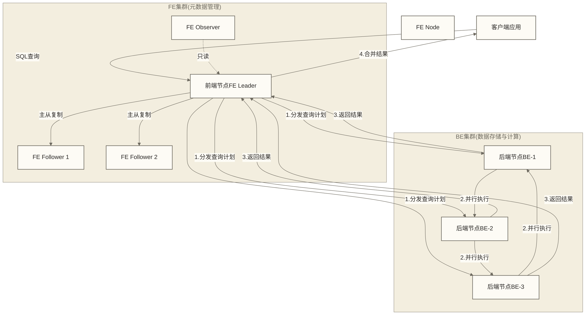
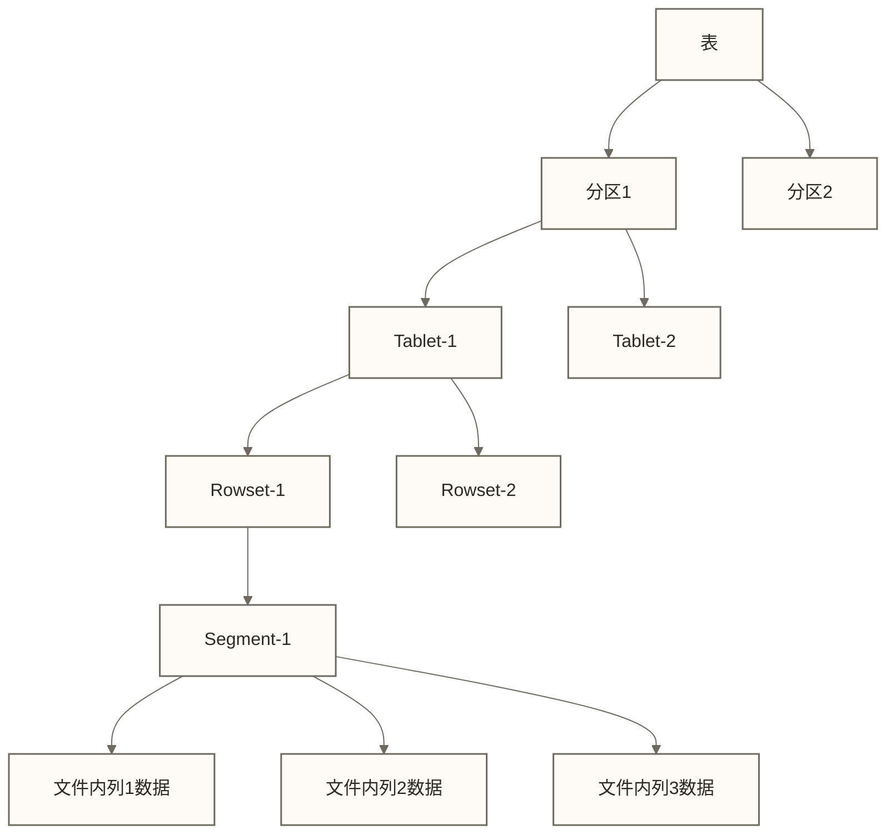
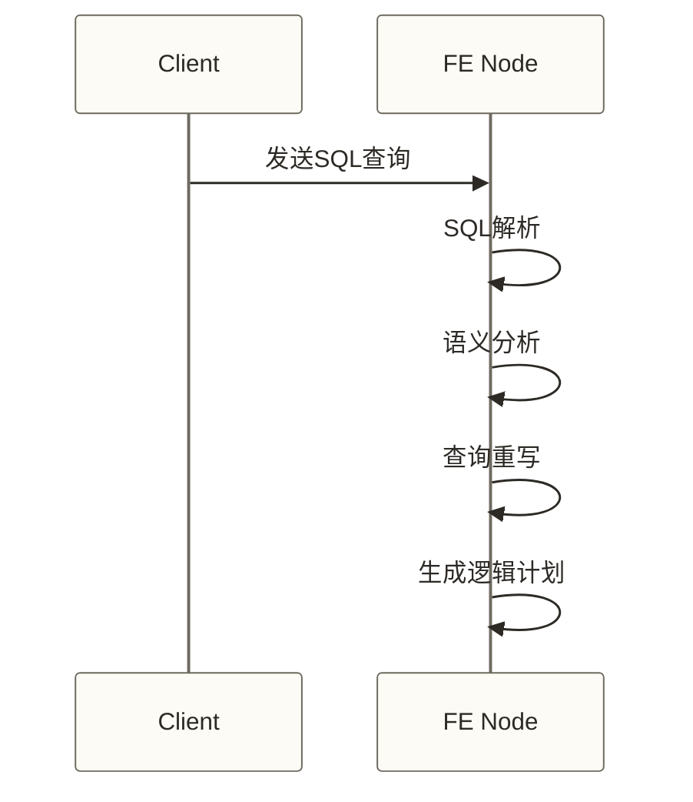
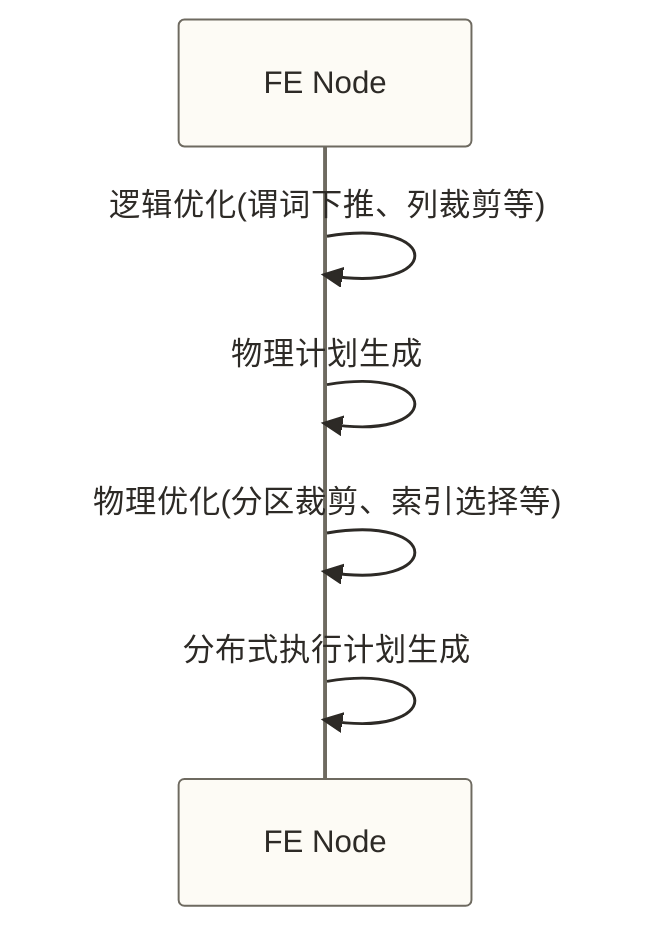
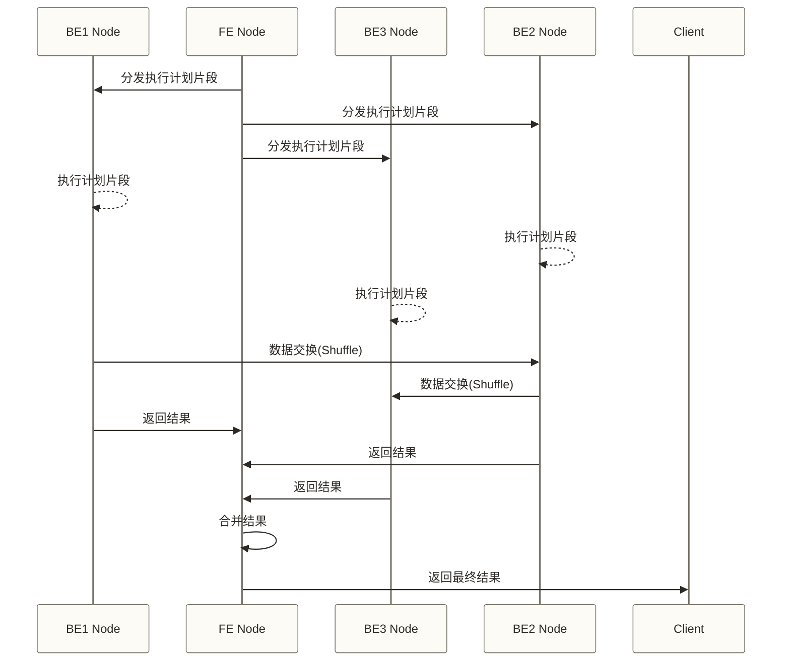

# Apache Doris架构深度解析 - 分布式MPP引擎的技术内幕

> [!abstract] 📋 本节概览
> - 🎯 学习目标：深度掌握Doris的分布式架构设计原理、FE/BE协作机制和查询执行流程
> - 📚 前置知识：[[【技术与工具】/Doris/01-Doris概述与特性|Doris概述与特性]]、分布式系统基础概念
> - ⏱️ 预计用时：30分钟阅读 + 45分钟深入理解
> - 🔗 相关文档：[[【技术与工具】/Doris/00-Doris学习路线图|Doris]]、[[【技术与工具】/Doris/03-Doris核心概念|Doris核心概念]]

## 🌟 为什么要深入理解Doris架构？

> [!quote] 💭 架构理解的重要性
> 理解系统架构就像理解一座城市的规划：只有掌握了道路网络、功能分区和交通流向，才能在其中高效工作和生活。对于Doris架构的深度理解，将帮助你在实际使用中做出最优的设计决策，并在遇到性能问题时快速定位和解决。

### 🎯 架构知识的实际价值

**技术决策能力**
- 合理规划集群规模和节点配置
- 优化查询性能和资源利用率
- 设计高可用和容灾方案

**问题排查能力**
- 快速定位性能瓶颈和故障根因
- 理解监控指标的业务含义
- 制定有效的运维策略

**系统优化能力**
- 基于架构特性进行SQL优化
- 合理设计数据分布和存储策略
- 提升系统整体性能
## 💡 Doris整体架构

Doris采用经典的MPP(大规模并行处理)架构，主要由两类节点组成：

1. **FE(Frontend)** - 前端节点，负责元数据管理、查询规划和协调
2. **BE(Backend)** - 后端节点，负责数据存储和查询执行



## 🔍 FE(Frontend)节点详解

### 核心功能

1. **元数据管理**：维护数据库、表、分区等元数据信息
2. **查询解析与规划**：SQL解析、语义分析、查询优化、执行计划生成
3. **集群管理**：节点健康检查、负载均衡、资源调度
4. **用户权限管理**：认证与授权
5. **查询协调**：分发执行计划、收集结果、错误处理

### FE节点角色

| 角色 | 数量 | 功能 | 元数据写入 | 元数据读取 | 处理查询 |
|---|---|---|---|---|---|
| **Leader** | 1 | 主节点，负责元数据写入 | ✅ | ✅ | ✅ |
| **Follower** | 0-N（高可用常见配置为2个） | 备用主节点，参与选举 | ❌ | ✅ | ✅ |
| **Observer** | 0-N | 只读节点，提供读扩展 | ❌ | ✅ | ✅ |

```sql
-- 查看FE节点状态
SHOW FRONTENDS;

-- 添加Follower节点
ALTER SYSTEM ADD FOLLOWER "fe_host:9010";

-- 添加Observer节点
ALTER SYSTEM ADD OBSERVER "fe_host:9010";
```

### 元数据管理

FE采用类似Paxos的多数派协议保证元数据一致性，元数据以journal日志形式持久化：

```text
+-- meta/
    +-- bdb/
    |   +-- 00000000.jnl
    |   +-- 00000001.jnl
    +-- image/
        +-- metadata.000001
```

## 📊 BE(Backend)节点详解

### 核心功能

1. **数据存储**：管理数据文件、副本、版本
2. **查询执行**：执行查询计划、数据过滤、聚合计算
3. **数据导入**：接收并处理数据导入请求
4. **数据压缩与索引**：管理数据压缩和索引构建

### BE存储结构

```text
+-- storage/
    +-- data/
        +-- db_id/
            +-- table_id/
                +-- partition_id/
                    +-- rowset_id/
                        +-- segment_id.dat
```

### 数据组织形式

Doris采用分层数据组织结构：

1. **Tablet**：数据分片的基本单位，对应一个表的一个分区的一个分桶
2. **Rowset**：Tablet内一组数据的集合，可由导入或Compaction产生，不与一次导入全局一一对应
3. **Segment**：Rowset内的数据文件，按列存储



## 🚀 查询执行流程

### 1. 查询接收与解析



### 2. 查询优化与规划



### 3. 查询执行与结果返回



### 查询执行示例

```sql
-- 查询示例
SELECT 
    region_name,
    SUM(sales_amount) as total_sales
FROM sales_fact
JOIN dim_region ON sales_fact.region_id = dim_region.region_id
WHERE sale_date BETWEEN '2023-01-01' AND '2023-01-31'
GROUP BY region_name
ORDER BY total_sales DESC
LIMIT 10;

-- 查看查询计划
EXPLAIN SELECT 
    region_name,
    SUM(sales_amount) as total_sales
FROM sales_fact
JOIN dim_region ON sales_fact.region_id = dim_region.region_id
WHERE sale_date BETWEEN '2023-01-01' AND '2023-01-31'
GROUP BY region_name
ORDER BY total_sales DESC
LIMIT 10;
```

## 🔧 存储引擎详解

### 列式存储

Doris采用列式存储格式，在Segment文件内按列组织数据，并非每列必然对应一个独立文件，具有以下优势：

1. **高压缩比**：同类型数据放在一起，压缩效率高
2. **I/O减少**：只读取查询需要的列
3. **向量化执行**：便于CPU缓存优化和SIMD指令

```markdown
# 行存储 vs 列存储示意图

行存储:
+-------+----------+------+--------+
| id    | name     | age  | score  |
+-------+----------+------+--------+
| 1     | Alice    | 20   | 85     |
| 2     | Bob      | 22   | 90     |
| 3     | Charlie  | 21   | 78     |
+-------+----------+------+--------+

列存储:
id:     [1, 2, 3]
name:   ["Alice", "Bob", "Charlie"]
age:    [20, 22, 21]
score:  [85, 90, 78]
```

### 数据压缩

Doris支持多种压缩算法，可以根据数据特点选择最适合的算法：

| 压缩算法 | 压缩比 | 压缩速度 | 解压速度 | 适用场景 |
|---|---|---|---|---|
| LZ4 | 中 | 快 | 极快 | 平衡性能与压缩比；是否为默认算法需按版本确认 |
| ZLIB | 高 | 慢 | 中 | 存储空间敏感场景 |
| ZSTD | 高 | 中 | 快 | 较好平衡压缩比和性能 |
| SNAPPY | 低 | 极快 | 极快 | 性能优先场景 |

```sql
-- 设置表的压缩算法
CREATE TABLE compressed_table (
    id BIGINT,
    name VARCHAR(100),
    data STRING
)
DISTRIBUTED BY HASH(id) BUCKETS 10
PROPERTIES (
    "compression" = "zstd"
);
```

### 索引技术

Doris提供多种索引技术加速查询：

1. **前缀索引**：自动基于排序键前缀创建索引，前缀长度受36字节上限、列数和字段类型等限制，并非必然覆盖排序键的前36个字节；具体规则需按目标版本确认
2. **Bloom Filter**：高效过滤不存在的值
3. **Bitmap索引**：适用于低基数列
4. **Zone Map**：记录数据块的统计信息，用于快速过滤

```sql
-- 为高基数列添加Bloom Filter索引
ALTER TABLE user_behavior SET ("bloom_filter_columns" = "user_id");
-- 如已有其他Bloom Filter列，应将需保留的列一起列入该属性；执行前检查现有配置

-- 为低基数列添加Bitmap索引
ALTER TABLE user_behavior ADD INDEX idx_behavior_type (behavior_type) USING BITMAP;
```

## 📈 计算引擎详解

### 向量化执行引擎

Doris采用向量化执行引擎，批量处理数据，充分利用现代CPU的缓存和SIMD指令：

1. **批处理**：一次处理多行数据，减少函数调用开销
2. **SIMD指令**：单指令多数据并行处理
3. **流水线执行**：减少数据在内存中的移动

### 并行执行模型

Doris采用多级并行执行模型：

1. **节点间并行**：多BE节点并行处理数据
2. **节点内并行**：单BE节点内多线程并行
3. **算子内并行**：单个算子内的数据并行处理

```sql
-- 设置查询并行度
SET parallel_fragment_exec_instance_num = 8;

-- 查看查询并行度
SHOW VARIABLES LIKE '%parallel%';
```

### 查询优化技术

1. **分区裁剪**：根据查询条件过滤不相关分区
2. **谓词下推**：尽早过滤数据
3. **运行时过滤**：利用Join条件动态生成过滤条件
4. **物化视图选择**：自动选择最优物化视图
5. **CBO优化**：基于成本的优化器

## ⚠️ 常见问题与解决方案

### 1. FE节点故障

- **问题**：FE Leader节点宕机
- **解决方案**：
  - 有投票权的FE节点保持多数派存活时，Follower节点可自动选举新Leader；Observer不参与投票
  - 高可用部署通常采用3个有投票权的FE节点(1 Leader + 2 Follower)，并分散故障域；Observer不能替代投票节点
  - 使用Observer节点扩展读能力

### 2. BE节点故障

- **问题**：BE节点宕机导致数据不可用
- **解决方案**：
  - 设置适当的副本数(通常为3)
  - 开启副本自动修复功能
  - 合理规划BE节点部署，避免单点故障

```sql
-- 设置表的副本数
CREATE TABLE replicated_table (
    id BIGINT,
    name VARCHAR(100)
)
DISTRIBUTED BY HASH(id) BUCKETS 10
PROPERTIES (
    "replication_num" = "3"
);

-- 查看副本状态
SHOW TABLET 12345;  -- 12345为tablet_id
```

### 3. 查询性能问题

- **问题**：查询执行缓慢
- **解决方案**：
  - 使用EXPLAIN分析查询计划
  - 优化表结构和索引
  - 调整并行度参数
  - 创建合适的物化视图

## ✅ 掌握检查
- [ ] 理解Doris的整体架构和工作原理
- [ ] 掌握FE和BE节点的核心功能与角色
- [ ] 了解Doris的存储结构和数据组织方式
- [ ] 理解查询执行流程和优化技术

## 🔗 学习连接
**前置知识**: [[【技术与工具】/Doris/01-Doris概述与特性|Doris概述与特性]]
**下一步**: [[【技术与工具】/Doris/03-Doris核心概念|Doris核心概念]] 