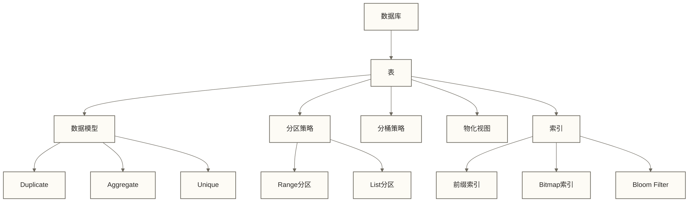

# Doris核心概念 - 构建数据模型的基石

> [!abstract] 📋 本节概览
> - 🎯 **学习目标**：掌握Doris的核心概念及其关系
> - 📚 **前置知识**：02-Doris架构深度解析|Doris架构深度解析
> - ⏱️ **预计用时**：20分钟
> - 💡 **关键收获**：理解Doris数据组织方式和查询优化基础

## 🎯 实际应用价值

理解Doris的数据模型、分区分桶和索引，有助于分析建表与查询设计问题；实际收益需结合数据分布和查询负载验证。

在实际工作环境中，这样的挑战每天都在发生。理解相关知识不仅能解决当前问题，更能提升整体的专业能力。
## 💡 数据库与表

### 数据库（Database）
- 逻辑隔离的数据集合，类似MySQL的数据库概念
- 用于组织和管理相关表的容器

### 表（Table）
- 数据的基本组织单元，由行和列组成
- 在Doris中，表有明确的模型定义和数据分布策略

```sql
-- 创建数据库
CREATE DATABASE IF NOT EXISTS example_db;

-- 创建表
CREATE TABLE example_db.example_table (
    user_id BIGINT,
    username VARCHAR(50),
    age INT
) ENGINE=OLAP
DISTRIBUTED BY HASH(user_id) BUCKETS 10;
```

## 🧩 数据模型
Doris支持三种主要数据模型，每种模型针对不同的应用场景进行了优化：

### 1. 明细模型（Duplicate）
> [!info] 📚 明细模型类比
> 就像图书馆保存每一本原版图书，不做任何合并或删减，保留所有原始信息。

- **特点**：存储完整明细数据，无聚合，支持按任意列查询
- **适用场景**：需要查询原始数据，如日志明细、原始事件
- **数据导入**：支持追加写入，不会合并或聚合数据

```sql
CREATE TABLE user_logs (
    log_id BIGINT,
    user_id INT,
    action VARCHAR(20),
    log_time DATETIME,
    page VARCHAR(50)
) ENGINE=OLAP
DUPLICATE KEY(log_id)
DISTRIBUTED BY HASH(user_id) BUCKETS 10;
```

### 2. 聚合模型（Aggregate）
> [!info] 📚 聚合模型类比
> 类似超市每日销售报表，不记录每一笔交易明细，而是自动按商品、类别等维度汇总销售额、销量等指标。

- **特点**：按维度列自动聚合指标列，减少存储空间，提高查询性能
- **适用场景**：指标分析，如销售汇总、用户访问统计
- **数据导入**：自动按Key列聚合Value列，多批次导入会合并计算

```sql
CREATE TABLE sales_agg (
    sale_date DATE,
    product_id INT,
    region VARCHAR(50),
    sales_count BIGINT SUM,
    sales_amount DECIMAL(10,2) SUM
) ENGINE=OLAP
AGGREGATE KEY(sale_date, product_id, region)
DISTRIBUTED BY HASH(product_id) BUCKETS 10;
```

### 3. 更新模型（Unique）
> [!info] 📚 更新模型类比
> 就像手机通讯录，同一个联系人只保留最新信息，旧信息会被覆盖更新。

- **特点**：按Key列去重并更新数据；“最新”取决于写入顺序或配置的Sequence列，不一定是业务时间最新
- **适用场景**：维度表、需要更新的事实表、保留最新状态的场景
- **数据导入**：按Key列处理重复记录；同一Key的覆盖顺序需结合写入顺序和Sequence列配置理解

```sql
CREATE TABLE user_profiles (
    user_id INT,
    username VARCHAR(50),
    email VARCHAR(100),
    last_login DATETIME,
    status TINYINT
) ENGINE=OLAP
UNIQUE KEY(user_id)
DISTRIBUTED BY HASH(user_id) BUCKETS 10;
```

| 模型类型 | 特点 | 适用场景 | 生活类比 |
|---|---|---|---|
| Duplicate | 存储全部数据 | 日志、原始数据 | 图书馆完整收藏 |
| Aggregate | 自动聚合 | 指标分析 | 超市销售日报表 |
| Unique | 自动去重更新 | 维度表、需更新的表 | 通讯录(同名覆盖) |

## 🗂️ 分区与分桶

### 分区（Partition）
> [!info] 📚 分区类比
> 就像大型图书馆按主题划分不同区域（历史区、科学区、文学区），方便管理和快速定位。

- **作用**：水平切分数据的第一层，通常按时间或地区等维度
- **优势**：
  - 支持分区级别的数据生命周期管理
  - 查询时可跳过不相关分区（分区裁剪）
  - 支持动态添加/删除分区

### 分桶（Bucket）
> [!info] 📚 分桶类比
> 在图书馆的每个主题区内，再按作者姓氏首字母分类存放，进一步缩小查找范围。

- **作用**：分区内的进一步细分，通常按Hash值分布
- **优势**：
  - 通过分桶将数据分布到多个BE节点；是否均匀取决于分桶键取值分布、桶数和节点布局
  - 支持并行处理提高查询性能
  - 合理选择分桶键可缓解数据倾斜；热点键集中时仍可能倾斜

```sql
-- 创建带分区分桶的表
CREATE TABLE sales (
    sale_date DATE,
    region VARCHAR(50),
    product_id INT,
    sales_amount DECIMAL(10,2)
)
ENGINE=OLAP
PARTITION BY RANGE(sale_date) (
    PARTITION p202301 VALUES [('2023-01-01'), ('2023-02-01')),
    PARTITION p202302 VALUES [('2023-02-01'), ('2023-03-01'))
)
DISTRIBUTED BY HASH(product_id) BUCKETS 10;
```

## 📊 索引与排序

### 前缀索引
> [!info] 📚 前缀索引类比
> 类似字典的页眉，标记每页开头的单词，帮助快速定位到大致位置。

- **特点**：基于有序列的前缀构建，默认索引前36个字节
- **作用**：加速查询条件过滤，减少数据扫描量

### 排序键（Sort Key）
> [!info] 📚 排序键类比
> 就像图书按特定顺序排列在书架上，方便快速查找。

- **特点**：决定数据物理存储顺序的列
- **作用**：影响查询性能和数据压缩率
- **设计原则**：
  - 结合高频过滤条件、谓词类型和基数选择排序键顺序，不应仅因ID基数高就将其放在最前
  - 常用过滤条件列放前面
  - 经常一起查询的列放一起

### 稀疏索引
- **特点**：按数据块而非每行记录索引项，以减少索引大小；Doris前缀索引采用稀疏索引组织方式，二者不是两种独立索引
- **作用**：快速定位数据块，减少不必要的IO

## 🔄 物化视图

> [!info] 📚 物化视图类比
> 就像超市预先准备的各种统计报表，虽然从原始销售数据也能计算出来，但预先计算好可以极大提高查询速度。

- **定义**：预先计算并存储的查询结果集
- **作用**：加速查询、减少计算量
- **特点**：
  - 优化器可在满足改写条件时选择物化视图，不保证每个查询都命中或获得最优性能
  - 同步物化视图随基表写入维护；异步物化视图按配置刷新，可能存在数据延迟
  - 支持的聚合、索引及查询改写能力取决于物化视图类型和Doris版本

```sql
-- 创建物化视图
CREATE MATERIALIZED VIEW mv_region_daily
AS SELECT region, sale_date, SUM(sales_amount) as total_sales
FROM sales GROUP BY region, sale_date;
```

## 📋 数据类型

Doris支持多种数据类型，适应不同的业务需求：

### 整数类型
- TINYINT：1字节，范围-128到127
- SMALLINT：2字节，范围-32768到32767
- INT：4字节，范围约±21亿
- BIGINT：8字节，范围约±9.2E18

### 浮点与定点类型
- FLOAT：4字节单精度浮点数
- DOUBLE：8字节双精度浮点数
- DECIMAL：精确的定点数，如DECIMAL(10,2)，不属于浮点类型

### 字符串类型
- CHAR：固定长度字符串
- VARCHAR：可变长度字符串
- STRING：可变长度字符串类型，可用于较长文本；长度限制及使用约束需按Doris版本确认

### 日期时间类型
- DATE：日期类型，格式YYYY-MM-DD
- DATETIME：日期时间类型，格式YYYY-MM-DD HH:MM:SS

### 其他类型
- BOOLEAN：布尔类型，值为TRUE或FALSE
- ARRAY：数组类型，如ARRAY\<INT\>
- JSON：JSON类型（新版本支持）

## 🔄 数据导入与导出

### 导入方式
- **Stream Load**：适合小批量实时导入
- **Broker Load**：适合从HDFS等外部存储导入大量数据
- **Routine Load**：持续消费Kafka数据
- **Insert Into**：通过SQL插入数据

### 导出方式
- **Select Into Outfile**：查询结果导出到文件
- **Export**：导出表数据到外部存储

## 🔄 概念之间的关系



- 数据库包含多个表
- 表采用特定数据模型
- 表可按需划分为多个分区
- 分区内数据按分桶分布在多个BE节点
- 数据按排序键排序并建立前缀索引
- 物化视图基于基表创建，加速特定查询

## ⚠️ 常见问题与解决方案

> [!warning] 🚨 注意事项
> - **分区设计过细**：导致元数据过多，FE压力大
>   - 解决：控制分区数量，按查询过滤和生命周期管理需求适当增大分区粒度
> - **分桶数过多**：增加Tablet数量和管理开销，可能影响查询与写入性能
>   - 解决：根据数据量和节点数合理设置分桶数
> - **排序键设计不当**：影响数据压缩率和查询性能
>   - 解决：根据高频过滤条件、谓词类型及列基数安排排序键，并通过实际查询验证效果

## ✅ 掌握检查
- [ ] 能说出Doris三种主要数据模型及适用场景
- [ ] 理解分区分桶的作用及设计原则
- [ ] 掌握排序键和前缀索引的概念及设计原则
- [ ] 了解物化视图的作用及使用场景
- [ ] 熟悉常用数据类型及选择原则

## 🔗 学习连接
**前置知识**: [[【技术与工具】/Doris/02-Doris架构深度解析|Doris架构]]
**下一步**: [[【技术与工具】/Doris/04-Doris与其他数据库对比|Doris与其他数据库对比]]
**相关概念**: [[【技术与工具】/Doris/07-数据模型设计详解|数据模型设计]], [[【技术与工具】/Doris/08-表结构设计与优化|表结构设计与优化]] 