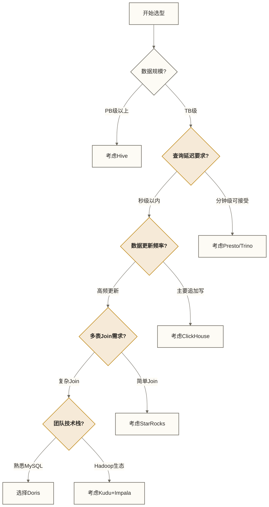

# Doris与其他数据库对比 - 如何选型

> [!abstract] 📋 本节概览
> - 🎯 **学习目标**：了解Doris与其他主流分析型数据库的差异与适用场景
> - 📚 **前置知识**：03-Doris核心概念|Doris核心概念
> - ⏱️ **预计用时**：20分钟
> - 💡 **关键收获**：掌握数据库选型的决策方法和判断标准

## 🎯 实际应用价值

Doris与其他数据库对比在实际工作中的应用价值和最佳实践，能够显著提升工作效率。

在实际工作环境中，这样的挑战每天都在发生。理解相关知识不仅能解决当前问题，更能提升整体的专业能力。
## 💡 数据库分类与定位

在对比具体产品前，先了解不同类型数据库的定位：

| 数据库类型 | 特点 | 典型代表 | 适用场景 |
|---|---|---|---|
| OLTP | 高并发、低延迟、事务性 | MySQL, PostgreSQL | 交易系统、业务系统 |
| OLAP | 大数据量、复杂查询、分析性 | Doris, ClickHouse | 数据分析、报表系统 |
| 混合HTAP | 兼顾OLTP和OLAP | TiDB, OceanBase | 需要同时支持交易和分析 |
| 数据湖相关工具 | 面向湖上数据的管理与查询，成本取决于存储和计算配置 | Hive（数仓工具）, Trino（查询引擎） | 大规模数据管理与分析；二者本身不等同于数据湖 |

## 💡 Doris与主流分析型数据库对比

### Doris vs ClickHouse

| 特性 | Doris | ClickHouse |
|---|---|---|
| 架构 | FE-BE架构，元数据集中管理 | 无中心化架构，元数据分散 |
| 易用性 | 兼容MySQL，学习成本低 | 独特语法，学习曲线陡 |
| 数据更新 | 支持行级更新 | 主要追加写，更新较复杂 |
| 高可用 | 内置多副本机制 | 复制协调可使用ClickHouse Keeper或ZooKeeper，取决于部署配置 |
| 查询性能 | 综合性能优秀 | 单表扫描性能极佳 |
| 多表Join | 性能较好 | 多表Join性能一般 |
| 事务支持 | 支持 | 有限支持 |
| 对比项待补充（原稿误写为“学习目标”） | 原稿写“支持”，所指能力待核实 | 原稿写“支持，更灵活”，所指能力待核实 |
| 资源隔离 | 支持资源组 | 有限支持 |

> [!info] 📚 生活类比
> Doris像SUV，侧重通用分析场景；ClickHouse像赛车，常用于追加写和大表扫描场景。这只是帮助理解的类比，不代表性能保证或产品能力边界。

#### 实际应用场景对比
- **选择Doris的场景**：
  - 需要频繁更新的用户画像系统
  - 包含复杂多表Join的报表系统
  - 团队熟悉MySQL，希望平滑过渡
  
- **选择ClickHouse的场景**：
  - 日志分析系统（追加写入为主）
  - 单表大规模数据扫描场景
  - 对极致性能有追求，愿意接受更陡的学习曲线

### Doris vs StarRocks

| 特性 | Doris | StarRocks |
|---|---|---|
| 源流 | Apache顶级项目 | Doris分支演化 |
| 查询优化 | CBO优化器 | CBO优化器，更激进 |
| 资源隔离 | 支持资源组 | 支持资源组，更细粒度 |
| 向量化执行 | 支持 | 支持，优化更深 |
| 物化视图 | 支持 | 支持，更灵活 |
| 社区活跃度 | 非常活跃 | 活跃 |
| 数据湖分析 | 支持 | 支持，更完善 |
| 云原生支持 | 支持 | 支持，更成熟 |
| 商业支持 | 多家公司 | 主要是StarRocks公司 |

> [!info] 📚 生活类比
> Doris和StarRocks像同根同源的两款车型，StarRocks在某些性能指标上更激进，Doris则更注重稳定性和兼容性。

#### 实际应用场景对比
- **选择Doris的场景**：
  - 追求开源社区稳定性和长期支持
  - 需要与现有Hadoop生态深度整合
  - 对成熟度和稳定性要求高
  
- **选择StarRocks的场景**：
  - 极致追求查询性能
  - 需要更强的数据湖分析能力
  - 需要更细粒度的资源隔离

### Doris vs Hive

| 特性 | Doris | Hive |
|---|---|---|
| 架构 | 一体化MPP架构 | 基于Hadoop生态 |
| 存储 | 自管理列存 | 依赖HDFS |
| 计算 | 自带计算引擎 | 可使用Tez、MapReduce等执行引擎，具体支持取决于版本与发行版 |
| 查询延迟 | 秒级 | 分钟级甚至更高 |
| 数据规模 | TB-PB级 | PB级以上 |
| 适用场景 | 实时分析、交互式查询 | 批处理、大规模ETL |
| 部署复杂度 | 中等 | 高 |
| 运维成本 | 中等 | 高 |
| 数据格式支持 | 主要支持结构化数据 | 支持多种格式，包括半结构化 |

> [!info] 📚 生活类比
> Doris像高铁，速度快但容量有限；Hive像货运列车，速度慢但能装载海量货物。

#### 实际应用场景对比
- **选择Doris的场景**：
  - 需要交互式查询体验
  - 实时数据分析需求
  - 中小规模数据量(TB级)的报表系统
  
- **选择Hive的场景**：
  - 超大规模数据存储(PB级以上)
  - 批处理ETL流程
  - 已有成熟Hadoop生态

### Doris vs Kudu+Impala

| 特性 | Doris | Kudu+Impala |
|---|---|---|
| 架构复杂度 | 一体化，部署简单 | 组件多，部署复杂 |
| 更新能力 | 支持行级更新 | 支持行级更新，更灵活 |
| 查询引擎 | 内置查询引擎 | Impala查询引擎 |
| 生态整合 | 兼容MySQL生态 | 深度整合Hadoop生态 |
| 运维复杂度 | 较低 | 较高 |
| 分布式事务 | 有限支持 | 支持 |
| 存储灵活性 | 固定存储格式 | 更灵活的存储选项 |
| 资源管理 | 自带资源管理 | Impala使用自身的准入控制等机制，不能笼统视为依赖YARN调度 |

> [!info] 📚 生活类比
> Doris像一体式家电，开箱即用；Kudu+Impala像组装电脑，灵活但需要专业知识。

### Doris vs Presto/Trino

| 特性 | Doris | Presto/Trino |
|---|---|---|
| 定位 | 一体化OLAP数据库 | 联邦查询引擎 |
| 存储 | 自带存储 | 无存储，连接多数据源 |
| 数据写入 | 支持高效写入 | 主要读取，写入能力有限 |
| 查询性能 | 对自身数据查询快 | 跨源查询性能好 |
| 使用场景 | 统一分析平台 | 数据联邦查询 |
| 元数据管理 | 自管理 | 依赖Hive Metastore等 |

> [!info] 📚 生活类比
> Doris像一个功能齐全的超市，商品都在自己仓库；Presto/Trino像一个购物代理，可以从各个商店采购商品。

### Doris vs Kylin

| 特性 | Doris | Kylin |
|---|---|---|
| 预计算方式 | 物化视图 | OLAP立方体 |
| 查询灵活性 | 支持任意维度组合 | 受预构建立方体限制 |
| 数据更新 | 支持实时更新 | 主要批量更新 |
| 存储引擎 | 自带存储引擎 | 依赖HBase等 |
| 适用场景 | 通用OLAP分析 | 固定维度报表分析 |
| 计算引擎 | 自带MPP引擎 | 依赖Spark等 |

> [!info] 📚 生活类比
> Doris像现点现做的餐厅，可以根据需求定制；Kylin像预先做好的快餐，固定菜单但上菜快。

## 📊 性能对比与基准测试

### TPC-H测试结果对比（原稿未核实示例）

以下数字没有测试来源与环境说明，不构成实测证据。Doris行的“1.8.7”和ClickHouse行的“2.5.1”存在格式损坏，无法确定列边界或原值，暂按原稿保留，禁止用于比较或计算。
```text
查询延迟对比（数据量：100GB，单位：秒）
                Q1    Q3    Q6    Q9    Q19   平均
Doris          3.2   4.5   1.8.7   2.9   4.2
ClickHouse     2.8   6.2   1.5   12.3  2.5.1
StarRocks      3.0   4.2   1.7   8.1   2.7   3.9
Hive          45.2  62.3  28.5  95.4  38.7  54.0
Presto        12.5  15.8  6.3   22.7  9.8   13.4
```

### 实时导入性能对比（原稿未核实示例）

以下吞吐区间按原稿保留，未说明行宽、导入方式、批次、硬件、副本与持久化配置，不代表可复现结果或吞吐承诺。
```text
每秒导入行数（单位：万行/秒）
Doris: 50-100
ClickHouse: 70-120
StarRocks: 60-110
Hive: 5-10
Kudu: 30-60
```

### 资源消耗对比（原稿未核实且缺项）

以下表格缺少测试依据，多行指标值不齐，无法确定缺失值对应哪一列；按原稿保留，不补值，也不据此判断资源成本。
```text
相同数据量下的资源消耗（100GB数据集）
                CPU使用率  内存使用  存储空间
Doris          中      低
ClickHouse     高       低
StarRocks      高       中      低
Hive           低      高
Presto         高      不适用
```

### 多维度评分示意图

以下为流程图形式的维度展示，并非雷达图；评分为原稿未核实示例，未提供评分标准和测量依据，不用于产品排名。

```mermaid
%%{init: {"theme":"base","themeVariables":{"fontFamily":"PingFang SC, -apple-system, Source Han Serif SC, serif","fontSize":"16px","background":"#FDFBF5","primaryColor":"#FDFBF5","primaryTextColor":"#2D2A26","primaryBorderColor":"#6E6A60","secondaryColor":"#E8EFE8","secondaryBorderColor":"#8FA890","secondaryTextColor":"#2D2A26","tertiaryColor":"#FDFBF5","tertiaryBorderColor":"#9A9488","tertiaryTextColor":"#6E6A60","lineColor":"#6E6A60","textColor":"#2D2A26","mainBkg":"#FDFBF5","nodeBorder":"#2D5A3D","clusterBkg":"#F3EEDF","clusterBorder":"#9A9488","edgeLabelBackground":"#FDFBF5"},"flowchart":{"htmlLabels":true,"curve":"basis","padding":20,"nodeSpacing":60,"rankSpacing":70,"useMaxWidth":false},"themeCSS":".node rect, .node polygon, .node circle { stroke-width: 1.5px; } .edgePath .path { stroke-width: 1.5px; } .cluster-label .nodeLabel, .cluster-label foreignObject { color: #2D2A26 !important; } .edgeLabel, .edgeLabel foreignObject { color: #2D2A26 !important; background-color: #FDFBF5; } .edgeLabel rect { fill: #FDFBF5; }"}}%%
flowchart TD
    A[多维度评分示意图：原稿未核实]
    A --> B[查询性能]
    A --> C[数据导入速度]
    A --> D[资源消耗]
    A --> E[易用性]
    A --> F[生态集成]
    A --> G[运维复杂度]
    B --> B1[Doris: 4.5/5]
    B --> B2[ClickHouse: 4.8/5]
    B --> B3[StarRocks: 4.7/5]
    B --> B4[Hive: 2/5]
    C --> C1[Doris: 4/5]
    C --> C2[ClickHouse: 4.5/5]
    C --> C3[StarRocks: 4.2/5]
    C --> C4[Hive: 2/5]
    D --> D1[Doris: 3.5/5]
    D --> D2[ClickHouse: 4/5]
    D --> D3[StarRocks: 3.5/5]
    D --> D4[Hive: 2.5/5]
    E --> E1[Doris: 4.5/5]
    E --> E2[ClickHouse: 3/5]
    E --> E3[StarRocks: 4/5]
    E --> E4[Hive: 3.5/5]
    F --> F1[Doris: 4/5]
    F --> F2[ClickHouse: 3/5]
    F --> F3[StarRocks: 3.5/5]
    F --> F4[Hive: 5/5]
    G --> G1[Doris: 4/5]
    G --> G2[ClickHouse: 3/5]
    G --> G3[StarRocks: 3.5/5]
    G --> G4[Hive: 2/5]
```



## 🎯 企业实践案例（仅作教学假设）

原稿未提供可核验的企业身份或成果来源。以下三个场景及其“效果”均仅按教学假设理解；原有规模、延迟和效果描述予以保留，不代表已发生的客户成果，也不是实施后的收益保证。

### 案例1：电商平台
- **选择**: Doris
- **场景**: 用户行为分析、商品推荐、实时销售报表
- **原因**: 
  - 需要兼顾实时性和复杂查询
  - 数据需要频繁更新
  - 团队熟悉MySQL语法
- **效果**: 查询延迟从分钟级降至秒级，支持更多维度分析

### 案例2：大型日志分析系统
- **选择**: ClickHouse
- **场景**: 系统日志分析、用户行为追踪
- **原因**:
  - 主要是追加写入场景
  - 单表扫描性能要求极高
  - 数据量巨大但查询模式相对固定
- **效果**: 每天处理TB级日志，查询延迟保持在亚秒级

### 案例3：金融风控系统
- **选择**: Doris + Hive混合架构
- **场景**: 实时风控 + 历史数据分析
- **原因**:
  - Doris处理实时风控决策
  - Hive存储长期历史数据
  - 两者结合满足不同时效性需求
- **效果**: 实现了实时风控与深度历史分析的平衡

## 🔄 数据库选型决策树

此树只用于初筛候选方案，数据规模和单项特征不能唯一决定产品；“选择Doris”等叶节点也仅表示候选建议，最终应结合目标版本、业务负载与工程约束验证。



## 🔍 选型核心考量因素

选择合适的分析型数据库时，需要考虑以下关键因素：

1. **数据规模**: 当前数据量和未来增长预期
2. **查询模式**: 复杂Join vs 单表扫描
3. **实时性要求**: 秒级、分钟级还是小时级
4. **更新需求**: 频繁更新还是主要追加写入
5. **团队技能**: 现有技术栈和学习成本
6. **运维资源**: 可投入的运维人力和基础设施
7. **成本预算**: 硬件投入、许可费用、运维成本
8. **生态整合**: 与现有系统的集成需求

## ✅ 掌握检查
- [ ] 能说出Doris与其他数据库的关键差异
- [ ] 能根据业务场景选择合适的数据库
- [ ] 理解不同类型数据库的适用场景
- [ ] 掌握数据库选型的核心考量因素

## 🔗 学习连接
**前置知识**: [[【技术与工具】/Doris/03-Doris核心概念|Doris核心概念]]
**下一步**: [[【技术与工具】/Doris/05-Doris环境安装与配置|Doris环境安装与配置]]
**相关概念**: 数据库选型方法论相关技术(连接 **前置知识*), 系统架构设计 