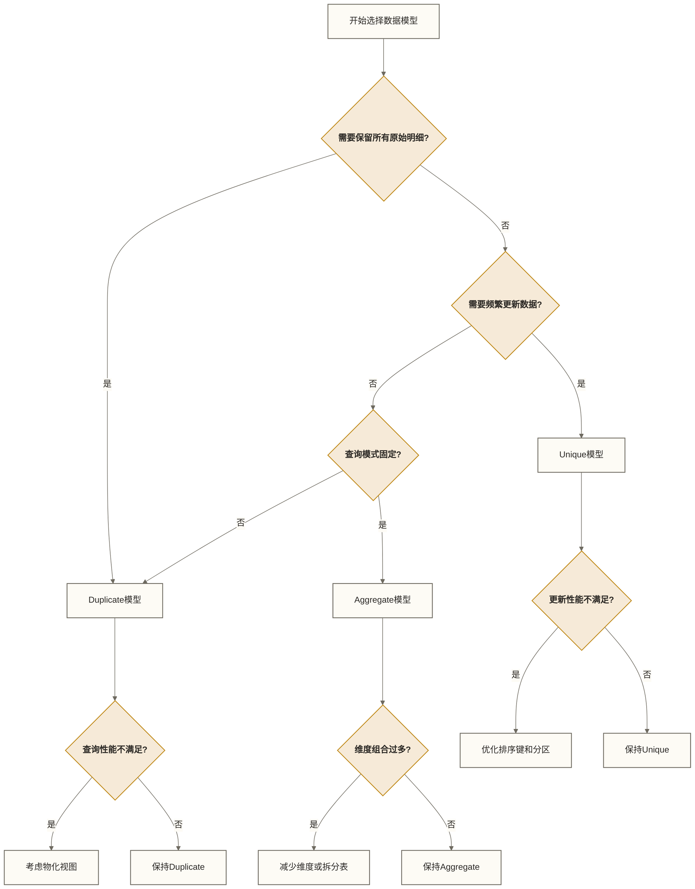

# Doris数据模型设计详解 - 构建高效分析引擎

> [!abstract] 📋 本节概览
> - 🎯 **学习目标**：掌握Doris三种数据模型的设计原则与最佳实践
> - 📚 **前置知识**：06-第一个Doris应用|第一个Doris应用 和 03-Doris核心概念|Doris核心概念
> - ⏱️ **预计用时**：25分钟
> - 💡 **关键收获**：能够根据业务场景选择合适的数据模型并进行优化

## 🏗️ 架构设计挑战

构建可靠的数据系统时，Doris数据模型设计详解是核心考虑因素，直接影响系统的稳定性和扩展性。

在实际工作环境中，这样的挑战每天都在发生。理解相关知识不仅能解决当前问题，更能提升整体的专业能力。
## 💡 Doris三种数据模型详解

### 1. 明细模型（Duplicate）

**核心特点**：存储完整明细数据，不做任何聚合

**适用场景**：
- 原始日志存储
- 事件明细记录
- 需要保留所有原始数据的场景
- 不确定查询模式的探索性分析

> [!info] 📚 生活类比
> 就像图书馆的完整藏书——每本书都原封不动地保存，不做任何合并或摘要。你可以查阅任何一本书的任何内容，但要找特定主题的汇总信息则需要自己整理。

**语法示例**：
```sql
CREATE TABLE user_actions (
    user_id BIGINT,
    action_time DATETIME,
    action_type VARCHAR(20),
    page_id INT,
    stay_time INT,
    ip VARCHAR(32)
)
ENGINE=OLAP
DUPLICATE KEY(user_id, action_time)
DISTRIBUTED BY HASH(user_id) BUCKETS 10;
```

**设计要点**：
- 选择合适的排序键（DUPLICATE KEY）提升查询效率
- 通常按时间字段分区，便于管理数据生命周期
- 适合高频写入、低频查询的场景
- 支持任意列的条件过滤和聚合操作

**优势与劣势**：
- ✅ 保留全部原始数据，查询灵活性最高
- ✅ 支持任意维度的即席查询
- ✅ 无需模型层的预聚合计算，通常有利于写入吞吐；不保证在所有负载下写入性能最好
- ❌ 存储空间消耗大
- ❌ 对于固定模式的聚合查询性能不如预聚合

### 2. 聚合模型（Aggregate）

**核心特点**：按维度列自动聚合指标列，减少存储空间

**适用场景**：
- 指标分析（如销售汇总、流量统计）
- 预聚合报表
- 高频查询、低频写入的场景
- 查询模式固定的场景

> [!info] 📚 生活类比
> 就像超市的销售日报表——不记录每笔交易明细，只保存每天每种商品的销售总额、销售数量等汇总数据。查询速度快，但无法查看单笔交易的详情。

**语法示例**：
```sql
CREATE TABLE sales_metrics (
    date_id DATE,
    product_id INT,
    region VARCHAR(20),
    sales_amount DECIMAL(15, 2) SUM,
    sales_count BIGINT SUM,
    return_count BIGINT SUM,
    uv HLL HLL_UNION
)
ENGINE=OLAP
AGGREGATE KEY(date_id, product_id, region)
DISTRIBUTED BY HASH(product_id) BUCKETS 10;
```

**支持的聚合函数**：
- SUM：求和
- MIN：最小值
- MAX：最大值
- REPLACE：替换（按导入与合并规则覆盖值，不应直接等同于保留业务时间最新的值）
- HLL_UNION：基数估计（UV统计）
- BITMAP_UNION：精确去重

**设计要点**：
- 维度列和指标列划分清晰
- 选择合适的聚合函数
- 避免维度过多导致聚合效果降低
- 预先考虑查询模式，确保常用维度组合在模型中

**优势与劣势**：
- ✅ 存储空间大幅减少
- ✅ 聚合查询性能极高
- ✅ 适合固定模式的报表分析
- ❌ 失去明细数据，灵活性降低
- ❌ 维度过多时聚合效果减弱
- ❌ 无法按已丢失的原始明细字段过滤；保留的维度列可用于条件过滤，指标列的过滤需区分聚合前后语义

### 3. 更新模型（Unique）

**核心特点**：按Key列自动去重并覆盖数据；“最新”取决于导入顺序及Sequence列等配置，不天然等同于业务事件时间最新

**适用场景**：
- 维度表
- 需要频繁更新的事实表
- 需要主键唯一约束的表
- 状态表或配置表

> [!info] 📚 生活类比
> 就像通讯录——同一个联系人只保留最新的电话号码和地址，旧信息会被自动覆盖。你始终能看到最新的信息，但无法查看历史记录。

**语法示例**：
```sql
CREATE TABLE dim_users (
    user_id BIGINT,
    username VARCHAR(50),
    email VARCHAR(100),
    age INT,
    gender TINYINT,
    register_time DATETIME,
    last_active_time DATETIME,
    status TINYINT
)
ENGINE=OLAP
UNIQUE KEY(user_id)
DISTRIBUTED BY HASH(user_id) BUCKETS 10;
```

**设计要点**：
- 主键选择（UNIQUE KEY）直接影响更新性能
- 适合频繁更新的场景
- 可选择Merge-on-Write或Merge-on-Read策略
- 合理设计排序列，提高查询效率

**优势与劣势**：
- ✅ 自动去重，保证记录唯一性
- ✅ 支持高效的行级更新
- ✅ 适合维度表和状态表
- ❌ 更新操作有一定开销
- ❌ 不保留历史版本（除非使用时间列设计）

## 🔄 模型选择决策树



## 🏗️ 数据模型设计原则

### 1. 业务场景分析
- **查询模式**：分析查询频率、复杂度和响应时间要求
- **写入模式**：数据更新频率、批量导入还是实时写入
- **数据量级**：当前数据量和增长预期
- **时效性要求**：实时性要求vs查询性能要求

### 2. 模型选择指南
| 需求特征 | 推荐模型 | 理由 |
|---|---|---|
| 需要保留所有原始数据 | Duplicate | 不做聚合，保留全部明细 |
| 高频统计分析 | Aggregate | 预聚合提升查询性能 |
| 频繁更新数据 | Unique | 自动去重，保留最新值 |
| 维度表 | Unique | 保证记录唯一性 |
| 日志/事件流 | Duplicate | 保留完整明细记录 |
| 实时大屏展示 | Aggregate | 预聚合加速查询 |
| 多维分析 | Duplicate+物化视图 | 兼顾灵活性和性能 |

### 3. 字段设计原则
- **数据类型选择**：使用合适的数据类型，避免过度冗余
- **排序键设计**：优先考虑高频过滤条件及其选择性，不仅按基数排序；KEY列顺序须符合目标模型和版本的建表约束
- **空值处理**：合理使用NULL或默认值
- **字符串长度**：根据实际数据长度设置，避免浪费空间

### 4. 分区分桶设计
- **分区策略**：通常按时间分区，便于管理数据生命周期
- **分区粒度**：根据数据量和查询模式选择（日/周/月）
- **分桶数量**：根据数据量和节点数量确定，避免过多小文件
- **分桶列选择**：选择数据分布均匀的列，避免数据倾斜

## 📊 三种模型性能对比

以下为定性选型参考，不是基准测试结果。“最好”“最快”等排名并非普遍成立，实际结果取决于数据重复度、维度基数、查询模式、导入批次、Unique实现方式及集群配置；应以目标环境测试为准。

| 性能指标 | Duplicate | Aggregate | Unique |
|---|---|---|---|
| 写入性能 | 最好 | 中等 | 较差 |
| 存储空间 | 最大 | 最小 | 中等 |
| 明细查询 | 支持 | 不支持 | 支持(最新) |
| 聚合查询 | 较慢 | 最快 | 较慢 |
| 更新性能 | 不支持 | 不支持 | 支持 |
| 灵活性 | 最高 | 最低 | 中等 |

## 🌟 实战案例分析

### 案例1：电商销售分析系统

**需求**：分析商品销售趋势、区域分布、用户行为

**模型设计**：
```sql
-- 1. 用户维度表（Unique模型）
CREATE TABLE dim_users (
    user_id BIGINT,
    username VARCHAR(50),
    age INT,
    gender TINYINT,
    city VARCHAR(20),
    register_time DATETIME
)
ENGINE=OLAP
UNIQUE KEY(user_id)
DISTRIBUTED BY HASH(user_id) BUCKETS 10;

-- 2. 商品维度表（Unique模型）
CREATE TABLE dim_products (
    product_id BIGINT,
    product_name VARCHAR(100),
    category VARCHAR(50),
    brand VARCHAR(50),
    price DECIMAL(10, 2)
)
ENGINE=OLAP
UNIQUE KEY(product_id)
DISTRIBUTED BY HASH(product_id) BUCKETS 8;

-- 3. 订单明细表（Duplicate模型）
CREATE TABLE fact_order_detail (
    order_id VARCHAR(32),
    product_id BIGINT,
    order_time DATETIME,
    user_id BIGINT,
    quantity INT,
    price DECIMAL(10, 2),
    total_amount DECIMAL(10, 2)
)
ENGINE=OLAP
DUPLICATE KEY(order_id, product_id)
PARTITION BY RANGE(order_time) (
    PARTITION p202301 VALUES [('2023-01-01'), ('2023-02-01')),
    PARTITION p202302 VALUES [('2023-02-01'), ('2023-03-01'))
)
DISTRIBUTED BY HASH(order_id) BUCKETS 20;

-- 4. 销售汇总表（Aggregate模型）
CREATE TABLE agg_sales_metrics (
    dt DATE,
    product_id BIGINT,
    city VARCHAR(20),
    sales_amount DECIMAL(15, 2) SUM,
    sales_count BIGINT SUM,
    user_count HLL HLL_UNION
)
ENGINE=OLAP
AGGREGATE KEY(dt, product_id, city)
PARTITION BY RANGE(dt) (
    PARTITION p202301 VALUES [('2023-01-01'), ('2023-02-01')),
    PARTITION p202302 VALUES [('2023-02-01'), ('2023-03-01'))
)
DISTRIBUTED BY HASH(product_id) BUCKETS 10;
```

**设计说明**：
- 维度表使用Unique模型，支持数据更新
- 明细数据使用Duplicate模型，保留完整记录
- 聚合指标使用Aggregate模型，提升查询性能
- 按时间分区，便于管理数据生命周期

### 案例2：用户行为分析系统

**需求**：分析用户访问路径、停留时间、转化漏斗

**模型设计**：
```sql
-- 1. 用户行为明细表（Duplicate模型）
CREATE TABLE user_behavior_detail (
    user_id BIGINT,
    session_id VARCHAR(64),
    event_time DATETIME,
    event_type VARCHAR(20),
    page_id INT,
    stay_time INT,
    device_type VARCHAR(20),
    os_type VARCHAR(20)
)
ENGINE=OLAP
DUPLICATE KEY(user_id, session_id, event_time)
PARTITION BY RANGE(event_time) (
    PARTITION p2023_w01 VALUES [('2023-01-01'), ('2023-01-08')),
    PARTITION p2023_w02 VALUES [('2023-01-08'), ('2023-01-15'))
)
DISTRIBUTED BY HASH(user_id) BUCKETS 20;

-- 2. 页面访问汇总表（Aggregate模型）
CREATE TABLE agg_page_visits (
    dt DATE,
    hour INT,
    page_id INT,
    device_type VARCHAR(20),
    pv BIGINT SUM,
    uv HLL HLL_UNION,
    total_stay_time BIGINT SUM,
    stay_time_count BIGINT SUM  -- 写入时累计有效停留时长的记录数；查询时用总时长除以该计数，计数为0时返回NULL
)
ENGINE=OLAP
AGGREGATE KEY(dt, hour, page_id, device_type)
PARTITION BY RANGE(dt) (
    PARTITION p20230101 VALUES [('2023-01-01'), ('2023-01-02')),
    PARTITION p20230102 VALUES [('2023-01-02'), ('2023-01-03'))
)
DISTRIBUTED BY HASH(page_id) BUCKETS 10;

-- 3. 用户画像表（Unique模型）
CREATE TABLE user_profile (
    user_id BIGINT,
    last_visit_time DATETIME,
    visit_count BIGINT,
    total_stay_time BIGINT,
    favorite_page_id INT,
    device_preference VARCHAR(20),
    user_status TINYINT
)
ENGINE=OLAP
UNIQUE KEY(user_id)
DISTRIBUTED BY HASH(user_id) BUCKETS 10;
```

**设计说明**：
- 行为明细使用Duplicate模型，保留完整行为轨迹
- 访问汇总使用Aggregate模型，加速常用指标查询
- 用户画像使用Unique模型，支持用户信息更新
- 明细表按周分区，汇总表按天分区，反映数据粒度差异

## ⚠️ 常见设计陷阱与解决方案

### 1. 维度过多导致聚合效果差

**问题**：Aggregate模型中维度列过多，导致聚合率低，失去预聚合优势

**解决方案**：
- 拆分高基数维度到单独表
- 使用Duplicate模型+物化视图替代
- 重新评估哪些维度是必要的

```sql
-- 优化前：维度过多的聚合表
CREATE TABLE bad_design (
    dt DATE,
    hour INT,
    minute INT,  -- 高基数维度
    user_id BIGINT,  -- 高基数维度
    page_id INT,
    device_id VARCHAR(64),  -- 高基数维度
    metrics BIGINT SUM
)
AGGREGATE KEY(dt, hour, minute, user_id, page_id, device_id);

-- 优化后：拆分为明细表+物化视图
CREATE TABLE better_design (
    dt DATE,
    hour INT,
    user_id BIGINT,
    page_id INT,
    minute INT,
    device_id VARCHAR(64),
    metrics BIGINT
)
DUPLICATE KEY(dt, hour, user_id, page_id);

-- 添加常用聚合维度的物化视图
CREATE MATERIALIZED VIEW mv_hourly
AS SELECT dt, hour, page_id, SUM(metrics) as total_metrics
FROM better_design
GROUP BY dt, hour, page_id;
```

### 2. 排序键设计不当

**问题**：排序键（KEY）设计不合理，导致查询性能差

**解决方案**：
- 将高频查询条件列放在前面
- 结合过滤频率、选择性和前缀索引利用情况安排顺序，而非一律将高基数列放在前面
- 将经常一起查询的列放在一起

```sql
-- 优化前：排序键设计不合理
CREATE TABLE bad_sort_key (
    dt DATE,  -- 低基数，但放在第一位
    region_code VARCHAR(20),  -- 低基数
    user_id BIGINT,  -- 高频查询条件，高基数
    event_type VARCHAR(20)
)
DUPLICATE KEY(dt, region_code, user_id);

-- 优化后：调整排序键顺序
CREATE TABLE better_sort_key (
    user_id BIGINT,  -- 高频过滤列提前，并与KEY声明顺序一致
    dt DATE,
    region_code VARCHAR(20),
    event_type VARCHAR(20)
)
DUPLICATE KEY(user_id, dt, region_code);
```

### 3. 分区设计不合理

**问题**：分区过细或过粗，影响查询性能和管理效率

**解决方案**：
- 根据数据量和查询模式选择合适的分区粒度
- 考虑数据生命周期管理需求
- 避免创建过多小分区

```sql
-- 优化前：分区过细
CREATE TABLE over_partitioned (
    event_time DATETIME,
    user_id BIGINT,
    data VARCHAR(100)
)
PARTITION BY RANGE(event_time) (
    PARTITION p20230101_00 VALUES [('2023-01-01 00:00:00'), ('2023-01-01 01:00:00')),
    PARTITION p20230101_01 VALUES [('2023-01-01 01:00:00'), ('2023-01-01 02:00:00'))
    -- 每小时一个分区，在数据量较小时可能产生过多小分区
);

-- 优化后：合理分区
CREATE TABLE better_partitioned (
    event_time DATETIME,
    user_id BIGINT,
    data VARCHAR(100)
)
PARTITION BY RANGE(event_time) (
    PARTITION p20230101 VALUES [('2023-01-01'), ('2023-01-02')),
    PARTITION p20230102 VALUES [('2023-01-02'), ('2023-01-03'))
    -- 此示例改为按天分区，实际粒度仍需结合数据量和查询模式
);
```

## 🔍 模型优化技巧

### 1. 物化视图补充

当单一模型无法满足多样化查询需求时，可以使用物化视图：

```sql
-- 为Duplicate模型表添加聚合物化视图
CREATE MATERIALIZED VIEW mv_hourly_stats
AS SELECT 
    DATE(event_time) as dt,
    HOUR(event_time) as hour,
    page_id,
    COUNT(*) as pv,
    COUNT(DISTINCT user_id) as uv,
    SUM(stay_time) as total_stay_time
FROM user_behavior_detail
GROUP BY dt, hour, page_id;
```

### 2. 冷热数据分离

对于时间序列数据，可以按冷热程度分区管理：

```sql
-- 创建带冷热分区的表
CREATE TABLE event_logs (
    event_time DATETIME,
    user_id BIGINT,
    event_type VARCHAR(20),
    data VARCHAR(1000)
)
DUPLICATE KEY(event_time, user_id)
PARTITION BY RANGE(event_time) (
    PARTITION p_hot VALUES [('2023-06-01'), ('2023-07-01')),  -- 热数据
    PARTITION p_warm VALUES [('2023-05-01'), ('2023-06-01')),  -- 温数据
    PARTITION p_cold VALUES [('2023-01-01'), ('2023-05-01'))  -- 冷数据
)
DISTRIBUTED BY HASH(user_id) BUCKETS 20;

-- 设置分区存储介质与冷却时间：此处指定SSD并将冷却时间推迟至9999年，不会提高压缩比，也不实现迁往HDD
ALTER TABLE event_logs MODIFY PARTITION p_cold 
SET ("storage_medium" = "SSD", "storage_cooldown_time" = "9999-12-31 23:59:59");
```

### 3. 动态分区管理

对于持续增长的时间序列数据，使用动态分区自动管理：

```sql
-- 启用动态分区
ALTER TABLE agg_sales_metrics SET ("dynamic_partition.enable" = "true",
                              "dynamic_partition.time_unit" = "DAY",
                              "dynamic_partition.start" = "-7",
                              "dynamic_partition.end" = "3",
                              "dynamic_partition.prefix" = "p",
                              "dynamic_partition.buckets" = "10");
```

## ✅ 掌握检查
- [ ] 理解三种数据模型的特点和适用场景
- [ ] 能够根据业务需求选择合适的数据模型
- [ ] 掌握排序键、分区分桶的设计原则
- [ ] 了解常见设计陷阱及解决方案
- [ ] 能够设计并优化复杂业务场景的数据模型

## 🔗 学习连接
**前置知识**: [[【技术与工具】/Doris/06-第一个Doris应用|第一个Doris]], [[【技术与工具】/Doris/03-Doris核心概念|Doris核心概念]]
**下一步**: [[【技术与工具】/Doris/08-表结构设计与优化|表结构设计与优化]]
**相关概念**: [[【技术与工具】/Doris/11-物化视图应用|物化视图]], [[【技术与工具】/Doris/10-SQL查询与分析|SQL查询与]] 