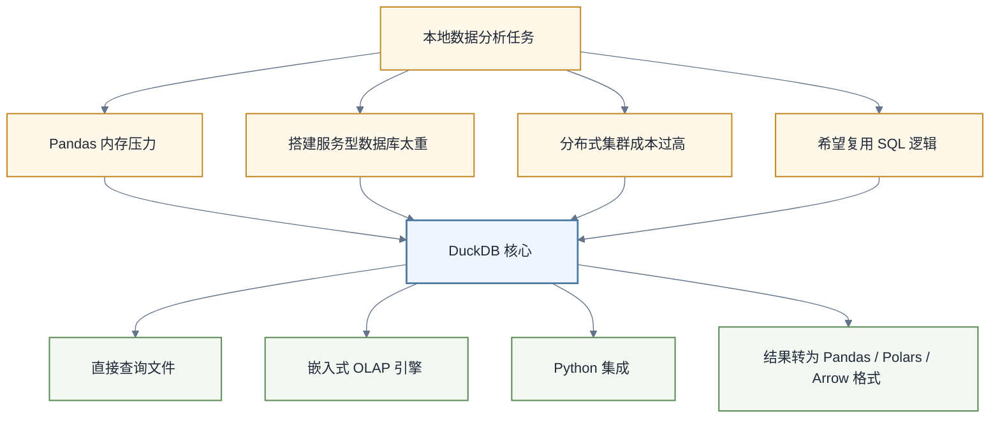

# DuckDB学习路线图

> [!abstract] 一句话定位
> DuckDB 是“装在你进程里的分析型数据库”。它最适合用 SQL 直接分析本地 CSV、Parquet、JSON、Pandas、Polars、Arrow 数据。对数据人来说，它补上了 Pandas 太慢、Spark 太重之间的那块空地。

如果你经常在 Notebook 里写 Pandas，但数据一大就慢；或者你很会 SQL，但不想为了一个本地分析任务搭数据库；那 DuckDB 很值得学。

前置阅读：[[【技术与工具】/SQL/00-SQL学习路线图|SQL学习路线图]]、[[【技术与工具】/Python/41-从Pandas到Polars与DuckDB|从Pandas到Polars与DuckDB]]。

---

## 1. DuckDB解决什么问题



官方 Python API 文档说明，DuckDB 可以直接读取 CSV、Parquet、JSON，也可以直接查询 Pandas DataFrame、Polars DataFrame 和 Arrow Table，并把结果转成 Pandas、Polars、Arrow、NumPy 等格式。

这意味着 DuckDB 很适合成为“Python 数据工作流里的 SQL 引擎”。

---

## 2. 学习路线

| 顺序 | 专题 | 学习结果 |
|---|---|---|
| 1 | [[【技术与工具】/DuckDB/01-直接查询文件与SQL实践|直接查询文件与SQL实践]] | 用 SQL 安全查询 CSV、Parquet 与分区文件 |
| 2 | [[【技术与工具】/DuckDB/02-Python集成与数据交换|Python集成与数据交换]] | 在 Pandas、Polars、Arrow 之间选择结果边界 |
| 3 | [[【技术与工具】/DuckDB/03-性能优化与扩展管理|性能优化与扩展管理]] | 用计划、基准和最小权限管理性能与扩展 |

### 阶段一：SQL on Files

目标：不用建库，直接查文件。

你要掌握：

- `SELECT * FROM 'file.parquet'`
- `read_csv` / `read_parquet`
- Parquet 分区目录
- CSV 类型推断与显式 schema
- `COPY` 导出结果

这阶段适合和 [[【技术与工具】/SQL/33-AI时代分析SQL实战|AI时代分析SQL实战]] 配合，把留存、漏斗、Cohort SQL 跑在本地文件上。

### 阶段二：Python集成

目标：让 DuckDB 和 Python 生态互通。

你要掌握：

```python
import duckdb

result = duckdb.sql("""
SELECT
    DATE_TRUNC('day', pay_time) AS dt,
    SUM(amount) AS gmv
FROM 'orders.parquet'
WHERE status = 'paid'
GROUP BY 1
ORDER BY 1
""").df()
```

重点不是背 API，而是理解什么时候 `.df()`，什么时候 `.pl()`，什么时候 `.arrow()`。

### 阶段三：本地数据集市

目标：把一次性分析沉淀为可复用本地数据集市。

你要掌握：

- 持久化 DuckDB 数据库文件
- 创建表和视图
- 导入导出 Parquet
- 与 dbt Core 或 Ibis 结合
- 管理中间结果

### 阶段四：嵌入式分析应用

目标：把 DuckDB 放进应用里，做轻量分析后端。

适合场景：

- Streamlit 数据应用
- 本地报表工具
- 单机数据质量检查
- 文件数据探索服务
- 小团队内部分析平台

---

## 3. DuckDB适合和不适合

| 场景 | 是否适合 | 说明 |
|---|---|---|
| 本地 Parquet 分析 | 很适合 | 不必先读入 Pandas |
| Notebook SQL 探索 | 很适合 | SQL 逻辑清晰，结果可转 DataFrame |
| 小团队轻量数据应用 | 适合 | 部署简单，运维成本低 |
| 企业级高并发 OLTP | 不适合 | DuckDB 不是 MySQL/PostgreSQL 替代品 |
| PB 级分布式计算 | 不适合 | 该用 Spark/Flink/Trino 等 |
| AI 作品集项目 | 很适合 | 低成本、可复现、易展示 |

> [!tip] 判断
> DuckDB 不是“小 Spark”，也不是“轻量 MySQL”。它是面向分析的嵌入式数据库。

---

## 4. AI时代为什么要学DuckDB

### 4.1 AI生成SQL更容易本地验证

让 AI 生成 SQL，然后用 DuckDB 在样例数据上跑，可以检查该样例上的执行结果；仍需核对业务口径、边界情况和目标引擎方言，不能仅凭运行成功认定 SQL 正确。

### 4.2 作品集更容易落地

你可以用 DuckDB + Parquet + Streamlit 快速构建一个数据产品 Demo，不需要复杂集群。

### 4.3 与Agent工作流天然契合

Agent 可以通过受控工具调用 DuckDB，在沙箱中分析文件，输出结果。在限制文件访问、网络、扩展加载和资源使用，并避免暴露企业数仓凭证的条件下，这种方式可降低直连企业数仓带来的部分风险；安全性仍取决于沙箱与权限配置。

相关：[[【AI 与大数据】/03-AI-Agent/08-Agent安全与沙箱执行|Agent安全与沙箱执行]]。

---

## 5. 外部参考

- [DuckDB Documentation](https://duckdb.org/docs/current/)
- [DuckDB Python API](https://duckdb.org/docs/current/clients/python/overview)
- [DuckDB Performance Guide](https://duckdb.org/docs/current/guides/performance/overview)
- [DuckDB Extensions](https://duckdb.org/docs/current/extensions/overview)

---

## 6. 相关学习入口

- [[【技术与工具】/Python/41-从Pandas到Polars与DuckDB|从Pandas到Polars与DuckDB]]
- [[【技术与工具】/Polars/00-Polars学习路线图|Polars学习路线图]]
- [[【技术与工具】/Ibis/00-Ibis学习路线图|Ibis学习路线图]]
- [[【技术与工具】/SQL/33-AI时代分析SQL实战|AI时代分析SQL实战]]
- [[【技术与工具】/dbt/14-dbt-Fusion与AI时代SQL语义工程|dbt Fusion与AI时代SQL语义工程]]
