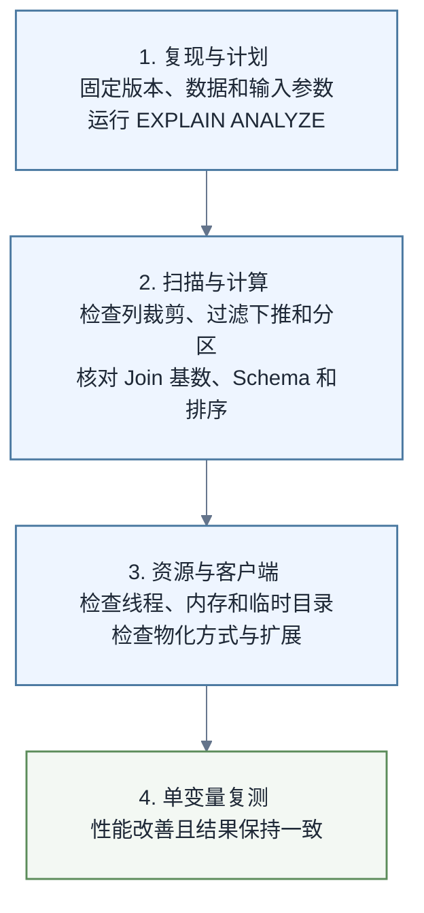

# DuckDB性能优化与扩展管理

> [!abstract] 学习目标
> 用可重复基准和查询计划定位瓶颈，理解线程、内存、临时目录与文件布局的关系，并以最小权限安装、加载和固定扩展。

调优的第一原则是先测量。DuckDB 已自动完成大量优化，随意加线程、建索引或拆文件可能更慢。开始前应掌握 [[【技术与工具】/DuckDB/01-直接查询文件与SQL实践|直接查询文件与SQL实践]] 和 [[【技术与工具】/DuckDB/02-Python集成与数据交换|Python集成与数据交换]]。

## 1. 建立可比较的基线

同一查询至少记录：DuckDB 版本、硬件、可用内存、线程数、数据文件数量、格式、压缩方式、冷/热缓存状态、结果行数与耗时。只比较一次墙钟时间，无法区分查询优化与缓存波动。

```sql
SELECT version();
PRAGMA platform;
EXPLAIN ANALYZE
SELECT customer_id, SUM(amount) AS gmv
FROM read_parquet('lake/orders/*.parquet')
WHERE pay_date >= DATE '2026-08-01'
GROUP BY customer_id;
```

预期结果包含物理执行计划以及各算子的运行信息。首先寻找扫描行数是否异常、过滤是否靠近数据源、投影列是否过多、连接是否放大数据，再决定优化动作。

## 2. 优先减少扫描与物化

最有效的优化通常发生在输入端：

- Parquet 替代反复解析的大 CSV；
- 只选择需要的列，让 projection pushdown 生效；
- 尽早写可下推过滤条件；
- 以常用过滤列规划分区，但避免极高基数目录；
- 合并微小文件，减少打开、调度与元数据开销；
- 聚合后再转为 DataFrame，避免大结果跨边界复制。

不要把复杂表达式包在无法下推的转换外层。先用 `EXPLAIN` 对比计划，再用 `EXPLAIN ANALYZE` 比较实际执行。

## 3. 线程、内存与落盘

DuckDB 会并行执行，但更多线程会增加并发内存需求。可以在受控连接中设置资源上限：

```sql
SET threads = 4;
SET memory_limit = '4GB';
SET temp_directory = '/data/duckdb-tmp';
```

`memory_limit` 不是整个进程的绝对内存上限；部分数据结构与客户端结果仍会占用额外内存。临时目录必须有足够空间与正确权限，并避免放在慢速或不稳定网络盘上。发生 OOM 时，应先缩小输入、减少线程、检查连接基数和结果物化，而不是只提高上限。

> [!warning]
> 官方调优建议强调：工作负载并非总能随线程数线性加速。小查询或高内存查询使用过多线程，可能因调度和内存压力变慢。

## 4. Schema、Join 与索引判断

分析型扫描通常依赖列式执行和 zonemap。排序良好的数据可能让范围过滤更有效。索引不是通用加速按钮；创建和维护有成本，并且并非所有查询都会使用。

连接前先验证键的唯一性与基数：

```sql
SELECT customer_id, COUNT(*) AS n
FROM customers
GROUP BY customer_id
HAVING COUNT(*) > 1;
```

若预期唯一，此查询应返回 0 行。连接后的行数突然放大，通常是数据语义错误，而不只是性能问题。SQL 口径测试可结合 [[【技术与工具】/SQL/33-AI时代分析SQL实战|AI时代分析SQL实战]]。

## 5. 扩展的安装与加载

DuckDB 扩展为文件格式、远程协议或其他能力提供模块。典型流程是安装一次、按连接加载：

```sql
INSTALL httpfs;
LOAD httpfs;
```

自动加载能提升便利性，但生产环境应明确：允许的扩展清单、来源仓库、DuckDB 版本、扩展版本、网络出口、缓存位置和升级验证。离线环境可预装扩展；安全敏感环境不要允许任意扩展仓库或任意 URL。

```sql
SELECT extension_name, installed, loaded
FROM duckdb_extensions()
ORDER BY extension_name;
```

预期能看到扩展是否已安装、是否加载。扩展与 DuckDB 有版本兼容关系，复制旧环境的二进制文件并不等于兼容新版本。

## 6. 一个诊断顺序



按照图中的顺序逐层排除：当前层发现异常时先修复并复测，没有异常再进入下一层。每次只改一个变量并重复测量。优化结果必须同时满足性能和结果一致性；快但少算数据不是优化。

## 7. 练习与验收

1. 比较 CSV 与 Parquet 的同一聚合，记录扫描列、耗时和文件大小。
2. 分别设置 1、2、4 个线程运行同一查询，解释为何结果不一定线性加速。
3. 故意制造多对多连接，使用行数和唯一键断言发现放大。
4. 安装一个官方核心扩展，重启连接后检查 installed/loaded 状态。
5. 为生产脚本建立允许扩展清单，并验证未知扩展会被拒绝。

## 8. 延伸阅读

- [[【技术与工具】/DuckDB/00-DuckDB学习路线图|DuckDB学习路线图]]
- [[【技术与工具】/Polars/00-Polars学习路线图|Polars学习路线图]]
- [[【技术与工具】/Polars/01-表达式与常用数据操作|Polars表达式与常用数据操作]]
- [[【技术与工具】/Polars/02-Lazy执行与性能优化|Polars Lazy执行与性能优化]]
- [[【技术与工具】/Ibis/00-Ibis学习路线图|Ibis学习路线图]]
- [[【技术与工具】/Ibis/01-表达式与延迟执行|Ibis表达式与延迟执行]]
- [[【技术与工具】/Ibis/03-跨后端迁移与测试|Ibis跨后端迁移与测试]]
- [[【技术与工具】/Python/12-数据读取与存储|Python数据读取与存储]]
- [[【技术与工具】/Python/24-生产部署|Python生产部署]]
- [[【技术与工具】/Python/33-系统监控|Python系统监控]]
- [[【技术与工具】/Python/36-Python数据工程与大数据|Python数据工程与大数据]]
- [[【技术与工具】/dbt/14-dbt-Fusion与AI时代SQL语义工程|dbt Fusion与AI时代SQL语义工程]]

## 官方来源

- [DuckDB：性能指南](https://duckdb.org/docs/current/guides/performance/overview)
- [DuckDB：如何调优工作负载](https://duckdb.org/docs/current/guides/performance/how_to_tune_workloads)
- [DuckDB：内存不足问题](https://duckdb.org/docs/current/guides/performance/oom)
- [DuckDB：扩展概览](https://duckdb.org/docs/current/extensions/overview)
- [DuckDB：安装扩展](https://duckdb.org/docs/current/extensions/installing_extensions)
