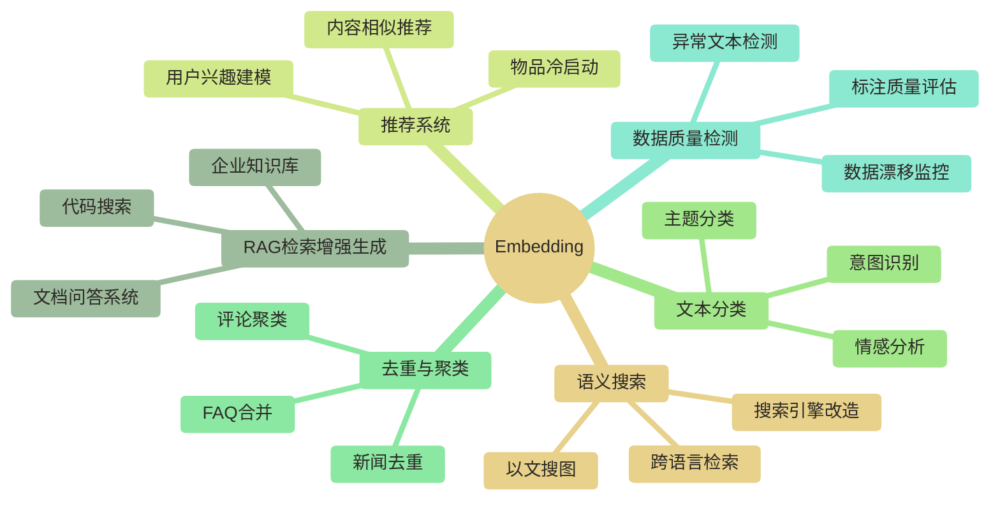

# Embedding 工程概览

## 一个比喻开始

语言是给人类用的，向量是给计算机用的。

在本文的文本应用场景中，可以把 Embedding 比喻为把文字翻译成坐标。作为教学示意，假设模型能有效表达词义及跨语言语义："苹果"与"apple"可以落在相近的水果区域，"苹果手机"则可以落在电子产品区域。实际向量距离取决于模型、上下文和相似度度量，并不保证出现这样的区域划分。

这个"坐标系"通常有 768 或 1024 个维度，人类无法直接感知，但计算机可以用数学操作它：找最近邻、做聚类、计算相似度。RAG、语义搜索和推荐系统中的向量检索或相似度计算环节，可以在这个坐标系里做几何运算；这些系统还可能包含生成、排序、规则及其他处理环节。

选错了坐标系（Embedding 模型），后面所有工作都是沙滩建塔。

---

## Embedding 的应用全景

---

## 三类方案：选哪个？

| 方案 | 代表 | 质量 | 成本 | 隐私 | 适用场景 |
|------|------|------|------|------|---------|
| 云端 API | OpenAI / Cohere / Google | 需按模型与任务评测 | 按具体服务的计费规则 | 是否出境及数据处理方式需核实 | 快速原型、满足数据合规要求的场景 |
| 本地开源模型 | BGE / GTE / E5 系列 | 需按模型与任务评测 | 硬件、推理与持续运维成本 | 可本地处理，仍需安全与权限治理 | 生产环境、具备合规部署条件的敏感数据场景 |
| Fine-tuned 模型 | 领域数据微调 | 可能提升领域效果，需评测 | 数据准备、训练、推理与运维成本 | 取决于训练和推理的部署及数据处理方式 | 垂直领域、专业术语密集 |

**判断逻辑很简单**：

- 数据不能出境 → 先核实云端服务的数据处理区域与合规条件；不满足要求时排除该服务，可考虑合规的本地开源部署
- 预算有限、快速上线 → OpenAI text-embedding-3-small
- 中文内容为主 → BAAI/bge-m3 或 bge-large-zh-v1.5
- 医疗、法律、金融等专业领域 → 考虑 Fine-tune

---

## 本系列文档

这个系列解决 Embedding 工程从选型到落地的完整问题：

| 文档 | 内容 | 适合读者 |
|------|------|---------|
| [[【技术与工具】/Embedding工程/01-Embedding模型选型指南|Embedding模型选型指南]] | MTEB 榜单解读、主流模型对比、选型决策树 | 需要选模型的工程师 |
| [[【技术与工具】/Embedding工程/02-Embedding工程实践|Embedding工程实践]] | 切片策略、批量 Pipeline、缓存、质量评估、Fine-tune | 需要落地的工程师 |

---

## 与知识库其他模块的关系

Embedding 是 AI 工程的基础设施层：

- **上游**：文档处理、数据清洗 → 影响 Embedding 输入质量
- **下游**：[[【技术与工具】/向量数据库/00-向量数据库选型指南|向量数据库]] → 存储和检索向量
- **应用层**：[[【AI 与大数据】/02-大模型核心/04-RAG检索增强生成实战|RAG 检索增强生成]] → 最常见的 Embedding 应用场景

> [!tip] 学习建议
> 如果你正在构建 RAG 系统：先读本文了解全貌，再读 [[【技术与工具】/Embedding工程/01-Embedding模型选型指南|Embedding模型选型指南]] 确定用哪个模型，最后读 [[【技术与工具】/Embedding工程/02-Embedding工程实践|Embedding工程实践]] 解决工程落地问题。
>
> 如果你只是想快速跑通：直接用 OpenAI text-embedding-3-small + Weaviate，先跑起来再优化。

---

## 常见误解

**误解一：用更大维度的向量就更好**

在数据规模、存储精度、索引方式和计算条件相同的情况下，维度越高通常需要更多存储，并可能增加检索计算开销。原稿以“768 维的 bge-large-zh 在中文检索任务上可以打败 3072 维的 text-embedding-3-large”作为示例，但未提供评测依据，不能据此判断模型优劣；其中 bge-large-zh 的标准输出维度应为 1024，而非 768。维度不是质量，适合才是质量。

**误解二：Embedding 模型选好就完了**

模型只是起点。切片策略、预处理方式、查询扩展、重排序（Reranker）每个环节都影响最终效果。端到端系统的瓶颈经常不在 Embedding 模型本身。

**误解三：Fine-tune 一定比通用模型好**

Fine-tune 需要高质量的领域标注数据。如果你只有几百条数据，用通用模型加 Prompt 工程可能反而更好。

---

#Embedding #向量化 #RAG #语义搜索 #AI工程
