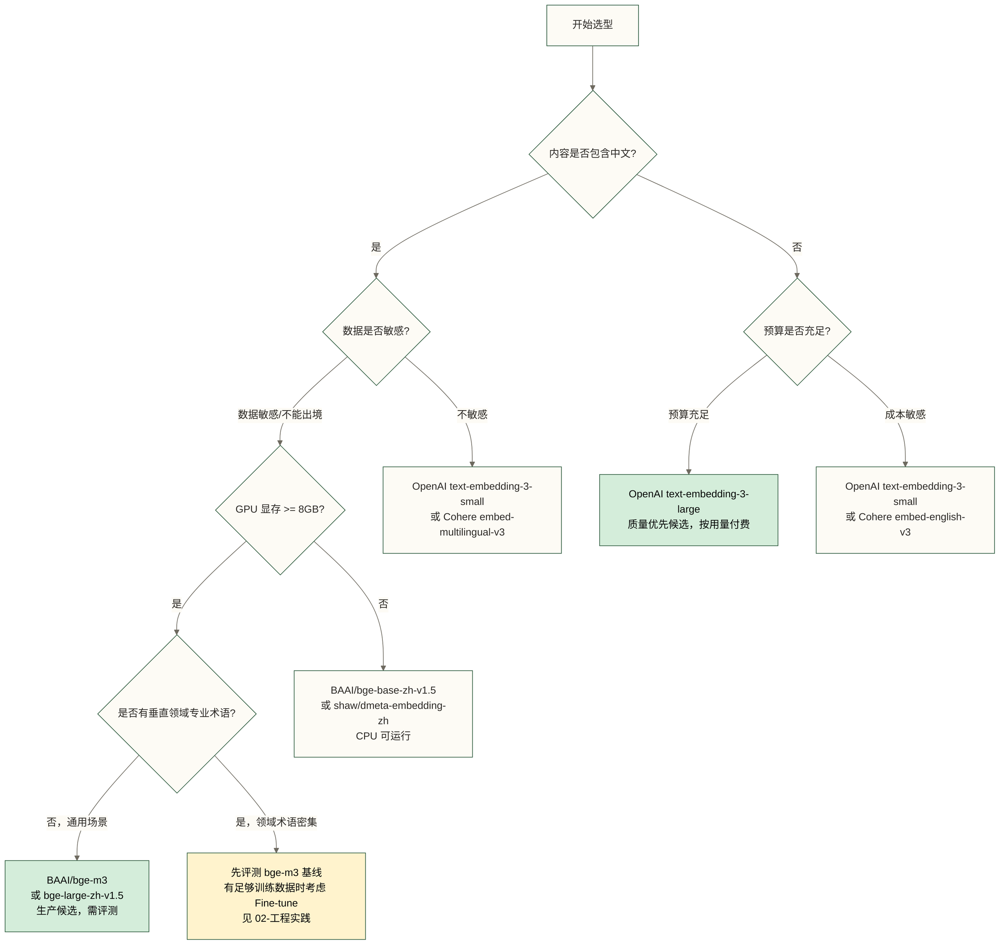

# Embedding 模型选型指南

> [!tip] 前置阅读
> 建议先读 [[【技术与工具】/Embedding工程/00-Embedding工程概览|Embedding工程概览]] 了解背景，再看本文的具体选型。

选模型这件事，很多人的做法是：看到哪个名字熟悉就用哪个。这可能导致一个结果：未经目标语料评测就用某个模型处理中文法律文书，效果不符合预期，然后怀疑 Embedding 这个技术本身有问题；不能据此断言 OpenAI 模型在该场景必然效果差。

问题不在技术，在选型。本文给你一套有依据的选型方法。

---

## MTEB：评估 Embedding 模型的标准

### 什么是 MTEB

MTEB（Massive Text Embedding Benchmark）是目前业界公认的 Embedding 模型评测基准，由 HuggingFace 维护。

规模：
- **56 个任务**，覆盖检索、分类、聚类、语义相似度等类型
- **112 种语言**，包含完整的中文评测集（C-MTEB）
- **排行榜实时更新**：https://huggingface.co/spaces/mteb/leaderboard

### 如何读懂 MTEB 榜单

榜单上最重要的指标不是 Average（平均分），而是 **Retrieval（检索）任务的得分**。

原因：RAG 和语义搜索的核心操作是"给定 query，找最相关文档"，这正是 Retrieval 任务考察的。一个模型在分类任务上很强，不代表它检索效果好。

> [!important] 核心原则
> 选型时，优先看目标场景对应的子任务得分，而不是 Average。中文场景看 C-MTEB/Retrieval；英文场景看 BEIR 子集。

### 2025 年 C-MTEB 头部模型

以下为原稿列出的模型候选与参数参考，重点关注中文检索能力；未提供可复核的 2025 年榜单快照及评测配置，表中定性评价不应视为已验证的 C-MTEB 排名或得分：

| 模型 | 参数量 | C-MTEB 平均 | 向量维度 | 最大 Token | 推荐场景 |
|------|--------|------------|---------|-----------|---------|
| BAAI/bge-m3 | 568M | 待目标任务评测 | 1024 | 8192 | 中英混合，生产候选 |
| BAAI/bge-large-zh-v1.5 | 326M | 待中文任务评测 | 1024 | 512 | 纯中文，评测效果/成本平衡 |
| BAAI/bge-base-zh-v1.5 | 102M | 良好 | 768 | 512 | 纯中文，轻量化 |
| jinaai/jina-embeddings-v3 | 570M | 优秀 | 1024（可变） | 8192 | 多语言，支持 Matryoshka |
| OpenAI/text-embedding-3-large | 未知 | 优秀（英文更强） | 256-3072 | 8191 | 英文为主，预算充足 |
| OpenAI/text-embedding-3-small | 未知 | 良好 | 512-1536 | 8191 | 快速原型，成本敏感 |
| shaw/dmeta-embedding-zh | 102M | 中文良好 | 768 | 512 | 极轻量，资源受限场景 |

> [!note] 关于 bge-m3
> bge-m3 支持三种检索模式：Dense（稠密向量）、Sparse（稀疏向量，类似 BM25）、ColBERT（多向量交互）。生产环境可以评测 Dense + Sparse 混合检索，是否提升召回率及提升幅度取决于语料、查询和融合策略。

---

## 选型决策树



---

## 云端 API：OpenAI text-embedding-3 系列

### 两个模型的定位

| | text-embedding-3-small | text-embedding-3-large |
|---|---|---|
| 最大维度 | 1536 | 3072 |
| 常用维度 | 512 | 1024 或 3072 |
| 速度 | 快 | 慢 |
| 成本 | $0.02 / 1M tokens \vert{} $0.13 / 1M tokens |
| 质量 | 良好 | 优秀 |
| 适用 | 原型、成本敏感 | 生产、质量优先 |

### Matryoshka 维度缩减

OpenAI 的 text-embedding-3 系列支持 Matryoshka 表示学习：你可以在 API 请求时指定维度，截断后的向量仍然保持语义相对质量，不需要重新训练模型。

实际意义：在存储成本和检索质量之间找平衡点。在元素类型相同且仅计向量本体时，512 维所需存储为 3072 维的 1/6，约节省 83.3%；原稿所列“质量损失通常在 5% 以内”未提供评测依据，仅作未核实参考，实际损失需按目标任务指标测量。

### 批量调用最佳实践

```python
import openai
import time
from typing import List

client = openai.OpenAI(api_key="your-api-key")

def embed_texts_batch(
    texts: List[str],
    model: str = "text-embedding-3-small",
    dimensions: int = 512,
    batch_size: int = 100,
    max_retries: int = 3,
) -> List[List[float]]:
    """
    批量 Embedding，带重试和速率限制处理。

    原稿参考限制：每分钟 1M tokens，单次请求最多 2048 个文本；未核实。
    实际限额须按账户、模型和当前官方文档确认，不能视为通用保证。
    batch_size=100 仅为示例值，还需校验单条及整批 token 数。
    """
    if batch_size <= 0 or max_retries <= 0:
        raise ValueError("batch_size 和 max_retries 必须为正整数")
    all_embeddings = []

    for i in range(0, len(texts), batch_size):
        batch = texts[i : i + batch_size]
        # 空文本替换为占位文本以避免 API 报错；生产中须明确该替换的业务含义
        batch = [t.strip() for t in batch]
        batch = [t if t else "空" for t in batch]

        for attempt in range(max_retries):
            try:
                response = client.embeddings.create(
                    input=batch,
                    model=model,
                    dimensions=dimensions,
                )
                embeddings = [item.embedding for item in response.data]
                all_embeddings.extend(embeddings)
                break
            except openai.RateLimitError:
                if attempt == max_retries - 1:
                    raise
                wait_time = 2 ** attempt  # 指数退避：1s, 2s, 4s
                print(f"Rate limit，等待 {wait_time}s 后重试...")
                time.sleep(wait_time)
            except openai.APIError as e:
                if attempt == max_retries - 1:
                    raise
                print(f"API 错误 {e}，重试 {attempt + 1}/{max_retries}")
                time.sleep(1)

        # 批次间稍作停顿，避免触发速率限制
        if i + batch_size < len(texts):
            time.sleep(0.1)

    return all_embeddings


# 使用示例
texts = ["这是第一个文档", "这是第二个文档", "This is English text"]
embeddings = embed_texts_batch(texts, dimensions=512)
print(f"生成 {len(embeddings)} 个向量，维度 {len(embeddings[0])}")
```

---

## 本地部署：BAAI/bge-m3

bge-m3 是 BAAI（北京智源人工智能研究院）发布的多语言 Embedding 模型，可作为中文检索任务的开源候选；其相对效果应通过目标语料评测确定。

### 最简单的方式：sentence-transformers

```python
from sentence_transformers import SentenceTransformer
import torch

# 自动下载模型（约 2GB），第一次慢，之后用缓存
model = SentenceTransformer(
    "BAAI/bge-m3",
    device="cuda" if torch.cuda.is_available() else "cpu",
)

texts = [
    "BGE M3-Embedding是一个支持多语言的嵌入模型",
    "This is an English sentence",
    "日本語のテキスト",
]

# normalize_embeddings=True：归一化后余弦相似度等价于点积，向量数据库通常推荐开启
embeddings = model.encode(
    texts,
    batch_size=32,
    normalize_embeddings=True,
    show_progress_bar=True,
)

print(f"向量维度: {embeddings.shape}")  # (3, 1024)
```

### 批量推理优化

```python
import numpy as np
from sentence_transformers import SentenceTransformer
import torch

def load_optimized_model(model_name: str = "BAAI/bge-m3"):
    """
    加载并优化模型：
    - 半精度（FP16）减少一半显存占用，速度提升约 30%
    - GPU 可用时自动使用
    """
    device = "cuda" if torch.cuda.is_available() else "cpu"
    model = SentenceTransformer(model_name, device=device)

    if device == "cuda":
        model = model.half()  # FP16
        print(f"使用 GPU（FP16），显存占用约 1.1GB")
    else:
        print(f"使用 CPU，推理速度约 5-10 条/秒")

    return model


def batch_encode(
    model: SentenceTransformer,
    texts: list[str],
    batch_size: int = 64,
) -> np.ndarray:
    """
    GPU 推荐 batch_size=64-128；CPU 推荐 batch_size=16-32。
    batch_size 太大会 OOM，太小 GPU 利用率低。
    """
    return model.encode(
        texts,
        batch_size=batch_size,
        normalize_embeddings=True,
        show_progress_bar=len(texts) > 100,
        convert_to_numpy=True,
    )
```

### 性能基准参考

| 硬件 | batch_size | 速度（条/秒） | 显存/内存占用 |
|------|-----------|------------|------------|
| A100 (FP16) | 128 | ~2000 | ~2GB 显存 |
| RTX 3090 (FP16) | 64 | ~800 | ~2GB 显存 |
| RTX 3090 (FP32) | 32 | ~400 | ~4GB 显存 |
| CPU (8核) | 16 | ~15 | ~4GB 内存 |

### 服务化：FastAPI 包装

```python
from fastapi import FastAPI
from pydantic import BaseModel
from sentence_transformers import SentenceTransformer
import torch

app = FastAPI()
model = SentenceTransformer(
    "BAAI/bge-m3",
    device="cuda" if torch.cuda.is_available() else "cpu",
)


class EmbedRequest(BaseModel):
    texts: list[str]
    normalize: bool = True


class EmbedResponse(BaseModel):
    embeddings: list[list[float]]
    model: str
    dimension: int


@app.post("/embed", response_model=EmbedResponse)
async def embed(request: EmbedRequest):
    embeddings = model.encode(
        request.texts,
        normalize_embeddings=request.normalize,
        convert_to_numpy=True,
    )
    return EmbedResponse(
        embeddings=embeddings.tolist(),
        model="BAAI/bge-m3",
        dimension=embeddings.shape[1],
    )


# 启动：uvicorn main:app --host 0.0.0.0 --port 8080 --workers 1
# 示例使用单 worker；多 worker 通常会各自加载模型，须评估显存与资源隔离，GPU 锁不会自动实现模型跨进程共享
```

> [!warning] 多进程问题
> 普通多 worker 部署不会自动共享同一份 GPU 模型，通常会重复加载并占用显存。如果需要高并发，可评估任务队列（如 Celery）或多实例负载均衡，但须明确各进程的模型加载、GPU 分配与并发上限；当前 async 路由直接执行同步推理，仍会阻塞事件循环。

---

## Cohere Embed v3

Cohere 的 Embedding 模型提供 **Input Type 参数**，用于区分检索文档、检索查询等输入用途；任务区分机制并非 Cohere 独有。

### Input Type：最容易被忽视的参数

```python
import cohere

co = cohere.Client("your-api-key")

# 索引文档时：用 search_document
doc_embeddings = co.embed(
    texts=["文档内容1", "文档内容2"],
    model="embed-multilingual-v3.0",
    input_type="search_document",  # 关键参数！
)

# 查询时：用 search_query
query_embedding = co.embed(
    texts=["用户的问题"],
    model="embed-multilingual-v3.0",
    input_type="search_query",  # 关键参数！
)
```

为什么重要？查询和文档在语义空间中的分布不同：查询通常是短句、关键词；文档是完整段落。Cohere 用不同的 Input Type 分别优化两者的向量表示，让查询向量更容易找到对应的文档向量。

其他模型（如 bge）通过在查询前加前缀实现类似效果：
```python
# 部分中文 BGE 检索模型的查询前缀示例；按具体模型说明使用，bge-m3 不要求添加该前缀
query = "为这个句子生成表示以用于检索相关文章：" + user_query
```

### 其他 Cohere 特性

- **多语言支持**：embed-multilingual-v3.0 支持 100+ 语言
- **int8 量化输出**：向量从 float32 压缩为 int8，存储减少 75%，精度损失约 1-2%
- **embedding_types 参数**：一次请求同时返回 float、int8、binary 三种格式

```python
response = co.embed(
    texts=docs,
    model="embed-multilingual-v3.0",
    input_type="search_document",
    embedding_types=["float", "int8"],  # 同时获取两种格式
)

float_vecs = response.embeddings.float    # 高精度，用于精排
int8_vecs = response.embeddings.int8      # 低精度，用于粗筛，节省存储
```

---

## 选型总结：直接给结论

以下按场景给出候选建议，仍需结合目标语料、成本、数据合规及部署条件验证：

| 场景 | 推荐模型 | 理由 |
|------|---------|------|
| 中文生产环境，数据敏感 | BAAI/bge-m3 | 本地部署候选；原稿列出长文本上限（8192 token），具体配置需核对 |
| 纯中文，资源受限（< 4GB 显存） | BAAI/bge-base-zh-v1.5 | 102M 参数，CPU 可运行，效果仍然良好 |
| 中英混合，云端 API | OpenAI text-embedding-3-small | 按文中未核实价格，small 费用约为 large 的 1/6.5；是否够用需评测 |
| 英文为主，质量优先 | OpenAI text-embedding-3-large | 质量优先候选，需对照英文目标任务评测 |
| 多语言，需要 int8 量化 | Cohere embed-multilingual-v3.0 | 原生支持量化，多语言强 |
| 极轻量，边缘设备 | shaw/dmeta-embedding-zh | 102M 参数，纯 CPU 也快 |
| 垂直领域（医疗/法律/金融） | bge-m3 + Fine-tune | 见 [[【技术与工具】/Embedding工程/02-Embedding工程实践|Embedding工程实践]] |

> [!tip] 一个快速验证方法
> 在正式选型前，用你自己的数据做一个 10 分钟的快速测试：准备 50-100 个问答对，分别用候选模型计算 query 和 document 的向量，看 Recall@5（前 5 个检索结果中命中的相关文档数，占该查询全部已标注相关文档数的比例，再对查询求平均；每个查询只有一个相关文档时等于前 5 名命中率）。前 5 个结果中相关文档所占比例是 Precision@5。该小样本测试比仅看 MTEB 榜单更贴近自己的场景，但不能替代完整评测。

---

## 延伸阅读

- [[【技术与工具】/Embedding工程/00-Embedding工程概览|Embedding工程概览]] - 方案全景与背景
- [[【技术与工具】/Embedding工程/02-Embedding工程实践|Embedding工程实践]] - 切片、Pipeline、Fine-tune 落地
- [[【技术与工具】/向量数据库/00-向量数据库选型指南|向量数据库选型指南]] - 向量存储层
- [[【AI 与大数据】/02-大模型核心/04-RAG检索增强生成实战|RAG 检索增强生成实战]] - Embedding 的主战场

---

#Embedding #模型选型 #BGE #OpenAI #MTEB #RAG #语义搜索
