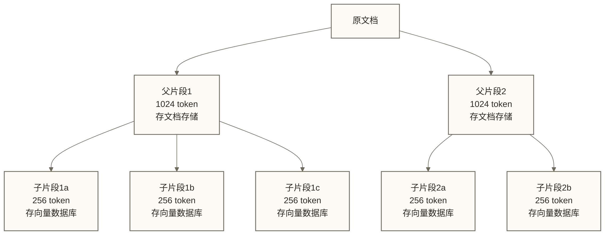

# Embedding 工程实践

> [!tip] 前置阅读
> 本文假设你已经选定了 Embedding 模型。如果还没有，先读 [[【技术与工具】/Embedding工程/01-Embedding模型选型指南|Embedding模型选型指南]]。

选完模型，麻烦才刚开始。

实际项目中，Embedding 效果差未必只由模型本身造成，还可能涉及：文本没有做预处理、切片策略不对、批量 Pipeline 有坑、没有缓存导致重复花钱、上线后没有评估方法。原稿中的“80%”没有可追溯统计依据，仅保留为未核实示例，不代表实际原因占比。本文逐一讨论。

---

## 文本预处理

### 为什么预处理很重要

同样是"机器学习"，以下三种格式的向量可能相差很大：

```text
机器学习                         ← 干净文本
<p>机器&nbsp;学习</p>            ← HTML 格式
机  器  学  习                   ← 多余空白
```

Embedding 模型看到的是 token 序列，格式噪声会直接污染语义向量。更糟的情况：同一批文档，一部分来自 HTML 抓取，一部分来自 Word 导出，格式不一致会导致相同语义的文本在向量空间中散开，检索召回率暴跌。

### 标准化流程

```python
import re
import unicodedata
from opencc import OpenCC  # pip install opencc-python-reimplemented

# 繁简转换器（可选，根据数据情况决定）
cc = OpenCC("t2s")  # 繁体转简体


def preprocess_text(text: str, convert_traditional: bool = False) -> str:
    """
    标准文本预处理流程。

    顺序很重要：先去 HTML，再统一编码，再处理标点，最后压缩空白。
    """
    if not text or not text.strip():
        return ""

    # Step 1: 去除 HTML 标签
    text = re.sub(r"<[^>]+>", " ", text)
    # 处理 HTML 实体
    text = text.replace("&nbsp;", " ").replace("&amp;", "&")
    text = text.replace("&lt;", "<").replace("&gt;", ">")
    text = text.replace("&quot;", '"').replace("&#39;", "'")

    # Step 2: Unicode 标准化（处理全角/半角、不同编码的空格等）
    text = unicodedata.normalize("NFKC", text)

    # Step 3: 统一标点（可选，根据场景）
    # 全角转半角标点
    text = text.replace("，", "，").replace("。", "。")  # 保留中文标点
    # 去除零宽字符
    text = re.sub(r"[\u200b\u200c\u200d\ufeff]", "", text)

    # Step 4: 繁简转换（可选）
    if convert_traditional:
        text = cc.convert(text)

    # Step 5: 压缩多余空白（保留换行结构）
    text = re.sub(r"[ \t]+", " ", text)       # 多个空格/Tab → 单个空格
    text = re.sub(r"\n{3,}", "\n\n", text)    # 超过 2 个换行 → 2 个
    text = text.strip()

    return text
```

### 什么时候不应该过度清洗

有些内容保留原始格式反而更好：

| 内容类型 | 预处理建议 | 原因 |
|---------|-----------|------|
| 代码片段 | 保留缩进和换行 | 缩进是语义的一部分 |
| 专业术语/缩写 | 不做繁简转换 | "HBase" 不是错误 |
| 表格数据 | 保留结构，转为文字描述 | 纯表格向量化效果很差 |
| 数字和单位 | 保留原始格式 | "1.5TB" vs "1500GB" 语义相同但格式不同 |

> [!warning] 过度清洗的副作用
> 把所有标点去掉、把英文全部转小写——这在传统 NLP 中常见，在 Embedding 中可能有害。现代 Transformer 模型本身能理解大小写和标点的语义。你的清洗可能比模型更蠢。

---

## Chunking（切片）策略

### 为什么必须切片

大多数 Embedding 模型有 Token 上限：

| 模型 | 最大 Token |
|------|-----------|
| bge-large-zh-v1.5 | 512 |
| text-embedding-3-small/large | 8191 |
| BAAI/bge-m3 | 8192 |
| jina-embeddings-v3 | 8192 |

512 Token 对应多少中文字符取决于模型 tokenizer 和文本内容；原稿的 350-400 个中文字符仅是未验证估算，不能作为长度校验依据。一篇 3000 字的文章可能超过模型输入上限；超限时可能报错或被截断，具体取决于接口与截断配置，应使用对应 tokenizer 检查。

### 四种切片策略对比

#### 1. Fixed Size（固定大小切片）

```python
def fixed_size_split(text: str, chunk_size: int = 500, overlap: int = 50) -> list[str]:
    """最简单的切片方式，按字符数切。"""
    if chunk_size <= 0 or not 0 <= overlap < chunk_size:
        raise ValueError("要求 chunk_size > 0 且 0 <= overlap < chunk_size")
    chunks = []
    start = 0
    while start < len(text):
        end = start + chunk_size
        chunks.append(text[start:end])
        start += chunk_size - overlap  # overlap 可缓解边界信息割裂，但不保证语义完整
    return chunks
```

**优点**：实现简单，速度快。
**缺点**：可能在句子中间截断，产生语义不完整的片段。

适用：对效果要求不高的快速原型。

#### 2. Sentence Splitter（句子切片）

```python
import re

def sentence_split(text: str, max_chunk_size: int = 512) -> list[str]:
    """尽量按句子边界切片；超长单句仍可能超过字符上限，需另作拆分与 Token 校验。"""
    # 中英文句子边界
    sentence_endings = re.compile(r'(?<=[。！？.!?])\s*')
    sentences = sentence_endings.split(text)
    sentences = [s.strip() for s in sentences if s.strip()]

    chunks = []
    current_chunk = ""

    for sentence in sentences:
        if len(current_chunk) + len(sentence) <= max_chunk_size:
            current_chunk += sentence
        else:
            if current_chunk:
                chunks.append(current_chunk)
            current_chunk = sentence

    if current_chunk:
        chunks.append(current_chunk)

    return chunks
```

**优点**：片段语义完整。
**缺点**：片段长度不均匀，短句可能只有几个字，信息量不足。

#### 3. Recursive Character Splitter（递归切片）——生产推荐

LangChain 的默认切片策略，也是目前工程实践中最常用的方案。

**核心思想**：按优先级递归分割——先尝试按段落切，太大就按句子切，还太大就按字符切。

```python
from langchain.text_splitter import RecursiveCharacterTextSplitter

splitter = RecursiveCharacterTextSplitter(
    chunk_size=512,          # 每片最大字符数（length_function=len），不是 Token 上限
    chunk_overlap=50,        # 相邻片段的重叠字符数
    length_function=len,
    separators=[
        "\n\n",   # 优先按段落切
        "\n",     # 其次按换行切
        "。", "！", "？",   # 然后按中文句子切
        ".", "!", "?",      # 英文句子
        "，", ",",          # 逗号
        " ",                # 空格
        "",                 # 最后按字符切
    ],
)

chunks = splitter.split_text(your_text)
```

**优点**：兼顾语义完整性和片段大小均匀性，工程实践中效果最稳定。
**缺点**：参数需要根据数据特点调整。

#### 4. Semantic Chunker（语义切片）

用 Embedding 相似度找语义边界——相邻句子相似度骤降的地方，就是自然的切片位置。

```python
from langchain_experimental.text_splitter import SemanticChunker
from langchain_openai import OpenAIEmbeddings

# 注意：每次切片都需要调用 Embedding，成本高
embeddings = OpenAIEmbeddings(model="text-embedding-3-small")

semantic_splitter = SemanticChunker(
    embeddings,
    breakpoint_threshold_type="percentile",  # 按百分位数找断点
    breakpoint_threshold_amount=95,          # 距离断点阈值取百分位数 95；不是相似度下降 95%
)

chunks = semantic_splitter.split_text(long_document)
```

**优点**：切片边界最自然，语义最完整。
**缺点**：此示例的切片过程会调用 Embedding API，增加向量计算成本和延迟。原稿的 10-50 倍为未核实示例，未给出计费方式、文本规模及比较口径，不能作为成本预测。

**适用场景**：数据量小（< 10K 文档），对质量要求极高，预算充足。

### 切片大小的经验值

| 场景 | 推荐 chunk_size | Overlap | 理由 |
|------|---------------|---------|------|
| 精准问答（FAQ） | 256 token | 0-20 | 片段短，答案集中 |
| 通用文档检索 | 512 token | 50 | 平衡精准和上下文 |
| 长文档摘要检索 | 1024 token | 100 | 需要更多上下文 |
| 代码检索 | 函数级别 | 0 | 以函数为单位切，不按字符 |

### Overlap 的作用

Overlap（重叠）是为了防止关键信息被切片边界割断：

```text
片段1: [......关键信息在这里
片段2:                    关键信息在这里......]
                          ↑ overlap 区域
```

经验值：overlap = chunk_size 的 10-20%。太大浪费存储和检索时间，太小边界信息丢失。

---

## 父子切片（Parent-Child Chunking）

### 核心思想

单一切片大小是个两难问题：
- 小片段（256 token）：检索精准，但给 LLM 的上下文太少，回答质量差
- 大片段（1024 token）：上下文丰富，但检索时噪声多，召回率下降

父子切片解决这个矛盾：**用小片段检索，用大片段生成**。



检索时：用子片段找到最相关内容 → 取出对应的父片段 → 把父片段喂给 LLM。

### LlamaIndex 实现

```python
from llama_index.core import SimpleDirectoryReader, VectorStoreIndex
from llama_index.core.node_parser import (
    HierarchicalNodeParser,
    get_leaf_nodes,
)
from llama_index.core.storage.docstore import SimpleDocumentStore
from llama_index.core import StorageContext
from llama_index.core.retrievers import AutoMergingRetriever

# 定义层级切片大小
node_parser = HierarchicalNodeParser.from_defaults(
    chunk_sizes=[1024, 512, 256]  # 从大到小：祖父、父、子
)

# 加载文档
documents = SimpleDirectoryReader("./docs").load_data()

# 解析节点
nodes = node_parser.get_nodes_from_documents(documents)
leaf_nodes = get_leaf_nodes(nodes)  # 最小的子片段，用于检索

# 构建索引（只索引叶子节点）
docstore = SimpleDocumentStore()
docstore.add_documents(nodes)  # 存储所有层级

storage_context = StorageContext.from_defaults(docstore=docstore)
index = VectorStoreIndex(leaf_nodes, storage_context=storage_context)

# 检索时根据命中子节点的覆盖情况自动合并到父节点，并非每次都返回父片段
retriever = AutoMergingRetriever(
    index.as_retriever(similarity_top_k=6),
    storage_context,
    verbose=True,
)
```

> [!note] 什么时候用父子切片
> 文档结构清晰（有章节、段落层级）、平均文档长度 > 2000 字时，父子切片的效果提升明显。短文档（< 500 字）直接用单层切片就够了。

---

## 批量 Embedding Pipeline

生产级 Pipeline 需要处理：大量文档的加载、预处理、切片、Embedding、写入向量库，还要处理错误、支持断点续传。

```python
import hashlib
import json
import logging
from pathlib import Path
from typing import Iterator
from tqdm import tqdm
from sentence_transformers import SentenceTransformer
import weaviate

logging.basicConfig(level=logging.INFO)
logger = logging.getLogger(__name__)


class EmbeddingPipeline:
    """
    Embedding Pipeline 教学原型，尚非生产级实现。
    演示：批量处理、异常记录、进度持久化、写入向量数据库。
    上线前须补对象级失败核查、幂等写入、原子断点和资源管理。
    """

    def __init__(
        self,
        model_name: str = "BAAI/bge-m3",
        weaviate_url: str = "http://localhost:8080",
        collection_name: str = "Documents",
        checkpoint_file: str = ".pipeline_checkpoint.json",
    ):
        self.model = SentenceTransformer(model_name)
        self.client = weaviate.connect_to_local()
        self.collection = self.client.collections.get(collection_name)
        self.checkpoint_file = Path(checkpoint_file)
        self.processed_ids = self._load_checkpoint()

    def _load_checkpoint(self) -> set:
        """加载已处理文档的 ID，支持断点续传。"""
        if self.checkpoint_file.exists():
            with open(self.checkpoint_file) as f:
                return set(json.load(f))
        return set()

    def _save_checkpoint(self, doc_id: str):
        self.processed_ids.add(doc_id)
        with open(self.checkpoint_file, "w") as f:
            json.dump(list(self.processed_ids), f)

    def _doc_id(self, text: str) -> str:
        """用文本 hash 作为唯一 ID，相同文本不重复处理。"""
        return hashlib.md5(text.encode()).hexdigest()

    def _iter_chunks(self, documents: list[dict]) -> Iterator[dict]:
        """文档预处理 + 切片；此处按需生成，但 run 会将全部片段转为列表。"""
        from langchain.text_splitter import RecursiveCharacterTextSplitter

        splitter = RecursiveCharacterTextSplitter(
            chunk_size=512,
            chunk_overlap=50,
            separators=["\n\n", "\n", "。", ".", " ", ""],
        )

        for doc in documents:
            raw_text = doc.get("content", "")
            cleaned = preprocess_text(raw_text)  # 上文定义的预处理函数
            chunks = splitter.split_text(cleaned)

            for i, chunk in enumerate(chunks):
                if not chunk.strip():
                    continue
                yield {
                    "text": chunk,
                    "source": doc.get("source", "unknown"),
                    "chunk_index": i,
                    "total_chunks": len(chunks),
                    "doc_id": doc.get("id", ""),
                }

    def run(self, documents: list[dict], batch_size: int = 64):
        """
        执行完整 Pipeline。
        documents 格式：[{"id": "...", "content": "...", "source": "..."}, ...]
        """
        chunks = list(self._iter_chunks(documents))
        logger.info(f"共 {len(documents)} 个文档，切片后 {len(chunks)} 个片段")

        # 过滤已处理的片段
        pending = [c for c in chunks if self._doc_id(c["text"]) not in self.processed_ids]
        logger.info(f"待处理片段：{len(pending)}（已跳过 {len(chunks) - len(pending)} 个）")

        failed = []

        with tqdm(total=len(pending), desc="Embedding") as pbar:
            for i in range(0, len(pending), batch_size):
                batch = pending[i : i + batch_size]
                texts = [c["text"] for c in batch]

                try:
                    embeddings = self.model.encode(
                        texts,
                        normalize_embeddings=True,
                        show_progress_bar=False,
                    )

                    # 批量写入 Weaviate
                    with self.collection.batch.dynamic() as weaviate_batch:
                        for chunk, embedding in zip(batch, embeddings):
                            weaviate_batch.add_object(
                                properties={
                                    "text": chunk["text"],
                                    "source": chunk["source"],
                                    "chunk_index": chunk["chunk_index"],
                                },
                                vector=embedding.tolist(),
                            )

                    # 更新 checkpoint
                    for chunk in batch:
                        self._save_checkpoint(self._doc_id(chunk["text"]))

                    pbar.update(len(batch))

                except Exception as e:
                    logger.error(f"批次 {i//batch_size} 处理失败：{e}")
                    failed.extend(batch)
                    pbar.update(len(batch))

        logger.info(f"Pipeline 完成。失败片段数：{len(failed)}")
        return failed
```

---

## Embedding 缓存

每次调用 Embedding API 都要付费，相同文本反复 Embedding 是纯粹的浪费。用 Redis 做缓存，以文本 hash 为 key：

```python
import hashlib
import json
import redis
import numpy as np


class EmbeddingCache:
    """
    Redis 缓存层，透明地包装 Embedding 函数。
    相同文本直接从缓存返回，不调用模型或 API。
    """

    def __init__(self, redis_url: str = "redis://localhost:6379", ttl_days: int = 30):
        self.redis = redis.from_url(redis_url)
        self.ttl = ttl_days * 86400  # 转为秒

    def _key(self, text: str, model: str) -> str:
        """缓存 key = 模型名 + 文本 hash，不同模型的向量不混用。"""
        text_hash = hashlib.sha256(text.encode()).hexdigest()[:16]
        return f"emb:{model}:{text_hash}"

    def get(self, text: str, model: str):
        """从缓存获取向量，未命中返回 None。"""
        key = self._key(text, model)
        cached = self.redis.get(key)
        if cached:
            return np.frombuffer(cached, dtype=np.float32)
        return None

    def set(self, text: str, model: str, embedding: np.ndarray):
        """写入缓存，TTL 30 天后自动过期。"""
        key = self._key(text, model)
        self.redis.setex(key, self.ttl, embedding.astype(np.float32).tobytes())

    def embed_with_cache(self, texts: list[str], model_name: str, embed_fn) -> list:
        """
        带缓存的批量 Embedding。
        未命中的文本才调用 embed_fn，命中的直接返回缓存。
        """
        results = [None] * len(texts)
        miss_indices = []
        miss_texts = []

        for i, text in enumerate(texts):
            cached = self.get(text, model_name)
            if cached is not None:
                results[i] = cached
            else:
                miss_indices.append(i)
                miss_texts.append(text)

        if miss_texts:
            new_embeddings = embed_fn(miss_texts)
            for idx, (i, embedding) in enumerate(zip(miss_indices, new_embeddings)):
                results[i] = embedding
                self.set(texts[i], model_name, np.array(embedding))

        cache_hit_rate = (len(texts) - len(miss_texts)) / len(texts) * 100 if texts else 0.0
        print(f"缓存命中率: {cache_hit_rate:.1f}%，复用 {len(texts) - len(miss_texts)} 条文本的向量；API 请求数取决于批处理方式")

        return results
```

---

## Embedding 质量评估

上线前必须知道你的 Embedding 效果如何。不评估就上线，效果差了都不知道问题在哪。

### 定性评估：向量可视化

用 UMAP 把高维向量降到 2D，看语义相似的文本是否聚在一起：

```python
import umap
import matplotlib.pyplot as plt
import numpy as np


def visualize_embeddings(texts: list[str], embeddings: np.ndarray, labels: list[str]):
    """
    UMAP 降维可视化。
    labels 是每个文本的类别标签，用不同颜色区分。
    """
    reducer = umap.UMAP(n_neighbors=15, min_dist=0.1, random_state=42)
    embedding_2d = reducer.fit_transform(embeddings)

    unique_labels = list(set(labels))
    colors = plt.cm.tab10(np.linspace(0, 1, len(unique_labels)))
    label_color = {label: color for label, color in zip(unique_labels, colors)}

    plt.figure(figsize=(12, 8))
    for label in unique_labels:
        mask = [l == label for l in labels]
        points = embedding_2d[mask]
        plt.scatter(points[:, 0], points[:, 1], c=[label_color[label]], label=label, alpha=0.7)

    plt.legend()
    plt.title("Embedding 向量空间可视化")
    plt.savefig("embedding_visualization.png", dpi=150, bbox_inches="tight")
    plt.show()
```

### 定量评估：Recall@K

Recall@K 是检索评估的重要指标之一。本例假设每个查询只有一个相关片段，给定 100 个问答对，统计前 K 个结果命中该片段的查询比例；在这一假设下也等同于 Hit Rate@K。多相关片段任务需逐查询计算召回比例，不能直接沿用本例。

```python
import numpy as np
from sentence_transformers import SentenceTransformer
from sklearn.metrics.pairwise import cosine_similarity


def evaluate_recall_at_k(
    qa_pairs: list[dict],   # [{"query": "...", "answer": "..."}, ...]
    documents: list[str],
    model: SentenceTransformer,
    k_values: list[int] = [1, 3, 5, 10],
) -> dict:
    """
    计算 Recall@K。

    qa_pairs 中的 answer 必须是 documents 中的某一条（精确匹配）。
    实际使用时，documents 就是你的知识库文档片段。
    """
    if not qa_pairs or not documents:
        raise ValueError("qa_pairs 和 documents 均不能为空")
    if any(k <= 0 for k in k_values):
        raise ValueError("k_values 中的 K 必须为正数")
    if any(pair["answer"] not in documents for pair in qa_pairs):
        raise ValueError("每个 answer 必须精确匹配 documents 中的一条；请先修正评估数据")

    # 计算所有文档和查询的向量
    print("计算文档向量...")
    doc_embeddings = model.encode(documents, normalize_embeddings=True, show_progress_bar=True)

    print("计算查询向量...")
    queries = [pair["query"] for pair in qa_pairs]
    query_embeddings = model.encode(queries, normalize_embeddings=True, show_progress_bar=True)

    # 计算相似度矩阵
    similarities = cosine_similarity(query_embeddings, doc_embeddings)

    # 计算 Recall@K
    results = {f"Recall@{k}": 0 for k in k_values}

    for i, pair in enumerate(qa_pairs):
        # 找到正确答案在 documents 中的位置
        try:
            correct_idx = documents.index(pair["answer"])
        except ValueError:
            continue  # 答案不在文档列表中，跳过

        # 按相似度排序，找出 top-K 的索引
        top_indices = np.argsort(similarities[i])[::-1]

        for k in k_values:
            if correct_idx in top_indices[:k]:
                results[f"Recall@{k}"] += 1

    # 归一化
    n = len(qa_pairs)
    for key in results:
        results[key] = round(results[key] / n, 4)

    return results


# 使用示例
qa_pairs = [
    {"query": "什么是向量数据库", "answer": "向量数据库是专门存储和检索向量数据的数据库..."},
    {"query": "Milvus 和 Qdrant 的区别", "answer": "Milvus 是..."},
    # 准备 50-100 个问答对
]

model = SentenceTransformer("BAAI/bge-m3")
metrics = evaluate_recall_at_k(qa_pairs, documents, model)
print(metrics)
# 输出示例：{'Recall@1': 0.62, 'Recall@3': 0.78, 'Recall@5': 0.85, 'Recall@10': 0.91}
```

> [!important] 原稿未核实的分档示例
> 以下数值没有指定数据集、标注方法和实验条件，不是通用中文检索基线，也不能作为上线标准：
> - Recall@5 < 0.70：可作为排查提示，但不能据此判定模型或切片有问题
> - Recall@5 0.70-0.85：仅保留为原稿示例区间，不代表正常水平或已满足上线要求
> - Recall@5 > 0.85：仅保留为原稿示例区间，是否加入 Reranker 仍须比较精度、延迟和成本
> 应在独立业务测试集上与现有方案比较，并结合权限、安全、延迟及端到端回答质量制定验收条件。

---

## Fine-tuning Embedding 模型（进阶）

### 什么时候需要 Fine-tune

通用模型不理解你的领域术语。举例：

- 医疗场景："冠脉造影"和"冠状动脉血管造影术"通常指同一检查，通用模型是否能识别这种对应关系需要通过领域测试验证
- 法律场景："合同解除"和"合同终止"法律含义不同，通用模型可能认为它们相似
- 金融场景："NAV" 常用于表示净资产价值，但"净值"可能指总净资产或单位净值，不能无条件与"净资产"等同，需结合业务口径判断

如果你的领域词汇密集，并且有一定量的领域数据，Fine-tune 是值得的。

### 训练数据格式

sentence-transformers 的对比学习需要正负例对：

```python
from sentence_transformers import InputExample

# 正例对：query 和相关文档（应该距离近）
# 负例对：query 和不相关文档（应该距离远）
train_examples = [
    InputExample(
        texts=["冠脉造影的适应症是什么", "冠状动脉血管造影术用于诊断冠心病..."],
        label=1.0,   # 相关
    ),
    InputExample(
        texts=["冠脉造影的适应症是什么", "青光眼的手术治疗方案..."],
        label=0.0,   # 不相关
    ),
    # 原稿建议的 1000-10000 个样本对未经实验验证；效果取决于质量、覆盖度、损失与基线
]
```

### 用 LLM 生成训练数据（数据飞轮）

手动标注成本高，可以用 LLM 自动生成问答对：

```python
import openai

client = openai.OpenAI()

def generate_qa_pairs(document: str, n: int = 5) -> list[dict]:
    """
    从文档自动生成 n 个问答对，作为 Fine-tune 训练数据。
    这是数据飞轮的起点：用 LLM 生成数据，用数据训练 Embedding，
    用 Embedding 改善检索，用改善的检索提升 LLM 效果。
    """
    prompt = f"""请根据以下文档内容，生成 {n} 个可能的用户问题。
要求：
1. 问题要自然，像真实用户会问的
2. 每个问题都能在文档中找到答案
3. 问题要多样，覆盖文档的不同角度
4. 每行一个问题，不要编号

文档：
{document[:2000]}

问题："""

    response = client.chat.completions.create(
        model="gpt-4o-mini",
        messages=[{"role": "user", "content": prompt}],
    )

    questions = response.choices[0].message.content.strip().split("\n")
    questions = [q.strip() for q in questions if q.strip()]

    return [{"query": q, "answer": document} for q in questions[:n]]
```

### Fine-tune 训练

```python
from sentence_transformers import SentenceTransformer, losses
from sentence_transformers.evaluation import EmbeddingSimilarityEvaluator
from torch.utils.data import DataLoader

# 在 bge-m3 基础上微调（比从头训练快得多）
model = SentenceTransformer("BAAI/bge-m3")

# 本损失将每个输入文本对视为正例，不使用 label=0.0 来表示显式负例
positive_train_examples = [example for example in train_examples if example.label == 1.0]
train_dataloader = DataLoader(positive_train_examples, shuffle=True, batch_size=16)
# 上文只列出一个正例用于说明格式；实际训练需补充足量审核后的正例，并避免批内假负例

# MultipleNegativesRankingLoss：对比学习损失，不需要显式负例
# 同一 batch 中的其他样本自动作为负例（效率高）
train_loss = losses.MultipleNegativesRankingLoss(model)

model.fit(
    train_objectives=[(train_dataloader, train_loss)],
    epochs=3,
    warmup_steps=100,
    output_path="./fine-tuned-bge-m3",
    show_progress_bar=True,
)
```

> [!note] Fine-tune 的预期效果
> 原稿的 5-15% Recall@5 提升没有实验来源，也未区分相对提升与百分点，仅保留为未核实示例，不构成效果承诺。微调可能提升、持平或降低效果；应使用独立测试集对比基线。提升不明显时需同时排查数据质量、假负例、训练参数、模型适配及评估设计，不能只归因于问答对太简单或不够多样。

---

## 延伸阅读

- [[【技术与工具】/Embedding工程/00-Embedding工程概览|Embedding工程概览]] - 全局视角和方案对比
- [[【技术与工具】/Embedding工程/01-Embedding模型选型指南|Embedding模型选型指南]] - 选哪个模型
- [[【技术与工具】/向量数据库/00-向量数据库选型指南|向量数据库选型指南]] - 向量存储
- [[【AI 与大数据】/02-大模型核心/04-RAG检索增强生成实战|RAG 检索增强生成实战]] - Embedding 的实际应用场景

---

#Embedding #工程实践 #Chunking #切片策略 #Pipeline #Fine-tuning #RAG
