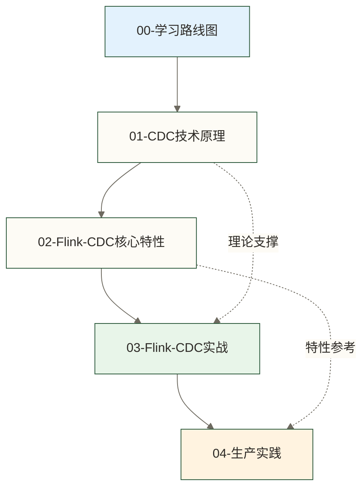
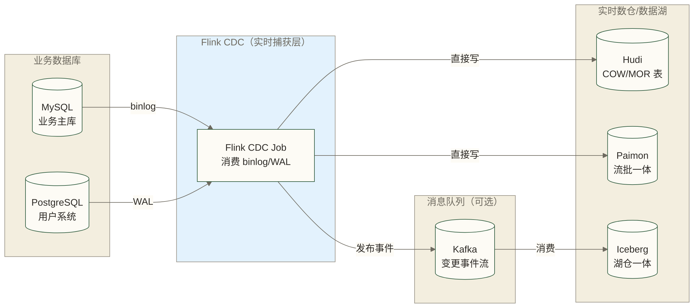

# Flink CDC 学习路线图 - 实时数据同步完整知识体系

> [!abstract] 这份路线图能给你什么
> - **学习目标**：系统学习 Flink CDC，为独立完成实时数据同步和实时入湖任务建立基础；生产交付仍需结合具体环境完成测试与验收
> - **文档数量**：5 篇专精文档，从 CDC 原理到生产实践的完整链路
> - **预计时长**：总计 15-20 小时，含实操练习
> - **适用人群**：数据工程师、实时数仓工程师、希望从离线转实时的数据开发
> - **前置要求**：了解 Flink 基础概念（[[【技术与工具】/Flink/00-Flink学习路线图|Flink 学习路线图]]），了解 MySQL/binlog 基础

---

以下为教学假设场景，并非经核实的真人案例：王工来公司已经三年了，一直做离线数仓，用 DataX + Hive 的方案。最近业务方提了一个需求：实时大屏要求销售数据延迟不超过 1 分钟。他搜了一圈，将 Flink CDC 作为实时同步的候选方案——它可捕获 MySQL 的数据变更并写入 Hudi/Paimon 实时数仓；秒级同步是该教学场景的期望效果，实际延迟需在具体配置、负载和下游可见性条件下验证。但 CDC 的原理、配置、生产调优都和离线同步完全不同，这份路线图就是为王工量身定制的入门到生产实践指南。

---

## 知识地图



---

## 文档导航

### 基础理论（先搞清楚原理，再动手配置）

**[[【技术与工具】/Flink-CDC/01-CDC技术原理|01-CDC技术原理]]**
CDC（Change Data Capture，变更数据捕获）用于识别和捕获数据变更；本路线主要讨论基于数据库变更日志的 CDC。MySQL 的 binlog、PostgreSQL 的 WAL、Oracle 的 Redo Log，这些日志以各自的格式记录数据库变更；记录范围及 CDC 可解析的内容取决于数据库配置、日志格式和连接器实现。CDC 工具就是读取这些日志，把 INSERT/UPDATE/DELETE 事件转化为结构化的消息流。

这篇文章回答三个问题：
- CDC 和查询增量同步的本质区别是什么
- binlog 是什么，有几种格式，为什么要用 ROW 格式
- 全量+增量一体化是怎么实现的

**[[【技术与工具】/Flink-CDC/02-Flink-CDC核心特性|02-Flink-CDC核心特性]]**
Flink CDC 在 binlog/WAL 的基础上做了哪些工程创新：
- 增量快照算法：通过分片快照与日志变更衔接读取全量数据，可减少传统快照的锁依赖；是否需要锁及其范围取决于连接器、版本和配置，不能笼统认为 Canal/Debezium 全量阶段都存在同样的锁表问题
- Exactly-Once 语义：基于 Flink Checkpoint 机制管理状态与恢复；端到端数据不丢不重还取决于 Source/Sink 的语义、提交机制和相关配置
- 并行读取：多并发读取大表的不同分片
- 待核实的数据库支持示例：原稿列出 MySQL 8.x、PostgreSQL 14+、Oracle 11g+、MongoDB、OceanBase、TiDB 等；此列表不是已核实的兼容矩阵，具体支持范围须按 Flink CDC 及连接器版本确认

### 动手实战（配置驱动学习）

**[[【技术与工具】/Flink-CDC/03-Flink-CDC实战|03-Flink-CDC实战]]**
以下列出 5 个核心实战场景；所链接文章的代码未随本页提供，其完整性与可运行性仍需结合依赖版本和实际环境验证：

| 场景 | 核心技术 | 典型应用 |
|------|---------|---------|
| MySQL CDC → Kafka | Flink CDC Source + Kafka Sink | 解耦变更事件，供多个消费方使用 |
| MySQL CDC → Hudi 实时入湖 | Flink CDC + Hudi MOR 表 | 实时数仓 ODS 层 |
| MySQL CDC → Iceberg | Flink CDC + Iceberg | 湖仓一体架构 |
| MySQL CDC → Paimon | Flink CDC + Paimon | 现代实时数仓 |
| 整库同步 | Flink CDC 整库同步 API | 一键同步几十张表 |

**[[【技术与工具】/Flink-CDC/04-Flink-CDC生产实践|04-Flink-CDC生产实践]]**
从测试环境到生产环境的关键步骤：监控哪些指标、常见故障如何排查、性能瓶颈在哪里，以及实时同步和离线同步如何配合。

---

## Flink CDC 在数据架构中的位置



Flink CDC 的典型架构是**直接从业务数据库到数据湖**，省去了 Kafka 中间层（当然也可以先写 Kafka，再从 Kafka 入湖）。

---

## 学习路径建议

### 快速入门路径（2-3 天）

已经了解 Flink，只想快速做出第一个 CDC 同步任务：

```text
01-CDC技术原理（1小时）
→ 02-Flink-CDC核心特性（1小时）
→ 03-Flink-CDC实战（重点看 MySQL→Kafka 和 MySQL→Paimon）
→ 在本地 Docker 环境跑通第一个任务
```

### 系统掌握路径（1 周）

需要在生产环境使用 Flink CDC：

```text
按序阅读全部 5 篇文档
重点：03（实战场景）+ 04（生产实践）
配合在测试环境实际部署一套 MySQL CDC → Paimon 的链路
```

### 架构决策路径（按需阅读）

需要在技术选型时做决策：

```text
01-CDC技术原理（理解选型基础）
→ DataX/01-数据集成概述（横向对比）
→ 04-Flink-CDC生产实践（了解生产成本）
```

---

## 与 Flink 基础的关系

Flink CDC 构建在 Flink 的基础框架之上，建议有以下基础：

| Flink 概念 | 在 Flink CDC 中的作用 |
|-----------|---------------------|
| Flink DataStream/Table API | 定义 CDC 任务的数据处理逻辑 |
| Flink Checkpoint | 为 CDC 状态一致性与故障恢复提供基础；端到端 Exactly-Once 还需 Source/Sink 语义与配置配合 |
| Flink State Management | 维护 CDC 的读取位点状态 |
| Flink SQL | 用 SQL 方式定义 CDC 任务（最常用） |

如果还没有 Flink 基础，建议先看 [[【技术与工具】/Flink/00-Flink学习路线图|Flink 学习路线图]] 的前 6 篇文档。

---

## 关联技术

学习 Flink CDC 需要的前置知识：
- [[【技术与工具】/Flink/00-Flink学习路线图|Flink]] - 计算引擎基础
- [[【技术与工具】/MySQL/00-MySQL学习路线图|MySQL]] - binlog 原理
- [[【技术与工具】/Kafka/00-Kafka学习路线图|Kafka]] - 消息队列（可选，作为 CDC 事件的下游）

学完 Flink CDC 后可以延伸学习：
- [[【技术与工具】/Hudi/00-Hudi学习路线图|Hudi]] - CDC 的主要目标存储之一
- [[【技术与工具】/Paimon/00-Paimon学习路线图|Paimon]] - 现代流批一体存储
- [[【技术与工具】/DataX/00-DataX学习路线图|DataX]] - 离线同步，与 Flink CDC 互补

---

#FlinkCDC #CDC #实时同步 #数据集成 #实时数仓 #binlog #学习路线
