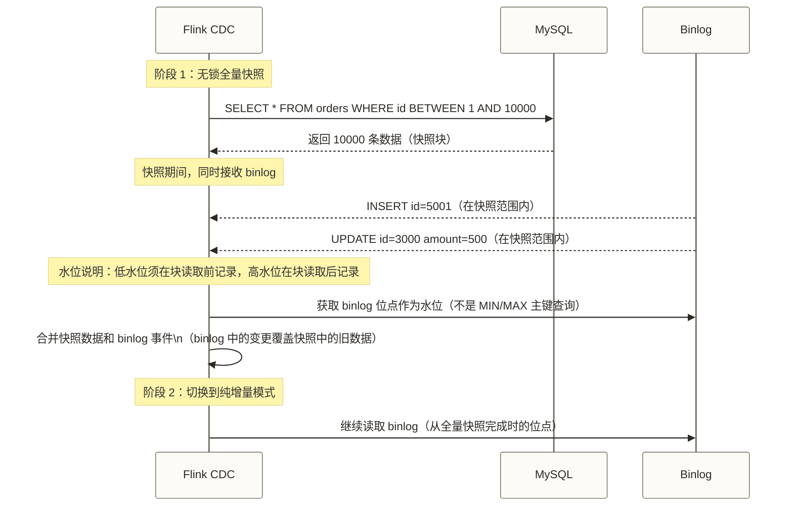

# CDC 技术原理 - binlog/WAL、全量增量一体化深度解析

> [!abstract] 本文核心内容
> - 什么是 CDC，为什么比查询增量同步更好
> - CDC 的两种实现方式：基于查询 vs 基于日志
> - MySQL binlog 的三种格式和为什么必须用 ROW 格式
> - PostgreSQL WAL 和 Oracle Redo Log 的对应原理
> - 全量+增量一体化：增量快照算法的工作原理

---

## 什么是 CDC

CDC（Change Data Capture，变更数据捕获）是一种捕获数据库中数据变化的技术，核心是**实时追踪每一条 INSERT、UPDATE、DELETE 操作**，并把这些变更传递给下游系统。

用一个具体场景来理解：

```text
业务场景：用户在 App 上下了一笔订单

MySQL 执行：
INSERT INTO orders (order_id, user_id, amount, status)
VALUES (1001, 2056, 299.00, 'PENDING')

无 CDC 的世界：
  → 假设数仓只配置了每日离线同步，要等到凌晨 T+1 才能看到这条订单

有 CDC 的世界：
  → Flink CDC 读到 binlog，假设 3 秒后这条数据出现在实时大屏上（原稿未核实的教学示例，不是延迟保证）
  → 风控系统收到这个事件，实时判断是否欺诈订单
  → Elasticsearch 索引立即更新，用户在 App 里能查到订单状态
```

**CDC 的本质**：把数据库从"状态存储"变成"事件流"。

---

## CDC 的两种实现方式

### 基于查询的伪 CDC（Query-based）

定期用 SELECT + 时间戳过滤来获取变更数据：

```sql
-- 每分钟查询一次，获取最近一分钟的变更
SELECT * FROM orders
WHERE update_time >= NOW() - INTERVAL 1 MINUTE
  AND update_time < NOW();
```

**优点**：实现简单，通常只需查询权限；数据库需支持相应查询语法，表需有可用于识别变更的字段。

**缺点**：

| 问题 | 说明 |
|------|------|
| 漏捕获 DELETE | DELETE 操作会删除记录，下次查询时记录已经不存在了 |
| 漏捕获不更新 update_time 的变更 | 某些 UPDATE 操作可能不会更新时间戳字段 |
| 延迟不可控 | 延迟 = 查询周期，周期短则数据库压力大 |
| 高频查询压力 | 频繁的 SELECT 会消耗数据库资源 |

这解释了 [[【技术与工具】/DataX/01-数据集成概述|DataX 的增量同步]] 在采用上述时间戳轮询且未补充删除标记、可靠水位等机制时，可能漏捕获变更的原因。

### 基于日志的 CDC（Log-based）

直接读取数据库的变更日志（MySQL 的 binlog、PostgreSQL 的 WAL、Oracle 的 Redo Log），把日志里记录的每一次操作转化为结构化事件。

```text
MySQL binlog 示例：
# at 4
#260318 10:23:45 server id 1  end_log_pos 128 CRC32 0x5a4b3c2d
# Event type: WRITE_ROWS_EVENT
# Table_id: 108
INSERT INTO `shop`.`orders`
  (`order_id`, `user_id`, `amount`, `status`)
  VALUES (1001, 2056, 299.00, 'PENDING')
```

**优点**：

| 优点 | 说明 |
|------|------|
| 捕获行级变更 | 在日志配置、采集范围、保留时间和消费链路满足要求时，可捕获 INSERT/UPDATE/DELETE |
| 低延迟 | 可持续读取已提交变更；实际端到端延迟取决于负载、网络、处理和下游写入 |
| 减少轮询压力 | 增量阶段主要读取日志，但日志生成、传输及保留仍消耗资源，全量快照还会执行 SELECT |
| 提供前后值 | 可用字段取决于数据库日志配置、行镜像或复制标识设置及连接器能力 |

**缺点**：

| 缺点 | 说明 |
|------|------|
| 需要特殊权限 | MySQL 需要开启 binlog，且账号有 REPLICATION 权限 |
| 日志格式要求 | Flink CDC 的 MySQL 行级变更采集要求使用 ROW 格式 binlog |
| 技术复杂度高 | 需要处理日志解析、偏移量维护、断点续传等问题 |

> [!note] Flink CDC 采用基于日志的方式
> 本文涉及的 Flink CDC、Canal、Debezium 数据库连接器采用基于日志的 CDC 方式。DataX 在采用上述时间戳轮询且没有删除标记或其他删除识别机制时，无法捕获已物理删除的记录；不能将此限制泛化到所有 DataX 同步方案。

---

## MySQL Binlog 深度解析

### 什么是 Binlog

Binlog（Binary Log，二进制日志）是 MySQL 在启用相应日志配置时记录数据变更及部分数据库操作的日志文件；未写入 binlog 的操作无法由该日志捕获。它的主要用途是：
- **主从复制**：从库读取主库的 binlog，回放同样的操作，实现数据同步
- **CDC**：CDC 工具模拟 MySQL 从库的行为，读取 binlog 来捕获变更
- **时间点恢复**：配合可用的全量备份和连续保留的 binlog，恢复到日志覆盖范围内的目标时间点

### Binlog 的三种格式

```sql
-- 查看当前 binlog 格式
SHOW VARIABLES LIKE 'binlog_format';
```

| 格式 | 记录内容 | 示例 |
|------|---------|------|
| **STATEMENT** | 记录执行的 SQL 语句 | `UPDATE orders SET status='PAID' WHERE user_id=1` |
| **ROW** | 记录每一行数据的变化（记录行的前后镜像） | 每行：`{before: {status: PENDING}, after: {status: PAID}}` |
| **MIXED** | 默认 STATEMENT，某些情况下自动切换到 ROW | 混合使用 |

**Flink CDC 的 MySQL 行级变更采集要求使用 ROW 格式**，原因：

```text
STATEMENT 格式的问题：
  UPDATE orders SET amount = amount * 1.1 WHERE status = 'PENDING'
  这条 SQL 更新了 1000 条记录，CDC 工具无法知道具体哪条记录变成了什么值
  如果目标数据库没有这 1000 条数据的全量历史，就无法正确同步

ROW 格式的优势：
  记录的是每行数据的前镜像和后镜像
  CDC 工具直接读取每行的变化，不需要执行 SQL，也不会有不确定性
```

### 配置 MySQL 开启 ROW 格式 Binlog

编辑 MySQL 配置文件（`/etc/mysql/my.cnf` 或 `/etc/my.cnf`）：

```ini
[mysqld]
# 开启 binlog
log-bin = /var/lib/mysql/mysql-bin

# 必须设置为 ROW 格式
binlog_format = ROW

# ROW 格式的详细级别：FULL 记录完整的行（包含所有列），CDC 需要 FULL
binlog_row_image = FULL

# binlog 保留天数（建议保留 7 天，给 CDC 工具追赶时间）
expire_logs_days = 7

# 每个 binlog 文件的大小上限
max_binlog_size = 1G

# server-id 必须唯一（集群中每个节点都不同）
server-id = 1
```

重启 MySQL 后验证：

```sql
SHOW VARIABLES LIKE 'log_bin';         -- 期望: ON
SHOW VARIABLES LIKE 'binlog_format';   -- 期望: ROW
SHOW VARIABLES LIKE 'binlog_row_image'; -- 期望: FULL

-- 查看 binlog 文件列表
SHOW BINARY LOGS;

-- 查看当前 binlog 位置
SHOW MASTER STATUS;
```

### 给 CDC 账号授权

```sql
-- 创建 CDC 专用账号
CREATE USER 'flink_cdc'@'%' IDENTIFIED BY 'strong_password';

-- 必须的权限
GRANT SELECT, RELOAD, SHOW DATABASES, REPLICATION SLAVE, REPLICATION CLIENT
    ON *.* TO 'flink_cdc'@'%';

-- BACKUP_ADMIN 是否需要须按连接器版本和快照锁定方式确认，并非所有 MySQL 8.0+ 场景都需要
GRANT BACKUP_ADMIN ON *.* TO 'flink_cdc'@'%';

FLUSH PRIVILEGES;
```

权限说明：

| 权限 | 用途 |
|------|------|
| `SELECT` | 全量阶段读取数据 |
| `RELOAD` | 执行 FLUSH TABLES WITH READ LOCK（老版本全量需要）|
| `SHOW DATABASES` | 查看数据库列表 |
| `REPLICATION SLAVE` | 作为从库读取 binlog |
| `REPLICATION CLIENT` | 查看 binlog 位置信息 |
| `BACKUP_ADMIN` | 用于相应备份锁操作；是否需要取决于连接器及快照方式，不能视为无锁快照的通用必需权限 |

---

## PostgreSQL WAL 原理

PostgreSQL 使用 WAL（Write-Ahead Log，预写日志）来实现数据持久性和复制。对于 CDC 来说，PostgreSQL 的 WAL 类似于 MySQL 的 binlog。

### 开启逻辑复制

PostgreSQL 9.4 引入了逻辑解码和逻辑复制槽，PostgreSQL 10 引入内置发布/订阅逻辑复制及 pgoutput。下面使用 pgoutput 的示例要求 PostgreSQL 10+，连接器还可能有更高的版本要求：

```ini
# postgresql.conf
wal_level = logical           # 开启逻辑复制（必须）
max_replication_slots = 10    # 最大复制槽数量
max_wal_senders = 10          # 最大 WAL 发送进程数
```

重启 PostgreSQL 后：

```sql
-- 手动验证逻辑复制槽；连接器是否自动创建取决于版本和配置，避免与任务使用的槽冲突
SELECT pg_create_logical_replication_slot('flink_slot', 'pgoutput');

-- 查看复制槽状态
SELECT * FROM pg_replication_slots;
```

```sql
-- 创建 CDC 账号
CREATE USER flink_cdc WITH PASSWORD 'strong_password' REPLICATION;
GRANT SELECT ON ALL TABLES IN SCHEMA public TO flink_cdc;
```

> [!warning] PostgreSQL 复制槽的风险
> 如果 CDC 任务长时间停止，复制槽可能持续保留解码所需的 WAL，导致磁盘空间耗尽；实际保留受槽状态及相关限制配置影响，达到限制也可能使复制槽失效。
>
> 生产建议：
> - 监控复制槽的滞后量：`SELECT * FROM pg_replication_slots;` 中的 `confirmed_flush_lsn`
> - 仅在确认任务已停用并制定重新初始化或恢复方案后删除复制槽：`SELECT pg_drop_replication_slot('flink_slot');`；删除后原消费位置不再由该槽保留，不能假定可无损续传。

---

## Oracle Redo Log 原理

Oracle 使用 Redo Log 记录所有数据库变更，CDC 通过 LogMiner 组件读取 Redo Log。

```sql
-- 检查 Oracle 是否处于 ARCHIVELOG 模式（CDC 必须）
SELECT log_mode FROM v$database;

-- 如果是 NOARCHIVELOG，需要按数据库版本和部署方式制定切换流程；通常需停库后启动到 MOUNT 状态，再执行切换并打开数据库。以下不是可连续执行的完整流程
ALTER SYSTEM SET enable_goldengate_replication = TRUE;
ALTER DATABASE ARCHIVELOG;

-- 配置 CDC 需要的补充日志
ALTER DATABASE ADD SUPPLEMENTAL LOG DATA;
ALTER DATABASE ADD SUPPLEMENTAL LOG DATA (ALL) COLUMNS;

-- 创建 CDC 账号
CREATE USER flink_cdc IDENTIFIED BY "strong_password";
GRANT CREATE SESSION TO flink_cdc;
GRANT SELECT ANY TABLE TO flink_cdc;
GRANT LOGMINING TO flink_cdc;
GRANT SELECT ON V_$LOG TO flink_cdc;
GRANT SELECT ON V_$LOGFILE TO flink_cdc;
```

---

## 全量 + 增量一体化

CDC 面临的一个经典问题：如何从"零开始"建立同步？

### 长时间持有全局读锁的简化方案及其问题（不代表所有旧版 Debezium 的实际流程）

```text
1. 开启全局读锁（FLUSH TABLES WITH READ LOCK）
2. 记录当前 binlog 位点
3. 全量读取数据
4. 释放读锁
5. 从记录的 binlog 位点开始追增量

问题：
- 步骤 1-4 期间，全局读锁会阻塞所有写操作！
- 大表全量读取可能需要几小时，业务停写几小时不可接受
```

### Flink CDC 的增量快照算法（无锁方案）

Flink CDC 2.0 为 MySQL 连接器引入了增量快照（Incremental Snapshot）算法，以避免传统全量阶段长时间持有全局读锁；并不意味着源库不会出现任何锁等待。下图仅为概念示意，水位与切换细节仍需修订：



核心思路：
1. **分块读取全量数据**（按主键范围分块，每块独立处理）
2. **同时读取 binlog**（记录全量期间发生的所有变更）
3. **合并**：用 binlog 变更覆盖全量快照中的旧数据，得到一致的状态
4. **避免长时间全局读锁**：符合连接器要求的增量快照路径可不依赖全局读锁；其他锁竞争仍需监控

读取每块数据前后的 binlog 位点可界定该块的回补时间区间；还须按块键范围筛选事件、处理删除及事件顺序，并在后续增量阶段按各块水位过滤重复事件。仅记录两个位点不足以保证一致性。

---

## CDC 事件的结构

理解 CDC 事件的数据结构，是后续配置处理逻辑的基础：

```json
{
    "before": {
        "order_id": 1001,
        "status": "PENDING",
        "amount": 299.00
    },
    "after": {
        "order_id": 1001,
        "status": "PAID",
        "amount": 299.00
    },
    "source": {
        "db": "shop",
        "table": "orders",
        "ts_ms": 1742266020000,
        "file": "mysql-bin.000003",
        "pos": 1234567
    },
    "op": "u",
    "ts_ms": 1742266021000
}
```

| 字段 | 说明 |
|------|------|
| `before` | 变更前的行数据（INSERT 时为 null） |
| `after` | 变更后的行数据（DELETE 时为 null） |
| `op` | 操作类型：`c`（INSERT）/ `u`（UPDATE）/ `d`（DELETE）/ `r`（快照读）|
| `source` | 变更来源信息：数据库、表、binlog 文件和位点 |
| `ts_ms` | 此处为 Debezium 风格事件信封中的连接器处理时间；源端变更时间通常见 `source.ts_ms`，具体语义须按连接器核对 |

---

## 数据库对 CDC 的支持情况

| 数据库 | 日志机制 | Flink CDC 支持 | 最低版本要求 |
|--------|---------|--------------|------------|
| MySQL | binlog（ROW格式） | 完整支持 | MySQL 5.6+ |
| PostgreSQL | WAL（逻辑复制） | 完整支持 | PostgreSQL 9.6+ |
| Oracle | Redo Log（LogMiner） | 完整支持 | Oracle 11g+ |
| MongoDB | Oplog | 完整支持 | MongoDB 3.6+ |
| SQL Server | CDC feature | 完整支持 | SQL Server 2012+ |
| OceanBase | binlog 兼容 | 支持 | OceanBase 3.x+ |
| TiDB | TiCDC | 支持 | TiDB 5.0+ |

---

## 相关文档

- [[【技术与工具】/Flink-CDC/02-Flink-CDC核心特性|02-Flink-CDC核心特性]] - Flink CDC 在增量快照算法上的工程实现
- [[【技术与工具】/Flink-CDC/03-Flink-CDC实战|03-Flink-CDC实战]] - 基于以上原理的配置实战
- [[【技术与工具】/DataX/01-数据集成概述|数据集成概述]] - CDC 与离线同步的对比选型

---

#CDC #binlog #WAL #RedoLog #变更数据捕获 #MySQL #PostgreSQL #Oracle #增量快照

---

> [!info] 前置知识
> - 了解数据集成的基本概念（离线同步 vs 实时同步），参考 [[【技术与工具】/DataX/01-数据集成概述|数据集成概述]]
> - 理解数据库事务的基本概念（写入事务、提交、回滚）
> - 了解 MySQL 的基本架构（InnoDB 存储引擎、表结构、主键索引）

---

## 掌握检查

- [ ] 能用一句话解释日志型 CDC 的核心思想：通过读取数据库的变更日志（binlog/WAL）持续捕获数据变更，减少轮询查询，但仍有日志生成、传输、保留及全量快照的源库开销
- [ ] 能解释 MySQL binlog 的三种格式（STATEMENT/ROW/MIXED）及其区别，说明为什么 Flink CDC 要求使用 `ROW` 格式（必须记录行级别的前后镜像才能准确重放）
- [ ] 能描述增量快照算法（Incremental Snapshot）解决的核心问题：长时间持有全局读锁（FLUSH TABLES WITH READ LOCK）的简化全量方案会阻塞业务写入，但并非所有传统 CDC 快照流程都如此；符合连接器要求的增量快照通过按主键分块、逐块高低水位、变更回补及重复事件过滤，避免全量阶段长时间持有全局读锁
- [ ] 能说明 `dbt_valid_from`/`dbt_valid_to` 风格的 SCD Type 2 和 CDC 的关系：CDC 捕获变更事件（INSERT/UPDATE/DELETE），SCD 是在数仓层用这些事件构建历史版本的建模方式
- [ ] 能列举 Flink CDC 支持的 5 种以上数据库（MySQL、PostgreSQL、Oracle、MongoDB、SQL Server、TiDB、OceanBase），并说明各自依赖的日志技术

---

## 实践练习

**基础题**：在 MySQL 中执行以下操作：`INSERT` 一行 → `UPDATE` 该行的某个字段 → `DELETE` 该行。使用 `SHOW BINLOG EVENTS` 查看事件类型和位置，再使用 `mysqlbinlog --base64-output=DECODE-ROWS -vv` 解码相应 binlog 文件中的行事件，找到这 3 个操作对应的事件。观察 INSERT 的后镜像、UPDATE 的前后镜像及 DELETE 的前镜像；可见字段取决于 `binlog_row_image` 等日志配置，`SHOW BINLOG EVENTS` 本身不展示完整行镜像。

**进阶题**：解释为什么"先全量读取历史数据，再切换到 binlog 增量读取"的过渡阶段最容易出现数据漏读或重复读的问题，并描述增量快照算法（Chunk 分块 + 高水位/低水位 binlog 位点记录）如何解决这个问题，保证全量和增量切换时的数据一致性。

---

## 下一步

[[【技术与工具】/Flink-CDC/02-Flink-CDC核心特性|02-Flink-CDC核心特性]] - 了解 Flink CDC 在增量快照算法、Exactly-Once 语义和 Schema 演进方面的工程实现
