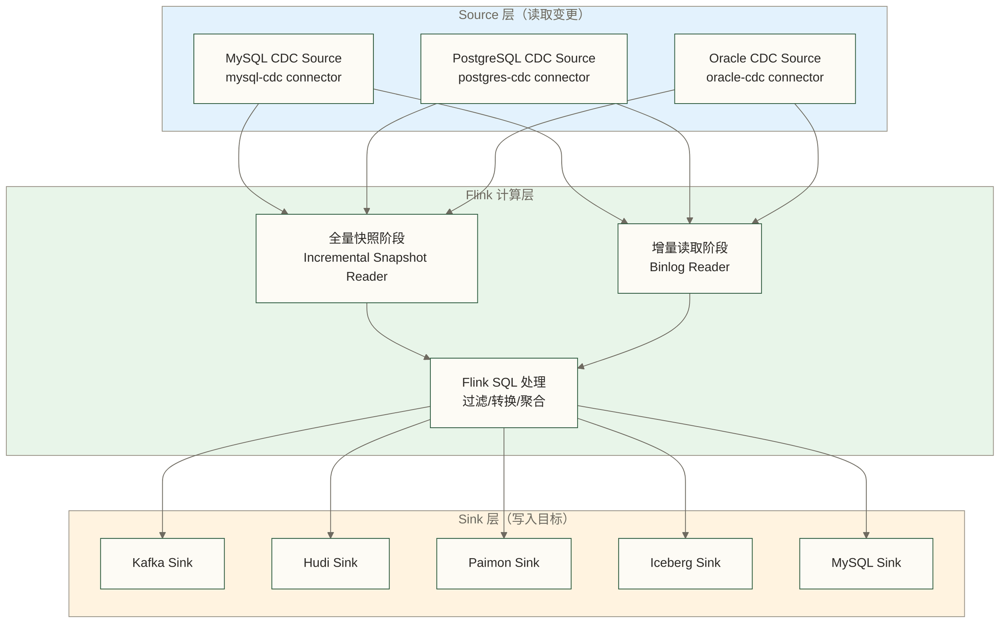
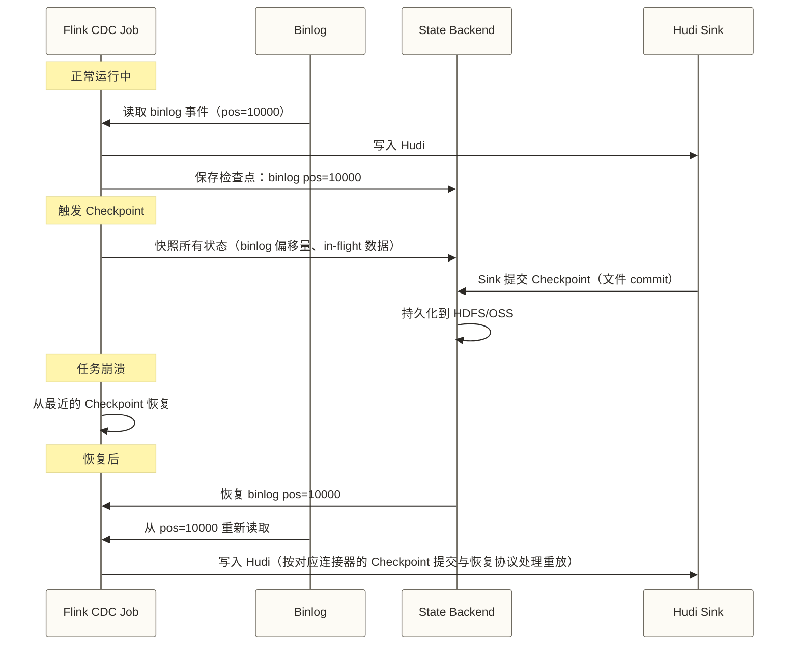

# Flink CDC 核心特性 - 架构、Exactly-Once、多数据库支持详解

> [!abstract] 本文核心内容
> - Flink CDC 的整体架构和版本演进（2.x vs 3.x）
> - 增量快照算法：无锁全量的工程实现细节
> - Exactly-Once 语义：Flink Checkpoint 如何保证数据不丢不重
> - 并行读取：如何并发同步大表
> - 多数据库支持全景：MySQL/PostgreSQL/Oracle/MongoDB 的配置差异
> - Schema Evolution：处理源表结构变更

---

## Flink CDC 版本演进

理解版本演进，可以避免在不同版本文档之间产生困惑。

```text
Flink CDC 1.x（2020-2021）
├── 基本的 MySQL/PostgreSQL CDC 支持
├── 单并发读取（全量阶段需要锁表）
└── 仅支持 DataStream API

Flink CDC 2.x（2021-2023）
├── 增量快照算法（无锁全量读取）
├── 多并发读取（水平扩展能力）
├── Flink SQL 支持（CREATE TABLE 定义 CDC Source）
├── 更多数据库支持（Oracle/MongoDB/OceanBase）
└── 整库同步（一次性同步多张表）

Flink CDC 3.x（2023 至今，又叫 Flink CDC 新版 / FLINK-CDC）
├── 全面重构，基于 FLIP-27 的 Source 接口
├── Pipeline API（更灵活的数据转换）
├── 更好的 Schema Evolution 支持
├── 原生支持 MySQL → 多目标的并行写入
└── 更丰富的 Sink（Hudi/Iceberg/Paimon/Kafka/Doris/StarRocks）
```

> [!note] 版本选择建议
> 2026 年新项目推荐直接使用 Flink CDC 3.x（当前最新版），API 更简洁，生态更完整。
> 本文的代码示例以 Flink CDC 3.x 的 Flink SQL 方式为主。

---

## 整体架构



在采用全量加增量启动模式时，CDC Source Connector 的工作通常分为两个阶段：
1. **全量快照阶段**：读取历史数据；是否避免全局读锁取决于数据库、连接器版本及快照方式
2. **增量读取阶段**：从对应数据库的变更日志或变更流读取后续变更，例如 MySQL binlog、PostgreSQL WAL、Oracle redo 日志或 MongoDB Change Streams

在连接器支持且配置满足衔接条件时，两个阶段对下游形成统一的事件流。

---

## 增量快照算法详解

这是 Flink CDC 2.0 最重要的技术创新，解决了历史上 CDC 工具全量阶段锁表的痛点。

### 核心思路：高水位和低水位

```text
表 orders 有 100 万条记录，id 从 1 到 1000000

分块策略：
  Chunk-1: id BETWEEN 1 AND 10000
  Chunk-2: id BETWEEN 10001 AND 20000
  ...
  Chunk-100: id BETWEEN 990001 AND 1000000
```

对每个 Chunk 的读取过程：

```text
读取 Chunk-1 的过程：

时间线 T1: 记录低水位 binlog 位点 (file='bin.001', pos=1000)
时间线 T2: 执行 SELECT * FROM orders WHERE id BETWEEN 1 AND 10000
            → 得到 10000 条数据（快照数据）
时间线 T3: 记录高水位 binlog 位点 (file='bin.001', pos=2000)
时间线 T4: 读取 T1-T3 期间的 binlog 事件：
            → UPDATE id=3000 amount=500  （在 Chunk 范围内）
            → INSERT id=8888              （在 Chunk 范围内）
            → DELETE id=1500              （在 Chunk 范围内）
时间线 T5: 用 binlog 事件修正快照数据：
            → id=3000 的 amount 更新为 500
            → id=8888 的记录已存在于 binlog 中，输出
            → id=1500 的记录删除
时间线 T6: 输出修正后的 Chunk-1 数据（完全准确）
```

**关键点**：以支持增量快照的 MySQL CDC 实现为例，可避免传统全量快照所需的全局读锁；这不等于数据库完全没有锁。通过分块快照与低、高水位之间的 binlog 事件合并，在算法适用条件下保持一致性。

### 并行读取

Flink CDC 2.0+ 支持多并发读取，每个并发任务负责不同的 Chunk：

```text
Flink Job 配置了 parallelism = 4

Chunk 分配：
  Task-1: Chunk-1, Chunk-5, Chunk-9, ...
  Task-2: Chunk-2, Chunk-6, Chunk-10, ...
  Task-3: Chunk-3, Chunk-7, Chunk-11, ...
  Task-4: Chunk-4, Chunk-8, Chunk-12, ...
```

> [!warning] 并行读取的限制
> 全量快照阶段可以并行，但**增量阶段（binlog 读取）只能单并发**。
>
> 原因：binlog 是一个有序的事件流，多个并发消费会破坏顺序。
>
> 实际表现：全量阶段速度很快（多并发），切换到增量阶段后只有 1 个并发在工作（不需要高并发，因为是实时追的）。

---

## Exactly-Once 语义实现

Flink CDC 借助 **Flink Checkpoint 机制**协调源端位点与作业状态的恢复；端到端 Exactly-Once 还要求目标 Sink 的提交协议、配置及恢复行为满足相应条件，不能仅由开启 Checkpoint 推出。

### Checkpoint 如何保证 Exactly-Once



**关键保证**：
1. **Source 侧**：崩溃恢复后，从 Checkpoint 记录的 binlog 偏移量重新读取，不丢事件
2. **Sink 侧**：Hudi/Paimon 等 Sink 需使用对应版本支持的 Checkpoint 协调提交与恢复机制；事务提交、幂等更新和端到端 Exactly-Once 不能直接等同，须验证故障重放后的目标端可见结果。

> [!note] 并不是所有 Sink 都支持 Exactly-Once
> - **Hudi、Paimon、Iceberg**：需核验对应连接器版本的 Checkpoint 协调提交与恢复机制，不能一概归为相同的 2PC 实现
> - **Kafka**：支持事务写入的连接器在正确配置 Exactly-Once、事务及消费隔离级别等条件下，可提供相应边界内的保证
> - **MySQL**：`INSERT ... ON DUPLICATE KEY UPDATE` 或 REPLACE INTO 可在合适的键与写入语义下实现幂等，但不能单凭这些语句判定端到端 Exactly-Once；还需核验事务型 Sink 或重放处理方案
> - **HDFS TextFile**：是否支持 Exactly-Once 取决于所用文件 Sink 的 Checkpoint 协调提交与恢复机制，不能仅凭存储介质或文本格式判断
>
> 选择 Sink 时要考虑是否需要 Exactly-Once。

### Checkpoint 配置

```sql
-- 在 Flink SQL 中配置 Checkpoint
SET 'execution.checkpointing.interval' = '3min';   -- 每 3 分钟做一次 Checkpoint
SET 'execution.checkpointing.mode' = 'EXACTLY_ONCE';
SET 'execution.checkpointing.timeout' = '10min';   -- Checkpoint 超时时间
SET 'state.checkpoints.num-retained' = '5';         -- 保留最近 5 个 Checkpoint
SET 'state.backend' = 'rocksdb';                    -- 大状态用 RocksDB
SET 'state.checkpoints.dir' = 'hdfs:///flink/checkpoints';
```

---

## 支持的数据库详解

### MySQL（最成熟）

```sql
-- Flink SQL 定义 MySQL CDC Source
CREATE TABLE mysql_orders (
    order_id     BIGINT,
    user_id      BIGINT,
    order_status STRING,
    amount       DECIMAL(12,2),
    create_time  TIMESTAMP(3),
    update_time  TIMESTAMP(3),
    PRIMARY KEY (order_id) NOT ENFORCED
) WITH (
    'connector' = 'mysql-cdc',
    'hostname'  = '10.0.0.1',
    'port'      = '3306',
    'username'  = 'flink_cdc',
    'password'  = 'strong_password',
    'database-name' = 'shop_db',
    'table-name'    = 'orders',

    -- 推荐配置（Flink CDC 3.x）
    'scan.incremental.snapshot.enabled' = 'true',   -- 开启增量快照（无锁）
    'scan.incremental.snapshot.chunk.size' = '8096', -- 每个 Chunk 的行数
    'connection.pool.size' = '20',                   -- 连接池大小

    -- 初始化时是否做全量快照
    'scan.startup.mode' = 'initial'  -- 'initial'（全量+增量）/ 'latest-offset'（仅增量）/ 'earliest-offset'（从头读）
);
```

### PostgreSQL

```sql
CREATE TABLE pg_users (
    user_id      BIGINT,
    username     STRING,
    email        STRING,
    created_at   TIMESTAMP(3),
    PRIMARY KEY (user_id) NOT ENFORCED
) WITH (
    'connector' = 'postgres-cdc',
    'hostname'  = '10.0.0.2',
    'port'      = '5432',
    'username'  = 'flink_cdc',
    'password'  = 'strong_password',
    'database-name' = 'user_db',
    'schema-name'   = 'public',
    'table-name'    = 'users',
    'slot.name'     = 'flink_slot',    -- 复制槽名称（每个任务唯一）
    'decoding.plugin.name' = 'pgoutput' -- PostgreSQL 10+ 使用 pgoutput
);
```

> [!warning] PostgreSQL 复制槽管理
> `slot.name` 建议用有意义的名称（如任务名），方便管理。
>
> 每个 CDC 任务需要独立的复制槽，不能多个任务共用同一个槽。
>
> 任务停止后不会自动删除复制槽，需要手动清理或设置监控告警。

### Oracle

```sql
CREATE TABLE oracle_accounts (
    ACCOUNT_ID   BIGINT,
    CUSTOMER_NAME STRING,
    BALANCE      DECIMAL(15,2),
    PRIMARY KEY (ACCOUNT_ID) NOT ENFORCED
) WITH (
    'connector' = 'oracle-cdc',
    'hostname'  = '10.0.0.3',
    'port'      = '1521',
    'username'  = 'flink_cdc',
    'password'  = 'strong_password',
    'database-name' = 'ORCL',
    'schema-name'   = 'FINANCE',
    'table-name'    = 'ACCOUNTS',
    'debezium.log.mining.strategy' = 'online_catalog',  -- Oracle 12c+ 用 online_catalog
    'debezium.log.mining.continuous.mine' = 'true'
);
```

### MongoDB

```sql
CREATE TABLE mongo_products (
    _id       STRING,
    name      STRING,
    price     DOUBLE,
    category  STRING,
    PRIMARY KEY (_id) NOT ENFORCED
) WITH (
    'connector' = 'mongodb-cdc',
    'hosts'     = '10.0.0.4:27017',
    'username'  = 'flink_cdc',
    'password'  = 'strong_password',
    'database'  = 'catalog',
    'collection' = 'products'
);
```

---

## Schema Evolution（表结构变更处理）

Schema Evolution 是生产 CDC 系统中的高频痛点：业务表加字段了，CDC 任务怎么办？

### Flink CDC 3.x 的 Schema Evolution 支持

Flink CDC 3.x 的 Pipeline 通过 Schema 变更事件及协调机制处理部分表结构变更；具体能力取决于小版本、Source、Transform 与 Sink，不应与独立的 Schema Registry 服务混同：

```yaml
# Flink CDC 3.x Pipeline 配置示例（YAML 格式）
source:
  type: mysql
  hostname: 10.0.0.1
  port: 3306
  username: flink_cdc
  password: strong_password
  tables: shop_db.orders

transform:
  - source-table: shop_db.orders
    projection: "order_id, user_id, amount, create_time"

sink:
  type: paimon
  catalog.type: hive
  metastore.uris: thrift://hive-metastore:9083
  database: ods
  table-name: ods_orders

pipeline:
  name: mysql-to-paimon-pipeline
  parallelism: 4
  schema.change.behavior: evolve  # 'evolve': 自动同步 DDL 变更
```

`schema.change.behavior` 的选项：

| 选项 | 行为 |
|------|------|
| `ignore` | 忽略 DDL 变更（最保守，新字段在目标端不出现） |
| `exception` | 检测到 DDL 变更时抛异常（需要人工处理） |
| `evolve` | 尝试向目标端应用 Schema 变更；能否成功取决于具体变更、版本和 Sink 支持，删字段等破坏性变更须先验证 |
| `lenient` | 采用兼容性演进策略，避免直接传播部分破坏性变更，例如保留被删除的目标列；并非忽略所有无法同步的变更，具体规则依版本核验 |

> [!tip] Schema Evolution 的生产建议
> - **加字段**：通常安全，建议用 `evolve` 自动处理
> - **删字段**：需要谨慎，下游如果依赖这个字段会报错
> - **改字段类型**：高风险操作，建议先在测试环境验证
> - **改表名**：需要更新 CDC 任务配置，无法自动处理
>
> 建议定期审查业务表的 Schema 变更计划，提前做好 CDC 任务的对应准备。

---

## Flink CDC 与 Canal/Debezium 的对比

| 特性 | Flink CDC | Canal | Debezium |
|------|-----------|-------|---------|
| 全量+增量一体化 | 原生支持 | 只支持增量，全量需要其他工具 | 支持，但早期版本需要锁表 |
| 无锁全量读取 | 支持（2.0+） | 不支持 | 支持（部分版本） |
| Exactly-Once | 支持（配合 Flink Checkpoint）| 不支持（At-Least-Once）| 依赖 Kafka 事务 |
| 并行读取 | 支持 | 不支持 | 部分支持 |
| 计算能力 | 内置 Flink 计算（过滤/转换/聚合）| 无计算，只转发 | 无计算，只转发 |
| 运维复杂度 | 中（需要 Flink 集群）| 低（独立服务）| 低（Kafka Connect 插件）|
| 适用场景 | 实时入湖/实时数仓 | MySQL→Kafka 事件解耦 | 多数据库→Kafka |

---

## 相关文档

- [[【技术与工具】/Flink-CDC/01-CDC技术原理|01-CDC技术原理]] - binlog/WAL 的底层原理
- [[【技术与工具】/Flink-CDC/03-Flink-CDC实战|03-Flink-CDC实战]] - 基于以上特性的完整配置
- [[【技术与工具】/Flink/02-Flink核心特性|Flink 核心特性]] - Checkpoint 和 State 的详细介绍
- [[【技术与工具】/Paimon/00-Paimon学习路线图|Paimon]] - Flink CDC 主流 Sink 之一

---

#FlinkCDC #ExactlyOnce #增量快照 #Schema演进 #MySQL-CDC #PostgreSQL-CDC #Oracle-CDC

---

> [!info] 前置知识
> - 理解 CDC 技术的底层原理（binlog/WAL/增量快照），参考 [[【技术与工具】/Flink-CDC/01-CDC技术原理|01-CDC技术原理]]
> - 了解 Flink 的 Checkpoint 机制和 State 概念（Flink CDC 的 Exactly-Once 依赖于此）
> - 知道 At-Least-Once 和 Exactly-Once 语义的区别（至少一次、可能重复 vs 在约定边界内结果恰好生效一次，并非物理读取只发生一次）

---

## 掌握检查

- [ ] 能解释 Flink CDC 如何实现 Exactly-Once 语义：通过 Flink Checkpoint 机制保存源端位点与作业状态，重启时从最后一个成功 Checkpoint 恢复并重放；端到端保证还需下游 Sink 的提交与恢复协议配合，不能仅凭 Paimon/Hudi 的 UPSERT 判定
- [ ] 能描述并行读取（Parallel Snapshot）的工作方式：将表数据按主键范围切分成多个 Chunk，多个并发 Task 同时读取不同 Chunk，全量读完后由一个 Task 接管 binlog 增量读取
- [ ] 能解释 Schema 演进（DDL 同步）的实际意义：在支持相应 DDL 的 Pipeline 版本、Source、Transform 和 Sink 组合中，源库执行 `ALTER TABLE ADD COLUMN` 后可自动传播表结构变更；固定投影可能不包含新增字段，Flink SQL 静态表定义也不能直接套用这一结论，须按实际链路验证是否需要人工处理
- [ ] 能比较 Flink CDC、Canal 和 Debezium 三者的核心差异：Flink CDC 内置计算能力（可在同一作业中完成 CDC + 过滤 + 聚合），Canal/Debezium 是纯 CDC 组件只负责变更事件发送到 Kafka
- [ ] 能说明 Flink CDC 2.x 的"整库同步"（Database-level Sync）特性：一个 Flink 作业可以同步整个数据库的所有表，而不是每张表单独一个作业，大幅降低资源消耗

---

## 实践练习

**基础题**：阅读 Flink CDC 官方文档，理解一个 MySQL CDC Source 的 Flink SQL 定义语法（`WITH ('connector' = 'mysql-cdc', 'hostname' = ...)`），能说出每个关键参数（`hostname`、`port`、`username`、`password`、`database-name`、`table-name`、`server-id`）的含义和注意事项。

**进阶题**：比较以下两种方案的优缺点：方案 A（Flink CDC 直接入 Paimon，一个 Flink 作业完成整个链路）vs 方案 B（Flink CDC → Kafka → 另一个 Flink 作业 → Paimon）。从延迟、可靠性、运维复杂度、回溯能力 4 个维度进行分析，并说明在什么场景下选择方案 B 更合适。

---

## 下一步

[[【技术与工具】/Flink-CDC/03-Flink-CDC实战|03-Flink-CDC实战]] - 基于这些核心特性，动手配置 MySQL→Kafka/Paimon 的完整同步作业
