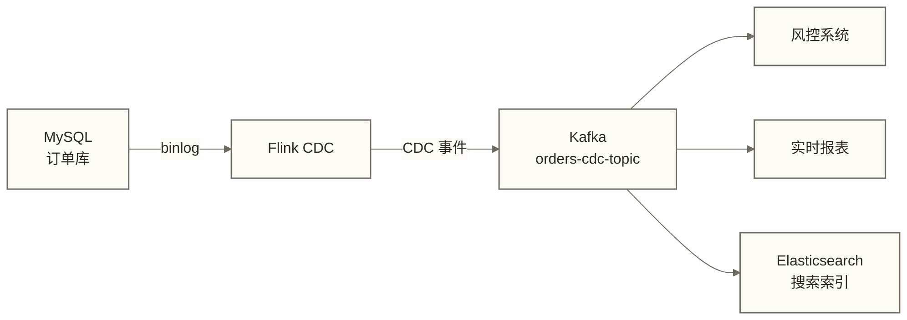

# Flink CDC 实战 - MySQL→Kafka/Hudi/Paimon 完整配置

> [!abstract] 本文核心内容
> - 环境准备：Maven 依赖和 Flink SQL Client 配置
> - 场景 1：MySQL CDC → Kafka（事件流解耦）
> - 场景 2：MySQL CDC → Hudi 实时入湖（MOR 表）
> - 场景 3：MySQL CDC → Paimon（推荐的现代实时数仓方案）
> - 场景 4：多表同步（JOIN 和路由）
> - 场景 5：整库同步（Flink CDC 3.x Pipeline API）

---

## 环境准备

### Maven 依赖（Jar 包准备）

在 Flink 集群中使用 CDC 需要下载对应的 Connector Jar 并放到 Flink 的 lib 目录：

```bash
# Flink CDC Connector（MySQL）
# 从官方 Maven 仓库或 GitHub Releases 下载

# Flink CDC 3.x 版本
# https://github.com/apache/flink-cdc/releases

# 下载示例（以 Flink 1.18 + Flink CDC 3.1 为例）
wget https://repo1.maven.org/maven2/org/apache/flink/flink-cdc-pipeline-connector-mysql/3.1.0/flink-cdc-pipeline-connector-mysql-3.1.0.jar

# MySQL JDBC Connector
wget https://repo1.maven.org/maven2/com/mysql/mysql-connector-j/8.0.33/mysql-connector-j-8.0.33.jar

# 放到 Flink lib 目录
cp flink-cdc-pipeline-connector-mysql-3.1.0.jar $FLINK_HOME/lib/
cp mysql-connector-j-8.0.33.jar $FLINK_HOME/lib/

# 如果是 Hudi Sink
wget https://repo1.maven.org/maven2/org/apache/hudi/hudi-flink1.18-bundle/0.14.1/hudi-flink1.18-bundle-0.14.1.jar
cp hudi-flink1.18-bundle-0.14.1.jar $FLINK_HOME/lib/

# 如果是 Paimon Sink
wget https://repo1.maven.org/maven2/org/apache/paimon/paimon-flink-1.18/0.8.0/paimon-flink-1.18-0.8.0.jar
cp paimon-flink-1.18-0.8.0.jar $FLINK_HOME/lib/
```

### 国内下载加速

```bash
# 阿里云 Maven 镜像
MAVEN_REPO="https://maven.aliyun.com/repository/central"

wget "${MAVEN_REPO}/com/ververica/flink-sql-connector-mysql-cdc/3.0.1/flink-sql-connector-mysql-cdc-3.0.1.jar"
```

### 启动 Flink SQL Client

```bash
# 启动 Flink 集群
$FLINK_HOME/bin/start-cluster.sh

# 启动 Flink SQL Client（交互式）
$FLINK_HOME/bin/sql-client.sh

# 或者用 SQL 文件执行（生产推荐）
$FLINK_HOME/bin/sql-client.sh -f /opt/flink/jobs/mysql_cdc_to_paimon.sql
```

---

## 场景 1：MySQL CDC → Kafka

**业务场景**：订单数据变更需要推送给多个下游系统（风控、用户行为分析、实时报表），通过 Kafka 做解耦，下游各自独立消费。



### Flink SQL 实现

```sql
-- 1. 配置 Checkpoint（Exactly-Once 必须）
SET 'execution.checkpointing.interval' = '3min';
SET 'execution.checkpointing.mode' = 'EXACTLY_ONCE';
SET 'state.backend' = 'rocksdb';
SET 'state.checkpoints.dir' = 'hdfs:///flink/checkpoints/mysql-cdc-kafka';

-- 2. 创建 MySQL CDC Source Table
CREATE TABLE IF NOT EXISTS mysql_orders_source (
    order_id     BIGINT,
    user_id      BIGINT,
    order_status STRING,
    amount       DECIMAL(12,2),
    create_time  TIMESTAMP(3),
    update_time  TIMESTAMP(3),
    PRIMARY KEY (order_id) NOT ENFORCED
) WITH (
    'connector'                       = 'mysql-cdc',
    'hostname'                        = '10.0.0.1',
    'port'                            = '3306',
    'username'                        = 'flink_cdc',
    'password'                        = 'strong_password',
    'database-name'                   = 'shop_db',
    'table-name'                      = 'orders',
    'scan.startup.mode'               = 'initial',
    'scan.incremental.snapshot.enabled' = 'true',
    'scan.incremental.snapshot.chunk.size' = '8096'
);

-- 3. 创建 Kafka Sink Table
CREATE TABLE IF NOT EXISTS kafka_orders_sink (
    order_id     BIGINT,
    user_id      BIGINT,
    order_status STRING,
    amount       DECIMAL(12,2),
    create_time  TIMESTAMP(3),
    update_time  TIMESTAMP(3),
    PRIMARY KEY (order_id) NOT ENFORCED
) WITH (
    'connector'                  = 'upsert-kafka',
    'topic'                      = 'orders-cdc-events',
    'properties.bootstrap.servers' = 'kafka-broker:9092',
    'key.format'                 = 'json',
    'value.format'               = 'json',
    'value.json.timestamp-format.standard' = 'ISO-8601'
);

-- 4. 启动同步任务
INSERT INTO kafka_orders_sink
SELECT order_id, user_id, order_status, amount, create_time, update_time
FROM mysql_orders_source;
```

### 验证 Kafka 消息

```bash
# 消费 Kafka topic 查看事件
kafka-console-consumer.sh \
    --bootstrap-server kafka-broker:9092 \
    --topic orders-cdc-events \
    --from-beginning \
    --max-messages 5
```

示意输出（JSON 格式，以下仅展示部分字段，并非完整消息断言）：本例 upsert-kafka 输出键对应的值，删除输出 tombstone，不生成 before/after/op 事件信封。

```json
{"order_id":1001,"user_id":2056,"order_status":"PENDING","amount":299.00,"create_time":"2026-03-18T10:23:45"}
{"order_id":1001,"user_id":2056,"order_status":"PAID","amount":299.00,"update_time":"2026-03-18T10:24:15"}
```

---

## 场景 2：MySQL CDC → Hudi 实时入湖

**业务场景**：把 MySQL 订单数据实时同步到 Hudi MOR 表，供实时 OLAP 查询。MOR（Merge On Read）表写入延迟低，适合高频写入场景。

```sql
-- 1. 创建 Hudi 表（通过 Flink SQL）
CREATE TABLE IF NOT EXISTS hudi_orders (
    order_id     BIGINT,
    user_id      BIGINT,
    order_status STRING,
    amount       DECIMAL(12,2),
    create_time  TIMESTAMP(3),
    update_time  TIMESTAMP(3),
    dt           STRING,          -- 分区字段
    PRIMARY KEY (order_id) NOT ENFORCED
) PARTITIONED BY (dt)
WITH (
    'connector'       = 'hudi',
    'path'            = 'hdfs:///user/hive/warehouse/ods.db/ods_orders_rt',
    'table.type'      = 'MERGE_ON_READ',    -- MOR 表，写入快
    'write.tasks'     = '4',
    'compaction.async.enabled'  = 'true',   -- 异步 Compaction（将日志中的变更合并到基础文件）
    'compaction.trigger.strategy' = 'num_commits',
    'compaction.delta_commits'  = '5',      -- 每 5 次 commit 触发一次 compact
    'hoodie.datasource.write.recordkey.field' = 'order_id',
    'hoodie.datasource.write.partitionpath.field' = 'dt',
    'read.streaming.enabled'    = 'true',   -- 开启流式读取
    'hive_sync.enable'          = 'true',   -- 同步 Hive 元数据
    'hive_sync.mode'            = 'hms',
    'hive_sync.metastore.uris'  = 'thrift://hive-metastore:9083',
    'hive_sync.database'        = 'ods',
    'hive_sync.table'           = 'ods_orders_rt'
);

-- 2. MySQL CDC Source（同场景 1）
-- 假设 mysql_orders_source 已创建

-- 3. 写入 Hudi（加入分区字段计算）
INSERT INTO hudi_orders
SELECT
    order_id,
    user_id,
    order_status,
    amount,
    create_time,
    update_time,
    DATE_FORMAT(create_time, 'yyyy-MM-dd') AS dt  -- 按天分区
FROM mysql_orders_source;
```

> [!note] Hudi MOR vs COW 的选择
> - **MOR（Merge On Read）**：写入直接追加到 delta log，查询时合并读取。**写入快，查询稍慢**，适合实时同步
> - **COW（Copy On Write）**：写入时直接合并到 Parquet 文件。**写入慢，查询快**，适合离线分析
>
> 实时 CDC 同步选 MOR，离线批量读取为主的场景选 COW。

---

## 场景 3：MySQL CDC → Paimon（推荐方案）

**业务场景**：Paimon 是 Apache 的流批一体表格式，与 Flink 集成，可作为实时数仓的候选存储方案；是否适用需结合版本、更新模式、查询引擎和运维条件验证。

> [!tip] 为什么推荐 Paimon
> 本文将 Paimon 作为 Flink 场景的选型候选；以下比较未提供版本、测试条件或来源，应视为待验证的选型观察，而非普遍结论：
> - 原生 Flink 集成，API 更简洁
> - 支持更细粒度的 Schema 变更
> - Lookup Join 性能优秀（维表关联场景）
> - Flink CDC + Paimon 是本文演示的组合；原稿关于社区活跃度及“当前最主流”的判断未经核实，不作为市场地位或选型依据

```sql
-- 1. 创建 Paimon Catalog
CREATE CATALOG paimon_hive WITH (
    'type'          = 'paimon',
    'metastore'     = 'hive',
    'uri'           = 'thrift://hive-metastore:9083',
    'warehouse'     = 'hdfs:///user/hive/warehouse'
);

USE CATALOG paimon_hive;

-- 2. 创建 Paimon 数据库
CREATE DATABASE IF NOT EXISTS ods;

-- 3. 创建 Paimon 目标表
CREATE TABLE IF NOT EXISTS ods.ods_orders (
    order_id     BIGINT,
    user_id      BIGINT,
    order_status STRING,
    amount       DECIMAL(12,2),
    create_time  TIMESTAMP(3),
    update_time  TIMESTAMP(3),
    dt           STRING,
    PRIMARY KEY (dt, order_id) NOT ENFORCED  -- 分区主键表的主键必须包含分区字段，此处包含 dt
) PARTITIONED BY (dt)
WITH (
    'bucket'                  = '4',           -- 每个分区的 bucket 数
    'bucket-key'              = 'order_id',    -- bucket 分桶键
    'changelog-producer'      = 'input',       -- 直接用 Flink CDC 的 changelog 作为输入
    'sequence.field'          = 'update_time', -- 用 update_time 比较更新顺序；须验证空值、同值及时间回退，不能单凭此项保证乱序正确性
    'write-mode'              = 'change-log'   -- Changelog 模式，支持 UPDATE/DELETE
);

-- 4. 切回默认 Catalog 来定义 MySQL Source
USE CATALOG default_catalog;

CREATE TABLE IF NOT EXISTS mysql_orders_source (
    order_id     BIGINT,
    user_id      BIGINT,
    order_status STRING,
    amount       DECIMAL(12,2),
    create_time  TIMESTAMP(3),
    update_time  TIMESTAMP(3),
    PRIMARY KEY (order_id) NOT ENFORCED
) WITH (
    'connector'     = 'mysql-cdc',
    'hostname'      = '10.0.0.1',
    'port'          = '3306',
    'username'      = 'flink_cdc',
    'password'      = 'strong_password',
    'database-name' = 'shop_db',
    'table-name'    = 'orders',
    'scan.startup.mode' = 'initial'
);

-- 5. 插入数据到 Paimon
INSERT INTO paimon_hive.ods.ods_orders
SELECT
    order_id,
    user_id,
    order_status,
    amount,
    create_time,
    update_time,
    DATE_FORMAT(create_time, 'yyyy-MM-dd') AS dt
FROM default_catalog.default_database.mysql_orders_source;
```

### 验证 Paimon 数据

```sql
-- 在 Flink SQL 中查询 Paimon 表
USE CATALOG paimon_hive;

-- 查询最新数据
SELECT order_id, order_status, amount, update_time
FROM ods.ods_orders
WHERE dt = '2026-03-18'
LIMIT 10;

-- 也可以在 Hive 中查询（通过 HMS 同步）
-- 在 Hive 中：SELECT * FROM ods.ods_orders WHERE dt = '2026-03-18' LIMIT 10;
```

---

## 场景 4：多表同步与数据路由

**业务场景**：同时同步多张相关表（orders、order_items、payments），并做简单的字段过滤和转换。

```sql
-- 创建订单明细的 CDC Source
CREATE TABLE mysql_order_items_source (
    item_id      BIGINT,
    order_id     BIGINT,
    product_id   BIGINT,
    quantity     INT,
    unit_price   DECIMAL(10,2),
    PRIMARY KEY (item_id) NOT ENFORCED
) WITH (
    'connector'     = 'mysql-cdc',
    'hostname'      = '10.0.0.1',
    'port'          = '3306',
    'username'      = 'flink_cdc',
    'password'      = 'strong_password',
    'database-name' = 'shop_db',
    'table-name'    = 'order_items',
    'scan.startup.mode' = 'initial'
);

-- 创建支付记录的 CDC Source
CREATE TABLE mysql_payments_source (
    payment_id   BIGINT,
    order_id     BIGINT,
    payment_method STRING,
    paid_amount  DECIMAL(12,2),
    paid_time    TIMESTAMP(3),
    PRIMARY KEY (payment_id) NOT ENFORCED
) WITH (
    'connector'     = 'mysql-cdc',
    'hostname'      = '10.0.0.1',
    'port'          = '3306',
    'username'      = 'flink_cdc',
    'password'      = 'strong_password',
    'database-name' = 'shop_db',
    'table-name'    = 'payments',
    'scan.startup.mode' = 'initial'
);

-- 各表分别写入 Paimon（可以并行 INSERT）
-- Flink SQL Client 使用 EXECUTE STATEMENT SET 将多条 INSERT 提交为一个 Job
EXECUTE STATEMENT SET
BEGIN
    INSERT INTO paimon_hive.ods.ods_orders
    SELECT order_id, user_id, order_status, amount, create_time, update_time,
           DATE_FORMAT(create_time, 'yyyy-MM-dd') AS dt
    FROM mysql_orders_source;

    INSERT INTO paimon_hive.ods.ods_order_items
    SELECT item_id, order_id, product_id, quantity, unit_price
    FROM mysql_order_items_source;

    INSERT INTO paimon_hive.ods.ods_payments
    SELECT payment_id, order_id, payment_method, paid_amount, paid_time
    FROM mysql_payments_source;
END;
```

> [!tip] STATEMENT SET 的优势
> 把多条 INSERT 放在 STATEMENT SET 里，Flink 会把它们合并成一个 Job 执行，共享 TaskManager 资源，而不是启动多个独立的 Job。
>
> 如果表很多（20+ 张），建议用 Flink CDC 3.x 的整库同步功能，更简洁。

---

## 场景 5：整库同步（Flink CDC 3.x Pipeline API）

**业务场景**：一次性配置，把 MySQL 某个数据库里所有表的变更同步到 Paimon，包括后续新建的表也自动覆盖。

### Pipeline 配置文件（YAML）

```yaml
# mysql-to-paimon-pipeline.yaml

source:
  type: mysql
  name: MySQL Source
  hostname: 10.0.0.1
  port: 3306
  username: flink_cdc
  password: strong_password
  tables: shop_db.\.*       # 正则表达式，匹配 shop_db 下所有表

transform:
  - source-table: shop_db.orders
    projection: "*, DATE_FORMAT(create_time, 'yyyy-MM-dd') AS dt"
    filter: "order_id > 0"  # 可选的数据过滤

  - source-table: shop_db.users
    projection: "user_id, username, phone, register_time, DATE_FORMAT(register_time, 'yyyy-MM-dd') AS dt"

route:
  - source-table: shop_db.orders
    sink-table: ods.ods_orders

  - source-table: shop_db.users
    sink-table: ods.ods_users

  - source-table: shop_db.order_items
    sink-table: ods.ods_order_items

  # 默认路由：其他所有表
  - source-table: shop_db.\.*
    sink-table: ods.<>     # <> 表示保留原表名

sink:
  type: paimon
  name: Paimon Sink
  metastore: hive
  uri: thrift://hive-metastore:9083
  warehouse: hdfs:///user/hive/warehouse

pipeline:
  name: shop-mysql-to-paimon
  parallelism: 8
  schema.change.behavior: evolve    # 自动同步 DDL 变更
  local-time-zone: Asia/Shanghai
```

### 提交 Pipeline Job

```bash
# 使用 Flink CDC CLI 提交 Pipeline
flink-cdc.sh mysql-to-paimon-pipeline.yaml \
    --flink-home $FLINK_HOME
```

---

## 常用 Flink SQL 调试技巧

### 查看 Job 状态

```sql
-- 在 Flink SQL Client 中
SHOW JOBS;

-- 停止某个 Job（会保存 Savepoint）
STOP JOB '<job_id>' WITH SAVEPOINT;
```

### 从 Savepoint 恢复

先在 `/opt/flink/jobs/mysql_cdc_to_paimon.sql` 中、提交 INSERT 作业之前设置恢复路径：

```sql
SET 'execution.savepoint.path' = 'hdfs:///flink/savepoints/savepoint-xxxxxx';
```

再提交 SQL 文件；SQL Client 的 `-s` 不是 Savepoint 路径参数。恢复前仍需验证作业拓扑、算子状态和连接器版本兼容性。

```bash
# 提交包含 Savepoint 恢复配置的 SQL 文件
$FLINK_HOME/bin/sql-client.sh \
    -f /opt/flink/jobs/mysql_cdc_to_paimon.sql
```

### 验证数据准确性

在全量同步完成后，验证 Paimon 表的数据量与 MySQL 是否一致：

```bash
# MySQL 侧统计
mysql -u flink_cdc -p shop_db -e "SELECT COUNT(*) FROM orders;"

# Flink SQL 侧统计
# SET 'execution.runtime-mode' = 'batch';  # 切换批模式
# SELECT COUNT(*) FROM paimon_hive.ods.ods_orders;

# 或者用 Hive 查询
hive -e "SELECT COUNT(*) FROM ods.ods_orders;"
```

---

## 相关文档

- [[【技术与工具】/Flink-CDC/01-CDC技术原理|01-CDC技术原理]] - 理解底层的 binlog 机制
- [[【技术与工具】/Flink-CDC/02-Flink-CDC核心特性|02-Flink-CDC核心特性]] - Exactly-Once 等特性的工作原理
- [[【技术与工具】/Flink-CDC/04-Flink-CDC生产实践|04-Flink-CDC生产实践]] - 生产环境的完整运维方案
- [[【技术与工具】/Paimon/00-Paimon学习路线图|Paimon]] - Paimon 存储层的详细配置
- [[【技术与工具】/Hudi/00-Hudi学习路线图|Hudi]] - Hudi 存储层的详细配置
- [[【技术与工具】/Kafka/00-Kafka学习路线图|Kafka]] - Kafka Sink 的详细配置

---

#FlinkCDC #MySQL-CDC #Paimon #Hudi #Kafka #实时入湖 #整库同步 #实时数仓

---

> [!info] 前置知识
> - 理解 Flink CDC 的核心特性和增量快照原理，参考 [[【技术与工具】/Flink-CDC/02-Flink-CDC核心特性|02-Flink-CDC核心特性]]
> - 了解 Flink SQL 的基本语法（CREATE TABLE、INSERT INTO SELECT）
> - 了解 Paimon 或 Hudi 的基本概念（湖格式存储，支持 UPSERT）

---

## 掌握检查

- [ ] 能用 Flink SQL 编写 MySQL CDC Source 表定义，正确填写 `connector: mysql-cdc`、`hostname`、`database-name`、`table-name`、`server-id` 等参数，并说明 `server-id` 为什么不能与其他 Canal/Flink CDC 实例冲突
- [ ] 能编写 MySQL CDC → Kafka 的 Flink SQL 作业（将变更事件序列化为 JSON/Debezium 格式写入 Kafka Topic），并说明 Kafka Topic 中每条消息的结构（`before`、`after`、`op` 字段的含义）
- [ ] 能配置 MySQL CDC → Paimon 的整库同步作业，理解本文 Pipeline YAML 中 `source.tables` 的匹配规则；区分其他同步入口的 `--including-tables` 参数，并说明源主键映射和 Paimon 分区主键须包含分区字段的要求
- [ ] 能说明 Flink CDC 全量阶段和增量阶段的衔接方式，并根据所用版本的日志、指标及源端变更测试确认进度；原稿提到的 `Snapshot phase finished` 日志文本未核实，不应作为通用切换标志，增量快照期间也可能读取 binlog 以协调快照一致性
- [ ] 能解释整库同步（`flink-cdc-pipeline`）相比多个独立单表作业的管理优势：一个 Flink 作业管理多张表；是否减少 MySQL binlog 连接数及复制线程占用，需结合源连接器实现、并行度和实际连接情况验证

---

## 实践练习

**基础题**：使用 Flink SQL 搭建一个 MySQL → Kafka 的 CDC 同步链路。源表：本地 MySQL 的 `orders` 表。目标：Kafka Topic `ods.orders`，消息格式为 JSON（含 `before`/`after`/`op` 字段）。运行作业后，在 MySQL 中分别执行 INSERT、UPDATE、DELETE 操作，在 Kafka 中消费消息验证变更事件正确捕获。

此题保留事件信封交付要求，但不能直接复用场景 1 的 upsert-kafka 输出；须另行配置支持该变更事件格式的 Kafka 写出方案，并验证所用格式的字段结构及下游解码方式。正文尚未提供这部分实现。

**进阶题**：将上述 Kafka 中的 CDC 事件继续用 Flink SQL 消费，写入 Paimon 表（本地 FileSystem Catalog）。配置 Paimon 表的 `primary-key` 与 MySQL 主键一致，运行后验证：INSERT 产生新行、UPDATE 更新已有行、DELETE 删除对应行（Paimon 中查不到该行）。说明 Checkpoint 间隔如何影响 Paimon 表的可见性延迟。

---

## 下一步

[[【技术与工具】/Flink-CDC/04-Flink-CDC生产实践|04-Flink-CDC生产实践]] - 将实战配置推向生产环境，掌握监控、调优和故障排查方法
