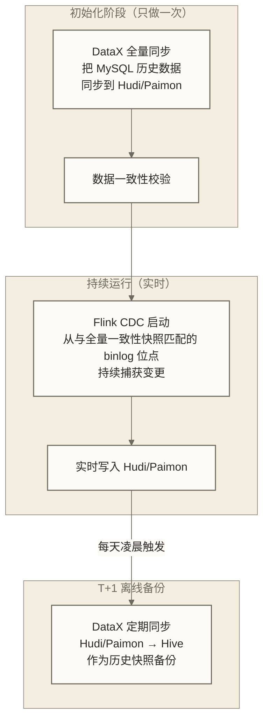

# Flink CDC 生产实践 - 监控、调优、故障排查完整指南

> [!abstract] 本文核心内容
> - 生产部署规范：集群配置、资源规划、作业提交方式
> - 核心监控指标：哪些指标是 CDC 任务健康状态的晴雨表
> - 常见故障排查手册：binlog 位点丢失、OOM、延迟飙升
> - 性能调优：Source 并行度、Checkpoint 配置、Sink 写入优化
> - 与离线同步的配合策略：DataX + Flink CDC 的混合架构

---

## 生产部署规范

### Flink 集群资源规划

CDC 任务的资源需求与表的数量、数据变更频率密切相关：

| 场景 | 建议配置 | 说明 |
|------|---------|------|
| 小规模（5 张表以内，低 TPS） | 2 TaskManager，每个 4C 8G | 适合测试和小业务 |
| 中规模（10-50 张表，中 TPS） | 4-8 TaskManager，每个 8C 16G | 生产标准配置 |
| 大规模（100+ 张表，高 TPS） | 10+ TaskManager，每个 8C 16G，独立 JobManager | 大型业务场景 |

```yaml
# flink-conf.yaml 关键配置

# TaskManager 内存配置（单个 TaskManager）
taskmanager.memory.process.size: 16g
taskmanager.memory.flink.size: 12g
taskmanager.numberOfTaskSlots: 4    # 每个 TM 的 Slot 数，建议等于 CPU 核数的一半

# JobManager
jobmanager.memory.process.size: 4g

# Checkpoint 相关
state.backend: rocksdb               # 大状态推荐 RocksDB
state.checkpoints.dir: hdfs:///flink/checkpoints
state.backend.rocksdb.memory.managed: true   # 使用 Flink 管理的内存
execution.checkpointing.interval: 3min
execution.checkpointing.timeout: 10min
execution.checkpointing.min-pause: 1min      # 两次 Checkpoint 最小间隔

# 高可用配置（生产必须）
high-availability: zookeeper
high-availability.zookeeper.quorum: zk1:2181,zk2:2181,zk3:2181
high-availability.storageDir: hdfs:///flink/ha
```

### 作业提交方式

```bash
# 方式 1：Flink SQL Client（交互式，适合调试）
$FLINK_HOME/bin/sql-client.sh

# 方式 2：SQL 文件提交（适合生产，可以纳入版本控制）
$FLINK_HOME/bin/sql-client.sh -f /opt/flink-jobs/mysql-cdc-to-paimon.sql

# 方式 3：JAR 提交（适合自定义逻辑复杂的场景）
$FLINK_HOME/bin/flink run \
    -m yarn-cluster \
    -yarnname "mysql-cdc-to-paimon" \
    -p 8 \
    -c com.company.data.MysqlCdcToPaimon \
    /opt/flink-jobs/mysql-cdc-job.jar

# 方式 4：Flink CDC 3.x Pipeline CLI（整库同步场景）
flink-cdc.sh /opt/flink-jobs/pipeline-config.yaml \
    --flink-home $FLINK_HOME
```

---

## 核心监控指标

### Flink Web UI 中的关键指标

访问 Flink Web UI（默认 `http://jobmanager:8081`），重点关注以下指标：

```mermaid
%%{init: {"theme":"base","themeVariables":{"fontFamily":"PingFang SC, -apple-system, Source Han Serif SC, serif","fontSize":"16px","background":"#FDFBF5","primaryColor":"#FDFBF5","primaryTextColor":"#2D2A26","primaryBorderColor":"#6E6A60","secondaryColor":"#E8EFE8","secondaryBorderColor":"#8FA890","secondaryTextColor":"#2D2A26","tertiaryColor":"#FDFBF5","tertiaryBorderColor":"#9A9488","tertiaryTextColor":"#6E6A60","lineColor":"#6E6A60","textColor":"#2D2A26","mainBkg":"#FDFBF5","nodeBorder":"#2D5A3D","clusterBkg":"#F3EEDF","clusterBorder":"#9A9488","edgeLabelBackground":"#FDFBF5"},"flowchart":{"htmlLabels":true,"curve":"basis","padding":20,"nodeSpacing":60,"rankSpacing":70,"useMaxWidth":false},"themeCSS":".node rect, .node polygon, .node circle { stroke-width: 1.5px; } .edgePath .path { stroke-width: 1.5px; } .cluster-label .nodeLabel, .cluster-label foreignObject { color: #2D2A26 !important; } .edgeLabel, .edgeLabel foreignObject { color: #2D2A26 !important; background-color: #FDFBF5; } .edgeLabel rect { fill: #FDFBF5; }"}}%%
graph TD
    classDef default fill:#FDFBF5,stroke:#6E6A60,color:#2D2A26,stroke-width:1.5px
    classDef startend fill:#2D2A26,stroke:#2D2A26,color:#FDFBF5,font-weight:bold
    classDef decision fill:#F6EAD8,stroke:#C08A1A,color:#2D2A26,font-weight:bold
    classDef hub fill:#3B5A80,stroke:#3B5A80,color:#FDFBF5,font-weight:bold
    classDef io fill:#E5EAF0,stroke:#3B5A80,color:#2D2A26
    classDef accent fill:#A6432C,stroke:#A6432C,color:#FDFBF5,font-weight:bold
    classDef storage fill:#F3EEDF,stroke:#9A9488,color:#2D2A26
    A[CDC 任务健康监控] --> B[Source 侧指标]
    A --> C[Checkpoint 指标]
    A --> D[Sink 侧指标]

    B --> B1["numRecordsOut\n（Source 输出记录数）"]
    B --> B2["currentFetchEventTimeLag\n（当前读取位点的延迟）"]
    B --> B3["sourceIdleTime\n（Source 空闲时间）"]

    C --> C1["lastCheckpointDuration\n（上次 Checkpoint 耗时）"]
    C --> C2["lastCheckpointSize\n（Checkpoint 大小）"]
    C --> C3["numberOfFailedCheckpoints\n（失败次数）"]

    D --> D1["numRecordsIn\n（Sink 接收记录数）"]
    D --> D2["currentSendTime\n（写入延迟）"]
    class A,B,C,D,B1,B2,B3,C1,C2,C3,D1,D2 default
```



### 用 Prometheus + Grafana 监控

```yaml
# Flink 集成 Prometheus 的配置（flink-conf.yaml）
metrics.reporters: prometheus
metrics.reporter.prometheus.factory.class: org.apache.flink.metrics.prometheus.PrometheusReporterFactory
metrics.reporter.prometheus.port: 9249
```

重要的 Prometheus 查询（PromQL）：

```promql
# CDC Source 的读取延迟（秒）
flink_taskmanager_job_task_operator_currentFetchEventTimeLag / 1000

# Checkpoint 成功率
rate(flink_jobmanager_job_numberOfCompletedCheckpoints[5m])
/ (rate(flink_jobmanager_job_numberOfCompletedCheckpoints[5m])
 + rate(flink_jobmanager_job_numberOfFailedCheckpoints[5m]))

# Source 输出 TPS
rate(flink_taskmanager_job_task_numRecordsOut[1m])

# Sink 接收 TPS
rate(flink_taskmanager_job_task_numRecordsIn[1m])
```

### 告警规则设置

| 告警指标 | 阈值建议 | 告警级别 |
|---------|---------|---------|
| currentFetchEventTimeLag | > 60s | P2 - 关注 |
| currentFetchEventTimeLag | > 300s（5分钟） | P1 - 立即处理 |
| numberOfFailedCheckpoints | 连续 3 次失败 | P1 - 立即处理 |
| lastCheckpointDuration | > 3 分钟 | P2 - 关注 |
| Source 侧 numRecordsOut | 连续 10 分钟为 0 | P2 - 检查是否空闲或卡住 |

---

## 常见故障排查手册

### 故障 1：延迟持续增大（积压严重）

**现象**：`currentFetchEventTimeLag` 持续上升，消费速度赶不上 binlog 生产速度。

**排查步骤**：

```bash
# 步骤 1：确认 Source 侧的读取速度
# Flink Web UI -> Job -> Source Operator -> numRecordsOut/s

# 步骤 2：确认 Sink 侧的写入速度
# Flink Web UI -> Job -> Sink Operator -> numRecordsIn/s

# 步骤 3：如果 Source 速度快、Sink 速度慢，说明 Sink 是瓶颈
# 检查 Sink（Paimon/Hudi）的写入性能

# 步骤 4：如果两侧速度都很低，可能是反压（backpressure）
# Flink Web UI -> Job -> 点击 Operator -> 查看是否有红色的 backpressure 标志
```

**常见解决方案**：

| 根因 | 解决方案 |
|------|---------|
| Source 并行度不够 | 检查并适当增大全量阶段的 Source 并行度；调小 `scan.incremental.snapshot.chunk.size` 可增加 Chunk 数量，但不等于提高实际并行度，也不能据此提高 binlog 增量读取并行度 |
| Sink 写入慢 | 增大 `write.tasks`（Paimon）或 `write.tasks`（Hudi） |
| 反压 | 找到产生反压的 Operator，针对性优化 |
| 网络带宽不够 | 检查 DataNode/Worker 节点的网络 I/O |

### 故障 2：Checkpoint 失败/超时

**现象**：Job 日志显示 `Checkpoint X expired before completing`。

**排查日志**：

```bash
# 查看 TaskManager 日志
grep -i "checkpoint" "$FLINK_HOME"/log/flink-*-taskmanager-*.log

# 查看 Checkpoint 协调器日志
grep -i "checkpoint" "$FLINK_HOME"/log/flink-*-standalonesession-*.log
```

**常见原因和解决方案**：

```text
原因 1：某个 Operator 处理缓慢，Barrier 迟迟不能传递
解决：增大超时时间（execution.checkpointing.timeout）
     检查是否有长时间运行的大事务

原因 2：State 太大，RocksDB 快照耗时长
解决：使用 incremental checkpoint
     SET 'state.backend.incremental' = 'true';

原因 3：HDFS 写入慢
解决：检查 HDFS 集群健康状态
     考虑使用 OSS/S3 作为 State 存储
```

### 故障 3：任务恢复后 binlog 位点丢失

**现象**：任务重启后报错 `The binlog position you requested is not available`，类似于：

```text
Caused by: com.mysql.cj.jdbc.exceptions.CommunicationsException:
  Could not read the binlog file 'mysql-bin.000010', which is no longer present on the server.
```

**原因**：MySQL binlog 已经过期轮转，但 Flink 保存的 Checkpoint 里记录的是已经不存在的 binlog 文件。

**解决方案**：

```bash
# 1. 先检查 MySQL 还保留哪些 binlog
SHOW BINARY LOGS;
# 如果 Checkpoint 里的 binlog 文件不在列表中，已经丢失

# 2. 如果业务明确允许跳过缺失期间的历史变更
# 可在不恢复旧 Checkpoint 状态的新任务中使用 latest-offset；这不会重新全量
# 修改 SQL：'scan.startup.mode' = 'latest-offset'

# 3. 如果需要重建当前数据状态
# 停止任务，使用 CDC 全量快照，或按一致性快照与位点衔接方案执行 DataX 全量，再恢复增量
# 已清理的历史变更不能仅靠当前全量数据还原；还需检查备份或其他变更记录
```

**预防措施**：

```ini
# 增大 MySQL binlog 保留时间
# my.cnf
binlog_expire_logs_seconds = 604800  # 7 天（秒为单位，MySQL 8.0+）
# 或者
expire_logs_days = 7   # MySQL 5.7 及以下
```

### 故障 4：OOM（内存溢出）

**现象**：TaskManager 崩溃，日志显示 `java.lang.OutOfMemoryError`。

**解决**：

```yaml
# 调整 TaskManager 内存配置
taskmanager.memory.process.size: 16g      # 增大总内存
taskmanager.memory.task.heap.size: 8g    # 增大堆内存

# RocksDB 内存调优
state.backend.rocksdb.memory.managed: true
state.backend.rocksdb.memory.fixed-per-slot: 2g  # 每个 Slot 给 RocksDB 的内存
```

---

## 性能调优

### Source 侧调优

```sql
-- 调整增量快照的 Chunk 大小
-- Chunk 越小，切分出的 Chunk 通常越多，调度及元数据总开销可能增大
-- Chunk 大小不直接决定 Source 并行度；吞吐需结合并行度、数据分布和数据库负载压测
-- 经验值：10000-50000 行/Chunk
'scan.incremental.snapshot.chunk.size' = '10000'

-- 调整连接池大小
-- 连接池大小不等同于作业并行度；需核对目标 CDC 版本的连接池作用域，并评估数据库总连接数
'connection.pool.size' = '8'

-- 全量阶段的并行度（影响全量读取速度）
-- 在 Flink SQL 中：
SET 'table.exec.resource.default-parallelism' = '8';
```

### Checkpoint 调优

```sql
-- Checkpoint 频率：越频繁，恢复数据越少，但对性能影响越大
-- 推荐 3-5 分钟一次
SET 'execution.checkpointing.interval' = '3min';

-- 开启增量 Checkpoint（减少 Checkpoint 数据量）
SET 'state.backend.incremental' = 'true';

-- Checkpoint 压缩（减少存储空间）
SET 'execution.checkpointing.compression' = 'true';
```

### Sink 侧调优（以 Paimon 为例）

```sql
-- Paimon 写入并发
'write.tasks' = '4'    -- 增大写入并发（对应 Flink Job 的并行度）

-- 模式合并配置示例（参数名称及支持情况需核对目标 Paimon 版本；不表示批量大小或每批提交文件数）
'write.merge-schema' = 'true'

-- 文件大小目标（影响文件数量和查询性能的平衡）
'target-file-size' = '128mb'

-- Compaction 策略
'full-compaction.delta-commits' = '10'   -- 每 10 次 commit 做一次全量合并
```

---

## 实时同步与离线同步的配合策略

在实际的数仓架构中，Flink CDC 和 DataX 通常配合使用，各有分工：



**关键步骤**：

```bash
# 步骤 1：DataX 全量同步（全量基线）
python3 datax.py full_sync_orders.json

# 以下仅演示查询位点，不能把全量完成后的查询结果直接作为安全切换边界
# 实际位点必须与全量读取的一致性快照协调记录
mysql -u flink_cdc -p -e "SHOW MASTER STATUS;" > /tmp/binlog_position.txt

# 步骤 2：启动 Flink CDC（从与全量一致性快照匹配且仍被保留的位点开始）
# 在 Flink SQL 中：
# 'scan.startup.mode' = 'specific-offset'
# 'scan.startup.specific-offset.file' = 'mysql-bin.000003'
# 'scan.startup.specific-offset.pos' = '1234567'
```

> [!warning] 注意全量和增量衔接的时序
> 全量与增量必须使用协调建立的一致性快照及对应 binlog 位点；仅在全量结束后查询位点并立即启动 CDC，仍可能遗漏全量读取期间的变更。
>
> 即使中间有 1 小时的间隙，只要从正确位点读取且所需 binlog 仍被保留，也不必然丢数；位点错误或 binlog 被清理才会导致无法完整追溯。
>
> 先启动 CDC 再执行 DataX 全量并不自动保证无缝衔接：需设计增量缓冲、快照边界、按序重放及删除处理，避免全量覆盖较新的增量。可优先评估 CDC 自带的全量增量衔接机制；自建方案必须经过一致性验证。

---

## 生产 Checklist

在把 Flink CDC 任务上线前，逐项确认：

### MySQL 配置检查

```sql
-- 确认 binlog 开启
SHOW VARIABLES LIKE 'log_bin';          -- 期望: ON
SHOW VARIABLES LIKE 'binlog_format';    -- 期望: ROW
SHOW VARIABLES LIKE 'binlog_row_image'; -- 期望: FULL

-- 确认 binlog 保留时间足够
SHOW VARIABLES LIKE 'binlog_expire_logs_seconds'; -- 建议 >= 604800 (7天)

-- 确认 CDC 账号权限
SHOW GRANTS FOR 'flink_cdc'@'%';
```

### Flink 任务检查

```json
[ ] Checkpoint 已配置，间隔 3-5 分钟
[ ] State Backend 使用 RocksDB（大状态场景）
[ ] Checkpoint 存储在 HDFS/OSS（不是本地磁盘）
[ ] Checkpoint 保留数量 >= 3（方便回滚）
[ ] 资源配置充足（TM 内存、并行度）
[ ] 高可用配置完成（ZooKeeper 或 Kubernetes HA）
```

### 监控检查

```json
[ ] Prometheus 指标暴露已配置
[ ] Grafana Dashboard 已创建
[ ] 关键告警已配置（延迟、Checkpoint 失败）
[ ] oncall 流程已明确
[ ] 故障恢复 SOP 已文档化
```

---

## Flink CDC 成本评估

生产运行 Flink CDC 的实际成本参考：

| 规模 | 计算资源 | 存储（Checkpoint） | 月均成本参考 |
|------|---------|------------------|------------|
| 10 张表，低 TPS | 4 TM × 8C16G | 50GB | 中等 |
| 50 张表，中 TPS | 8 TM × 8C16G | 200GB | 较高 |
| 100+ 张表，高 TPS | 16+ TM × 8C16G | 500GB+ | 高 |

> [!tip] 降低成本的建议
> 1. **按业务重要性分级**：高优先级表用 Flink CDC 实时同步，低优先级表用 DataX T+1 离线同步
> 2. **合理设置并行度**：不是越高越好，找到最优值后固定
> 3. **优化 Checkpoint 频率**：业务允许的情况下，5 分钟一次比 1 分钟一次省很多资源
> 4. **定期清理旧 Checkpoint**：只保留最近 3-5 个

---

## 相关文档

- [[【技术与工具】/Flink-CDC/03-Flink-CDC实战|03-Flink-CDC实战]] - 任务配置的完整代码
- [[【技术与工具】/Flink-CDC/02-Flink-CDC核心特性|02-Flink-CDC核心特性]] - 理解调优背后的机制
- [[【技术与工具】/DataX/08-DataX与调度集成|DataX 与调度集成]] - 离线同步的配合使用
- [[【技术与工具】/Flink/00-Flink学习路线图|Flink]] - Checkpoint 和 State 的底层原理
- [[【技术与工具】/Paimon/00-Paimon学习路线图|Paimon]] - Paimon Sink 的生产调优

---

#FlinkCDC #生产实践 #监控 #调优 #故障排查 #Checkpoint #性能优化 #运维

---

> [!info] 前置知识
> - 有 Flink CDC 作业的实际搭建经验，参考 [[【技术与工具】/Flink-CDC/03-Flink-CDC实战|03-Flink-CDC实战]]
> - 了解 Flink Web UI 和 Metrics 体系（TaskManager、Checkpoint、Backpressure 指标）
> - 理解 Checkpoint 机制：定期将算子状态和消费位点持久化到外部存储（HDFS/OSS）

---

## 掌握检查

- [ ] 能说出 Flink CDC 生产环境必须监控的 3 个核心指标：Source 端 `numRecordsOutPerSecond`（采集速率）、全链路消费延迟（Lag）、Checkpoint 成功率和耗时；当 Checkpoint 持续失败时优先排查 State 大小和网络带宽
- [ ] 能排查 Flink CDC 作业出现背压（Backpressure）的原因：Sink 端写入速度跟不上 Source 采集速度，需检查下游（Paimon/Kafka）的写入吞吐，而非单纯增加并行度
- [ ] 能描述 Flink CDC 作业从 Checkpoint 恢复的流程：从仍被保留且兼容的成功 Checkpoint 路径启动（`-s hdfs://path/to/checkpoint`），恢复 State 中记录的 binlog 位点并继续消费；端到端一致性取决于 Checkpoint 模式、Source 和 Sink 的恢复与提交协议，不能笼统等同于 At-Least-Once 加幂等
- [ ] 能解释 binlog 位点丢失（MySQL binlog 被清理）时的恢复策略：若无法从备份恢复缺失日志，可通过一致性全量快照重建当前状态并衔接增量；下游需处理主键更新、删除及旧数据清理，仅支持 UPSERT 不足以保证数据正确性，也不能还原已丢失的历史变更
- [ ] 能说明 Flink CDC 的 Checkpoint 配置取舍：原稿的间隔 3-5 分钟仅作待压测示例，需结合恢复目标、状态规模和 Sink 提交延迟调整；`minPauseBetweenCheckpoints` 应结合 Checkpoint 实际耗时与资源压力设置，没有必须等于超时时间一半的规则

---

## 实践练习

**基础题**：在隔离测试环境中，为一个运行中的 Flink CDC 作业（MySQL→Paimon）模拟故障恢复场景：预先配置取消后仍保留的外部化 Checkpoint，记录最后一次成功 Checkpoint 的路径，再停止作业；在 MySQL 中插入 10 条新数据，然后从该 Checkpoint 重启作业，验证新插入的 10 条数据是否正确同步到 Paimon，并检查是否出现重复或遗漏（观察所用 Checkpoint 模式与 Sink 提交协议下的一致性表现；仅验证这 10 条数据不足以证明端到端 Exactly-Once）。

**进阶题**：设计一个完整的 Flink CDC 生产运维方案，包含：
1. 关键 Metrics 的 Prometheus + Grafana 监控看板（列出至少 5 个必监控指标）
2. Checkpoint 存储路径和保留策略（保留最近几个 Checkpoint）
3. 告警规则（Checkpoint 失败告警、消费延迟超过 X 分钟告警）
4. 作业升级流程（如何在不丢数据的情况下更新 Flink CDC 作业的代码或配置）

说明每个设计决策背后的原因。
